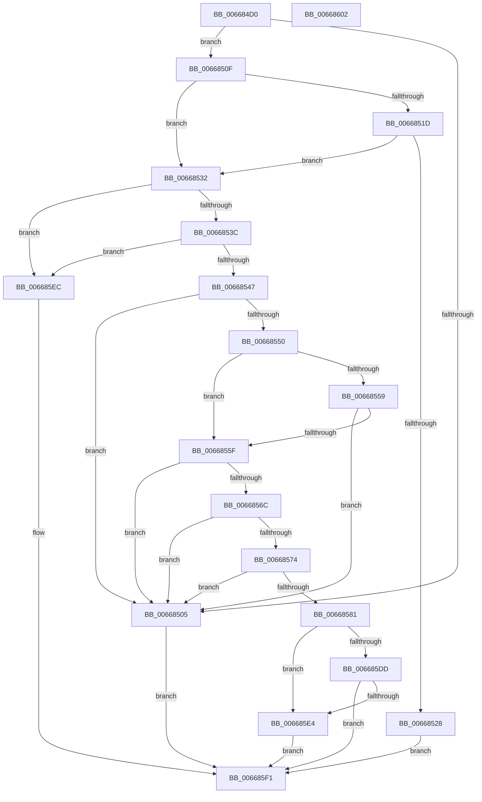

# AccelInitializeCompressionWorkspace

- RVA: `0x006684D0`–`0x00668603` (길이 `307` bytes)
- VA: `0x00000001406684D0`
- 실행 섹션: `.text`
- PDB 이름 있음: `예`; PDB Function 태그: `아니요`
- unwind 정보 RVA: `0x00086CF8`
- 디코드: `85`개 명령, `307/307` bytes 표시
- 미해석 바이트: `0` (있으면 어셈블리에 `.byte`로 보존)

> 이 문서는 커널 이미지의 기계어와 PDB 기호를 분석해 생성했습니다. 4번과 5번은 함수 원형과 자료형을 바이너리 사용 방식에서 추정한 C 해석이며 원본 소스 복구 결과는 아닙니다.

## 1. Dependencies

- 직접 호출 지점: **2**; 고유 호출 대상: **2**
- 직접 호출자로 확인된 함수: **2**
- RIP 상대 이미지 참조: **0**

### Outgoing calls
- `0x006684F4` → [memset](../6C/memset_function_006C6C40.md) (function, `0x006C6C40`)
- `0x006685CC` → [AccelpInternalOperationHandler](../2C/AccelpInternalOperationHandler_function_002C7DAC.md) (function, `0x002C7DAC`)

### Direct callers
- [SmHwAcceleratorCreate](../../page/7A/SmHwAcceleratorCreate_function_007AA40C.md) at `0x007AA546`
- [SmHwInitializeAccelDescriptor](../../page/7A/SmHwInitializeAccelDescriptor_function_007AB58C.md) at `0x007AB61A`

### Static image references
- 디코드된 RIP-relative 메모리 참조가 없습니다.

## 2. Other-region calls and transfers

- 다른 실행 섹션으로 향하는 call: **0**
- 별도 외부 분기/꼬리 이동을 확인하지 못했습니다.

## 3. Assembly (complete function range)

```asm
006684D0  48 89 5C 24 08                  mov qword ptr [rsp + 8], rbx
006684D5  55                              push rbp
006684D6  48 8D 6C 24 A9                  lea rbp, [rsp - 0x57]
006684DB  48 81 EC A0 00 00 00            sub rsp, 0xa0
006684E2  33 C0                           xor eax, eax
006684E4  48 8B D9                        mov rbx, rcx
006684E7  33 D2                           xor edx, edx
006684E9  89 45 EB                        mov dword ptr [rbp - 0x15], eax
006684EC  48 8D 4D E7                     lea rcx, [rbp - 0x19]
006684F0  44 8D 40 6C                     lea r8d, [rax + 0x6c]
006684F4  E8 47 E7 05 00                  call 0x1406c6c40
006684F9  45 33 DB                        xor r11d, r11d
006684FC  44 89 5D E3                     mov dword ptr [rbp - 0x1d], r11d
00668500  48 85 DB                        test rbx, rbx
00668503  75 0A                           jne 0x14066850f
00668505  B8 0D 00 00 C0                  mov eax, 0xc000000d
0066850A  E9 E2 00 00 00                  jmp 0x1406685f1
0066850F  8B 4B 20                        mov ecx, dword ptr [rbx + 0x20]
00668512  41 B8 01 00 00 00               mov r8d, 1
00668518  41 3B C8                        cmp ecx, r8d
0066851B  75 15                           jne 0x140668532
0066851D  8B 43 24                        mov eax, dword ptr [rbx + 0x24]
00668520  83 E8 02                        sub eax, 2
00668523  83 F8 02                        cmp eax, 2
00668526  77 0A                           ja 0x140668532
00668528  B8 02 00 00 C0                  mov eax, 0xc0000002
0066852D  E9 BF 00 00 00                  jmp 0x1406685f1
00668532  66 44 39 03                     cmp word ptr [rbx], r8w
00668536  0F 82 B0 00 00 00               jb 0x1406685ec
0066853C  66 83 7B 02 40                  cmp word ptr [rbx + 2], 0x40
00668541  0F 82 A5 00 00 00               jb 0x1406685ec
00668547  48 8B 53 08                     mov rdx, qword ptr [rbx + 8]
0066854B  48 85 D2                        test rdx, rdx
0066854E  74 B5                           je 0x140668505
00668550  44 8B 4B 38                     mov r9d, dword ptr [rbx + 0x38]
00668554  45 85 C9                        test r9d, r9d
00668557  74 06                           je 0x14066855f
00668559  4C 39 5B 30                     cmp qword ptr [rbx + 0x30], r11
0066855D  74 A6                           je 0x140668505
0066855F  44 8B 53 1C                     mov r10d, dword ptr [rbx + 0x1c]
00668563  41 8D 42 FA                     lea eax, [r10 - 6]
00668567  41 3B C0                        cmp eax, r8d
0066856A  77 99                           ja 0x140668505
0066856C  8D 41 FF                        lea eax, [rcx - 1]
0066856F  41 3B C0                        cmp eax, r8d
00668572  77 91                           ja 0x140668505
00668574  44 8B 43 24                     mov r8d, dword ptr [rbx + 0x24]
00668578  41 8D 40 FF                     lea eax, [r8 - 1]
0066857C  83 F8 03                        cmp eax, 3
0066857F  77 84                           ja 0x140668505
00668581  48 8B 02                        mov rax, qword ptr [rdx]
00668584  48 8D 55 D7                     lea rdx, [rbp - 0x29]
00668588  48 89 45 EF                     mov qword ptr [rbp - 0x11], rax
0066858C  48 8B 43 10                     mov rax, qword ptr [rbx + 0x10]
00668590  48 89 45 17                     mov qword ptr [rbp + 0x17], rax
00668594  8B 43 18                        mov eax, dword ptr [rbx + 0x18]
00668597  89 45 1F                        mov dword ptr [rbp + 0x1f], eax
0066859A  48 8B 43 30                     mov rax, qword ptr [rbx + 0x30]
0066859E  89 4D 27                        mov dword ptr [rbp + 0x27], ecx
006685A1  48 8D 4D E7                     lea rcx, [rbp - 0x19]
006685A5  48 89 45 D7                     mov qword ptr [rbp - 0x29], rax
006685A9  C7 45 E7 0D 00 00 00            mov dword ptr [rbp - 0x19], 0xd
006685B0  44 89 5D F7                     mov dword ptr [rbp - 9], r11d
006685B4  4C 89 5D FF                     mov qword ptr [rbp - 1], r11
006685B8  4C 89 5D 07                     mov qword ptr [rbp + 7], r11
006685BC  4C 89 5D 0F                     mov qword ptr [rbp + 0xf], r11
006685C0  44 89 55 23                     mov dword ptr [rbp + 0x23], r10d
006685C4  44 89 45 2B                     mov dword ptr [rbp + 0x2b], r8d
006685C8  44 89 4D DF                     mov dword ptr [rbp - 0x21], r9d
006685CC  E8 DB F7 C5 FF                  call 0x1402c7dac
006685D1  BA 00 00 00 80                  mov edx, 0x80000000
006685D6  8D 0C 10                        lea ecx, [rax + rdx]
006685D9  85 CA                           test edx, ecx
006685DB  75 07                           jne 0x1406685e4
006685DD  3D 23 00 00 C0                  cmp eax, 0xc0000023
006685E2  75 0D                           jne 0x1406685f1
006685E4  8B 4D DF                        mov ecx, dword ptr [rbp - 0x21]
006685E7  89 4B 38                        mov dword ptr [rbx + 0x38], ecx
006685EA  EB 05                           jmp 0x1406685f1
006685EC  B8 59 00 00 C0                  mov eax, 0xc0000059
006685F1  48 8B 9C 24 B0 00 00 00         mov rbx, qword ptr [rsp + 0xb0]
006685F9  48 81 C4 A0 00 00 00            add rsp, 0xa0
00668600  5D                              pop rbp
00668601  C3                              ret
00668602  CC                              int3
```

## 4. C-style interpretation (structured pseudocode)

```c
__int64 __fastcall AccelInitializeCompressionWorkspace(__int64 a1, int a2)
{
    __int64 result;
    __int64 v_r11;
    __int64 v_rsp;
    unsigned int v_stack_m34;
    unsigned int v_stack_m38;
    unsigned int v_stack_m3C;
    unsigned int v_stack_m40;
    unsigned __int64 v_stack_m48;
    unsigned __int64 v_stack_m50;
    unsigned __int64 v_stack_m58;
    unsigned __int64 v_stack_m5F;
    unsigned __int64 v_stack_m60;
    unsigned int v_stack_m68;
    unsigned __int64 v_stack_m70;
    unsigned int v_stack_m74;
    unsigned __int64 v_stack_m78;
    unsigned int v_stack_m7C;
    unsigned int v_stack_m80;
    unsigned __int64 v_stack_m88;
    unsigned __int64 v_stack_p8;

    v_stack_p8 = v_rbx;
    v_rsp = (v_rsp) - (160);
    result = 0;
    a2 = 0;
    v_stack_m74 = 0;
    result = memset(v_stack_m78, a2, result + 108, a4);
    v_r11 = 0;
    v_stack_m7C = 0;
    if (a1 != 0) goto loc_0066850F;
loc_00668505:
    goto loc_006685F1;
loc_0066850F:
    if (((unsigned int)((unsigned int)(*(unsigned int *)(a1 + 32)))) != 1) goto loc_00668532;
    result = (unsigned int)(((unsigned int)(*(unsigned int *)(a1 + 36))) - (2));
    if (((unsigned int)(result)) > 2) goto loc_00668532;
    goto loc_006685F1;
loc_00668532:
    if ((*(unsigned __int16 *)(a1)) < 1) goto loc_006685EC;
    if ((*(unsigned __int16 *)(a1 + 2)) < 64) goto loc_006685EC;
    if (*(unsigned __int64 *)(a1 + 8) == 0) goto loc_00668505;
    if ((unsigned int)((unsigned int)(*(unsigned int *)(a1 + 56))) == 0) goto loc_0066855F;
    if ((*(unsigned __int64 *)(a1 + 48)) == 0) goto loc_00668505;
loc_0066855F:
    if (((unsigned int)((unsigned int)(*(unsigned int *)(a1 + 28)) - 6)) > 1) goto loc_00668505;
    if (((unsigned int)((unsigned int)(*(unsigned int *)(a1 + 32)) - 1)) > 1) goto loc_00668505;
    if (((unsigned int)((unsigned int)(*(unsigned int *)(a1 + 36)) - 1)) > 3) goto loc_00668505;
    v_stack_m70 = *(unsigned __int64 *)(*(unsigned __int64 *)(a1 + 8));
    v_stack_m48 = *(unsigned __int64 *)(a1 + 16);
    v_stack_m40 = (unsigned int)((unsigned int)(*(unsigned int *)(a1 + 24)));
    v_stack_m38 = (unsigned int)((unsigned int)(*(unsigned int *)(a1 + 32)));
    v_stack_m88 = *(unsigned __int64 *)(a1 + 48);
    v_stack_m78 = 13;
    v_stack_m68 = 0;
    v_stack_m60 = 0;
    v_stack_m58 = 0;
    v_stack_m50 = 0;
    v_stack_m3C = (unsigned int)((unsigned int)(*(unsigned int *)(a1 + 28)));
    v_stack_m34 = (unsigned int)((unsigned int)(*(unsigned int *)(a1 + 36)));
    v_stack_m80 = (unsigned int)((unsigned int)(*(unsigned int *)(a1 + 56)));
    result = AccelpInternalOperationHandler(v_stack_m78, v_stack_m88, (unsigned int)(*(unsigned int *)(a1 + 36)), (unsigned int)(*(unsigned int *)(a1 + 56)));
    if ((((unsigned int)((unsigned int)(0x80000000ULL))) & ((unsigned int)(result + (unsigned int)(0x80000000ULL) * 1))) != 0) goto loc_006685E4;
    if (((unsigned int)(result)) != 0xC0000023ULL) goto loc_006685F1;
loc_006685E4:
    *(unsigned int *)(a1 + 56) = (unsigned int)((unsigned int)(v_stack_m80));
    goto loc_006685F1;
loc_006685EC:
loc_006685F1:
    v_rsp = (v_rsp) + (160);
    return (unsigned int)(0xC0000059ULL);
}
```

## 5. (Beta) C Style

```c
int64_t AccelInitializeCompressionWorkspace(int64_t Arg1, int32_t Arg2)
{
    int64_t result;
    int64_t local_r11;
    int64_t local_rsp;
    uint32_t v_stack_m34;
    uint32_t v_stack_m38;
    uint32_t v_stack_m3C;
    uint32_t v_stack_m40;
    uint64_t v_stack_m48;
    uint64_t v_stack_m50;
    uint64_t v_stack_m58;
    uint64_t v_stack_m5F;
    uint64_t v_stack_m60;
    uint32_t v_stack_m68;
    uint64_t v_stack_m70;
    uint32_t v_stack_m74;
    uint64_t v_stack_m78;
    uint32_t v_stack_m7C;
    uint32_t v_stack_m80;
    uint64_t v_stack_m88;
    uint64_t v_stack_p8;

    v_stack_p8 = local_rbx;
    local_rsp = (local_rsp) - (160);
    result = 0;
    Arg2 = 0;
    v_stack_m74 = 0;
    result = memset(v_stack_m78, Arg2, result + 108, a4);
    local_r11 = 0;
    v_stack_m7C = 0;
    if (Arg1 != 0) goto loc_0066850F;
loc_00668505:
    goto loc_006685F1;
loc_0066850F:
    if (((uint32_t)((uint32_t)(*(uint32_t *)(Arg1 + 0x20)))) != 1) goto loc_00668532;
    result = (uint32_t)(((uint32_t)(*(uint32_t *)(Arg1 + 0x24))) - (2));
    if (((uint32_t)(result)) > 2) goto loc_00668532;
    goto loc_006685F1;
loc_00668532:
    if ((*(uint16_t *)(Arg1)) < 1) goto loc_006685EC;
    if ((*(uint16_t *)(Arg1 + 0x2)) < 64) goto loc_006685EC;
    if (*(uint64_t *)(Arg1 + 0x8) == 0) goto loc_00668505;
    if ((uint32_t)((uint32_t)(*(uint32_t *)(Arg1 + 0x38))) == 0) goto loc_0066855F;
    if ((*(uint64_t *)(Arg1 + 0x30)) == 0) goto loc_00668505;
loc_0066855F:
    if (((uint32_t)((uint32_t)(*(uint32_t *)(Arg1 + 0x1C)) - 6)) > 1) goto loc_00668505;
    if (((uint32_t)((uint32_t)(*(uint32_t *)(Arg1 + 0x20)) - 1)) > 1) goto loc_00668505;
    if (((uint32_t)((uint32_t)(*(uint32_t *)(Arg1 + 0x24)) - 1)) > 3) goto loc_00668505;
    v_stack_m70 = *(uint64_t *)(*(uint64_t *)(Arg1 + 0x8));
    v_stack_m48 = *(uint64_t *)(Arg1 + 0x10);
    v_stack_m40 = (uint32_t)((uint32_t)(*(uint32_t *)(Arg1 + 0x18)));
    v_stack_m38 = (uint32_t)((uint32_t)(*(uint32_t *)(Arg1 + 0x20)));
    v_stack_m88 = *(uint64_t *)(Arg1 + 0x30);
    v_stack_m78 = 13;
    v_stack_m68 = 0;
    v_stack_m60 = 0;
    v_stack_m58 = 0;
    v_stack_m50 = 0;
    v_stack_m3C = (uint32_t)((uint32_t)(*(uint32_t *)(Arg1 + 0x1C)));
    v_stack_m34 = (uint32_t)((uint32_t)(*(uint32_t *)(Arg1 + 0x24)));
    v_stack_m80 = (uint32_t)((uint32_t)(*(uint32_t *)(Arg1 + 0x38)));
    result = AccelpInternalOperationHandler(v_stack_m78, v_stack_m88, (uint32_t)(*(uint32_t *)(Arg1 + 0x24)), (uint32_t)(*(uint32_t *)(Arg1 + 0x38)));
    if ((((uint32_t)((uint32_t)(0x80000000ULL))) & ((uint32_t)(result + (uint32_t)(0x80000000ULL) * 1))) != 0) goto loc_006685E4;
    if (((uint32_t)(result)) != 0xC0000023ULL) goto loc_006685F1;
loc_006685E4:
    *(uint32_t *)(Arg1 + 0x38) = (uint32_t)((uint32_t)(v_stack_m80));
    goto loc_006685F1;
loc_006685EC:
loc_006685F1:
    local_rsp = (local_rsp) + (160);
    return (uint32_t)(0xC0000059ULL);
}
```

## 6. Execution-region graph

[열기: 2D/3D 그래프와 함수 탐색 컨트롤 패널](../../../control-panel.html?section=text&rva=0x006684D0&view=graph)

- 2D 그래프는 위에서 아래로 흐르고, 3D 그래프는 빈 공간을 드래그해 회전합니다. Shift+드래그는 이동, 휠은 확대·축소, 함수 노드 선택은 대상 보고서 이동입니다.

### Static fallback


