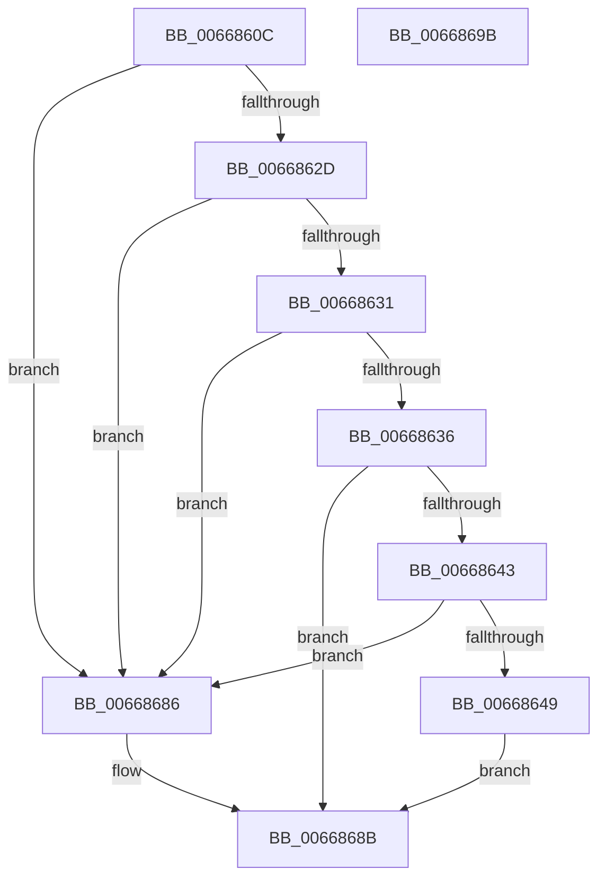

# AccelInitializeDescriptor

- RVA: `0x0066860C`–`0x0066869C` (길이 `144` bytes)
- VA: `0x000000014066860C`
- 실행 섹션: `.text`
- PDB 이름 있음: `예`; PDB Function 태그: `아니요`
- unwind 정보 RVA: `0x000A9ACC`
- 디코드: `45`개 명령, `144/144` bytes 표시
- 미해석 바이트: `0` (있으면 어셈블리에 `.byte`로 보존)

> 이 문서는 커널 이미지의 기계어와 PDB 기호를 분석해 생성했습니다. 4번과 5번은 함수 원형과 자료형을 바이너리 사용 방식에서 추정한 C 해석이며 원본 소스 복구 결과는 아닙니다.

## 1. Dependencies

- 직접 호출 지점: **1**; 고유 호출 대상: **1**
- 직접 호출자로 확인된 함수: **3**
- RIP 상대 이미지 참조: **0**

### Outgoing calls
- `0x0066863A` → [AccelQueryDescriptorSize](AccelQueryDescriptorSize_function_00668750.md) (function, `0x00668750`)

### Direct callers
- [MiAllocateAcceleratorDescriptor](../69/MiAllocateAcceleratorDescriptor_function_00697124.md) at `0x0069723F`
- [SmHwAcceleratorCreate](../../page/7A/SmHwAcceleratorCreate_function_007AA40C.md) at `0x007AA500`
- [SmHwInitializeAccelDescriptor](../../page/7A/SmHwInitializeAccelDescriptor_function_007AB58C.md) at `0x007AB5DC`

### Static image references
- 디코드된 RIP-relative 메모리 참조가 없습니다.

## 2. Other-region calls and transfers

- 다른 실행 섹션으로 향하는 call: **0**
- 별도 외부 분기/꼬리 이동을 확인하지 못했습니다.

## 3. Assembly (complete function range)

```asm
0066860C  48 8B C4                        mov rax, rsp
0066860F  48 89 58 10                     mov qword ptr [rax + 0x10], rbx
00668613  48 89 70 18                     mov qword ptr [rax + 0x18], rsi
00668617  57                              push rdi
00668618  48 83 EC 20                     sub rsp, 0x20
0066861C  83 60 08 00                     and dword ptr [rax + 8], 0
00668620  49 8B D8                        mov rbx, r8
00668623  8B F2                           mov esi, edx
00668625  48 8B F9                        mov rdi, rcx
00668628  48 85 C9                        test rcx, rcx
0066862B  74 59                           je 0x140668686
0066862D  85 D2                           test edx, edx
0066862F  74 55                           je 0x140668686
00668631  48 85 DB                        test rbx, rbx
00668634  74 50                           je 0x140668686
00668636  48 8D 50 08                     lea rdx, [rax + 8]
0066863A  E8 11 01 00 00                  call 0x140668750
0066863F  85 C0                           test eax, eax
00668641  78 48                           js 0x14066868b
00668643  3B 74 24 30                     cmp esi, dword ptr [rsp + 0x30]
00668647  72 3D                           jb 0x140668686
00668649  48 89 3B                        mov qword ptr [rbx], rdi
0066864C  48 8B 47 10                     mov rax, qword ptr [rdi + 0x10]
00668650  8B 48 20                        mov ecx, dword ptr [rax + 0x20]
00668653  48 8D 43 28                     lea rax, [rbx + 0x28]
00668657  48 89 43 18                     mov qword ptr [rbx + 0x18], rax
0066865B  89 4B 10                        mov dword ptr [rbx + 0x10], ecx
0066865E  48 8B 47 10                     mov rax, qword ptr [rdi + 0x10]
00668662  8B 90 14 01 00 00               mov edx, dword ptr [rax + 0x114]
00668668  8B 80 0C 01 00 00               mov eax, dword ptr [rax + 0x10c]
0066866E  48 83 C0 27                     add rax, 0x27
00668672  48 03 C2                        add rax, rdx
00668675  48 F7 DA                        neg rdx
00668678  48 03 C3                        add rax, rbx
0066867B  48 23 C2                        and rax, rdx
0066867E  48 89 43 20                     mov qword ptr [rbx + 0x20], rax
00668682  33 C0                           xor eax, eax
00668684  EB 05                           jmp 0x14066868b
00668686  B8 0D 00 00 C0                  mov eax, 0xc000000d
0066868B  48 8B 5C 24 38                  mov rbx, qword ptr [rsp + 0x38]
00668690  48 8B 74 24 40                  mov rsi, qword ptr [rsp + 0x40]
00668695  48 83 C4 20                     add rsp, 0x20
00668699  5F                              pop rdi
0066869A  C3                              ret
0066869B  CC                              int3
```

## 4. C-style interpretation (structured pseudocode)

```c
__int64 __fastcall AccelInitializeDescriptor(__int64 a1, int a2, __int64 a3)
{
    __int64 result;
    __int64 v_rsp;
    unsigned __int64 v_stack_p10;
    unsigned __int64 v_stack_p18;
    unsigned int v_stack_p8;

    *(unsigned __int64 *)(v_rsp + 16) = v_rbx;
    *(unsigned __int64 *)(v_rsp + 24) = v_rsi;
    v_rsp = (v_rsp) - (32);
    if (a1 == 0) goto loc_00668686;
    if (a2 == 0) goto loc_00668686;
    if (a3 == 0) goto loc_00668686;
    result = AccelQueryDescriptorSize(a1, v_rsp + 8, a3, a4);
    if (sign_flag) goto loc_0066868B;
    if (((unsigned int)((unsigned int)(a2))) < v_stack_p8) goto loc_00668686;
    *(unsigned __int64 *)(a3) = a1;
    *(unsigned __int64 *)(a3 + 24) = a3 + 40;
    *(unsigned int *)(a3 + 16) = (unsigned int)((unsigned int)(*(unsigned int *)(*(unsigned __int64 *)(a1 + 16) + 32)));
    result = ((unsigned int)(*(unsigned int *)(*(unsigned __int64 *)(a1 + 16) + 268))) + (39);
    result = (result) + ((unsigned int)(*(unsigned int *)(*(unsigned __int64 *)(a1 + 16) + 276)));
    a2 = -((unsigned int)(*(unsigned int *)(*(unsigned __int64 *)(a1 + 16) + 276)));
    result = (result) + (a3);
    result = (result) & (a2);
    *(unsigned __int64 *)(a3 + 32) = result;
    result = 0;
    goto loc_0066868B;
loc_00668686:
loc_0066868B:
    v_rsp = (v_rsp) + (32);
    return (unsigned int)(0xC000000DULL);
}
```

## 5. (Beta) C Style

```c
int64_t AccelInitializeDescriptor(void *Arg1, int32_t Arg2, int64_t Arg3)
{
    uint8_t *arg1 = (uint8_t *)Arg1;

    int64_t result;
    int64_t local_rsp;
    uint64_t v_stack_p10;
    uint64_t v_stack_p18;
    uint32_t v_stack_p8;

    *(uint64_t *)(local_rsp + 0x10) = local_rbx;
    *(uint64_t *)(local_rsp + 0x18) = local_rsi;
    local_rsp = (local_rsp) - (32);
    if (Arg1 == NULL) goto loc_00668686;
    if (Arg2 == 0) goto loc_00668686;
    if (Arg3 == 0) goto loc_00668686;
    result = AccelQueryDescriptorSize(Arg1, local_rsp + 8, Arg3, a4);
    if (sign_flag) goto loc_0066868B;
    if (((uint32_t)((uint32_t)(Arg2))) < v_stack_p8) goto loc_00668686;
    *(void **)(Arg3) = Arg1;
    *(uint64_t *)(Arg3 + 0x18) = Arg3 + 40;
    *(uint32_t *)(Arg3 + 0x10) = (uint32_t)((uint32_t)(*(uint32_t *)(*(uint64_t *)(arg1 + 0x10) + 0x20)));
    result = ((uint32_t)(*(uint32_t *)(*(uint64_t *)(arg1 + 0x10) + 0x10C))) + (39);
    result = (result) + ((uint32_t)(*(uint32_t *)(*(uint64_t *)(arg1 + 0x10) + 0x114)));
    Arg2 = -((uint32_t)(*(uint32_t *)(*(uint64_t *)(arg1 + 0x10) + 0x114)));
    result = (result) + (Arg3);
    result = (result) & (Arg2);
    *(uint64_t *)(Arg3 + 0x20) = result;
    result = 0;
    goto loc_0066868B;
loc_00668686:
loc_0066868B:
    local_rsp = (local_rsp) + (32);
    return (uint32_t)(0xC000000DULL);
}
```

### 관측된 메모리 오프셋

구조체 형식이 확인되지 않은 접근은 인자 기준의 오프셋으로만 기록했습니다.

| 기준 인자 | 오프셋 표현 | 폭 (bit) | 접근 |
|---|---:|---:|---|
| `Arg1` | `+ 0x10` | `64` | `R` |

## 6. Execution-region graph

[열기: 2D/3D 그래프와 함수 탐색 컨트롤 패널](../../../control-panel.html?section=text&rva=0x0066860C&view=graph)

- 2D 그래프는 위에서 아래로 흐르고, 3D 그래프는 빈 공간을 드래그해 회전합니다. Shift+드래그는 이동, 휠은 확대·축소, 함수 노드 선택은 대상 보고서 이동입니다.

### Static fallback


