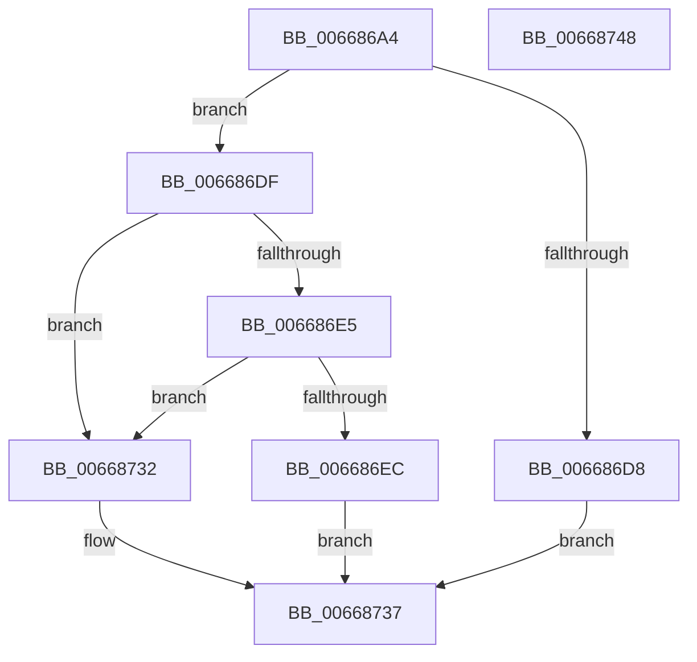

# AccelQueryCompletionInformation

- RVA: `0x006686A4`–`0x00668749` (길이 `165` bytes)
- VA: `0x00000001406686A4`
- 실행 섹션: `.text`
- PDB 이름 있음: `예`; PDB Function 태그: `아니요`
- unwind 정보 RVA: `0x00086CF8`
- 디코드: `45`개 명령, `165/165` bytes 표시
- 미해석 바이트: `0` (있으면 어셈블리에 `.byte`로 보존)

> 이 문서는 커널 이미지의 기계어와 PDB 기호를 분석해 생성했습니다. 4번과 5번은 함수 원형과 자료형을 바이너리 사용 방식에서 추정한 C 해석이며 원본 소스 복구 결과는 아닙니다.

## 1. Dependencies

- 직접 호출 지점: **2**; 고유 호출 대상: **2**
- 직접 호출자로 확인된 함수: **3**
- RIP 상대 이미지 참조: **0**

### Outgoing calls
- `0x006686C8` → [memset](../6C/memset_function_006C6C40.md) (function, `0x006C6C40`)
- `0x0066872B` → [AccelpInternalOperationHandler](../2C/AccelpInternalOperationHandler_function_002C7DAC.md) (function, `0x002C7DAC`)

### Direct callers
- [SmHwAcceleratorWaitForRequest](../61/SmHwAcceleratorWaitForRequest_function_00611A7C.md) at `0x00611B32`
- [SmHwAcceleratorWaitForRequest](../61/SmHwAcceleratorWaitForRequest_function_00611A7C.md) at `0x00611B47`
- [AccelCompressBuffer](AccelCompressBuffer_function_00668258.md) at `0x00668378`
- [AccelDecompressBuffer](AccelDecompressBuffer_function_006683C8.md) at `0x0066848F`

### Static image references
- 디코드된 RIP-relative 메모리 참조가 없습니다.

## 2. Other-region calls and transfers

- 다른 실행 섹션으로 향하는 call: **0**
- 별도 외부 분기/꼬리 이동을 확인하지 못했습니다.

## 3. Assembly (complete function range)

```asm
006686A4  48 89 5C 24 08                  mov qword ptr [rsp + 8], rbx
006686A9  55                              push rbp
006686AA  48 8D 6C 24 A9                  lea rbp, [rsp - 0x57]
006686AF  48 81 EC A0 00 00 00            sub rsp, 0xa0
006686B6  33 C0                           xor eax, eax
006686B8  48 8B D9                        mov rbx, rcx
006686BB  33 D2                           xor edx, edx
006686BD  89 45 EB                        mov dword ptr [rbp - 0x15], eax
006686C0  48 8D 4D E7                     lea rcx, [rbp - 0x19]
006686C4  44 8D 40 6C                     lea r8d, [rax + 0x6c]
006686C8  E8 73 E5 05 00                  call 0x1406c6c40
006686CD  33 D2                           xor edx, edx
006686CF  48 89 55 DF                     mov qword ptr [rbp - 0x21], rdx
006686D3  48 85 DB                        test rbx, rbx
006686D6  75 07                           jne 0x1406686df
006686D8  B8 0D 00 00 C0                  mov eax, 0xc000000d
006686DD  EB 58                           jmp 0x140668737
006686DF  66 83 3B 01                     cmp word ptr [rbx], 1
006686E3  72 4D                           jb 0x140668732
006686E5  66 83 7B 02 38                  cmp word ptr [rbx + 2], 0x38
006686EA  72 46                           jb 0x140668732
006686EC  48 8B 4B 08                     mov rcx, qword ptr [rbx + 8]
006686F0  89 55 F7                        mov dword ptr [rbp - 9], edx
006686F3  48 89 55 0F                     mov qword ptr [rbp + 0xf], rdx
006686F7  48 8D 55 D7                     lea rdx, [rbp - 0x29]
006686FB  C7 45 E7 04 00 00 00            mov dword ptr [rbp - 0x19], 4
00668702  48 8B 01                        mov rax, qword ptr [rcx]
00668705  48 89 45 EF                     mov qword ptr [rbp - 0x11], rax
00668709  48 8B 41 18                     mov rax, qword ptr [rcx + 0x18]
0066870D  48 89 45 FF                     mov qword ptr [rbp - 1], rax
00668711  48 8B 41 20                     mov rax, qword ptr [rcx + 0x20]
00668715  48 8D 4D E7                     lea rcx, [rbp - 0x19]
00668719  48 89 45 07                     mov qword ptr [rbp + 7], rax
0066871D  8B 43 10                        mov eax, dword ptr [rbx + 0x10]
00668720  89 45 17                        mov dword ptr [rbp + 0x17], eax
00668723  48 8D 43 18                     lea rax, [rbx + 0x18]
00668727  48 89 45 D7                     mov qword ptr [rbp - 0x29], rax
0066872B  E8 7C F6 C5 FF                  call 0x1402c7dac
00668730  EB 05                           jmp 0x140668737
00668732  B8 59 00 00 C0                  mov eax, 0xc0000059
00668737  48 8B 9C 24 B0 00 00 00         mov rbx, qword ptr [rsp + 0xb0]
0066873F  48 81 C4 A0 00 00 00            add rsp, 0xa0
00668746  5D                              pop rbp
00668747  C3                              ret
00668748  CC                              int3
```

## 4. C-style interpretation (structured pseudocode)

```c
__int64 __fastcall AccelQueryCompletionInformation(__int64 a1, int a2)
{
    __int64 result;
    __int64 v_rsp;
    unsigned int v_stack_m48;
    unsigned __int64 v_stack_m50;
    unsigned __int64 v_stack_m58;
    unsigned __int64 v_stack_m5F;
    unsigned __int64 v_stack_m60;
    unsigned int v_stack_m68;
    unsigned __int64 v_stack_m70;
    unsigned int v_stack_m74;
    unsigned __int64 v_stack_m78;
    unsigned __int64 v_stack_m80;
    unsigned __int64 v_stack_m88;
    unsigned __int64 v_stack_p8;

    v_stack_p8 = v_rbx;
    v_rsp = (v_rsp) - (160);
    result = 0;
    a2 = 0;
    v_stack_m74 = 0;
    result = memset(v_stack_m78, a2, result + 108, a4);
    a2 = 0;
    v_stack_m80 = 0;
    if (a1 != 0) goto loc_006686DF;
    goto loc_00668737;
loc_006686DF:
    if ((*(unsigned __int16 *)(a1)) < 1) goto loc_00668732;
    if ((*(unsigned __int16 *)(a1 + 2)) < 56) goto loc_00668732;
    v_stack_m68 = 0;
    v_stack_m50 = 0;
    v_stack_m78 = 4;
    v_stack_m70 = *(unsigned __int64 *)(*(unsigned __int64 *)(a1 + 8));
    v_stack_m60 = *(unsigned __int64 *)(*(unsigned __int64 *)(a1 + 8) + 24);
    v_stack_m58 = *(unsigned __int64 *)(*(unsigned __int64 *)(a1 + 8) + 32);
    v_stack_m48 = (unsigned int)((unsigned int)(*(unsigned int *)(a1 + 16)));
    v_stack_m88 = a1 + 24;
    result = AccelpInternalOperationHandler(v_stack_m78, v_stack_m88, result + 108, a4);
    goto loc_00668737;
loc_00668732:
loc_00668737:
    v_rsp = (v_rsp) + (160);
    return (unsigned int)(0xC0000059ULL);
}
```

## 5. (Beta) C Style

```c
int64_t AccelQueryCompletionInformation(int64_t Arg1, int32_t Arg2)
{
    int64_t result;
    int64_t local_rsp;
    uint32_t v_stack_m48;
    uint64_t v_stack_m50;
    uint64_t v_stack_m58;
    uint64_t v_stack_m5F;
    uint64_t v_stack_m60;
    uint32_t v_stack_m68;
    uint64_t v_stack_m70;
    uint32_t v_stack_m74;
    uint64_t v_stack_m78;
    uint64_t v_stack_m80;
    uint64_t v_stack_m88;
    uint64_t v_stack_p8;

    v_stack_p8 = local_rbx;
    local_rsp = (local_rsp) - (160);
    result = 0;
    Arg2 = 0;
    v_stack_m74 = 0;
    result = memset(v_stack_m78, Arg2, result + 108, a4);
    Arg2 = 0;
    v_stack_m80 = 0;
    if (Arg1 != 0) goto loc_006686DF;
    goto loc_00668737;
loc_006686DF:
    if ((*(uint16_t *)(Arg1)) < 1) goto loc_00668732;
    if ((*(uint16_t *)(Arg1 + 0x2)) < 56) goto loc_00668732;
    v_stack_m68 = 0;
    v_stack_m50 = 0;
    v_stack_m78 = 4;
    v_stack_m70 = *(uint64_t *)(*(uint64_t *)(Arg1 + 0x8));
    v_stack_m60 = *(uint64_t *)(*(uint64_t *)(Arg1 + 0x8) + 0x18);
    v_stack_m58 = *(uint64_t *)(*(uint64_t *)(Arg1 + 0x8) + 0x20);
    v_stack_m48 = (uint32_t)((uint32_t)(*(uint32_t *)(Arg1 + 0x10)));
    v_stack_m88 = Arg1 + 24;
    result = AccelpInternalOperationHandler(v_stack_m78, v_stack_m88, result + 108, a4);
    goto loc_00668737;
loc_00668732:
loc_00668737:
    local_rsp = (local_rsp) + (160);
    return (uint32_t)(0xC0000059ULL);
}
```

## 6. Execution-region graph

[열기: 2D/3D 그래프와 함수 탐색 컨트롤 패널](../../../control-panel.html?section=text&rva=0x006686A4&view=graph)

- 2D 그래프는 위에서 아래로 흐르고, 3D 그래프는 빈 공간을 드래그해 회전합니다. Shift+드래그는 이동, 휠은 확대·축소, 함수 노드 선택은 대상 보고서 이동입니다.

### Static fallback


