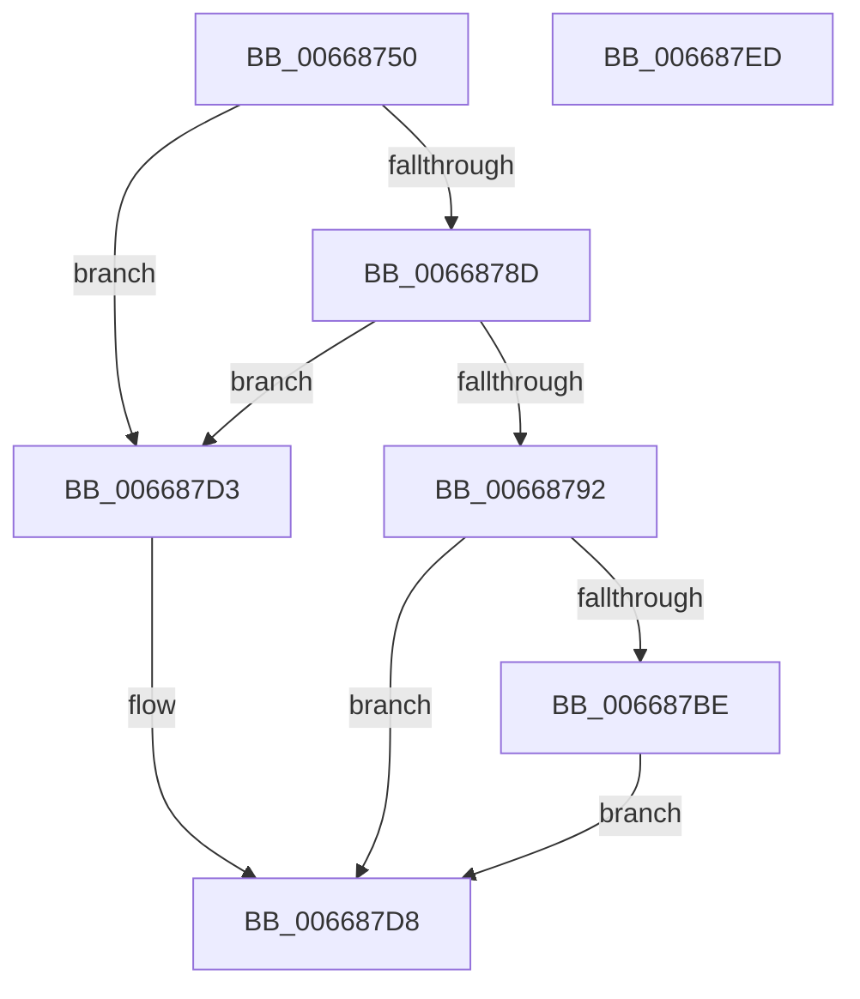

# AccelQueryDescriptorSize

- RVA: `0x00668750`–`0x006687EE` (길이 `158` bytes)
- VA: `0x0000000140668750`
- 실행 섹션: `.text`
- PDB 이름 있음: `예`; PDB Function 태그: `아니요`
- unwind 정보 RVA: `0x000BDF14`
- 디코드: `45`개 명령, `158/158` bytes 표시
- 미해석 바이트: `0` (있으면 어셈블리에 `.byte`로 보존)

> 이 문서는 커널 이미지의 기계어와 PDB 기호를 분석해 생성했습니다. 4번과 5번은 함수 원형과 자료형을 바이너리 사용 방식에서 추정한 C 해석이며 원본 소스 복구 결과는 아닙니다.

## 1. Dependencies

- 직접 호출 지점: **2**; 고유 호출 대상: **2**
- 직접 호출자로 확인된 함수: **3**
- RIP 상대 이미지 참조: **0**

### Outgoing calls
- `0x0066877C` → [memset](../6C/memset_function_006C6C40.md) (function, `0x006C6C40`)
- `0x006687B5` → [AccelpInternalOperationHandler](../2C/AccelpInternalOperationHandler_function_002C7DAC.md) (function, `0x002C7DAC`)

### Direct callers
- [AccelInitializeDescriptor](AccelInitializeDescriptor_function_0066860C.md) at `0x0066863A`
- [SmHwAcceleratorCreate](../../page/7A/SmHwAcceleratorCreate_function_007AA40C.md) at `0x007AA461`
- [MiQueryAcceleratorHandle](../../page/81/MiQueryAcceleratorHandle_function_00811470.md) at `0x008114E8`

### Static image references
- 디코드된 RIP-relative 메모리 참조가 없습니다.

## 2. Other-region calls and transfers

- 다른 실행 섹션으로 향하는 call: **0**
- 별도 외부 분기/꼬리 이동을 확인하지 못했습니다.

## 3. Assembly (complete function range)

```asm
00668750  48 89 5C 24 08                  mov qword ptr [rsp + 8], rbx
00668755  48 89 7C 24 10                  mov qword ptr [rsp + 0x10], rdi
0066875A  55                              push rbp
0066875B  48 8D 6C 24 A9                  lea rbp, [rsp - 0x57]
00668760  48 81 EC A0 00 00 00            sub rsp, 0xa0
00668767  33 C0                           xor eax, eax
00668769  48 8B DA                        mov rbx, rdx
0066876C  48 8B F9                        mov rdi, rcx
0066876F  89 45 EB                        mov dword ptr [rbp - 0x15], eax
00668772  33 D2                           xor edx, edx
00668774  48 8D 4D E7                     lea rcx, [rbp - 0x19]
00668778  44 8D 40 6C                     lea r8d, [rax + 0x6c]
0066877C  E8 BF E4 05 00                  call 0x1406c6c40
00668781  0F 57 C0                        xorps xmm0, xmm0
00668784  0F 11 45 D7                     movups xmmword ptr [rbp - 0x29], xmm0
00668788  48 85 FF                        test rdi, rdi
0066878B  74 46                           je 0x1406687d3
0066878D  48 85 DB                        test rbx, rbx
00668790  74 41                           je 0x1406687d3
00668792  83 65 E7 00                     and dword ptr [rbp - 0x19], 0
00668796  48 8D 55 D7                     lea rdx, [rbp - 0x29]
0066879A  83 65 F7 00                     and dword ptr [rbp - 9], 0
0066879E  48 8D 4D E7                     lea rcx, [rbp - 0x19]
006687A2  48 83 65 FF 00                  and qword ptr [rbp - 1], 0
006687A7  48 83 65 07 00                  and qword ptr [rbp + 7], 0
006687AC  48 83 65 0F 00                  and qword ptr [rbp + 0xf], 0
006687B1  48 89 7D EF                     mov qword ptr [rbp - 0x11], rdi
006687B5  E8 F2 F5 C5 FF                  call 0x1402c7dac
006687BA  85 C0                           test eax, eax
006687BC  78 1A                           js 0x1406687d8
006687BE  44 8B 45 D7                     mov r8d, dword ptr [rbp - 0x29]
006687C2  8B 55 DF                        mov edx, dword ptr [rbp - 0x21]
006687C5  44 03 45 DB                     add r8d, dword ptr [rbp - 0x25]
006687C9  83 C2 27                        add edx, 0x27
006687CC  41 03 D0                        add edx, r8d
006687CF  89 13                           mov dword ptr [rbx], edx
006687D1  EB 05                           jmp 0x1406687d8
006687D3  B8 0D 00 00 C0                  mov eax, 0xc000000d
006687D8  4C 8D 9C 24 A0 00 00 00         lea r11, [rsp + 0xa0]
006687E0  49 8B 5B 10                     mov rbx, qword ptr [r11 + 0x10]
006687E4  49 8B 7B 18                     mov rdi, qword ptr [r11 + 0x18]
006687E8  49 8B E3                        mov rsp, r11
006687EB  5D                              pop rbp
006687EC  C3                              ret
006687ED  CC                              int3
```

## 4. C-style interpretation (structured pseudocode)

```c
__int64 __fastcall AccelQueryDescriptorSize(__int64 a1, __int64 a2)
{
    __int64 result;
    __int64 v_rsp;
    unsigned __int64 v_stack_m50;
    unsigned __int64 v_stack_m58;
    unsigned __int64 v_stack_m5F;
    unsigned __int64 v_stack_m60;
    unsigned int v_stack_m68;
    unsigned __int64 v_stack_m70;
    unsigned int v_stack_m74;
    unsigned __int64 v_stack_m78;
    unsigned __int64 v_stack_m8;
    unsigned int v_stack_m80;
    unsigned int v_stack_m84;
    unsigned __int64 v_stack_m88;
    unsigned __int64 v_stack_p10;
    unsigned __int64 v_stack_p8;

    v_stack_p8 = v_rbx;
    v_stack_p10 = v_rdi;
    v_rsp = (v_rsp) - (160);
    result = 0;
    v_stack_m74 = 0;
    a2 = 0;
    result = memset(v_stack_m78, a2, result + 108, a4);
    v_stack_m88 = v_xmm0;
    if (a1 == 0) goto loc_006687D3;
    if (0 == 0) goto loc_006687D3;
    v_stack_m70 = a1;
    result = AccelpInternalOperationHandler(v_stack_m78, v_stack_m88, result + 108, a4);
    if (sign_flag) goto loc_006687D8;
    a3 = (unsigned int)(((unsigned int)(v_stack_m88)) + (v_stack_m84));
    a2 = (unsigned int)(((unsigned int)(v_stack_m80)) + (39));
    a2 = (unsigned int)((a2) + ((unsigned int)(a3)));
    *(unsigned int *)(a2) = (unsigned int)(a2);
    goto loc_006687D8;
loc_006687D3:
loc_006687D8:
    return (unsigned int)(0xC000000DULL);
}
```

## 5. (Beta) C Style

```c
int64_t AccelQueryDescriptorSize(int64_t Arg1, int64_t Arg2)
{
    int64_t result;
    int64_t local_rsp;
    uint64_t v_stack_m50;
    uint64_t v_stack_m58;
    uint64_t v_stack_m5F;
    uint64_t v_stack_m60;
    uint32_t v_stack_m68;
    uint64_t v_stack_m70;
    uint32_t v_stack_m74;
    uint64_t v_stack_m78;
    uint64_t v_stack_m8;
    uint32_t v_stack_m80;
    uint32_t v_stack_m84;
    uint64_t v_stack_m88;
    uint64_t v_stack_p10;
    uint64_t v_stack_p8;

    v_stack_p8 = local_rbx;
    v_stack_p10 = local_rdi;
    local_rsp = (local_rsp) - (160);
    result = 0;
    v_stack_m74 = 0;
    Arg2 = 0;
    result = memset(v_stack_m78, Arg2, result + 108, a4);
    v_stack_m88 = v_xmm0;
    if (Arg1 == 0) goto loc_006687D3;
    if (0 == 0) goto loc_006687D3;
    v_stack_m70 = Arg1;
    result = AccelpInternalOperationHandler(v_stack_m78, v_stack_m88, result + 108, a4);
    if (sign_flag) goto loc_006687D8;
    a3 = (uint32_t)(((uint32_t)(v_stack_m88)) + (v_stack_m84));
    Arg2 = (uint32_t)(((uint32_t)(v_stack_m80)) + (39));
    Arg2 = (uint32_t)((Arg2) + ((uint32_t)(a3)));
    *(uint32_t *)(Arg2) = (uint32_t)(Arg2);
    goto loc_006687D8;
loc_006687D3:
loc_006687D8:
    return (uint32_t)(0xC000000DULL);
}
```

## 6. Execution-region graph

[열기: 2D/3D 그래프와 함수 탐색 컨트롤 패널](../../../control-panel.html?section=text&rva=0x00668750&view=graph)

- 2D 그래프는 위에서 아래로 흐르고, 3D 그래프는 빈 공간을 드래그해 회전합니다. Shift+드래그는 이동, 휠은 확대·축소, 함수 노드 선택은 대상 보고서 이동입니다.

### Static fallback


