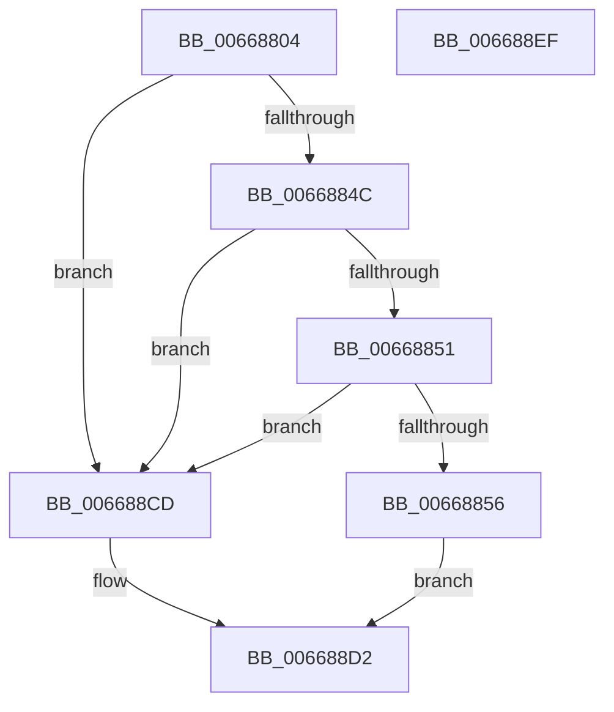

# AccelpBuildDescriptorComputeHistogram

- RVA: `0x00668804`–`0x006688F0` (길이 `236` bytes)
- VA: `0x0000000140668804`
- 실행 섹션: `.text`
- PDB 이름 있음: `예`; PDB Function 태그: `아니요`
- unwind 정보 RVA: `0x0006EE68`
- 디코드: `64`개 명령, `236/236` bytes 표시
- 미해석 바이트: `0` (있으면 어셈블리에 `.byte`로 보존)

> 이 문서는 커널 이미지의 기계어와 PDB 기호를 분석해 생성했습니다. 4번과 5번은 함수 원형과 자료형을 바이너리 사용 방식에서 추정한 C 해석이며 원본 소스 복구 결과는 아닙니다.

## 1. Dependencies

- 직접 호출 지점: **4**; 고유 호출 대상: **2**
- 직접 호출자로 확인된 함수: **1**
- RIP 상대 이미지 참조: **0**

### Outgoing calls
- `0x0066883E` → [memset](../6C/memset_function_006C6C40.md) (function, `0x006C6C40`)
- `0x0066886A` → [memset](../6C/memset_function_006C6C40.md) (function, `0x006C6C40`)
- `0x00668883` → [memset](../6C/memset_function_006C6C40.md) (function, `0x006C6C40`)
- `0x006688C6` → [AccelpInternalOperationHandler](../2C/AccelpInternalOperationHandler_function_002C7DAC.md) (function, `0x002C7DAC`)

### Direct callers
- [AccelpComputeHistogram](AccelpComputeHistogram_function_00668BA0.md) at `0x00668BB7`

### Static image references
- 디코드된 RIP-relative 메모리 참조가 없습니다.

## 2. Other-region calls and transfers

- 다른 실행 섹션으로 향하는 call: **0**
- 별도 외부 분기/꼬리 이동을 확인하지 못했습니다.

## 3. Assembly (complete function range)

```asm
00668804  48 8B C4                        mov rax, rsp
00668807  48 89 58 08                     mov qword ptr [rax + 8], rbx
0066880B  48 89 70 10                     mov qword ptr [rax + 0x10], rsi
0066880F  48 89 78 18                     mov qword ptr [rax + 0x18], rdi
00668813  4C 89 70 20                     mov qword ptr [rax + 0x20], r14
00668817  55                              push rbp
00668818  48 8D 68 A9                     lea rbp, [rax - 0x57]
0066881C  48 81 EC 90 00 00 00            sub rsp, 0x90
00668823  33 C0                           xor eax, eax
00668825  45 8B F0                        mov r14d, r8d
00668828  48 8B F2                        mov rsi, rdx
0066882B  89 45 E3                        mov dword ptr [rbp - 0x1d], eax
0066882E  48 8B D9                        mov rbx, rcx
00668831  33 D2                           xor edx, edx
00668833  48 8D 4D DF                     lea rcx, [rbp - 0x21]
00668837  49 8B F9                        mov rdi, r9
0066883A  44 8D 40 6C                     lea r8d, [rax + 0x6c]
0066883E  E8 FD E3 05 00                  call 0x1406c6c40
00668843  48 85 DB                        test rbx, rbx
00668846  0F 84 81 00 00 00               je 0x1406688cd
0066884C  48 85 F6                        test rsi, rsi
0066884F  74 7C                           je 0x1406688cd
00668851  48 85 FF                        test rdi, rdi
00668854  74 77                           je 0x1406688cd
00668856  48 8B 03                        mov rax, qword ptr [rbx]
00668859  33 D2                           xor edx, edx
0066885B  48 8B 48 10                     mov rcx, qword ptr [rax + 0x10]
0066885F  44 8B 81 0C 01 00 00            mov r8d, dword ptr [rcx + 0x10c]
00668866  48 8B 4B 18                     mov rcx, qword ptr [rbx + 0x18]
0066886A  E8 D1 E3 05 00                  call 0x1406c6c40
0066886F  48 8B 03                        mov rax, qword ptr [rbx]
00668872  33 D2                           xor edx, edx
00668874  48 8B 48 10                     mov rcx, qword ptr [rax + 0x10]
00668878  44 8B 81 10 01 00 00            mov r8d, dword ptr [rcx + 0x110]
0066887F  48 8B 4B 20                     mov rcx, qword ptr [rbx + 0x20]
00668883  E8 B8 E3 05 00                  call 0x1406c6c40
00668888  48 8B 03                        mov rax, qword ptr [rbx]
0066888B  48 8D 4D DF                     lea rcx, [rbp - 0x21]
0066888F  48 89 45 E7                     mov qword ptr [rbp - 0x19], rax
00668893  33 D2                           xor edx, edx
00668895  8B 43 10                        mov eax, dword ptr [rbx + 0x10]
00668898  89 45 EF                        mov dword ptr [rbp - 0x11], eax
0066889B  48 8B 43 18                     mov rax, qword ptr [rbx + 0x18]
0066889F  48 89 45 F7                     mov qword ptr [rbp - 9], rax
006688A3  48 8B 43 20                     mov rax, qword ptr [rbx + 0x20]
006688A7  48 89 45 FF                     mov qword ptr [rbp - 1], rax
006688AB  48 8B 45 7F                     mov rax, qword ptr [rbp + 0x7f]
006688AF  48 89 45 07                     mov qword ptr [rbp + 7], rax
006688B3  C7 45 DF 0E 00 00 00            mov dword ptr [rbp - 0x21], 0xe
006688BA  48 89 75 0F                     mov qword ptr [rbp + 0xf], rsi
006688BE  44 89 75 17                     mov dword ptr [rbp + 0x17], r14d
006688C2  48 89 7D 1F                     mov qword ptr [rbp + 0x1f], rdi
006688C6  E8 E1 F4 C5 FF                  call 0x1402c7dac
006688CB  EB 05                           jmp 0x1406688d2
006688CD  B8 0D 00 00 C0                  mov eax, 0xc000000d
006688D2  4C 8D 9C 24 90 00 00 00         lea r11, [rsp + 0x90]
006688DA  49 8B 5B 10                     mov rbx, qword ptr [r11 + 0x10]
006688DE  49 8B 73 18                     mov rsi, qword ptr [r11 + 0x18]
006688E2  49 8B 7B 20                     mov rdi, qword ptr [r11 + 0x20]
006688E6  4D 8B 73 28                     mov r14, qword ptr [r11 + 0x28]
006688EA  49 8B E3                        mov rsp, r11
006688ED  5D                              pop rbp
006688EE  C3                              ret
006688EF  CC                              int3
```

## 4. C-style interpretation (structured pseudocode)

```c
__int64 __fastcall AccelpBuildDescriptorComputeHistogram(__int64 a1, __int64 a2, int a3, __int64 a4)
{
    __int64 result;
    __int64 v_rsp;
    unsigned __int64 v_stack_m8;

    *(unsigned __int64 *)(v_rsp + 8) = v_rbx;
    *(unsigned __int64 *)(v_rsp + 16) = v_rsi;
    *(unsigned __int64 *)(v_rsp + 24) = v_rdi;
    *(unsigned __int64 *)(v_rsp + 32) = v_r14;
    v_rsp = (v_rsp) - (144);
    result = 0;
    *(unsigned int *)(v_rsp - 87 - 29) = 0;
    a2 = 0;
    result = memset(v_rsp - 87 - 33, a2, result + 108, a4);
    if (a1 == 0) goto loc_006688CD;
    if (0 == 0) goto loc_006688CD;
    if (a4 == 0) goto loc_006688CD;
    a2 = 0;
    result = memset(*(unsigned __int64 *)(a1 + 24), a2, (unsigned int)(*(unsigned int *)(*(unsigned __int64 *)(*(unsigned __int64 *)(a1) + 16) + 268)), a4);
    a2 = 0;
    result = memset(*(unsigned __int64 *)(a1 + 32), a2, (unsigned int)(*(unsigned int *)(*(unsigned __int64 *)(*(unsigned __int64 *)(a1) + 16) + 272)), a4);
    *(unsigned __int64 *)(v_rsp - 87 - 25) = *(unsigned __int64 *)(a1);
    a2 = 0;
    *(unsigned int *)(v_rsp - 87 - 17) = (unsigned int)((unsigned int)(*(unsigned int *)(a1 + 16)));
    *(unsigned __int64 *)(v_rsp - 87 - 9) = *(unsigned __int64 *)(a1 + 24);
    *(unsigned __int64 *)(v_rsp - 87 - 1) = *(unsigned __int64 *)(a1 + 32);
    *(unsigned __int64 *)(v_rsp - 87 + 7) = *(unsigned __int64 *)(v_rsp - 87 + 127);
    *(unsigned int *)(v_rsp - 87 - 33) = 14;
    *(unsigned __int64 *)(v_rsp - 87 + 15) = 0;
    *(unsigned int *)(v_rsp - 87 + 23) = (unsigned int)((unsigned int)(a3));
    *(unsigned __int64 *)(v_rsp - 87 + 31) = a4;
    result = AccelpInternalOperationHandler(v_rsp - 87 - 33, a2, (unsigned int)(*(unsigned int *)(*(unsigned __int64 *)(*(unsigned __int64 *)(a1) + 16) + 272)), a4);
    goto loc_006688D2;
loc_006688CD:
loc_006688D2:
    return (unsigned int)(0xC000000DULL);
}
```

## 5. (Beta) C Style

```c
int64_t AccelpBuildDescriptorComputeHistogram(int64_t Arg1, int64_t Arg2, int32_t Arg3, int64_t Arg4)
{
    int64_t result;
    int64_t local_rsp;
    uint64_t v_stack_m8;

    *(uint64_t *)(local_rsp + 0x8) = local_rbx;
    *(uint64_t *)(local_rsp + 0x10) = local_rsi;
    *(uint64_t *)(local_rsp + 0x18) = local_rdi;
    *(uint64_t *)(local_rsp + 0x20) = local_r14;
    local_rsp = (local_rsp) - (144);
    result = 0;
    *(uint32_t *)(local_rsp - 0x57 - 0x1D) = 0;
    Arg2 = 0;
    result = memset(local_rsp - 87 - 33, Arg2, result + 108, Arg4);
    if (Arg1 == 0) goto loc_006688CD;
    if (0 == 0) goto loc_006688CD;
    if (Arg4 == 0) goto loc_006688CD;
    Arg2 = 0;
    result = memset(*(uint64_t *)(Arg1 + 0x18), Arg2, (uint32_t)(*(uint32_t *)(*(uint64_t *)(*(uint64_t *)(Arg1) + 0x10) + 0x10C)), Arg4);
    Arg2 = 0;
    result = memset(*(uint64_t *)(Arg1 + 0x20), Arg2, (uint32_t)(*(uint32_t *)(*(uint64_t *)(*(uint64_t *)(Arg1) + 0x10) + 0x110)), Arg4);
    *(uint64_t *)(local_rsp - 0x57 - 0x19) = *(uint64_t *)(Arg1);
    Arg2 = 0;
    *(uint32_t *)(local_rsp - 0x57 - 0x11) = (uint32_t)((uint32_t)(*(uint32_t *)(Arg1 + 0x10)));
    *(uint64_t *)(local_rsp - 0x57 - 0x9) = *(uint64_t *)(Arg1 + 0x18);
    *(uint64_t *)(local_rsp - 0x57 - 0x1) = *(uint64_t *)(Arg1 + 0x20);
    *(uint64_t *)(local_rsp - 0x57 + 0x7) = *(uint64_t *)(local_rsp - 0x57 + 0x7F);
    *(uint32_t *)(local_rsp - 0x57 - 0x21) = 14;
    *(uint64_t *)(local_rsp - 0x57 + 0xF) = 0;
    *(uint32_t *)(local_rsp - 0x57 + 0x17) = (uint32_t)((uint32_t)(Arg3));
    *(uint64_t *)(local_rsp - 0x57 + 0x1F) = Arg4;
    result = AccelpInternalOperationHandler(local_rsp - 87 - 33, Arg2, (uint32_t)(*(uint32_t *)(*(uint64_t *)(*(uint64_t *)(Arg1) + 0x10) + 0x110)), Arg4);
    goto loc_006688D2;
loc_006688CD:
loc_006688D2:
    return (uint32_t)(0xC000000DULL);
}
```

## 6. Execution-region graph

[열기: 2D/3D 그래프와 함수 탐색 컨트롤 패널](../../../control-panel.html?section=text&rva=0x00668804&view=graph)

- 2D 그래프는 위에서 아래로 흐르고, 3D 그래프는 빈 공간을 드래그해 회전합니다. Shift+드래그는 이동, 휠은 확대·축소, 함수 노드 선택은 대상 보고서 이동입니다.

### Static fallback


