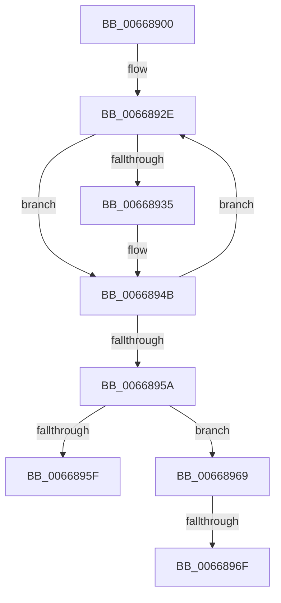

# AccelpBuildHuffmanEncoding

- RVA: `0x00668900`–`0x00668991` (길이 `145` bytes)
- VA: `0x0000000140668900`
- 실행 섹션: `.text`
- PDB 이름 있음: `예`; PDB Function 태그: `아니요`
- unwind 정보 RVA: `0x000D627C`
- 디코드: `38`개 명령, `145/145` bytes 표시
- 미해석 바이트: `0` (있으면 어셈블리에 `.byte`로 보존)

> 이 문서는 커널 이미지의 기계어와 PDB 기호를 분석해 생성했습니다. 4번과 5번은 함수 원형과 자료형을 바이너리 사용 방식에서 추정한 C 해석이며 원본 소스 복구 결과는 아닙니다.

## 1. Dependencies

- 직접 호출 지점: **1**; 고유 호출 대상: **1**
- 직접 호출자로 확인된 함수: **1**
- RIP 상대 이미지 참조: **0**

### Outgoing calls
- `0x00668920` → [memset](../6C/memset_function_006C6C40.md) (function, `0x006C6C40`)

### Direct callers
- [AccelCompressBuffer](AccelCompressBuffer_function_00668258.md) at `0x006682BF`

### Static image references
- 디코드된 RIP-relative 메모리 참조가 없습니다.

## 2. Other-region calls and transfers

- 다른 실행 섹션으로 향하는 call: **0**
- call이 아닌 외부 분기/꼬리 이동: **3**
  - `0x00668964` → [sub_00668B02 + 0x5A](Unknown_function_00668B02.md) (`tail-transfer`)
  - `0x0066896D` → [sub_00668991](Unknown_function_00668991.md) (`tail-transfer`)
  - `0x0066898C` → [sub_00668B02 + 0x58](Unknown_function_00668B02.md) (`tail-transfer`)

## 3. Assembly (complete function range)

```asm
00668900  40 53                           push rbx
00668902  56                              push rsi
00668903  57                              push rdi
00668904  48 83 EC 20                     sub rsp, 0x20
00668908  48 8B 59 18                     mov rbx, qword ptr [rcx + 0x18]
0066890C  33 D2                           xor edx, edx
0066890E  41 B8 00 01 00 00               mov r8d, 0x100
00668914  33 F6                           xor esi, esi
00668916  48 8B FB                        mov rdi, rbx
00668919  48 8D 8B 48 3A 00 00            lea rcx, [rbx + 0x3a48]
00668920  E8 1B E3 05 00                  call 0x1406c6c40
00668925  33 C0                           xor eax, eax
00668927  48 8D 8B 48 35 00 00            lea rcx, [rbx + 0x3548]
0066892E  8B 11                           mov edx, dword ptr [rcx]
00668930  48 85 D2                        test rdx, rdx
00668933  74 16                           je 0x14066894b
00668935  48 89 17                        mov qword ptr [rdi], rdx
00668938  48 C7 47 08 00 00 00 00         mov qword ptr [rdi + 8], 0
00668940  48 89 47 10                     mov qword ptr [rdi + 0x10], rax
00668944  48 83 C7 18                     add rdi, 0x18
00668948  48 FF C6                        inc rsi
0066894B  48 FF C0                        inc rax
0066894E  48 83 C1 04                     add rcx, 4
00668952  48 3D 00 01 00 00               cmp rax, 0x100
00668958  72 D4                           jb 0x14066892e
0066895A  48 85 F6                        test rsi, rsi
0066895D  75 0A                           jne 0x140668969
0066895F  B8 0D 00 00 C0                  mov eax, 0xc000000d
00668964  E9 F3 01 00 00                  jmp 0x140668b5c
00668969  48 83 FE 01                     cmp rsi, 1
0066896D  75 22                           jne 0x140668991
0066896F  48 8B 43 10                     mov rax, qword ptr [rbx + 0x10]
00668973  48 8D 0C 83                     lea rcx, [rbx + rax*4]
00668977  8B 81 48 31 00 00               mov eax, dword ptr [rcx + 0x3148]
0066897D  25 00 80 F8 FF                  and eax, 0xfff88000
00668982  0F BA E8 0F                     bts eax, 0xf
00668986  89 81 48 31 00 00               mov dword ptr [rcx + 0x3148], eax
0066898C  E9 C9 01 00 00                  jmp 0x140668b5a
```

## 4. C-style interpretation (structured pseudocode)

```c
__int64 __fastcall AccelpBuildHuffmanEncoding(__int64 a1, int a2)
{
    __int64 result;
    __int64 v_rdi;
    __int64 v_rsi;
    __int64 v_rsp;

    v_rsp = (v_rsp) - (32);
    a2 = 0;
    v_rsi = 0;
    result = memset(*(unsigned __int64 *)(a1 + 24) + 14920, a2, 256, a4);
    result = 0;
loc_0066892E:
    v_rdi = *(unsigned __int64 *)(a1 + 24);
    if ((unsigned int)(*(unsigned int *)(*(unsigned __int64 *)(a1 + 24) + 13640)) != 0) {
        *(unsigned __int64 *)(*(unsigned __int64 *)(a1 + 24)) = (unsigned int)(*(unsigned int *)(*(unsigned __int64 *)(a1 + 24) + 13640));
        *(unsigned __int64 *)(*(unsigned __int64 *)(a1 + 24) + 8) = 0;
        *(unsigned __int64 *)(*(unsigned __int64 *)(a1 + 24) + 16) = 0;
        v_rdi = (*(unsigned __int64 *)(a1 + 24)) + (24);
        v_rsi = (v_rsi) + 1;
    }
    result = (result) + 1;
    a1 = (*(unsigned __int64 *)(a1 + 24) + 13640) + (4);
    if (result < 256) goto loc_0066892E;
    if (v_rsi != 0) goto loc_00668969;
loc_00668969:
    result = (unsigned int)(((unsigned int)(*(unsigned int *)(*(unsigned __int64 *)(a1 + 24) + *(unsigned __int64 *)(*(unsigned __int64 *)(a1 + 24) + 16) * 4 + 12616))) & (0xFFF88000ULL));
    *(unsigned int *)(*(unsigned __int64 *)(a1 + 24) + *(unsigned __int64 *)(*(unsigned __int64 *)(a1 + 24) + 16) * 4 + 12616) = (unsigned int)(result);
}
```

## 5. (Beta) C Style

```c
int64_t AccelpBuildHuffmanEncoding(void *Arg1, int32_t Arg2)
{
    uint8_t *arg1 = (uint8_t *)Arg1;

    int64_t result;
    int64_t local_rdi;
    int64_t local_rsi;
    int64_t local_rsp;

    local_rsp = (local_rsp) - (32);
    Arg2 = 0;
    local_rsi = 0;
    result = memset(*(uint64_t *)(arg1 + 0x18) + 14920, Arg2, 256, a4);
    result = 0;
loc_0066892E:
    local_rdi = *(uint64_t *)(arg1 + 0x18);
    if ((uint32_t)(*(uint32_t *)(*(uint64_t *)(arg1 + 0x18) + 0x3548)) != 0) {
        *(uint64_t *)(*(uint64_t *)(arg1 + 0x18)) = (uint32_t)(*(uint32_t *)(*(uint64_t *)(arg1 + 0x18) + 0x3548));
        *(uint64_t *)(*(uint64_t *)(arg1 + 0x18) + 0x8) = 0;
        *(uint64_t *)(*(uint64_t *)(arg1 + 0x18) + 0x10) = 0;
        local_rdi = (*(uint64_t *)(arg1 + 0x18)) + (24);
        local_rsi = (local_rsi) + 1;
    }
    result = (result) + 1;
    Arg1 = (*(uint64_t *)(arg1 + 0x18) + 13640) + (4);
    if (result < 256) goto loc_0066892E;
    if (local_rsi != 0) goto loc_00668969;
loc_00668969:
    result = (uint32_t)(((uint32_t)(*(uint32_t *)(*(uint64_t *)(arg1 + 0x18) + *(uint64_t *)(*(uint64_t *)(arg1 + 0x18) + 0x10) * 4 + 0x3148))) & (0xFFF88000ULL));
    *(uint32_t *)(*(uint64_t *)(arg1 + 0x18) + *(uint64_t *)(*(uint64_t *)(arg1 + 0x18) + 0x10) * 4 + 0x3148) = (uint32_t)(result);
}
```

### 관측된 메모리 오프셋

구조체 형식이 확인되지 않은 접근은 인자 기준의 오프셋으로만 기록했습니다.

| 기준 인자 | 오프셋 표현 | 폭 (bit) | 접근 |
|---|---:|---:|---|
| `Arg1` | `+ 0x18` | `64` | `R` |

## 6. Execution-region graph

[열기: 2D/3D 그래프와 함수 탐색 컨트롤 패널](../../../control-panel.html?section=text&rva=0x00668900&view=graph)

- 2D 그래프는 위에서 아래로 흐르고, 3D 그래프는 빈 공간을 드래그해 회전합니다. Shift+드래그는 이동, 휠은 확대·축소, 함수 노드 선택은 대상 보고서 이동입니다.

### Static fallback


