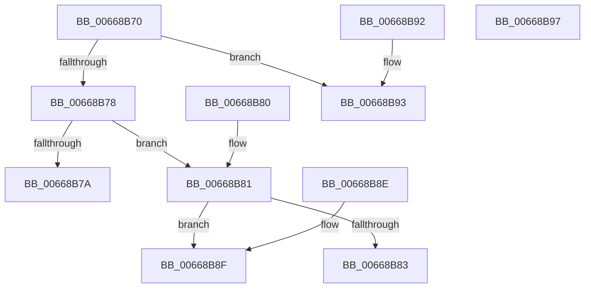

# AccelpCodeSort

- RVA: `0x00668B70`–`0x00668B98` (길이 `40` bytes)
- VA: `0x0000000140668B70`
- 실행 섹션: `.text`
- PDB 이름 있음: `예`; PDB Function 태그: `아니요`
- unwind 정보 RVA: `0x000DB714`
- 디코드: `19`개 명령, `40/40` bytes 표시
- 미해석 바이트: `0` (있으면 어셈블리에 `.byte`로 보존)

> 이 문서는 커널 이미지의 기계어와 PDB 기호를 분석해 생성했습니다. 4번과 5번은 함수 원형과 자료형을 바이너리 사용 방식에서 추정한 C 해석이며 원본 소스 복구 결과는 아닙니다.

## 1. Dependencies

- 직접 호출 지점: **0**; 고유 호출 대상: **0**
- 직접 호출자로 확인된 함수: **0**
- RIP 상대 이미지 참조: **0**

### Outgoing calls
- 직접 디코드된 call 명령이 없습니다.

### Direct callers
- 이 함수 시작 RVA로 연결되는 직접 call은 확인되지 않았습니다. 간접 호출은 완전히 역산할 수 없습니다.

### Static image references
- 디코드된 RIP-relative 메모리 참조가 없습니다.

## 2. Other-region calls and transfers

- 다른 실행 섹션으로 향하는 call: **0**
- 별도 외부 분기/꼬리 이동을 확인하지 못했습니다.

## 3. Assembly (complete function range)

```asm
00668B70  48 8B 01                        mov rax, qword ptr [rcx]
00668B73  48 3B 02                        cmp rax, qword ptr [rdx]
00668B76  72 1B                           jb 0x140668b93
00668B78  76 07                           jbe 0x140668b81
00668B7A  B8 01 00 00 00                  mov eax, 1
00668B7F  C3                              ret
00668B80  CC                              int3
00668B81  75 0C                           jne 0x140668b8f
00668B83  48 8B 42 10                     mov rax, qword ptr [rdx + 0x10]
00668B87  48 39 41 10                     cmp qword ptr [rcx + 0x10], rax
00668B8B  1B C0                           sbb eax, eax
00668B8D  C3                              ret
00668B8E  CC                              int3
00668B8F  33 C0                           xor eax, eax
00668B91  C3                              ret
00668B92  CC                              int3
00668B93  83 C8 FF                        or eax, 0xffffffff
00668B96  C3                              ret
00668B97  CC                              int3
```

## 4. C-style interpretation (structured pseudocode)

```c
__int64 __fastcall AccelpCodeSort(__int64 a1, __int64 a2)
{
    __int64 result;

    if ((*(unsigned __int64 *)(a1)) < (*(unsigned __int64 *)(a2))) goto loc_00668B93;
    if ((*(unsigned __int64 *)(a1)) <= (*(unsigned __int64 *)(a2))) goto loc_00668B81;
    return 1;
loc_00668B81:
    if ((*(unsigned __int64 *)(a1)) != (*(unsigned __int64 *)(a2))) goto loc_00668B8F;
    return *(unsigned __int64 *)(a2 + 16);
loc_00668B8F:
    result = 0;
    return result;
loc_00668B93:
    result = (unsigned int)((result) | (0xFFFFFFFFULL));
    return result;
}
```

## 5. (Beta) C Style

```c
int64_t AccelpCodeSort(void *Arg1, void *Arg2)
{
    uint8_t *arg1 = (uint8_t *)Arg1;
    uint8_t *arg2 = (uint8_t *)Arg2;

    int64_t result;

    if ((*(uint64_t *)(arg1)) < (*(uint64_t *)(arg2))) goto loc_00668B93;
    if ((*(uint64_t *)(arg1)) <= (*(uint64_t *)(arg2))) goto loc_00668B81;
    return 1;
loc_00668B81:
    if ((*(uint64_t *)(arg1)) != (*(uint64_t *)(arg2))) goto loc_00668B8F;
    return *(uint64_t *)(arg2 + 0x10);
loc_00668B8F:
    result = 0;
    return result;
loc_00668B93:
    result = (uint32_t)((result) | (0xFFFFFFFFULL));
    return result;
}
```

### 관측된 메모리 오프셋

구조체 형식이 확인되지 않은 접근은 인자 기준의 오프셋으로만 기록했습니다.

| 기준 인자 | 오프셋 표현 | 폭 (bit) | 접근 |
|---|---:|---:|---|
| `Arg1` | `+ 0x0` | `64` | `R` |
| `Arg1` | `+ 0x10` | `64` | `R` |
| `Arg2` | `+ 0x0` | `64` | `R` |
| `Arg2` | `+ 0x10` | `64` | `R` |

## 6. Execution-region graph

[열기: 2D/3D 그래프와 함수 탐색 컨트롤 패널](../../../control-panel.html?section=text&rva=0x00668B70&view=graph)

- 2D 그래프는 위에서 아래로 흐르고, 3D 그래프는 빈 공간을 드래그해 회전합니다. Shift+드래그는 이동, 휠은 확대·축소, 함수 노드 선택은 대상 보고서 이동입니다.

### Static fallback


