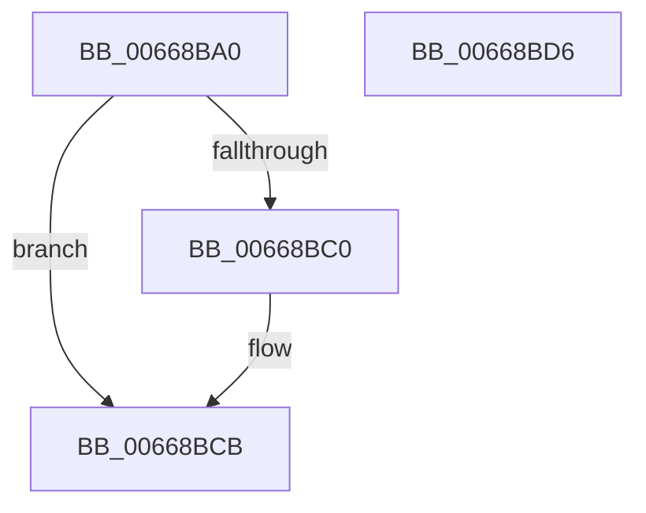

# AccelpComputeHistogram

- RVA: `0x00668BA0`–`0x00668BD7` (길이 `55` bytes)
- VA: `0x0000000140668BA0`
- 실행 섹션: `.text`
- PDB 이름 있음: `예`; PDB Function 태그: `아니요`
- unwind 정보 RVA: `0x0006E5F8`
- 디코드: `17`개 명령, `55/55` bytes 표시
- 미해석 바이트: `0` (있으면 어셈블리에 `.byte`로 보존)

> 이 문서는 커널 이미지의 기계어와 PDB 기호를 분석해 생성했습니다. 4번과 5번은 함수 원형과 자료형을 바이너리 사용 방식에서 추정한 C 해석이며 원본 소스 복구 결과는 아닙니다.

## 1. Dependencies

- 직접 호출 지점: **2**; 고유 호출 대상: **2**
- 직접 호출자로 확인된 함수: **1**
- RIP 상대 이미지 참조: **0**

### Outgoing calls
- `0x00668BB7` → [AccelpBuildDescriptorComputeHistogram](AccelpBuildDescriptorComputeHistogram_function_00668804.md) (function, `0x00668804`)
- `0x00668BC6` → [AccelpSubmitWork](../2C/AccelpSubmitWork_function_002C8190.md) (function, `0x002C8190`)

### Direct callers
- [AccelCompressBuffer](AccelCompressBuffer_function_00668258.md) at `0x006682AD`

### Static image references
- 디코드된 RIP-relative 메모리 참조가 없습니다.

## 2. Other-region calls and transfers

- 다른 실행 섹션으로 향하는 call: **0**
- 별도 외부 분기/꼬리 이동을 확인하지 못했습니다.

## 3. Assembly (complete function range)

```asm
00668BA0  48 89 5C 24 08                  mov qword ptr [rsp + 8], rbx
00668BA5  57                              push rdi
00668BA6  48 83 EC 30                     sub rsp, 0x30
00668BAA  48 8B 7C 24 60                  mov rdi, qword ptr [rsp + 0x60]
00668BAF  48 8B D9                        mov rbx, rcx
00668BB2  48 89 7C 24 20                  mov qword ptr [rsp + 0x20], rdi
00668BB7  E8 48 FC FF FF                  call 0x140668804
00668BBC  85 C0                           test eax, eax
00668BBE  78 0B                           js 0x140668bcb
00668BC0  48 8B D7                        mov rdx, rdi
00668BC3  48 8B CB                        mov rcx, rbx
00668BC6  E8 C5 F5 C5 FF                  call 0x1402c8190
00668BCB  48 8B 5C 24 40                  mov rbx, qword ptr [rsp + 0x40]
00668BD0  48 83 C4 30                     add rsp, 0x30
00668BD4  5F                              pop rdi
00668BD5  C3                              ret
00668BD6  CC                              int3
```

## 4. C-style interpretation (structured pseudocode)

```c
__int64 __fastcall AccelpComputeHistogram(__int64 a1, __int64 a2, __int64 a3, __int64 a4, __int64 a5)
{
    __int64 result;
    __int64 v_rsp;
    unsigned __int64 v_stack_m18;
    unsigned __int64 v_stack_p8;

    v_stack_p8 = v_rbx;
    v_rsp = (v_rsp) - (48);
    v_stack_m18 = a5;
    result = AccelpBuildDescriptorComputeHistogram(a1, a2, a3, a4);
    if (!(sign_flag)) {
        a2 = a5;
        a1 = a1;
        result = AccelpSubmitWork(a1, a2, a3, a4);
    }
    v_rsp = (v_rsp) + (48);
    return result;
}
```

## 5. (Beta) C Style

```c
int64_t AccelpComputeHistogram(int64_t Arg1, int64_t Arg2, int64_t Arg3, int64_t Arg4, int64_t Arg5)
{
    int64_t result;
    int64_t local_rsp;
    uint64_t v_stack_m18;
    uint64_t v_stack_p8;

    v_stack_p8 = local_rbx;
    local_rsp = (local_rsp) - (48);
    v_stack_m18 = Arg5;
    result = AccelpBuildDescriptorComputeHistogram(Arg1, Arg2, Arg3, Arg4);
    if (!(sign_flag)) {
        Arg2 = Arg5;
        Arg1 = Arg1;
        result = AccelpSubmitWork(Arg1, Arg2, Arg3, Arg4);
    }
    local_rsp = (local_rsp) + (48);
    return result;
}
```

## 6. Execution-region graph

[열기: 2D/3D 그래프와 함수 탐색 컨트롤 패널](../../../control-panel.html?section=text&rva=0x00668BA0&view=graph)

- 2D 그래프는 위에서 아래로 흐르고, 3D 그래프는 빈 공간을 드래그해 회전합니다. Shift+드래그는 이동, 휠은 확대·축소, 함수 노드 선택은 대상 보고서 이동입니다.

### Static fallback


