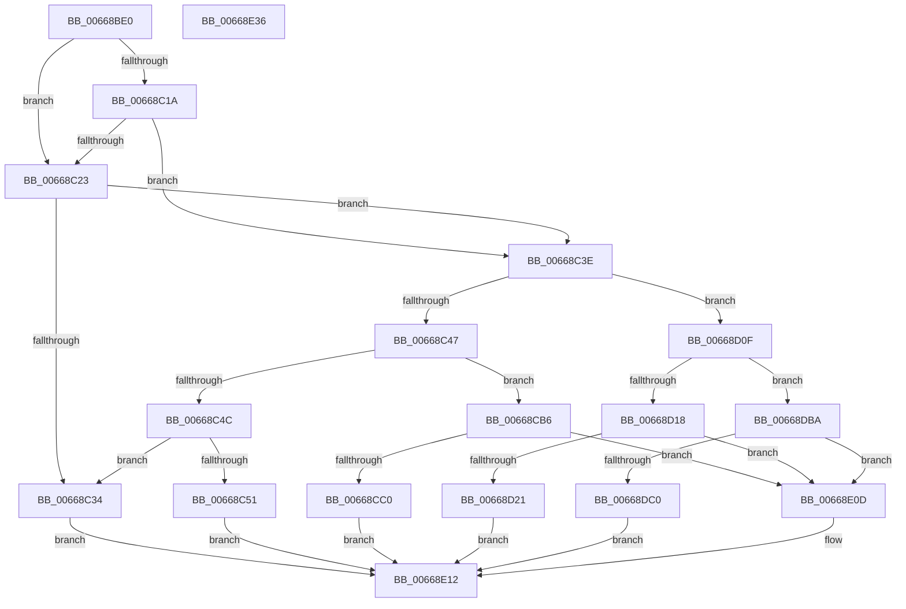

# AccelpSiovCompressionDecompression

- RVA: `0x00668BE0`–`0x00668E37` (길이 `599` bytes)
- VA: `0x0000000140668BE0`
- 실행 섹션: `.text`
- PDB 이름 있음: `예`; PDB Function 태그: `아니요`
- unwind 정보 RVA: `0x000CDE54`
- 디코드: `151`개 명령, `599/599` bytes 표시
- 미해석 바이트: `0` (있으면 어셈블리에 `.byte`로 보존)

> 이 문서는 커널 이미지의 기계어와 PDB 기호를 분석해 생성했습니다. 4번과 5번은 함수 원형과 자료형을 바이너리 사용 방식에서 추정한 C 해석이며 원본 소스 복구 결과는 아닙니다.

## 1. Dependencies

- 직접 호출 지점: **5**; 고유 호출 대상: **5**
- 직접 호출자로 확인된 함수: **1**
- RIP 상대 이미지 참조: **0**

### Outgoing calls
- `0x00668CAC` → [IaaBuildDescriptorHuffmanCompress](IaaBuildDescriptorHuffmanCompress_function_00669790.md) (function, `0x00669790`)
- `0x00668D05` → [IaaBuildDescriptorFixedCompress](IaaBuildDescriptorFixedCompress_function_006695CC.md) (function, `0x006695CC`)
- `0x00668D85` → [IaaBuildDescriptorHuffmanDecompress](IaaBuildDescriptorHuffmanDecompress_function_006698BC.md) (function, `0x006698BC`)
- `0x00668DB3` → [IaapSetAecsDecompressionHuffmanTable](IaapSetAecsDecompressionHuffmanTable_function_00669A28.md) (function, `0x00669A28`)
- `0x00668DF3` → [DsaBuildDescriptorCommon](../48/DsaBuildDescriptorCommon_function_00483934.md) (function, `0x00483934`)

### Direct callers
- [AccelpSiovIaaOperationHandler](AccelpSiovIaaOperationHandler_function_00668EF0.md) at `0x0066908F`

### Static image references
- 디코드된 RIP-relative 메모리 참조가 없습니다.

## 2. Other-region calls and transfers

- 다른 실행 섹션으로 향하는 call: **0**
- 별도 외부 분기/꼬리 이동을 확인하지 못했습니다.

## 3. Assembly (complete function range)

```asm
00668BE0  48 8B C4                        mov rax, rsp
00668BE3  48 89 58 08                     mov qword ptr [rax + 8], rbx
00668BE7  48 89 68 10                     mov qword ptr [rax + 0x10], rbp
00668BEB  48 89 70 18                     mov qword ptr [rax + 0x18], rsi
00668BEF  48 89 78 20                     mov qword ptr [rax + 0x20], rdi
00668BF3  41 54                           push r12
00668BF5  41 56                           push r14
00668BF7  41 57                           push r15
00668BF9  48 81 EC 80 00 00 00            sub rsp, 0x80
00668C00  33 ED                           xor ebp, ebp
00668C02  44 8A E2                        mov r12b, dl
00668C05  8B 11                           mov edx, dword ptr [rcx]
00668C07  48 8B F1                        mov rsi, rcx
00668C0A  8B 49 58                        mov ecx, dword ptr [rcx + 0x58]
00668C0D  45 8A F1                        mov r14b, r9b
00668C10  45 8B F8                        mov r15d, r8d
00668C13  8B DD                           mov ebx, ebp
00668C15  83 F9 01                        cmp ecx, 1
00668C18  75 09                           jne 0x140668c23
00668C1A  4C 8D 56 5C                     lea r10, [rsi + 0x5c]
00668C1E  41 39 0A                        cmp dword ptr [r10], ecx
00668C21  74 1B                           je 0x140668c3e
00668C23  48 8B 46 50                     mov rax, qword ptr [rsi + 0x50]
00668C27  4C 8D 56 5C                     lea r10, [rsi + 0x5c]
00668C2B  48 8B 58 18                     mov rbx, qword ptr [rax + 0x18]
00668C2F  48 85 DB                        test rbx, rbx
00668C32  75 0A                           jne 0x140668c3e
00668C34  BD 0D 00 00 C0                  mov ebp, 0xc000000d
00668C39  E9 D4 01 00 00                  jmp 0x140668e12
00668C3E  83 FA 0B                        cmp edx, 0xb
00668C41  0F 85 C8 00 00 00               jne 0x140668d0f
00668C47  83 E9 01                        sub ecx, 1
00668C4A  74 6A                           je 0x140668cb6
00668C4C  83 F9 01                        cmp ecx, 1
00668C4F  75 E3                           jne 0x140668c34
00668C51  8A 84 24 C0 00 00 00            mov al, byte ptr [rsp + 0xc0]
00668C58  4C 8D 8B 48 31 00 00            lea r9, [rbx + 0x3148]
00668C5F  48 8B 4E 60                     mov rcx, qword ptr [rsi + 0x60]
00668C63  4C 8B 46 50                     mov r8, qword ptr [rsi + 0x50]
00668C67  48 8B 56 20                     mov rdx, qword ptr [rsi + 0x20]
00668C6B  88 44 24 60                     mov byte ptr [rsp + 0x60], al
00668C6F  8A 01                           mov al, byte ptr [rcx]
00668C71  4D 8B 40 10                     mov r8, qword ptr [r8 + 0x10]
00668C75  48 8B 4E 18                     mov rcx, qword ptr [rsi + 0x18]
00668C79  44 88 74 24 58                  mov byte ptr [rsp + 0x58], r14b
00668C7E  44 89 7C 24 50                  mov dword ptr [rsp + 0x50], r15d
00668C83  44 88 64 24 48                  mov byte ptr [rsp + 0x48], r12b
00668C88  88 44 24 40                     mov byte ptr [rsp + 0x40], al
00668C8C  8B 46 48                        mov eax, dword ptr [rsi + 0x48]
00668C8F  89 44 24 38                     mov dword ptr [rsp + 0x38], eax
00668C93  48 8B 46 40                     mov rax, qword ptr [rsi + 0x40]
00668C97  48 89 44 24 30                  mov qword ptr [rsp + 0x30], rax
00668C9C  8B 46 38                        mov eax, dword ptr [rsi + 0x38]
00668C9F  89 44 24 28                     mov dword ptr [rsp + 0x28], eax
00668CA3  48 8B 46 30                     mov rax, qword ptr [rsi + 0x30]
00668CA7  48 89 44 24 20                  mov qword ptr [rsp + 0x20], rax
00668CAC  E8 DF 0A 00 00                  call 0x140669790
00668CB1  E9 5C 01 00 00                  jmp 0x140668e12
00668CB6  41 83 3A 01                     cmp dword ptr [r10], 1
00668CBA  0F 85 4D 01 00 00               jne 0x140668e0d
00668CC0  8A 84 24 C0 00 00 00            mov al, byte ptr [rsp + 0xc0]
00668CC7  4C 8B 46 50                     mov r8, qword ptr [rsi + 0x50]
00668CCB  4C 8B 4E 30                     mov r9, qword ptr [rsi + 0x30]
00668CCF  48 8B 56 20                     mov rdx, qword ptr [rsi + 0x20]
00668CD3  48 8B 4E 18                     mov rcx, qword ptr [rsi + 0x18]
00668CD7  4D 8B 40 10                     mov r8, qword ptr [r8 + 0x10]
00668CDB  88 44 24 50                     mov byte ptr [rsp + 0x50], al
00668CDF  8B 46 48                        mov eax, dword ptr [rsi + 0x48]
00668CE2  44 88 74 24 48                  mov byte ptr [rsp + 0x48], r14b
00668CE7  44 89 7C 24 40                  mov dword ptr [rsp + 0x40], r15d
00668CEC  44 88 64 24 38                  mov byte ptr [rsp + 0x38], r12b
00668CF1  89 44 24 30                     mov dword ptr [rsp + 0x30], eax
00668CF5  48 8B 46 40                     mov rax, qword ptr [rsi + 0x40]
00668CF9  48 89 44 24 28                  mov qword ptr [rsp + 0x28], rax
00668CFE  8B 46 38                        mov eax, dword ptr [rsi + 0x38]
00668D01  89 44 24 20                     mov dword ptr [rsp + 0x20], eax
00668D05  E8 C2 08 00 00                  call 0x1406695cc
00668D0A  E9 03 01 00 00                  jmp 0x140668e12
00668D0F  83 E9 01                        sub ecx, 1
00668D12  0F 84 A2 00 00 00               je 0x140668dba
00668D18  83 F9 01                        cmp ecx, 1
00668D1B  0F 85 EC 00 00 00               jne 0x140668e0d
00668D21  48 8B 4E 68                     mov rcx, qword ptr [rsi + 0x68]
00668D25  8A 84 24 C0 00 00 00            mov al, byte ptr [rsp + 0xc0]
00668D2C  4C 8B 46 50                     mov r8, qword ptr [rsi + 0x50]
00668D30  4C 8B 4E 30                     mov r9, qword ptr [rsi + 0x30]
00668D34  48 8B 56 20                     mov rdx, qword ptr [rsi + 0x20]
00668D38  88 44 24 70                     mov byte ptr [rsp + 0x70], al
00668D3C  8A 41 03                        mov al, byte ptr [rcx + 3]
00668D3F  4D 8B 40 10                     mov r8, qword ptr [r8 + 0x10]
00668D43  44 88 74 24 68                  mov byte ptr [rsp + 0x68], r14b
00668D48  44 89 7C 24 60                  mov dword ptr [rsp + 0x60], r15d
00668D4D  44 88 64 24 58                  mov byte ptr [rsp + 0x58], r12b
00668D52  88 44 24 50                     mov byte ptr [rsp + 0x50], al
00668D56  8A 41 02                        mov al, byte ptr [rcx + 2]
00668D59  88 44 24 48                     mov byte ptr [rsp + 0x48], al
00668D5D  8A 41 01                        mov al, byte ptr [rcx + 1]
00668D60  88 44 24 40                     mov byte ptr [rsp + 0x40], al
00668D64  8A 01                           mov al, byte ptr [rcx]
00668D66  48 8B 4E 18                     mov rcx, qword ptr [rsi + 0x18]
00668D6A  88 44 24 38                     mov byte ptr [rsp + 0x38], al
00668D6E  8B 46 48                        mov eax, dword ptr [rsi + 0x48]
00668D71  89 44 24 30                     mov dword ptr [rsp + 0x30], eax
00668D75  48 8B 46 40                     mov rax, qword ptr [rsi + 0x40]
00668D79  48 89 44 24 28                  mov qword ptr [rsp + 0x28], rax
00668D7E  8B 46 38                        mov eax, dword ptr [rsi + 0x38]
00668D81  89 44 24 20                     mov dword ptr [rsp + 0x20], eax
00668D85  E8 32 0B 00 00                  call 0x1406698bc
00668D8A  48 8B 56 50                     mov rdx, qword ptr [rsi + 0x50]
00668D8E  48 8D 83 48 43 00 00            lea rax, [rbx + 0x4348]
00668D95  4C 8D 8B 48 3F 00 00            lea r9, [rbx + 0x3f48]
00668D9C  48 89 44 24 20                  mov qword ptr [rsp + 0x20], rax
00668DA1  4C 8D 83 48 3B 00 00            lea r8, [rbx + 0x3b48]
00668DA8  48 8D 8B 48 31 00 00            lea rcx, [rbx + 0x3148]
00668DAF  48 8B 52 10                     mov rdx, qword ptr [rdx + 0x10]
00668DB3  E8 70 0C 00 00                  call 0x140669a28
00668DB8  EB 58                           jmp 0x140668e12
00668DBA  41 83 3A 01                     cmp dword ptr [r10], 1
00668DBE  75 4D                           jne 0x140668e0d
00668DC0  8A 84 24 C0 00 00 00            mov al, byte ptr [rsp + 0xc0]
00668DC7  45 8A CC                        mov r9b, r12b
00668DCA  48 8B 56 18                     mov rdx, qword ptr [rsi + 0x18]
00668DCE  B9 42 00 00 00                  mov ecx, 0x42
00668DD3  4C 8B 46 20                     mov r8, qword ptr [rsi + 0x20]
00668DD7  8B 5E 48                        mov ebx, dword ptr [rsi + 0x48]
00668DDA  4C 8B 56 40                     mov r10, qword ptr [rsi + 0x40]
00668DDE  8B 7E 38                        mov edi, dword ptr [rsi + 0x38]
00668DE1  4C 8B 5E 30                     mov r11, qword ptr [rsi + 0x30]
00668DE5  88 44 24 30                     mov byte ptr [rsp + 0x30], al
00668DE9  44 88 74 24 28                  mov byte ptr [rsp + 0x28], r14b
00668DEE  44 89 7C 24 20                  mov dword ptr [rsp + 0x20], r15d
00668DF3  E8 3C AB E1 FF                  call 0x140483934
00668DF8  66 83 4A 26 1F                  or word ptr [rdx + 0x26], 0x1f
00668DFD  4C 89 52 10                     mov qword ptr [rdx + 0x10], r10
00668E01  89 5A 20                        mov dword ptr [rdx + 0x20], ebx
00668E04  4C 89 5A 18                     mov qword ptr [rdx + 0x18], r11
00668E08  89 7A 30                        mov dword ptr [rdx + 0x30], edi
00668E0B  EB 05                           jmp 0x140668e12
00668E0D  BD 5F 02 00 C0                  mov ebp, 0xc000025f
00668E12  4C 8D 9C 24 80 00 00 00         lea r11, [rsp + 0x80]
00668E1A  8B C5                           mov eax, ebp
00668E1C  49 8B 5B 20                     mov rbx, qword ptr [r11 + 0x20]
00668E20  49 8B 6B 28                     mov rbp, qword ptr [r11 + 0x28]
00668E24  49 8B 73 30                     mov rsi, qword ptr [r11 + 0x30]
00668E28  49 8B 7B 38                     mov rdi, qword ptr [r11 + 0x38]
00668E2C  49 8B E3                        mov rsp, r11
00668E2F  41 5F                           pop r15
00668E31  41 5E                           pop r14
00668E33  41 5C                           pop r12
00668E35  C3                              ret
00668E36  CC                              int3
```

## 4. C-style interpretation (structured pseudocode)

```c
__int64 __fastcall AccelpSiovCompressionDecompression(__int64 a1, unsigned __int8 a2, int a3, unsigned __int8 a4, unsigned __int8 a5)
{
    __int64 result;
    __int64 v_rbp;
    __int64 v_rsp;
    unsigned __int64 v_stack_m18;
    unsigned __int8 v_stack_m28;
    unsigned __int8 v_stack_m30;
    unsigned __int8 v_stack_m38;
    unsigned __int8 v_stack_m40;
    unsigned int v_stack_m48;
    unsigned __int8 v_stack_m50;
    unsigned __int8 v_stack_m58;
    unsigned int v_stack_m60;
    unsigned __int64 v_stack_m68;
    unsigned int v_stack_m70;
    unsigned __int64 v_stack_m78;

    *(unsigned __int64 *)(v_rsp + 8) = v_rbx;
    *(unsigned __int64 *)(v_rsp + 16) = v_rbp;
    *(unsigned __int64 *)(v_rsp + 24) = v_rsi;
    *(unsigned __int64 *)(v_rsp + 32) = v_rdi;
    v_rsp = (v_rsp) - (128);
    v_rbp = 0;
    if (((unsigned int)((unsigned int)(*(unsigned int *)(a1 + 88)))) != 1) goto loc_00668C23;
    if ((*(unsigned int *)(a1 + 92)) == ((unsigned int)((unsigned int)(*(unsigned int *)(a1 + 88))))) goto loc_00668C3E;
loc_00668C23:
    if (*(unsigned __int64 *)(*(unsigned __int64 *)(a1 + 80) + 24) != 0) goto loc_00668C3E;
loc_00668C34:
    goto loc_00668E12;
loc_00668C3E:
    if (((unsigned int)((unsigned int)(*(unsigned int *)(a1)))) != 11) goto loc_00668D0F;
    a1 = (unsigned int)(((unsigned int)(*(unsigned int *)(a1 + 88))) - (1));
    if (condition_is_equal) goto loc_00668CB6;
    if (((unsigned int)(a1)) != 1) goto loc_00668C34;
    v_stack_m38 = a5;
    v_stack_m40 = a4;
    v_stack_m48 = (unsigned int)((unsigned int)(a3));
    v_stack_m50 = a2;
    v_stack_m58 = (unsigned __int8)(*(unsigned __int8 *)(*(unsigned __int64 *)(a1 + 96)));
    v_stack_m60 = (unsigned int)((unsigned int)(*(unsigned int *)(a1 + 72)));
    v_stack_m68 = *(unsigned __int64 *)(a1 + 64);
    v_stack_m70 = (unsigned int)((unsigned int)(*(unsigned int *)(a1 + 56)));
    v_stack_m78 = *(unsigned __int64 *)(a1 + 48);
    result = IaaBuildDescriptorHuffmanCompress(*(unsigned __int64 *)(a1 + 24), *(unsigned __int64 *)(a1 + 32), *(unsigned __int64 *)(*(unsigned __int64 *)(a1 + 80) + 16), *(unsigned __int64 *)(*(unsigned __int64 *)(a1 + 80) + 24) + 12616);
    goto loc_00668E12;
loc_00668CB6:
    if ((*(unsigned int *)(a1 + 92)) != 1) goto loc_00668E0D;
    v_stack_m48 = a5;
    v_stack_m50 = a4;
    v_stack_m58 = (unsigned int)((unsigned int)(a3));
    v_stack_m60 = a2;
    v_stack_m68 = (unsigned int)((unsigned int)(*(unsigned int *)(a1 + 72)));
    v_stack_m70 = *(unsigned __int64 *)(a1 + 64);
    v_stack_m78 = (unsigned int)((unsigned int)(*(unsigned int *)(a1 + 56)));
    result = IaaBuildDescriptorFixedCompress(*(unsigned __int64 *)(a1 + 24), *(unsigned __int64 *)(a1 + 32), *(unsigned __int64 *)(*(unsigned __int64 *)(a1 + 80) + 16), *(unsigned __int64 *)(a1 + 48));
    goto loc_00668E12;
loc_00668D0F:
    a1 = (unsigned int)((*(unsigned __int64 *)(a1 + 24)) - (1));
    if (condition_is_equal) goto loc_00668DBA;
    if (((unsigned int)(a1)) != 1) goto loc_00668E0D;
    v_stack_m28 = a5;
    v_stack_m30 = a4;
    v_stack_m38 = (unsigned int)((unsigned int)(a3));
    v_stack_m40 = a2;
    v_stack_m48 = (unsigned __int8)(*(unsigned __int8 *)(*(unsigned __int64 *)(a1 + 104) + 3));
    v_stack_m50 = (unsigned __int8)(*(unsigned __int8 *)(*(unsigned __int64 *)(a1 + 104) + 2));
    v_stack_m58 = (unsigned __int8)(*(unsigned __int8 *)(*(unsigned __int64 *)(a1 + 104) + 1));
    v_stack_m60 = (unsigned __int8)(*(unsigned __int8 *)(*(unsigned __int64 *)(a1 + 104)));
    v_stack_m68 = (unsigned int)((unsigned int)(*(unsigned int *)(a1 + 72)));
    v_stack_m70 = *(unsigned __int64 *)(a1 + 64);
    v_stack_m78 = (unsigned int)((unsigned int)(*(unsigned int *)(a1 + 56)));
    result = IaaBuildDescriptorHuffmanDecompress(*(unsigned __int64 *)(a1 + 24), *(unsigned __int64 *)(a1 + 32), *(unsigned __int64 *)(*(unsigned __int64 *)(a1 + 80) + 16), *(unsigned __int64 *)(a1 + 48));
    v_stack_m78 = *(unsigned __int64 *)(*(unsigned __int64 *)(a1 + 80) + 24) + 17224;
    result = IaapSetAecsDecompressionHuffmanTable(*(unsigned __int64 *)(*(unsigned __int64 *)(a1 + 80) + 24) + 12616, *(unsigned __int64 *)(*(unsigned __int64 *)(a1 + 80) + 16), *(unsigned __int64 *)(*(unsigned __int64 *)(a1 + 80) + 24) + 15176, *(unsigned __int64 *)(*(unsigned __int64 *)(a1 + 80) + 24) + 16200);
    goto loc_00668E12;
loc_00668DBA:
    if ((*(unsigned int *)(a1 + 92)) != 1) goto loc_00668E0D;
    v_stack_m68 = a5;
    v_stack_m70 = a4;
    v_stack_m78 = (unsigned int)((unsigned int)(a3));
    result = DsaBuildDescriptorCommon(66, *(unsigned __int64 *)(a1 + 24), *(unsigned __int64 *)(a1 + 32), a2);
    *(unsigned __int64 *)(*(unsigned __int64 *)(a1 + 24) + 16) = *(unsigned __int64 *)(a1 + 64);
    *(unsigned int *)(*(unsigned __int64 *)(a1 + 24) + 32) = (unsigned int)((unsigned int)(*(unsigned int *)(a1 + 72)));
    *(unsigned __int64 *)(*(unsigned __int64 *)(a1 + 24) + 24) = *(unsigned __int64 *)(a1 + 48);
    *(unsigned int *)(*(unsigned __int64 *)(a1 + 24) + 48) = (unsigned int)((unsigned int)(*(unsigned int *)(a1 + 56)));
    goto loc_00668E12;
loc_00668E0D:
loc_00668E12:
    return (unsigned int)((unsigned int)((unsigned int)(0xC000025FULL)));
}
```

## 5. (Beta) C Style

```c
int64_t AccelpSiovCompressionDecompression(void *Arg1, uint8_t Arg2, int32_t Arg3, uint8_t Arg4, uint8_t Arg5)
{
    uint8_t *arg1 = (uint8_t *)Arg1;

    int64_t result;
    int64_t local_rbp;
    int64_t local_rsp;
    uint64_t v_stack_m18;
    uint8_t v_stack_m28;
    uint8_t v_stack_m30;
    uint8_t v_stack_m38;
    uint8_t v_stack_m40;
    uint32_t v_stack_m48;
    uint8_t v_stack_m50;
    uint8_t v_stack_m58;
    uint32_t v_stack_m60;
    uint64_t v_stack_m68;
    uint32_t v_stack_m70;
    uint64_t v_stack_m78;

    *(uint64_t *)(local_rsp + 0x8) = local_rbx;
    *(uint64_t *)(local_rsp + 0x10) = local_rbp;
    *(uint64_t *)(local_rsp + 0x18) = local_rsi;
    *(uint64_t *)(local_rsp + 0x20) = local_rdi;
    local_rsp = (local_rsp) - (128);
    local_rbp = 0;
    if (((uint32_t)((uint32_t)(*(uint32_t *)(arg1 + 0x58)))) != 1) goto loc_00668C23;
    if ((*(uint32_t *)(arg1 + 0x5C)) == ((uint32_t)((uint32_t)(*(uint32_t *)(arg1 + 0x58))))) goto loc_00668C3E;
loc_00668C23:
    if (*(uint64_t *)(*(uint64_t *)(arg1 + 0x50) + 0x18) != 0) goto loc_00668C3E;
loc_00668C34:
    goto loc_00668E12;
loc_00668C3E:
    if (((uint32_t)((uint32_t)(*(uint32_t *)(arg1)))) != 11) goto loc_00668D0F;
    Arg1 = (uint32_t)(((uint32_t)(*(uint32_t *)(arg1 + 0x58))) - (1));
    if (condition_is_equal) goto loc_00668CB6;
    if (((uint32_t)(Arg1)) != 1) goto loc_00668C34;
    v_stack_m38 = Arg5;
    v_stack_m40 = Arg4;
    v_stack_m48 = (uint32_t)((uint32_t)(Arg3));
    v_stack_m50 = Arg2;
    v_stack_m58 = (uint8_t)(*(uint8_t *)(*(uint64_t *)(arg1 + 0x60)));
    v_stack_m60 = (uint32_t)((uint32_t)(*(uint32_t *)(arg1 + 0x48)));
    v_stack_m68 = *(uint64_t *)(arg1 + 0x40);
    v_stack_m70 = (uint32_t)((uint32_t)(*(uint32_t *)(arg1 + 0x38)));
    v_stack_m78 = *(uint64_t *)(arg1 + 0x30);
    result = IaaBuildDescriptorHuffmanCompress(*(uint64_t *)(arg1 + 0x18), *(uint64_t *)(arg1 + 0x20), *(uint64_t *)(*(uint64_t *)(arg1 + 0x50) + 0x10), *(uint64_t *)(*(uint64_t *)(arg1 + 0x50) + 0x18) + 12616);
    goto loc_00668E12;
loc_00668CB6:
    if ((*(uint32_t *)(arg1 + 0x5C)) != 1) goto loc_00668E0D;
    v_stack_m48 = Arg5;
    v_stack_m50 = Arg4;
    v_stack_m58 = (uint32_t)((uint32_t)(Arg3));
    v_stack_m60 = Arg2;
    v_stack_m68 = (uint32_t)((uint32_t)(*(uint32_t *)(arg1 + 0x48)));
    v_stack_m70 = *(uint64_t *)(arg1 + 0x40);
    v_stack_m78 = (uint32_t)((uint32_t)(*(uint32_t *)(arg1 + 0x38)));
    result = IaaBuildDescriptorFixedCompress(*(uint64_t *)(arg1 + 0x18), *(uint64_t *)(arg1 + 0x20), *(uint64_t *)(*(uint64_t *)(arg1 + 0x50) + 0x10), *(uint64_t *)(arg1 + 0x30));
    goto loc_00668E12;
loc_00668D0F:
    Arg1 = (uint32_t)((*(uint64_t *)(arg1 + 0x18)) - (1));
    if (condition_is_equal) goto loc_00668DBA;
    if (((uint32_t)(Arg1)) != 1) goto loc_00668E0D;
    v_stack_m28 = Arg5;
    v_stack_m30 = Arg4;
    v_stack_m38 = (uint32_t)((uint32_t)(Arg3));
    v_stack_m40 = Arg2;
    v_stack_m48 = (uint8_t)(*(uint8_t *)(*(uint64_t *)(arg1 + 0x68) + 0x3));
    v_stack_m50 = (uint8_t)(*(uint8_t *)(*(uint64_t *)(arg1 + 0x68) + 0x2));
    v_stack_m58 = (uint8_t)(*(uint8_t *)(*(uint64_t *)(arg1 + 0x68) + 0x1));
    v_stack_m60 = (uint8_t)(*(uint8_t *)(*(uint64_t *)(arg1 + 0x68)));
    v_stack_m68 = (uint32_t)((uint32_t)(*(uint32_t *)(arg1 + 0x48)));
    v_stack_m70 = *(uint64_t *)(arg1 + 0x40);
    v_stack_m78 = (uint32_t)((uint32_t)(*(uint32_t *)(arg1 + 0x38)));
    result = IaaBuildDescriptorHuffmanDecompress(*(uint64_t *)(arg1 + 0x18), *(uint64_t *)(arg1 + 0x20), *(uint64_t *)(*(uint64_t *)(arg1 + 0x50) + 0x10), *(uint64_t *)(arg1 + 0x30));
    v_stack_m78 = *(uint64_t *)(*(uint64_t *)(arg1 + 0x50) + 0x18) + 17224;
    result = IaapSetAecsDecompressionHuffmanTable(*(uint64_t *)(*(uint64_t *)(arg1 + 0x50) + 0x18) + 12616, *(uint64_t *)(*(uint64_t *)(arg1 + 0x50) + 0x10), *(uint64_t *)(*(uint64_t *)(arg1 + 0x50) + 0x18) + 15176, *(uint64_t *)(*(uint64_t *)(arg1 + 0x50) + 0x18) + 16200);
    goto loc_00668E12;
loc_00668DBA:
    if ((*(uint32_t *)(arg1 + 0x5C)) != 1) goto loc_00668E0D;
    v_stack_m68 = Arg5;
    v_stack_m70 = Arg4;
    v_stack_m78 = (uint32_t)((uint32_t)(Arg3));
    result = DsaBuildDescriptorCommon(66, *(uint64_t *)(arg1 + 0x18), *(uint64_t *)(arg1 + 0x20), Arg2);
    *(uint64_t *)(*(uint64_t *)(arg1 + 0x18) + 0x10) = *(uint64_t *)(arg1 + 0x40);
    *(uint32_t *)(*(uint64_t *)(arg1 + 0x18) + 0x20) = (uint32_t)((uint32_t)(*(uint32_t *)(arg1 + 0x48)));
    *(uint64_t *)(*(uint64_t *)(arg1 + 0x18) + 0x18) = *(uint64_t *)(arg1 + 0x30);
    *(uint32_t *)(*(uint64_t *)(arg1 + 0x18) + 0x30) = (uint32_t)((uint32_t)(*(uint32_t *)(arg1 + 0x38)));
    goto loc_00668E12;
loc_00668E0D:
loc_00668E12:
    return (uint32_t)((uint32_t)((uint32_t)(0xC000025FULL)));
}
```

### 관측된 메모리 오프셋

구조체 형식이 확인되지 않은 접근은 인자 기준의 오프셋으로만 기록했습니다.

| 기준 인자 | 오프셋 표현 | 폭 (bit) | 접근 |
|---|---:|---:|---|
| `Arg1` | `+ 0x0` | `32` | `R` |
| `Arg1` | `+ 0x18` | `64` | `R` |
| `Arg1` | `+ 0x20` | `64` | `R` |
| `Arg1` | `+ 0x30` | `64` | `R` |
| `Arg1` | `+ 0x38` | `32` | `R` |
| `Arg1` | `+ 0x40` | `64` | `R` |
| `Arg1` | `+ 0x48` | `32` | `R` |
| `Arg1` | `+ 0x50` | `64` | `R` |
| `Arg1` | `+ 0x58` | `32` | `R` |
| `Arg1` | `+ 0x5C` | `64` | `R` |
| `Arg1` | `+ 0x60` | `64` | `R` |
| `Arg1` | `+ 0x68` | `64` | `R` |

## 6. Execution-region graph

[열기: 2D/3D 그래프와 함수 탐색 컨트롤 패널](../../../control-panel.html?section=text&rva=0x00668BE0&view=graph)

- 2D 그래프는 위에서 아래로 흐르고, 3D 그래프는 빈 공간을 드래그해 회전합니다. Shift+드래그는 이동, 휠은 확대·축소, 함수 노드 선택은 대상 보고서 이동입니다.

### Static fallback


