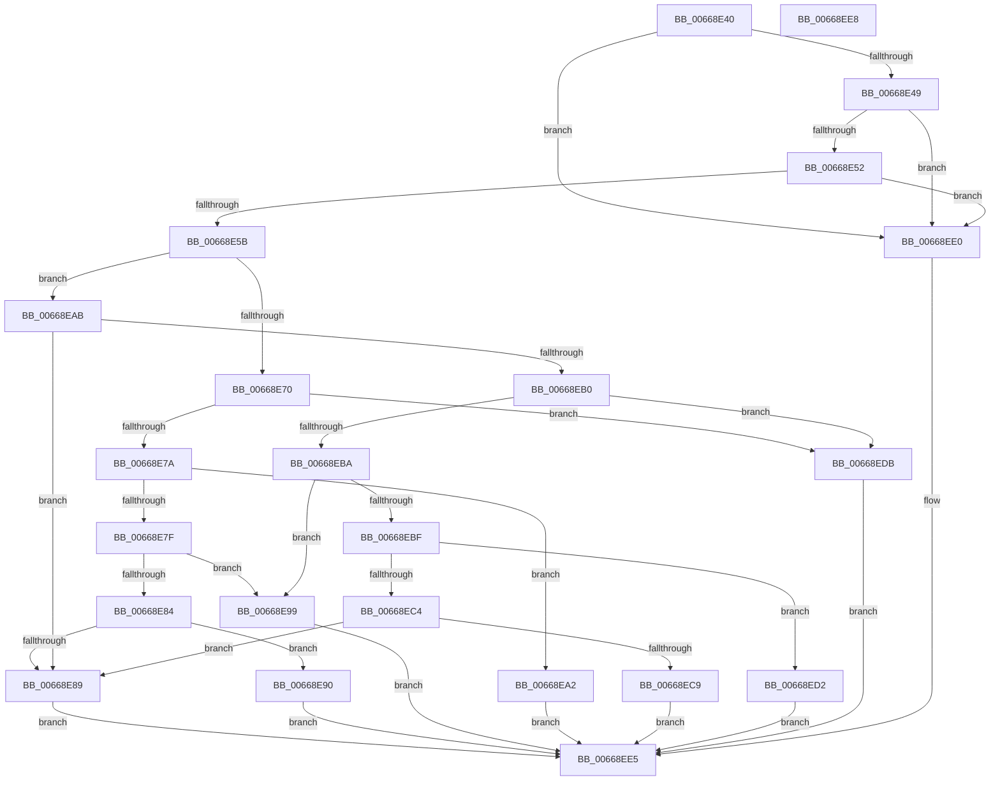

# AccelpSiovGetOperationType

- RVA: `0x00668E40`–`0x00668EE9` (길이 `169` bytes)
- VA: `0x0000000140668E40`
- 실행 섹션: `.text`
- PDB 이름 있음: `예`; PDB Function 태그: `아니요`
- unwind 정보 RVA: `0x000DB714`
- 디코드: `51`개 명령, `169/169` bytes 표시
- 미해석 바이트: `0` (있으면 어셈블리에 `.byte`로 보존)

> 이 문서는 커널 이미지의 기계어와 PDB 기호를 분석해 생성했습니다. 4번과 5번은 함수 원형과 자료형을 바이너리 사용 방식에서 추정한 C 해석이며 원본 소스 복구 결과는 아닙니다.

## 1. Dependencies

- 직접 호출 지점: **0**; 고유 호출 대상: **0**
- 직접 호출자로 확인된 함수: **2**
- RIP 상대 이미지 참조: **0**

### Outgoing calls
- 직접 디코드된 call 명령이 없습니다.

### Direct callers
- [AccelpSiovUpdateStatsOnSubmitWork](AccelpSiovUpdateStatsOnSubmitWork_function_006694D0.md) at `0x006694F2`
- [AccelpSiovUpdateStatsOnWorkCompletion](AccelpSiovUpdateStatsOnWorkCompletion_function_00669550.md) at `0x00669577`

### Static image references
- 디코드된 RIP-relative 메모리 참조가 없습니다.

## 2. Other-region calls and transfers

- 다른 실행 섹션으로 향하는 call: **0**
- 별도 외부 분기/꼬리 이동을 확인하지 못했습니다.

## 3. Assembly (complete function range)

```asm
00668E40  48 85 C9                        test rcx, rcx
00668E43  0F 84 97 00 00 00               je 0x140668ee0
00668E49  48 85 D2                        test rdx, rdx
00668E4C  0F 84 8E 00 00 00               je 0x140668ee0
00668E52  4D 85 C0                        test r8, r8
00668E55  0F 84 85 00 00 00               je 0x140668ee0
00668E5B  48 8B 41 10                     mov rax, qword ptr [rcx + 0x10]
00668E5F  41 B9 01 00 00 00               mov r9d, 1
00668E65  8B 88 BC 00 00 00               mov ecx, dword ptr [rax + 0xbc]
00668E6B  41 3B C9                        cmp ecx, r9d
00668E6E  75 3B                           jne 0x140668eab
00668E70  0F B6 52 07                     movzx edx, byte ptr [rdx + 7]
00668E74  33 C9                           xor ecx, ecx
00668E76  85 D2                           test edx, edx
00668E78  74 61                           je 0x140668edb
00668E7A  41 2B D1                        sub edx, r9d
00668E7D  74 23                           je 0x140668ea2
00668E7F  83 EA 02                        sub edx, 2
00668E82  74 15                           je 0x140668e99
00668E84  41 3B D1                        cmp edx, r9d
00668E87  74 07                           je 0x140668e90
00668E89  B9 01 00 00 C0                  mov ecx, 0xc0000001
00668E8E  EB 55                           jmp 0x140668ee5
00668E90  41 C7 00 03 00 00 00            mov dword ptr [r8], 3
00668E97  EB 4C                           jmp 0x140668ee5
00668E99  41 C7 00 04 00 00 00            mov dword ptr [r8], 4
00668EA0  EB 43                           jmp 0x140668ee5
00668EA2  41 C7 00 02 00 00 00            mov dword ptr [r8], 2
00668EA9  EB 3A                           jmp 0x140668ee5
00668EAB  83 F9 02                        cmp ecx, 2
00668EAE  75 D9                           jne 0x140668e89
00668EB0  0F B6 52 07                     movzx edx, byte ptr [rdx + 7]
00668EB4  33 C9                           xor ecx, ecx
00668EB6  85 D2                           test edx, edx
00668EB8  74 21                           je 0x140668edb
00668EBA  83 EA 03                        sub edx, 3
00668EBD  74 DA                           je 0x140668e99
00668EBF  83 EA 3F                        sub edx, 0x3f
00668EC2  74 0E                           je 0x140668ed2
00668EC4  41 3B D1                        cmp edx, r9d
00668EC7  75 C0                           jne 0x140668e89
00668EC9  41 C7 00 06 00 00 00            mov dword ptr [r8], 6
00668ED0  EB 13                           jmp 0x140668ee5
00668ED2  41 C7 00 07 00 00 00            mov dword ptr [r8], 7
00668ED9  EB 0A                           jmp 0x140668ee5
00668EDB  45 89 08                        mov dword ptr [r8], r9d
00668EDE  EB 05                           jmp 0x140668ee5
00668EE0  B9 0D 00 00 C0                  mov ecx, 0xc000000d
00668EE5  8B C1                           mov eax, ecx
00668EE7  C3                              ret
00668EE8  CC                              int3
```

## 4. C-style interpretation (structured pseudocode)

```c
__int64 __fastcall AccelpSiovGetOperationType(__int64 a1, __int64 a2, __int64 a3)
{
    if (a1 == 0) goto loc_00668EE0;
    if (a2 == 0) goto loc_00668EE0;
    if (a3 == 0) goto loc_00668EE0;
    if (((unsigned int)((unsigned int)(*(unsigned int *)(*(unsigned __int64 *)(a1 + 16) + 188)))) != 1) goto loc_00668EAB;
    a1 = 0;
    if ((unsigned int)(*(unsigned __int8 *)(a2 + 7)) == 0) goto loc_00668EDB;
    a2 = (unsigned int)((*(unsigned __int8 *)(a2 + 7)) - (1));
    if (condition_is_equal) goto loc_00668EA2;
    a2 = (unsigned int)((a2) - (2));
    if (condition_is_equal) goto loc_00668E99;
    if (((unsigned int)(a2)) == 1) goto loc_00668E90;
loc_00668E89:
    goto loc_00668EE5;
loc_00668E90:
    *(unsigned int *)(a3) = 3;
    goto loc_00668EE5;
loc_00668E99:
    *(unsigned int *)(a3) = 4;
    goto loc_00668EE5;
loc_00668EA2:
    *(unsigned int *)(a3) = 2;
    goto loc_00668EE5;
loc_00668EAB:
    if (((unsigned int)((unsigned int)(0xC0000001ULL))) != 2) goto loc_00668E89;
    a1 = 0;
    if ((unsigned int)(*(unsigned __int8 *)(a2 + 7)) == 0) goto loc_00668EDB;
    a2 = (unsigned int)((*(unsigned __int8 *)(a2 + 7)) - (3));
    if (condition_is_equal) goto loc_00668E99;
    a2 = (unsigned int)((a2) - (63));
    if (condition_is_equal) goto loc_00668ED2;
    if (((unsigned int)(a2)) != 1) goto loc_00668E89;
    *(unsigned int *)(a3) = 6;
    goto loc_00668EE5;
loc_00668ED2:
    *(unsigned int *)(a3) = 7;
    goto loc_00668EE5;
loc_00668EDB:
    *(unsigned int *)(a3) = 1;
    goto loc_00668EE5;
loc_00668EE0:
loc_00668EE5:
    return (unsigned int)((unsigned int)((unsigned int)(0xC000000DULL)));
}
```

## 5. (Beta) C Style

```c
int64_t AccelpSiovGetOperationType(int64_t Arg1, int64_t Arg2, int64_t Arg3)
{
    if (Arg1 == 0) goto loc_00668EE0;
    if (Arg2 == 0) goto loc_00668EE0;
    if (Arg3 == 0) goto loc_00668EE0;
    if (((uint32_t)((uint32_t)(*(uint32_t *)(*(uint64_t *)(Arg1 + 0x10) + 0xBC)))) != 1) goto loc_00668EAB;
    Arg1 = 0;
    if ((uint32_t)(*(uint8_t *)(Arg2 + 0x7)) == 0) goto loc_00668EDB;
    Arg2 = (uint32_t)((*(uint8_t *)(Arg2 + 0x7)) - (1));
    if (condition_is_equal) goto loc_00668EA2;
    Arg2 = (uint32_t)((Arg2) - (2));
    if (condition_is_equal) goto loc_00668E99;
    if (((uint32_t)(Arg2)) == 1) goto loc_00668E90;
loc_00668E89:
    goto loc_00668EE5;
loc_00668E90:
    *(uint32_t *)(Arg3) = 3;
    goto loc_00668EE5;
loc_00668E99:
    *(uint32_t *)(Arg3) = 4;
    goto loc_00668EE5;
loc_00668EA2:
    *(uint32_t *)(Arg3) = 2;
    goto loc_00668EE5;
loc_00668EAB:
    if (((uint32_t)((uint32_t)(0xC0000001ULL))) != 2) goto loc_00668E89;
    Arg1 = 0;
    if ((uint32_t)(*(uint8_t *)(Arg2 + 0x7)) == 0) goto loc_00668EDB;
    Arg2 = (uint32_t)((*(uint8_t *)(Arg2 + 0x7)) - (3));
    if (condition_is_equal) goto loc_00668E99;
    Arg2 = (uint32_t)((Arg2) - (63));
    if (condition_is_equal) goto loc_00668ED2;
    if (((uint32_t)(Arg2)) != 1) goto loc_00668E89;
    *(uint32_t *)(Arg3) = 6;
    goto loc_00668EE5;
loc_00668ED2:
    *(uint32_t *)(Arg3) = 7;
    goto loc_00668EE5;
loc_00668EDB:
    *(uint32_t *)(Arg3) = 1;
    goto loc_00668EE5;
loc_00668EE0:
loc_00668EE5:
    return (uint32_t)((uint32_t)((uint32_t)(0xC000000DULL)));
}
```

## 6. Execution-region graph

[열기: 2D/3D 그래프와 함수 탐색 컨트롤 패널](../../../control-panel.html?section=text&rva=0x00668E40&view=graph)

- 2D 그래프는 위에서 아래로 흐르고, 3D 그래프는 빈 공간을 드래그해 회전합니다. Shift+드래그는 이동, 휠은 확대·축소, 함수 노드 선택은 대상 보고서 이동입니다.

### Static fallback


