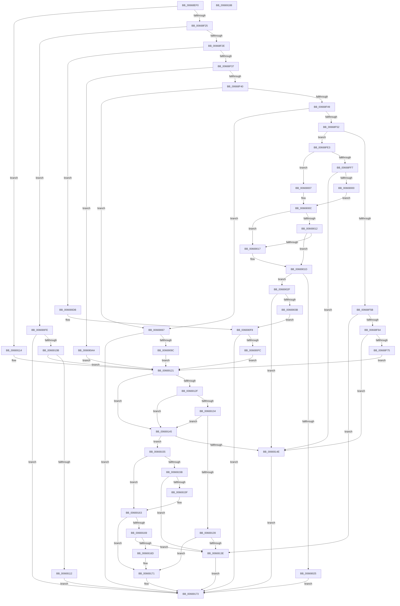

# AccelpSiovIaaOperationHandler

- RVA: `0x00668EF0`–`0x00669189` (길이 `665` bytes)
- VA: `0x0000000140668EF0`
- 실행 섹션: `.text`
- PDB 이름 있음: `예`; PDB Function 태그: `아니요`
- unwind 정보 RVA: `0x0007D3C0`
- 디코드: `183`개 명령, `665/665` bytes 표시
- 미해석 바이트: `0` (있으면 어셈블리에 `.byte`로 보존)

> 이 문서는 커널 이미지의 기계어와 PDB 기호를 분석해 생성했습니다. 4번과 5번은 함수 원형과 자료형을 바이너리 사용 방식에서 추정한 C 해석이며 원본 소스 복구 결과는 아닙니다.

## 1. Dependencies

- 직접 호출 지점: **6**; 고유 호출 대상: **5**
- 직접 호출자로 확인된 함수: **1**
- RIP 상대 이미지 참조: **0**

### Outgoing calls
- `0x00668FBA` → [DsaBuildDescriptorCommon](../48/DsaBuildDescriptorCommon_function_00483934.md) (function, `0x00483934`)
- `0x0066905D` → [AccelpSiovSetCompressionWorkspace](AccelpSiovSetCompressionWorkspace_function_006693D4.md) (function, `0x006693D4`)
- `0x0066908F` → [AccelpSiovCompressionDecompression](AccelpSiovCompressionDecompression_function_00668BE0.md) (function, `0x00668BE0`)
- `0x006690D2` → [DsaBuildDescriptorCommon](../48/DsaBuildDescriptorCommon_function_00483934.md) (function, `0x00483934`)
- `0x006690F3` → [AccelpSiovIaaQueryCompletionInformation](AccelpSiovIaaQueryCompletionInformation_function_00669190.md) (function, `0x00669190`)
- `0x00669102` → [IaaGetStatusFromCompletionRecord](IaaGetStatusFromCompletionRecord_function_006699D4.md) (function, `0x006699D4`)

### Direct callers
- [AccelpSiovInternalOperationHandler](../2C/AccelpSiovInternalOperationHandler_function_002C7DDC.md) at `0x002C7EE6`

### Static image references
- 디코드된 RIP-relative 메모리 참조가 없습니다.

## 2. Other-region calls and transfers

- 다른 실행 섹션으로 향하는 call: **0**
- 별도 외부 분기/꼬리 이동을 확인하지 못했습니다.

## 3. Assembly (complete function range)

```asm
00668EF0  48 89 5C 24 08                  mov qword ptr [rsp + 8], rbx
00668EF5  48 89 6C 24 10                  mov qword ptr [rsp + 0x10], rbp
00668EFA  48 89 74 24 18                  mov qword ptr [rsp + 0x18], rsi
00668EFF  57                              push rdi
00668F00  48 83 EC 40                     sub rsp, 0x40
00668F04  48 8B 41 08                     mov rax, qword ptr [rcx + 8]
00668F08  48 8B F9                        mov rdi, rcx
00668F0B  8B 09                           mov ecx, dword ptr [rcx]
00668F0D  BE 57 00 00 00                  mov esi, 0x57
00668F12  4C 8B 48 10                     mov r9, qword ptr [rax + 0x10]
00668F16  4D 8B 89 C0 00 00 00            mov r9, qword ptr [r9 + 0xc0]
00668F1D  85 C9                           test ecx, ecx
00668F1F  0F 84 EF 01 00 00               je 0x140669114
00668F25  83 E9 03                        sub ecx, 3
00668F28  0F 84 D0 01 00 00               je 0x1406690fe
00668F2E  83 E9 01                        sub ecx, 1
00668F31  0F 84 A4 01 00 00               je 0x1406690db
00668F37  83 E9 05                        sub ecx, 5
00668F3A  0F 84 6A 01 00 00               je 0x1406690aa
00668F40  83 E9 02                        sub ecx, 2
00668F43  0F 84 1E 01 00 00               je 0x140669067
00668F49  83 E9 01                        sub ecx, 1
00668F4C  0F 84 15 01 00 00               je 0x140669067
00668F52  83 E9 01                        sub ecx, 1
00668F55  0F 84 88 00 00 00               je 0x140668fe3
00668F5B  83 F9 01                        cmp ecx, 1
00668F5E  0F 85 DA 01 00 00               jne 0x14066913e
00668F64  48 8B 47 40                     mov rax, qword ptr [rdi + 0x40]
00668F68  48 8B 68 18                     mov rbp, qword ptr [rax + 0x18]
00668F6C  48 85 ED                        test rbp, rbp
00668F6F  0F 84 D9 01 00 00               je 0x14066914e
00668F75  8B 57 10                        mov edx, dword ptr [rdi + 0x10]
00668F78  49 8B C9                        mov rcx, r9
00668F7B  48 8B 5F 18                     mov rbx, qword ptr [rdi + 0x18]
00668F7F  8B C2                           mov eax, edx
00668F81  4C 8B 47 20                     mov r8, qword ptr [rdi + 0x20]
00668F85  25 FF FF 0F 00                  and eax, 0xfffff
00668F8A  44 8B 5F 38                     mov r11d, dword ptr [rdi + 0x38]
00668F8E  4C 8B 57 30                     mov r10, qword ptr [rdi + 0x30]
00668F92  48 C1 E9 0A                     shr rcx, 0xa
00668F96  80 E1 01                        and cl, 1
00668F99  41 C0 E9 07                     shr r9b, 7
00668F9D  88 4C 24 30                     mov byte ptr [rsp + 0x30], cl
00668FA1  41 80 E1 01                     and r9b, 1
00668FA5  C1 EA 1F                        shr edx, 0x1f
00668FA8  8D 4E EC                        lea ecx, [rsi - 0x14]
00668FAB  44 88 4C 24 28                  mov byte ptr [rsp + 0x28], r9b
00668FB0  44 8A CA                        mov r9b, dl
00668FB3  48 8B D3                        mov rdx, rbx
00668FB6  89 44 24 20                     mov dword ptr [rsp + 0x20], eax
00668FBA  E8 75 A9 E1 FF                  call 0x140483934
00668FBF  66 83 4B 26 11                  or word ptr [rbx + 0x26], 0x11
00668FC4  48 8D 85 48 35 00 00            lea rax, [rbp + 0x3548]
00668FCB  48 89 43 18                     mov qword ptr [rbx + 0x18], rax
00668FCF  4C 89 53 10                     mov qword ptr [rbx + 0x10], r10
00668FD3  44 89 5B 20                     mov dword ptr [rbx + 0x20], r11d
00668FD7  C7 43 30 00 05 00 00            mov dword ptr [rbx + 0x30], 0x500
00668FDE  E9 3E 01 00 00                  jmp 0x140669121
00668FE3  8B 4F 3C                        mov ecx, dword ptr [rdi + 0x3c]
00668FE6  44 8B 52 08                     mov r10d, dword ptr [rdx + 8]
00668FEA  44 8B 4F 44                     mov r9d, dword ptr [rdi + 0x44]
00668FEE  44 8B 47 40                     mov r8d, dword ptr [rdi + 0x40]
00668FF2  83 E9 06                        sub ecx, 6
00668FF5  74 10                           je 0x140669007
00668FF7  83 F9 01                        cmp ecx, 1
00668FFA  0F 85 4E 01 00 00               jne 0x14066914e
00669000  B9 3F 15 00 00                  mov ecx, 0x153f
00669005  EB 05                           jmp 0x14066900c
00669007  B9 5F 06 00 00                  mov ecx, 0x65f
0066900C  41 83 F8 01                     cmp r8d, 1
00669010  75 05                           jne 0x140669017
00669012  45 3B C8                        cmp r9d, r8d
00669015  74 06                           je 0x14066901d
00669017  81 C1 C0 44 00 00               add ecx, 0x44c0
0066901D  89 4A 08                        mov dword ptr [rdx + 8], ecx
00669020  44 3B D1                        cmp r10d, ecx
00669023  73 0A                           jae 0x14066902f
00669025  B8 23 00 00 C0                  mov eax, 0xc0000023
0066902A  E9 44 01 00 00                  jmp 0x140669173
0066902F  4C 8B 12                        mov r10, qword ptr [rdx]
00669032  4D 85 D2                        test r10, r10
00669035  0F 84 13 01 00 00               je 0x14066914e
0066903B  8B 47 44                        mov eax, dword ptr [rdi + 0x44]
0066903E  8B D1                           mov edx, ecx
00669040  44 8B 4F 38                     mov r9d, dword ptr [rdi + 0x38]
00669044  49 8B CA                        mov rcx, r10
00669047  4C 8B 47 30                     mov r8, qword ptr [rdi + 0x30]
0066904B  89 44 24 30                     mov dword ptr [rsp + 0x30], eax
0066904F  8B 47 40                        mov eax, dword ptr [rdi + 0x40]
00669052  89 44 24 28                     mov dword ptr [rsp + 0x28], eax
00669056  8B 47 3C                        mov eax, dword ptr [rdi + 0x3c]
00669059  89 44 24 20                     mov dword ptr [rsp + 0x20], eax
0066905D  E8 72 03 00 00                  call 0x1406693d4
00669062  E9 91 00 00 00                  jmp 0x1406690f8
00669067  8B 57 10                        mov edx, dword ptr [rdi + 0x10]
0066906A  49 8B C1                        mov rax, r9
0066906D  44 8B C2                        mov r8d, edx
00669070  48 C1 E8 0A                     shr rax, 0xa
00669074  41 C0 E9 07                     shr r9b, 7
00669078  24 01                           and al, 1
0066907A  41 80 E1 01                     and r9b, 1
0066907E  C1 EA 1F                        shr edx, 0x1f
00669081  41 81 E0 FF FF 0F 00            and r8d, 0xfffff
00669088  88 44 24 20                     mov byte ptr [rsp + 0x20], al
0066908C  48 8B CF                        mov rcx, rdi
0066908F  E8 4C FB FF FF                  call 0x140668be0
00669094  85 C0                           test eax, eax
00669096  0F 88 D7 00 00 00               js 0x140669173
0066909C  8B 07                           mov eax, dword ptr [rdi]
0066909E  83 E8 0B                        sub eax, 0xb
006690A1  F7 D8                           neg eax
006690A3  1B F6                           sbb esi, esi
006690A5  83 C6 43                        add esi, 0x43
006690A8  EB 77                           jmp 0x140669121
006690AA  44 8B 4F 10                     mov r9d, dword ptr [rdi + 0x10]
006690AE  33 C9                           xor ecx, ecx
006690B0  4C 8B 47 20                     mov r8, qword ptr [rdi + 0x20]
006690B4  41 8B C1                        mov eax, r9d
006690B7  48 8B 57 18                     mov rdx, qword ptr [rdi + 0x18]
006690BB  25 FF FF 0F 00                  and eax, 0xfffff
006690C0  C6 44 24 30 00                  mov byte ptr [rsp + 0x30], 0
006690C5  41 C1 E9 1F                     shr r9d, 0x1f
006690C9  C6 44 24 28 00                  mov byte ptr [rsp + 0x28], 0
006690CE  89 44 24 20                     mov dword ptr [rsp + 0x20], eax
006690D2  E8 5D A8 E1 FF                  call 0x140483934
006690D7  33 F6                           xor esi, esi
006690D9  EB 46                           jmp 0x140669121
006690DB  4C 8B 0A                        mov r9, qword ptr [rdx]
006690DE  44 8B 47 30                     mov r8d, dword ptr [rdi + 0x30]
006690E2  48 8B 57 20                     mov rdx, qword ptr [rdi + 0x20]
006690E6  48 8B 4F 18                     mov rcx, qword ptr [rdi + 0x18]
006690EA  4C 89 4C 24 20                  mov qword ptr [rsp + 0x20], r9
006690EF  45 8B 49 18                     mov r9d, dword ptr [r9 + 0x18]
006690F3  E8 98 00 00 00                  call 0x140669190
006690F8  85 C0                           test eax, eax
006690FA  78 77                           js 0x140669173
006690FC  EB 23                           jmp 0x140669121
006690FE  48 8B 4F 20                     mov rcx, qword ptr [rdi + 0x20]
00669102  E8 CD 08 00 00                  call 0x1406699d4
00669107  85 C0                           test eax, eax
00669109  78 68                           js 0x140669173
0066910B  3D 03 01 00 00                  cmp eax, 0x103
00669110  75 0F                           jne 0x140669121
00669112  EB 5F                           jmp 0x140669173
00669114  B8 40 00 00 00                  mov eax, 0x40
00669119  89 02                           mov dword ptr [rdx], eax
0066911B  89 42 04                        mov dword ptr [rdx + 4], eax
0066911E  89 42 08                        mov dword ptr [rdx + 8], eax
00669121  4C 8B 47 28                     mov r8, qword ptr [rdi + 0x28]
00669125  8B CE                           mov ecx, esi
00669127  48 8B 57 18                     mov rdx, qword ptr [rdi + 0x18]
0066912B  85 F6                           test esi, esi
0066912D  74 16                           je 0x140669145
0066912F  83 E9 42                        sub ecx, 0x42
00669132  74 11                           je 0x140669145
00669134  83 E9 01                        sub ecx, 1
00669137  74 0C                           je 0x140669145
00669139  83 F9 14                        cmp ecx, 0x14
0066913C  74 33                           je 0x140669171
0066913E  B8 BB 00 00 C0                  mov eax, 0xc00000bb
00669143  EB 2E                           jmp 0x140669173
00669145  49 F7 C0 F0 FF FF FF            test r8, -0x10
0066914C  74 07                           je 0x140669155
0066914E  B8 0D 00 00 C0                  mov eax, 0xc000000d
00669153  EB 1E                           jmp 0x140669173
00669155  41 F6 C0 01                     test r8b, 1
00669159  74 08                           je 0x140669163
0066915B  85 F6                           test esi, esi
0066915D  74 DF                           je 0x14066913e
0066915F  80 62 04 FD                     and byte ptr [rdx + 4], 0xfd
00669163  41 F6 C0 02                     test r8b, 2
00669167  74 08                           je 0x140669171
00669169  85 F6                           test esi, esi
0066916B  74 D1                           je 0x14066913e
0066916D  80 62 05 FE                     and byte ptr [rdx + 5], 0xfe
00669171  33 C0                           xor eax, eax
00669173  48 8B 5C 24 50                  mov rbx, qword ptr [rsp + 0x50]
00669178  48 8B 6C 24 58                  mov rbp, qword ptr [rsp + 0x58]
0066917D  48 8B 74 24 60                  mov rsi, qword ptr [rsp + 0x60]
00669182  48 83 C4 40                     add rsp, 0x40
00669186  5F                              pop rdi
00669187  C3                              ret
00669188  CC                              int3
```

## 4. C-style interpretation (structured pseudocode)

```c
__int64 __fastcall AccelpSiovIaaOperationHandler(__int64 a1)
{
    __int64 result;
    __int64 v_rsi;
    __int64 v_rsp;
    unsigned __int8 v_stack_m18;
    unsigned __int8 v_stack_m20;
    unsigned int v_stack_m28;
    unsigned __int64 v_stack_p10;
    unsigned __int64 v_stack_p18;
    unsigned __int64 v_stack_p8;

    v_stack_p8 = v_rbx;
    v_stack_p10 = v_rbp;
    v_stack_p18 = v_rsi;
    v_rsp = (v_rsp) - (64);
    if ((unsigned int)((unsigned int)(*(unsigned int *)(a1))) == 0) goto loc_00669114;
    a1 = (unsigned int)(((unsigned int)(*(unsigned int *)(a1))) - (3));
    if (condition_is_equal) goto loc_006690FE;
    a1 = (unsigned int)((a1) - (1));
    if (condition_is_equal) goto loc_006690DB;
    a1 = (unsigned int)((a1) - (5));
    if (condition_is_equal) goto loc_006690AA;
    a1 = (unsigned int)((a1) - (2));
    if (condition_is_equal) goto loc_00669067;
    a1 = (unsigned int)((a1) - (1));
    if (condition_is_equal) goto loc_00669067;
    a1 = (unsigned int)((a1) - (1));
    if (condition_is_equal) goto loc_00668FE3;
    if (((unsigned int)(a1)) != 1) goto loc_0066913E;
    if (*(unsigned __int64 *)(*(unsigned __int64 *)(a1 + 64) + 24) == 0) goto loc_0066914E;
    result = (unsigned int)(((unsigned int)((unsigned int)((unsigned int)(*(unsigned int *)(a1 + 16))))) & (0xFFFFFULL));
    a1 = (*(unsigned __int64 *)(*(unsigned __int64 *)(*(unsigned __int64 *)(a1 + 8) + 16) + 192)) >> (10);
    a1 = (unsigned __int8)((a1) & (1));
    a4 = (unsigned __int8)((*(unsigned __int64 *)(*(unsigned __int64 *)(*(unsigned __int64 *)(a1 + 8) + 16) + 192)) >> (7));
    v_stack_m18 = (unsigned __int8)(a1);
    a4 = (unsigned __int8)((a4) & (1));
    a2 = (unsigned int)(((unsigned int)(*(unsigned int *)(a1 + 16))) >> (31));
    v_stack_m20 = (unsigned __int8)(a4);
    v_stack_m28 = (unsigned int)(result);
    result = DsaBuildDescriptorCommon(87 - 20, *(unsigned __int64 *)(a1 + 24), *(unsigned __int64 *)(a1 + 32), (unsigned __int8)(a2));
    *(unsigned __int64 *)(*(unsigned __int64 *)(a1 + 24) + 24) = *(unsigned __int64 *)(*(unsigned __int64 *)(a1 + 64) + 24) + 13640;
    *(unsigned __int64 *)(*(unsigned __int64 *)(a1 + 24) + 16) = *(unsigned __int64 *)(a1 + 48);
    *(unsigned int *)(*(unsigned __int64 *)(a1 + 24) + 32) = (unsigned int)((unsigned int)(*(unsigned int *)(a1 + 56)));
    *(unsigned int *)(*(unsigned __int64 *)(a1 + 24) + 48) = 0x500ULL;
    goto loc_00669121;
loc_00668FE3:
    a1 = (unsigned int)(((unsigned int)(*(unsigned int *)(a1 + 60))) - (6));
    if (condition_is_equal) goto loc_00669007;
    if (((unsigned int)(a1)) != 1) goto loc_0066914E;
    goto loc_0066900C;
loc_00669007:
loc_0066900C:
    if (((unsigned int)((unsigned int)(*(unsigned int *)(a1 + 64)))) != 1) goto loc_00669017;
    if (((unsigned int)((unsigned int)(*(unsigned int *)(a1 + 68)))) != ((unsigned int)((unsigned int)(*(unsigned int *)(a1 + 64))))) {
        a1 = (unsigned int)(((unsigned int)(0x65FULL)) + (0x44C0ULL));
    }
    *(unsigned int *)(*(unsigned __int64 *)(a1 + 24) + 8) = (unsigned int)(a1);
    if (((unsigned int)((unsigned int)(*(unsigned int *)(*(unsigned __int64 *)(a1 + 24) + 8)))) >= ((unsigned int)(a1))) goto loc_0066902F;
    goto loc_00669173;
loc_0066902F:
    if (*(unsigned __int64 *)(*(unsigned __int64 *)(a1 + 24)) == 0) goto loc_0066914E;
    v_stack_m18 = (unsigned int)((unsigned int)(*(unsigned int *)(a1 + 68)));
    v_stack_m20 = (unsigned int)((unsigned int)(*(unsigned int *)(a1 + 64)));
    v_stack_m28 = (unsigned int)((unsigned int)(*(unsigned int *)(a1 + 60)));
    result = AccelpSiovSetCompressionWorkspace(*(unsigned __int64 *)(*(unsigned __int64 *)(a1 + 24)), (unsigned int)((unsigned int)(a1)), *(unsigned __int64 *)(a1 + 48), (unsigned int)(*(unsigned int *)(a1 + 56)));
    goto loc_006690F8;
loc_00669067:
    result = ((unsigned int)(*(unsigned int *)(a1 + 56))) >> (10);
    a4 = (unsigned __int8)(((unsigned int)(*(unsigned int *)(a1 + 56))) >> (7));
    result = (unsigned __int8)((result) & (1));
    a4 = (unsigned __int8)((a4) & (1));
    a2 = (unsigned int)(((unsigned int)(*(unsigned int *)(a1 + 16))) >> (31));
    a3 = (unsigned int)(((unsigned int)((unsigned int)((unsigned int)(*(unsigned int *)(a1 + 16))))) & (0xFFFFFULL));
    v_stack_m28 = (unsigned __int8)(result);
    result = AccelpSiovCompressionDecompression(a1, a2, a3, a4);
    if (sign_flag) goto loc_00669173;
    result = (unsigned int)(((unsigned int)(*(unsigned int *)(a1))) - (11));
    result = (unsigned int)(-(result));
    v_rsi = (unsigned int)((87) + (67));
    goto loc_00669121;
loc_006690AA:
    a1 = 0;
    result = (unsigned int)(((unsigned int)((unsigned int)((unsigned int)(*(unsigned int *)(a1 + 16))))) & (0xFFFFFULL));
    v_stack_m18 = 0;
    a4 = (unsigned int)(((unsigned int)(*(unsigned int *)(a1 + 16))) >> (31));
    v_stack_m20 = 0;
    v_stack_m28 = (unsigned int)(result);
    result = DsaBuildDescriptorCommon(a1, *(unsigned __int64 *)(a1 + 24), *(unsigned __int64 *)(a1 + 32), a4);
    v_rsi = 0;
    goto loc_00669121;
loc_006690DB:
    v_stack_m28 = *(unsigned __int64 *)(*(unsigned __int64 *)(a1 + 24));
    result = AccelpSiovIaaQueryCompletionInformation(*(unsigned __int64 *)(a1 + 24), *(unsigned __int64 *)(a1 + 32), (unsigned int)(*(unsigned int *)(a1 + 48)), (unsigned int)(*(unsigned int *)(*(unsigned __int64 *)(*(unsigned __int64 *)(a1 + 24)) + 24)));
loc_006690F8:
    if (sign_flag) goto loc_00669173;
    goto loc_00669121;
loc_006690FE:
    result = IaaGetStatusFromCompletionRecord(*(unsigned __int64 *)(a1 + 32), *(unsigned __int64 *)(a1 + 32), (unsigned int)(*(unsigned int *)(a1 + 48)), (unsigned int)(*(unsigned int *)(*(unsigned __int64 *)(*(unsigned __int64 *)(a1 + 24)) + 24)));
    if (sign_flag) goto loc_00669173;
    if (((unsigned int)(result)) != 259) goto loc_00669121;
    goto loc_00669173;
loc_00669114:
    *(unsigned int *)(*(unsigned __int64 *)(a1 + 32)) = 64;
    *(unsigned int *)(*(unsigned __int64 *)(a1 + 32) + 4) = 64;
    *(unsigned int *)(*(unsigned __int64 *)(a1 + 32) + 8) = 64;
loc_00669121:
    if (0 == 0) goto loc_00669145;
    a1 = (unsigned int)((0) - (66));
    if (condition_is_equal) goto loc_00669145;
    a1 = (unsigned int)((a1) - (1));
    if (condition_is_equal) goto loc_00669145;
    if (((unsigned int)(a1)) == 20) goto loc_00669171;
loc_0066913E:
    goto loc_00669173;
loc_00669145:
    if (((*(unsigned __int64 *)(a1 + 40)) & (-16)) == 0) goto loc_00669155;
loc_0066914E:
    goto loc_00669173;
loc_00669155:
    if ((((unsigned __int8)(*(unsigned __int64 *)(a1 + 40))) & (1)) == 0) goto loc_00669163;
    if (0 == 0) goto loc_0066913E;
loc_00669163:
    if ((((unsigned __int8)(*(unsigned __int64 *)(a1 + 40))) & (2)) == 0) goto loc_00669171;
    if (0 == 0) goto loc_0066913E;
loc_00669171:
    result = 0;
loc_00669173:
    v_rsp = (v_rsp) + (64);
    return result;
}
```

## 5. (Beta) C Style

```c
int64_t AccelpSiovIaaOperationHandler(void *Arg1)
{
    uint8_t *arg1 = (uint8_t *)Arg1;

    int64_t result;
    int64_t local_rsi;
    int64_t local_rsp;
    uint8_t v_stack_m18;
    uint8_t v_stack_m20;
    uint32_t v_stack_m28;
    uint64_t v_stack_p10;
    uint64_t v_stack_p18;
    uint64_t v_stack_p8;

    v_stack_p8 = local_rbx;
    v_stack_p10 = local_rbp;
    v_stack_p18 = local_rsi;
    local_rsp = (local_rsp) - (64);
    if ((uint32_t)((uint32_t)(*(uint32_t *)(arg1))) == 0) goto loc_00669114;
    Arg1 = (uint32_t)(((uint32_t)(*(uint32_t *)(arg1))) - (3));
    if (condition_is_equal) goto loc_006690FE;
    Arg1 = (uint32_t)((Arg1) - (1));
    if (condition_is_equal) goto loc_006690DB;
    Arg1 = (uint32_t)((Arg1) - (5));
    if (condition_is_equal) goto loc_006690AA;
    Arg1 = (uint32_t)((Arg1) - (2));
    if (condition_is_equal) goto loc_00669067;
    Arg1 = (uint32_t)((Arg1) - (1));
    if (condition_is_equal) goto loc_00669067;
    Arg1 = (uint32_t)((Arg1) - (1));
    if (condition_is_equal) goto loc_00668FE3;
    if (((uint32_t)(Arg1)) != 1) goto loc_0066913E;
    if (*(uint64_t *)(*(uint64_t *)(arg1 + 0x40) + 0x18) == 0) goto loc_0066914E;
    result = (uint32_t)(((uint32_t)((uint32_t)((uint32_t)(*(uint32_t *)(arg1 + 0x10))))) & (0xFFFFFULL));
    Arg1 = (*(uint64_t *)(*(uint64_t *)(*(uint64_t *)(arg1 + 0x8) + 0x10) + 0xC0)) >> (10);
    Arg1 = (uint8_t)((Arg1) & (1));
    a4 = (uint8_t)((*(uint64_t *)(*(uint64_t *)(*(uint64_t *)(arg1 + 0x8) + 0x10) + 0xC0)) >> (7));
    v_stack_m18 = (uint8_t)(Arg1);
    a4 = (uint8_t)((a4) & (1));
    a2 = (uint32_t)(((uint32_t)(*(uint32_t *)(arg1 + 0x10))) >> (31));
    v_stack_m20 = (uint8_t)(a4);
    v_stack_m28 = (uint32_t)(result);
    result = DsaBuildDescriptorCommon(87 - 20, *(uint64_t *)(arg1 + 0x18), *(uint64_t *)(arg1 + 0x20), (uint8_t)(a2));
    *(uint64_t *)(*(uint64_t *)(arg1 + 0x18) + 0x18) = *(uint64_t *)(*(uint64_t *)(arg1 + 0x40) + 0x18) + 13640;
    *(uint64_t *)(*(uint64_t *)(arg1 + 0x18) + 0x10) = *(uint64_t *)(arg1 + 0x30);
    *(uint32_t *)(*(uint64_t *)(arg1 + 0x18) + 0x20) = (uint32_t)((uint32_t)(*(uint32_t *)(arg1 + 0x38)));
    *(uint32_t *)(*(uint64_t *)(arg1 + 0x18) + 0x30) = 0x500ULL;
    goto loc_00669121;
loc_00668FE3:
    Arg1 = (uint32_t)(((uint32_t)(*(uint32_t *)(arg1 + 0x3C))) - (6));
    if (condition_is_equal) goto loc_00669007;
    if (((uint32_t)(Arg1)) != 1) goto loc_0066914E;
    goto loc_0066900C;
loc_00669007:
loc_0066900C:
    if (((uint32_t)((uint32_t)(*(uint32_t *)(arg1 + 0x40)))) != 1) goto loc_00669017;
    if (((uint32_t)((uint32_t)(*(uint32_t *)(arg1 + 0x44)))) != ((uint32_t)((uint32_t)(*(uint32_t *)(arg1 + 0x40))))) {
        Arg1 = (uint32_t)(((uint32_t)(0x65FULL)) + (0x44C0ULL));
    }
    *(uint32_t *)(*(uint64_t *)(arg1 + 0x18) + 0x8) = (uint32_t)(Arg1);
    if (((uint32_t)((uint32_t)(*(uint32_t *)(*(uint64_t *)(arg1 + 0x18) + 0x8)))) >= ((uint32_t)(Arg1))) goto loc_0066902F;
    goto loc_00669173;
loc_0066902F:
    if (*(uint64_t *)(*(uint64_t *)(arg1 + 0x18)) == 0) goto loc_0066914E;
    v_stack_m18 = (uint32_t)((uint32_t)(*(uint32_t *)(arg1 + 0x44)));
    v_stack_m20 = (uint32_t)((uint32_t)(*(uint32_t *)(arg1 + 0x40)));
    v_stack_m28 = (uint32_t)((uint32_t)(*(uint32_t *)(arg1 + 0x3C)));
    result = AccelpSiovSetCompressionWorkspace(*(uint64_t *)(*(uint64_t *)(arg1 + 0x18)), (uint32_t)((uint32_t)(Arg1)), *(uint64_t *)(arg1 + 0x30), (uint32_t)(*(uint32_t *)(arg1 + 0x38)));
    goto loc_006690F8;
loc_00669067:
    result = ((uint32_t)(*(uint32_t *)(arg1 + 0x38))) >> (10);
    a4 = (uint8_t)(((uint32_t)(*(uint32_t *)(arg1 + 0x38))) >> (7));
    result = (uint8_t)((result) & (1));
    a4 = (uint8_t)((a4) & (1));
    a2 = (uint32_t)(((uint32_t)(*(uint32_t *)(arg1 + 0x10))) >> (31));
    a3 = (uint32_t)(((uint32_t)((uint32_t)((uint32_t)(*(uint32_t *)(arg1 + 0x10))))) & (0xFFFFFULL));
    v_stack_m28 = (uint8_t)(result);
    result = AccelpSiovCompressionDecompression(Arg1, a2, a3, a4);
    if (sign_flag) goto loc_00669173;
    result = (uint32_t)(((uint32_t)(*(uint32_t *)(arg1))) - (11));
    result = (uint32_t)(-(result));
    local_rsi = (uint32_t)((87) + (67));
    goto loc_00669121;
loc_006690AA:
    Arg1 = 0;
    result = (uint32_t)(((uint32_t)((uint32_t)((uint32_t)(*(uint32_t *)(arg1 + 0x10))))) & (0xFFFFFULL));
    v_stack_m18 = 0;
    a4 = (uint32_t)(((uint32_t)(*(uint32_t *)(arg1 + 0x10))) >> (31));
    v_stack_m20 = 0;
    v_stack_m28 = (uint32_t)(result);
    result = DsaBuildDescriptorCommon(Arg1, *(uint64_t *)(arg1 + 0x18), *(uint64_t *)(arg1 + 0x20), a4);
    local_rsi = 0;
    goto loc_00669121;
loc_006690DB:
    v_stack_m28 = *(uint64_t *)(*(uint64_t *)(arg1 + 0x18));
    result = AccelpSiovIaaQueryCompletionInformation(*(uint64_t *)(arg1 + 0x18), *(uint64_t *)(arg1 + 0x20), (uint32_t)(*(uint32_t *)(arg1 + 0x30)), (uint32_t)(*(uint32_t *)(*(uint64_t *)(*(uint64_t *)(arg1 + 0x18)) + 0x18)));
loc_006690F8:
    if (sign_flag) goto loc_00669173;
    goto loc_00669121;
loc_006690FE:
    result = IaaGetStatusFromCompletionRecord(*(uint64_t *)(arg1 + 0x20), *(uint64_t *)(arg1 + 0x20), (uint32_t)(*(uint32_t *)(arg1 + 0x30)), (uint32_t)(*(uint32_t *)(*(uint64_t *)(*(uint64_t *)(arg1 + 0x18)) + 0x18)));
    if (sign_flag) goto loc_00669173;
    if (((uint32_t)(result)) != 259) goto loc_00669121;
    goto loc_00669173;
loc_00669114:
    *(uint32_t *)(*(uint64_t *)(arg1 + 0x20)) = 64;
    *(uint32_t *)(*(uint64_t *)(arg1 + 0x20) + 0x4) = 64;
    *(uint32_t *)(*(uint64_t *)(arg1 + 0x20) + 0x8) = 64;
loc_00669121:
    if (0 == 0) goto loc_00669145;
    Arg1 = (uint32_t)((0) - (66));
    if (condition_is_equal) goto loc_00669145;
    Arg1 = (uint32_t)((Arg1) - (1));
    if (condition_is_equal) goto loc_00669145;
    if (((uint32_t)(Arg1)) == 20) goto loc_00669171;
loc_0066913E:
    goto loc_00669173;
loc_00669145:
    if (((*(uint64_t *)(arg1 + 0x28)) & (-16)) == 0) goto loc_00669155;
loc_0066914E:
    goto loc_00669173;
loc_00669155:
    if ((((uint8_t)(*(uint64_t *)(arg1 + 0x28))) & (1)) == 0) goto loc_00669163;
    if (0 == 0) goto loc_0066913E;
loc_00669163:
    if ((((uint8_t)(*(uint64_t *)(arg1 + 0x28))) & (2)) == 0) goto loc_00669171;
    if (0 == 0) goto loc_0066913E;
loc_00669171:
    result = 0;
loc_00669173:
    local_rsp = (local_rsp) + (64);
    return result;
}
```

### 관측된 메모리 오프셋

구조체 형식이 확인되지 않은 접근은 인자 기준의 오프셋으로만 기록했습니다.

| 기준 인자 | 오프셋 표현 | 폭 (bit) | 접근 |
|---|---:|---:|---|
| `Arg1` | `+ 0x0` | `32` | `R` |
| `Arg1` | `+ 0x8` | `64` | `R` |
| `Arg1` | `+ 0x10` | `32` | `R` |
| `Arg1` | `+ 0x18` | `64` | `R` |
| `Arg1` | `+ 0x20` | `64` | `R` |
| `Arg1` | `+ 0x28` | `64` | `R` |
| `Arg1` | `+ 0x30` | `32` | `R` |
| `Arg1` | `+ 0x30` | `64` | `R` |
| `Arg1` | `+ 0x38` | `32` | `R` |
| `Arg1` | `+ 0x3C` | `32` | `R` |
| `Arg1` | `+ 0x40` | `32` | `R` |
| `Arg1` | `+ 0x40` | `64` | `R` |
| `Arg1` | `+ 0x44` | `32` | `R` |

## 6. Execution-region graph

[열기: 2D/3D 그래프와 함수 탐색 컨트롤 패널](../../../control-panel.html?section=text&rva=0x00668EF0&view=graph)

- 2D 그래프는 위에서 아래로 흐르고, 3D 그래프는 빈 공간을 드래그해 회전합니다. Shift+드래그는 이동, 휠은 확대·축소, 함수 노드 선택은 대상 보고서 이동입니다.

### Static fallback


