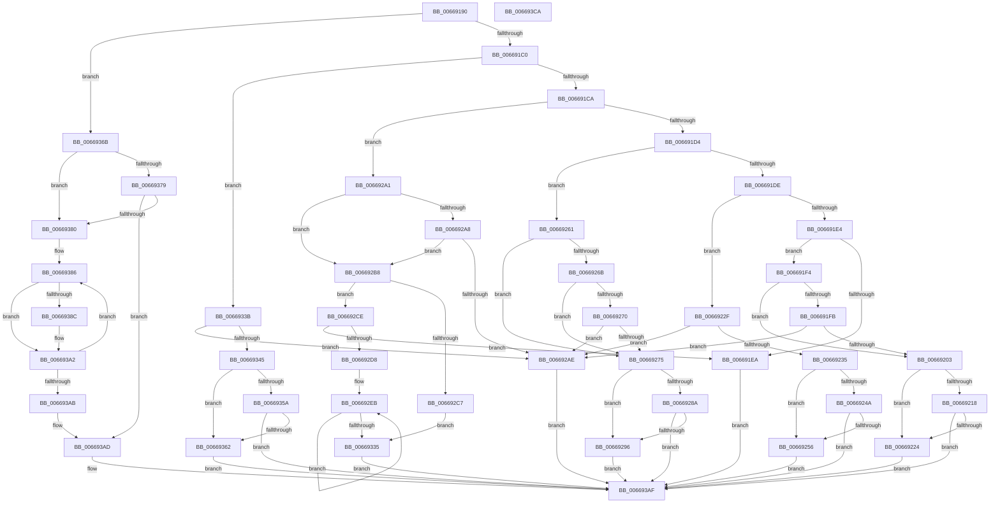

# AccelpSiovIaaQueryCompletionInformation

- RVA: `0x00669190`–`0x006693CB` (길이 `571` bytes)
- VA: `0x0000000140669190`
- 실행 섹션: `.text`
- PDB 이름 있음: `예`; PDB Function 태그: `아니요`
- unwind 정보 RVA: `0x00084C9C`
- 디코드: `163`개 명령, `571/571` bytes 표시
- 미해석 바이트: `0` (있으면 어셈블리에 `.byte`로 보존)

> 이 문서는 커널 이미지의 기계어와 PDB 기호를 분석해 생성했습니다. 4번과 5번은 함수 원형과 자료형을 바이너리 사용 방식에서 추정한 C 해석이며 원본 소스 복구 결과는 아닙니다.

## 1. Dependencies

- 직접 호출 지점: **6**; 고유 호출 대상: **2**
- 직접 호출자로 확인된 함수: **2**
- RIP 상대 이미지 참조: **0**

### Outgoing calls
- `0x00669206` → [IaaGetStatusFromCompletionRecord](IaaGetStatusFromCompletionRecord_function_006699D4.md) (function, `0x006699D4`)
- `0x00669238` → [IaaGetStatusFromCompletionRecord](IaaGetStatusFromCompletionRecord_function_006699D4.md) (function, `0x006699D4`)
- `0x00669278` → [IaaGetStatusFromCompletionRecord](IaaGetStatusFromCompletionRecord_function_006699D4.md) (function, `0x006699D4`)
- `0x00669348` → [IaaGetStatusFromCompletionRecord](IaaGetStatusFromCompletionRecord_function_006699D4.md) (function, `0x006699D4`)
- `0x0066936E` → [IaaGetStatusFromCompletionRecord](IaaGetStatusFromCompletionRecord_function_006699D4.md) (function, `0x006699D4`)
- `0x0066939D` → [AccelpSiovIaaQueryCompletionInformation](AccelpSiovIaaQueryCompletionInformation_function_00669190.md) (function, `0x00669190`)

### Direct callers
- [AccelpSiovIaaOperationHandler](AccelpSiovIaaOperationHandler_function_00668EF0.md) at `0x006690F3`
- [AccelpSiovIaaQueryCompletionInformation](AccelpSiovIaaQueryCompletionInformation_function_00669190.md) at `0x0066939D`

### Static image references
- 디코드된 RIP-relative 메모리 참조가 없습니다.

## 2. Other-region calls and transfers

- 다른 실행 섹션으로 향하는 call: **0**
- 별도 외부 분기/꼬리 이동을 확인하지 못했습니다.

## 3. Assembly (complete function range)

```asm
00669190  48 89 5C 24 08                  mov qword ptr [rsp + 8], rbx
00669195  48 89 6C 24 10                  mov qword ptr [rsp + 0x10], rbp
0066919A  48 89 74 24 18                  mov qword ptr [rsp + 0x18], rsi
0066919F  57                              push rdi
006691A0  41 56                           push r14
006691A2  41 57                           push r15
006691A4  48 83 EC 30                     sub rsp, 0x30
006691A8  48 8B 74 24 70                  mov rsi, qword ptr [rsp + 0x70]
006691AD  45 8B F9                        mov r15d, r9d
006691B0  48 8B FA                        mov rdi, rdx
006691B3  48 8B E9                        mov rbp, rcx
006691B6  41 83 E8 01                     sub r8d, 1
006691BA  0F 84 AB 01 00 00               je 0x14066936b
006691C0  41 83 E8 01                     sub r8d, 1
006691C4  0F 84 71 01 00 00               je 0x14066933b
006691CA  41 83 E8 01                     sub r8d, 1
006691CE  0F 84 CD 00 00 00               je 0x1406692a1
006691D4  41 83 E8 01                     sub r8d, 1
006691D8  0F 84 83 00 00 00               je 0x140669261
006691DE  41 83 E8 01                     sub r8d, 1
006691E2  74 4B                           je 0x14066922f
006691E4  41 83 F8 01                     cmp r8d, 1
006691E8  74 0A                           je 0x1406691f4
006691EA  BB BB 00 00 C0                  mov ebx, 0xc00000bb
006691EF  E9 BB 01 00 00                  jmp 0x1406693af
006691F4  8A 41 07                        mov al, byte ptr [rcx + 7]
006691F7  A8 FC                           test al, 0xfc
006691F9  75 08                           jne 0x140669203
006691FB  3C 01                           cmp al, 1
006691FD  0F 85 AB 00 00 00               jne 0x1406692ae
00669203  48 8B CF                        mov rcx, rdi
00669206  E8 C9 07 00 00                  call 0x1406699d4
0066920B  B9 00 00 00 80                  mov ecx, 0x80000000
00669210  8B D8                           mov ebx, eax
00669212  03 C1                           add eax, ecx
00669214  85 C1                           test ecx, eax
00669216  75 0C                           jne 0x140669224
00669218  81 FB 23 00 00 C0               cmp ebx, 0xc0000023
0066921E  0F 85 8B 01 00 00               jne 0x1406693af
00669224  8B 47 18                        mov eax, dword ptr [rdi + 0x18]
00669227  89 46 0C                        mov dword ptr [rsi + 0xc], eax
0066922A  E9 80 01 00 00                  jmp 0x1406693af
0066922F  F6 41 07 FD                     test byte ptr [rcx + 7], 0xfd
00669233  74 79                           je 0x1406692ae
00669235  48 8B CF                        mov rcx, rdi
00669238  E8 97 07 00 00                  call 0x1406699d4
0066923D  B9 00 00 00 80                  mov ecx, 0x80000000
00669242  8B D8                           mov ebx, eax
00669244  03 C1                           add eax, ecx
00669246  85 C1                           test ecx, eax
00669248  75 0C                           jne 0x140669256
0066924A  81 FB 23 00 00 C0               cmp ebx, 0xc0000023
00669250  0F 85 59 01 00 00               jne 0x1406693af
00669256  8A 47 1C                        mov al, byte ptr [rdi + 0x1c]
00669259  88 46 08                        mov byte ptr [rsi + 8], al
0066925C  E9 4E 01 00 00                  jmp 0x1406693af
00669261  8A 49 07                        mov cl, byte ptr [rcx + 7]
00669264  8D 41 FC                        lea eax, [rcx - 4]
00669267  3C 3F                           cmp al, 0x3f
00669269  76 0A                           jbe 0x140669275
0066926B  80 F9 01                        cmp cl, 1
0066926E  74 05                           je 0x140669275
00669270  80 F9 45                        cmp cl, 0x45
00669273  72 39                           jb 0x1406692ae
00669275  48 8B CF                        mov rcx, rdi
00669278  E8 57 07 00 00                  call 0x1406699d4
0066927D  B9 00 00 00 80                  mov ecx, 0x80000000
00669282  8B D8                           mov ebx, eax
00669284  03 C1                           add eax, ecx
00669286  85 C1                           test ecx, eax
00669288  75 0C                           jne 0x140669296
0066928A  81 FB 23 00 00 C0               cmp ebx, 0xc0000023
00669290  0F 85 19 01 00 00               jne 0x1406693af
00669296  8B 47 20                        mov eax, dword ptr [rdi + 0x20]
00669299  89 46 04                        mov dword ptr [rsi + 4], eax
0066929C  E9 0E 01 00 00                  jmp 0x1406693af
006692A1  33 DB                           xor ebx, ebx
006692A3  39 5E 18                        cmp dword ptr [rsi + 0x18], ebx
006692A6  74 10                           je 0x1406692b8
006692A8  48 39 5E 10                     cmp qword ptr [rsi + 0x10], rbx
006692AC  75 0A                           jne 0x1406692b8
006692AE  BB 0D 00 00 C0                  mov ebx, 0xc000000d
006692B3  E9 F7 00 00 00                  jmp 0x1406693af
006692B8  48 8B 4E 10                     mov rcx, qword ptr [rsi + 0x10]
006692BC  41 B8 00 04 00 00               mov r8d, 0x400
006692C2  45 3B F8                        cmp r15d, r8d
006692C5  73 07                           jae 0x1406692ce
006692C7  BB 23 00 00 C0                  mov ebx, 0xc0000023
006692CC  EB 67                           jmp 0x140669335
006692CE  80 7D 07 43                     cmp byte ptr [rbp + 7], 0x43
006692D2  0F 85 12 FF FF FF               jne 0x1406691ea
006692D8  48 8B 45 28                     mov rax, qword ptr [rbp + 0x28]
006692DC  BA 08 00 00 00                  mov edx, 8
006692E1  48 05 20 01 00 00               add rax, 0x120
006692E7  44 8D 4A 78                     lea r9d, [rdx + 0x78]
006692EB  0F 10 00                        movups xmm0, xmmword ptr [rax]
006692EE  0F 11 01                        movups xmmword ptr [rcx], xmm0
006692F1  0F 10 48 10                     movups xmm1, xmmword ptr [rax + 0x10]
006692F5  0F 11 49 10                     movups xmmword ptr [rcx + 0x10], xmm1
006692F9  0F 10 40 20                     movups xmm0, xmmword ptr [rax + 0x20]
006692FD  0F 11 41 20                     movups xmmword ptr [rcx + 0x20], xmm0
00669301  0F 10 48 30                     movups xmm1, xmmword ptr [rax + 0x30]
00669305  0F 11 49 30                     movups xmmword ptr [rcx + 0x30], xmm1
00669309  0F 10 40 40                     movups xmm0, xmmword ptr [rax + 0x40]
0066930D  0F 11 41 40                     movups xmmword ptr [rcx + 0x40], xmm0
00669311  0F 10 48 50                     movups xmm1, xmmword ptr [rax + 0x50]
00669315  0F 11 49 50                     movups xmmword ptr [rcx + 0x50], xmm1
00669319  0F 10 40 60                     movups xmm0, xmmword ptr [rax + 0x60]
0066931D  0F 11 41 60                     movups xmmword ptr [rcx + 0x60], xmm0
00669321  49 03 C9                        add rcx, r9
00669324  0F 10 48 70                     movups xmm1, xmmword ptr [rax + 0x70]
00669328  49 03 C1                        add rax, r9
0066932B  0F 11 49 F0                     movups xmmword ptr [rcx - 0x10], xmm1
0066932F  48 83 EA 01                     sub rdx, 1
00669333  75 B6                           jne 0x1406692eb
00669335  44 89 46 18                     mov dword ptr [rsi + 0x18], r8d
00669339  EB 74                           jmp 0x1406693af
0066933B  80 79 07 42                     cmp byte ptr [rcx + 7], 0x42
0066933F  0F 85 69 FF FF FF               jne 0x1406692ae
00669345  48 8B CF                        mov rcx, rdi
00669348  E8 87 06 00 00                  call 0x1406699d4
0066934D  B9 00 00 00 80                  mov ecx, 0x80000000
00669352  8B D8                           mov ebx, eax
00669354  03 C1                           add eax, ecx
00669356  85 C1                           test ecx, eax
00669358  75 08                           jne 0x140669362
0066935A  81 FB 23 00 00 C0               cmp ebx, 0xc0000023
00669360  75 4D                           jne 0x1406693af
00669362  8B 47 04                        mov eax, dword ptr [rdi + 4]
00669365  33 DB                           xor ebx, ebx
00669367  89 06                           mov dword ptr [rsi], eax
00669369  EB 44                           jmp 0x1406693af
0066936B  48 8B CF                        mov rcx, rdi
0066936E  E8 61 06 00 00                  call 0x1406699d4
00669373  33 DB                           xor ebx, ebx
00669375  85 C0                           test eax, eax
00669377  79 07                           jns 0x140669380
00669379  3D 23 00 00 C0                  cmp eax, 0xc0000023
0066937E  75 2D                           jne 0x1406693ad
00669380  41 BE 01 00 00 00               mov r14d, 1
00669386  41 83 FE 01                     cmp r14d, 1
0066938A  74 16                           je 0x1406693a2
0066938C  45 8B CF                        mov r9d, r15d
0066938F  48 89 74 24 20                  mov qword ptr [rsp + 0x20], rsi
00669394  45 8B C6                        mov r8d, r14d
00669397  48 8B D7                        mov rdx, rdi
0066939A  48 8B CD                        mov rcx, rbp
0066939D  E8 EE FD FF FF                  call 0x140669190
006693A2  41 FF C6                        inc r14d
006693A5  41 83 FE 07                     cmp r14d, 7
006693A9  72 DB                           jb 0x140669386
006693AB  8B C3                           mov eax, ebx
006693AD  8B D8                           mov ebx, eax
006693AF  48 8B 6C 24 58                  mov rbp, qword ptr [rsp + 0x58]
006693B4  8B C3                           mov eax, ebx
006693B6  48 8B 5C 24 50                  mov rbx, qword ptr [rsp + 0x50]
006693BB  48 8B 74 24 60                  mov rsi, qword ptr [rsp + 0x60]
006693C0  48 83 C4 30                     add rsp, 0x30
006693C4  41 5F                           pop r15
006693C6  41 5E                           pop r14
006693C8  5F                              pop rdi
006693C9  C3                              ret
006693CA  CC                              int3
```

## 4. C-style interpretation (structured pseudocode)

```c
__int64 __fastcall AccelpSiovIaaQueryCompletionInformation(__int64 a1, __int64 a2, int a3, int a4, __int64 a5)
{
    __int64 result;
    __int64 v_r14;
    __int64 v_rbx;
    __int64 v_rsp;
    unsigned __int64 v_stack_m28;
    unsigned __int64 v_stack_p10;
    unsigned __int64 v_stack_p18;
    unsigned __int64 v_stack_p8;

    v_stack_p8 = v_rbx;
    v_stack_p10 = v_rbp;
    v_stack_p18 = v_rsi;
    v_rsp = (v_rsp) - (48);
    a3 = (unsigned int)((a3) - (1));
    if (condition_is_equal) goto loc_0066936B;
    a3 = (unsigned int)((a3) - (1));
    if (condition_is_equal) goto loc_0066933B;
    a3 = (unsigned int)((a3) - (1));
    if (condition_is_equal) goto loc_006692A1;
    a3 = (unsigned int)((a3) - (1));
    if (condition_is_equal) goto loc_00669261;
    a3 = (unsigned int)((a3) - (1));
    if (condition_is_equal) goto loc_0066922F;
    if (a3 == 1) goto loc_006691F4;
loc_006691EA:
    goto loc_006693AF;
loc_006691F4:
    if ((((unsigned __int8)(*(unsigned __int8 *)(a1 + 7))) & (252)) != 0) goto loc_00669203;
    if (((unsigned __int8)(*(unsigned __int8 *)(a1 + 7))) != 1) goto loc_006692AE;
loc_00669203:
    result = IaaGetStatusFromCompletionRecord(a2, a2, a3, a4);
    result = (unsigned int)((result) + ((unsigned int)((unsigned int)(0x80000000ULL))));
    if ((((unsigned int)((unsigned int)(0x80000000ULL))) & ((unsigned int)(result))) != 0) goto loc_00669224;
    if (((unsigned int)((unsigned int)((unsigned int)(result)))) != 0xC0000023ULL) goto loc_006693AF;
loc_00669224:
    *(unsigned int *)(a5 + 12) = (unsigned int)((unsigned int)(*(unsigned int *)(a2 + 24)));
    goto loc_006693AF;
loc_0066922F:
    if (((*(unsigned __int8 *)((unsigned int)(0x80000000ULL) + 7)) & (253)) == 0) goto loc_006692AE;
    result = IaaGetStatusFromCompletionRecord(a2, a2, a3, a4);
    result = (unsigned int)((result) + ((unsigned int)((unsigned int)(0x80000000ULL))));
    if ((((unsigned int)((unsigned int)(0x80000000ULL))) & ((unsigned int)(result))) != 0) goto loc_00669256;
    if (((unsigned int)((unsigned int)((unsigned int)(result)))) != 0xC0000023ULL) goto loc_006693AF;
loc_00669256:
    *(unsigned __int8 *)(a5 + 8) = (unsigned __int8)(*(unsigned __int8 *)(a2 + 28));
    goto loc_006693AF;
loc_00669261:
    if (((unsigned __int8)(*(unsigned __int8 *)((unsigned int)(0x80000000ULL) + 7) - 4)) <= 63) goto loc_00669275;
    if (((unsigned __int8)(*(unsigned __int8 *)((unsigned int)(0x80000000ULL) + 7))) == 1) goto loc_00669275;
    if (((unsigned __int8)(*(unsigned __int8 *)((unsigned int)(0x80000000ULL) + 7))) < 69) goto loc_006692AE;
loc_00669275:
    result = IaaGetStatusFromCompletionRecord(a2, a2, a3, a4);
    result = (unsigned int)((result) + ((unsigned int)((unsigned int)(0x80000000ULL))));
    if ((((unsigned int)((unsigned int)(0x80000000ULL))) & ((unsigned int)(result))) != 0) goto loc_00669296;
    if (((unsigned int)((unsigned int)((unsigned int)(result)))) != 0xC0000023ULL) goto loc_006693AF;
loc_00669296:
    *(unsigned int *)(a5 + 4) = (unsigned int)((unsigned int)(*(unsigned int *)(a2 + 32)));
    goto loc_006693AF;
loc_006692A1:
    v_rbx = 0;
    if ((*(unsigned int *)(a5 + 24)) == 0) goto loc_006692B8;
    if ((*(unsigned __int64 *)(a5 + 16)) != 0) goto loc_006692B8;
loc_006692AE:
    goto loc_006693AF;
loc_006692B8:
    if (((unsigned int)((unsigned int)(a4))) >= ((unsigned int)((unsigned int)(0x400ULL)))) goto loc_006692CE;
    goto loc_00669335;
loc_006692CE:
    if ((*(unsigned __int8 *)(a1 + 7)) != 67) goto loc_006691EA;
    result = (*(unsigned __int64 *)(a1 + 40)) + (288);
loc_006692EB:
    *(unsigned __int64 *)(*(unsigned __int64 *)(a5 + 16)) = v_xmm0;
    *(unsigned __int64 *)(*(unsigned __int64 *)(a5 + 16) + 16) = v_xmm1;
    *(unsigned __int64 *)(*(unsigned __int64 *)(a5 + 16) + 32) = v_xmm0;
    *(unsigned __int64 *)(*(unsigned __int64 *)(a5 + 16) + 48) = v_xmm1;
    *(unsigned __int64 *)(*(unsigned __int64 *)(a5 + 16) + 64) = v_xmm0;
    *(unsigned __int64 *)(*(unsigned __int64 *)(a5 + 16) + 80) = v_xmm1;
    *(unsigned __int64 *)(*(unsigned __int64 *)(a5 + 16) + 96) = v_xmm0;
    a1 = (*(unsigned __int64 *)(a5 + 16)) + (8 + 120);
    result = (result) + (8 + 120);
    *(unsigned __int64 *)(a1 - 16) = v_xmm1;
    a2 = (8) - (1);
    if (condition_is_not_equal) goto loc_006692EB;
loc_00669335:
    *(unsigned int *)(a5 + 24) = (unsigned int)((unsigned int)(0x400ULL));
    goto loc_006693AF;
loc_0066933B:
    if ((*(unsigned __int8 *)(a1 + 7)) != 66) goto loc_006692AE;
    result = IaaGetStatusFromCompletionRecord(a2, a2, (unsigned int)(0x400ULL), 8 + 120);
    result = (unsigned int)((result) + ((unsigned int)((unsigned int)(0x80000000ULL))));
    if ((((unsigned int)((unsigned int)(0x80000000ULL))) & ((unsigned int)(result))) != 0) goto loc_00669362;
    if (((unsigned int)((unsigned int)((unsigned int)(result)))) != 0xC0000023ULL) goto loc_006693AF;
loc_00669362:
    v_rbx = 0;
    *(unsigned int *)(a5) = (unsigned int)((unsigned int)(*(unsigned int *)(a2 + 4)));
    goto loc_006693AF;
loc_0066936B:
    result = IaaGetStatusFromCompletionRecord(a2, a2, (unsigned int)(0x400ULL), 8 + 120);
    v_rbx = 0;
    if (!sign_flag) goto loc_00669380;
    if (((unsigned int)(result)) != 0xC0000023ULL) goto loc_006693AD;
loc_00669380:
loc_00669386:
    if (1 != 1) {
        a4 = (unsigned int)((unsigned int)(a4));
        v_stack_m28 = a5;
        a3 = 1;
        a2 = a2;
        a1 = a1;
        result = AccelpSiovIaaQueryCompletionInformation(a1, a2, a3, a4);
    }
    v_r14 = (unsigned int)((1) + 1);
    if (((unsigned int)(v_r14)) < 7) goto loc_00669386;
loc_006693AD:
loc_006693AF:
    v_rsp = (v_rsp) + (48);
    return 0;
}
```

## 5. (Beta) C Style

```c
int64_t AccelpSiovIaaQueryCompletionInformation(void *Arg1, void *Arg2, int32_t Arg3, int32_t Arg4, void *Arg5)
{
    uint8_t *arg1 = (uint8_t *)Arg1;
    uint8_t *arg2 = (uint8_t *)Arg2;
    uint8_t *arg5 = (uint8_t *)Arg5;

    int64_t result;
    int64_t local_r14;
    int64_t local_rbx;
    int64_t local_rsp;
    uint64_t v_stack_m28;
    uint64_t v_stack_p10;
    uint64_t v_stack_p18;
    uint64_t v_stack_p8;

    v_stack_p8 = local_rbx;
    v_stack_p10 = local_rbp;
    v_stack_p18 = local_rsi;
    local_rsp = (local_rsp) - (48);
    Arg3 = (uint32_t)((Arg3) - (1));
    if (condition_is_equal) goto loc_0066936B;
    Arg3 = (uint32_t)((Arg3) - (1));
    if (condition_is_equal) goto loc_0066933B;
    Arg3 = (uint32_t)((Arg3) - (1));
    if (condition_is_equal) goto loc_006692A1;
    Arg3 = (uint32_t)((Arg3) - (1));
    if (condition_is_equal) goto loc_00669261;
    Arg3 = (uint32_t)((Arg3) - (1));
    if (condition_is_equal) goto loc_0066922F;
    if (Arg3 == 1) goto loc_006691F4;
loc_006691EA:
    goto loc_006693AF;
loc_006691F4:
    if ((((uint8_t)(*(uint8_t *)(arg1 + 0x7))) & (252)) != 0) goto loc_00669203;
    if (((uint8_t)(*(uint8_t *)(arg1 + 0x7))) != 1) goto loc_006692AE;
loc_00669203:
    result = IaaGetStatusFromCompletionRecord(Arg2, Arg2, Arg3, Arg4);
    result = (uint32_t)((result) + ((uint32_t)((uint32_t)(0x80000000ULL))));
    if ((((uint32_t)((uint32_t)(0x80000000ULL))) & ((uint32_t)(result))) != 0) goto loc_00669224;
    if (((uint32_t)((uint32_t)((uint32_t)(result)))) != 0xC0000023ULL) goto loc_006693AF;
loc_00669224:
    *(uint32_t *)(arg5 + 0xC) = (uint32_t)((uint32_t)(*(uint32_t *)(arg2 + 0x18)));
    goto loc_006693AF;
loc_0066922F:
    if (((*(uint8_t *)((uint32_t)(0x80000000ULL) + 0x7)) & (253)) == 0) goto loc_006692AE;
    result = IaaGetStatusFromCompletionRecord(Arg2, Arg2, Arg3, Arg4);
    result = (uint32_t)((result) + ((uint32_t)((uint32_t)(0x80000000ULL))));
    if ((((uint32_t)((uint32_t)(0x80000000ULL))) & ((uint32_t)(result))) != 0) goto loc_00669256;
    if (((uint32_t)((uint32_t)((uint32_t)(result)))) != 0xC0000023ULL) goto loc_006693AF;
loc_00669256:
    *(uint8_t *)(arg5 + 0x8) = (uint8_t)(*(uint8_t *)(arg2 + 0x1C));
    goto loc_006693AF;
loc_00669261:
    if (((uint8_t)(*(uint8_t *)((uint32_t)(0x80000000ULL) + 0x7) - 4)) <= 63) goto loc_00669275;
    if (((uint8_t)(*(uint8_t *)((uint32_t)(0x80000000ULL) + 0x7))) == 1) goto loc_00669275;
    if (((uint8_t)(*(uint8_t *)((uint32_t)(0x80000000ULL) + 0x7))) < 69) goto loc_006692AE;
loc_00669275:
    result = IaaGetStatusFromCompletionRecord(Arg2, Arg2, Arg3, Arg4);
    result = (uint32_t)((result) + ((uint32_t)((uint32_t)(0x80000000ULL))));
    if ((((uint32_t)((uint32_t)(0x80000000ULL))) & ((uint32_t)(result))) != 0) goto loc_00669296;
    if (((uint32_t)((uint32_t)((uint32_t)(result)))) != 0xC0000023ULL) goto loc_006693AF;
loc_00669296:
    *(uint32_t *)(arg5 + 0x4) = (uint32_t)((uint32_t)(*(uint32_t *)(arg2 + 0x20)));
    goto loc_006693AF;
loc_006692A1:
    local_rbx = 0;
    if ((*(uint32_t *)(arg5 + 0x18)) == 0) goto loc_006692B8;
    if ((*(uint64_t *)(arg5 + 0x10)) != 0) goto loc_006692B8;
loc_006692AE:
    goto loc_006693AF;
loc_006692B8:
    if (((uint32_t)((uint32_t)(Arg4))) >= ((uint32_t)((uint32_t)(0x400ULL)))) goto loc_006692CE;
    goto loc_00669335;
loc_006692CE:
    if ((*(uint8_t *)(arg1 + 0x7)) != 67) goto loc_006691EA;
    result = (*(uint64_t *)(arg1 + 0x28)) + (288);
loc_006692EB:
    *(uint64_t *)(*(uint64_t *)(arg5 + 0x10)) = v_xmm0;
    *(uint64_t *)(*(uint64_t *)(arg5 + 0x10) + 0x10) = v_xmm1;
    *(uint64_t *)(*(uint64_t *)(arg5 + 0x10) + 0x20) = v_xmm0;
    *(uint64_t *)(*(uint64_t *)(arg5 + 0x10) + 0x30) = v_xmm1;
    *(uint64_t *)(*(uint64_t *)(arg5 + 0x10) + 0x40) = v_xmm0;
    *(uint64_t *)(*(uint64_t *)(arg5 + 0x10) + 0x50) = v_xmm1;
    *(uint64_t *)(*(uint64_t *)(arg5 + 0x10) + 0x60) = v_xmm0;
    Arg1 = (*(uint64_t *)(arg5 + 0x10)) + (8 + 120);
    result = (result) + (8 + 120);
    *(uint64_t *)(arg1 - 0x10) = v_xmm1;
    Arg2 = (8) - (1);
    if (condition_is_not_equal) goto loc_006692EB;
loc_00669335:
    *(uint32_t *)(arg5 + 0x18) = (uint32_t)((uint32_t)(0x400ULL));
    goto loc_006693AF;
loc_0066933B:
    if ((*(uint8_t *)(arg1 + 0x7)) != 66) goto loc_006692AE;
    result = IaaGetStatusFromCompletionRecord(Arg2, Arg2, (uint32_t)(0x400ULL), 8 + 120);
    result = (uint32_t)((result) + ((uint32_t)((uint32_t)(0x80000000ULL))));
    if ((((uint32_t)((uint32_t)(0x80000000ULL))) & ((uint32_t)(result))) != 0) goto loc_00669362;
    if (((uint32_t)((uint32_t)((uint32_t)(result)))) != 0xC0000023ULL) goto loc_006693AF;
loc_00669362:
    local_rbx = 0;
    *(uint32_t *)(arg5) = (uint32_t)((uint32_t)(*(uint32_t *)(arg2 + 0x4)));
    goto loc_006693AF;
loc_0066936B:
    result = IaaGetStatusFromCompletionRecord(Arg2, Arg2, (uint32_t)(0x400ULL), 8 + 120);
    local_rbx = 0;
    if (!sign_flag) goto loc_00669380;
    if (((uint32_t)(result)) != 0xC0000023ULL) goto loc_006693AD;
loc_00669380:
loc_00669386:
    if (1 != 1) {
        Arg4 = (uint32_t)((uint32_t)(Arg4));
        v_stack_m28 = Arg5;
        Arg3 = 1;
        Arg2 = Arg2;
        Arg1 = Arg1;
        result = AccelpSiovIaaQueryCompletionInformation(Arg1, Arg2, Arg3, Arg4);
    }
    local_r14 = (uint32_t)((1) + 1);
    if (((uint32_t)(local_r14)) < 7) goto loc_00669386;
loc_006693AD:
loc_006693AF:
    local_rsp = (local_rsp) + (48);
    return 0;
}
```

### 관측된 메모리 오프셋

구조체 형식이 확인되지 않은 접근은 인자 기준의 오프셋으로만 기록했습니다.

| 기준 인자 | 오프셋 표현 | 폭 (bit) | 접근 |
|---|---:|---:|---|
| `Arg1` | `+ 0x7` | `8` | `R` |
| `Arg1` | `+ 0x28` | `64` | `R` |
| `Arg2` | `+ 0x4` | `32` | `R` |
| `Arg2` | `+ 0x18` | `32` | `R` |
| `Arg2` | `+ 0x1C` | `8` | `R` |
| `Arg2` | `+ 0x20` | `32` | `R` |
| `Arg5` | `+ 0x0` | `32` | `W` |
| `Arg5` | `+ 0x4` | `32` | `W` |
| `Arg5` | `+ 0x8` | `8` | `W` |
| `Arg5` | `+ 0xC` | `32` | `W` |
| `Arg5` | `+ 0x10` | `64` | `R` |
| `Arg5` | `+ 0x18` | `32` | `R` |
| `Arg5` | `+ 0x18` | `32` | `W` |

## 6. Execution-region graph

[열기: 2D/3D 그래프와 함수 탐색 컨트롤 패널](../../../control-panel.html?section=text&rva=0x00669190&view=graph)

- 2D 그래프는 위에서 아래로 흐르고, 3D 그래프는 빈 공간을 드래그해 회전합니다. Shift+드래그는 이동, 휠은 확대·축소, 함수 노드 선택은 대상 보고서 이동입니다.

### Static fallback


