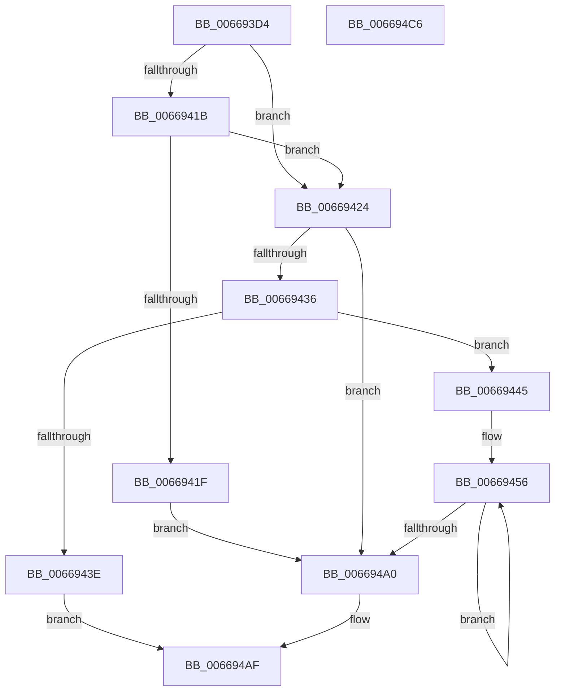

# AccelpSiovSetCompressionWorkspace

- RVA: `0x006693D4`–`0x006694C7` (길이 `243` bytes)
- VA: `0x00000001406693D4`
- 실행 섹션: `.text`
- PDB 이름 있음: `예`; PDB Function 태그: `아니요`
- unwind 정보 RVA: `0x0005C954`
- 디코드: `70`개 명령, `243/243` bytes 표시
- 미해석 바이트: `0` (있으면 어셈블리에 `.byte`로 보존)

> 이 문서는 커널 이미지의 기계어와 PDB 기호를 분석해 생성했습니다. 4번과 5번은 함수 원형과 자료형을 바이너리 사용 방식에서 추정한 C 해석이며 원본 소스 복구 결과는 아닙니다.

## 1. Dependencies

- 직접 호출 지점: **1**; 고유 호출 대상: **1**
- 직접 호출자로 확인된 함수: **1**
- RIP 상대 이미지 참조: **0**

### Outgoing calls
- `0x006693F8` → [memset](../6C/memset_function_006C6C40.md) (function, `0x006C6C40`)

### Direct callers
- [AccelpSiovIaaOperationHandler](AccelpSiovIaaOperationHandler_function_00668EF0.md) at `0x0066905D`

### Static image references
- 디코드된 RIP-relative 메모리 참조가 없습니다.

## 2. Other-region calls and transfers

- 다른 실행 섹션으로 향하는 call: **0**
- 별도 외부 분기/꼬리 이동을 확인하지 못했습니다.

## 3. Assembly (complete function range)

```asm
006693D4  48 89 5C 24 08                  mov qword ptr [rsp + 8], rbx
006693D9  48 89 6C 24 10                  mov qword ptr [rsp + 0x10], rbp
006693DE  48 89 74 24 18                  mov qword ptr [rsp + 0x18], rsi
006693E3  57                              push rdi
006693E4  48 83 EC 20                     sub rsp, 0x20
006693E8  49 8B F0                        mov rsi, r8
006693EB  8B DA                           mov ebx, edx
006693ED  44 8B C2                        mov r8d, edx
006693F0  41 8B E9                        mov ebp, r9d
006693F3  33 D2                           xor edx, edx
006693F5  48 8B F9                        mov rdi, rcx
006693F8  E8 43 D8 05 00                  call 0x1406c6c40
006693FD  8B 44 24 50                     mov eax, dword ptr [rsp + 0x50]
00669401  33 D2                           xor edx, edx
00669403  8B 4C 24 60                     mov ecx, dword ptr [rsp + 0x60]
00669407  89 47 04                        mov dword ptr [rdi + 4], eax
0066940A  8B 44 24 58                     mov eax, dword ptr [rsp + 0x58]
0066940E  89 1F                           mov dword ptr [rdi], ebx
00669410  89 47 08                        mov dword ptr [rdi + 8], eax
00669413  89 4F 0C                        mov dword ptr [rdi + 0xc], ecx
00669416  83 F8 01                        cmp eax, 1
00669419  75 09                           jne 0x140669424
0066941B  3B C8                           cmp ecx, eax
0066941D  75 05                           jne 0x140669424
0066941F  8D 42 20                        lea eax, [rdx + 0x20]
00669422  EB 7C                           jmp 0x1406694a0
00669424  48 8D 4F 20                     lea rcx, [rdi + 0x20]
00669428  B8 E0 44 00 00                  mov eax, 0x44e0
0066942D  48 89 4F 18                     mov qword ptr [rdi + 0x18], rcx
00669431  48 85 F6                        test rsi, rsi
00669434  74 6A                           je 0x1406694a0
00669436  81 FD 00 04 00 00               cmp ebp, 0x400
0066943C  73 07                           jae 0x140669445
0066943E  BA 0D 00 00 C0                  mov edx, 0xc000000d
00669443  EB 6A                           jmp 0x1406694af
00669445  41 B8 08 00 00 00               mov r8d, 8
0066944B  48 81 C1 48 31 00 00            add rcx, 0x3148
00669452  45 8D 48 78                     lea r9d, [r8 + 0x78]
00669456  0F 10 06                        movups xmm0, xmmword ptr [rsi]
00669459  0F 11 01                        movups xmmword ptr [rcx], xmm0
0066945C  0F 10 4E 10                     movups xmm1, xmmword ptr [rsi + 0x10]
00669460  0F 11 49 10                     movups xmmword ptr [rcx + 0x10], xmm1
00669464  0F 10 46 20                     movups xmm0, xmmword ptr [rsi + 0x20]
00669468  0F 11 41 20                     movups xmmword ptr [rcx + 0x20], xmm0
0066946C  0F 10 4E 30                     movups xmm1, xmmword ptr [rsi + 0x30]
00669470  0F 11 49 30                     movups xmmword ptr [rcx + 0x30], xmm1
00669474  0F 10 46 40                     movups xmm0, xmmword ptr [rsi + 0x40]
00669478  0F 11 41 40                     movups xmmword ptr [rcx + 0x40], xmm0
0066947C  0F 10 4E 50                     movups xmm1, xmmword ptr [rsi + 0x50]
00669480  0F 11 49 50                     movups xmmword ptr [rcx + 0x50], xmm1
00669484  0F 10 46 60                     movups xmm0, xmmword ptr [rsi + 0x60]
00669488  0F 11 41 60                     movups xmmword ptr [rcx + 0x60], xmm0
0066948C  49 03 C9                        add rcx, r9
0066948F  0F 10 4E 70                     movups xmm1, xmmword ptr [rsi + 0x70]
00669493  49 03 F1                        add rsi, r9
00669496  0F 11 49 F0                     movups xmmword ptr [rcx - 0x10], xmm1
0066949A  49 83 E8 01                     sub r8, 1
0066949E  75 B6                           jne 0x140669456
006694A0  48 8D 4F 1F                     lea rcx, [rdi + 0x1f]
006694A4  48 03 C8                        add rcx, rax
006694A7  48 83 E1 E0                     and rcx, 0xffffffffffffffe0
006694AB  48 89 4F 10                     mov qword ptr [rdi + 0x10], rcx
006694AF  48 8B 5C 24 30                  mov rbx, qword ptr [rsp + 0x30]
006694B4  8B C2                           mov eax, edx
006694B6  48 8B 6C 24 38                  mov rbp, qword ptr [rsp + 0x38]
006694BB  48 8B 74 24 40                  mov rsi, qword ptr [rsp + 0x40]
006694C0  48 83 C4 20                     add rsp, 0x20
006694C4  5F                              pop rdi
006694C5  C3                              ret
006694C6  CC                              int3
```

## 4. C-style interpretation (structured pseudocode)

```c
__int64 __fastcall AccelpSiovSetCompressionWorkspace(__int64 a1, int a2, __int64 a3, int a4, unsigned int a5, unsigned int a6, unsigned int a7)
{
    __int64 result;
    __int64 v_rsi;
    __int64 v_rsp;
    unsigned __int64 v_stack_p10;
    unsigned __int64 v_stack_p18;
    unsigned __int64 v_stack_p8;

    v_stack_p8 = v_rbx;
    v_stack_p10 = v_rbp;
    v_stack_p18 = v_rsi;
    v_rsp = (v_rsp) - (32);
    a2 = 0;
    result = memset(a1, a2, (unsigned int)(a2), a4);
    a2 = 0;
    *(unsigned int *)(a1 + 4) = (unsigned int)((unsigned int)(a5));
    *(unsigned int *)(a1) = (unsigned int)((unsigned int)(a2));
    *(unsigned int *)(a1 + 8) = (unsigned int)((unsigned int)(a6));
    *(unsigned int *)(a1 + 12) = (unsigned int)((unsigned int)(a7));
    if (((unsigned int)((unsigned int)(a6))) != 1) goto loc_00669424;
    if (((unsigned int)((unsigned int)(a7))) != ((unsigned int)((unsigned int)(a6)))) goto loc_00669424;
    goto loc_006694A0;
loc_00669424:
    *(unsigned __int64 *)(a1 + 24) = a1 + 32;
    if (a3 == 0) goto loc_006694A0;
    if (((unsigned int)((unsigned int)(a4))) >= 0x400ULL) goto loc_00669445;
    goto loc_006694AF;
loc_00669445:
    a1 = (a1 + 32) + (0x3148ULL);
loc_00669456:
    *(unsigned __int64 *)(a1) = v_xmm0;
    *(unsigned __int64 *)(a1 + 16) = v_xmm1;
    *(unsigned __int64 *)(a1 + 32) = v_xmm0;
    *(unsigned __int64 *)(a1 + 48) = v_xmm1;
    *(unsigned __int64 *)(a1 + 64) = v_xmm0;
    *(unsigned __int64 *)(a1 + 80) = v_xmm1;
    *(unsigned __int64 *)(a1 + 96) = v_xmm0;
    a1 = (a1) + (8 + 120);
    v_rsi = (a3) + (8 + 120);
    *(unsigned __int64 *)(a1 - 16) = v_xmm1;
    a3 = (8) - (1);
    if (condition_is_not_equal) goto loc_00669456;
loc_006694A0:
    a1 = (a1 + 31) + ((unsigned int)(0x44E0ULL));
    a1 = (a1) & (-32);
    *(unsigned __int64 *)(a1 + 16) = a1;
loc_006694AF:
    v_rsp = (v_rsp) + (32);
    return (unsigned int)((unsigned int)((unsigned int)(0xC000000DULL)));
}
```

## 5. (Beta) C Style

```c
int64_t AccelpSiovSetCompressionWorkspace(void *Arg1, int32_t Arg2, int64_t Arg3, int32_t Arg4, uint32_t Arg5, uint32_t Arg6, uint32_t Arg7)
{
    uint8_t *arg1 = (uint8_t *)Arg1;

    int64_t result;
    int64_t local_rsi;
    int64_t local_rsp;
    uint64_t v_stack_p10;
    uint64_t v_stack_p18;
    uint64_t v_stack_p8;

    v_stack_p8 = local_rbx;
    v_stack_p10 = local_rbp;
    v_stack_p18 = local_rsi;
    local_rsp = (local_rsp) - (32);
    Arg2 = 0;
    result = memset(Arg1, Arg2, (uint32_t)(Arg2), Arg4);
    Arg2 = 0;
    *(uint32_t *)(arg1 + 0x4) = (uint32_t)((uint32_t)(Arg5));
    *(uint32_t *)(arg1) = (uint32_t)((uint32_t)(Arg2));
    *(uint32_t *)(arg1 + 0x8) = (uint32_t)((uint32_t)(Arg6));
    *(uint32_t *)(arg1 + 0xC) = (uint32_t)((uint32_t)(Arg7));
    if (((uint32_t)((uint32_t)(Arg6))) != 1) goto loc_00669424;
    if (((uint32_t)((uint32_t)(Arg7))) != ((uint32_t)((uint32_t)(Arg6)))) goto loc_00669424;
    goto loc_006694A0;
loc_00669424:
    *(void **)(arg1 + 0x18) = Arg1 + 32;
    if (Arg3 == 0) goto loc_006694A0;
    if (((uint32_t)((uint32_t)(Arg4))) >= 0x400ULL) goto loc_00669445;
    goto loc_006694AF;
loc_00669445:
    Arg1 = (Arg1 + 32) + (0x3148ULL);
loc_00669456:
    *(uint64_t *)(arg1) = v_xmm0;
    *(uint64_t *)(arg1 + 0x10) = v_xmm1;
    *(uint64_t *)(arg1 + 0x20) = v_xmm0;
    *(uint64_t *)(arg1 + 0x30) = v_xmm1;
    *(uint64_t *)(arg1 + 0x40) = v_xmm0;
    *(uint64_t *)(arg1 + 0x50) = v_xmm1;
    *(uint64_t *)(arg1 + 0x60) = v_xmm0;
    Arg1 = (Arg1) + (8 + 120);
    local_rsi = (Arg3) + (8 + 120);
    *(uint64_t *)(arg1 - 0x10) = v_xmm1;
    Arg3 = (8) - (1);
    if (condition_is_not_equal) goto loc_00669456;
loc_006694A0:
    Arg1 = (Arg1 + 31) + ((uint32_t)(0x44E0ULL));
    Arg1 = (Arg1) & (-32);
    *(void **)(arg1 + 0x10) = Arg1;
loc_006694AF:
    local_rsp = (local_rsp) + (32);
    return (uint32_t)((uint32_t)((uint32_t)(0xC000000DULL)));
}
```

### 관측된 메모리 오프셋

구조체 형식이 확인되지 않은 접근은 인자 기준의 오프셋으로만 기록했습니다.

| 기준 인자 | 오프셋 표현 | 폭 (bit) | 접근 |
|---|---:|---:|---|
| `Arg1` | `- 0x10` | `128` | `R` |
| `Arg1` | `+ 0x0` | `32` | `W` |
| `Arg1` | `+ 0x0` | `128` | `R` |
| `Arg1` | `+ 0x4` | `32` | `W` |
| `Arg1` | `+ 0x8` | `32` | `W` |
| `Arg1` | `+ 0xC` | `32` | `W` |
| `Arg1` | `+ 0x10` | `64` | `W` |
| `Arg1` | `+ 0x10` | `128` | `R` |
| `Arg1` | `+ 0x18` | `64` | `W` |
| `Arg1` | `+ 0x1F` | `64` | `R` |
| `Arg1` | `+ 0x20` | `64` | `R` |
| `Arg1` | `+ 0x20` | `128` | `R` |
| `Arg1` | `+ 0x30` | `128` | `R` |
| `Arg1` | `+ 0x40` | `128` | `R` |
| `Arg1` | `+ 0x50` | `128` | `R` |
| `Arg1` | `+ 0x60` | `128` | `R` |

## 6. Execution-region graph

[열기: 2D/3D 그래프와 함수 탐색 컨트롤 패널](../../../control-panel.html?section=text&rva=0x006693D4&view=graph)

- 2D 그래프는 위에서 아래로 흐르고, 3D 그래프는 빈 공간을 드래그해 회전합니다. Shift+드래그는 이동, 휠은 확대·축소, 함수 노드 선택은 대상 보고서 이동입니다.

### Static fallback


