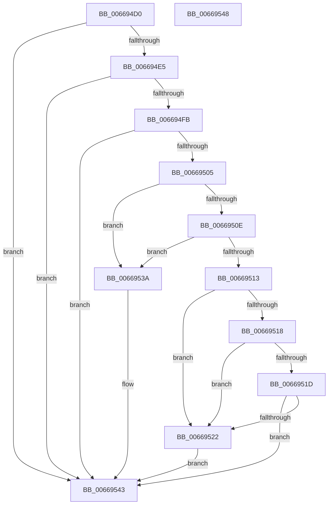

# AccelpSiovUpdateStatsOnSubmitWork

- RVA: `0x006694D0`–`0x00669549` (길이 `121` bytes)
- VA: `0x00000001406694D0`
- 실행 섹션: `.text`
- PDB 이름 있음: `예`; PDB Function 태그: `아니요`
- unwind 정보 RVA: `0x0005C788`
- 디코드: `32`개 명령, `121/121` bytes 표시
- 미해석 바이트: `0` (있으면 어셈블리에 `.byte`로 보존)

> 이 문서는 커널 이미지의 기계어와 PDB 기호를 분석해 생성했습니다. 4번과 5번은 함수 원형과 자료형을 바이너리 사용 방식에서 추정한 C 해석이며 원본 소스 복구 결과는 아닙니다.

## 1. Dependencies

- 직접 호출 지점: **1**; 고유 호출 대상: **1**
- 직접 호출자로 확인된 함수: **1**
- RIP 상대 이미지 참조: **0**

### Outgoing calls
- `0x006694F2` → [AccelpSiovGetOperationType](AccelpSiovGetOperationType_function_00668E40.md) (function, `0x00668E40`)

### Direct callers
- [AccelpSiovInternalOperationHandler](../2C/AccelpSiovInternalOperationHandler_function_002C7DDC.md) at `0x002C7E9F`

### Static image references
- 디코드된 RIP-relative 메모리 참조가 없습니다.

## 2. Other-region calls and transfers

- 다른 실행 섹션으로 향하는 call: **0**
- 별도 외부 분기/꼬리 이동을 확인하지 못했습니다.

## 3. Assembly (complete function range)

```asm
006694D0  48 83 EC 28                     sub rsp, 0x28
006694D4  4C 8B 51 10                     mov r10, qword ptr [rcx + 0x10]
006694D8  4C 8B DA                        mov r11, rdx
006694DB  41 83 BA BC 00 00 00 01         cmp dword ptr [r10 + 0xbc], 1
006694E3  75 5E                           jne 0x140669543
006694E5  4C 8D 44 24 30                  lea r8, [rsp + 0x30]
006694EA  C7 44 24 30 08 00 00 00         mov dword ptr [rsp + 0x30], 8
006694F2  E8 49 F9 FF FF                  call 0x140668e40
006694F7  85 C0                           test eax, eax
006694F9  78 48                           js 0x140669543
006694FB  48 63 4C 24 30                  movsxd rcx, dword ptr [rsp + 0x30]
00669500  83 F9 08                        cmp ecx, 8
00669503  74 3E                           je 0x140669543
00669505  48 8D 14 49                     lea rdx, [rcx + rcx*2]
00669509  83 E9 01                        sub ecx, 1
0066950C  74 2C                           je 0x14066953a
0066950E  83 E9 01                        sub ecx, 1
00669511  74 27                           je 0x14066953a
00669513  83 E9 01                        sub ecx, 1
00669516  74 0A                           je 0x140669522
00669518  83 E9 01                        sub ecx, 1
0066951B  74 05                           je 0x140669522
0066951D  83 F9 01                        cmp ecx, 1
00669520  75 21                           jne 0x140669543
00669522  F0 41 FF 84 D2 38 02 00 00      lock inc dword ptr [r10 + rdx*8 + 0x238]
0066952B  41 8B 43 20                     mov eax, dword ptr [r11 + 0x20]
0066952F  F0 49 01 84 D2 40 02 00 00      lock add qword ptr [r10 + rdx*8 + 0x240], rax
00669538  EB 09                           jmp 0x140669543
0066953A  F0 41 FF 84 D2 38 02 00 00      lock inc dword ptr [r10 + rdx*8 + 0x238]
00669543  48 83 C4 28                     add rsp, 0x28
00669547  C3                              ret
00669548  CC                              int3
```

## 4. C-style interpretation (structured pseudocode)

```c
__int64 __fastcall AccelpSiovUpdateStatsOnSubmitWork(__int64 a1, __int64 a2)
{
    __int64 result;
    __int64 v_rsp;
    unsigned __int64 v_stack_p8;

    v_rsp = (v_rsp) - (40);
    if ((*(unsigned int *)(*(unsigned __int64 *)(a1 + 16) + 188)) != 1) goto loc_00669543;
    v_stack_p8 = 8;
    result = AccelpSiovGetOperationType(a1, a2, v_stack_p8, a4);
    if (sign_flag) goto loc_00669543;
    if (((unsigned int)((int)(v_stack_p8))) == 8) goto loc_00669543;
    a1 = (unsigned int)(((int)(v_stack_p8)) - (1));
    if (condition_is_equal) goto loc_0066953A;
    a1 = (unsigned int)((a1) - (1));
    if (condition_is_equal) goto loc_0066953A;
    a1 = (unsigned int)((a1) - (1));
    if (condition_is_equal) goto loc_00669522;
    a1 = (unsigned int)((a1) - (1));
    if (condition_is_equal) goto loc_00669522;
    if (((unsigned int)(a1)) != 1) goto loc_00669543;
loc_00669522:
    goto loc_00669543;
loc_0066953A:
loc_00669543:
    v_rsp = (v_rsp) + (40);
    return (unsigned int)(*(unsigned int *)(a2 + 32));
}
```

## 5. (Beta) C Style

```c
int64_t AccelpSiovUpdateStatsOnSubmitWork(void *Arg1, int64_t Arg2)
{
    uint8_t *arg1 = (uint8_t *)Arg1;

    int64_t result;
    int64_t local_rsp;
    uint64_t v_stack_p8;

    local_rsp = (local_rsp) - (40);
    if ((*(uint32_t *)(*(uint64_t *)(arg1 + 0x10) + 0xBC)) != 1) goto loc_00669543;
    v_stack_p8 = 8;
    result = AccelpSiovGetOperationType(Arg1, Arg2, v_stack_p8, a4);
    if (sign_flag) goto loc_00669543;
    if (((uint32_t)((int32_t)(v_stack_p8))) == 8) goto loc_00669543;
    Arg1 = (uint32_t)(((int32_t)(v_stack_p8)) - (1));
    if (condition_is_equal) goto loc_0066953A;
    Arg1 = (uint32_t)((Arg1) - (1));
    if (condition_is_equal) goto loc_0066953A;
    Arg1 = (uint32_t)((Arg1) - (1));
    if (condition_is_equal) goto loc_00669522;
    Arg1 = (uint32_t)((Arg1) - (1));
    if (condition_is_equal) goto loc_00669522;
    if (((uint32_t)(Arg1)) != 1) goto loc_00669543;
loc_00669522:
    goto loc_00669543;
loc_0066953A:
loc_00669543:
    local_rsp = (local_rsp) + (40);
    return (uint32_t)(*(uint32_t *)(Arg2 + 0x20));
}
```

### 관측된 메모리 오프셋

구조체 형식이 확인되지 않은 접근은 인자 기준의 오프셋으로만 기록했습니다.

| 기준 인자 | 오프셋 표현 | 폭 (bit) | 접근 |
|---|---:|---:|---|
| `Arg1` | `+ 0x10` | `64` | `R` |

## 6. Execution-region graph

[열기: 2D/3D 그래프와 함수 탐색 컨트롤 패널](../../../control-panel.html?section=text&rva=0x006694D0&view=graph)

- 2D 그래프는 위에서 아래로 흐르고, 3D 그래프는 빈 공간을 드래그해 회전합니다. Shift+드래그는 이동, 휠은 확대·축소, 함수 노드 선택은 대상 보고서 이동입니다.

### Static fallback


