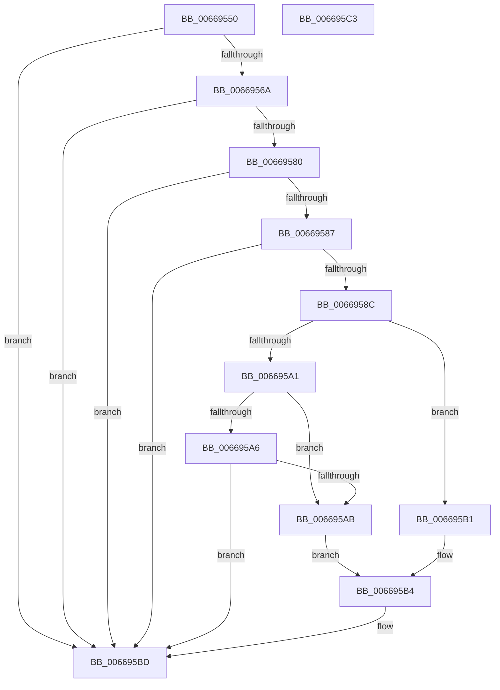

# AccelpSiovUpdateStatsOnWorkCompletion

- RVA: `0x00669550`–`0x006695C4` (길이 `116` bytes)
- VA: `0x0000000140669550`
- 실행 섹션: `.text`
- PDB 이름 있음: `예`; PDB Function 태그: `아니요`
- unwind 정보 RVA: `0x0005CF00`
- 디코드: `34`개 명령, `116/116` bytes 표시
- 미해석 바이트: `0` (있으면 어셈블리에 `.byte`로 보존)

> 이 문서는 커널 이미지의 기계어와 PDB 기호를 분석해 생성했습니다. 4번과 5번은 함수 원형과 자료형을 바이너리 사용 방식에서 추정한 C 해석이며 원본 소스 복구 결과는 아닙니다.

## 1. Dependencies

- 직접 호출 지점: **1**; 고유 호출 대상: **1**
- 직접 호출자로 확인된 함수: **1**
- RIP 상대 이미지 참조: **0**

### Outgoing calls
- `0x00669577` → [AccelpSiovGetOperationType](AccelpSiovGetOperationType_function_00668E40.md) (function, `0x00668E40`)

### Direct callers
- [AccelpSiovDsaOperationHandler](../2C/AccelpSiovDsaOperationHandler_function_002C7F30.md) at `0x002C80D6`

### Static image references
- 디코드된 RIP-relative 메모리 참조가 없습니다.

## 2. Other-region calls and transfers

- 다른 실행 섹션으로 향하는 call: **0**
- 별도 외부 분기/꼬리 이동을 확인하지 못했습니다.

## 3. Assembly (complete function range)

```asm
00669550  40 53                           push rbx
00669552  48 83 EC 20                     sub rsp, 0x20
00669556  4C 8B 51 10                     mov r10, qword ptr [rcx + 0x10]
0066955A  4D 8B D8                        mov r11, r8
0066955D  48 8B DA                        mov rbx, rdx
00669560  41 83 BA BC 00 00 00 01         cmp dword ptr [r10 + 0xbc], 1
00669568  75 53                           jne 0x1406695bd
0066956A  4C 8D 44 24 30                  lea r8, [rsp + 0x30]
0066956F  C7 44 24 30 08 00 00 00         mov dword ptr [rsp + 0x30], 8
00669577  E8 C4 F8 FF FF                  call 0x140668e40
0066957C  85 C0                           test eax, eax
0066957E  78 3D                           js 0x1406695bd
00669580  83 7C 24 30 08                  cmp dword ptr [rsp + 0x30], 8
00669585  74 36                           je 0x1406695bd
00669587  4D 85 DB                        test r11, r11
0066958A  74 31                           je 0x1406695bd
0066958C  48 63 44 24 30                  movsxd rax, dword ptr [rsp + 0x30]
00669591  41 0F B6 0B                     movzx ecx, byte ptr [r11]
00669595  83 E1 3F                        and ecx, 0x3f
00669598  48 8D 14 40                     lea rdx, [rax + rax*2]
0066959C  83 E9 01                        sub ecx, 1
0066959F  74 10                           je 0x1406695b1
006695A1  83 E9 02                        sub ecx, 2
006695A4  74 05                           je 0x1406695ab
006695A6  83 F9 01                        cmp ecx, 1
006695A9  75 12                           jne 0x1406695bd
006695AB  41 8B 43 04                     mov eax, dword ptr [r11 + 4]
006695AF  EB 03                           jmp 0x1406695b4
006695B1  8B 43 20                        mov eax, dword ptr [rbx + 0x20]
006695B4  F0 49 01 84 D2 48 02 00 00      lock add qword ptr [r10 + rdx*8 + 0x248], rax
006695BD  48 83 C4 20                     add rsp, 0x20
006695C1  5B                              pop rbx
006695C2  C3                              ret
006695C3  CC                              int3
```

## 4. C-style interpretation (structured pseudocode)

```c
__int64 __fastcall AccelpSiovUpdateStatsOnWorkCompletion(__int64 a1, __int64 a2, __int64 a3)
{
    __int64 result;
    __int64 v_rsp;
    unsigned __int64 v_stack_p8;

    v_rsp = (v_rsp) - (32);
    if ((*(unsigned int *)(*(unsigned __int64 *)(a1 + 16) + 188)) != 1) goto loc_006695BD;
    v_stack_p8 = 8;
    result = AccelpSiovGetOperationType(a1, a2, v_stack_p8, a4);
    if (sign_flag) goto loc_006695BD;
    if (v_stack_p8 == 8) goto loc_006695BD;
    if (a3 == 0) goto loc_006695BD;
    a1 = (unsigned int)((*(unsigned __int8 *)(a3)) & (63));
    a1 = (unsigned int)((a1) - (1));
    if (condition_is_equal) goto loc_006695B1;
    a1 = (unsigned int)((a1) - (2));
    if (condition_is_equal) goto loc_006695AB;
    if (((unsigned int)(a1)) != 1) goto loc_006695BD;
loc_006695AB:
    goto loc_006695B4;
loc_006695B1:
loc_006695B4:
loc_006695BD:
    v_rsp = (v_rsp) + (32);
    return (unsigned int)(*(unsigned int *)(a2 + 32));
}
```

## 5. (Beta) C Style

```c
int64_t AccelpSiovUpdateStatsOnWorkCompletion(void *Arg1, void *Arg2, int64_t Arg3)
{
    uint8_t *arg1 = (uint8_t *)Arg1;
    uint8_t *arg2 = (uint8_t *)Arg2;

    int64_t result;
    int64_t local_rsp;
    uint64_t v_stack_p8;

    local_rsp = (local_rsp) - (32);
    if ((*(uint32_t *)(*(uint64_t *)(arg1 + 0x10) + 0xBC)) != 1) goto loc_006695BD;
    v_stack_p8 = 8;
    result = AccelpSiovGetOperationType(Arg1, Arg2, v_stack_p8, a4);
    if (sign_flag) goto loc_006695BD;
    if (v_stack_p8 == 8) goto loc_006695BD;
    if (Arg3 == 0) goto loc_006695BD;
    Arg1 = (uint32_t)((*(uint8_t *)(Arg3)) & (63));
    Arg1 = (uint32_t)((Arg1) - (1));
    if (condition_is_equal) goto loc_006695B1;
    Arg1 = (uint32_t)((Arg1) - (2));
    if (condition_is_equal) goto loc_006695AB;
    if (((uint32_t)(Arg1)) != 1) goto loc_006695BD;
loc_006695AB:
    goto loc_006695B4;
loc_006695B1:
loc_006695B4:
loc_006695BD:
    local_rsp = (local_rsp) + (32);
    return (uint32_t)(*(uint32_t *)(arg2 + 0x20));
}
```

### 관측된 메모리 오프셋

구조체 형식이 확인되지 않은 접근은 인자 기준의 오프셋으로만 기록했습니다.

| 기준 인자 | 오프셋 표현 | 폭 (bit) | 접근 |
|---|---:|---:|---|
| `Arg1` | `+ 0x10` | `64` | `R` |
| `Arg2` | `+ 0x20` | `32` | `R` |

## 6. Execution-region graph

[열기: 2D/3D 그래프와 함수 탐색 컨트롤 패널](../../../control-panel.html?section=text&rva=0x00669550&view=graph)

- 2D 그래프는 위에서 아래로 흐르고, 3D 그래프는 빈 공간을 드래그해 회전합니다. Shift+드래그는 이동, 휠은 확대·축소, 함수 노드 선택은 대상 보고서 이동입니다.

### Static fallback


