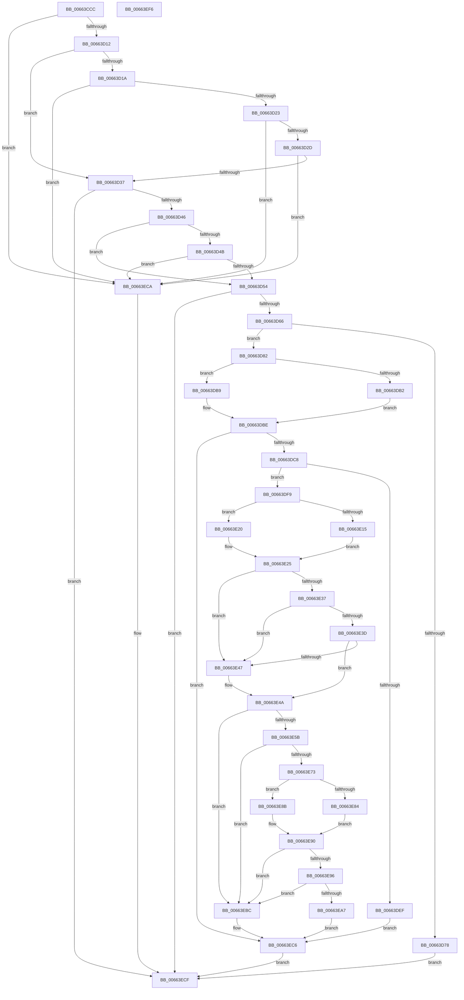

# ApiSetComposeSchema_V7

- RVA: `0x00663CCC`–`0x00663EF7` (길이 `555` bytes)
- VA: `0x0000000140663CCC`
- 실행 섹션: `.text`
- PDB 이름 있음: `예`; PDB Function 태그: `아니요`
- unwind 정보 RVA: `0x000D616C`
- 디코드: `158`개 명령, `555/555` bytes 표시
- 미해석 바이트: `0` (있으면 어셈블리에 `.byte`로 보존)

> 이 문서는 커널 이미지의 기계어와 PDB 기호를 분석해 생성했습니다. 4번과 5번은 함수 원형과 자료형을 바이너리 사용 방식에서 추정한 C 해석이며 원본 소스 복구 결과는 아닙니다.

## 1. Dependencies

- 직접 호출 지점: **21**; 고유 호출 대상: **18**
- 직접 호출자로 확인된 함수: **1**
- RIP 상대 이미지 참조: **1**

### Outgoing calls
- `0x00663D05` → [ApiSetIsSchemaSealed](ApiSetIsSchemaSealed_function_00662D48.md) (function, `0x00662D48`)
- `0x00663D39` → [ApiSetValidateSchemaFormat_V7](ApiSetValidateSchemaFormat_V7_function_006636E8.md) (function, `0x006636E8`)
- `0x00663D59` → [ApiSetValidateSchemaFormat](ApiSetValidateSchemaFormat_function_0066228C.md) (function, `0x0066228C`)
- `0x00663D69` → [ApiSetGetSchemaVersion](ApiSetGetSchemaVersion_function_00661F70.md) (function, `0x00661F70`)
- `0x00663D8F` → [memset](../6C/memset_function_006C6C40.md) (function, `0x006C6C40`)
- `0x00663DA0` → [ApiSetSchemaExpander_Initialize](ApiSetSchemaExpander_Initialize_function_00665570.md) (function, `0x00665570`)
- `0x00663DB2` → [ApiSetCompose_ProcessV7Extension_Phase0](ApiSetCompose_ProcessV7Extension_Phase0_function_00663F00.md) (function, `0x00663F00`)
- `0x00663DB9` → [ApiSetCompose_V7_ProcessV6Extension_Phase0](ApiSetCompose_V7_ProcessV6Extension_Phase0_function_00665A78.md) (function, `0x00665A78`)
- `0x00663DCD` → [ApiSetSchemaExpander_GetNewSchemaSize](ApiSetSchemaExpander_GetNewSchemaSize_function_00665450.md) (function, `0x00665450`)
- `0x00663DE2` → [ExAllocatePool2](../../poolcode/B8/ExAllocatePool2_function_00B820F0.md) (function, `0x00B820F0`)
- `0x00663E04` → [memset](../6C/memset_function_006C6C40.md) (function, `0x006C6C40`)
- `0x00663E2D` → [ApiSetSchemaExpander_ExpandSchema](ApiSetSchemaExpander_ExpandSchema_function_00665334.md) (function, `0x00665334`)
- `0x00663E50` → [ApiSetValidateSchemaHeader_V7](ApiSetValidateSchemaHeader_V7_function_00663734.md) (function, `0x00663734`)
- `0x00663E60` → [ApiSetSchemaExpander_MigrateSchemaData](ApiSetSchemaExpander_MigrateSchemaData_function_006658F8.md) (function, `0x006658F8`)
- `0x00663E68` → [ApiSetValidateSchemaElements_V7](ApiSetValidateSchemaElements_V7_function_00663478.md) (function, `0x00663478`)
- `0x00663E84` → [ApiSetCompose_ProcessV7Extension_Phase1](ApiSetCompose_ProcessV7Extension_Phase1_function_006641BC.md) (function, `0x006641BC`)
- `0x00663E8B` → [ApiSetCompose_V7_ProcessV6Extension_Phase1](ApiSetCompose_V7_ProcessV6Extension_Phase1_function_00665C64.md) (function, `0x00665C64`)
- `0x00663E9C` → [ApiSetValidateSchemaFormat_V7](ApiSetValidateSchemaFormat_V7_function_006636E8.md) (function, `0x006636E8`)
- `0x00663EAD` → [ExFreePoolWithTag](../../poolcode/B8/ExFreePoolWithTag_function_00B82870.md) (function, `0x00B82870`)
- `0x00663EC1` → [ExFreePoolWithTag](../../poolcode/B8/ExFreePoolWithTag_function_00B82870.md) (function, `0x00B82870`)
- `0x00663ED6` → [_security_check_cookie](../6A/_security_check_cookie_function_006AC640.md) (function, `0x006AC640`)

### Direct callers
- [ApiSetComposeSchema](ApiSetComposeSchema_function_00662684.md) at `0x00662D20`

### Static image references
- `0x00663CE8` → RVA `0x00E0A740` (`.data`; read)

## 2. Other-region calls and transfers

- 다른 실행 섹션으로 향하는 call: **3**
  - `0x00663DE2` → [ExAllocatePool2](../../poolcode/B8/ExAllocatePool2_function_00B820F0.md) (`.text` → `POOLCODE`)
  - `0x00663EAD` → [ExFreePoolWithTag](../../poolcode/B8/ExFreePoolWithTag_function_00B82870.md) (`.text` → `POOLCODE`)
  - `0x00663EC1` → [ExFreePoolWithTag](../../poolcode/B8/ExFreePoolWithTag_function_00B82870.md) (`.text` → `POOLCODE`)
- 별도 외부 분기/꼬리 이동을 확인하지 못했습니다.

## 3. Assembly (complete function range)

```asm
00663CCC  48 89 5C 24 20                  mov qword ptr [rsp + 0x20], rbx
00663CD1  55                              push rbp
00663CD2  56                              push rsi
00663CD3  57                              push rdi
00663CD4  41 54                           push r12
00663CD6  41 55                           push r13
00663CD8  41 56                           push r14
00663CDA  41 57                           push r15
00663CDC  48 8D 6C 24 C0                  lea rbp, [rsp - 0x40]
00663CE1  48 81 EC 40 01 00 00            sub rsp, 0x140
00663CE8  48 8B 05 51 6A 7A 00            mov rax, qword ptr [rip + 0x7a6a51]
00663CEF  48 33 C4                        xor rax, rsp
00663CF2  48 89 45 30                     mov qword ptr [rbp + 0x30], rax
00663CF6  4C 8B E1                        mov r12, rcx
00663CF9  41 8B D9                        mov ebx, r9d
00663CFC  48 8B 09                        mov rcx, qword ptr [rcx]
00663CFF  49 8B F0                        mov rsi, r8
00663D02  4C 8B EA                        mov r13, rdx
00663D05  E8 3E F0 FF FF                  call 0x140662d48
00663D0A  84 C0                           test al, al
00663D0C  0F 85 B8 01 00 00               jne 0x140663eca
00663D12  40 B7 07                        mov dil, 7
00663D15  40 38 39                        cmp byte ptr [rcx], dil
00663D18  74 1D                           je 0x140663d37
00663D1A  83 39 06                        cmp dword ptr [rcx], 6
00663D1D  0F 85 A7 01 00 00               jne 0x140663eca
00663D23  83 79 10 08                     cmp dword ptr [rcx + 0x10], 8
00663D27  0F 86 9D 01 00 00               jbe 0x140663eca
00663D2D  40 38 79 1C                     cmp byte ptr [rcx + 0x1c], dil
00663D31  0F 85 93 01 00 00               jne 0x140663eca
00663D37  8B 12                           mov edx, dword ptr [rdx]
00663D39  E8 AA F9 FF FF                  call 0x1406636e8
00663D3E  85 C0                           test eax, eax
00663D40  0F 88 89 01 00 00               js 0x140663ecf
00663D46  83 3E 06                        cmp dword ptr [rsi], 6
00663D49  74 09                           je 0x140663d54
00663D4B  40 38 3E                        cmp byte ptr [rsi], dil
00663D4E  0F 85 76 01 00 00               jne 0x140663eca
00663D54  8B D3                           mov edx, ebx
00663D56  48 8B CE                        mov rcx, rsi
00663D59  E8 2E E5 FF FF                  call 0x14066228c
00663D5E  85 C0                           test eax, eax
00663D60  0F 88 69 01 00 00               js 0x140663ecf
00663D66  48 8B CE                        mov rcx, rsi
00663D69  E8 02 E2 FF FF                  call 0x140661f70
00663D6E  B9 02 07 00 00                  mov ecx, 0x702
00663D73  66 3B C1                        cmp ax, cx
00663D76  76 0A                           jbe 0x140663d82
00663D78  B8 62 A1 00 C0                  mov eax, 0xc000a162
00663D7D  E9 4D 01 00 00                  jmp 0x140663ecf
00663D82  33 D2                           xor edx, edx
00663D84  48 8D 4C 24 20                  lea rcx, [rsp + 0x20]
00663D89  41 B8 10 01 00 00               mov r8d, 0x110
00663D8F  E8 AC 2E 06 00                  call 0x1406c6c40
00663D94  49 8B 0C 24                     mov rcx, qword ptr [r12]
00663D98  4C 8D 44 24 20                  lea r8, [rsp + 0x20]
00663D9D  48 8B D6                        mov rdx, rsi
00663DA0  E8 CB 17 00 00                  call 0x140665570
00663DA5  48 8D 54 24 20                  lea rdx, [rsp + 0x20]
00663DAA  48 8B CE                        mov rcx, rsi
00663DAD  40 38 3E                        cmp byte ptr [rsi], dil
00663DB0  75 07                           jne 0x140663db9
00663DB2  E8 49 01 00 00                  call 0x140663f00
00663DB7  EB 05                           jmp 0x140663dbe
00663DB9  E8 BA 1C 00 00                  call 0x140665a78
00663DBE  8B D8                           mov ebx, eax
00663DC0  85 C0                           test eax, eax
00663DC2  0F 88 FE 00 00 00               js 0x140663ec6
00663DC8  48 8D 4C 24 20                  lea rcx, [rsp + 0x20]
00663DCD  E8 7E 16 00 00                  call 0x140665450
00663DD2  41 B8 41 53 63 68               mov r8d, 0x68635341
00663DD8  8B D0                           mov edx, eax
00663DDA  B9 00 01 00 00                  mov ecx, 0x100
00663DDF  44 8B F8                        mov r15d, eax
00663DE2  E8 09 E3 51 00                  call 0x140b820f0
00663DE7  48 8B F8                        mov rdi, rax
00663DEA  48 85 C0                        test rax, rax
00663DED  75 0A                           jne 0x140663df9
00663DEF  BB 17 00 00 C0                  mov ebx, 0xc0000017
00663DF4  E9 CD 00 00 00                  jmp 0x140663ec6
00663DF9  4D 8B C7                        mov r8, r15
00663DFC  BA 3F 00 00 00                  mov edx, 0x3f
00663E01  48 8B CF                        mov rcx, rdi
00663E04  E8 37 2E 06 00                  call 0x1406c6c40
00663E09  80 7C 24 30 00                  cmp byte ptr [rsp + 0x30], 0
00663E0E  48 89 7C 24 48                  mov qword ptr [rsp + 0x48], rdi
00663E13  74 0B                           je 0x140663e20
00663E15  48 8D 47 1C                     lea rax, [rdi + 0x1c]
00663E19  48 89 44 24 40                  mov qword ptr [rsp + 0x40], rax
00663E1E  EB 05                           jmp 0x140663e25
00663E20  48 89 7C 24 40                  mov qword ptr [rsp + 0x40], rdi
00663E25  41 8B D7                        mov edx, r15d
00663E28  48 8D 4C 24 20                  lea rcx, [rsp + 0x20]
00663E2D  E8 02 15 00 00                  call 0x140665334
00663E32  83 3F 06                        cmp dword ptr [rdi], 6
00663E35  75 10                           jne 0x140663e47
00663E37  83 7F 10 08                     cmp dword ptr [rdi + 0x10], 8
00663E3B  76 0A                           jbe 0x140663e47
00663E3D  4C 8D 77 1C                     lea r14, [rdi + 0x1c]
00663E41  41 80 3E 07                     cmp byte ptr [r14], 7
00663E45  74 03                           je 0x140663e4a
00663E47  4C 8B F7                        mov r14, rdi
00663E4A  41 8B D7                        mov edx, r15d
00663E4D  49 8B CE                        mov rcx, r14
00663E50  E8 DF F8 FF FF                  call 0x140663734
00663E55  8B D8                           mov ebx, eax
00663E57  85 C0                           test eax, eax
00663E59  78 61                           js 0x140663ebc
00663E5B  48 8D 4C 24 20                  lea rcx, [rsp + 0x20]
00663E60  E8 93 1A 00 00                  call 0x1406658f8
00663E65  49 8B CE                        mov rcx, r14
00663E68  E8 0B F6 FF FF                  call 0x140663478
00663E6D  8B D8                           mov ebx, eax
00663E6F  85 C0                           test eax, eax
00663E71  78 49                           js 0x140663ebc
00663E73  FF 44 24 20                     inc dword ptr [rsp + 0x20]
00663E77  48 8D 54 24 20                  lea rdx, [rsp + 0x20]
00663E7C  80 3E 07                        cmp byte ptr [rsi], 7
00663E7F  48 8B CE                        mov rcx, rsi
00663E82  75 07                           jne 0x140663e8b
00663E84  E8 33 03 00 00                  call 0x1406641bc
00663E89  EB 05                           jmp 0x140663e90
00663E8B  E8 D4 1D 00 00                  call 0x140665c64
00663E90  8B D8                           mov ebx, eax
00663E92  85 C0                           test eax, eax
00663E94  78 26                           js 0x140663ebc
00663E96  41 8B D7                        mov edx, r15d
00663E99  48 8B CF                        mov rcx, rdi
00663E9C  E8 47 F8 FF FF                  call 0x1406636e8
00663EA1  8B D8                           mov ebx, eax
00663EA3  85 C0                           test eax, eax
00663EA5  78 15                           js 0x140663ebc
00663EA7  49 8B 0C 24                     mov rcx, qword ptr [r12]
00663EAB  33 D2                           xor edx, edx
00663EAD  E8 BE E9 51 00                  call 0x140b82870
00663EB2  49 89 3C 24                     mov qword ptr [r12], rdi
00663EB6  45 89 7D 00                     mov dword ptr [r13], r15d
00663EBA  EB 0A                           jmp 0x140663ec6
00663EBC  33 D2                           xor edx, edx
00663EBE  48 8B CF                        mov rcx, rdi
00663EC1  E8 AA E9 51 00                  call 0x140b82870
00663EC6  8B C3                           mov eax, ebx
00663EC8  EB 05                           jmp 0x140663ecf
00663ECA  B8 0D 00 00 C0                  mov eax, 0xc000000d
00663ECF  48 8B 4D 30                     mov rcx, qword ptr [rbp + 0x30]
00663ED3  48 33 CC                        xor rcx, rsp
00663ED6  E8 65 87 04 00                  call 0x1406ac640
00663EDB  48 8B 9C 24 98 01 00 00         mov rbx, qword ptr [rsp + 0x198]
00663EE3  48 81 C4 40 01 00 00            add rsp, 0x140
00663EEA  41 5F                           pop r15
00663EEC  41 5E                           pop r14
00663EEE  41 5D                           pop r13
00663EF0  41 5C                           pop r12
00663EF2  5F                              pop rdi
00663EF3  5E                              pop rsi
00663EF4  5D                              pop rbp
00663EF5  C3                              ret
00663EF6  CC                              int3
```

## 4. C-style interpretation (structured pseudocode)

```c
__int64 __fastcall ApiSetComposeSchema_V7(__int64 a1, __int64 a2, __int64 a3, int a4)
{
    __int64 result;
    __int64 v_r14;
    __int64 v_rsp;
    unsigned __int64 v_stack_m130;
    unsigned __int64 v_stack_m138;
    unsigned __int8 v_stack_m148;
    unsigned __int64 v_stack_m158;
    unsigned __int64 v_stack_m48;
    unsigned __int64 v_stack_m78;
    unsigned __int64 v_stack_p20;

    v_stack_p20 = v_rbx;
    v_rsp = (v_rsp) - (320);
    result = (*(unsigned __int64 *)(v_rip + 8022609)) ^ (v_rsp);
    v_stack_m48 = result;
    result = ApiSetIsSchemaSealed(*(unsigned __int64 *)(a1), a2, a3, a4);
    if ((unsigned __int8)(result) != 0) goto loc_00663ECA;
    if ((*(unsigned __int8 *)(*(unsigned __int64 *)(a1))) == 7) goto loc_00663D37;
    if ((*(unsigned int *)(*(unsigned __int64 *)(a1))) != 6) goto loc_00663ECA;
    if ((*(unsigned int *)(*(unsigned __int64 *)(a1) + 16)) <= 8) goto loc_00663ECA;
    if ((*(unsigned __int8 *)(*(unsigned __int64 *)(a1) + 28)) != 7) goto loc_00663ECA;
loc_00663D37:
    result = ApiSetValidateSchemaFormat_V7(*(unsigned __int64 *)(a1), (unsigned int)(*(unsigned int *)(a2)), a3, a4);
    if (sign_flag) goto loc_00663ECF;
    if ((*(unsigned int *)(a3)) == 6) goto loc_00663D54;
    if ((*(unsigned __int8 *)(a3)) != 7) goto loc_00663ECA;
loc_00663D54:
    result = ApiSetValidateSchemaFormat(a3, (unsigned int)((unsigned int)((unsigned int)(a4))), a3, a4);
    if (sign_flag) goto loc_00663ECF;
    result = ApiSetGetSchemaVersion(a3, (unsigned int)((unsigned int)((unsigned int)(a4))), a3, a4);
    if (((unsigned __int16)(result)) <= ((unsigned __int16)((unsigned int)(0x702ULL)))) goto loc_00663D82;
    goto loc_00663ECF;
loc_00663D82:
    a2 = 0;
    result = memset(v_stack_m158, a2, 272, a4);
    result = ApiSetSchemaExpander_Initialize(*(unsigned __int64 *)(a1), a3, v_stack_m158, a4);
    if ((*(unsigned __int8 *)(a3)) != 7) goto loc_00663DB9;
    result = ApiSetCompose_ProcessV7Extension_Phase0(a3, v_stack_m158, v_stack_m158, a4);
    goto loc_00663DBE;
loc_00663DB9:
    result = ApiSetCompose_V7_ProcessV6Extension_Phase0(a3, v_stack_m158, v_stack_m158, a4);
loc_00663DBE:
    if (sign_flag) goto loc_00663EC6;
    result = ApiSetSchemaExpander_GetNewSchemaSize(v_stack_m158, v_stack_m158, v_stack_m158, a4);
    result = ExAllocatePool2(256, (unsigned int)((unsigned int)(result)), (unsigned int)(0x68635341ULL), a4);
    if (result != 0) goto loc_00663DF9;
    goto loc_00663EC6;
loc_00663DF9:
    result = memset(result, 63, (unsigned int)((unsigned int)(result)), a4);
    v_stack_m130 = result;
    if (v_stack_m148 == 0) goto loc_00663E20;
    v_stack_m138 = result + 28;
    goto loc_00663E25;
loc_00663E20:
    v_stack_m138 = result;
loc_00663E25:
    result = ApiSetSchemaExpander_ExpandSchema(v_stack_m158, (unsigned int)((unsigned int)((unsigned int)((unsigned int)(result)))), (unsigned int)((unsigned int)(result)), a4);
    if ((*(unsigned int *)(result)) != 6) goto loc_00663E47;
    if ((*(unsigned int *)(result + 16)) <= 8) goto loc_00663E47;
    v_r14 = result + 28;
    if ((*(unsigned __int8 *)(result + 28)) != 7) {
        v_r14 = result;
    }
    result = ApiSetValidateSchemaHeader_V7(v_r14, (unsigned int)((unsigned int)((unsigned int)((unsigned int)(result)))), (unsigned int)((unsigned int)(result)), a4);
    if (sign_flag) goto loc_00663EBC;
    result = ApiSetSchemaExpander_MigrateSchemaData(v_stack_m158, (unsigned int)((unsigned int)((unsigned int)((unsigned int)(result)))), (unsigned int)((unsigned int)(result)), a4);
    result = ApiSetValidateSchemaElements_V7(v_r14, (unsigned int)((unsigned int)((unsigned int)((unsigned int)(result)))), (unsigned int)((unsigned int)(result)), a4);
    if (sign_flag) goto loc_00663EBC;
    if ((*(unsigned __int8 *)(a3)) != 7) goto loc_00663E8B;
    result = ApiSetCompose_ProcessV7Extension_Phase1(a3, v_stack_m158, (unsigned int)((unsigned int)(result)), a4);
    goto loc_00663E90;
loc_00663E8B:
    result = ApiSetCompose_V7_ProcessV6Extension_Phase1(a3, v_stack_m158, (unsigned int)((unsigned int)(result)), a4);
loc_00663E90:
    if (sign_flag) goto loc_00663EBC;
    result = ApiSetValidateSchemaFormat_V7(result, (unsigned int)((unsigned int)((unsigned int)((unsigned int)(result)))), (unsigned int)((unsigned int)(result)), a4);
    if (sign_flag) goto loc_00663EBC;
    a2 = 0;
    result = ExFreePoolWithTag(*(unsigned __int64 *)(a1), a2, (unsigned int)((unsigned int)(result)), a4);
    *(unsigned __int64 *)(a1) = result;
    *(unsigned int *)(a2) = (unsigned int)((unsigned int)((unsigned int)(result)));
    goto loc_00663EC6;
loc_00663EBC:
    a2 = 0;
    result = ExFreePoolWithTag(result, a2, (unsigned int)((unsigned int)(result)), a4);
loc_00663EC6:
    goto loc_00663ECF;
loc_00663ECA:
loc_00663ECF:
    a1 = (v_stack_m48) ^ (v_rsp);
    result = _security_check_cookie(a1, a2, (unsigned int)((unsigned int)(result)), a4);
    v_rsp = (v_rsp) + (320);
    return result;
}
```

## 5. (Beta) C Style

```c
int64_t ApiSetComposeSchema_V7(void *Arg1, void *Arg2, void *Arg3, int32_t Arg4)
{
    uint8_t *arg1 = (uint8_t *)Arg1;
    uint8_t *arg2 = (uint8_t *)Arg2;
    uint8_t *arg3 = (uint8_t *)Arg3;

    int64_t result;
    int64_t local_r14;
    int64_t local_rsp;
    uint64_t v_stack_m130;
    uint64_t v_stack_m138;
    uint8_t v_stack_m148;
    uint64_t v_stack_m158;
    uint64_t v_stack_m48;
    uint64_t v_stack_m78;
    uint64_t v_stack_p20;

    v_stack_p20 = local_rbx;
    local_rsp = (local_rsp) - (320);
    result = (*(uint64_t *)(v_rip + 0x7A6A51)) ^ (local_rsp);
    v_stack_m48 = result;
    result = ApiSetIsSchemaSealed(*(uint64_t *)(arg1), Arg2, Arg3, Arg4);
    if ((uint8_t)(result) != 0) goto loc_00663ECA;
    if ((*(uint8_t *)(*(uint64_t *)(arg1))) == 7) goto loc_00663D37;
    if ((*(uint32_t *)(*(uint64_t *)(arg1))) != 6) goto loc_00663ECA;
    if ((*(uint32_t *)(*(uint64_t *)(arg1) + 0x10)) <= 8) goto loc_00663ECA;
    if ((*(uint8_t *)(*(uint64_t *)(arg1) + 0x1C)) != 7) goto loc_00663ECA;
loc_00663D37:
    result = ApiSetValidateSchemaFormat_V7(*(uint64_t *)(arg1), (uint32_t)(*(uint32_t *)(arg2)), Arg3, Arg4);
    if (sign_flag) goto loc_00663ECF;
    if ((*(uint32_t *)(arg3)) == 6) goto loc_00663D54;
    if ((*(uint8_t *)(arg3)) != 7) goto loc_00663ECA;
loc_00663D54:
    result = ApiSetValidateSchemaFormat(Arg3, (uint32_t)((uint32_t)((uint32_t)(Arg4))), Arg3, Arg4);
    if (sign_flag) goto loc_00663ECF;
    result = ApiSetGetSchemaVersion(Arg3, (uint32_t)((uint32_t)((uint32_t)(Arg4))), Arg3, Arg4);
    if (((uint16_t)(result)) <= ((uint16_t)((uint32_t)(0x702ULL)))) goto loc_00663D82;
    goto loc_00663ECF;
loc_00663D82:
    Arg2 = 0;
    result = memset(v_stack_m158, Arg2, 272, Arg4);
    result = ApiSetSchemaExpander_Initialize(*(uint64_t *)(arg1), Arg3, v_stack_m158, Arg4);
    if ((*(uint8_t *)(arg3)) != 7) goto loc_00663DB9;
    result = ApiSetCompose_ProcessV7Extension_Phase0(Arg3, v_stack_m158, v_stack_m158, Arg4);
    goto loc_00663DBE;
loc_00663DB9:
    result = ApiSetCompose_V7_ProcessV6Extension_Phase0(Arg3, v_stack_m158, v_stack_m158, Arg4);
loc_00663DBE:
    if (sign_flag) goto loc_00663EC6;
    result = ApiSetSchemaExpander_GetNewSchemaSize(v_stack_m158, v_stack_m158, v_stack_m158, Arg4);
    result = ExAllocatePool2(256, (uint32_t)((uint32_t)(result)), (uint32_t)(0x68635341ULL), Arg4);
    if (result != 0) goto loc_00663DF9;
    goto loc_00663EC6;
loc_00663DF9:
    result = memset(result, 63, (uint32_t)((uint32_t)(result)), Arg4);
    v_stack_m130 = result;
    if (v_stack_m148 == 0) goto loc_00663E20;
    v_stack_m138 = result + 28;
    goto loc_00663E25;
loc_00663E20:
    v_stack_m138 = result;
loc_00663E25:
    result = ApiSetSchemaExpander_ExpandSchema(v_stack_m158, (uint32_t)((uint32_t)((uint32_t)((uint32_t)(result)))), (uint32_t)((uint32_t)(result)), Arg4);
    if ((*(uint32_t *)(result)) != 6) goto loc_00663E47;
    if ((*(uint32_t *)(result + 0x10)) <= 8) goto loc_00663E47;
    local_r14 = result + 28;
    if ((*(uint8_t *)(result + 0x1C)) != 7) {
        local_r14 = result;
    }
    result = ApiSetValidateSchemaHeader_V7(local_r14, (uint32_t)((uint32_t)((uint32_t)((uint32_t)(result)))), (uint32_t)((uint32_t)(result)), Arg4);
    if (sign_flag) goto loc_00663EBC;
    result = ApiSetSchemaExpander_MigrateSchemaData(v_stack_m158, (uint32_t)((uint32_t)((uint32_t)((uint32_t)(result)))), (uint32_t)((uint32_t)(result)), Arg4);
    result = ApiSetValidateSchemaElements_V7(local_r14, (uint32_t)((uint32_t)((uint32_t)((uint32_t)(result)))), (uint32_t)((uint32_t)(result)), Arg4);
    if (sign_flag) goto loc_00663EBC;
    if ((*(uint8_t *)(arg3)) != 7) goto loc_00663E8B;
    result = ApiSetCompose_ProcessV7Extension_Phase1(Arg3, v_stack_m158, (uint32_t)((uint32_t)(result)), Arg4);
    goto loc_00663E90;
loc_00663E8B:
    result = ApiSetCompose_V7_ProcessV6Extension_Phase1(Arg3, v_stack_m158, (uint32_t)((uint32_t)(result)), Arg4);
loc_00663E90:
    if (sign_flag) goto loc_00663EBC;
    result = ApiSetValidateSchemaFormat_V7(result, (uint32_t)((uint32_t)((uint32_t)((uint32_t)(result)))), (uint32_t)((uint32_t)(result)), Arg4);
    if (sign_flag) goto loc_00663EBC;
    Arg2 = 0;
    result = ExFreePoolWithTag(*(uint64_t *)(arg1), Arg2, (uint32_t)((uint32_t)(result)), Arg4);
    *(uint64_t *)(arg1) = result;
    *(uint32_t *)(arg2) = (uint32_t)((uint32_t)((uint32_t)(result)));
    goto loc_00663EC6;
loc_00663EBC:
    Arg2 = 0;
    result = ExFreePoolWithTag(result, Arg2, (uint32_t)((uint32_t)(result)), Arg4);
loc_00663EC6:
    goto loc_00663ECF;
loc_00663ECA:
loc_00663ECF:
    Arg1 = (v_stack_m48) ^ (local_rsp);
    result = _security_check_cookie(Arg1, Arg2, (uint32_t)((uint32_t)(result)), Arg4);
    local_rsp = (local_rsp) + (320);
    return result;
}
```

### 관측된 메모리 오프셋

구조체 형식이 확인되지 않은 접근은 인자 기준의 오프셋으로만 기록했습니다.

| 기준 인자 | 오프셋 표현 | 폭 (bit) | 접근 |
|---|---:|---:|---|
| `Arg1` | `+ 0x0` | `64` | `R` |
| `Arg1` | `+ 0x0` | `64` | `W` |
| `Arg2` | `+ 0x0` | `32` | `W` |
| `Arg3` | `+ 0x0` | `8` | `R` |
| `Arg3` | `+ 0x0` | `32` | `R` |

## 6. Execution-region graph

[열기: 2D/3D 그래프와 함수 탐색 컨트롤 패널](../../../control-panel.html?section=text&rva=0x00663CCC&view=graph)

- 2D 그래프는 위에서 아래로 흐르고, 3D 그래프는 빈 공간을 드래그해 회전합니다. Shift+드래그는 이동, 휠은 확대·축소, 함수 노드 선택은 대상 보고서 이동입니다.

### Static fallback


