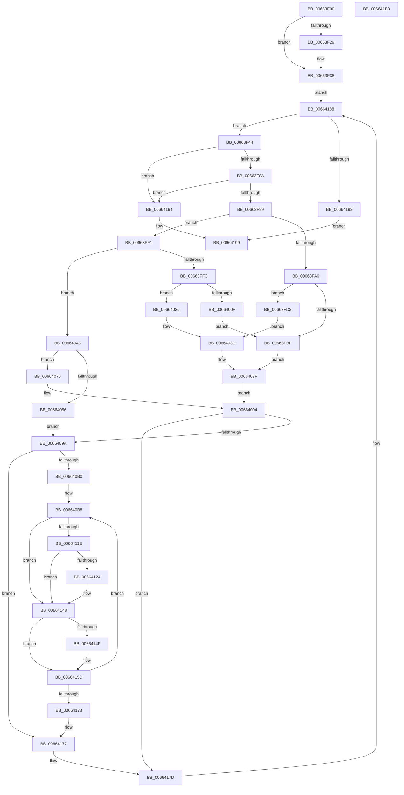

# ApiSetCompose_ProcessV7Extension_Phase0

- RVA: `0x00663F00`–`0x006641B4` (길이 `692` bytes)
- VA: `0x0000000140663F00`
- 실행 섹션: `.text`
- PDB 이름 있음: `예`; PDB Function 태그: `아니요`
- unwind 정보 RVA: `0x000BDF48`
- 디코드: `184`개 명령, `692/692` bytes 표시
- 미해석 바이트: `0` (있으면 어셈블리에 `.byte`로 보존)

> 이 문서는 커널 이미지의 기계어와 PDB 기호를 분석해 생성했습니다. 4번과 5번은 함수 원형과 자료형을 바이너리 사용 방식에서 추정한 C 해석이며 원본 소스 복구 결과는 아닙니다.

## 1. Dependencies

- 직접 호출 지점: **5**; 고유 호출 대상: **2**
- 직접 호출자로 확인된 함수: **1**
- RIP 상대 이미지 참조: **0**

### Outgoing calls
- `0x00663F7D` → [ApiSetpGetContractKeyInfo](ApiSetpGetContractKeyInfo_function_00664B44.md) (function, `0x00664B44`)
- `0x00663FB0` → [ApiSetpSearchForSectionIndex_V7](ApiSetpSearchForSectionIndex_V7_function_00665218.md) (function, `0x00665218`)
- `0x00664000` → [ApiSetpSearchForSectionIndex_V7](ApiSetpSearchForSectionIndex_V7_function_00665218.md) (function, `0x00665218`)
- `0x00664047` → [ApiSetpSearchForSectionIndex_V7](ApiSetpSearchForSectionIndex_V7_function_00665218.md) (function, `0x00665218`)
- `0x0066410A` → [ApiSetpSearchForSectionIndex_V7](ApiSetpSearchForSectionIndex_V7_function_00665218.md) (function, `0x00665218`)

### Direct callers
- [ApiSetComposeSchema_V7](ApiSetComposeSchema_V7_function_00663CCC.md) at `0x00663DB2`

### Static image references
- 디코드된 RIP-relative 메모리 참조가 없습니다.

## 2. Other-region calls and transfers

- 다른 실행 섹션으로 향하는 call: **0**
- 별도 외부 분기/꼬리 이동을 확인하지 못했습니다.

## 3. Assembly (complete function range)

```asm
00663F00  48 89 5C 24 10                  mov qword ptr [rsp + 0x10], rbx
00663F05  55                              push rbp
00663F06  56                              push rsi
00663F07  57                              push rdi
00663F08  41 54                           push r12
00663F0A  41 55                           push r13
00663F0C  41 56                           push r14
00663F0E  41 57                           push r15
00663F10  48 8B EC                        mov rbp, rsp
00663F13  48 83 EC 50                     sub rsp, 0x50
00663F17  33 F6                           xor esi, esi
00663F19  48 8B DA                        mov rbx, rdx
00663F1C  4C 8B F1                        mov r14, rcx
00663F1F  44 8D 66 01                     lea r12d, [rsi + 1]
00663F23  66 39 71 10                     cmp word ptr [rcx + 0x10], si
00663F27  76 0F                           jbe 0x140663f38
00663F29  66 44 01 A2 D4 00 00 00         add word ptr [rdx + 0xd4], r12w
00663F31  83 82 D8 00 00 00 0C            add dword ptr [rdx + 0xd8], 0xc
00663F38  66 3B 71 12                     cmp si, word ptr [rcx + 0x12]
00663F3C  44 8B EE                        mov r13d, esi
00663F3F  E9 44 02 00 00                  jmp 0x140664188
00663F44  33 C9                           xor ecx, ecx
00663F46  41 8B C5                        mov eax, r13d
00663F49  48 89 4D F0                     mov qword ptr [rbp - 0x10], rcx
00663F4D  4C 8D 4D D0                     lea r9, [rbp - 0x30]
00663F51  0F 57 C0                        xorps xmm0, xmm0
00663F54  45 33 C0                        xor r8d, r8d
00663F57  0F 11 45 D0                     movups xmmword ptr [rbp - 0x30], xmm0
00663F5B  48 8D 14 80                     lea rdx, [rax + rax*4]
00663F5F  41 8B 46 0C                     mov eax, dword ptr [r14 + 0xc]
00663F63  49 03 C6                        add rax, r14
00663F66  48 89 55 50                     mov qword ptr [rbp + 0x50], rdx
00663F6A  48 89 45 58                     mov qword ptr [rbp + 0x58], rax
00663F6E  0F 11 45 E0                     movups xmmword ptr [rbp - 0x20], xmm0
00663F72  8B 0C 90                        mov ecx, dword ptr [rax + rdx*4]
00663F75  0F B7 54 90 08                  movzx edx, word ptr [rax + rdx*4 + 8]
00663F7A  49 03 CE                        add rcx, r14
00663F7D  E8 C2 0B 00 00                  call 0x140664b44
00663F82  84 C0                           test al, al
00663F84  0F 84 0A 02 00 00               je 0x140664194
00663F8A  8B 4D DC                        mov ecx, dword ptr [rbp - 0x24]
00663F8D  8D 41 FF                        lea eax, [rcx - 1]
00663F90  83 F8 02                        cmp eax, 2
00663F93  0F 87 FB 01 00 00               ja 0x140664194
00663F99  48 8B 7B 08                     mov rdi, qword ptr [rbx + 8]
00663F9D  4C 8D 45 D0                     lea r8, [rbp - 0x30]
00663FA1  41 3B CC                        cmp ecx, r12d
00663FA4  75 4B                           jne 0x140663ff1
00663FA6  45 8A CC                        mov r9b, r12b
00663FA9  48 8D 57 2C                     lea rdx, [rdi + 0x2c]
00663FAD  48 8B CF                        mov rcx, rdi
00663FB0  E8 63 12 00 00                  call 0x140665218
00663FB5  B9 FF FF 00 00                  mov ecx, 0xffff
00663FBA  66 3B C1                        cmp ax, cx
00663FBD  75 14                           jne 0x140663fd3
00663FBF  66 44 01 A3 A4 00 00 00         add word ptr [rbx + 0xa4], r12w
00663FC7  40 8A C6                        mov al, sil
00663FCA  83 83 A8 00 00 00 14            add dword ptr [rbx + 0xa8], 0x14
00663FD1  EB 6C                           jmp 0x14066403f
00663FD3  0F B7 C8                        movzx ecx, ax
00663FD6  0F B6 47 34                     movzx eax, byte ptr [rdi + 0x34]
00663FDA  48 0F AF C8                     imul rcx, rax
00663FDE  0F B7 47 12                     movzx eax, word ptr [rdi + 0x12]
00663FE2  48 2B C8                        sub rcx, rax
00663FE5  8B 47 2C                        mov eax, dword ptr [rdi + 0x2c]
00663FE8  48 03 CF                        add rcx, rdi
00663FEB  8A 44 08 0A                     mov al, byte ptr [rax + rcx + 0xa]
00663FEF  EB 4B                           jmp 0x14066403c
00663FF1  45 33 C9                        xor r9d, r9d
00663FF4  83 F9 02                        cmp ecx, 2
00663FF7  48 8B CF                        mov rcx, rdi
00663FFA  75 47                           jne 0x140664043
00663FFC  48 8D 57 38                     lea rdx, [rdi + 0x38]
00664000  E8 13 12 00 00                  call 0x140665218
00664005  B9 FF FF 00 00                  mov ecx, 0xffff
0066400A  66 3B C1                        cmp ax, cx
0066400D  75 11                           jne 0x140664020
0066400F  66 44 01 A3 B0 00 00 00         add word ptr [rbx + 0xb0], r12w
00664017  83 83 B4 00 00 00 14            add dword ptr [rbx + 0xb4], 0x14
0066401E  EB 9F                           jmp 0x140663fbf
00664020  0F B6 4F 40                     movzx ecx, byte ptr [rdi + 0x40]
00664024  0F B7 C0                        movzx eax, ax
00664027  48 0F AF C8                     imul rcx, rax
0066402B  0F B7 47 12                     movzx eax, word ptr [rdi + 0x12]
0066402F  48 2B C8                        sub rcx, rax
00664032  8B 47 38                        mov eax, dword ptr [rdi + 0x38]
00664035  48 03 CF                        add rcx, rdi
00664038  8A 44 08 06                     mov al, byte ptr [rax + rcx + 6]
0066403C  41 22 C4                        and al, r12b
0066403F  84 C0                           test al, al
00664041  EB 51                           jmp 0x140664094
00664043  48 8D 57 44                     lea rdx, [rdi + 0x44]
00664047  E8 CC 11 00 00                  call 0x140665218
0066404C  B9 FF FF 00 00                  mov ecx, 0xffff
00664051  66 3B C1                        cmp ax, cx
00664054  75 20                           jne 0x140664076
00664056  66 44 01 A3 BC 00 00 00         add word ptr [rbx + 0xbc], r12w
0066405E  83 83 C0 00 00 00 14            add dword ptr [rbx + 0xc0], 0x14
00664065  66 44 01 A3 A4 00 00 00         add word ptr [rbx + 0xa4], r12w
0066406D  83 83 A8 00 00 00 14            add dword ptr [rbx + 0xa8], 0x14
00664074  EB 24                           jmp 0x14066409a
00664076  0F B6 57 4C                     movzx edx, byte ptr [rdi + 0x4c]
0066407A  8B 4F 44                        mov ecx, dword ptr [rdi + 0x44]
0066407D  0F B7 C0                        movzx eax, ax
00664080  48 0F AF D0                     imul rdx, rax
00664084  0F B7 47 12                     movzx eax, word ptr [rdi + 0x12]
00664088  48 2B D0                        sub rdx, rax
0066408B  48 8D 04 17                     lea rax, [rdi + rdx]
0066408F  44 84 64 01 0A                  test byte ptr [rcx + rax + 0xa], r12b
00664094  0F 85 E3 00 00 00               jne 0x14066417d
0066409A  48 8B 45 50                     mov rax, qword ptr [rbp + 0x50]
0066409E  44 8B E6                        mov r12d, esi
006640A1  48 8B 4D 58                     mov rcx, qword ptr [rbp + 0x58]
006640A5  66 3B 74 81 0A                  cmp si, word ptr [rcx + rax*4 + 0xa]
006640AA  0F 83 C7 00 00 00               jae 0x140664177
006640B0  4C 8B E8                        mov r13, rax
006640B3  BA 01 00 00 00                  mov edx, 1
006640B8  46 8B 7C A9 04                  mov r15d, dword ptr [rcx + r13*4 + 4]
006640BD  4C 8D 45 D0                     lea r8, [rbp - 0x30]
006640C1  44 8A 4F 65                     mov r9b, byte ptr [rdi + 0x65]
006640C5  0F 57 C0                        xorps xmm0, xmm0
006640C8  0F 11 45 D0                     movups xmmword ptr [rbp - 0x30], xmm0
006640CC  41 D0 E9                        shr r9b, 1
006640CF  0F 11 45 E0                     movups xmmword ptr [rbp - 0x20], xmm0
006640D3  88 55 DA                        mov byte ptr [rbp - 0x26], dl
006640D6  44 22 CA                        and r9b, dl
006640D9  41 8B C4                        mov eax, r12d
006640DC  48 8D 57 5C                     lea rdx, [rdi + 0x5c]
006640E0  48 C1 E0 04                     shl rax, 4
006640E4  49 03 C6                        add rax, r14
006640E7  4C 03 F8                        add r15, rax
006640EA  33 C0                           xor eax, eax
006640EC  48 89 45 F0                     mov qword ptr [rbp - 0x10], rax
006640F0  41 0F B7 4F 08                  movzx ecx, word ptr [r15 + 8]
006640F5  41 8B 07                        mov eax, dword ptr [r15]
006640F8  49 03 C6                        add rax, r14
006640FB  66 89 4D D8                     mov word ptr [rbp - 0x28], cx
006640FF  66 89 4D E2                     mov word ptr [rbp - 0x1e], cx
00664103  48 8B CF                        mov rcx, rdi
00664106  48 89 45 D0                     mov qword ptr [rbp - 0x30], rax
0066410A  E8 09 11 00 00                  call 0x140665218
0066410F  B9 FF FF 00 00                  mov ecx, 0xffff
00664114  BA 01 00 00 00                  mov edx, 1
00664119  66 3B C1                        cmp ax, cx
0066411C  75 2A                           jne 0x140664148
0066411E  41 84 57 0C                     test byte ptr [r15 + 0xc], dl
00664122  75 24                           jne 0x140664148
00664124  66 01 93 C8 00 00 00            add word ptr [rbx + 0xc8], dx
0066412B  83 83 CC 00 00 00 14            add dword ptr [rbx + 0xcc], 0x14
00664132  41 0F B7 47 08                  movzx eax, word ptr [r15 + 8]
00664137  03 C0                           add eax, eax
00664139  01 83 E8 00 00 00               add dword ptr [rbx + 0xe8], eax
0066413F  66 41 09 57 0C                  or word ptr [r15 + 0xc], dx
00664144  48 8B 7B 08                     mov rdi, qword ptr [rbx + 8]
00664148  66 41 39 77 0A                  cmp word ptr [r15 + 0xa], si
0066414D  74 0E                           je 0x14066415d
0066414F  66 01 93 E0 00 00 00            add word ptr [rbx + 0xe0], dx
00664156  83 83 E4 00 00 00 10            add dword ptr [rbx + 0xe4], 0x10
0066415D  48 8B 4D 58                     mov rcx, qword ptr [rbp + 0x58]
00664161  44 03 E2                        add r12d, edx
00664164  42 0F B7 44 A9 0A               movzx eax, word ptr [rcx + r13*4 + 0xa]
0066416A  44 3B E0                        cmp r12d, eax
0066416D  0F 82 45 FF FF FF               jb 0x1406640b8
00664173  44 8B 6D 40                     mov r13d, dword ptr [rbp + 0x40]
00664177  41 BC 01 00 00 00               mov r12d, 1
0066417D  41 0F B7 46 12                  movzx eax, word ptr [r14 + 0x12]
00664182  45 03 EC                        add r13d, r12d
00664185  44 3B E8                        cmp r13d, eax
00664188  44 89 6D 40                     mov dword ptr [rbp + 0x40], r13d
0066418C  0F 82 B2 FD FF FF               jb 0x140663f44
00664192  EB 05                           jmp 0x140664199
00664194  BE 33 00 00 C0                  mov esi, 0xc0000033
00664199  48 8B 9C 24 98 00 00 00         mov rbx, qword ptr [rsp + 0x98]
006641A1  8B C6                           mov eax, esi
006641A3  48 83 C4 50                     add rsp, 0x50
006641A7  41 5F                           pop r15
006641A9  41 5E                           pop r14
006641AB  41 5D                           pop r13
006641AD  41 5C                           pop r12
006641AF  5F                              pop rdi
006641B0  5E                              pop rsi
006641B1  5D                              pop rbp
006641B2  C3                              ret
006641B3  CC                              int3
```

## 4. C-style interpretation (structured pseudocode)

```c
__int64 __fastcall ApiSetCompose_ProcessV7Extension_Phase0(__int64 a1, __int64 a2, int a3)
{
    __int64 result;
    __int64 v_r12;
    __int64 v_r13;
    __int64 v_r15;
    __int64 v_rdi;
    __int64 v_rsi;
    __int64 v_rsp;
    unsigned __int64 v_stack_m48;
    unsigned __int16 v_stack_m56;
    unsigned __int64 v_stack_m58;
    unsigned int v_stack_m5C;
    unsigned __int8 v_stack_m5E;
    unsigned __int16 v_stack_m60;
    unsigned __int64 v_stack_m68;
    unsigned __int64 v_stack_p10;
    unsigned __int64 v_stack_p18;
    unsigned __int64 v_stack_p20;
    unsigned int v_stack_p8;

    v_stack_p10 = v_rbx;
    v_rsp = (v_rsp) - (80);
    v_rsi = 0;
    if ((*(unsigned __int16 *)(a1 + 16)) >= = 0) {
    }
    goto loc_00664188;
loc_00663F44:
    a1 = 0;
    v_stack_m48 = 0;
    a3 = 0;
    v_stack_m68 = v_xmm0;
    result = ((unsigned int)(*(unsigned int *)(a1 + 12))) + (0);
    v_stack_p18 = 0 + 0 * 4;
    v_stack_p20 = result;
    v_stack_m58 = v_xmm0;
    a1 = ((unsigned int)(*(unsigned int *)(result + 0 + 0 * 4 * 4))) + (0);
    result = ApiSetpGetContractKeyInfo(a1, *(unsigned __int16 *)(result + 0 + 0 * 4 * 4 + 8), a3, v_stack_m68);
    if ((unsigned __int8)(result) == 0) goto loc_00664194;
    if (((unsigned int)((unsigned int)(v_stack_m5C) - 1)) > 2) goto loc_00664194;
    if (((unsigned int)((unsigned int)(v_stack_m5C))) != ((unsigned int)(v_rsi + 1))) goto loc_00663FF1;
    result = ApiSetpSearchForSectionIndex_V7(*(unsigned __int64 *)(a2 + 8), *(unsigned __int64 *)(a2 + 8) + 44, v_stack_m68, (unsigned __int8)(v_rsi + 1));
    if (((unsigned __int16)(result)) != ((unsigned __int16)((unsigned int)(0xFFFFULL)))) goto loc_00663FD3;
loc_00663FBF:
    goto loc_0066403F;
loc_00663FD3:
    a1 = (0) * (*(unsigned __int8 *)(*(unsigned __int64 *)(a2 + 8) + 52));
    a1 = (a1) - (*(unsigned __int16 *)(*(unsigned __int64 *)(a2 + 8) + 18));
    a1 = (a1) + (*(unsigned __int64 *)(a2 + 8));
    goto loc_0066403C;
loc_00663FF1:
    a4 = 0;
    if (((unsigned int)(a1)) != 2) goto loc_00664043;
    result = ApiSetpSearchForSectionIndex_V7(*(unsigned __int64 *)(a2 + 8), *(unsigned __int64 *)(a2 + 8) + 56, v_stack_m68, a4);
    if (((unsigned __int16)(result)) != ((unsigned __int16)((unsigned int)(0xFFFFULL)))) goto loc_00664020;
    goto loc_00663FBF;
loc_00664020:
    a1 = (*(unsigned __int8 *)(*(unsigned __int64 *)(a2 + 8) + 64)) * ((unsigned __int16)(result));
    a1 = (a1) - (*(unsigned __int16 *)(*(unsigned __int64 *)(a2 + 8) + 18));
    a1 = (a1) + (*(unsigned __int64 *)(a2 + 8));
loc_0066403C:
    result = (unsigned __int8)((*(unsigned __int8 *)((unsigned int)(*(unsigned int *)(*(unsigned __int64 *)(a2 + 8) + 56)) + a1 * 1 + 6)) & ((unsigned __int8)(v_rsi + 1)));
loc_0066403F:
    goto loc_00664094;
loc_00664043:
    result = ApiSetpSearchForSectionIndex_V7(a1, *(unsigned __int64 *)(a2 + 8) + 68, v_stack_m68, a4);
    if (((unsigned __int16)(result)) != ((unsigned __int16)((unsigned int)(0xFFFFULL)))) goto loc_00664076;
    goto loc_0066409A;
loc_00664076:
    a2 = (*(unsigned __int8 *)(*(unsigned __int64 *)(a2 + 8) + 76)) * ((unsigned __int16)(result));
    a2 = (a2) - (*(unsigned __int16 *)(*(unsigned __int64 *)(a2 + 8) + 18));
loc_00664094:
    if (((*(unsigned __int8 *)((unsigned int)(*(unsigned int *)(*(unsigned __int64 *)(a2 + 8) + 68)) + *(unsigned __int64 *)(a2 + 8) + a2 * 1 * 1 + 10)) & ((unsigned __int8)(v_rsi + 1))) != 0) goto loc_0066417D;
loc_0066409A:
    if (0 >= (*(unsigned __int16 *)(v_stack_p20 + v_stack_p18 * 4 + 10))) goto loc_00664177;
loc_006640B8:
    v_stack_m68 = v_xmm0;
    a4 = (unsigned __int8)((*(unsigned __int8 *)(*(unsigned __int64 *)(a2 + 8) + 101)) >> (1));
    v_stack_m58 = v_xmm0;
    v_stack_m5E = 1;
    a4 = (unsigned __int8)((a4) & (1));
    result = (0) << (4);
    result = (result) + (a1);
    v_r15 = ((unsigned int)(*(unsigned int *)(v_stack_p20 + v_stack_p18 * 4 + 4))) + (result);
    result = 0;
    v_stack_m48 = 0;
    result = ((unsigned int)(*(unsigned int *)(v_r15))) + (a1);
    v_stack_m60 = (unsigned __int16)(*(unsigned __int16 *)(v_r15 + 8));
    v_stack_m56 = (unsigned __int16)(*(unsigned __int16 *)(v_r15 + 8));
    v_stack_m68 = result;
    result = ApiSetpSearchForSectionIndex_V7(*(unsigned __int64 *)(a2 + 8), *(unsigned __int64 *)(a2 + 8) + 92, v_stack_m68, a4);
    if (((unsigned __int16)(result)) != ((unsigned __int16)((unsigned int)(0xFFFFULL)))) goto loc_00664148;
    v_rdi = *(unsigned __int64 *)(a2 + 8);
    if (((*(unsigned __int8 *)(v_r15 + 12)) & (1)) == 0) {
        result = *(unsigned __int16 *)(v_r15 + 8);
        result = (unsigned int)((result) + ((unsigned int)(result)));
        v_rdi = *(unsigned __int64 *)(a2 + 8);
    }
    if ((*(unsigned __int16 *)(v_r15 + 10)) != 0) {
    }
    v_r12 = (unsigned int)((0) + (1));
    if (((unsigned int)(v_r12)) < ((unsigned int)(*(unsigned __int16 *)(v_stack_p20 + v_stack_p18 * 4 + 10)))) goto loc_006640B8;
loc_00664177:
loc_0066417D:
    v_r13 = (unsigned int)(((unsigned int)(v_stack_p8)) + (1));
loc_00664188:
    v_stack_p8 = (unsigned int)(v_r13);
    if (((unsigned int)(v_r13)) < ((unsigned int)(*(unsigned __int16 *)(a1 + 18)))) goto loc_00663F44;
    goto loc_00664199;
loc_00664194:
loc_00664199:
    v_rsp = (v_rsp) + (80);
    return (unsigned int)((unsigned int)((unsigned int)(0xC0000033ULL)));
}
```

## 5. (Beta) C Style

```c
int64_t ApiSetCompose_ProcessV7Extension_Phase0(void *Arg1, void *Arg2, int32_t Arg3)
{
    uint8_t *arg1 = (uint8_t *)Arg1;
    uint8_t *arg2 = (uint8_t *)Arg2;

    int64_t result;
    int64_t local_r12;
    int64_t local_r13;
    int64_t local_r15;
    int64_t local_rdi;
    int64_t local_rsi;
    int64_t local_rsp;
    uint64_t v_stack_m48;
    uint16_t v_stack_m56;
    uint64_t v_stack_m58;
    uint32_t v_stack_m5C;
    uint8_t v_stack_m5E;
    uint16_t v_stack_m60;
    uint64_t v_stack_m68;
    uint64_t v_stack_p10;
    uint64_t v_stack_p18;
    uint64_t v_stack_p20;
    uint32_t v_stack_p8;

    v_stack_p10 = local_rbx;
    local_rsp = (local_rsp) - (80);
    local_rsi = 0;
    if ((*(uint16_t *)(arg1 + 0x10)) >= = 0) {
    }
    goto loc_00664188;
loc_00663F44:
    Arg1 = 0;
    v_stack_m48 = 0;
    Arg3 = 0;
    v_stack_m68 = v_xmm0;
    result = ((uint32_t)(*(uint32_t *)(arg1 + 0xC))) + (0);
    v_stack_p18 = 0 + 0 * 4;
    v_stack_p20 = result;
    v_stack_m58 = v_xmm0;
    Arg1 = ((uint32_t)(*(uint32_t *)(result + 0x0 + 0x0 * 4 * 4))) + (0);
    result = ApiSetpGetContractKeyInfo(Arg1, *(uint16_t *)(result + 0x0 + 0x0 * 4 * 4 + 0x8), Arg3, v_stack_m68);
    if ((uint8_t)(result) == 0) goto loc_00664194;
    if (((uint32_t)((uint32_t)(v_stack_m5C) - 1)) > 2) goto loc_00664194;
    if (((uint32_t)((uint32_t)(v_stack_m5C))) != ((uint32_t)(local_rsi + 1))) goto loc_00663FF1;
    result = ApiSetpSearchForSectionIndex_V7(*(uint64_t *)(arg2 + 0x8), *(uint64_t *)(arg2 + 0x8) + 44, v_stack_m68, (uint8_t)(local_rsi + 1));
    if (((uint16_t)(result)) != ((uint16_t)((uint32_t)(0xFFFFULL)))) goto loc_00663FD3;
loc_00663FBF:
    goto loc_0066403F;
loc_00663FD3:
    Arg1 = (0) * (*(uint8_t *)(*(uint64_t *)(arg2 + 0x8) + 0x34));
    Arg1 = (Arg1) - (*(uint16_t *)(*(uint64_t *)(arg2 + 0x8) + 0x12));
    Arg1 = (Arg1) + (*(uint64_t *)(arg2 + 0x8));
    goto loc_0066403C;
loc_00663FF1:
    a4 = 0;
    if (((uint32_t)(Arg1)) != 2) goto loc_00664043;
    result = ApiSetpSearchForSectionIndex_V7(*(uint64_t *)(arg2 + 0x8), *(uint64_t *)(arg2 + 0x8) + 56, v_stack_m68, a4);
    if (((uint16_t)(result)) != ((uint16_t)((uint32_t)(0xFFFFULL)))) goto loc_00664020;
    goto loc_00663FBF;
loc_00664020:
    Arg1 = (*(uint8_t *)(*(uint64_t *)(arg2 + 0x8) + 0x40)) * ((uint16_t)(result));
    Arg1 = (Arg1) - (*(uint16_t *)(*(uint64_t *)(arg2 + 0x8) + 0x12));
    Arg1 = (Arg1) + (*(uint64_t *)(arg2 + 0x8));
loc_0066403C:
    result = (uint8_t)((*(uint8_t *)((uint32_t)(*(uint32_t *)(*(uint64_t *)(arg2 + 0x8) + 0x38)) + arg1 * 1 + 0x6)) & ((uint8_t)(local_rsi + 1)));
loc_0066403F:
    goto loc_00664094;
loc_00664043:
    result = ApiSetpSearchForSectionIndex_V7(Arg1, *(uint64_t *)(arg2 + 0x8) + 68, v_stack_m68, a4);
    if (((uint16_t)(result)) != ((uint16_t)((uint32_t)(0xFFFFULL)))) goto loc_00664076;
    goto loc_0066409A;
loc_00664076:
    Arg2 = (*(uint8_t *)(*(uint64_t *)(arg2 + 0x8) + 0x4C)) * ((uint16_t)(result));
    Arg2 = (Arg2) - (*(uint16_t *)(*(uint64_t *)(arg2 + 0x8) + 0x12));
loc_00664094:
    if (((*(uint8_t *)((uint32_t)(*(uint32_t *)(*(uint64_t *)(arg2 + 0x8) + 0x44)) + *(uint64_t *)(arg2 + 0x8) + arg2 * 1 * 1 + 0xA)) & ((uint8_t)(local_rsi + 1))) != 0) goto loc_0066417D;
loc_0066409A:
    if (0 >= (*(uint16_t *)(v_stack_p20 + v_stack_p18 * 4 + 0xA))) goto loc_00664177;
loc_006640B8:
    v_stack_m68 = v_xmm0;
    a4 = (uint8_t)((*(uint8_t *)(*(uint64_t *)(arg2 + 0x8) + 0x65)) >> (1));
    v_stack_m58 = v_xmm0;
    v_stack_m5E = 1;
    a4 = (uint8_t)((a4) & (1));
    result = (0) << (4);
    result = (result) + (Arg1);
    local_r15 = ((uint32_t)(*(uint32_t *)(v_stack_p20 + v_stack_p18 * 4 + 0x4))) + (result);
    result = 0;
    v_stack_m48 = 0;
    result = ((uint32_t)(*(uint32_t *)(local_r15))) + (Arg1);
    v_stack_m60 = (uint16_t)(*(uint16_t *)(local_r15 + 0x8));
    v_stack_m56 = (uint16_t)(*(uint16_t *)(local_r15 + 0x8));
    v_stack_m68 = result;
    result = ApiSetpSearchForSectionIndex_V7(*(uint64_t *)(arg2 + 0x8), *(uint64_t *)(arg2 + 0x8) + 92, v_stack_m68, a4);
    if (((uint16_t)(result)) != ((uint16_t)((uint32_t)(0xFFFFULL)))) goto loc_00664148;
    local_rdi = *(uint64_t *)(arg2 + 0x8);
    if (((*(uint8_t *)(local_r15 + 0xC)) & (1)) == 0) {
        result = *(uint16_t *)(local_r15 + 0x8);
        result = (uint32_t)((result) + ((uint32_t)(result)));
        local_rdi = *(uint64_t *)(arg2 + 0x8);
    }
    if ((*(uint16_t *)(local_r15 + 0xA)) != 0) {
    }
    local_r12 = (uint32_t)((0) + (1));
    if (((uint32_t)(local_r12)) < ((uint32_t)(*(uint16_t *)(v_stack_p20 + v_stack_p18 * 4 + 0xA)))) goto loc_006640B8;
loc_00664177:
loc_0066417D:
    local_r13 = (uint32_t)(((uint32_t)(v_stack_p8)) + (1));
loc_00664188:
    v_stack_p8 = (uint32_t)(local_r13);
    if (((uint32_t)(local_r13)) < ((uint32_t)(*(uint16_t *)(arg1 + 0x12)))) goto loc_00663F44;
    goto loc_00664199;
loc_00664194:
loc_00664199:
    local_rsp = (local_rsp) + (80);
    return (uint32_t)((uint32_t)((uint32_t)(0xC0000033ULL)));
}
```

### 관측된 메모리 오프셋

구조체 형식이 확인되지 않은 접근은 인자 기준의 오프셋으로만 기록했습니다.

| 기준 인자 | 오프셋 표현 | 폭 (bit) | 접근 |
|---|---:|---:|---|
| `Arg1` | `+ 0xC` | `32` | `R` |
| `Arg1` | `+ 0x10` | `16` | `R` |
| `Arg1` | `+ 0x12` | `16` | `R` |
| `Arg2` | `+ 0x8` | `64` | `R` |
| `Arg2` | `+ 0xA4` | `16` | `R/W` |
| `Arg2` | `+ 0xA8` | `32` | `R/W` |
| `Arg2` | `+ 0xB0` | `16` | `R/W` |
| `Arg2` | `+ 0xB4` | `32` | `R/W` |
| `Arg2` | `+ 0xBC` | `16` | `R/W` |
| `Arg2` | `+ 0xC0` | `32` | `R/W` |
| `Arg2` | `+ 0xC8` | `16` | `R/W` |
| `Arg2` | `+ 0xCC` | `32` | `R/W` |
| `Arg2` | `+ 0xD4` | `16` | `R/W` |
| `Arg2` | `+ 0xD8` | `32` | `R/W` |
| `Arg2` | `+ 0xE0` | `16` | `R/W` |
| `Arg2` | `+ 0xE4` | `32` | `R/W` |
| `Arg2` | `+ 0xE8` | `32` | `R/W` |

## 6. Execution-region graph

[열기: 2D/3D 그래프와 함수 탐색 컨트롤 패널](../../../control-panel.html?section=text&rva=0x00663F00&view=graph)

- 2D 그래프는 위에서 아래로 흐르고, 3D 그래프는 빈 공간을 드래그해 회전합니다. Shift+드래그는 이동, 휠은 확대·축소, 함수 노드 선택은 대상 보고서 이동입니다.

### Static fallback


