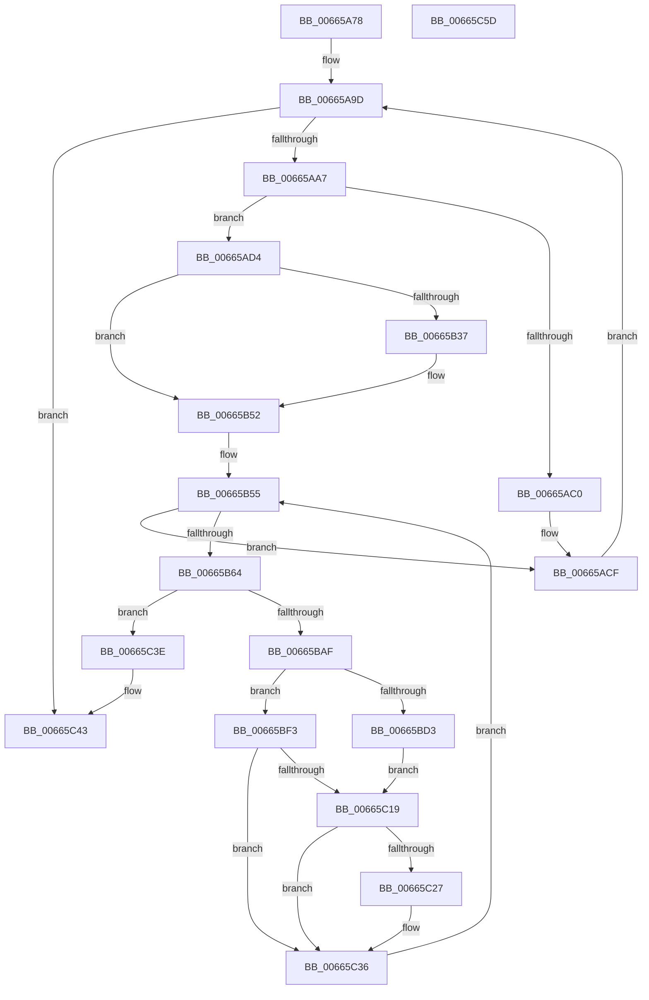

# ApiSetCompose_V7_ProcessV6Extension_Phase0

- RVA: `0x00665A78`–`0x00665C5E` (길이 `486` bytes)
- VA: `0x0000000140665A78`
- 실행 섹션: `.text`
- PDB 이름 있음: `예`; PDB Function 태그: `아니요`
- unwind 정보 RVA: `0x000BDF48`
- 디코드: `127`개 명령, `486/486` bytes 표시
- 미해석 바이트: `0` (있으면 어셈블리에 `.byte`로 보존)

> 이 문서는 커널 이미지의 기계어와 PDB 기호를 분석해 생성했습니다. 4번과 5번은 함수 원형과 자료형을 바이너리 사용 방식에서 추정한 C 해석이며 원본 소스 복구 결과는 아닙니다.

## 1. Dependencies

- 직접 호출 지점: **3**; 고유 호출 대상: **2**
- 직접 호출자로 확인된 함수: **1**
- RIP 상대 이미지 참조: **0**

### Outgoing calls
- `0x00665B22` → [ApiSetpSearchForSectionIndex_V7](ApiSetpSearchForSectionIndex_V7_function_00665218.md) (function, `0x00665218`)
- `0x00665BA2` → [ApiSetpGetContractKeyInfo](ApiSetpGetContractKeyInfo_function_00664B44.md) (function, `0x00664B44`)
- `0x00665BBE` → [ApiSetpSearchForSectionIndex_V7](ApiSetpSearchForSectionIndex_V7_function_00665218.md) (function, `0x00665218`)

### Direct callers
- [ApiSetComposeSchema_V7](ApiSetComposeSchema_V7_function_00663CCC.md) at `0x00663DB9`

### Static image references
- 디코드된 RIP-relative 메모리 참조가 없습니다.

## 2. Other-region calls and transfers

- 다른 실행 섹션으로 향하는 call: **0**
- 별도 외부 분기/꼬리 이동을 확인하지 못했습니다.

## 3. Assembly (complete function range)

```asm
00665A78  48 89 5C 24 10                  mov qword ptr [rsp + 0x10], rbx
00665A7D  55                              push rbp
00665A7E  56                              push rsi
00665A7F  57                              push rdi
00665A80  41 54                           push r12
00665A82  41 55                           push r13
00665A84  41 56                           push r14
00665A86  41 57                           push r15
00665A88  48 8B EC                        mov rbp, rsp
00665A8B  48 83 EC 50                     sub rsp, 0x50
00665A8F  33 FF                           xor edi, edi
00665A91  48 8B DA                        mov rbx, rdx
00665A94  4C 8B F1                        mov r14, rcx
00665A97  8B F7                           mov esi, edi
00665A99  44 8D 57 01                     lea r10d, [rdi + 1]
00665A9D  41 3B 76 0C                     cmp esi, dword ptr [r14 + 0xc]
00665AA1  0F 83 9C 01 00 00               jae 0x140665c43
00665AA7  41 8B 4E 10                     mov ecx, dword ptr [r14 + 0x10]
00665AAB  49 03 CE                        add rcx, r14
00665AAE  8B C6                           mov eax, esi
00665AB0  48 89 4D 40                     mov qword ptr [rbp + 0x40], rcx
00665AB4  4C 8D 2C 40                     lea r13, [rax + rax*2]
00665AB8  42 8B 04 E9                     mov eax, dword ptr [rcx + r13*8]
00665ABC  A8 04                           test al, 4
00665ABE  74 14                           je 0x140665ad4
00665AC0  66 44 01 93 D4 00 00 00         add word ptr [rbx + 0xd4], r10w
00665AC8  83 83 D8 00 00 00 0C            add dword ptr [rbx + 0xd8], 0xc
00665ACF  41 03 F2                        add esi, r10d
00665AD2  EB C9                           jmp 0x140665a9d
00665AD4  4C 8B 63 08                     mov r12, qword ptr [rbx + 8]
00665AD8  4C 8D 45 D0                     lea r8, [rbp - 0x30]
00665ADC  46 8B 7C E9 08                  mov r15d, dword ptr [rcx + r13*8 + 8]
00665AE1  33 C0                           xor eax, eax
00665AE3  48 89 45 F0                     mov qword ptr [rbp - 0x10], rax
00665AE7  0F 57 C0                        xorps xmm0, xmm0
00665AEA  42 8B 44 E9 04                  mov eax, dword ptr [rcx + r13*8 + 4]
00665AEF  49 8B CC                        mov rcx, r12
00665AF2  45 8A 4C 24 65                  mov r9b, byte ptr [r12 + 0x65]
00665AF7  49 8D 54 24 5C                  lea rdx, [r12 + 0x5c]
00665AFC  0F 11 45 D0                     movups xmmword ptr [rbp - 0x30], xmm0
00665B00  41 D0 E9                        shr r9b, 1
00665B03  49 03 C6                        add rax, r14
00665B06  41 D1 EF                        shr r15d, 1
00665B09  45 22 CA                        and r9b, r10b
00665B0C  0F 11 45 E0                     movups xmmword ptr [rbp - 0x20], xmm0
00665B10  48 89 45 D0                     mov qword ptr [rbp - 0x30], rax
00665B14  66 44 89 7D D8                  mov word ptr [rbp - 0x28], r15w
00665B19  44 88 55 DA                     mov byte ptr [rbp - 0x26], r10b
00665B1D  66 44 89 7D E2                  mov word ptr [rbp - 0x1e], r15w
00665B22  E8 F1 F6 FF FF                  call 0x140665218
00665B27  B9 FF FF 00 00                  mov ecx, 0xffff
00665B2C  41 BA 01 00 00 00               mov r10d, 1
00665B32  66 3B C1                        cmp ax, cx
00665B35  75 1B                           jne 0x140665b52
00665B37  66 44 01 93 C8 00 00 00         add word ptr [rbx + 0xc8], r10w
00665B3F  83 83 CC 00 00 00 14            add dword ptr [rbx + 0xcc], 0x14
00665B46  41 0F B7 C7                     movzx eax, r15w
00665B4A  03 C0                           add eax, eax
00665B4C  01 83 E8 00 00 00               add dword ptr [rbx + 0xe8], eax
00665B52  44 8B FF                        mov r15d, edi
00665B55  48 8B 4D 40                     mov rcx, qword ptr [rbp + 0x40]
00665B59  46 3B 7C E9 14                  cmp r15d, dword ptr [rcx + r13*8 + 0x14]
00665B5E  0F 83 6B FF FF FF               jae 0x140665acf
00665B64  0F 57 C0                        xorps xmm0, xmm0
00665B67  41 8B C7                        mov eax, r15d
00665B6A  4C 8D 4D D0                     lea r9, [rbp - 0x30]
00665B6E  0F 11 45 D0                     movups xmmword ptr [rbp - 0x30], xmm0
00665B72  4C 8D 04 80                     lea r8, [rax + rax*4]
00665B76  42 8B 44 E9 10                  mov eax, dword ptr [rcx + r13*8 + 0x10]
00665B7B  49 03 C6                        add rax, r14
00665B7E  4C 89 45 50                     mov qword ptr [rbp + 0x50], r8
00665B82  33 C9                           xor ecx, ecx
00665B84  48 89 45 58                     mov qword ptr [rbp + 0x58], rax
00665B88  48 89 4D F0                     mov qword ptr [rbp - 0x10], rcx
00665B8C  0F 11 45 E0                     movups xmmword ptr [rbp - 0x20], xmm0
00665B90  42 8B 54 80 10                  mov edx, dword ptr [rax + r8*4 + 0x10]
00665B95  42 8B 4C 80 0C                  mov ecx, dword ptr [rax + r8*4 + 0xc]
00665B9A  45 8A C2                        mov r8b, r10b
00665B9D  D1 EA                           shr edx, 1
00665B9F  49 03 CE                        add rcx, r14
00665BA2  E8 9D EF FF FF                  call 0x140664b44
00665BA7  84 C0                           test al, al
00665BA9  0F 84 8F 00 00 00               je 0x140665c3e
00665BAF  49 8D 54 24 44                  lea rdx, [r12 + 0x44]
00665BB4  45 33 C9                        xor r9d, r9d
00665BB7  4C 8D 45 D0                     lea r8, [rbp - 0x30]
00665BBB  49 8B CC                        mov rcx, r12
00665BBE  E8 55 F6 FF FF                  call 0x140665218
00665BC3  B9 FF FF 00 00                  mov ecx, 0xffff
00665BC8  41 BA 01 00 00 00               mov r10d, 1
00665BCE  66 3B C1                        cmp ax, cx
00665BD1  75 20                           jne 0x140665bf3
00665BD3  66 44 01 93 BC 00 00 00         add word ptr [rbx + 0xbc], r10w
00665BDB  83 83 C0 00 00 00 14            add dword ptr [rbx + 0xc0], 0x14
00665BE2  66 44 01 93 A4 00 00 00         add word ptr [rbx + 0xa4], r10w
00665BEA  83 83 A8 00 00 00 14            add dword ptr [rbx + 0xa8], 0x14
00665BF1  EB 26                           jmp 0x140665c19
00665BF3  41 0F B6 54 24 4C               movzx edx, byte ptr [r12 + 0x4c]
00665BF9  41 8B 4C 24 44                  mov ecx, dword ptr [r12 + 0x44]
00665BFE  0F B7 C0                        movzx eax, ax
00665C01  48 0F AF D0                     imul rdx, rax
00665C05  41 0F B7 44 24 12               movzx eax, word ptr [r12 + 0x12]
00665C0B  48 2B D0                        sub rdx, rax
00665C0E  49 8D 04 14                     lea rax, [r12 + rdx]
00665C12  44 84 54 01 0A                  test byte ptr [rcx + rax + 0xa], r10b
00665C17  75 1D                           jne 0x140665c36
00665C19  48 8B 45 50                     mov rax, qword ptr [rbp + 0x50]
00665C1D  48 8B 4D 58                     mov rcx, qword ptr [rbp + 0x58]
00665C21  39 7C 81 04                     cmp dword ptr [rcx + rax*4 + 4], edi
00665C25  74 0F                           je 0x140665c36
00665C27  66 44 01 93 E0 00 00 00         add word ptr [rbx + 0xe0], r10w
00665C2F  83 83 E4 00 00 00 10            add dword ptr [rbx + 0xe4], 0x10
00665C36  45 03 FA                        add r15d, r10d
00665C39  E9 17 FF FF FF                  jmp 0x140665b55
00665C3E  BF 33 00 00 C0                  mov edi, 0xc0000033
00665C43  48 8B 9C 24 98 00 00 00         mov rbx, qword ptr [rsp + 0x98]
00665C4B  8B C7                           mov eax, edi
00665C4D  48 83 C4 50                     add rsp, 0x50
00665C51  41 5F                           pop r15
00665C53  41 5E                           pop r14
00665C55  41 5D                           pop r13
00665C57  41 5C                           pop r12
00665C59  5F                              pop rdi
00665C5A  5E                              pop rsi
00665C5B  5D                              pop rbp
00665C5C  C3                              ret
00665C5D  CC                              int3
```

## 4. C-style interpretation (structured pseudocode)

```c
__int64 __fastcall ApiSetCompose_V7_ProcessV6Extension_Phase0(__int64 a1, __int64 a2)
{
    __int64 result;
    __int64 v_r15;
    __int64 v_rdi;
    __int64 v_rsi;
    __int64 v_rsp;
    unsigned __int64 v_stack_m48;
    unsigned __int16 v_stack_m56;
    unsigned __int64 v_stack_m58;
    unsigned __int8 v_stack_m5E;
    unsigned __int16 v_stack_m60;
    unsigned __int64 v_stack_m68;
    unsigned __int64 v_stack_p10;
    unsigned __int64 v_stack_p18;
    unsigned __int64 v_stack_p20;
    unsigned __int64 v_stack_p8;

    v_stack_p10 = v_rbx;
    v_rsp = (v_rsp) - (80);
    v_rdi = 0;
loc_00665A9D:
    if (0 >= (*(unsigned int *)(a1 + 12))) goto loc_00665C43;
    a1 = ((unsigned int)(*(unsigned int *)(a1 + 16))) + (a1);
    v_stack_p8 = a1;
    if ((((unsigned __int8)((unsigned int)(*(unsigned int *)(a1 + 0 + 0 * 2 * 8)))) & (4)) == 0) goto loc_00665AD4;
loc_00665ACF:
    v_rsi = (unsigned int)((0) + ((unsigned int)(v_rdi + 1)));
    goto loc_00665A9D;
loc_00665AD4:
    result = 0;
    v_stack_m48 = 0;
    v_stack_m68 = v_xmm0;
    a4 = (unsigned __int8)((*(unsigned __int8 *)(*(unsigned __int64 *)(a2 + 8) + 101)) >> (1));
    result = ((unsigned int)(*(unsigned int *)(a1 + 0 + 0 * 2 * 8 + 4))) + (a1);
    v_r15 = (unsigned int)(((unsigned int)(*(unsigned int *)(a1 + 0 + 0 * 2 * 8 + 8))) >> (1));
    a4 = (unsigned __int8)((a4) & ((unsigned __int8)(v_rdi + 1)));
    v_stack_m58 = v_xmm0;
    v_stack_m68 = result;
    v_stack_m60 = (unsigned __int16)(v_r15);
    v_stack_m5E = (unsigned __int8)(v_rdi + 1);
    v_stack_m56 = (unsigned __int16)(v_r15);
    result = ApiSetpSearchForSectionIndex_V7(*(unsigned __int64 *)(a2 + 8), *(unsigned __int64 *)(a2 + 8) + 92, v_stack_m68, a4);
    if (((unsigned __int16)(result)) == ((unsigned __int16)((unsigned int)(0xFFFFULL)))) {
        result = (unsigned __int16)(v_r15);
        result = (unsigned int)((result) + ((unsigned int)(result)));
    }
loc_00665B55:
    if (0 >= (*(unsigned int *)(v_stack_p8 + 0 + 0 * 2 * 8 + 20))) goto loc_00665ACF;
    v_stack_m68 = v_xmm0;
    result = ((unsigned int)(*(unsigned int *)(v_stack_p8 + 0 + 0 * 2 * 8 + 16))) + (a1);
    v_stack_p18 = 0 + 0 * 4;
    a1 = 0;
    v_stack_p20 = result;
    v_stack_m48 = 0;
    v_stack_m58 = v_xmm0;
    a2 = (unsigned int)(((unsigned int)(*(unsigned int *)(result + 0 + 0 * 4 * 4 + 16))) >> (1));
    a1 = ((unsigned int)(*(unsigned int *)(result + 0 + 0 * 4 * 4 + 12))) + (0);
    result = ApiSetpGetContractKeyInfo(a1, a2, 1, v_stack_m68);
    if ((unsigned __int8)(result) == 0) goto loc_00665C3E;
    a4 = 0;
    result = ApiSetpSearchForSectionIndex_V7(*(unsigned __int64 *)(a2 + 8), *(unsigned __int64 *)(a2 + 8) + 68, v_stack_m68, a4);
    if (((unsigned __int16)(result)) != ((unsigned __int16)((unsigned int)(0xFFFFULL)))) goto loc_00665BF3;
    goto loc_00665C19;
loc_00665BF3:
    a2 = (*(unsigned __int8 *)(*(unsigned __int64 *)(a2 + 8) + 76)) * ((unsigned __int16)(result));
    a2 = (a2) - (*(unsigned __int16 *)(*(unsigned __int64 *)(a2 + 8) + 18));
    if (((*(unsigned __int8 *)((unsigned int)(*(unsigned int *)(*(unsigned __int64 *)(a2 + 8) + 68)) + *(unsigned __int64 *)(a2 + 8) + a2 * 1 * 1 + 10)) & (1)) != 0) goto loc_00665C36;
loc_00665C19:
    if ((*(unsigned int *)(v_stack_p20 + v_stack_p18 * 4 + 4)) != 0) {
    }
    v_r15 = (unsigned int)((0) + (1));
    goto loc_00665B55;
loc_00665C3E:
loc_00665C43:
    v_rsp = (v_rsp) + (80);
    return (unsigned int)((unsigned int)((unsigned int)(0xC0000033ULL)));
}
```

## 5. (Beta) C Style

```c
int64_t ApiSetCompose_V7_ProcessV6Extension_Phase0(void *Arg1, void *Arg2)
{
    uint8_t *arg1 = (uint8_t *)Arg1;
    uint8_t *arg2 = (uint8_t *)Arg2;

    int64_t result;
    int64_t local_r15;
    int64_t local_rdi;
    int64_t local_rsi;
    int64_t local_rsp;
    uint64_t v_stack_m48;
    uint16_t v_stack_m56;
    uint64_t v_stack_m58;
    uint8_t v_stack_m5E;
    uint16_t v_stack_m60;
    uint64_t v_stack_m68;
    uint64_t v_stack_p10;
    uint64_t v_stack_p18;
    uint64_t v_stack_p20;
    uint64_t v_stack_p8;

    v_stack_p10 = local_rbx;
    local_rsp = (local_rsp) - (80);
    local_rdi = 0;
loc_00665A9D:
    if (0 >= (*(uint32_t *)(arg1 + 0xC))) goto loc_00665C43;
    Arg1 = ((uint32_t)(*(uint32_t *)(arg1 + 0x10))) + (Arg1);
    v_stack_p8 = Arg1;
    if ((((uint8_t)((uint32_t)(*(uint32_t *)(arg1 + 0x0 + 0x0 * 2 * 8)))) & (4)) == 0) goto loc_00665AD4;
loc_00665ACF:
    local_rsi = (uint32_t)((0) + ((uint32_t)(local_rdi + 1)));
    goto loc_00665A9D;
loc_00665AD4:
    result = 0;
    v_stack_m48 = 0;
    v_stack_m68 = v_xmm0;
    a4 = (uint8_t)((*(uint8_t *)(*(uint64_t *)(arg2 + 0x8) + 0x65)) >> (1));
    result = ((uint32_t)(*(uint32_t *)(arg1 + 0x0 + 0x0 * 2 * 8 + 0x4))) + (Arg1);
    local_r15 = (uint32_t)(((uint32_t)(*(uint32_t *)(arg1 + 0x0 + 0x0 * 2 * 8 + 0x8))) >> (1));
    a4 = (uint8_t)((a4) & ((uint8_t)(local_rdi + 1)));
    v_stack_m58 = v_xmm0;
    v_stack_m68 = result;
    v_stack_m60 = (uint16_t)(local_r15);
    v_stack_m5E = (uint8_t)(local_rdi + 1);
    v_stack_m56 = (uint16_t)(local_r15);
    result = ApiSetpSearchForSectionIndex_V7(*(uint64_t *)(arg2 + 0x8), *(uint64_t *)(arg2 + 0x8) + 92, v_stack_m68, a4);
    if (((uint16_t)(result)) == ((uint16_t)((uint32_t)(0xFFFFULL)))) {
        result = (uint16_t)(local_r15);
        result = (uint32_t)((result) + ((uint32_t)(result)));
    }
loc_00665B55:
    if (0 >= (*(uint32_t *)(v_stack_p8 + 0x0 + 0x0 * 2 * 8 + 0x14))) goto loc_00665ACF;
    v_stack_m68 = v_xmm0;
    result = ((uint32_t)(*(uint32_t *)(v_stack_p8 + 0x0 + 0x0 * 2 * 8 + 0x10))) + (Arg1);
    v_stack_p18 = 0 + 0 * 4;
    Arg1 = 0;
    v_stack_p20 = result;
    v_stack_m48 = 0;
    v_stack_m58 = v_xmm0;
    Arg2 = (uint32_t)(((uint32_t)(*(uint32_t *)(result + 0x0 + 0x0 * 4 * 4 + 0x10))) >> (1));
    Arg1 = ((uint32_t)(*(uint32_t *)(result + 0x0 + 0x0 * 4 * 4 + 0xC))) + (0);
    result = ApiSetpGetContractKeyInfo(Arg1, Arg2, 1, v_stack_m68);
    if ((uint8_t)(result) == 0) goto loc_00665C3E;
    a4 = 0;
    result = ApiSetpSearchForSectionIndex_V7(*(uint64_t *)(arg2 + 0x8), *(uint64_t *)(arg2 + 0x8) + 68, v_stack_m68, a4);
    if (((uint16_t)(result)) != ((uint16_t)((uint32_t)(0xFFFFULL)))) goto loc_00665BF3;
    goto loc_00665C19;
loc_00665BF3:
    Arg2 = (*(uint8_t *)(*(uint64_t *)(arg2 + 0x8) + 0x4C)) * ((uint16_t)(result));
    Arg2 = (Arg2) - (*(uint16_t *)(*(uint64_t *)(arg2 + 0x8) + 0x12));
    if (((*(uint8_t *)((uint32_t)(*(uint32_t *)(*(uint64_t *)(arg2 + 0x8) + 0x44)) + *(uint64_t *)(arg2 + 0x8) + arg2 * 1 * 1 + 0xA)) & (1)) != 0) goto loc_00665C36;
loc_00665C19:
    if ((*(uint32_t *)(v_stack_p20 + v_stack_p18 * 4 + 0x4)) != 0) {
    }
    local_r15 = (uint32_t)((0) + (1));
    goto loc_00665B55;
loc_00665C3E:
loc_00665C43:
    local_rsp = (local_rsp) + (80);
    return (uint32_t)((uint32_t)((uint32_t)(0xC0000033ULL)));
}
```

### 관측된 메모리 오프셋

구조체 형식이 확인되지 않은 접근은 인자 기준의 오프셋으로만 기록했습니다.

| 기준 인자 | 오프셋 표현 | 폭 (bit) | 접근 |
|---|---:|---:|---|
| `Arg1` | `+ 0xC` | `32` | `R` |
| `Arg1` | `+ 0x10` | `32` | `R` |
| `Arg2` | `+ 0x8` | `64` | `R` |
| `Arg2` | `+ 0xA4` | `16` | `R/W` |
| `Arg2` | `+ 0xA8` | `32` | `R/W` |
| `Arg2` | `+ 0xBC` | `16` | `R/W` |
| `Arg2` | `+ 0xC0` | `32` | `R/W` |
| `Arg2` | `+ 0xC8` | `16` | `R/W` |
| `Arg2` | `+ 0xCC` | `32` | `R/W` |
| `Arg2` | `+ 0xD4` | `16` | `R/W` |
| `Arg2` | `+ 0xD8` | `32` | `R/W` |
| `Arg2` | `+ 0xE0` | `16` | `R/W` |
| `Arg2` | `+ 0xE4` | `32` | `R/W` |
| `Arg2` | `+ 0xE8` | `32` | `R/W` |

## 6. Execution-region graph

[열기: 2D/3D 그래프와 함수 탐색 컨트롤 패널](../../../control-panel.html?section=text&rva=0x00665A78&view=graph)

- 2D 그래프는 위에서 아래로 흐르고, 3D 그래프는 빈 공간을 드래그해 회전합니다. Shift+드래그는 이동, 휠은 확대·축소, 함수 노드 선택은 대상 보고서 이동입니다.

### Static fallback


