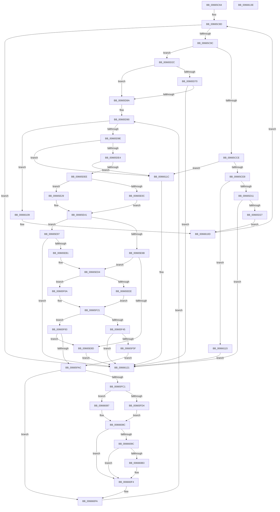

# ApiSetCompose_V7_ProcessV6Extension_Phase1

- RVA: `0x00665C64`–`0x0066613F` (길이 `1,243` bytes)
- VA: `0x0000000140665C64`
- 실행 섹션: `.text`
- PDB 이름 있음: `예`; PDB Function 태그: `아니요`
- unwind 정보 RVA: `0x00073494`
- 디코드: `334`개 명령, `1,243/1,243` bytes 표시
- 미해석 바이트: `0` (있으면 어셈블리에 `.byte`로 보존)

> 이 문서는 커널 이미지의 기계어와 PDB 기호를 분석해 생성했습니다. 4번과 5번은 함수 원형과 자료형을 바이너리 사용 방식에서 추정한 C 해석이며 원본 소스 복구 결과는 아닙니다.

## 1. Dependencies

- 직접 호출 지점: **15**; 고유 호출 대상: **9**
- 직접 호출자로 확인된 함수: **1**
- RIP 상대 이미지 참조: **0**

### Outgoing calls
- `0x00665CDB` → [ApiSetpGetExtensionNameKeyInfo](ApiSetpGetExtensionNameKeyInfo_function_00664E4C.md) (function, `0x00664E4C`)
- `0x00665CFE` → [ApiSetpSearchForSectionIndex_V7](ApiSetpSearchForSectionIndex_V7_function_00665218.md) (function, `0x00665218`)
- `0x00665D18` → [ApiSetSchemaExpander_InsertExtensionNameEntry](ApiSetSchemaExpander_InsertExtensionNameEntry_function_006656B0.md) (function, `0x006656B0`)
- `0x00665D58` → [ApiSetpSearchForSectionIndex_V7](ApiSetpSearchForSectionIndex_V7_function_00665218.md) (function, `0x00665218`)
- `0x00665D7B` → [ApiSetSchemaExpander_InsertHostEntry](ApiSetSchemaExpander_InsertHostEntry_function_00665758.md) (function, `0x00665758`)
- `0x00665DD7` → [ApiSetpGetContractKeyInfo](ApiSetpGetContractKeyInfo_function_00664B44.md) (function, `0x00664B44`)
- `0x00665E1F` → [ApiSetpGetSearchKeyHash](ApiSetpGetSearchKeyHash_function_00664F9C.md) (function, `0x00664F9C`)
- `0x00665E3C` → [ApiSetpGetSearchKeyHash](ApiSetpGetSearchKeyHash_function_00664F9C.md) (function, `0x00664F9C`)
- `0x00665E52` → [ApiSetpSearchForSectionIndex_V7](ApiSetpSearchForSectionIndex_V7_function_00665218.md) (function, `0x00665218`)
- `0x00665EA2` → [ApiSetSchemaExpander_InsertContractEntry](ApiSetSchemaExpander_InsertContractEntry_function_0066565C.md) (function, `0x0066565C`)
- `0x00665F00` → [ApiSetpGetSearchKeyHash](ApiSetpGetSearchKeyHash_function_00664F9C.md) (function, `0x00664F9C`)
- `0x00665F1C` → [ApiSetpGetSearchKeyHash](ApiSetpGetSearchKeyHash_function_00664F9C.md) (function, `0x00664F9C`)
- `0x00665F32` → [ApiSetpSearchForSectionIndex_V7](ApiSetpSearchForSectionIndex_V7_function_00665218.md) (function, `0x00665218`)
- `0x00665F50` → [ApiSetSchemaExpander_InsertSemverContractEntry](ApiSetSchemaExpander_InsertSemverContractEntry_function_00665850.md) (function, `0x00665850`)
- `0x006660A9` → [ApiSetpSearchForApiSet](../4B/ApiSetpSearchForApiSet_function_004B8048.md) (function, `0x004B8048`)

### Direct callers
- [ApiSetComposeSchema_V7](ApiSetComposeSchema_V7_function_00663CCC.md) at `0x00663E8B`

### Static image references
- 디코드된 RIP-relative 메모리 참조가 없습니다.

## 2. Other-region calls and transfers

- 다른 실행 섹션으로 향하는 call: **0**
- 별도 외부 분기/꼬리 이동을 확인하지 못했습니다.

## 3. Assembly (complete function range)

```asm
00665C64  48 89 5C 24 10                  mov qword ptr [rsp + 0x10], rbx
00665C69  55                              push rbp
00665C6A  56                              push rsi
00665C6B  57                              push rdi
00665C6C  41 54                           push r12
00665C6E  41 55                           push r13
00665C70  41 56                           push r14
00665C72  41 57                           push r15
00665C74  48 8B EC                        mov rbp, rsp
00665C77  48 81 EC 80 00 00 00            sub rsp, 0x80
00665C7E  33 DB                           xor ebx, ebx
00665C80  48 8B F2                        mov rsi, rdx
00665C83  4C 8B E1                        mov r12, rcx
00665C86  45 33 F6                        xor r14d, r14d
00665C89  44 8D 7B 01                     lea r15d, [rbx + 1]
00665C8D  44 89 75 B4                     mov dword ptr [rbp - 0x4c], r14d
00665C91  45 3B 74 24 0C                  cmp r14d, dword ptr [r12 + 0xc]
00665C96  0F 83 85 04 00 00               jae 0x140666121
00665C9C  41 8B 7C 24 10                  mov edi, dword ptr [r12 + 0x10]
00665CA1  4F 8D 2C 76                     lea r13, [r14 + r14*2]
00665CA5  49 03 FC                        add rdi, r12
00665CA8  0F 57 C0                        xorps xmm0, xmm0
00665CAB  48 89 7D C8                     mov qword ptr [rbp - 0x38], rdi
00665CAF  0F 11 45 D0                     movups xmmword ptr [rbp - 0x30], xmm0
00665CB3  42 8B 54 EF 08                  mov edx, dword ptr [rdi + r13*8 + 8]
00665CB8  42 8B 4C EF 04                  mov ecx, dword ptr [rdi + r13*8 + 4]
00665CBD  42 8B 04 EF                     mov eax, dword ptr [rdi + r13*8]
00665CC1  49 03 CC                        add rcx, r12
00665CC4  D1 EA                           shr edx, 1
00665CC6  0F 11 45 E0                     movups xmmword ptr [rbp - 0x20], xmm0
00665CCA  A8 04                           test al, 4
00665CCC  74 5E                           je 0x140665d2c
00665CCE  33 C0                           xor eax, eax
00665CD0  4C 8D 4D D0                     lea r9, [rbp - 0x30]
00665CD4  45 8A C7                        mov r8b, r15b
00665CD7  48 89 45 F0                     mov qword ptr [rbp - 0x10], rax
00665CDB  E8 6C F1 FF FF                  call 0x140664e4c
00665CE0  84 C0                           test al, al
00665CE2  0F 84 34 04 00 00               je 0x14066611c
00665CE8  48 8B 4E 20                     mov rcx, qword ptr [rsi + 0x20]
00665CEC  4C 8D 45 D0                     lea r8, [rbp - 0x30]
00665CF0  44 8A 49 59                     mov r9b, byte ptr [rcx + 0x59]
00665CF4  48 8D 51 50                     lea rdx, [rcx + 0x50]
00665CF8  41 D0 E9                        shr r9b, 1
00665CFB  45 22 CF                        and r9b, r15b
00665CFE  E8 15 F5 FF FF                  call 0x140665218
00665D03  B9 FF FF 00 00                  mov ecx, 0xffff
00665D08  66 3B C1                        cmp ax, cx
00665D0B  0F 85 04 04 00 00               jne 0x140666115
00665D11  48 8D 55 D0                     lea rdx, [rbp - 0x30]
00665D15  48 8B CE                        mov rcx, rsi
00665D18  E8 93 F9 FF FF                  call 0x1406656b0
00665D1D  8B D8                           mov ebx, eax
00665D1F  85 C0                           test eax, eax
00665D21  0F 88 FA 03 00 00               js 0x140666121
00665D27  E9 E1 03 00 00                  jmp 0x14066610d
00665D2C  48 89 4D D0                     mov qword ptr [rbp - 0x30], rcx
00665D30  4C 8D 45 D0                     lea r8, [rbp - 0x30]
00665D34  48 8B 4E 20                     mov rcx, qword ptr [rsi + 0x20]
00665D38  33 C0                           xor eax, eax
00665D3A  66 89 55 D8                     mov word ptr [rbp - 0x28], dx
00665D3E  66 89 55 E2                     mov word ptr [rbp - 0x1e], dx
00665D42  48 89 45 F0                     mov qword ptr [rbp - 0x10], rax
00665D46  44 8A 49 65                     mov r9b, byte ptr [rcx + 0x65]
00665D4A  48 8D 51 5C                     lea rdx, [rcx + 0x5c]
00665D4E  41 D0 E9                        shr r9b, 1
00665D51  45 22 CF                        and r9b, r15b
00665D54  44 88 7D DA                     mov byte ptr [rbp - 0x26], r15b
00665D58  E8 BB F4 FF FF                  call 0x140665218
00665D5D  44 0F B7 F8                     movzx r15d, ax
00665D61  66 89 45 40                     mov word ptr [rbp + 0x40], ax
00665D65  B8 FF FF 00 00                  mov eax, 0xffff
00665D6A  66 44 3B F8                     cmp r15w, ax
00665D6E  75 1A                           jne 0x140665d8a
00665D70  4C 8D 45 40                     lea r8, [rbp + 0x40]
00665D74  48 8B CE                        mov rcx, rsi
00665D77  48 8D 55 D0                     lea rdx, [rbp - 0x30]
00665D7B  E8 D8 F9 FF FF                  call 0x140665758
00665D80  8B D8                           mov ebx, eax
00665D82  85 C0                           test eax, eax
00665D84  0F 88 97 03 00 00               js 0x140666121
00665D8A  33 C0                           xor eax, eax
00665D8C  44 8D 78 01                     lea r15d, [rax + 1]
00665D90  89 45 B0                        mov dword ptr [rbp - 0x50], eax
00665D93  42 3B 44 EF 14                  cmp eax, dword ptr [rdi + r13*8 + 0x14]
00665D98  0F 83 6B 03 00 00               jae 0x140666109
00665D9E  48 8D 0C 80                     lea rcx, [rax + rax*4]
00665DA2  33 D2                           xor edx, edx
00665DA4  42 8B 44 EF 10                  mov eax, dword ptr [rdi + r13*8 + 0x10]
00665DA9  4C 8D 4D D0                     lea r9, [rbp - 0x30]
00665DAD  49 03 C4                        add rax, r12
00665DB0  48 89 55 F0                     mov qword ptr [rbp - 0x10], rdx
00665DB4  48 89 4D B8                     mov qword ptr [rbp - 0x48], rcx
00665DB8  0F 57 C0                        xorps xmm0, xmm0
00665DBB  45 8A C7                        mov r8b, r15b
00665DBE  48 89 45 C0                     mov qword ptr [rbp - 0x40], rax
00665DC2  0F 11 45 D0                     movups xmmword ptr [rbp - 0x30], xmm0
00665DC6  8B 54 88 10                     mov edx, dword ptr [rax + rcx*4 + 0x10]
00665DCA  8B 4C 88 0C                     mov ecx, dword ptr [rax + rcx*4 + 0xc]
00665DCE  49 03 CC                        add rcx, r12
00665DD1  D1 EA                           shr edx, 1
00665DD3  0F 11 45 E0                     movups xmmword ptr [rbp - 0x20], xmm0
00665DD7  E8 68 ED FF FF                  call 0x140664b44
00665DDC  84 C0                           test al, al
00665DDE  0F 84 38 03 00 00               je 0x14066611c
00665DE4  83 7D DC 03                     cmp dword ptr [rbp - 0x24], 3
00665DE8  0F 85 2E 03 00 00               jne 0x14066611c
00665DEE  48 8B 7E 20                     mov rdi, qword ptr [rsi + 0x20]
00665DF2  8A 4F 02                        mov cl, byte ptr [rdi + 2]
00665DF5  44 8A 57 37                     mov r10b, byte ptr [rdi + 0x37]
00665DF9  8A D1                           mov dl, cl
00665DFB  80 E2 10                        and dl, 0x10
00665DFE  44 88 54 24 20                  mov byte ptr [rsp + 0x20], r10b
00665E03  80 E1 08                        and cl, 8
00665E06  F6 47 35 04                     test byte ptr [rdi + 0x35], 4
00665E0A  74 1D                           je 0x140665e29
00665E0C  84 D2                           test dl, dl
00665E0E  41 8A D7                        mov dl, r15b
00665E11  41 0F 95 C1                     setne r9b
00665E15  84 C9                           test cl, cl
00665E17  48 8D 4D D0                     lea rcx, [rbp - 0x30]
00665E1B  41 0F 95 C0                     setne r8b
00665E1F  E8 78 F1 FF FF                  call 0x140664f9c
00665E24  0F B6 C0                        movzx eax, al
00665E27  EB 18                           jmp 0x140665e41
00665E29  84 D2                           test dl, dl
00665E2B  41 8A D7                        mov dl, r15b
00665E2E  41 0F 95 C1                     setne r9b
00665E32  84 C9                           test cl, cl
00665E34  48 8D 4D D0                     lea rcx, [rbp - 0x30]
00665E38  41 0F 95 C0                     setne r8b
00665E3C  E8 5B F1 FF FF                  call 0x140664f9c
00665E41  45 8A CF                        mov r9b, r15b
00665E44  89 45 58                        mov dword ptr [rbp + 0x58], eax
00665E47  4C 8D 45 D0                     lea r8, [rbp - 0x30]
00665E4B  48 8B CF                        mov rcx, rdi
00665E4E  48 8D 57 2C                     lea rdx, [rdi + 0x2c]
00665E52  E8 C1 F3 FF FF                  call 0x140665218
00665E57  44 0F B7 F8                     movzx r15d, ax
00665E5B  B8 FF FF 00 00                  mov eax, 0xffff
00665E60  66 44 89 7D 50                  mov word ptr [rbp + 0x50], r15w
00665E65  66 44 3B F8                     cmp r15w, ax
00665E69  74 2C                           je 0x140665e97
00665E6B  0F B7 4F 12                     movzx ecx, word ptr [rdi + 0x12]
00665E6F  0F B6 57 34                     movzx edx, byte ptr [rdi + 0x34]
00665E73  44 8B 77 2C                     mov r14d, dword ptr [rdi + 0x2c]
00665E77  8B 45 58                        mov eax, dword ptr [rbp + 0x58]
00665E7A  49 0F AF D7                     imul rdx, r15
00665E7E  48 2B D1                        sub rdx, rcx
00665E81  48 8D 0C 17                     lea rcx, [rdi + rdx]
00665E85  4C 03 F1                        add r14, rcx
00665E88  41 39 06                        cmp dword ptr [r14], eax
00665E8B  74 47                           je 0x140665ed4
00665E8D  BB 29 02 00 C0                  mov ebx, 0xc0000229
00665E92  E9 8A 02 00 00                  jmp 0x140666121
00665E97  4C 8D 45 50                     lea r8, [rbp + 0x50]
00665E9B  48 8B CE                        mov rcx, rsi
00665E9E  48 8D 55 D0                     lea rdx, [rbp - 0x30]
00665EA2  E8 B5 F7 FF FF                  call 0x14066565c
00665EA7  8B D8                           mov ebx, eax
00665EA9  85 C0                           test eax, eax
00665EAB  0F 88 70 02 00 00               js 0x140666121
00665EB1  48 8B 7E 20                     mov rdi, qword ptr [rsi + 0x20]
00665EB5  44 0F B7 7D 50                  movzx r15d, word ptr [rbp + 0x50]
00665EBA  0F B7 47 12                     movzx eax, word ptr [rdi + 0x12]
00665EBE  0F B6 4F 34                     movzx ecx, byte ptr [rdi + 0x34]
00665EC2  44 8B 77 2C                     mov r14d, dword ptr [rdi + 0x2c]
00665EC6  49 0F AF CF                     imul rcx, r15
00665ECA  48 2B C8                        sub rcx, rax
00665ECD  48 8D 04 0F                     lea rax, [rdi + rcx]
00665ED1  4C 03 F0                        add r14, rax
00665ED4  8A 4F 02                        mov cl, byte ptr [rdi + 2]
00665ED7  44 8A 57 4F                     mov r10b, byte ptr [rdi + 0x4f]
00665EDB  8A D1                           mov dl, cl
00665EDD  80 E2 10                        and dl, 0x10
00665EE0  44 88 54 24 20                  mov byte ptr [rsp + 0x20], r10b
00665EE5  80 E1 08                        and cl, 8
00665EE8  F6 47 4D 04                     test byte ptr [rdi + 0x4d], 4
00665EEC  74 1C                           je 0x140665f0a
00665EEE  84 D2                           test dl, dl
00665EF0  41 0F 95 C1                     setne r9b
00665EF4  84 C9                           test cl, cl
00665EF6  48 8D 4D D0                     lea rcx, [rbp - 0x30]
00665EFA  41 0F 95 C0                     setne r8b
00665EFE  33 D2                           xor edx, edx
00665F00  E8 97 F0 FF FF                  call 0x140664f9c
00665F05  0F B6 C0                        movzx eax, al
00665F08  EB 17                           jmp 0x140665f21
00665F0A  84 D2                           test dl, dl
00665F0C  41 0F 95 C1                     setne r9b
00665F10  84 C9                           test cl, cl
00665F12  48 8D 4D D0                     lea rcx, [rbp - 0x30]
00665F16  41 0F 95 C0                     setne r8b
00665F1A  33 D2                           xor edx, edx
00665F1C  E8 7B F0 FF FF                  call 0x140664f9c
00665F21  48 8D 57 44                     lea rdx, [rdi + 0x44]
00665F25  89 45 58                        mov dword ptr [rbp + 0x58], eax
00665F28  45 33 C9                        xor r9d, r9d
00665F2B  4C 8D 45 D0                     lea r8, [rbp - 0x30]
00665F2F  48 8B CF                        mov rcx, rdi
00665F32  E8 E1 F2 FF FF                  call 0x140665218
00665F37  B9 FF FF 00 00                  mov ecx, 0xffff
00665F3C  66 89 45 50                     mov word ptr [rbp + 0x50], ax
00665F40  66 3B C1                        cmp ax, cx
00665F43  75 3E                           jne 0x140665f83
00665F45  4C 8D 45 50                     lea r8, [rbp + 0x50]
00665F49  48 8B CE                        mov rcx, rsi
00665F4C  48 8D 55 D0                     lea rdx, [rbp - 0x30]
00665F50  E8 FB F8 FF FF                  call 0x140665850
00665F55  8B D8                           mov ebx, eax
00665F57  85 C0                           test eax, eax
00665F59  0F 88 C2 01 00 00               js 0x140666121
00665F5F  48 8B 56 20                     mov rdx, qword ptr [rsi + 0x20]
00665F63  0F B7 45 50                     movzx eax, word ptr [rbp + 0x50]
00665F67  0F B6 4A 4C                     movzx ecx, byte ptr [rdx + 0x4c]
00665F6B  44 8B 42 44                     mov r8d, dword ptr [rdx + 0x44]
00665F6F  48 0F AF C8                     imul rcx, rax
00665F73  0F B7 42 12                     movzx eax, word ptr [rdx + 0x12]
00665F77  48 2B C8                        sub rcx, rax
00665F7A  48 8D 04 0A                     lea rax, [rdx + rcx]
00665F7E  4C 03 C0                        add r8, rax
00665F81  EB 29                           jmp 0x140665fac
00665F83  0F B6 4F 4C                     movzx ecx, byte ptr [rdi + 0x4c]
00665F87  44 8B 47 44                     mov r8d, dword ptr [rdi + 0x44]
00665F8B  0F B7 C0                        movzx eax, ax
00665F8E  48 0F AF C8                     imul rcx, rax
00665F92  0F B7 47 12                     movzx eax, word ptr [rdi + 0x12]
00665F96  48 2B C8                        sub rcx, rax
00665F99  48 8D 04 0F                     lea rax, [rdi + rcx]
00665F9D  4C 03 C0                        add r8, rax
00665FA0  8B 45 58                        mov eax, dword ptr [rbp + 0x58]
00665FA3  41 39 00                        cmp dword ptr [r8], eax
00665FA6  0F 85 E1 FE FF FF               jne 0x140665e8d
00665FAC  66 45 89 78 04                  mov word ptr [r8 + 4], r15w
00665FB1  41 BF 01 00 00 00               mov r15d, 1
00665FB7  45 84 78 0A                     test byte ptr [r8 + 0xa], r15b
00665FBB  0F 85 39 01 00 00               jne 0x1406660fa
00665FC1  48 8B 45 B8                     mov rax, qword ptr [rbp - 0x48]
00665FC5  48 8B 4D C0                     mov rcx, qword ptr [rbp - 0x40]
00665FC9  83 7C 81 04 00                  cmp dword ptr [rcx + rax*4 + 4], 0
00665FCE  0F 84 B3 00 00 00               je 0x140666087
00665FD4  44 8B 96 9C 00 00 00            mov r10d, dword ptr [rsi + 0x9c]
00665FDB  44 0F B7 7D 40                  movzx r15d, word ptr [rbp + 0x40]
00665FE0  41 8D 42 10                     lea eax, [r10 + 0x10]
00665FE4  41 C1 EA 04                     shr r10d, 4
00665FE8  89 86 9C 00 00 00               mov dword ptr [rsi + 0x9c], eax
00665FEE  4C 8B 46 20                     mov r8, qword ptr [rsi + 0x20]
00665FF2  41 0F B7 C2                     movzx eax, r10w
00665FF6  41 0F B7 50 12                  movzx edx, word ptr [r8 + 0x12]
00665FFB  45 0F B7 48 72                  movzx r9d, word ptr [r8 + 0x72]
00666000  41 0F B6 48 64                  movzx ecx, byte ptr [r8 + 0x64]
00666005  4C 0F AF C8                     imul r9, rax
00666009  41 8B 40 68                     mov eax, dword ptr [r8 + 0x68]
0066600D  4C 03 C8                        add r9, rax
00666010  41 0F B7 46 04                  movzx eax, word ptr [r14 + 4]
00666015  48 0F AF C8                     imul rcx, rax
00666019  41 8B 40 5C                     mov eax, dword ptr [r8 + 0x5c]
0066601D  4C 2B CA                        sub r9, rdx
00666020  48 03 C8                        add rcx, rax
00666023  4D 03 C8                        add r9, r8
00666026  48 2B CA                        sub rcx, rdx
00666029  42 8B 44 01 04                  mov eax, dword ptr [rcx + r8 + 4]
0066602E  41 89 41 08                     mov dword ptr [r9 + 8], eax
00666032  42 0F B7 44 01 08               movzx eax, word ptr [rcx + r8 + 8]
00666038  66 41 89 41 0E                  mov word ptr [r9 + 0xe], ax
0066603D  4C 8B 46 20                     mov r8, qword ptr [rsi + 0x20]
00666041  41 0F B7 40 12                  movzx eax, word ptr [r8 + 0x12]
00666046  41 0F B6 50 64                  movzx edx, byte ptr [r8 + 0x64]
0066604B  41 8B 48 5C                     mov ecx, dword ptr [r8 + 0x5c]
0066604F  49 0F AF D7                     imul rdx, r15
00666053  48 2B D0                        sub rdx, rax
00666056  49 8D 04 10                     lea rax, [r8 + rdx]
0066605A  48 03 C8                        add rcx, rax
0066605D  8B 41 04                        mov eax, dword ptr [rcx + 4]
00666060  41 89 41 04                     mov dword ptr [r9 + 4], eax
00666064  0F B7 41 08                     movzx eax, word ptr [rcx + 8]
00666068  66 41 89 41 0C                  mov word ptr [r9 + 0xc], ax
0066606D  41 0F B7 46 06                  movzx eax, word ptr [r14 + 6]
00666072  66 41 89 01                     mov word ptr [r9], ax
00666076  B8 01 00 00 00                  mov eax, 1
0066607B  66 41 01 46 08                  add word ptr [r14 + 8], ax
00666080  66 45 89 56 06                  mov word ptr [r14 + 6], r10w
00666085  EB 05                           jmp 0x14066608c
00666087  44 0F B7 7D 40                  movzx r15d, word ptr [rbp + 0x40]
0066608C  41 80 4E 0A 02                  or byte ptr [r14 + 0xa], 2
00666091  66 45 89 7E 04                  mov word ptr [r14 + 4], r15w
00666096  80 7E 10 00                     cmp byte ptr [rsi + 0x10], 0
0066609A  74 58                           je 0x1406660f4
0066609C  44 0F B7 45 E2                  movzx r8d, word ptr [rbp - 0x1e]
006660A1  48 8B 55 D0                     mov rdx, qword ptr [rbp - 0x30]
006660A5  48 8B 4E 28                     mov rcx, qword ptr [rsi + 0x28]
006660A9  E8 9A 1F E5 FF                  call 0x1404b8048
006660AE  48 85 C0                        test rax, rax
006660B1  74 41                           je 0x1406660f4
006660B3  44 8B 48 10                     mov r9d, dword ptr [rax + 0x10]
006660B7  4C 8B 46 20                     mov r8, qword ptr [rsi + 0x20]
006660BB  4C 03 4E 28                     add r9, qword ptr [rsi + 0x28]
006660BF  41 0F B7 C7                     movzx eax, r15w
006660C3  41 0F B6 48 64                  movzx ecx, byte ptr [r8 + 0x64]
006660C8  41 8B 50 5C                     mov edx, dword ptr [r8 + 0x5c]
006660CC  48 0F AF C8                     imul rcx, rax
006660D0  41 0F B7 40 12                  movzx eax, word ptr [r8 + 0x12]
006660D5  48 2B C8                        sub rcx, rax
006660D8  49 8D 04 08                     lea rax, [r8 + rcx]
006660DC  48 03 D0                        add rdx, rax
006660DF  41 8B 40 24                     mov eax, dword ptr [r8 + 0x24]
006660E3  03 42 04                        add eax, dword ptr [rdx + 4]
006660E6  41 89 41 0C                     mov dword ptr [r9 + 0xc], eax
006660EA  0F B7 42 08                     movzx eax, word ptr [rdx + 8]
006660EE  03 C0                           add eax, eax
006660F0  41 89 41 10                     mov dword ptr [r9 + 0x10], eax
006660F4  41 BF 01 00 00 00               mov r15d, 1
006660FA  8B 45 B0                        mov eax, dword ptr [rbp - 0x50]
006660FD  48 8B 7D C8                     mov rdi, qword ptr [rbp - 0x38]
00666101  41 03 C7                        add eax, r15d
00666104  E9 87 FC FF FF                  jmp 0x140665d90
00666109  44 8B 75 B4                     mov r14d, dword ptr [rbp - 0x4c]
0066610D  45 03 F7                        add r14d, r15d
00666110  E9 78 FB FF FF                  jmp 0x140665c8d
00666115  BB 35 00 00 C0                  mov ebx, 0xc0000035
0066611A  EB 05                           jmp 0x140666121
0066611C  BB 33 00 00 C0                  mov ebx, 0xc0000033
00666121  8B C3                           mov eax, ebx
00666123  48 8B 9C 24 C8 00 00 00         mov rbx, qword ptr [rsp + 0xc8]
0066612B  48 81 C4 80 00 00 00            add rsp, 0x80
00666132  41 5F                           pop r15
00666134  41 5E                           pop r14
00666136  41 5D                           pop r13
00666138  41 5C                           pop r12
0066613A  5F                              pop rdi
0066613B  5E                              pop rsi
0066613C  5D                              pop rbp
0066613D  C3                              ret
0066613E  CC                              int3
```

## 4. C-style interpretation (structured pseudocode)

```c
__int64 __fastcall ApiSetCompose_V7_ProcessV6Extension_Phase1(__int64 a1, __int64 a2)
{
    __int64 result;
    __int64 v_r10;
    __int64 v_r14;
    __int64 v_rbx;
    __int64 v_rdi;
    __int64 v_rsp;
    unsigned __int64 v_stack_m48;
    unsigned __int16 v_stack_m56;
    unsigned __int64 v_stack_m58;
    unsigned int v_stack_m5C;
    unsigned __int8 v_stack_m5E;
    unsigned __int16 v_stack_m60;
    unsigned __int64 v_stack_m68;
    unsigned __int64 v_stack_m70;
    unsigned __int64 v_stack_m78;
    unsigned __int64 v_stack_m80;
    unsigned int v_stack_m84;
    unsigned int v_stack_m88;
    unsigned __int8 v_stack_m98;
    unsigned __int64 v_stack_p10;
    unsigned __int16 v_stack_p18;
    unsigned int v_stack_p20;
    unsigned __int16 v_stack_p8;

    v_stack_p10 = v_rbx;
    v_rsp = (v_rsp) - (128);
    v_rbx = 0;
    v_r14 = 0;
loc_00665C8D:
    v_stack_m84 = 0;
    if (0 >= (*(unsigned int *)(a1 + 12))) goto loc_00666121;
    v_rdi = ((unsigned int)(*(unsigned int *)(a1 + 16))) + (a1);
    v_stack_m70 = v_rdi;
    v_stack_m68 = v_xmm0;
    a1 = ((unsigned int)(*(unsigned int *)(v_rdi + v_r14 + v_r14 * 2 * 8 + 4))) + (a1);
    a2 = (unsigned int)(((unsigned int)(*(unsigned int *)(v_rdi + v_r14 + v_r14 * 2 * 8 + 8))) >> (1));
    v_stack_m58 = v_xmm0;
    if ((((unsigned __int8)((unsigned int)(*(unsigned int *)(v_rdi + v_r14 + v_r14 * 2 * 8)))) & (4)) == 0) goto loc_00665D2C;
    result = 0;
    v_stack_m48 = 0;
    result = ApiSetpGetExtensionNameKeyInfo(a1, a2, (unsigned __int8)(v_rbx + 1), v_stack_m68);
    if ((unsigned __int8)(result) == 0) goto loc_0066611C;
    a4 = (unsigned __int8)((*(unsigned __int8 *)(*(unsigned __int64 *)(a2 + 32) + 89)) >> (1));
    a4 = (unsigned __int8)((a4) & ((unsigned __int8)(v_rbx + 1)));
    result = ApiSetpSearchForSectionIndex_V7(*(unsigned __int64 *)(a2 + 32), *(unsigned __int64 *)(a2 + 32) + 80, v_stack_m68, a4);
    if (((unsigned __int16)(result)) != ((unsigned __int16)((unsigned int)(0xFFFFULL)))) goto loc_00666115;
    result = ApiSetSchemaExpander_InsertExtensionNameEntry(a2, v_stack_m68, v_stack_m68, a4);
    if (sign_flag) goto loc_00666121;
    goto loc_0066610D;
loc_00665D2C:
    v_stack_m68 = a2;
    result = 0;
    v_stack_m60 = (unsigned __int16)(v_stack_m68);
    v_stack_m56 = (unsigned __int16)(v_stack_m68);
    v_stack_m48 = 0;
    a4 = (unsigned __int8)((*(unsigned __int8 *)(*(unsigned __int64 *)(a2 + 32) + 101)) >> (1));
    a4 = (unsigned __int8)((a4) & ((unsigned __int8)(v_rbx + 1)));
    v_stack_m5E = (unsigned __int8)(v_rbx + 1);
    result = ApiSetpSearchForSectionIndex_V7(*(unsigned __int64 *)(a2 + 32), *(unsigned __int64 *)(a2 + 32) + 92, v_stack_m68, a4);
    v_stack_p8 = (unsigned __int16)(result);
    if (((unsigned __int16)((unsigned __int16)(result))) != ((unsigned __int16)((unsigned int)(0xFFFFULL)))) goto loc_00665D8A;
    result = ApiSetSchemaExpander_InsertHostEntry(a2, v_stack_m68, v_stack_p8, a4);
    if (sign_flag) goto loc_00666121;
loc_00665D8A:
    result = 0;
loc_00665D90:
    v_stack_m88 = 0;
    if (0 >= (*(unsigned int *)(v_rdi + v_r14 + v_r14 * 2 * 8 + 20))) goto loc_00666109;
    a2 = 0;
    result = ((unsigned int)(*(unsigned int *)(v_rdi + v_r14 + v_r14 * 2 * 8 + 16))) + (a1);
    v_stack_m48 = 0;
    v_stack_m80 = result + result * 4;
    v_stack_m78 = result;
    v_stack_m68 = v_xmm0;
    a1 = ((unsigned int)(*(unsigned int *)(result + result + result * 4 * 4 + 12))) + (a1);
    a2 = (unsigned int)(((unsigned int)(*(unsigned int *)(result + result + result * 4 * 4 + 16))) >> (1));
    v_stack_m58 = v_xmm0;
    result = ApiSetpGetContractKeyInfo(a1, a2, (unsigned __int8)(result + 1), v_stack_m68);
    if ((unsigned __int8)(result) == 0) goto loc_0066611C;
    if (v_stack_m5C != 3) goto loc_0066611C;
    a2 = (unsigned __int8)(((unsigned __int8)(*(unsigned __int8 *)(*(unsigned __int64 *)(a2 + 32) + 2))) & (16));
    v_stack_m98 = (unsigned __int8)(*(unsigned __int8 *)(*(unsigned __int64 *)(a2 + 32) + 55));
    a1 = (unsigned __int8)((*(unsigned __int8 *)(*(unsigned __int64 *)(a2 + 32) + 2)) & (8));
    if (((*(unsigned __int8 *)(*(unsigned __int64 *)(a2 + 32) + 53)) & (4)) == 0) goto loc_00665E29;
    a4 = ((unsigned __int8)(a2) != 0) ? 1 : 0;
    a3 = ((unsigned __int8)(a1) != 0) ? 1 : 0;
    result = ApiSetpGetSearchKeyHash(v_stack_m68, (unsigned __int8)(result + 1), a3, a4);
    goto loc_00665E41;
loc_00665E29:
    a4 = ((unsigned __int8)((unsigned __int8)(result + 1)) != 0) ? 1 : 0;
    a3 = ((unsigned __int8)(v_stack_m68) != 0) ? 1 : 0;
    result = ApiSetpGetSearchKeyHash(v_stack_m68, (unsigned __int8)(result + 1), a3, a4);
loc_00665E41:
    v_stack_p20 = (unsigned int)(result);
    result = ApiSetpSearchForSectionIndex_V7(*(unsigned __int64 *)(a2 + 32), *(unsigned __int64 *)(a2 + 32) + 44, v_stack_m68, (unsigned __int8)(result + 1));
    v_stack_p18 = (unsigned __int16)((unsigned __int16)(result));
    if (((unsigned __int16)((unsigned __int16)(result))) == ((unsigned __int16)((unsigned int)(0xFFFFULL)))) goto loc_00665E97;
    a2 = (*(unsigned __int8 *)(*(unsigned __int64 *)(a2 + 32) + 52)) * ((unsigned __int16)(result));
    a2 = (a2) - (*(unsigned __int16 *)(*(unsigned __int64 *)(a2 + 32) + 18));
    v_r14 = ((unsigned int)(*(unsigned int *)(*(unsigned __int64 *)(a2 + 32) + 44))) + (*(unsigned __int64 *)(a2 + 32) + a2 * 1);
    if ((*(unsigned int *)(v_r14)) == ((unsigned int)((unsigned int)(v_stack_p20)))) goto loc_00665ED4;
loc_00665E8D:
    goto loc_00666121;
loc_00665E97:
    result = ApiSetSchemaExpander_InsertContractEntry(a2, v_stack_m68, v_stack_p18, (unsigned __int8)(result + 1));
    if (sign_flag) goto loc_00666121;
    a1 = (*(unsigned __int8 *)(*(unsigned __int64 *)(a2 + 32) + 52)) * (v_stack_p18);
    a1 = (a1) - (*(unsigned __int16 *)(*(unsigned __int64 *)(a2 + 32) + 18));
    v_r14 = ((unsigned int)(*(unsigned int *)(*(unsigned __int64 *)(a2 + 32) + 44))) + (*(unsigned __int64 *)(a2 + 32) + a1 * 1);
loc_00665ED4:
    a2 = (unsigned __int8)(((unsigned __int8)(*(unsigned __int8 *)(*(unsigned __int64 *)(a2 + 32) + 2))) & (16));
    v_stack_m98 = (unsigned __int8)(*(unsigned __int8 *)(*(unsigned __int64 *)(a2 + 32) + 79));
    a1 = (unsigned __int8)((*(unsigned __int8 *)(*(unsigned __int64 *)(a2 + 32) + 2)) & (8));
    if (((*(unsigned __int8 *)(*(unsigned __int64 *)(a2 + 32) + 77)) & (4)) == 0) goto loc_00665F0A;
    a4 = ((unsigned __int8)(a2) != 0) ? 1 : 0;
    a3 = ((unsigned __int8)(a1) != 0) ? 1 : 0;
    a2 = 0;
    result = ApiSetpGetSearchKeyHash(v_stack_m68, a2, a3, a4);
    goto loc_00665F21;
loc_00665F0A:
    a4 = (0 != 0) ? 1 : 0;
    a3 = ((unsigned __int8)(v_stack_m68) != 0) ? 1 : 0;
    a2 = 0;
    result = ApiSetpGetSearchKeyHash(v_stack_m68, a2, a3, a4);
loc_00665F21:
    v_stack_p20 = (unsigned int)(result);
    a4 = 0;
    result = ApiSetpSearchForSectionIndex_V7(*(unsigned __int64 *)(a2 + 32), *(unsigned __int64 *)(a2 + 32) + 68, v_stack_m68, a4);
    v_stack_p18 = (unsigned __int16)(result);
    if (((unsigned __int16)(result)) != ((unsigned __int16)((unsigned int)(0xFFFFULL)))) goto loc_00665F83;
    result = ApiSetSchemaExpander_InsertSemverContractEntry(0, v_stack_m68, v_stack_p18, a4);
    if (sign_flag) goto loc_00666121;
    a1 = (*(unsigned __int8 *)(*(unsigned __int64 *)(a2 + 32) + 76)) * (v_stack_p18);
    a1 = (a1) - (*(unsigned __int16 *)(*(unsigned __int64 *)(a2 + 32) + 18));
    a3 = ((unsigned int)(*(unsigned int *)(*(unsigned __int64 *)(a2 + 32) + 68))) + (*(unsigned __int64 *)(a2 + 32) + a1 * 1);
    goto loc_00665FAC;
loc_00665F83:
    a1 = (*(unsigned __int8 *)(*(unsigned __int64 *)(a2 + 32) + 76)) * ((unsigned __int16)(*(unsigned __int64 *)(a2 + 32) + a1 * 1));
    a1 = (a1) - (*(unsigned __int16 *)(*(unsigned __int64 *)(a2 + 32) + 18));
    a3 = ((unsigned int)(*(unsigned int *)(*(unsigned __int64 *)(a2 + 32) + 68))) + (*(unsigned __int64 *)(a2 + 32) + a1 * 1);
    if ((*(unsigned int *)(a3)) != ((unsigned int)((unsigned int)(v_stack_p20)))) goto loc_00665E8D;
loc_00665FAC:
    *(unsigned __int16 *)(a3 + 4) = (unsigned __int16)(v_stack_p18);
    if (((*(unsigned __int8 *)(a3 + 10)) & (1)) != 0) goto loc_006660FA;
    if ((*(unsigned int *)(v_stack_m78 + v_stack_m80 * 4 + 4)) == 0) goto loc_00666087;
    v_r10 = (unsigned int)(((unsigned int)(*(unsigned int *)(a2 + 156))) >> (4));
    *(unsigned int *)(a2 + 156) = (unsigned int)((unsigned int)(*(unsigned int *)(a2 + 156)) + 16);
    a4 = (*(unsigned __int16 *)(*(unsigned __int64 *)(a2 + 32) + 114)) * ((unsigned __int16)(v_r10));
    a4 = (a4) + ((unsigned int)(*(unsigned int *)(*(unsigned __int64 *)(a2 + 32) + 104)));
    a1 = (*(unsigned __int8 *)(*(unsigned __int64 *)(a2 + 32) + 100)) * (*(unsigned __int16 *)(v_r14 + 4));
    a4 = (a4) - (*(unsigned __int16 *)(*(unsigned __int64 *)(a2 + 32) + 18));
    a1 = (a1) + ((unsigned int)(*(unsigned int *)(*(unsigned __int64 *)(a2 + 32) + 92)));
    a4 = (a4) + (*(unsigned __int64 *)(a2 + 32));
    a1 = (a1) - (*(unsigned __int16 *)(*(unsigned __int64 *)(a2 + 32) + 18));
    *(unsigned int *)(a4 + 8) = (unsigned int)((unsigned int)(*(unsigned int *)(a1 + *(unsigned __int64 *)(a2 + 32) * 1 + 4)));
    *(unsigned __int16 *)(a4 + 14) = (unsigned __int16)(*(unsigned __int16 *)(a1 + *(unsigned __int64 *)(a2 + 32) * 1 + 8));
    a2 = (*(unsigned __int8 *)(*(unsigned __int64 *)(a2 + 32) + 100)) * (v_stack_p8);
    a2 = (a2) - (*(unsigned __int16 *)(*(unsigned __int64 *)(a2 + 32) + 18));
    a1 = ((unsigned int)(*(unsigned int *)(*(unsigned __int64 *)(a2 + 32) + 92))) + (*(unsigned __int64 *)(a2 + 32) + a2 * 1);
    *(unsigned int *)(a4 + 4) = (unsigned int)((unsigned int)(*(unsigned int *)(a1 + 4)));
    *(unsigned __int16 *)(a4 + 12) = (unsigned __int16)(*(unsigned __int16 *)(a1 + 8));
    *(unsigned __int16 *)(a4) = (unsigned __int16)(*(unsigned __int16 *)(v_r14 + 6));
    *(unsigned __int16 *)(v_r14 + 6) = (unsigned __int16)(v_r10);
    goto loc_0066608C;
loc_00666087:
loc_0066608C:
    *(unsigned __int16 *)(v_r14 + 4) = (unsigned __int16)(v_stack_p8);
    if ((*(unsigned __int8 *)(a2 + 16)) == 0) goto loc_006660F4;
    result = ApiSetpSearchForApiSet(*(unsigned __int64 *)(a2 + 40), v_stack_m68, v_stack_m56, a4);
    if (result != 0) {
        a4 = *(unsigned int *)(result + 16);
        a3 = *(unsigned __int64 *)(a2 + 32);
        a4 = (a4) + (*(unsigned __int64 *)(a2 + 40));
        result = (unsigned __int16)(v_stack_p8);
        a1 = *(unsigned __int8 *)(a3 + 100);
        a2 = *(unsigned int *)(a3 + 92);
        a1 = (a1) * (result);
        result = *(unsigned __int16 *)(a3 + 18);
        a1 = (a1) - (result);
        result = a3 + a1 * 1;
        a2 = (a2) + (result);
        result = *(unsigned int *)(a3 + 36);
        result = (unsigned int)((result) + (*(unsigned int *)(a2 + 4)));
        *(unsigned int *)(a4 + 12) = (unsigned int)(result);
        result = *(unsigned __int16 *)(a2 + 8);
        result = (unsigned int)((result) + ((unsigned int)(result)));
        *(unsigned int *)(a4 + 16) = (unsigned int)(result);
    }
loc_006660FA:
    result = (unsigned int)(((unsigned int)(v_stack_m88)) + (1));
    goto loc_00665D90;
loc_00666109:
loc_0066610D:
    v_r14 = (unsigned int)(((unsigned int)(v_stack_m84)) + (1));
    goto loc_00665C8D;
loc_00666115:
    goto loc_00666121;
loc_0066611C:
loc_00666121:
    v_rsp = (v_rsp) + (128);
    return (unsigned int)((unsigned int)((unsigned int)(0xC0000033ULL)));
}
```

## 5. (Beta) C Style

```c
int64_t ApiSetCompose_V7_ProcessV6Extension_Phase1(void *Arg1, void *Arg2)
{
    uint8_t *arg1 = (uint8_t *)Arg1;
    uint8_t *arg2 = (uint8_t *)Arg2;

    int64_t result;
    int64_t local_r10;
    int64_t local_r14;
    int64_t local_rbx;
    int64_t local_rdi;
    int64_t local_rsp;
    uint64_t v_stack_m48;
    uint16_t v_stack_m56;
    uint64_t v_stack_m58;
    uint32_t v_stack_m5C;
    uint8_t v_stack_m5E;
    uint16_t v_stack_m60;
    uint64_t v_stack_m68;
    uint64_t v_stack_m70;
    uint64_t v_stack_m78;
    uint64_t v_stack_m80;
    uint32_t v_stack_m84;
    uint32_t v_stack_m88;
    uint8_t v_stack_m98;
    uint64_t v_stack_p10;
    uint16_t v_stack_p18;
    uint32_t v_stack_p20;
    uint16_t v_stack_p8;

    v_stack_p10 = local_rbx;
    local_rsp = (local_rsp) - (128);
    local_rbx = 0;
    local_r14 = 0;
loc_00665C8D:
    v_stack_m84 = 0;
    if (0 >= (*(uint32_t *)(arg1 + 0xC))) goto loc_00666121;
    local_rdi = ((uint32_t)(*(uint32_t *)(arg1 + 0x10))) + (Arg1);
    v_stack_m70 = local_rdi;
    v_stack_m68 = v_xmm0;
    Arg1 = ((uint32_t)(*(uint32_t *)(local_rdi + local_r14 + local_r14 * 2 * 8 + 0x4))) + (Arg1);
    Arg2 = (uint32_t)(((uint32_t)(*(uint32_t *)(local_rdi + local_r14 + local_r14 * 2 * 8 + 0x8))) >> (1));
    v_stack_m58 = v_xmm0;
    if ((((uint8_t)((uint32_t)(*(uint32_t *)(local_rdi + local_r14 + local_r14 * 2 * 8)))) & (4)) == 0) goto loc_00665D2C;
    result = 0;
    v_stack_m48 = 0;
    result = ApiSetpGetExtensionNameKeyInfo(Arg1, Arg2, (uint8_t)(local_rbx + 1), v_stack_m68);
    if ((uint8_t)(result) == 0) goto loc_0066611C;
    a4 = (uint8_t)((*(uint8_t *)(*(uint64_t *)(arg2 + 0x20) + 0x59)) >> (1));
    a4 = (uint8_t)((a4) & ((uint8_t)(local_rbx + 1)));
    result = ApiSetpSearchForSectionIndex_V7(*(uint64_t *)(arg2 + 0x20), *(uint64_t *)(arg2 + 0x20) + 80, v_stack_m68, a4);
    if (((uint16_t)(result)) != ((uint16_t)((uint32_t)(0xFFFFULL)))) goto loc_00666115;
    result = ApiSetSchemaExpander_InsertExtensionNameEntry(Arg2, v_stack_m68, v_stack_m68, a4);
    if (sign_flag) goto loc_00666121;
    goto loc_0066610D;
loc_00665D2C:
    v_stack_m68 = Arg2;
    result = 0;
    v_stack_m60 = (uint16_t)(v_stack_m68);
    v_stack_m56 = (uint16_t)(v_stack_m68);
    v_stack_m48 = 0;
    a4 = (uint8_t)((*(uint8_t *)(*(uint64_t *)(arg2 + 0x20) + 0x65)) >> (1));
    a4 = (uint8_t)((a4) & ((uint8_t)(local_rbx + 1)));
    v_stack_m5E = (uint8_t)(local_rbx + 1);
    result = ApiSetpSearchForSectionIndex_V7(*(uint64_t *)(arg2 + 0x20), *(uint64_t *)(arg2 + 0x20) + 92, v_stack_m68, a4);
    v_stack_p8 = (uint16_t)(result);
    if (((uint16_t)((uint16_t)(result))) != ((uint16_t)((uint32_t)(0xFFFFULL)))) goto loc_00665D8A;
    result = ApiSetSchemaExpander_InsertHostEntry(Arg2, v_stack_m68, v_stack_p8, a4);
    if (sign_flag) goto loc_00666121;
loc_00665D8A:
    result = 0;
loc_00665D90:
    v_stack_m88 = 0;
    if (0 >= (*(uint32_t *)(local_rdi + local_r14 + local_r14 * 2 * 8 + 0x14))) goto loc_00666109;
    Arg2 = 0;
    result = ((uint32_t)(*(uint32_t *)(local_rdi + local_r14 + local_r14 * 2 * 8 + 0x10))) + (Arg1);
    v_stack_m48 = 0;
    v_stack_m80 = result + result * 4;
    v_stack_m78 = result;
    v_stack_m68 = v_xmm0;
    Arg1 = ((uint32_t)(*(uint32_t *)(result + result + result * 4 * 4 + 0xC))) + (Arg1);
    Arg2 = (uint32_t)(((uint32_t)(*(uint32_t *)(result + result + result * 4 * 4 + 0x10))) >> (1));
    v_stack_m58 = v_xmm0;
    result = ApiSetpGetContractKeyInfo(Arg1, Arg2, (uint8_t)(result + 1), v_stack_m68);
    if ((uint8_t)(result) == 0) goto loc_0066611C;
    if (v_stack_m5C != 3) goto loc_0066611C;
    Arg2 = (uint8_t)(((uint8_t)(*(uint8_t *)(*(uint64_t *)(arg2 + 0x20) + 0x2))) & (16));
    v_stack_m98 = (uint8_t)(*(uint8_t *)(*(uint64_t *)(arg2 + 0x20) + 0x37));
    Arg1 = (uint8_t)((*(uint8_t *)(*(uint64_t *)(arg2 + 0x20) + 0x2)) & (8));
    if (((*(uint8_t *)(*(uint64_t *)(arg2 + 0x20) + 0x35)) & (4)) == 0) goto loc_00665E29;
    a4 = ((uint8_t)(Arg2) != 0) ? 1 : 0;
    a3 = ((uint8_t)(Arg1) != 0) ? 1 : 0;
    result = ApiSetpGetSearchKeyHash(v_stack_m68, (uint8_t)(result + 1), a3, a4);
    goto loc_00665E41;
loc_00665E29:
    a4 = ((uint8_t)((uint8_t)(result + 1)) != 0) ? 1 : 0;
    a3 = ((uint8_t)(v_stack_m68) != 0) ? 1 : 0;
    result = ApiSetpGetSearchKeyHash(v_stack_m68, (uint8_t)(result + 1), a3, a4);
loc_00665E41:
    v_stack_p20 = (uint32_t)(result);
    result = ApiSetpSearchForSectionIndex_V7(*(uint64_t *)(arg2 + 0x20), *(uint64_t *)(arg2 + 0x20) + 44, v_stack_m68, (uint8_t)(result + 1));
    v_stack_p18 = (uint16_t)((uint16_t)(result));
    if (((uint16_t)((uint16_t)(result))) == ((uint16_t)((uint32_t)(0xFFFFULL)))) goto loc_00665E97;
    Arg2 = (*(uint8_t *)(*(uint64_t *)(arg2 + 0x20) + 0x34)) * ((uint16_t)(result));
    Arg2 = (Arg2) - (*(uint16_t *)(*(uint64_t *)(arg2 + 0x20) + 0x12));
    local_r14 = ((uint32_t)(*(uint32_t *)(*(uint64_t *)(arg2 + 0x20) + 0x2C))) + (*(uint64_t *)(arg2 + 0x20) + Arg2 * 1);
    if ((*(uint32_t *)(local_r14)) == ((uint32_t)((uint32_t)(v_stack_p20)))) goto loc_00665ED4;
loc_00665E8D:
    goto loc_00666121;
loc_00665E97:
    result = ApiSetSchemaExpander_InsertContractEntry(Arg2, v_stack_m68, v_stack_p18, (uint8_t)(result + 1));
    if (sign_flag) goto loc_00666121;
    Arg1 = (*(uint8_t *)(*(uint64_t *)(arg2 + 0x20) + 0x34)) * (v_stack_p18);
    Arg1 = (Arg1) - (*(uint16_t *)(*(uint64_t *)(arg2 + 0x20) + 0x12));
    local_r14 = ((uint32_t)(*(uint32_t *)(*(uint64_t *)(arg2 + 0x20) + 0x2C))) + (*(uint64_t *)(arg2 + 0x20) + Arg1 * 1);
loc_00665ED4:
    Arg2 = (uint8_t)(((uint8_t)(*(uint8_t *)(*(uint64_t *)(arg2 + 0x20) + 0x2))) & (16));
    v_stack_m98 = (uint8_t)(*(uint8_t *)(*(uint64_t *)(arg2 + 0x20) + 0x4F));
    Arg1 = (uint8_t)((*(uint8_t *)(*(uint64_t *)(arg2 + 0x20) + 0x2)) & (8));
    if (((*(uint8_t *)(*(uint64_t *)(arg2 + 0x20) + 0x4D)) & (4)) == 0) goto loc_00665F0A;
    a4 = ((uint8_t)(Arg2) != 0) ? 1 : 0;
    a3 = ((uint8_t)(Arg1) != 0) ? 1 : 0;
    Arg2 = 0;
    result = ApiSetpGetSearchKeyHash(v_stack_m68, Arg2, a3, a4);
    goto loc_00665F21;
loc_00665F0A:
    a4 = (0 != 0) ? 1 : 0;
    a3 = ((uint8_t)(v_stack_m68) != 0) ? 1 : 0;
    Arg2 = 0;
    result = ApiSetpGetSearchKeyHash(v_stack_m68, Arg2, a3, a4);
loc_00665F21:
    v_stack_p20 = (uint32_t)(result);
    a4 = 0;
    result = ApiSetpSearchForSectionIndex_V7(*(uint64_t *)(arg2 + 0x20), *(uint64_t *)(arg2 + 0x20) + 68, v_stack_m68, a4);
    v_stack_p18 = (uint16_t)(result);
    if (((uint16_t)(result)) != ((uint16_t)((uint32_t)(0xFFFFULL)))) goto loc_00665F83;
    result = ApiSetSchemaExpander_InsertSemverContractEntry(0, v_stack_m68, v_stack_p18, a4);
    if (sign_flag) goto loc_00666121;
    Arg1 = (*(uint8_t *)(*(uint64_t *)(arg2 + 0x20) + 0x4C)) * (v_stack_p18);
    Arg1 = (Arg1) - (*(uint16_t *)(*(uint64_t *)(arg2 + 0x20) + 0x12));
    a3 = ((uint32_t)(*(uint32_t *)(*(uint64_t *)(arg2 + 0x20) + 0x44))) + (*(uint64_t *)(arg2 + 0x20) + Arg1 * 1);
    goto loc_00665FAC;
loc_00665F83:
    Arg1 = (*(uint8_t *)(*(uint64_t *)(arg2 + 0x20) + 0x4C)) * ((uint16_t)(*(uint64_t *)(arg2 + 0x20) + Arg1 * 1));
    Arg1 = (Arg1) - (*(uint16_t *)(*(uint64_t *)(arg2 + 0x20) + 0x12));
    a3 = ((uint32_t)(*(uint32_t *)(*(uint64_t *)(arg2 + 0x20) + 0x44))) + (*(uint64_t *)(arg2 + 0x20) + Arg1 * 1);
    if ((*(uint32_t *)(a3)) != ((uint32_t)((uint32_t)(v_stack_p20)))) goto loc_00665E8D;
loc_00665FAC:
    *(uint16_t *)(a3 + 0x4) = (uint16_t)(v_stack_p18);
    if (((*(uint8_t *)(a3 + 0xA)) & (1)) != 0) goto loc_006660FA;
    if ((*(uint32_t *)(v_stack_m78 + v_stack_m80 * 4 + 0x4)) == 0) goto loc_00666087;
    local_r10 = (uint32_t)(((uint32_t)(*(uint32_t *)(arg2 + 0x9C))) >> (4));
    *(uint32_t *)(arg2 + 0x9C) = (uint32_t)((uint32_t)(*(uint32_t *)(arg2 + 0x9C)) + 16);
    a4 = (*(uint16_t *)(*(uint64_t *)(arg2 + 0x20) + 0x72)) * ((uint16_t)(local_r10));
    a4 = (a4) + ((uint32_t)(*(uint32_t *)(*(uint64_t *)(arg2 + 0x20) + 0x68)));
    Arg1 = (*(uint8_t *)(*(uint64_t *)(arg2 + 0x20) + 0x64)) * (*(uint16_t *)(local_r14 + 0x4));
    a4 = (a4) - (*(uint16_t *)(*(uint64_t *)(arg2 + 0x20) + 0x12));
    Arg1 = (Arg1) + ((uint32_t)(*(uint32_t *)(*(uint64_t *)(arg2 + 0x20) + 0x5C)));
    a4 = (a4) + (*(uint64_t *)(arg2 + 0x20));
    Arg1 = (Arg1) - (*(uint16_t *)(*(uint64_t *)(arg2 + 0x20) + 0x12));
    *(uint32_t *)(a4 + 0x8) = (uint32_t)((uint32_t)(*(uint32_t *)(arg1 + *(uint64_t *)(arg2 + 0x20) * 1 + 0x4)));
    *(uint16_t *)(a4 + 0xE) = (uint16_t)(*(uint16_t *)(arg1 + *(uint64_t *)(arg2 + 0x20) * 1 + 0x8));
    Arg2 = (*(uint8_t *)(*(uint64_t *)(arg2 + 0x20) + 0x64)) * (v_stack_p8);
    Arg2 = (Arg2) - (*(uint16_t *)(*(uint64_t *)(arg2 + 0x20) + 0x12));
    Arg1 = ((uint32_t)(*(uint32_t *)(*(uint64_t *)(arg2 + 0x20) + 0x5C))) + (*(uint64_t *)(arg2 + 0x20) + Arg2 * 1);
    *(uint32_t *)(a4 + 0x4) = (uint32_t)((uint32_t)(*(uint32_t *)(arg1 + 0x4)));
    *(uint16_t *)(a4 + 0xC) = (uint16_t)(*(uint16_t *)(arg1 + 0x8));
    *(uint16_t *)(a4) = (uint16_t)(*(uint16_t *)(local_r14 + 0x6));
    *(uint16_t *)(local_r14 + 0x6) = (uint16_t)(local_r10);
    goto loc_0066608C;
loc_00666087:
loc_0066608C:
    *(uint16_t *)(local_r14 + 0x4) = (uint16_t)(v_stack_p8);
    if ((*(uint8_t *)(arg2 + 0x10)) == 0) goto loc_006660F4;
    result = ApiSetpSearchForApiSet(*(uint64_t *)(arg2 + 0x28), v_stack_m68, v_stack_m56, a4);
    if (result != 0) {
        a4 = *(uint32_t *)(result + 0x10);
        a3 = *(uint64_t *)(arg2 + 0x20);
        a4 = (a4) + (*(uint64_t *)(arg2 + 0x28));
        result = (uint16_t)(v_stack_p8);
        Arg1 = *(uint8_t *)(a3 + 0x64);
        Arg2 = *(uint32_t *)(a3 + 0x5C);
        Arg1 = (Arg1) * (result);
        result = *(uint16_t *)(a3 + 0x12);
        Arg1 = (Arg1) - (result);
        result = a3 + Arg1 * 1;
        Arg2 = (Arg2) + (result);
        result = *(uint32_t *)(a3 + 0x24);
        result = (uint32_t)((result) + (*(uint32_t *)(arg2 + 0x4)));
        *(uint32_t *)(a4 + 0xC) = (uint32_t)(result);
        result = *(uint16_t *)(arg2 + 0x8);
        result = (uint32_t)((result) + ((uint32_t)(result)));
        *(uint32_t *)(a4 + 0x10) = (uint32_t)(result);
    }
loc_006660FA:
    result = (uint32_t)(((uint32_t)(v_stack_m88)) + (1));
    goto loc_00665D90;
loc_00666109:
loc_0066610D:
    local_r14 = (uint32_t)(((uint32_t)(v_stack_m84)) + (1));
    goto loc_00665C8D;
loc_00666115:
    goto loc_00666121;
loc_0066611C:
loc_00666121:
    local_rsp = (local_rsp) + (128);
    return (uint32_t)((uint32_t)((uint32_t)(0xC0000033ULL)));
}
```

### 관측된 메모리 오프셋

구조체 형식이 확인되지 않은 접근은 인자 기준의 오프셋으로만 기록했습니다.

| 기준 인자 | 오프셋 표현 | 폭 (bit) | 접근 |
|---|---:|---:|---|
| `Arg1` | `+ 0xC` | `32` | `R` |
| `Arg1` | `+ 0x10` | `32` | `R` |
| `Arg2` | `+ 0x10` | `8` | `R` |
| `Arg2` | `+ 0x20` | `64` | `R` |
| `Arg2` | `+ 0x28` | `64` | `R` |
| `Arg2` | `+ 0x9C` | `32` | `R` |
| `Arg2` | `+ 0x9C` | `32` | `W` |

## 6. Execution-region graph

[열기: 2D/3D 그래프와 함수 탐색 컨트롤 패널](../../../control-panel.html?section=text&rva=0x00665C64&view=graph)

- 2D 그래프는 위에서 아래로 흐르고, 3D 그래프는 빈 공간을 드래그해 회전합니다. Shift+드래그는 이동, 휠은 확대·축소, 함수 노드 선택은 대상 보고서 이동입니다.

### Static fallback


