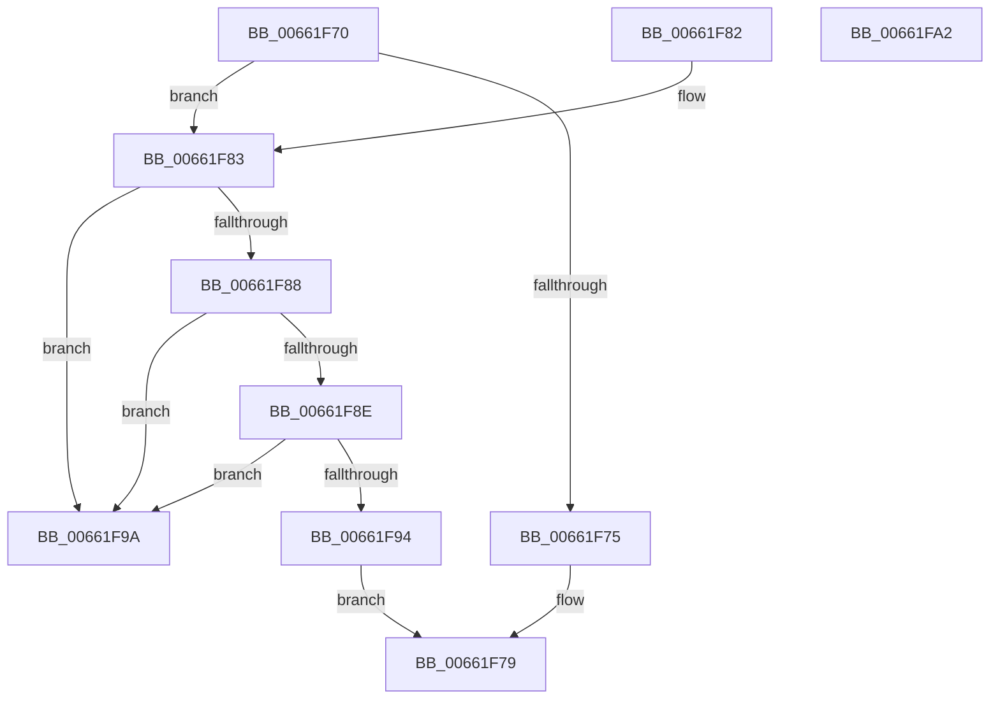

# ApiSetGetSchemaVersion

- RVA: `0x00661F70`–`0x00661FA3` (길이 `51` bytes)
- VA: `0x0000000140661F70`
- 실행 섹션: `.text`
- PDB 이름 있음: `예`; PDB Function 태그: `아니요`
- unwind 정보 RVA: `0x000DB714`
- 디코드: `19`개 명령, `51/51` bytes 표시
- 미해석 바이트: `0` (있으면 어셈블리에 `.byte`로 보존)

> 이 문서는 커널 이미지의 기계어와 PDB 기호를 분석해 생성했습니다. 4번과 5번은 함수 원형과 자료형을 바이너리 사용 방식에서 추정한 C 해석이며 원본 소스 복구 결과는 아닙니다.

## 1. Dependencies

- 직접 호출 지점: **0**; 고유 호출 대상: **0**
- 직접 호출자로 확인된 함수: **2**
- RIP 상대 이미지 참조: **0**

### Outgoing calls
- 직접 디코드된 call 명령이 없습니다.

### Direct callers
- [ApiSetComposeSchema_V7](ApiSetComposeSchema_V7_function_00663CCC.md) at `0x00663D69`
- [ApiSetLoadSchemaWithExtensions](../../page/7D/ApiSetLoadSchemaWithExtensions_function_007D9810.md) at `0x007D985A`

### Static image references
- 디코드된 RIP-relative 메모리 참조가 없습니다.

## 2. Other-region calls and transfers

- 다른 실행 섹션으로 향하는 call: **0**
- 별도 외부 분기/꼬리 이동을 확인하지 못했습니다.

## 3. Assembly (complete function range)

```asm
00661F70  80 39 07                        cmp byte ptr [rcx], 7
00661F73  75 0E                           jne 0x140661f83
00661F75  0F B6 41 01                     movzx eax, byte ptr [rcx + 1]
00661F79  B9 00 07 00 00                  mov ecx, 0x700
00661F7E  66 0B C1                        or ax, cx
00661F81  C3                              ret
00661F82  CC                              int3
00661F83  83 39 06                        cmp dword ptr [rcx], 6
00661F86  75 12                           jne 0x140661f9a
00661F88  83 79 10 08                     cmp dword ptr [rcx + 0x10], 8
00661F8C  76 0C                           jbe 0x140661f9a
00661F8E  80 79 1C 07                     cmp byte ptr [rcx + 0x1c], 7
00661F92  75 06                           jne 0x140661f9a
00661F94  0F B6 41 1D                     movzx eax, byte ptr [rcx + 0x1d]
00661F98  EB DF                           jmp 0x140661f79
00661F9A  0F B7 01                        movzx eax, word ptr [rcx]
00661F9D  66 C1 E0 08                     shl ax, 8
00661FA1  C3                              ret
00661FA2  CC                              int3
```

## 4. C-style interpretation (structured pseudocode)

```c
__int64 __fastcall ApiSetGetSchemaVersion(__int64 a1)
{
    __int64 result;

    if ((*(unsigned __int8 *)(a1)) != 7) goto loc_00661F83;
loc_00661F79:
    result = (unsigned __int16)((*(unsigned __int8 *)(a1 + 1)) | ((unsigned __int16)((unsigned int)(0x700ULL))));
    return result;
loc_00661F83:
    if ((*(unsigned int *)((unsigned int)(0x700ULL))) != 6) goto loc_00661F9A;
    if ((*(unsigned int *)((unsigned int)(0x700ULL) + 16)) <= 8) goto loc_00661F9A;
    if ((*(unsigned __int8 *)((unsigned int)(0x700ULL) + 28)) != 7) goto loc_00661F9A;
    goto loc_00661F79;
loc_00661F9A:
    result = (unsigned __int16)((*(unsigned __int16 *)((unsigned int)(0x700ULL))) << (8));
    return result;
}
```

## 5. (Beta) C Style

```c
int64_t ApiSetGetSchemaVersion(void *Arg1)
{
    uint8_t *arg1 = (uint8_t *)Arg1;

    int64_t result;

    if ((*(uint8_t *)(arg1)) != 7) goto loc_00661F83;
loc_00661F79:
    result = (uint16_t)((*(uint8_t *)(arg1 + 0x1)) | ((uint16_t)((uint32_t)(0x700ULL))));
    return result;
loc_00661F83:
    if ((*(uint32_t *)((uint32_t)(0x700ULL))) != 6) goto loc_00661F9A;
    if ((*(uint32_t *)((uint32_t)(0x700ULL) + 0x10)) <= 8) goto loc_00661F9A;
    if ((*(uint8_t *)((uint32_t)(0x700ULL) + 0x1C)) != 7) goto loc_00661F9A;
    goto loc_00661F79;
loc_00661F9A:
    result = (uint16_t)((*(uint16_t *)((uint32_t)(0x700ULL))) << (8));
    return result;
}
```

### 관측된 메모리 오프셋

구조체 형식이 확인되지 않은 접근은 인자 기준의 오프셋으로만 기록했습니다.

| 기준 인자 | 오프셋 표현 | 폭 (bit) | 접근 |
|---|---:|---:|---|
| `Arg1` | `+ 0x0` | `8` | `R` |
| `Arg1` | `+ 0x0` | `16` | `R` |
| `Arg1` | `+ 0x0` | `32` | `R` |
| `Arg1` | `+ 0x1` | `8` | `R` |
| `Arg1` | `+ 0x10` | `32` | `R` |
| `Arg1` | `+ 0x1C` | `8` | `R` |
| `Arg1` | `+ 0x1D` | `8` | `R` |

## 6. Execution-region graph

[열기: 2D/3D 그래프와 함수 탐색 컨트롤 패널](../../../control-panel.html?section=text&rva=0x00661F70&view=graph)

- 2D 그래프는 위에서 아래로 흐르고, 3D 그래프는 빈 공간을 드래그해 회전합니다. Shift+드래그는 이동, 휠은 확대·축소, 함수 노드 선택은 대상 보고서 이동입니다.

### Static fallback


