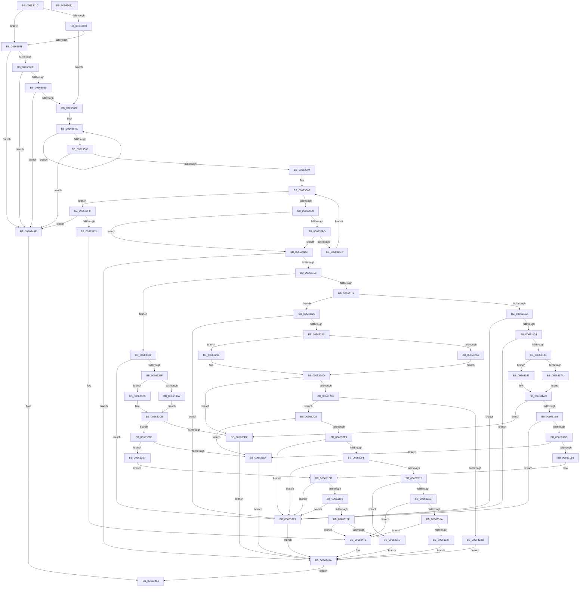

# ApiSetQuerySchemaInfo2_V7

- RVA: `0x0066301C`–`0x00663472` (길이 `1,110` bytes)
- VA: `0x000000014066301C`
- 실행 섹션: `.text`
- PDB 이름 있음: `예`; PDB Function 태그: `아니요`
- unwind 정보 RVA: `0x000BE68C`
- 디코드: `301`개 명령, `1,110/1,110` bytes 표시
- 미해석 바이트: `0` (있으면 어셈블리에 `.byte`로 보존)

> 이 문서는 커널 이미지의 기계어와 PDB 기호를 분석해 생성했습니다. 4번과 5번은 함수 원형과 자료형을 바이너리 사용 방식에서 추정한 C 해석이며 원본 소스 복구 결과는 아닙니다.

## 1. Dependencies

- 직접 호출 지점: **13**; 고유 호출 대상: **5**
- 직접 호출자로 확인된 함수: **1**
- RIP 상대 이미지 참조: **1**

### Outgoing calls
- `0x006630FB` → [ApiSetpGetContractKeyInfo](ApiSetpGetContractKeyInfo_function_00664B44.md) (function, `0x00664B44`)
- `0x00663134` → [ApiSetpSearchForSectionIndex_V7](ApiSetpSearchForSectionIndex_V7_function_00665218.md) (function, `0x00665218`)
- `0x0066318C` → [ApiSetpGetSearchKeyHash](ApiSetpGetSearchKeyHash_function_00664F9C.md) (function, `0x00664F9C`)
- `0x006631A8` → [ApiSetpGetSearchKeyHash](ApiSetpGetSearchKeyHash_function_00664F9C.md) (function, `0x00664F9C`)
- `0x00663234` → [ApiSetpSearchForSectionIndex_V7](ApiSetpSearchForSectionIndex_V7_function_00665218.md) (function, `0x00665218`)
- `0x0066328C` → [ApiSetpGetSearchKeyHash](ApiSetpGetSearchKeyHash_function_00664F9C.md) (function, `0x00664F9C`)
- `0x006632A8` → [ApiSetpGetSearchKeyHash](ApiSetpGetSearchKeyHash_function_00664F9C.md) (function, `0x00664F9C`)
- `0x0066332A` → [ApiSetpIsFeatureEnabled](ApiSetpIsFeatureEnabled_function_006648A8.md) (function, `0x006648A8`)
- `0x00663350` → [ApiSetpSearchForSectionIndex_V7](ApiSetpSearchForSectionIndex_V7_function_00665218.md) (function, `0x00665218`)
- `0x006633AB` → [ApiSetpGetSearchKeyHash](ApiSetpGetSearchKeyHash_function_00664F9C.md) (function, `0x00664F9C`)
- `0x006633C6` → [ApiSetpGetSearchKeyHash](ApiSetpGetSearchKeyHash_function_00664F9C.md) (function, `0x00664F9C`)
- `0x00663418` → [ApiSetpGetExtensionNameKeyInfo](ApiSetpGetExtensionNameKeyInfo_function_00664E4C.md) (function, `0x00664E4C`)
- `0x00663437` → [ApiSetpSearchForSectionIndex_V7](ApiSetpSearchForSectionIndex_V7_function_00665218.md) (function, `0x00665218`)

### Direct callers
- [ApiSetQuerySchemaInfo2](ApiSetQuerySchemaInfo2_function_00661FAC.md) at `0x00662260`

### Static image references
- `0x00663094` → RVA `0x00039DF8` (`.rdata`; read)

## 2. Other-region calls and transfers

- 다른 실행 섹션으로 향하는 call: **0**
- 별도 외부 분기/꼬리 이동을 확인하지 못했습니다.

## 3. Assembly (complete function range)

```asm
0066301C  48 89 5C 24 08                  mov qword ptr [rsp + 8], rbx
00663021  48 89 74 24 10                  mov qword ptr [rsp + 0x10], rsi
00663026  48 89 7C 24 18                  mov qword ptr [rsp + 0x18], rdi
0066302B  55                              push rbp
0066302C  41 54                           push r12
0066302E  41 55                           push r13
00663030  41 56                           push r14
00663032  41 57                           push r15
00663034  48 8B EC                        mov rbp, rsp
00663037  48 83 EC 60                     sub rsp, 0x60
0066303B  80 39 07                        cmp byte ptr [rcx], 7
0066303E  49 8B F0                        mov rsi, r8
00663041  4C 8B DA                        mov r11, rdx
00663044  41 C7 00 F0 00 00 00            mov dword ptr [r8], 0xf0
0066304B  48 8B D9                        mov rbx, rcx
0066304E  75 06                           jne 0x140663056
00663050  F6 41 02 02                     test byte ptr [rcx + 2], 2
00663054  74 20                           je 0x140663076
00663056  83 39 06                        cmp dword ptr [rcx], 6
00663059  0F 85 EF 03 00 00               jne 0x14066344e
0066305F  83 79 10 08                     cmp dword ptr [rcx + 0x10], 8
00663063  0F 86 E5 03 00 00               jbe 0x14066344e
00663069  48 83 C3 1C                     add rbx, 0x1c
0066306D  80 3B 07                        cmp byte ptr [rbx], 7
00663070  0F 85 D8 03 00 00               jne 0x14066344e
00663076  49 83 CA FF                     or r10, 0xffffffffffffffff
0066307A  33 FF                           xor edi, edi
0066307C  49 FF C2                        inc r10
0066307F  42 38 3C 12                     cmp byte ptr [rdx + r10], dil
00663083  75 F7                           jne 0x14066307c
00663085  41 BD FF FF 00 00               mov r13d, 0xffff
0066308B  4D 3B D5                        cmp r10, r13
0066308E  0F 87 BA 03 00 00               ja 0x14066344e
00663094  4C 8D 3D 5D 6D 9D FF            lea r15, [rip - 0x6292a3]
0066309B  41 B9 0A 00 00 00               mov r9d, 0xa
006630A1  4D 2B FB                        sub r15, r11
006630A4  4D 8B C3                        mov r8, r11
006630A7  45 85 C9                        test r9d, r9d
006630AA  0F 8E 49 03 00 00               jle 0x1406633f9
006630B0  45 0F B6 30                     movzx r14d, byte ptr [r8]
006630B4  47 8A 24 07                     mov r12b, byte ptr [r15 + r8]
006630B8  45 84 F6                        test r14b, r14b
006630BB  74 1F                           je 0x1406630dc
006630BD  41 8D 56 BF                     lea edx, [r14 - 0x41]
006630C1  80 FA 19                        cmp dl, 0x19
006630C4  41 8D 46 20                     lea eax, [r14 + 0x20]
006630C8  0F B6 C8                        movzx ecx, al
006630CB  41 0F 47 CE                     cmova ecx, r14d
006630CF  44 3A E1                        cmp r12b, cl
006630D2  75 08                           jne 0x1406630dc
006630D4  49 FF C0                        inc r8
006630D7  41 FF C9                        dec r9d
006630DA  EB CB                           jmp 0x1406630a7
006630DC  0F 57 C0                        xorps xmm0, xmm0
006630DF  4C 8D 4D D0                     lea r9, [rbp - 0x30]
006630E3  33 C0                           xor eax, eax
006630E5  45 33 C0                        xor r8d, r8d
006630E8  41 0F B7 D2                     movzx edx, r10w
006630EC  48 89 45 F0                     mov qword ptr [rbp - 0x10], rax
006630F0  49 8B CB                        mov rcx, r11
006630F3  0F 11 45 D0                     movups xmmword ptr [rbp - 0x30], xmm0
006630F7  0F 11 45 E0                     movups xmmword ptr [rbp - 0x20], xmm0
006630FB  E8 44 1A 00 00                  call 0x140664b44
00663100  84 C0                           test al, al
00663102  0F 84 42 03 00 00               je 0x14066344a
00663108  8B 4D DC                        mov ecx, dword ptr [rbp - 0x24]
0066310B  83 E9 01                        sub ecx, 1
0066310E  0F 84 2E 02 00 00               je 0x140663342
00663114  83 E9 01                        sub ecx, 1
00663117  0F 84 09 01 00 00               je 0x140663226
0066311D  83 F9 01                        cmp ecx, 1
00663120  0F 85 CB 02 00 00               jne 0x1406633f1
00663126  45 33 C9                        xor r9d, r9d
00663129  4C 8D 45 D0                     lea r8, [rbp - 0x30]
0066312D  48 8D 53 44                     lea rdx, [rbx + 0x44]
00663131  48 8B CB                        mov rcx, rbx
00663134  E8 DF 20 00 00                  call 0x140665218
00663139  66 41 3B C5                     cmp ax, r13w
0066313D  0F 84 AE 02 00 00               je 0x1406633f1
00663143  0F B6 4B 4C                     movzx ecx, byte ptr [rbx + 0x4c]
00663147  44 0F B7 7B 12                  movzx r15d, word ptr [rbx + 0x12]
0066314C  44 8B 73 44                     mov r14d, dword ptr [rbx + 0x44]
00663150  44 8A 53 4F                     mov r10b, byte ptr [rbx + 0x4f]
00663154  0F B7 C0                        movzx eax, ax
00663157  48 0F AF C1                     imul rax, rcx
0066315B  8A 4B 02                        mov cl, byte ptr [rbx + 2]
0066315E  49 2B C7                        sub rax, r15
00663161  44 88 54 24 20                  mov byte ptr [rsp + 0x20], r10b
00663166  48 03 C3                        add rax, rbx
00663169  8A D1                           mov dl, cl
0066316B  4C 03 F0                        add r14, rax
0066316E  80 E2 10                        and dl, 0x10
00663171  80 E1 08                        and cl, 8
00663174  F6 43 4D 04                     test byte ptr [rbx + 0x4d], 4
00663178  74 1C                           je 0x140663196
0066317A  84 D2                           test dl, dl
0066317C  41 0F 95 C1                     setne r9b
00663180  84 C9                           test cl, cl
00663182  48 8D 4D D0                     lea rcx, [rbp - 0x30]
00663186  41 0F 95 C0                     setne r8b
0066318A  33 D2                           xor edx, edx
0066318C  E8 0B 1E 00 00                  call 0x140664f9c
00663191  0F B6 C0                        movzx eax, al
00663194  EB 17                           jmp 0x1406631ad
00663196  84 D2                           test dl, dl
00663198  41 0F 95 C1                     setne r9b
0066319C  84 C9                           test cl, cl
0066319E  48 8D 4D D0                     lea rcx, [rbp - 0x30]
006631A2  41 0F 95 C0                     setne r8b
006631A6  33 D2                           xor edx, edx
006631A8  E8 EF 1D 00 00                  call 0x140664f9c
006631AD  41 39 06                        cmp dword ptr [r14], eax
006631B0  0F 85 1A 02 00 00               jne 0x1406633d0
006631B6  0F B6 43 34                     movzx eax, byte ptr [rbx + 0x34]
006631BA  41 0F B7 4E 04                  movzx ecx, word ptr [r14 + 4]
006631BF  48 0F AF C8                     imul rcx, rax
006631C3  8B 43 2C                        mov eax, dword ptr [rbx + 0x2c]
006631C6  48 03 C8                        add rcx, rax
006631C9  41 0F B6 46 09                  movzx eax, byte ptr [r14 + 9]
006631CE  49 2B CF                        sub rcx, r15
006631D1  66 39 45 E8                     cmp word ptr [rbp - 0x18], ax
006631D5  0F 87 16 02 00 00               ja 0x1406633f1
006631DB  F6 44 19 0A 02                  test byte ptr [rcx + rbx + 0xa], 2
006631E0  0F 84 F9 01 00 00               je 0x1406633df
006631E6  0F B7 44 19 04                  movzx eax, word ptr [rcx + rbx + 4]
006631EB  66 3B 43 60                     cmp ax, word ptr [rbx + 0x60]
006631EF  0F 83 FC 01 00 00               jae 0x1406633f1
006631F5  0F B6 4B 64                     movzx ecx, byte ptr [rbx + 0x64]
006631F9  48 0F AF C8                     imul rcx, rax
006631FD  8B 43 5C                        mov eax, dword ptr [rbx + 0x5c]
00663200  48 03 C8                        add rcx, rax
00663203  49 2B CF                        sub rcx, r15
00663206  48 03 CB                        add rcx, rbx
00663209  0F 84 E2 01 00 00               je 0x1406633f1
0066320F  8A 43 03                        mov al, byte ptr [rbx + 3]
00663212  38 41 0A                        cmp byte ptr [rcx + 0xa], al
00663215  0F 86 2D 02 00 00               jbe 0x140663448
0066321B  C7 06 F4 00 00 00               mov dword ptr [rsi], 0xf4
00663221  E9 24 02 00 00                  jmp 0x14066344a
00663226  45 33 C9                        xor r9d, r9d
00663229  4C 8D 45 D0                     lea r8, [rbp - 0x30]
0066322D  48 8D 53 38                     lea rdx, [rbx + 0x38]
00663231  48 8B CB                        mov rcx, rbx
00663234  E8 DF 1F 00 00                  call 0x140665218
00663239  66 41 3B C5                     cmp ax, r13w
0066323D  0F 84 AE 01 00 00               je 0x1406633f1
00663243  0F B6 4B 40                     movzx ecx, byte ptr [rbx + 0x40]
00663247  44 0F B7 7B 12                  movzx r15d, word ptr [rbx + 0x12]
0066324C  44 8B 73 38                     mov r14d, dword ptr [rbx + 0x38]
00663250  44 8A 53 43                     mov r10b, byte ptr [rbx + 0x43]
00663254  0F B7 C0                        movzx eax, ax
00663257  48 0F AF C1                     imul rax, rcx
0066325B  8A 4B 02                        mov cl, byte ptr [rbx + 2]
0066325E  49 2B C7                        sub rax, r15
00663261  44 88 54 24 20                  mov byte ptr [rsp + 0x20], r10b
00663266  48 03 C3                        add rax, rbx
00663269  8A D1                           mov dl, cl
0066326B  4C 03 F0                        add r14, rax
0066326E  80 E2 10                        and dl, 0x10
00663271  80 E1 08                        and cl, 8
00663274  F6 43 41 04                     test byte ptr [rbx + 0x41], 4
00663278  74 1C                           je 0x140663296
0066327A  84 D2                           test dl, dl
0066327C  41 0F 95 C1                     setne r9b
00663280  84 C9                           test cl, cl
00663282  48 8D 4D D0                     lea rcx, [rbp - 0x30]
00663286  41 0F 95 C0                     setne r8b
0066328A  33 D2                           xor edx, edx
0066328C  E8 0B 1D 00 00                  call 0x140664f9c
00663291  0F B6 C0                        movzx eax, al
00663294  EB 17                           jmp 0x1406632ad
00663296  84 D2                           test dl, dl
00663298  41 0F 95 C1                     setne r9b
0066329C  84 C9                           test cl, cl
0066329E  48 8D 4D D0                     lea rcx, [rbp - 0x30]
006632A2  41 0F 95 C0                     setne r8b
006632A6  33 D2                           xor edx, edx
006632A8  E8 EF 1C 00 00                  call 0x140664f9c
006632AD  41 39 06                        cmp dword ptr [r14], eax
006632B0  0F 85 1A 01 00 00               jne 0x1406633d0
006632B6  41 F6 46 06 02                  test byte ptr [r14 + 6], 2
006632BB  74 0B                           je 0x1406632c8
006632BD  C7 06 F3 00 00 00               mov dword ptr [rsi], 0xf3
006632C3  E9 82 01 00 00                  jmp 0x14066344a
006632C8  0F B6 43 34                     movzx eax, byte ptr [rbx + 0x34]
006632CC  41 0F B7 4E 04                  movzx ecx, word ptr [r14 + 4]
006632D1  48 0F AF C8                     imul rcx, rax
006632D5  8B 43 2C                        mov eax, dword ptr [rbx + 0x2c]
006632D8  48 03 C8                        add rcx, rax
006632DB  49 2B CF                        sub rcx, r15
006632DE  F6 44 19 0A 02                  test byte ptr [rcx + rbx + 0xa], 2
006632E3  0F 84 F6 00 00 00               je 0x1406633df
006632E9  0F B7 44 19 04                  movzx eax, word ptr [rcx + rbx + 4]
006632EE  66 3B 43 60                     cmp ax, word ptr [rbx + 0x60]
006632F2  0F 83 F9 00 00 00               jae 0x1406633f1
006632F8  0F B6 4B 64                     movzx ecx, byte ptr [rbx + 0x64]
006632FC  48 0F AF C8                     imul rcx, rax
00663300  8B 43 5C                        mov eax, dword ptr [rbx + 0x5c]
00663303  48 03 C8                        add rcx, rax
00663306  49 2B CF                        sub rcx, r15
00663309  48 03 CB                        add rcx, rbx
0066330C  0F 84 DF 00 00 00               je 0x1406633f1
00663312  8A 43 03                        mov al, byte ptr [rbx + 3]
00663315  38 41 0A                        cmp byte ptr [rcx + 0xa], al
00663318  0F 87 FD FE FF FF               ja 0x14066321b
0066331E  41 8B 4E 08                     mov ecx, dword ptr [r14 + 8]
00663322  85 C9                           test ecx, ecx
00663324  0F 84 1E 01 00 00               je 0x140663448
0066332A  E8 79 15 00 00                  call 0x1406648a8
0066332F  84 C0                           test al, al
00663331  0F 85 11 01 00 00               jne 0x140663448
00663337  C7 06 F5 00 00 00               mov dword ptr [rsi], 0xf5
0066333D  E9 08 01 00 00                  jmp 0x14066344a
00663342  41 B1 01                        mov r9b, 1
00663345  4C 8D 45 D0                     lea r8, [rbp - 0x30]
00663349  48 8D 53 2C                     lea rdx, [rbx + 0x2c]
0066334D  48 8B CB                        mov rcx, rbx
00663350  E8 C3 1E 00 00                  call 0x140665218
00663355  66 41 3B C5                     cmp ax, r13w
00663359  0F 84 92 00 00 00               je 0x1406633f1
0066335F  0F B6 4B 34                     movzx ecx, byte ptr [rbx + 0x34]
00663363  B2 01                           mov dl, 1
00663365  44 0F B7 7B 12                  movzx r15d, word ptr [rbx + 0x12]
0066336A  44 8B 73 2C                     mov r14d, dword ptr [rbx + 0x2c]
0066336E  44 8A 53 37                     mov r10b, byte ptr [rbx + 0x37]
00663372  0F B7 C0                        movzx eax, ax
00663375  48 0F AF C1                     imul rax, rcx
00663379  8A 4B 02                        mov cl, byte ptr [rbx + 2]
0066337C  49 2B C7                        sub rax, r15
0066337F  44 88 54 24 20                  mov byte ptr [rsp + 0x20], r10b
00663384  48 03 C3                        add rax, rbx
00663387  44 8A C1                        mov r8b, cl
0066338A  4C 03 F0                        add r14, rax
0066338D  41 80 E0 10                     and r8b, 0x10
00663391  80 E1 08                        and cl, 8
00663394  F6 43 35 04                     test byte ptr [rbx + 0x35], 4
00663398  74 1B                           je 0x1406633b5
0066339A  45 84 C0                        test r8b, r8b
0066339D  41 0F 95 C1                     setne r9b
006633A1  84 C9                           test cl, cl
006633A3  48 8D 4D D0                     lea rcx, [rbp - 0x30]
006633A7  41 0F 95 C0                     setne r8b
006633AB  E8 EC 1B 00 00                  call 0x140664f9c
006633B0  0F B6 C0                        movzx eax, al
006633B3  EB 16                           jmp 0x1406633cb
006633B5  45 84 C0                        test r8b, r8b
006633B8  41 0F 95 C1                     setne r9b
006633BC  84 C9                           test cl, cl
006633BE  48 8D 4D D0                     lea rcx, [rbp - 0x30]
006633C2  41 0F 95 C0                     setne r8b
006633C6  E8 D1 1B 00 00                  call 0x140664f9c
006633CB  41 39 06                        cmp dword ptr [r14], eax
006633CE  74 08                           je 0x1406633d8
006633D0  C7 06 F6 00 00 00               mov dword ptr [rsi], 0xf6
006633D6  EB 72                           jmp 0x14066344a
006633D8  41 F6 46 0A 02                  test byte ptr [r14 + 0xa], 2
006633DD  75 08                           jne 0x1406633e7
006633DF  C7 06 F2 00 00 00               mov dword ptr [rsi], 0xf2
006633E5  EB 63                           jmp 0x14066344a
006633E7  41 0F B7 46 04                  movzx eax, word ptr [r14 + 4]
006633EC  E9 FA FD FF FF                  jmp 0x1406631eb
006633F1  C7 06 F1 00 00 00               mov dword ptr [rsi], 0xf1
006633F7  EB 51                           jmp 0x14066344a
006633F9  0F 57 C0                        xorps xmm0, xmm0
006633FC  4C 8D 4D D0                     lea r9, [rbp - 0x30]
00663400  33 C0                           xor eax, eax
00663402  45 33 C0                        xor r8d, r8d
00663405  41 0F B7 D2                     movzx edx, r10w
00663409  48 89 45 F0                     mov qword ptr [rbp - 0x10], rax
0066340D  49 8B CB                        mov rcx, r11
00663410  0F 11 45 D0                     movups xmmword ptr [rbp - 0x30], xmm0
00663414  0F 11 45 E0                     movups xmmword ptr [rbp - 0x20], xmm0
00663418  E8 2F 1A 00 00                  call 0x140664e4c
0066341D  84 C0                           test al, al
0066341F  74 2D                           je 0x14066344e
00663421  44 8A 4B 59                     mov r9b, byte ptr [rbx + 0x59]
00663425  48 8D 53 50                     lea rdx, [rbx + 0x50]
00663429  41 D0 E9                        shr r9b, 1
0066342C  4C 8D 45 D0                     lea r8, [rbp - 0x30]
00663430  41 80 E1 01                     and r9b, 1
00663434  48 8B CB                        mov rcx, rbx
00663437  E8 DC 1D 00 00                  call 0x140665218
0066343C  66 41 3B C5                     cmp ax, r13w
00663440  B9 F1 00 00 00                  mov ecx, 0xf1
00663445  0F 44 F9                        cmove edi, ecx
00663448  89 3E                           mov dword ptr [rsi], edi
0066344A  33 C0                           xor eax, eax
0066344C  EB 05                           jmp 0x140663453
0066344E  B8 0D 00 00 C0                  mov eax, 0xc000000d
00663453  4C 8D 5C 24 60                  lea r11, [rsp + 0x60]
00663458  49 8B 5B 30                     mov rbx, qword ptr [r11 + 0x30]
0066345C  49 8B 73 38                     mov rsi, qword ptr [r11 + 0x38]
00663460  49 8B 7B 40                     mov rdi, qword ptr [r11 + 0x40]
00663464  49 8B E3                        mov rsp, r11
00663467  41 5F                           pop r15
00663469  41 5E                           pop r14
0066346B  41 5D                           pop r13
0066346D  41 5C                           pop r12
0066346F  5D                              pop rbp
00663470  C3                              ret
00663471  CC                              int3
```

## 4. C-style interpretation (structured pseudocode)

```c
__int64 __fastcall ApiSetQuerySchemaInfo2_V7(__int64 a1, __int64 a2, __int64 a3)
{
    __int64 result;
    __int64 v_r10;
    __int64 v_r14;
    __int64 v_r15;
    __int64 v_rbx;
    __int64 v_rdi;
    __int64 v_rsp;
    unsigned __int64 v_stack_m28;
    unsigned __int64 v_stack_m38;
    unsigned __int16 v_stack_m40;
    unsigned __int64 v_stack_m48;
    unsigned int v_stack_m4C;
    unsigned __int64 v_stack_m58;
    unsigned __int8 v_stack_m68;
    unsigned __int64 v_stack_p10;
    unsigned __int64 v_stack_p18;
    unsigned __int64 v_stack_p8;

    v_stack_p8 = v_rbx;
    v_stack_p10 = v_rsi;
    v_stack_p18 = v_rdi;
    v_rsp = (v_rsp) - (96);
    *(unsigned int *)(a3) = 240;
    if ((*(unsigned __int8 *)(a1)) != 7) goto loc_00663056;
    if (((*(unsigned __int8 *)(a1 + 2)) & (2)) == 0) goto loc_00663076;
loc_00663056:
    if ((*(unsigned int *)(a1)) != 6) goto loc_0066344E;
    if ((*(unsigned int *)(a1 + 16)) <= 8) goto loc_0066344E;
    v_rbx = (a1) + (28);
    if ((*(unsigned __int8 *)(v_rbx)) != 7) goto loc_0066344E;
loc_00663076:
    v_r10 = (v_r10) | (-1);
    v_rdi = 0;
loc_0066307C:
    v_r10 = (v_r10) + 1;
    if ((*(unsigned __int8 *)(a2 + v_r10 * 1)) != 0) goto loc_0066307C;
    if (v_r10 > ((unsigned int)(0xFFFFULL))) goto loc_0066344E;
    v_r15 = (v_rip - 6460067) - (a2);
loc_006630A7:
    if (condition_is_less_or_equal) goto loc_006633F9;
    if ((unsigned __int8)(*(unsigned __int8 *)(a2)) == 0) goto loc_006630DC;
    a1 = (unsigned __int8)(*(unsigned __int8 *)(a2) + 32);
    if (((unsigned __int8)(*(unsigned __int8 *)(a2) - 65)) > 25) { a1 = (unsigned int)(*(unsigned __int8 *)(a2)); }
    if (((unsigned __int8)(*(unsigned __int8 *)(v_r15 + a2 * 1))) != ((unsigned __int8)(a1))) goto loc_006630DC;
    a3 = (a2) + 1;
    a4 = (unsigned int)((10) - 1);
    goto loc_006630A7;
loc_006630DC:
    result = 0;
    a3 = 0;
    v_stack_m38 = 0;
    v_stack_m58 = v_xmm0;
    v_stack_m48 = v_xmm0;
    result = ApiSetpGetContractKeyInfo(a2, (unsigned __int16)(v_r10), a3, v_stack_m58);
    if ((unsigned __int8)(result) == 0) goto loc_0066344A;
    a1 = (unsigned int)(((unsigned int)(v_stack_m4C)) - (1));
    if (condition_is_equal) goto loc_00663342;
    a1 = (unsigned int)((a1) - (1));
    if (condition_is_equal) goto loc_00663226;
    if (((unsigned int)(a1)) != 1) goto loc_006633F1;
    a4 = 0;
    result = ApiSetpSearchForSectionIndex_V7(v_rbx, v_rbx + 68, v_stack_m58, a4);
    if (((unsigned __int16)(result)) == ((unsigned __int16)((unsigned int)(0xFFFFULL)))) goto loc_006633F1;
    result = ((unsigned __int16)(result)) * (*(unsigned __int8 *)(v_rbx + 76));
    result = (result) - (*(unsigned __int16 *)(v_rbx + 18));
    v_stack_m68 = (unsigned __int8)(*(unsigned __int8 *)(v_rbx + 79));
    result = (result) + (v_rbx);
    v_r14 = ((unsigned int)(*(unsigned int *)(v_rbx + 68))) + (result);
    a2 = (unsigned __int8)(((unsigned __int8)(*(unsigned __int8 *)(v_rbx + 2))) & (16));
    a1 = (unsigned __int8)((*(unsigned __int8 *)(v_rbx + 2)) & (8));
    if (((*(unsigned __int8 *)(v_rbx + 77)) & (4)) == 0) goto loc_00663196;
    a4 = ((unsigned __int8)(a2) != 0) ? 1 : 0;
    a3 = ((unsigned __int8)(a1) != 0) ? 1 : 0;
    a2 = 0;
    result = ApiSetpGetSearchKeyHash(v_stack_m58, a2, a3, a4);
    goto loc_006631AD;
loc_00663196:
    a4 = (0 != 0) ? 1 : 0;
    a3 = ((unsigned __int8)(v_stack_m58) != 0) ? 1 : 0;
    a2 = 0;
    result = ApiSetpGetSearchKeyHash(v_stack_m58, a2, a3, a4);
loc_006631AD:
    if ((*(unsigned int *)(v_r14)) != ((unsigned int)(result))) goto loc_006633D0;
    a1 = (*(unsigned __int16 *)(v_r14 + 4)) * (*(unsigned __int8 *)(v_rbx + 52));
    a1 = (a1) + ((unsigned int)(*(unsigned int *)(v_rbx + 44)));
    a1 = (a1) - (*(unsigned __int16 *)(v_rbx + 18));
    if (v_stack_m40 > ((unsigned __int16)(*(unsigned __int8 *)(v_r14 + 9)))) goto loc_006633F1;
    if (((*(unsigned __int8 *)(a1 + v_rbx * 1 + 10)) & (2)) == 0) goto loc_006633DF;
loc_006631EB:
    if (((unsigned __int16)(*(unsigned __int16 *)(a1 + v_rbx * 1 + 4))) >= (*(unsigned __int16 *)(v_rbx + 96))) goto loc_006633F1;
    a1 = (*(unsigned __int8 *)(v_rbx + 100)) * (*(unsigned __int16 *)(a1 + v_rbx * 1 + 4));
    a1 = (a1) + ((unsigned int)(*(unsigned int *)(v_rbx + 92)));
    a1 = (a1) - (*(unsigned __int16 *)(v_rbx + 18));
    a1 = (a1) + (v_rbx);
    if (condition_is_equal) goto loc_006633F1;
    if ((*(unsigned __int8 *)(a1 + 10)) <= ((unsigned __int8)(*(unsigned __int8 *)(v_rbx + 3)))) goto loc_00663448;
loc_0066321B:
    *(unsigned int *)(a3) = 244;
    goto loc_0066344A;
loc_00663226:
    a4 = 0;
    result = ApiSetpSearchForSectionIndex_V7(v_rbx, v_rbx + 56, v_stack_m58, a4);
    if (((unsigned __int16)(result)) == ((unsigned __int16)((unsigned int)(0xFFFFULL)))) goto loc_006633F1;
    result = ((unsigned __int16)(result)) * (*(unsigned __int8 *)(v_rbx + 64));
    result = (result) - (*(unsigned __int16 *)(v_rbx + 18));
    v_stack_m68 = (unsigned __int8)(*(unsigned __int8 *)(v_rbx + 67));
    result = (result) + (v_rbx);
    v_r14 = ((unsigned int)(*(unsigned int *)(v_rbx + 56))) + (result);
    a2 = (unsigned __int8)(((unsigned __int8)(*(unsigned __int8 *)(v_rbx + 2))) & (16));
    a1 = (unsigned __int8)((*(unsigned __int8 *)(v_rbx + 2)) & (8));
    if (((*(unsigned __int8 *)(v_rbx + 65)) & (4)) == 0) goto loc_00663296;
    a4 = ((unsigned __int8)(a2) != 0) ? 1 : 0;
    a3 = ((unsigned __int8)(a1) != 0) ? 1 : 0;
    a2 = 0;
    result = ApiSetpGetSearchKeyHash(v_stack_m58, a2, a3, a4);
    goto loc_006632AD;
loc_00663296:
    a4 = (0 != 0) ? 1 : 0;
    a3 = ((unsigned __int8)(v_stack_m58) != 0) ? 1 : 0;
    a2 = 0;
    result = ApiSetpGetSearchKeyHash(v_stack_m58, a2, a3, a4);
loc_006632AD:
    if ((*(unsigned int *)(v_r14)) != ((unsigned int)(result))) goto loc_006633D0;
    if (((*(unsigned __int8 *)(v_r14 + 6)) & (2)) == 0) goto loc_006632C8;
    *(unsigned int *)(a3) = 243;
    goto loc_0066344A;
loc_006632C8:
    a1 = (*(unsigned __int16 *)(v_r14 + 4)) * (*(unsigned __int8 *)(v_rbx + 52));
    a1 = (a1) + ((unsigned int)(*(unsigned int *)(v_rbx + 44)));
    a1 = (a1) - (*(unsigned __int16 *)(v_rbx + 18));
    if (((*(unsigned __int8 *)(a1 + v_rbx * 1 + 10)) & (2)) == 0) goto loc_006633DF;
    if (((unsigned __int16)(*(unsigned __int16 *)(a1 + v_rbx * 1 + 4))) >= (*(unsigned __int16 *)(v_rbx + 96))) goto loc_006633F1;
    a1 = (*(unsigned __int8 *)(v_rbx + 100)) * (*(unsigned __int16 *)(a1 + v_rbx * 1 + 4));
    a1 = (a1) + ((unsigned int)(*(unsigned int *)(v_rbx + 92)));
    a1 = (a1) - (*(unsigned __int16 *)(v_rbx + 18));
    a1 = (a1) + (v_rbx);
    if (condition_is_equal) goto loc_006633F1;
    if ((*(unsigned __int8 *)(a1 + 10)) > ((unsigned __int8)(*(unsigned __int8 *)(v_rbx + 3)))) goto loc_0066321B;
    if ((unsigned int)((unsigned int)(*(unsigned int *)(v_r14 + 8))) == 0) goto loc_00663448;
    result = ApiSetpIsFeatureEnabled((unsigned int)(*(unsigned int *)(v_r14 + 8)), a2, a3, a4);
    if ((unsigned __int8)(result) != 0) goto loc_00663448;
    *(unsigned int *)(a3) = 245;
    goto loc_0066344A;
loc_00663342:
    result = ApiSetpSearchForSectionIndex_V7(v_rbx, v_rbx + 44, v_stack_m58, 1);
    if (((unsigned __int16)(result)) == ((unsigned __int16)((unsigned int)(0xFFFFULL)))) goto loc_006633F1;
    result = ((unsigned __int16)(result)) * (*(unsigned __int8 *)(v_rbx + 52));
    result = (result) - (*(unsigned __int16 *)(v_rbx + 18));
    v_stack_m68 = (unsigned __int8)(*(unsigned __int8 *)(v_rbx + 55));
    result = (result) + (v_rbx);
    v_r14 = ((unsigned int)(*(unsigned int *)(v_rbx + 44))) + (result);
    a3 = (unsigned __int8)(((unsigned __int8)(*(unsigned __int8 *)(v_rbx + 2))) & (16));
    a1 = (unsigned __int8)((*(unsigned __int8 *)(v_rbx + 2)) & (8));
    if (((*(unsigned __int8 *)(v_rbx + 53)) & (4)) == 0) goto loc_006633B5;
    a4 = ((unsigned __int8)(a3) != 0) ? 1 : 0;
    a3 = ((unsigned __int8)(a1) != 0) ? 1 : 0;
    result = ApiSetpGetSearchKeyHash(v_stack_m58, 1, a3, a4);
    goto loc_006633CB;
loc_006633B5:
    a4 = ((unsigned __int8)(a3) != 0) ? 1 : 0;
    a3 = ((unsigned __int8)(v_stack_m58) != 0) ? 1 : 0;
    result = ApiSetpGetSearchKeyHash(v_stack_m58, 1, a3, a4);
loc_006633CB:
    if ((*(unsigned int *)(v_r14)) == ((unsigned int)(result))) goto loc_006633D8;
loc_006633D0:
    *(unsigned int *)(a3) = 246;
    goto loc_0066344A;
loc_006633D8:
    if (((*(unsigned __int8 *)(v_r14 + 10)) & (2)) != 0) goto loc_006633E7;
loc_006633DF:
    *(unsigned int *)(a3) = 242;
    goto loc_0066344A;
loc_006633E7:
    goto loc_006631EB;
loc_006633F1:
    *(unsigned int *)(a3) = 241;
    goto loc_0066344A;
loc_006633F9:
    result = 0;
    a3 = 0;
    v_stack_m38 = 0;
    v_stack_m58 = v_xmm0;
    v_stack_m48 = v_xmm0;
    result = ApiSetpGetExtensionNameKeyInfo(0, (unsigned __int16)(*(unsigned __int8 *)(v_rbx + 55)), a3, v_stack_m58);
    if ((unsigned __int8)(result) == 0) goto loc_0066344E;
    a4 = (unsigned __int8)((*(unsigned __int8 *)(v_rbx + 89)) >> (1));
    a4 = (unsigned __int8)((a4) & (1));
    result = ApiSetpSearchForSectionIndex_V7(v_rbx, v_rbx + 80, v_stack_m58, a4);
    if (((unsigned __int16)(result)) == ((unsigned __int16)((unsigned int)(0xFFFFULL)))) { v_rdi = 241; }
loc_00663448:
    *(unsigned int *)(a3) = (unsigned int)(v_rdi);
loc_0066344A:
    result = 0;
    goto loc_00663453;
loc_0066344E:
loc_00663453:
    return (unsigned int)(0xC000000DULL);
}
```

## 5. (Beta) C Style

```c
int64_t ApiSetQuerySchemaInfo2_V7(void *Arg1, void *Arg2, void *Arg3)
{
    uint8_t *arg1 = (uint8_t *)Arg1;
    uint8_t *arg2 = (uint8_t *)Arg2;
    uint8_t *arg3 = (uint8_t *)Arg3;

    int64_t result;
    int64_t local_r10;
    int64_t local_r14;
    int64_t local_r15;
    int64_t local_rbx;
    int64_t local_rdi;
    int64_t local_rsp;
    uint64_t v_stack_m28;
    uint64_t v_stack_m38;
    uint16_t v_stack_m40;
    uint64_t v_stack_m48;
    uint32_t v_stack_m4C;
    uint64_t v_stack_m58;
    uint8_t v_stack_m68;
    uint64_t v_stack_p10;
    uint64_t v_stack_p18;
    uint64_t v_stack_p8;

    v_stack_p8 = local_rbx;
    v_stack_p10 = local_rsi;
    v_stack_p18 = local_rdi;
    local_rsp = (local_rsp) - (96);
    *(uint32_t *)(arg3) = 240;
    if ((*(uint8_t *)(arg1)) != 7) goto loc_00663056;
    if (((*(uint8_t *)(arg1 + 0x2)) & (2)) == 0) goto loc_00663076;
loc_00663056:
    if ((*(uint32_t *)(arg1)) != 6) goto loc_0066344E;
    if ((*(uint32_t *)(arg1 + 0x10)) <= 8) goto loc_0066344E;
    local_rbx = (Arg1) + (28);
    if ((*(uint8_t *)(local_rbx)) != 7) goto loc_0066344E;
loc_00663076:
    local_r10 = (local_r10) | (-1);
    local_rdi = 0;
loc_0066307C:
    local_r10 = (local_r10) + 1;
    if ((*(uint8_t *)(arg2 + local_r10 * 1)) != 0) goto loc_0066307C;
    if (local_r10 > ((uint32_t)(0xFFFFULL))) goto loc_0066344E;
    local_r15 = (v_rip - 6460067) - (Arg2);
loc_006630A7:
    if (condition_is_less_or_equal) goto loc_006633F9;
    if ((uint8_t)(*(uint8_t *)(arg2)) == 0) goto loc_006630DC;
    Arg1 = (uint8_t)(*(uint8_t *)(arg2) + 32);
    if (((uint8_t)(*(uint8_t *)(arg2) - 65)) > 25) { Arg1 = (uint32_t)(*(uint8_t *)(arg2)); }
    if (((uint8_t)(*(uint8_t *)(local_r15 + arg2 * 1))) != ((uint8_t)(Arg1))) goto loc_006630DC;
    Arg3 = (Arg2) + 1;
    a4 = (uint32_t)((10) - 1);
    goto loc_006630A7;
loc_006630DC:
    result = 0;
    Arg3 = 0;
    v_stack_m38 = 0;
    v_stack_m58 = v_xmm0;
    v_stack_m48 = v_xmm0;
    result = ApiSetpGetContractKeyInfo(Arg2, (uint16_t)(local_r10), Arg3, v_stack_m58);
    if ((uint8_t)(result) == 0) goto loc_0066344A;
    Arg1 = (uint32_t)(((uint32_t)(v_stack_m4C)) - (1));
    if (condition_is_equal) goto loc_00663342;
    Arg1 = (uint32_t)((Arg1) - (1));
    if (condition_is_equal) goto loc_00663226;
    if (((uint32_t)(Arg1)) != 1) goto loc_006633F1;
    a4 = 0;
    result = ApiSetpSearchForSectionIndex_V7(local_rbx, local_rbx + 68, v_stack_m58, a4);
    if (((uint16_t)(result)) == ((uint16_t)((uint32_t)(0xFFFFULL)))) goto loc_006633F1;
    result = ((uint16_t)(result)) * (*(uint8_t *)(local_rbx + 0x4C));
    result = (result) - (*(uint16_t *)(local_rbx + 0x12));
    v_stack_m68 = (uint8_t)(*(uint8_t *)(local_rbx + 0x4F));
    result = (result) + (local_rbx);
    local_r14 = ((uint32_t)(*(uint32_t *)(local_rbx + 0x44))) + (result);
    Arg2 = (uint8_t)(((uint8_t)(*(uint8_t *)(local_rbx + 0x2))) & (16));
    Arg1 = (uint8_t)((*(uint8_t *)(local_rbx + 0x2)) & (8));
    if (((*(uint8_t *)(local_rbx + 0x4D)) & (4)) == 0) goto loc_00663196;
    a4 = ((uint8_t)(Arg2) != 0) ? 1 : 0;
    Arg3 = ((uint8_t)(Arg1) != 0) ? 1 : 0;
    Arg2 = 0;
    result = ApiSetpGetSearchKeyHash(v_stack_m58, Arg2, Arg3, a4);
    goto loc_006631AD;
loc_00663196:
    a4 = (0 != 0) ? 1 : 0;
    Arg3 = ((uint8_t)(v_stack_m58) != 0) ? 1 : 0;
    Arg2 = 0;
    result = ApiSetpGetSearchKeyHash(v_stack_m58, Arg2, Arg3, a4);
loc_006631AD:
    if ((*(uint32_t *)(local_r14)) != ((uint32_t)(result))) goto loc_006633D0;
    Arg1 = (*(uint16_t *)(local_r14 + 0x4)) * (*(uint8_t *)(local_rbx + 0x34));
    Arg1 = (Arg1) + ((uint32_t)(*(uint32_t *)(local_rbx + 0x2C)));
    Arg1 = (Arg1) - (*(uint16_t *)(local_rbx + 0x12));
    if (v_stack_m40 > ((uint16_t)(*(uint8_t *)(local_r14 + 0x9)))) goto loc_006633F1;
    if (((*(uint8_t *)(arg1 + local_rbx * 1 + 0xA)) & (2)) == 0) goto loc_006633DF;
loc_006631EB:
    if (((uint16_t)(*(uint16_t *)(arg1 + local_rbx * 1 + 0x4))) >= (*(uint16_t *)(local_rbx + 0x60))) goto loc_006633F1;
    Arg1 = (*(uint8_t *)(local_rbx + 0x64)) * (*(uint16_t *)(arg1 + local_rbx * 1 + 0x4));
    Arg1 = (Arg1) + ((uint32_t)(*(uint32_t *)(local_rbx + 0x5C)));
    Arg1 = (Arg1) - (*(uint16_t *)(local_rbx + 0x12));
    Arg1 = (Arg1) + (local_rbx);
    if (condition_is_equal) goto loc_006633F1;
    if ((*(uint8_t *)(arg1 + 0xA)) <= ((uint8_t)(*(uint8_t *)(local_rbx + 0x3)))) goto loc_00663448;
loc_0066321B:
    *(uint32_t *)(arg3) = 244;
    goto loc_0066344A;
loc_00663226:
    a4 = 0;
    result = ApiSetpSearchForSectionIndex_V7(local_rbx, local_rbx + 56, v_stack_m58, a4);
    if (((uint16_t)(result)) == ((uint16_t)((uint32_t)(0xFFFFULL)))) goto loc_006633F1;
    result = ((uint16_t)(result)) * (*(uint8_t *)(local_rbx + 0x40));
    result = (result) - (*(uint16_t *)(local_rbx + 0x12));
    v_stack_m68 = (uint8_t)(*(uint8_t *)(local_rbx + 0x43));
    result = (result) + (local_rbx);
    local_r14 = ((uint32_t)(*(uint32_t *)(local_rbx + 0x38))) + (result);
    Arg2 = (uint8_t)(((uint8_t)(*(uint8_t *)(local_rbx + 0x2))) & (16));
    Arg1 = (uint8_t)((*(uint8_t *)(local_rbx + 0x2)) & (8));
    if (((*(uint8_t *)(local_rbx + 0x41)) & (4)) == 0) goto loc_00663296;
    a4 = ((uint8_t)(Arg2) != 0) ? 1 : 0;
    Arg3 = ((uint8_t)(Arg1) != 0) ? 1 : 0;
    Arg2 = 0;
    result = ApiSetpGetSearchKeyHash(v_stack_m58, Arg2, Arg3, a4);
    goto loc_006632AD;
loc_00663296:
    a4 = (0 != 0) ? 1 : 0;
    Arg3 = ((uint8_t)(v_stack_m58) != 0) ? 1 : 0;
    Arg2 = 0;
    result = ApiSetpGetSearchKeyHash(v_stack_m58, Arg2, Arg3, a4);
loc_006632AD:
    if ((*(uint32_t *)(local_r14)) != ((uint32_t)(result))) goto loc_006633D0;
    if (((*(uint8_t *)(local_r14 + 0x6)) & (2)) == 0) goto loc_006632C8;
    *(uint32_t *)(arg3) = 243;
    goto loc_0066344A;
loc_006632C8:
    Arg1 = (*(uint16_t *)(local_r14 + 0x4)) * (*(uint8_t *)(local_rbx + 0x34));
    Arg1 = (Arg1) + ((uint32_t)(*(uint32_t *)(local_rbx + 0x2C)));
    Arg1 = (Arg1) - (*(uint16_t *)(local_rbx + 0x12));
    if (((*(uint8_t *)(arg1 + local_rbx * 1 + 0xA)) & (2)) == 0) goto loc_006633DF;
    if (((uint16_t)(*(uint16_t *)(arg1 + local_rbx * 1 + 0x4))) >= (*(uint16_t *)(local_rbx + 0x60))) goto loc_006633F1;
    Arg1 = (*(uint8_t *)(local_rbx + 0x64)) * (*(uint16_t *)(arg1 + local_rbx * 1 + 0x4));
    Arg1 = (Arg1) + ((uint32_t)(*(uint32_t *)(local_rbx + 0x5C)));
    Arg1 = (Arg1) - (*(uint16_t *)(local_rbx + 0x12));
    Arg1 = (Arg1) + (local_rbx);
    if (condition_is_equal) goto loc_006633F1;
    if ((*(uint8_t *)(arg1 + 0xA)) > ((uint8_t)(*(uint8_t *)(local_rbx + 0x3)))) goto loc_0066321B;
    if ((uint32_t)((uint32_t)(*(uint32_t *)(local_r14 + 0x8))) == 0) goto loc_00663448;
    result = ApiSetpIsFeatureEnabled((uint32_t)(*(uint32_t *)(local_r14 + 0x8)), Arg2, Arg3, a4);
    if ((uint8_t)(result) != 0) goto loc_00663448;
    *(uint32_t *)(arg3) = 245;
    goto loc_0066344A;
loc_00663342:
    result = ApiSetpSearchForSectionIndex_V7(local_rbx, local_rbx + 44, v_stack_m58, 1);
    if (((uint16_t)(result)) == ((uint16_t)((uint32_t)(0xFFFFULL)))) goto loc_006633F1;
    result = ((uint16_t)(result)) * (*(uint8_t *)(local_rbx + 0x34));
    result = (result) - (*(uint16_t *)(local_rbx + 0x12));
    v_stack_m68 = (uint8_t)(*(uint8_t *)(local_rbx + 0x37));
    result = (result) + (local_rbx);
    local_r14 = ((uint32_t)(*(uint32_t *)(local_rbx + 0x2C))) + (result);
    Arg3 = (uint8_t)(((uint8_t)(*(uint8_t *)(local_rbx + 0x2))) & (16));
    Arg1 = (uint8_t)((*(uint8_t *)(local_rbx + 0x2)) & (8));
    if (((*(uint8_t *)(local_rbx + 0x35)) & (4)) == 0) goto loc_006633B5;
    a4 = ((uint8_t)(Arg3) != 0) ? 1 : 0;
    Arg3 = ((uint8_t)(Arg1) != 0) ? 1 : 0;
    result = ApiSetpGetSearchKeyHash(v_stack_m58, 1, Arg3, a4);
    goto loc_006633CB;
loc_006633B5:
    a4 = ((uint8_t)(Arg3) != 0) ? 1 : 0;
    Arg3 = ((uint8_t)(v_stack_m58) != 0) ? 1 : 0;
    result = ApiSetpGetSearchKeyHash(v_stack_m58, 1, Arg3, a4);
loc_006633CB:
    if ((*(uint32_t *)(local_r14)) == ((uint32_t)(result))) goto loc_006633D8;
loc_006633D0:
    *(uint32_t *)(arg3) = 246;
    goto loc_0066344A;
loc_006633D8:
    if (((*(uint8_t *)(local_r14 + 0xA)) & (2)) != 0) goto loc_006633E7;
loc_006633DF:
    *(uint32_t *)(arg3) = 242;
    goto loc_0066344A;
loc_006633E7:
    goto loc_006631EB;
loc_006633F1:
    *(uint32_t *)(arg3) = 241;
    goto loc_0066344A;
loc_006633F9:
    result = 0;
    Arg3 = 0;
    v_stack_m38 = 0;
    v_stack_m58 = v_xmm0;
    v_stack_m48 = v_xmm0;
    result = ApiSetpGetExtensionNameKeyInfo(0, (uint16_t)(*(uint8_t *)(local_rbx + 0x37)), Arg3, v_stack_m58);
    if ((uint8_t)(result) == 0) goto loc_0066344E;
    a4 = (uint8_t)((*(uint8_t *)(local_rbx + 0x59)) >> (1));
    a4 = (uint8_t)((a4) & (1));
    result = ApiSetpSearchForSectionIndex_V7(local_rbx, local_rbx + 80, v_stack_m58, a4);
    if (((uint16_t)(result)) == ((uint16_t)((uint32_t)(0xFFFFULL)))) { local_rdi = 241; }
loc_00663448:
    *(uint32_t *)(arg3) = (uint32_t)(local_rdi);
loc_0066344A:
    result = 0;
    goto loc_00663453;
loc_0066344E:
loc_00663453:
    return (uint32_t)(0xC000000DULL);
}
```

### 관측된 메모리 오프셋

구조체 형식이 확인되지 않은 접근은 인자 기준의 오프셋으로만 기록했습니다.

| 기준 인자 | 오프셋 표현 | 폭 (bit) | 접근 |
|---|---:|---:|---|
| `Arg1` | `+ 0x0` | `8` | `R` |
| `Arg1` | `+ 0x0` | `32` | `R` |
| `Arg1` | `+ 0x2` | `8` | `R` |
| `Arg1` | `+ 0x3` | `8` | `R` |
| `Arg1` | `+ 0x10` | `32` | `R` |
| `Arg1` | `+ 0x12` | `16` | `R` |
| `Arg1` | `+ 0x2C` | `32` | `R` |
| `Arg1` | `+ 0x2C` | `64` | `R` |
| `Arg1` | `+ 0x34` | `8` | `R` |
| `Arg1` | `+ 0x35` | `8` | `R` |
| `Arg1` | `+ 0x37` | `8` | `R` |
| `Arg1` | `+ 0x38` | `32` | `R` |
| `Arg1` | `+ 0x38` | `64` | `R` |
| `Arg1` | `+ 0x40` | `8` | `R` |
| `Arg1` | `+ 0x41` | `8` | `R` |
| `Arg1` | `+ 0x43` | `8` | `R` |
| `Arg1` | `+ 0x44` | `32` | `R` |
| `Arg1` | `+ 0x44` | `64` | `R` |
| `Arg1` | `+ 0x4C` | `8` | `R` |
| `Arg1` | `+ 0x4D` | `8` | `R` |
| `Arg1` | `+ 0x4F` | `8` | `R` |
| `Arg1` | `+ 0x50` | `64` | `R` |
| `Arg1` | `+ 0x59` | `8` | `R` |
| `Arg1` | `+ 0x5C` | `32` | `R` |
| `Arg1` | `+ 0x60` | `16` | `R` |
| `Arg1` | `+ 0x64` | `8` | `R` |
| `Arg2` | `+ 0x0 + r10*1` | `8` | `R` |
| `Arg3` | `+ 0x0` | `32` | `W` |

## 6. Execution-region graph

[열기: 2D/3D 그래프와 함수 탐색 컨트롤 패널](../../../control-panel.html?section=text&rva=0x0066301C&view=graph)

- 2D 그래프는 위에서 아래로 흐르고, 3D 그래프는 빈 공간을 드래그해 회전합니다. Shift+드래그는 이동, 휠은 확대·축소, 함수 노드 선택은 대상 보고서 이동입니다.

### Static fallback


