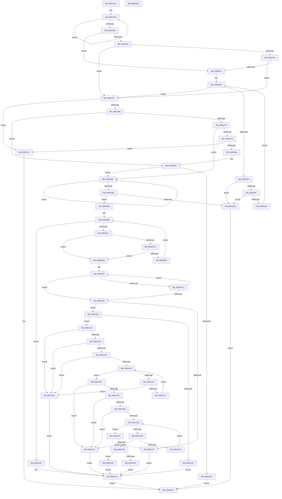

# ApiSetQuerySchemaInfo2

- RVA: `0x00661FAC`–`0x00662283` (길이 `727` bytes)
- VA: `0x0000000140661FAC`
- 실행 섹션: `.text`
- PDB 이름 있음: `예`; PDB Function 태그: `아니요`
- unwind 정보 RVA: `0x00075C18`
- 디코드: `215`개 명령, `727/727` bytes 표시
- 미해석 바이트: `0` (있으면 어셈블리에 `.byte`로 보존)

> 이 문서는 커널 이미지의 기계어와 PDB 기호를 분석해 생성했습니다. 4번과 5번은 함수 원형과 자료형을 바이너리 사용 방식에서 추정한 C 해석이며 원본 소스 복구 결과는 아닙니다.

## 1. Dependencies

- 직접 호출 지점: **3**; 고유 호출 대상: **2**
- 직접 호출자로 확인된 함수: **1**
- RIP 상대 이미지 참조: **3**

### Outgoing calls
- `0x00662112` → [ApiSetpSearchForApiSetA](ApiSetpSearchForApiSetA_function_006624A8.md) (function, `0x006624A8`)
- `0x0066223E` → [ApiSetpSearchForApiSetA](ApiSetpSearchForApiSetA_function_006624A8.md) (function, `0x006624A8`)
- `0x00662260` → [ApiSetQuerySchemaInfo2_V7](ApiSetQuerySchemaInfo2_V7_function_0066301C.md) (function, `0x0066301C`)

### Direct callers
- [RtlIsApiSetImplemented](../../page/79/RtlIsApiSetImplemented_function_00792C30.md) at `0x00792C4E`

### Static image references
- `0x00661FEE` → RVA `0x00039DF8` (`.rdata`; read)
- `0x0066200F` → RVA `0x00039E0C` (`.rdata`; read)
- `0x00662018` → RVA `0x00039E04` (`.rdata`; read)

## 2. Other-region calls and transfers

- 다른 실행 섹션으로 향하는 call: **0**
- 별도 외부 분기/꼬리 이동을 확인하지 못했습니다.

## 3. Assembly (complete function range)

```asm
00661FAC  48 89 5C 24 08                  mov qword ptr [rsp + 8], rbx
00661FB1  48 89 6C 24 10                  mov qword ptr [rsp + 0x10], rbp
00661FB6  48 89 74 24 18                  mov qword ptr [rsp + 0x18], rsi
00661FBB  57                              push rdi
00661FBC  41 54                           push r12
00661FBE  41 55                           push r13
00661FC0  41 56                           push r14
00661FC2  41 57                           push r15
00661FC4  48 83 EC 20                     sub rsp, 0x20
00661FC8  48 83 CD FF                     or rbp, 0xffffffffffffffff
00661FCC  41 C7 00 F0 00 00 00            mov dword ptr [r8], 0xf0
00661FD3  48 8B C5                        mov rax, rbp
00661FD6  33 DB                           xor ebx, ebx
00661FD8  4D 8B F0                        mov r14, r8
00661FDB  48 8B FA                        mov rdi, rdx
00661FDE  4C 8B F9                        mov r15, rcx
00661FE1  48 FF C0                        inc rax
00661FE4  38 1C 02                        cmp byte ptr [rdx + rax], bl
00661FE7  75 F8                           jne 0x140661fe1
00661FE9  BE 0A 00 00 00                  mov esi, 0xa
00661FEE  4C 8D 2D 03 7E 9D FF            lea r13, [rip - 0x6281fd]
00661FF5  48 83 C0 FC                     add rax, -4
00661FF9  44 8D 66 F7                     lea r12d, [rsi - 9]
00661FFD  48 3D FB FF 00 00               cmp rax, 0xfffb
00662003  77 1C                           ja 0x140662021
00662005  8B 02                           mov eax, dword ptr [rdx]
00662007  B9 DF DF DF FF                  mov ecx, 0xffdfdfdf
0066200C  48 23 C1                        and rax, rcx
0066200F  48 3B 05 F6 7D 9D FF            cmp rax, qword ptr [rip - 0x62820a]
00662016  74 4C                           je 0x140662064
00662018  48 3B 05 E5 7D 9D FF            cmp rax, qword ptr [rip - 0x62821b]
0066201F  74 43                           je 0x140662064
00662021  4D 8B D5                        mov r10, r13
00662024  44 8B CE                        mov r9d, esi
00662027  4C 2B D7                        sub r10, rdi
0066202A  4C 8B C7                        mov r8, rdi
0066202D  45 85 C9                        test r9d, r9d
00662030  7E 32                           jle 0x140662064
00662032  45 0F B6 18                     movzx r11d, byte ptr [r8]
00662036  47 8A 24 02                     mov r12b, byte ptr [r10 + r8]
0066203A  45 84 DB                        test r11b, r11b
0066203D  74 6A                           je 0x1406620a9
0066203F  41 8D 53 BF                     lea edx, [r11 - 0x41]
00662043  80 FA 19                        cmp dl, 0x19
00662046  41 8D 43 20                     lea eax, [r11 + 0x20]
0066204A  0F B6 C8                        movzx ecx, al
0066204D  41 0F 47 CB                     cmova ecx, r11d
00662051  44 3A E1                        cmp r12b, cl
00662054  75 53                           jne 0x1406620a9
00662056  41 BC 01 00 00 00               mov r12d, 1
0066205C  4D 03 C4                        add r8, r12
0066205F  45 2B CC                        sub r9d, r12d
00662062  EB C9                           jmp 0x14066202d
00662064  41 80 3F 07                     cmp byte ptr [r15], 7
00662068  0F 84 E9 01 00 00               je 0x140662257
0066206E  41 8B 07                        mov eax, dword ptr [r15]
00662071  83 F8 06                        cmp eax, 6
00662074  75 14                           jne 0x14066208a
00662076  41 83 7F 10 08                  cmp dword ptr [r15 + 0x10], 8
0066207B  76 19                           jbe 0x140662096
0066207D  41 80 7F 1C 07                  cmp byte ptr [r15 + 0x1c], 7
00662082  0F 84 CF 01 00 00               je 0x140662257
00662088  3B C0                           cmp eax, eax
0066208A  73 0A                           jae 0x140662096
0066208C  B8 BB 00 00 C0                  mov eax, 0xc00000bb
00662091  E9 CF 01 00 00                  jmp 0x140662265
00662096  48 FF C5                        inc rbp
00662099  38 1C 2F                        cmp byte ptr [rdi + rbp], bl
0066209C  75 F8                           jne 0x140662096
0066209E  41 BB FF FF 00 00               mov r11d, 0xffff
006620A4  49 3B EB                        cmp rbp, r11
006620A7  76 0A                           jbe 0x1406620b3
006620A9  B8 0D 00 00 C0                  mov eax, 0xc000000d
006620AE  E9 B2 01 00 00                  jmp 0x140662265
006620B3  4C 8B C7                        mov r8, rdi
006620B6  4C 2B EF                        sub r13, rdi
006620B9  85 F6                           test esi, esi
006620BB  0F 8E 73 01 00 00               jle 0x140662234
006620C1  45 0F B6 08                     movzx r9d, byte ptr [r8]
006620C5  47 8A 14 28                     mov r10b, byte ptr [r8 + r13]
006620C9  45 84 C9                        test r9b, r9b
006620CC  74 1F                           je 0x1406620ed
006620CE  41 8D 51 BF                     lea edx, [r9 - 0x41]
006620D2  80 FA 19                        cmp dl, 0x19
006620D5  41 8D 41 20                     lea eax, [r9 + 0x20]
006620D9  0F B6 C8                        movzx ecx, al
006620DC  41 0F 47 C9                     cmova ecx, r9d
006620E0  44 3A D1                        cmp r10b, cl
006620E3  75 08                           jne 0x1406620ed
006620E5  4D 03 C4                        add r8, r12
006620E8  41 2B F4                        sub esi, r12d
006620EB  EB CC                           jmp 0x1406620b9
006620ED  0F B7 C5                        movzx eax, bp
006620F0  0F B7 F5                        movzx esi, bp
006620F3  48 03 C7                        add rax, rdi
006620F6  66 41 3B F4                     cmp si, r12w
006620FA  76 0C                           jbe 0x140662108
006620FC  49 2B C4                        sub rax, r12
006620FF  66 41 03 F3                     add si, r11w
00662103  80 38 2D                        cmp byte ptr [rax], 0x2d
00662106  75 EE                           jne 0x1406620f6
00662108  44 0F B7 C6                     movzx r8d, si
0066210C  48 8B D7                        mov rdx, rdi
0066210F  49 8B CF                        mov rcx, r15
00662112  E8 91 03 00 00                  call 0x1406624a8
00662117  4C 8B C0                        mov r8, rax
0066211A  48 85 C0                        test rax, rax
0066211D  75 0C                           jne 0x14066212b
0066211F  41 C7 06 F1 00 00 00            mov dword ptr [r14], 0xf1
00662126  E9 28 01 00 00                  jmp 0x140662253
0066212B  8B 00                           mov eax, dword ptr [rax]
0066212D  A8 04                           test al, 4
0066212F  74 08                           je 0x140662139
00662131  41 89 1E                        mov dword ptr [r14], ebx
00662134  E9 1A 01 00 00                  jmp 0x140662253
00662139  0F B7 C6                        movzx eax, si
0066213C  44 0F B7 CB                     movzx r9d, bx
00662140  0F B7 D5                        movzx edx, bp
00662143  2B D0                           sub edx, eax
00662145  85 D2                           test edx, edx
00662147  0F 8E E0 00 00 00               jle 0x14066222d
0066214D  0F B7 CE                        movzx ecx, si
00662150  48 03 CF                        add rcx, rdi
00662153  80 39 2D                        cmp byte ptr [rcx], 0x2d
00662156  0F 85 D1 00 00 00               jne 0x14066222d
0066215C  49 03 CC                        add rcx, r12
0066215F  41 2B D4                        sub edx, r12d
00662162  0F 84 C5 00 00 00               je 0x14066222d
00662168  85 D2                           test edx, edx
0066216A  7E 31                           jle 0x14066219d
0066216C  44 0F B6 11                     movzx r10d, byte ptr [rcx]
00662170  41 8D 42 D0                     lea eax, [r10 - 0x30]
00662174  3C 09                           cmp al, 9
00662176  0F 87 B1 00 00 00               ja 0x14066222d
0066217C  41 0F B7 C1                     movzx eax, r9w
00662180  49 03 CC                        add rcx, r12
00662183  66 C1 E0 02                     shl ax, 2
00662187  66 44 03 C8                     add r9w, ax
0066218B  66 45 03 C9                     add r9w, r9w
0066218F  66 41 83 E9 30                  sub r9w, 0x30
00662194  66 45 03 CA                     add r9w, r10w
00662198  41 2B D4                        sub edx, r12d
0066219B  EB CB                           jmp 0x140662168
0066219D  41 8B 50 0C                     mov edx, dword ptr [r8 + 0xc]
006621A1  44 8B DB                        mov r11d, ebx
006621A4  41 8B 48 08                     mov ecx, dword ptr [r8 + 8]
006621A8  2B CA                           sub ecx, edx
006621AA  D1 E9                           shr ecx, 1
006621AC  74 78                           je 0x140662226
006621AE  41 8B 40 04                     mov eax, dword ptr [r8 + 4]
006621B2  49 03 C7                        add rax, r15
006621B5  48 03 D0                        add rdx, rax
006621B8  66 83 3A 2D                     cmp word ptr [rdx], 0x2d
006621BC  75 68                           jne 0x140662226
006621BE  48 83 C2 02                     add rdx, 2
006621C2  44 8D 51 FF                     lea r10d, [rcx - 1]
006621C6  45 85 D2                        test r10d, r10d
006621C9  74 5B                           je 0x140662226
006621CB  45 85 D2                        test r10d, r10d
006621CE  7E 21                           jle 0x1406621f1
006621D0  0F B7 3A                        movzx edi, word ptr [rdx]
006621D3  8D 47 D0                        lea eax, [rdi - 0x30]
006621D6  66 83 F8 09                     cmp ax, 9
006621DA  77 4A                           ja 0x140662226
006621DC  47 8D 1C 9B                     lea r11d, [r11 + r11*4]
006621E0  48 83 C2 02                     add rdx, 2
006621E4  45 8D 5B E8                     lea r11d, [r11 - 0x18]
006621E8  45 2B D4                        sub r10d, r12d
006621EB  46 8D 1C 5F                     lea r11d, [rdi + r11*2]
006621EF  EB DA                           jmp 0x1406621cb
006621F1  41 0F B7 C1                     movzx eax, r9w
006621F5  41 3B C3                        cmp eax, r11d
006621F8  0F 87 21 FF FF FF               ja 0x14066211f
006621FE  41 39 58 14                     cmp dword ptr [r8 + 0x14], ebx
00662202  75 09                           jne 0x14066220d
00662204  41 C7 06 F2 00 00 00            mov dword ptr [r14], 0xf2
0066220B  EB 46                           jmp 0x140662253
0066220D  41 8B 40 10                     mov eax, dword ptr [r8 + 0x10]
00662211  42 8B 4C 38 10                  mov ecx, dword ptr [rax + r15 + 0x10]
00662216  F7 D9                           neg ecx
00662218  1B C0                           sbb eax, eax
0066221A  F7 D0                           not eax
0066221C  25 F2 00 00 00                  and eax, 0xf2
00662221  41 89 06                        mov dword ptr [r14], eax
00662224  EB 2D                           jmp 0x140662253
00662226  BB E4 00 00 C0                  mov ebx, 0xc00000e4
0066222B  EB 26                           jmp 0x140662253
0066222D  BB 0D 00 00 C0                  mov ebx, 0xc000000d
00662232  EB 1F                           jmp 0x140662253
00662234  44 0F B7 C5                     movzx r8d, bp
00662238  48 8B D7                        mov rdx, rdi
0066223B  49 8B CF                        mov rcx, r15
0066223E  E8 65 02 00 00                  call 0x1406624a8
00662243  48 F7 D8                        neg rax
00662246  1B C9                           sbb ecx, ecx
00662248  F7 D1                           not ecx
0066224A  81 E1 F1 00 00 00               and ecx, 0xf1
00662250  41 89 0E                        mov dword ptr [r14], ecx
00662253  8B C3                           mov eax, ebx
00662255  EB 0E                           jmp 0x140662265
00662257  4D 8B C6                        mov r8, r14
0066225A  48 8B D7                        mov rdx, rdi
0066225D  49 8B CF                        mov rcx, r15
00662260  E8 B7 0D 00 00                  call 0x14066301c
00662265  48 8B 5C 24 50                  mov rbx, qword ptr [rsp + 0x50]
0066226A  48 8B 6C 24 58                  mov rbp, qword ptr [rsp + 0x58]
0066226F  48 8B 74 24 60                  mov rsi, qword ptr [rsp + 0x60]
00662274  48 83 C4 20                     add rsp, 0x20
00662278  41 5F                           pop r15
0066227A  41 5E                           pop r14
0066227C  41 5D                           pop r13
0066227E  41 5C                           pop r12
00662280  5F                              pop rdi
00662281  C3                              ret
00662282  CC                              int3
```

## 4. C-style interpretation (structured pseudocode)

```c
__int64 __fastcall ApiSetQuerySchemaInfo2(__int64 a1, __int64 a2, __int64 a3)
{
    __int64 result;
    __int64 v_r10;
    __int64 v_r13;
    __int64 v_rbp;
    __int64 v_rbx;
    __int64 v_rsi;
    __int64 v_rsp;
    unsigned __int64 v_stack_p10;
    unsigned __int64 v_stack_p18;
    unsigned __int64 v_stack_p8;

    v_stack_p8 = v_rbx;
    v_stack_p10 = v_rbp;
    v_stack_p18 = v_rsi;
    v_rsp = (v_rsp) - (32);
    v_rbp = (v_rbp) | (-1);
    *(unsigned int *)(a3) = 240;
    v_rbx = 0;
loc_00661FE1:
    result = (v_rbp) + 1;
    if ((*(unsigned __int8 *)(a2 + result * 1)) != 0) goto loc_00661FE1;
    result = (result) + (-4);
    if (result > 0xFFFBULL) goto loc_00662021;
    result = ((unsigned int)(*(unsigned int *)(a2))) & ((unsigned int)(0xFFDFDFDFULL));
    if (result == (*(unsigned __int64 *)(v_rip - 6455818))) goto loc_00662064;
    if (result == (*(unsigned __int64 *)(v_rip - 6455835))) goto loc_00662064;
loc_00662021:
    v_r10 = (v_rip - 6455805) - (a2);
loc_0066202D:
    if (condition_is_less_or_equal) goto loc_00662064;
    if ((unsigned __int8)(*(unsigned __int8 *)(a2)) == 0) goto loc_006620A9;
    a1 = (unsigned __int8)(*(unsigned __int8 *)(a2) + 32);
    if (((unsigned __int8)(*(unsigned __int8 *)(a2) - 65)) > 25) { a1 = (unsigned int)(*(unsigned __int8 *)(a2)); }
    if (((unsigned __int8)(*(unsigned __int8 *)(v_r10 + a2 * 1))) != ((unsigned __int8)(a1))) goto loc_006620A9;
    a3 = (a2) + (1);
    a4 = (unsigned int)((10) - (1));
    goto loc_0066202D;
loc_00662064:
    if ((*(unsigned __int8 *)(a1)) == 7) goto loc_00662257;
    if (((unsigned int)((unsigned int)(*(unsigned int *)(a1)))) != 6) goto loc_0066208A;
    if ((*(unsigned int *)(a1 + 16)) <= 8) goto loc_00662096;
    if ((*(unsigned __int8 *)(a1 + 28)) == 7) goto loc_00662257;
loc_0066208A:
    if (((unsigned int)((unsigned int)(*(unsigned int *)(a1)))) >= ((unsigned int)((unsigned int)(*(unsigned int *)(a1))))) goto loc_00662096;
    goto loc_00662265;
loc_00662096:
    v_rbp = (v_rbp) + 1;
    if ((*(unsigned __int8 *)(a2 + v_rbp * 1)) != 0) goto loc_00662096;
    if (v_rbp <= ((unsigned int)(0xFFFFULL))) goto loc_006620B3;
loc_006620A9:
    goto loc_00662265;
loc_006620B3:
    v_r13 = (v_rip - 6455805) - (a2);
loc_006620B9:
    if (condition_is_less_or_equal) goto loc_00662234;
    if ((unsigned __int8)(*(unsigned __int8 *)(a2)) == 0) goto loc_006620ED;
    a1 = (unsigned __int8)(*(unsigned __int8 *)(a2) + 32);
    if (((unsigned __int8)(*(unsigned __int8 *)(a2) - 65)) > 25) { a1 = (unsigned int)(*(unsigned __int8 *)(a2)); }
    if (((unsigned __int8)(*(unsigned __int8 *)(a2 + v_r13 * 1))) != ((unsigned __int8)(a1))) goto loc_006620ED;
    a3 = (a2) + (1);
    v_rsi = (unsigned int)((10) - (1));
    goto loc_006620B9;
loc_006620ED:
    result = ((unsigned __int16)(v_rbp)) + (a2);
loc_006620F6:
    if (((unsigned __int16)((unsigned __int16)(v_rbp))) <= 1) goto loc_00662108;
    result = (result) - (1);
    v_rsi = (unsigned __int16)(((unsigned __int16)(v_rbp)) + ((unsigned __int16)((unsigned int)(0xFFFFULL))));
    if ((*(unsigned __int8 *)(result)) != 45) goto loc_006620F6;
loc_00662108:
    result = ApiSetpSearchForApiSetA(a1, a2, (unsigned __int16)(v_rsi), *(unsigned __int8 *)(a2));
    if (result != 0) goto loc_0066212B;
loc_0066211F:
    *(unsigned int *)(a3) = 241;
    goto loc_00662253;
loc_0066212B:
    if ((((unsigned __int8)((unsigned int)(*(unsigned int *)(result)))) & (4)) == 0) goto loc_00662139;
    *(unsigned int *)(a3) = 0;
    goto loc_00662253;
loc_00662139:
    a2 = (unsigned int)(((unsigned __int16)(v_rbp)) - ((unsigned int)((unsigned __int16)(v_rsi))));
    if (condition_is_less_or_equal) goto loc_0066222D;
    a1 = ((unsigned __int16)(v_rsi)) + (a2);
    if ((*(unsigned __int8 *)(a1)) != 45) goto loc_0066222D;
    a1 = (a1) + (1);
    a2 = (unsigned int)((a2) - (1));
    if (condition_is_equal) goto loc_0066222D;
loc_00662168:
    if (condition_is_less_or_equal) goto loc_0066219D;
    if (((unsigned __int8)(*(unsigned __int8 *)(a1) - 48)) > 9) goto loc_0066222D;
    a1 = (a1) + (1);
    result = (unsigned __int16)((0) << (2));
    a4 = (unsigned __int16)((0) + ((unsigned __int16)(result)));
    a4 = (unsigned __int16)((a4) + ((unsigned __int16)(a4)));
    a4 = (unsigned __int16)((a4) - (48));
    a4 = (unsigned __int16)((a4) + ((unsigned __int16)(*(unsigned __int8 *)(a1))));
    a2 = (unsigned int)((a2) - (1));
    goto loc_00662168;
loc_0066219D:
    a1 = (unsigned int)(((unsigned int)(*(unsigned int *)(result + 8))) - ((unsigned int)((unsigned int)(*(unsigned int *)(result + 12)))));
    a1 = (unsigned int)((a1) >> (1));
    if (condition_is_equal) goto loc_00662226;
    result = ((unsigned int)(*(unsigned int *)(result + 4))) + (a1);
    a2 = ((unsigned int)(*(unsigned int *)(result + 12))) + (result);
    if ((*(unsigned __int16 *)(a2)) != 45) goto loc_00662226;
    a2 = (a2) + (2);
    if ((unsigned int)(a1 - 1) == 0) goto loc_00662226;
loc_006621CB:
    if (condition_is_less_or_equal) goto loc_006621F1;
    if (((unsigned __int16)(*(unsigned __int16 *)(a2) - 48)) > 9) goto loc_00662226;
    a2 = (a2) + (2);
    v_r10 = (unsigned int)((a1 - 1) - (1));
    goto loc_006621CB;
loc_006621F1:
    if (((unsigned int)((unsigned __int16)(a4))) > ((unsigned int)(*(unsigned __int16 *)(a2) + 0 + 0 * 4 - 24 * 2))) goto loc_0066211F;
    if ((*(unsigned int *)(result + 20)) != 0) goto loc_0066220D;
    *(unsigned int *)(a3) = 242;
    goto loc_00662253;
loc_0066220D:
    a1 = (unsigned int)(-((unsigned int)(*(unsigned int *)((unsigned int)(*(unsigned int *)(result + 16)) + a1 * 1 + 16))));
    result = (unsigned int)(~((unsigned int)(*(unsigned int *)(result + 16))));
    result = (unsigned int)((result) & (242));
    *(unsigned int *)(a3) = (unsigned int)(result);
    goto loc_00662253;
loc_00662226:
    goto loc_00662253;
loc_0066222D:
    goto loc_00662253;
loc_00662234:
    result = ApiSetpSearchForApiSetA(a1, *(unsigned __int16 *)(a2), (unsigned __int16)(v_rbp), a4);
    result = -(result);
    a1 = (unsigned int)(~(a1));
    a1 = (unsigned int)((a1) & (241));
    *(unsigned int *)(a3) = (unsigned int)(a1);
loc_00662253:
    goto loc_00662265;
loc_00662257:
    result = ApiSetQuerySchemaInfo2_V7(a1, *(unsigned __int16 *)(a2), a3, a4);
loc_00662265:
    v_rsp = (v_rsp) + (32);
    return result;
}
```

## 5. (Beta) C Style

```c
int64_t ApiSetQuerySchemaInfo2(void *Arg1, void *Arg2, void *Arg3)
{
    uint8_t *arg1 = (uint8_t *)Arg1;
    uint8_t *arg2 = (uint8_t *)Arg2;
    uint8_t *arg3 = (uint8_t *)Arg3;

    int64_t result;
    int64_t local_r10;
    int64_t local_r13;
    int64_t local_rbp;
    int64_t local_rbx;
    int64_t local_rsi;
    int64_t local_rsp;
    uint64_t v_stack_p10;
    uint64_t v_stack_p18;
    uint64_t v_stack_p8;

    v_stack_p8 = local_rbx;
    v_stack_p10 = local_rbp;
    v_stack_p18 = local_rsi;
    local_rsp = (local_rsp) - (32);
    local_rbp = (local_rbp) | (-1);
    *(uint32_t *)(arg3) = 240;
    local_rbx = 0;
loc_00661FE1:
    result = (local_rbp) + 1;
    if ((*(uint8_t *)(arg2 + result * 1)) != 0) goto loc_00661FE1;
    result = (result) + (-4);
    if (result > 0xFFFBULL) goto loc_00662021;
    result = ((uint32_t)(*(uint32_t *)(arg2))) & ((uint32_t)(0xFFDFDFDFULL));
    if (result == (*(uint64_t *)(v_rip - 0x62820A))) goto loc_00662064;
    if (result == (*(uint64_t *)(v_rip - 0x62821B))) goto loc_00662064;
loc_00662021:
    local_r10 = (v_rip - 6455805) - (Arg2);
loc_0066202D:
    if (condition_is_less_or_equal) goto loc_00662064;
    if ((uint8_t)(*(uint8_t *)(arg2)) == 0) goto loc_006620A9;
    Arg1 = (uint8_t)(*(uint8_t *)(arg2) + 32);
    if (((uint8_t)(*(uint8_t *)(arg2) - 65)) > 25) { Arg1 = (uint32_t)(*(uint8_t *)(arg2)); }
    if (((uint8_t)(*(uint8_t *)(local_r10 + arg2 * 1))) != ((uint8_t)(Arg1))) goto loc_006620A9;
    Arg3 = (Arg2) + (1);
    a4 = (uint32_t)((10) - (1));
    goto loc_0066202D;
loc_00662064:
    if ((*(uint8_t *)(arg1)) == 7) goto loc_00662257;
    if (((uint32_t)((uint32_t)(*(uint32_t *)(arg1)))) != 6) goto loc_0066208A;
    if ((*(uint32_t *)(arg1 + 0x10)) <= 8) goto loc_00662096;
    if ((*(uint8_t *)(arg1 + 0x1C)) == 7) goto loc_00662257;
loc_0066208A:
    if (((uint32_t)((uint32_t)(*(uint32_t *)(arg1)))) >= ((uint32_t)((uint32_t)(*(uint32_t *)(arg1))))) goto loc_00662096;
    goto loc_00662265;
loc_00662096:
    local_rbp = (local_rbp) + 1;
    if ((*(uint8_t *)(arg2 + local_rbp * 1)) != 0) goto loc_00662096;
    if (local_rbp <= ((uint32_t)(0xFFFFULL))) goto loc_006620B3;
loc_006620A9:
    goto loc_00662265;
loc_006620B3:
    local_r13 = (v_rip - 6455805) - (Arg2);
loc_006620B9:
    if (condition_is_less_or_equal) goto loc_00662234;
    if ((uint8_t)(*(uint8_t *)(arg2)) == 0) goto loc_006620ED;
    Arg1 = (uint8_t)(*(uint8_t *)(arg2) + 32);
    if (((uint8_t)(*(uint8_t *)(arg2) - 65)) > 25) { Arg1 = (uint32_t)(*(uint8_t *)(arg2)); }
    if (((uint8_t)(*(uint8_t *)(arg2 + local_r13 * 1))) != ((uint8_t)(Arg1))) goto loc_006620ED;
    Arg3 = (Arg2) + (1);
    local_rsi = (uint32_t)((10) - (1));
    goto loc_006620B9;
loc_006620ED:
    result = ((uint16_t)(local_rbp)) + (Arg2);
loc_006620F6:
    if (((uint16_t)((uint16_t)(local_rbp))) <= 1) goto loc_00662108;
    result = (result) - (1);
    local_rsi = (uint16_t)(((uint16_t)(local_rbp)) + ((uint16_t)((uint32_t)(0xFFFFULL))));
    if ((*(uint8_t *)(result)) != 45) goto loc_006620F6;
loc_00662108:
    result = ApiSetpSearchForApiSetA(Arg1, Arg2, (uint16_t)(local_rsi), *(uint8_t *)(arg2));
    if (result != 0) goto loc_0066212B;
loc_0066211F:
    *(uint32_t *)(arg3) = 241;
    goto loc_00662253;
loc_0066212B:
    if ((((uint8_t)((uint32_t)(*(uint32_t *)(result)))) & (4)) == 0) goto loc_00662139;
    *(uint32_t *)(arg3) = 0;
    goto loc_00662253;
loc_00662139:
    Arg2 = (uint32_t)(((uint16_t)(local_rbp)) - ((uint32_t)((uint16_t)(local_rsi))));
    if (condition_is_less_or_equal) goto loc_0066222D;
    Arg1 = ((uint16_t)(local_rsi)) + (Arg2);
    if ((*(uint8_t *)(arg1)) != 45) goto loc_0066222D;
    Arg1 = (Arg1) + (1);
    Arg2 = (uint32_t)((Arg2) - (1));
    if (condition_is_equal) goto loc_0066222D;
loc_00662168:
    if (condition_is_less_or_equal) goto loc_0066219D;
    if (((uint8_t)(*(uint8_t *)(arg1) - 48)) > 9) goto loc_0066222D;
    Arg1 = (Arg1) + (1);
    result = (uint16_t)((0) << (2));
    a4 = (uint16_t)((0) + ((uint16_t)(result)));
    a4 = (uint16_t)((a4) + ((uint16_t)(a4)));
    a4 = (uint16_t)((a4) - (48));
    a4 = (uint16_t)((a4) + ((uint16_t)(*(uint8_t *)(arg1))));
    Arg2 = (uint32_t)((Arg2) - (1));
    goto loc_00662168;
loc_0066219D:
    Arg1 = (uint32_t)(((uint32_t)(*(uint32_t *)(result + 0x8))) - ((uint32_t)((uint32_t)(*(uint32_t *)(result + 0xC)))));
    Arg1 = (uint32_t)((Arg1) >> (1));
    if (condition_is_equal) goto loc_00662226;
    result = ((uint32_t)(*(uint32_t *)(result + 0x4))) + (Arg1);
    Arg2 = ((uint32_t)(*(uint32_t *)(result + 0xC))) + (result);
    if ((*(uint16_t *)(arg2)) != 45) goto loc_00662226;
    Arg2 = (Arg2) + (2);
    if ((uint32_t)(Arg1 - 1) == 0) goto loc_00662226;
loc_006621CB:
    if (condition_is_less_or_equal) goto loc_006621F1;
    if (((uint16_t)(*(uint16_t *)(arg2) - 48)) > 9) goto loc_00662226;
    Arg2 = (Arg2) + (2);
    local_r10 = (uint32_t)((Arg1 - 1) - (1));
    goto loc_006621CB;
loc_006621F1:
    if (((uint32_t)((uint16_t)(a4))) > ((uint32_t)(*(uint16_t *)(arg2) + 0 + 0 * 4 - 24 * 2))) goto loc_0066211F;
    if ((*(uint32_t *)(result + 0x14)) != 0) goto loc_0066220D;
    *(uint32_t *)(arg3) = 242;
    goto loc_00662253;
loc_0066220D:
    Arg1 = (uint32_t)(-((uint32_t)(*(uint32_t *)((uint32_t)(*(uint32_t *)(result + 0x10)) + arg1 * 1 + 0x10))));
    result = (uint32_t)(~((uint32_t)(*(uint32_t *)(result + 0x10))));
    result = (uint32_t)((result) & (242));
    *(uint32_t *)(arg3) = (uint32_t)(result);
    goto loc_00662253;
loc_00662226:
    goto loc_00662253;
loc_0066222D:
    goto loc_00662253;
loc_00662234:
    result = ApiSetpSearchForApiSetA(Arg1, *(uint16_t *)(arg2), (uint16_t)(local_rbp), a4);
    result = -(result);
    Arg1 = (uint32_t)(~(Arg1));
    Arg1 = (uint32_t)((Arg1) & (241));
    *(uint32_t *)(arg3) = (uint32_t)(Arg1);
loc_00662253:
    goto loc_00662265;
loc_00662257:
    result = ApiSetQuerySchemaInfo2_V7(Arg1, *(uint16_t *)(arg2), Arg3, a4);
loc_00662265:
    local_rsp = (local_rsp) + (32);
    return result;
}
```

### 관측된 메모리 오프셋

구조체 형식이 확인되지 않은 접근은 인자 기준의 오프셋으로만 기록했습니다.

| 기준 인자 | 오프셋 표현 | 폭 (bit) | 접근 |
|---|---:|---:|---|
| `Arg1` | `+ 0x0` | `8` | `R` |
| `Arg1` | `+ 0x0` | `32` | `R` |
| `Arg1` | `+ 0x10` | `32` | `R` |
| `Arg1` | `+ 0x1C` | `8` | `R` |
| `Arg2` | `+ 0x0` | `8` | `R` |
| `Arg2` | `+ 0x0` | `32` | `R` |
| `Arg2` | `+ 0x0 + r13*1` | `8` | `R` |
| `Arg2` | `+ 0x0 + rax*1` | `8` | `R` |
| `Arg2` | `+ 0x0 + rbp*1` | `8` | `R` |
| `Arg3` | `+ 0x0` | `32` | `W` |

## 6. Execution-region graph

[열기: 2D/3D 그래프와 함수 탐색 컨트롤 패널](../../../control-panel.html?section=text&rva=0x00661FAC&view=graph)

- 2D 그래프는 위에서 아래로 흐르고, 3D 그래프는 빈 공간을 드래그해 회전합니다. Shift+드래그는 이동, 휠은 확대·축소, 함수 노드 선택은 대상 보고서 이동입니다.

### Static fallback


