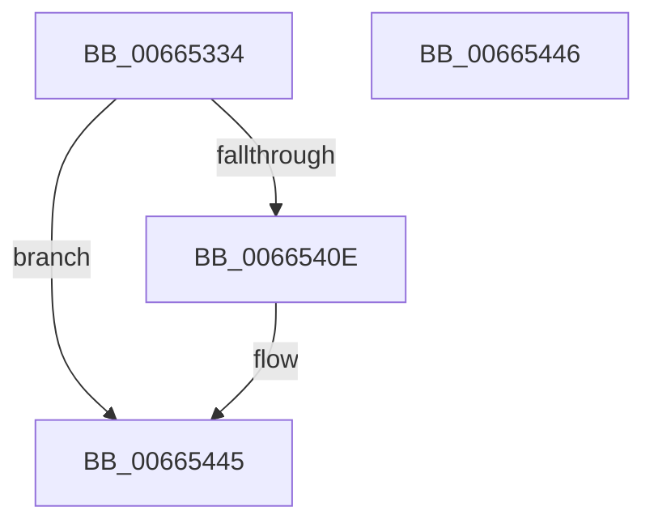

# ApiSetSchemaExpander_ExpandSchema

- RVA: `0x00665334`–`0x00665447` (길이 `275` bytes)
- VA: `0x0000000140665334`
- 실행 섹션: `.text`
- PDB 이름 있음: `예`; PDB Function 태그: `아니요`
- unwind 정보 RVA: `0x000DB714`
- 디코드: `63`개 명령, `275/275` bytes 표시
- 미해석 바이트: `0` (있으면 어셈블리에 `.byte`로 보존)

> 이 문서는 커널 이미지의 기계어와 PDB 기호를 분석해 생성했습니다. 4번과 5번은 함수 원형과 자료형을 바이너리 사용 방식에서 추정한 C 해석이며 원본 소스 복구 결과는 아닙니다.

## 1. Dependencies

- 직접 호출 지점: **0**; 고유 호출 대상: **0**
- 직접 호출자로 확인된 함수: **1**
- RIP 상대 이미지 참조: **0**

### Outgoing calls
- 직접 디코드된 call 명령이 없습니다.

### Direct callers
- [ApiSetComposeSchema_V7](ApiSetComposeSchema_V7_function_00663CCC.md) at `0x00663E2D`

### Static image references
- 디코드된 RIP-relative 메모리 참조가 없습니다.

## 2. Other-region calls and transfers

- 다른 실행 섹션으로 향하는 call: **0**
- 별도 외부 분기/꼬리 이동을 확인하지 못했습니다.

## 3. Assembly (complete function range)

```asm
00665334  4C 8B 49 08                     mov r9, qword ptr [rcx + 8]
00665338  4C 8B C1                        mov r8, rcx
0066533B  4C 8B 51 20                     mov r10, qword ptr [rcx + 0x20]
0066533F  44 8B DA                        mov r11d, edx
00665342  41 0F 10 01                     movups xmm0, xmmword ptr [r9]
00665346  41 0F 11 02                     movups xmmword ptr [r10], xmm0
0066534A  41 0F 10 49 10                  movups xmm1, xmmword ptr [r9 + 0x10]
0066534F  41 0F 11 4A 10                  movups xmmword ptr [r10 + 0x10], xmm1
00665354  41 0F 10 41 20                  movups xmm0, xmmword ptr [r9 + 0x20]
00665359  41 0F 11 42 20                  movups xmmword ptr [r10 + 0x20], xmm0
0066535E  41 0F 10 49 30                  movups xmm1, xmmword ptr [r9 + 0x30]
00665363  41 0F 11 4A 30                  movups xmmword ptr [r10 + 0x30], xmm1
00665368  41 0F 10 41 40                  movups xmm0, xmmword ptr [r9 + 0x40]
0066536D  41 0F 11 42 40                  movups xmmword ptr [r10 + 0x40], xmm0
00665372  41 0F 10 49 50                  movups xmm1, xmmword ptr [r9 + 0x50]
00665377  41 0F 11 4A 50                  movups xmmword ptr [r10 + 0x50], xmm1
0066537C  41 0F 10 41 60                  movups xmm0, xmmword ptr [r9 + 0x60]
00665381  41 0F 11 42 60                  movups xmmword ptr [r10 + 0x60], xmm0
00665386  F2 41 0F 10 49 70               movsd xmm1, qword ptr [r9 + 0x70]
0066538C  F2 41 0F 11 4A 70               movsd qword ptr [r10 + 0x70], xmm1
00665392  41 8B 41 78                     mov eax, dword ptr [r9 + 0x78]
00665396  41 89 42 78                     mov dword ptr [r10 + 0x78], eax
0066539A  41 89 52 04                     mov dword ptr [r10 + 4], edx
0066539E  8B 89 F0 00 00 00               mov ecx, dword ptr [rcx + 0xf0]
006653A4  41 89 4A 28                     mov dword ptr [r10 + 0x28], ecx
006653A8  41 8B 80 0C 01 00 00            mov eax, dword ptr [r8 + 0x10c]
006653AF  41 03 4A 24                     add ecx, dword ptr [r10 + 0x24]
006653B3  41 89 42 6C                     mov dword ptr [r10 + 0x6c], eax
006653B7  41 0F B7 80 E0 00 00 00         movzx eax, word ptr [r8 + 0xe0]
006653BF  66 41 01 42 70                  add word ptr [r10 + 0x70], ax
006653C4  41 89 4A 2C                     mov dword ptr [r10 + 0x2c], ecx
006653C8  41 8B 90 F8 00 00 00            mov edx, dword ptr [r8 + 0xf8]
006653CF  03 D1                           add edx, ecx
006653D1  41 89 52 38                     mov dword ptr [r10 + 0x38], edx
006653D5  41 8B 88 FC 00 00 00            mov ecx, dword ptr [r8 + 0xfc]
006653DC  03 CA                           add ecx, edx
006653DE  41 89 4A 44                     mov dword ptr [r10 + 0x44], ecx
006653E2  41 8B 90 00 01 00 00            mov edx, dword ptr [r8 + 0x100]
006653E9  03 D1                           add edx, ecx
006653EB  41 89 52 50                     mov dword ptr [r10 + 0x50], edx
006653EF  41 8B 88 04 01 00 00            mov ecx, dword ptr [r8 + 0x104]
006653F6  03 CA                           add ecx, edx
006653F8  41 89 4A 5C                     mov dword ptr [r10 + 0x5c], ecx
006653FC  41 03 88 08 01 00 00            add ecx, dword ptr [r8 + 0x108]
00665403  41 89 4A 68                     mov dword ptr [r10 + 0x68], ecx
00665407  41 80 78 10 00                  cmp byte ptr [r8 + 0x10], 0
0066540C  74 37                           je 0x140665445
0066540E  41 0F B7 42 12                  movzx eax, word ptr [r10 + 0x12]
00665413  49 8B CA                        mov rcx, r10
00665416  48 2B C8                        sub rcx, rax
00665419  41 0F B7 41 12                  movzx eax, word ptr [r9 + 0x12]
0066541E  4C 2B C8                        sub r9, rax
00665421  41 0F 10 01                     movups xmm0, xmmword ptr [r9]
00665425  0F 11 01                        movups xmmword ptr [rcx], xmm0
00665428  F2 41 0F 10 49 10               movsd xmm1, qword ptr [r9 + 0x10]
0066542E  F2 0F 11 49 10                  movsd qword ptr [rcx + 0x10], xmm1
00665433  41 8B 41 18                     mov eax, dword ptr [r9 + 0x18]
00665437  89 41 18                        mov dword ptr [rcx + 0x18], eax
0066543A  44 89 59 04                     mov dword ptr [rcx + 4], r11d
0066543E  41 8B 42 18                     mov eax, dword ptr [r10 + 0x18]
00665442  89 41 10                        mov dword ptr [rcx + 0x10], eax
00665445  C3                              ret
00665446  CC                              int3
```

## 4. C-style interpretation (structured pseudocode)

```c
__int64 __fastcall ApiSetSchemaExpander_ExpandSchema(__int64 a1, int a2)
{
    __int64 result;

    *(unsigned __int64 *)(*(unsigned __int64 *)(a1 + 32)) = v_xmm0;
    *(unsigned __int64 *)(*(unsigned __int64 *)(a1 + 32) + 16) = v_xmm1;
    *(unsigned __int64 *)(*(unsigned __int64 *)(a1 + 32) + 32) = v_xmm0;
    *(unsigned __int64 *)(*(unsigned __int64 *)(a1 + 32) + 48) = v_xmm1;
    *(unsigned __int64 *)(*(unsigned __int64 *)(a1 + 32) + 64) = v_xmm0;
    *(unsigned __int64 *)(*(unsigned __int64 *)(a1 + 32) + 80) = v_xmm1;
    *(unsigned __int64 *)(*(unsigned __int64 *)(a1 + 32) + 96) = v_xmm0;
    *(unsigned __int64 *)(*(unsigned __int64 *)(a1 + 32) + 112) = v_xmm1;
    *(unsigned int *)(*(unsigned __int64 *)(a1 + 32) + 120) = (unsigned int)((unsigned int)(*(unsigned int *)(*(unsigned __int64 *)(a1 + 8) + 120)));
    *(unsigned int *)(*(unsigned __int64 *)(a1 + 32) + 4) = a2;
    *(unsigned int *)(*(unsigned __int64 *)(a1 + 32) + 40) = (unsigned int)((unsigned int)(*(unsigned int *)(a1 + 240)));
    a1 = (unsigned int)(((unsigned int)(*(unsigned int *)(a1 + 240))) + (*(unsigned int *)(*(unsigned __int64 *)(a1 + 32) + 36)));
    *(unsigned int *)(*(unsigned __int64 *)(a1 + 32) + 108) = (unsigned int)((unsigned int)(*(unsigned int *)(a1 + 268)));
    *(unsigned int *)(*(unsigned __int64 *)(a1 + 32) + 44) = (unsigned int)(a1);
    a2 = (unsigned int)(((unsigned int)(*(unsigned int *)(a1 + 248))) + ((unsigned int)(a1)));
    *(unsigned int *)(*(unsigned __int64 *)(a1 + 32) + 56) = a2;
    a1 = (unsigned int)(((unsigned int)(*(unsigned int *)(a1 + 252))) + (a2));
    *(unsigned int *)(*(unsigned __int64 *)(a1 + 32) + 68) = (unsigned int)(a1);
    a2 = (unsigned int)(((unsigned int)(*(unsigned int *)(a1 + 256))) + ((unsigned int)(a1)));
    *(unsigned int *)(*(unsigned __int64 *)(a1 + 32) + 80) = a2;
    a1 = (unsigned int)(((unsigned int)(*(unsigned int *)(a1 + 260))) + (a2));
    *(unsigned int *)(*(unsigned __int64 *)(a1 + 32) + 92) = (unsigned int)(a1);
    a1 = (unsigned int)((a1) + (*(unsigned int *)(a1 + 264)));
    *(unsigned int *)(*(unsigned __int64 *)(a1 + 32) + 104) = (unsigned int)(a1);
    result = *(unsigned __int16 *)(a1 + 224);
    if ((*(unsigned __int8 *)(a1 + 16)) != 0) {
        result = *(unsigned __int16 *)(*(unsigned __int64 *)(a1 + 32) + 18);
        a1 = *(unsigned __int64 *)(a1 + 32);
        a1 = (a1) - (result);
        result = *(unsigned __int16 *)(*(unsigned __int64 *)(a1 + 8) + 18);
        a4 = (*(unsigned __int64 *)(a1 + 8)) - (result);
        *(unsigned __int64 *)(a1) = v_xmm0;
        *(unsigned __int64 *)(a1 + 16) = v_xmm1;
        result = *(unsigned int *)(a4 + 24);
        *(unsigned int *)(a1 + 24) = (unsigned int)(result);
        *(unsigned int *)(a1 + 4) = (unsigned int)((unsigned int)(a2));
        result = *(unsigned int *)(*(unsigned __int64 *)(a1 + 32) + 24);
        *(unsigned int *)(a1 + 16) = (unsigned int)(result);
    }
    return result;
}
```

## 5. (Beta) C Style

```c
int64_t ApiSetSchemaExpander_ExpandSchema(void *Arg1, int32_t Arg2)
{
    uint8_t *arg1 = (uint8_t *)Arg1;

    int64_t result;

    *(uint64_t *)(*(uint64_t *)(arg1 + 0x20)) = v_xmm0;
    *(uint64_t *)(*(uint64_t *)(arg1 + 0x20) + 0x10) = v_xmm1;
    *(uint64_t *)(*(uint64_t *)(arg1 + 0x20) + 0x20) = v_xmm0;
    *(uint64_t *)(*(uint64_t *)(arg1 + 0x20) + 0x30) = v_xmm1;
    *(uint64_t *)(*(uint64_t *)(arg1 + 0x20) + 0x40) = v_xmm0;
    *(uint64_t *)(*(uint64_t *)(arg1 + 0x20) + 0x50) = v_xmm1;
    *(uint64_t *)(*(uint64_t *)(arg1 + 0x20) + 0x60) = v_xmm0;
    *(uint64_t *)(*(uint64_t *)(arg1 + 0x20) + 0x70) = v_xmm1;
    *(uint32_t *)(*(uint64_t *)(arg1 + 0x20) + 0x78) = (uint32_t)((uint32_t)(*(uint32_t *)(*(uint64_t *)(arg1 + 0x8) + 0x78)));
    *(uint32_t *)(*(uint64_t *)(arg1 + 0x20) + 0x4) = Arg2;
    *(uint32_t *)(*(uint64_t *)(arg1 + 0x20) + 0x28) = (uint32_t)((uint32_t)(*(uint32_t *)(arg1 + 0xF0)));
    Arg1 = (uint32_t)(((uint32_t)(*(uint32_t *)(arg1 + 0xF0))) + (*(uint32_t *)(*(uint64_t *)(arg1 + 0x20) + 0x24)));
    *(uint32_t *)(*(uint64_t *)(arg1 + 0x20) + 0x6C) = (uint32_t)((uint32_t)(*(uint32_t *)(arg1 + 0x10C)));
    *(uint32_t *)(*(uint64_t *)(arg1 + 0x20) + 0x2C) = (uint32_t)(Arg1);
    Arg2 = (uint32_t)(((uint32_t)(*(uint32_t *)(arg1 + 0xF8))) + ((uint32_t)(Arg1)));
    *(uint32_t *)(*(uint64_t *)(arg1 + 0x20) + 0x38) = Arg2;
    Arg1 = (uint32_t)(((uint32_t)(*(uint32_t *)(arg1 + 0xFC))) + (Arg2));
    *(uint32_t *)(*(uint64_t *)(arg1 + 0x20) + 0x44) = (uint32_t)(Arg1);
    Arg2 = (uint32_t)(((uint32_t)(*(uint32_t *)(arg1 + 0x100))) + ((uint32_t)(Arg1)));
    *(uint32_t *)(*(uint64_t *)(arg1 + 0x20) + 0x50) = Arg2;
    Arg1 = (uint32_t)(((uint32_t)(*(uint32_t *)(arg1 + 0x104))) + (Arg2));
    *(uint32_t *)(*(uint64_t *)(arg1 + 0x20) + 0x5C) = (uint32_t)(Arg1);
    Arg1 = (uint32_t)((Arg1) + (*(uint32_t *)(arg1 + 0x108)));
    *(uint32_t *)(*(uint64_t *)(arg1 + 0x20) + 0x68) = (uint32_t)(Arg1);
    result = *(uint16_t *)(arg1 + 0xE0);
    if ((*(uint8_t *)(arg1 + 0x10)) != 0) {
        result = *(uint16_t *)(*(uint64_t *)(arg1 + 0x20) + 0x12);
        Arg1 = *(uint64_t *)(arg1 + 0x20);
        Arg1 = (Arg1) - (result);
        result = *(uint16_t *)(*(uint64_t *)(arg1 + 0x8) + 0x12);
        a4 = (*(uint64_t *)(arg1 + 0x8)) - (result);
        *(uint64_t *)(arg1) = v_xmm0;
        *(uint64_t *)(arg1 + 0x10) = v_xmm1;
        result = *(uint32_t *)(a4 + 0x18);
        *(uint32_t *)(arg1 + 0x18) = (uint32_t)(result);
        *(uint32_t *)(arg1 + 0x4) = (uint32_t)((uint32_t)(Arg2));
        result = *(uint32_t *)(*(uint64_t *)(arg1 + 0x20) + 0x18);
        *(uint32_t *)(arg1 + 0x10) = (uint32_t)(result);
    }
    return result;
}
```

### 관측된 메모리 오프셋

구조체 형식이 확인되지 않은 접근은 인자 기준의 오프셋으로만 기록했습니다.

| 기준 인자 | 오프셋 표현 | 폭 (bit) | 접근 |
|---|---:|---:|---|
| `Arg1` | `+ 0x8` | `64` | `R` |
| `Arg1` | `+ 0x10` | `8` | `R` |
| `Arg1` | `+ 0x20` | `64` | `R` |
| `Arg1` | `+ 0xE0` | `16` | `R` |
| `Arg1` | `+ 0xF0` | `32` | `R` |
| `Arg1` | `+ 0xF8` | `32` | `R` |
| `Arg1` | `+ 0xFC` | `32` | `R` |
| `Arg1` | `+ 0x100` | `32` | `R` |
| `Arg1` | `+ 0x104` | `32` | `R` |
| `Arg1` | `+ 0x108` | `32` | `R` |
| `Arg1` | `+ 0x10C` | `32` | `R` |

## 6. Execution-region graph

[열기: 2D/3D 그래프와 함수 탐색 컨트롤 패널](../../../control-panel.html?section=text&rva=0x00665334&view=graph)

- 2D 그래프는 위에서 아래로 흐르고, 3D 그래프는 빈 공간을 드래그해 회전합니다. Shift+드래그는 이동, 휠은 확대·축소, 함수 노드 선택은 대상 보고서 이동입니다.

### Static fallback


