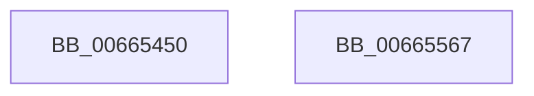

# ApiSetSchemaExpander_GetNewSchemaSize

- RVA: `0x00665450`–`0x00665568` (길이 `280` bytes)
- VA: `0x0000000140665450`
- 실행 섹션: `.text`
- PDB 이름 있음: `예`; PDB Function 태그: `아니요`
- unwind 정보 RVA: `0x000A6CEC`
- 디코드: `67`개 명령, `280/280` bytes 표시
- 미해석 바이트: `0` (있으면 어셈블리에 `.byte`로 보존)

> 이 문서는 커널 이미지의 기계어와 PDB 기호를 분석해 생성했습니다. 4번과 5번은 함수 원형과 자료형을 바이너리 사용 방식에서 추정한 C 해석이며 원본 소스 복구 결과는 아닙니다.

## 1. Dependencies

- 직접 호출 지점: **0**; 고유 호출 대상: **0**
- 직접 호출자로 확인된 함수: **1**
- RIP 상대 이미지 참조: **0**

### Outgoing calls
- 직접 디코드된 call 명령이 없습니다.

### Direct callers
- [ApiSetComposeSchema_V7](ApiSetComposeSchema_V7_function_00663CCC.md) at `0x00663DCD`

### Static image references
- 디코드된 RIP-relative 메모리 참조가 없습니다.

## 2. Other-region calls and transfers

- 다른 실행 섹션으로 향하는 call: **0**
- 별도 외부 분기/꼬리 이동을 확인하지 못했습니다.

## 3. Assembly (complete function range)

```asm
00665450  48 8B C4                        mov rax, rsp
00665453  48 89 58 08                     mov qword ptr [rax + 8], rbx
00665457  48 89 68 10                     mov qword ptr [rax + 0x10], rbp
0066545B  48 89 70 18                     mov qword ptr [rax + 0x18], rsi
0066545F  48 89 78 20                     mov qword ptr [rax + 0x20], rdi
00665463  41 56                           push r14
00665465  48 8B 59 08                     mov rbx, qword ptr [rcx + 8]
00665469  8B A9 E8 00 00 00               mov ebp, dword ptr [rcx + 0xe8]
0066546F  48 8B 74 24 20                  mov rsi, qword ptr [rsp + 0x20]
00665474  83 C5 03                        add ebp, 3
00665477  44 8B 73 1C                     mov r14d, dword ptr [rbx + 0x1c]
0066547B  44 89 B1 F4 00 00 00            mov dword ptr [rcx + 0xf4], r14d
00665482  03 6B 28                        add ebp, dword ptr [rbx + 0x28]
00665485  83 E5 FC                        and ebp, 0xfffffffc
00665488  89 A9 F0 00 00 00               mov dword ptr [rcx + 0xf0], ebp
0066548E  0F B6 7B 34                     movzx edi, byte ptr [rbx + 0x34]
00665492  0F B7 43 30                     movzx eax, word ptr [rbx + 0x30]
00665496  83 C7 08                        add edi, 8
00665499  0F AF F8                        imul edi, eax
0066549C  03 B9 A8 00 00 00               add edi, dword ptr [rcx + 0xa8]
006654A2  89 B9 F8 00 00 00               mov dword ptr [rcx + 0xf8], edi
006654A8  0F B7 43 3C                     movzx eax, word ptr [rbx + 0x3c]
006654AC  44 0F B6 5B 40                  movzx r11d, byte ptr [rbx + 0x40]
006654B1  41 83 C3 08                     add r11d, 8
006654B5  44 0F AF D8                     imul r11d, eax
006654B9  44 03 99 B4 00 00 00            add r11d, dword ptr [rcx + 0xb4]
006654C0  44 89 99 FC 00 00 00            mov dword ptr [rcx + 0xfc], r11d
006654C7  0F B7 43 48                     movzx eax, word ptr [rbx + 0x48]
006654CB  44 0F B6 53 4C                  movzx r10d, byte ptr [rbx + 0x4c]
006654D0  41 83 C2 08                     add r10d, 8
006654D4  44 0F AF D0                     imul r10d, eax
006654D8  44 03 91 C0 00 00 00            add r10d, dword ptr [rcx + 0xc0]
006654DF  44 89 91 00 01 00 00            mov dword ptr [rcx + 0x100], r10d
006654E6  0F B7 43 54                     movzx eax, word ptr [rbx + 0x54]
006654EA  44 0F B6 4B 58                  movzx r9d, byte ptr [rbx + 0x58]
006654EF  41 83 C1 08                     add r9d, 8
006654F3  44 0F AF C8                     imul r9d, eax
006654F7  44 03 89 D8 00 00 00            add r9d, dword ptr [rcx + 0xd8]
006654FE  44 89 89 04 01 00 00            mov dword ptr [rcx + 0x104], r9d
00665505  0F B7 43 60                     movzx eax, word ptr [rbx + 0x60]
00665509  44 0F B6 43 64                  movzx r8d, byte ptr [rbx + 0x64]
0066550E  41 83 C0 08                     add r8d, 8
00665512  44 0F AF C0                     imul r8d, eax
00665516  8A 41 10                        mov al, byte ptr [rcx + 0x10]
00665519  44 03 81 CC 00 00 00            add r8d, dword ptr [rcx + 0xcc]
00665520  44 89 81 08 01 00 00            mov dword ptr [rcx + 0x108], r8d
00665527  8B 53 6C                        mov edx, dword ptr [rbx + 0x6c]
0066552A  03 91 E4 00 00 00               add edx, dword ptr [rcx + 0xe4]
00665530  48 8B 5C 24 10                  mov rbx, qword ptr [rsp + 0x10]
00665535  F6 D8                           neg al
00665537  89 91 0C 01 00 00               mov dword ptr [rcx + 0x10c], edx
0066553D  1B C0                           sbb eax, eax
0066553F  83 E0 1C                        and eax, 0x1c
00665542  83 C0 7C                        add eax, 0x7c
00665545  03 C2                           add eax, edx
00665547  41 03 C0                        add eax, r8d
0066554A  41 03 C1                        add eax, r9d
0066554D  41 03 C2                        add eax, r10d
00665550  41 03 C3                        add eax, r11d
00665553  03 C7                           add eax, edi
00665555  48 8B 7C 24 28                  mov rdi, qword ptr [rsp + 0x28]
0066555A  03 C5                           add eax, ebp
0066555C  48 8B 6C 24 18                  mov rbp, qword ptr [rsp + 0x18]
00665561  41 03 C6                        add eax, r14d
00665564  41 5E                           pop r14
00665566  C3                              ret
00665567  CC                              int3
```

## 4. C-style interpretation (structured pseudocode)

```c
__int64 __fastcall ApiSetSchemaExpander_GetNewSchemaSize(__int64 a1)
{
    __int64 result;
    __int64 v_r10;
    __int64 v_r11;
    __int64 v_rbp;
    __int64 v_rdi;
    unsigned __int64 v_stack_p10;
    unsigned __int64 v_stack_p18;
    unsigned __int64 v_stack_p20;
    unsigned __int64 v_stack_p8;

    *(unsigned __int64 *)(v_rsp + 8) = v_rbx;
    *(unsigned __int64 *)(v_rsp + 16) = v_rbp;
    *(unsigned __int64 *)(v_rsp + 24) = v_rsi;
    *(unsigned __int64 *)(v_rsp + 32) = v_rdi;
    v_rbp = (unsigned int)(((unsigned int)(*(unsigned int *)(a1 + 232))) + (3));
    *(unsigned int *)(a1 + 244) = (unsigned int)((unsigned int)(*(unsigned int *)(*(unsigned __int64 *)(a1 + 8) + 28)));
    v_rbp = (unsigned int)((v_rbp) + (*(unsigned int *)(*(unsigned __int64 *)(a1 + 8) + 40)));
    v_rbp = (unsigned int)((v_rbp) & (0xFFFFFFFCULL));
    *(unsigned int *)(a1 + 240) = (unsigned int)(v_rbp);
    v_rdi = (unsigned int)((*(unsigned __int8 *)(*(unsigned __int64 *)(a1 + 8) + 52)) + (8));
    v_rdi = (unsigned int)((v_rdi) * ((unsigned int)(*(unsigned __int16 *)(*(unsigned __int64 *)(a1 + 8) + 48))));
    v_rdi = (unsigned int)((v_rdi) + (*(unsigned int *)(a1 + 168)));
    *(unsigned int *)(a1 + 248) = (unsigned int)(v_rdi);
    v_r11 = (unsigned int)((*(unsigned __int8 *)(*(unsigned __int64 *)(a1 + 8) + 64)) + (8));
    v_r11 = (unsigned int)((v_r11) * ((unsigned int)(*(unsigned __int16 *)(*(unsigned __int64 *)(a1 + 8) + 60))));
    v_r11 = (unsigned int)((v_r11) + (*(unsigned int *)(a1 + 180)));
    *(unsigned int *)(a1 + 252) = (unsigned int)(v_r11);
    v_r10 = (unsigned int)((*(unsigned __int8 *)(*(unsigned __int64 *)(a1 + 8) + 76)) + (8));
    v_r10 = (unsigned int)((v_r10) * ((unsigned int)(*(unsigned __int16 *)(*(unsigned __int64 *)(a1 + 8) + 72))));
    v_r10 = (unsigned int)((v_r10) + (*(unsigned int *)(a1 + 192)));
    *(unsigned int *)(a1 + 256) = (unsigned int)(v_r10);
    a4 = (unsigned int)((*(unsigned __int8 *)(*(unsigned __int64 *)(a1 + 8) + 88)) + (8));
    a4 = (unsigned int)((a4) * ((unsigned int)(*(unsigned __int16 *)(*(unsigned __int64 *)(a1 + 8) + 84))));
    a4 = (unsigned int)((a4) + (*(unsigned int *)(a1 + 216)));
    *(unsigned int *)(a1 + 260) = (unsigned int)(a4);
    a3 = (unsigned int)((*(unsigned __int8 *)(*(unsigned __int64 *)(a1 + 8) + 100)) + (8));
    a3 = (unsigned int)((a3) * ((unsigned int)(*(unsigned __int16 *)(*(unsigned __int64 *)(a1 + 8) + 96))));
    a3 = (unsigned int)((a3) + (*(unsigned int *)(a1 + 204)));
    *(unsigned int *)(a1 + 264) = (unsigned int)(a3);
    a2 = (unsigned int)(((unsigned int)(*(unsigned int *)(*(unsigned __int64 *)(a1 + 8) + 108))) + (*(unsigned int *)(a1 + 228)));
    result = (unsigned __int8)(-(*(unsigned __int8 *)(a1 + 16)));
    *(unsigned int *)(a1 + 268) = (unsigned int)(a2);
    result = (unsigned int)((result) & (28));
    result = (unsigned int)((result) + (124));
    result = (unsigned int)((result) + ((unsigned int)(a2)));
    result = (unsigned int)((result) + ((unsigned int)(a3)));
    result = (unsigned int)((result) + ((unsigned int)(a4)));
    result = (unsigned int)((result) + ((unsigned int)(v_r10)));
    result = (unsigned int)((result) + ((unsigned int)(v_r11)));
    result = (unsigned int)((result) + ((unsigned int)(v_rdi)));
    result = (unsigned int)((result) + ((unsigned int)(v_rbp)));
    result = (unsigned int)((result) + ((unsigned int)((unsigned int)(*(unsigned int *)(*(unsigned __int64 *)(a1 + 8) + 28)))));
    return result;
}
```

## 5. (Beta) C Style

```c
int64_t ApiSetSchemaExpander_GetNewSchemaSize(void *Arg1)
{
    uint8_t *arg1 = (uint8_t *)Arg1;

    int64_t result;
    int64_t local_r10;
    int64_t local_r11;
    int64_t local_rbp;
    int64_t local_rdi;
    uint64_t v_stack_p10;
    uint64_t v_stack_p18;
    uint64_t v_stack_p20;
    uint64_t v_stack_p8;

    *(uint64_t *)(local_rsp + 0x8) = local_rbx;
    *(uint64_t *)(local_rsp + 0x10) = local_rbp;
    *(uint64_t *)(local_rsp + 0x18) = local_rsi;
    *(uint64_t *)(local_rsp + 0x20) = local_rdi;
    local_rbp = (uint32_t)(((uint32_t)(*(uint32_t *)(arg1 + 0xE8))) + (3));
    *(uint32_t *)(arg1 + 0xF4) = (uint32_t)((uint32_t)(*(uint32_t *)(*(uint64_t *)(arg1 + 0x8) + 0x1C)));
    local_rbp = (uint32_t)((local_rbp) + (*(uint32_t *)(*(uint64_t *)(arg1 + 0x8) + 0x28)));
    local_rbp = (uint32_t)((local_rbp) & (0xFFFFFFFCULL));
    *(uint32_t *)(arg1 + 0xF0) = (uint32_t)(local_rbp);
    local_rdi = (uint32_t)((*(uint8_t *)(*(uint64_t *)(arg1 + 0x8) + 0x34)) + (8));
    local_rdi = (uint32_t)((local_rdi) * ((uint32_t)(*(uint16_t *)(*(uint64_t *)(arg1 + 0x8) + 0x30))));
    local_rdi = (uint32_t)((local_rdi) + (*(uint32_t *)(arg1 + 0xA8)));
    *(uint32_t *)(arg1 + 0xF8) = (uint32_t)(local_rdi);
    local_r11 = (uint32_t)((*(uint8_t *)(*(uint64_t *)(arg1 + 0x8) + 0x40)) + (8));
    local_r11 = (uint32_t)((local_r11) * ((uint32_t)(*(uint16_t *)(*(uint64_t *)(arg1 + 0x8) + 0x3C))));
    local_r11 = (uint32_t)((local_r11) + (*(uint32_t *)(arg1 + 0xB4)));
    *(uint32_t *)(arg1 + 0xFC) = (uint32_t)(local_r11);
    local_r10 = (uint32_t)((*(uint8_t *)(*(uint64_t *)(arg1 + 0x8) + 0x4C)) + (8));
    local_r10 = (uint32_t)((local_r10) * ((uint32_t)(*(uint16_t *)(*(uint64_t *)(arg1 + 0x8) + 0x48))));
    local_r10 = (uint32_t)((local_r10) + (*(uint32_t *)(arg1 + 0xC0)));
    *(uint32_t *)(arg1 + 0x100) = (uint32_t)(local_r10);
    a4 = (uint32_t)((*(uint8_t *)(*(uint64_t *)(arg1 + 0x8) + 0x58)) + (8));
    a4 = (uint32_t)((a4) * ((uint32_t)(*(uint16_t *)(*(uint64_t *)(arg1 + 0x8) + 0x54))));
    a4 = (uint32_t)((a4) + (*(uint32_t *)(arg1 + 0xD8)));
    *(uint32_t *)(arg1 + 0x104) = (uint32_t)(a4);
    a3 = (uint32_t)((*(uint8_t *)(*(uint64_t *)(arg1 + 0x8) + 0x64)) + (8));
    a3 = (uint32_t)((a3) * ((uint32_t)(*(uint16_t *)(*(uint64_t *)(arg1 + 0x8) + 0x60))));
    a3 = (uint32_t)((a3) + (*(uint32_t *)(arg1 + 0xCC)));
    *(uint32_t *)(arg1 + 0x108) = (uint32_t)(a3);
    a2 = (uint32_t)(((uint32_t)(*(uint32_t *)(*(uint64_t *)(arg1 + 0x8) + 0x6C))) + (*(uint32_t *)(arg1 + 0xE4)));
    result = (uint8_t)(-(*(uint8_t *)(arg1 + 0x10)));
    *(uint32_t *)(arg1 + 0x10C) = (uint32_t)(a2);
    result = (uint32_t)((result) & (28));
    result = (uint32_t)((result) + (124));
    result = (uint32_t)((result) + ((uint32_t)(a2)));
    result = (uint32_t)((result) + ((uint32_t)(a3)));
    result = (uint32_t)((result) + ((uint32_t)(a4)));
    result = (uint32_t)((result) + ((uint32_t)(local_r10)));
    result = (uint32_t)((result) + ((uint32_t)(local_r11)));
    result = (uint32_t)((result) + ((uint32_t)(local_rdi)));
    result = (uint32_t)((result) + ((uint32_t)(local_rbp)));
    result = (uint32_t)((result) + ((uint32_t)((uint32_t)(*(uint32_t *)(*(uint64_t *)(arg1 + 0x8) + 0x1C)))));
    return result;
}
```

### 관측된 메모리 오프셋

구조체 형식이 확인되지 않은 접근은 인자 기준의 오프셋으로만 기록했습니다.

| 기준 인자 | 오프셋 표현 | 폭 (bit) | 접근 |
|---|---:|---:|---|
| `Arg1` | `+ 0x8` | `64` | `R` |
| `Arg1` | `+ 0x10` | `8` | `R` |
| `Arg1` | `+ 0xA8` | `32` | `R` |
| `Arg1` | `+ 0xB4` | `32` | `R` |
| `Arg1` | `+ 0xC0` | `32` | `R` |
| `Arg1` | `+ 0xCC` | `32` | `R` |
| `Arg1` | `+ 0xD8` | `32` | `R` |
| `Arg1` | `+ 0xE4` | `32` | `R` |
| `Arg1` | `+ 0xE8` | `32` | `R` |
| `Arg1` | `+ 0xF0` | `32` | `W` |
| `Arg1` | `+ 0xF4` | `32` | `W` |
| `Arg1` | `+ 0xF8` | `32` | `W` |
| `Arg1` | `+ 0xFC` | `32` | `W` |
| `Arg1` | `+ 0x100` | `32` | `W` |
| `Arg1` | `+ 0x104` | `32` | `W` |
| `Arg1` | `+ 0x108` | `32` | `W` |
| `Arg1` | `+ 0x10C` | `32` | `W` |

## 6. Execution-region graph

[열기: 2D/3D 그래프와 함수 탐색 컨트롤 패널](../../../control-panel.html?section=text&rva=0x00665450&view=graph)

- 2D 그래프는 위에서 아래로 흐르고, 3D 그래프는 빈 공간을 드래그해 회전합니다. Shift+드래그는 이동, 휠은 확대·축소, 함수 노드 선택은 대상 보고서 이동입니다.

### Static fallback


