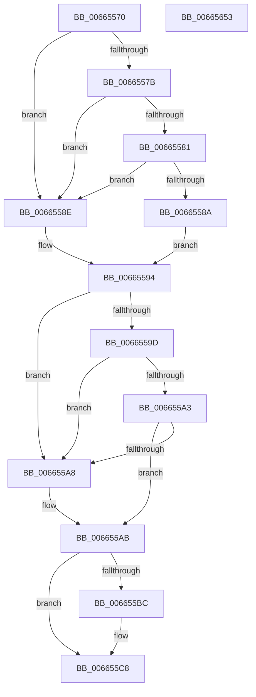

# ApiSetSchemaExpander_Initialize

- RVA: `0x00665570`–`0x00665654` (길이 `228` bytes)
- VA: `0x0000000140665570`
- 실행 섹션: `.text`
- PDB 이름 있음: `예`; PDB Function 태그: `아니요`
- unwind 정보 RVA: `0x000DB714`
- 디코드: `56`개 명령, `228/228` bytes 표시
- 미해석 바이트: `0` (있으면 어셈블리에 `.byte`로 보존)

> 이 문서는 커널 이미지의 기계어와 PDB 기호를 분석해 생성했습니다. 4번과 5번은 함수 원형과 자료형을 바이너리 사용 방식에서 추정한 C 해석이며 원본 소스 복구 결과는 아닙니다.

## 1. Dependencies

- 직접 호출 지점: **0**; 고유 호출 대상: **0**
- 직접 호출자로 확인된 함수: **1**
- RIP 상대 이미지 참조: **0**

### Outgoing calls
- 직접 디코드된 call 명령이 없습니다.

### Direct callers
- [ApiSetComposeSchema_V7](ApiSetComposeSchema_V7_function_00663CCC.md) at `0x00663DA0`

### Static image references
- 디코드된 RIP-relative 메모리 참조가 없습니다.

## 2. Other-region calls and transfers

- 다른 실행 섹션으로 향하는 call: **0**
- 별도 외부 분기/꼬리 이동을 확인하지 못했습니다.

## 3. Assembly (complete function range)

```asm
00665570  83 39 06                        cmp dword ptr [rcx], 6
00665573  4C 8B CA                        mov r9, rdx
00665576  48 8B C1                        mov rax, rcx
00665579  75 13                           jne 0x14066558e
0066557B  83 79 10 08                     cmp dword ptr [rcx + 0x10], 8
0066557F  76 0D                           jbe 0x14066558e
00665581  48 83 C1 1C                     add rcx, 0x1c
00665585  80 39 07                        cmp byte ptr [rcx], 7
00665588  75 04                           jne 0x14066558e
0066558A  B2 01                           mov dl, 1
0066558C  EB 06                           jmp 0x140665594
0066558E  32 D2                           xor dl, dl
00665590  48 8D 48 1C                     lea rcx, [rax + 0x1c]
00665594  41 88 50 10                     mov byte ptr [r8 + 0x10], dl
00665598  83 38 06                        cmp dword ptr [rax], 6
0066559B  75 0B                           jne 0x1406655a8
0066559D  83 78 10 08                     cmp dword ptr [rax + 0x10], 8
006655A1  76 05                           jbe 0x1406655a8
006655A3  80 39 07                        cmp byte ptr [rcx], 7
006655A6  74 03                           je 0x1406655ab
006655A8  48 8B C8                        mov rcx, rax
006655AB  49 83 60 28 00                  and qword ptr [r8 + 0x28], 0
006655B0  49 89 48 08                     mov qword ptr [r8 + 8], rcx
006655B4  4D 89 48 18                     mov qword ptr [r8 + 0x18], r9
006655B8  84 D2                           test dl, dl
006655BA  74 0C                           je 0x1406655c8
006655BC  0F B7 40 0C                     movzx eax, word ptr [rax + 0xc]
006655C0  66 41 89 80 EC 00 00 00         mov word ptr [r8 + 0xec], ax
006655C8  0F B7 41 30                     movzx eax, word ptr [rcx + 0x30]
006655CC  66 41 89 80 AC 00 00 00         mov word ptr [r8 + 0xac], ax
006655D4  0F B7 41 3C                     movzx eax, word ptr [rcx + 0x3c]
006655D8  66 41 89 80 B8 00 00 00         mov word ptr [r8 + 0xb8], ax
006655E0  0F B7 41 48                     movzx eax, word ptr [rcx + 0x48]
006655E4  66 41 89 80 C4 00 00 00         mov word ptr [r8 + 0xc4], ax
006655EC  0F B7 41 60                     movzx eax, word ptr [rcx + 0x60]
006655F0  66 41 89 80 D0 00 00 00         mov word ptr [r8 + 0xd0], ax
006655F8  0F B7 41 54                     movzx eax, word ptr [rcx + 0x54]
006655FC  66 41 89 80 DC 00 00 00         mov word ptr [r8 + 0xdc], ax
00665604  0F 10 01                        movups xmm0, xmmword ptr [rcx]
00665607  41 0F 11 40 30                  movups xmmword ptr [r8 + 0x30], xmm0
0066560C  0F 10 49 10                     movups xmm1, xmmword ptr [rcx + 0x10]
00665610  41 0F 11 48 40                  movups xmmword ptr [r8 + 0x40], xmm1
00665615  0F 10 41 20                     movups xmm0, xmmword ptr [rcx + 0x20]
00665619  41 0F 11 40 50                  movups xmmword ptr [r8 + 0x50], xmm0
0066561E  0F 10 49 30                     movups xmm1, xmmword ptr [rcx + 0x30]
00665622  41 0F 11 48 60                  movups xmmword ptr [r8 + 0x60], xmm1
00665627  0F 10 41 40                     movups xmm0, xmmword ptr [rcx + 0x40]
0066562B  41 0F 11 40 70                  movups xmmword ptr [r8 + 0x70], xmm0
00665630  0F 10 49 50                     movups xmm1, xmmword ptr [rcx + 0x50]
00665634  41 0F 11 88 80 00 00 00         movups xmmword ptr [r8 + 0x80], xmm1
0066563C  0F 10 41 60                     movups xmm0, xmmword ptr [rcx + 0x60]
00665640  41 0F 11 80 90 00 00 00         movups xmmword ptr [r8 + 0x90], xmm0
00665648  8B 41 70                        mov eax, dword ptr [rcx + 0x70]
0066564B  41 89 80 A0 00 00 00            mov dword ptr [r8 + 0xa0], eax
00665652  C3                              ret
00665653  CC                              int3
```

## 4. C-style interpretation (structured pseudocode)

```c
__int64 __fastcall ApiSetSchemaExpander_Initialize(__int64 a1, __int64 a2, __int64 a3)
{
    __int64 result;

    if ((*(unsigned int *)(a1)) != 6) goto loc_0066558E;
    if ((*(unsigned int *)(a1 + 16)) <= 8) goto loc_0066558E;
    a1 = (a1) + (28);
    if ((*(unsigned __int8 *)(a1)) != 7) goto loc_0066558E;
    goto loc_00665594;
loc_0066558E:
    a2 = 0;
loc_00665594:
    *(unsigned __int8 *)(a3 + 16) = 0;
    if ((*(unsigned int *)(a1)) != 6) goto loc_006655A8;
    if ((*(unsigned int *)(a1 + 16)) <= 8) goto loc_006655A8;
    if ((*(unsigned __int8 *)(a1 + 28)) != 7) {
        a1 = a1;
    }
    *(unsigned __int64 *)(a3 + 8) = a1;
    *(unsigned __int64 *)(a3 + 24) = 0;
    result = a1;
    if (0 != 0) {
        result = *(unsigned __int16 *)(a1 + 12);
        *(unsigned __int16 *)(a3 + 236) = (unsigned __int16)(result);
    }
    *(unsigned __int16 *)(a3 + 172) = (unsigned __int16)(*(unsigned __int16 *)(a1 + 48));
    *(unsigned __int16 *)(a3 + 184) = (unsigned __int16)(*(unsigned __int16 *)(a1 + 60));
    *(unsigned __int16 *)(a3 + 196) = (unsigned __int16)(*(unsigned __int16 *)(a1 + 72));
    *(unsigned __int16 *)(a3 + 208) = (unsigned __int16)(*(unsigned __int16 *)(a1 + 96));
    *(unsigned __int16 *)(a3 + 220) = (unsigned __int16)(*(unsigned __int16 *)(a1 + 84));
    *(unsigned __int64 *)(a3 + 48) = v_xmm0;
    *(unsigned __int64 *)(a3 + 64) = v_xmm1;
    *(unsigned __int64 *)(a3 + 80) = v_xmm0;
    *(unsigned __int64 *)(a3 + 96) = v_xmm1;
    *(unsigned __int64 *)(a3 + 112) = v_xmm0;
    *(unsigned __int64 *)(a3 + 128) = v_xmm1;
    *(unsigned __int64 *)(a3 + 144) = v_xmm0;
    *(unsigned int *)(a3 + 160) = (unsigned int)((unsigned int)(*(unsigned int *)(a1 + 112)));
    return (unsigned int)(*(unsigned int *)(a1 + 112));
}
```

## 5. (Beta) C Style

```c
int64_t ApiSetSchemaExpander_Initialize(void *Arg1, int64_t Arg2, void *Arg3)
{
    uint8_t *arg1 = (uint8_t *)Arg1;
    uint8_t *arg3 = (uint8_t *)Arg3;

    int64_t result;

    if ((*(uint32_t *)(arg1)) != 6) goto loc_0066558E;
    if ((*(uint32_t *)(arg1 + 0x10)) <= 8) goto loc_0066558E;
    Arg1 = (Arg1) + (28);
    if ((*(uint8_t *)(arg1)) != 7) goto loc_0066558E;
    goto loc_00665594;
loc_0066558E:
    Arg2 = 0;
loc_00665594:
    *(uint8_t *)(arg3 + 0x10) = 0;
    if ((*(uint32_t *)(arg1)) != 6) goto loc_006655A8;
    if ((*(uint32_t *)(arg1 + 0x10)) <= 8) goto loc_006655A8;
    if ((*(uint8_t *)(arg1 + 0x1C)) != 7) {
        Arg1 = Arg1;
    }
    *(void **)(arg3 + 0x8) = Arg1;
    *(uint64_t *)(arg3 + 0x18) = 0;
    result = Arg1;
    if (0 != 0) {
        result = *(uint16_t *)(arg1 + 0xC);
        *(uint16_t *)(arg3 + 0xEC) = (uint16_t)(result);
    }
    *(uint16_t *)(arg3 + 0xAC) = (uint16_t)(*(uint16_t *)(arg1 + 0x30));
    *(uint16_t *)(arg3 + 0xB8) = (uint16_t)(*(uint16_t *)(arg1 + 0x3C));
    *(uint16_t *)(arg3 + 0xC4) = (uint16_t)(*(uint16_t *)(arg1 + 0x48));
    *(uint16_t *)(arg3 + 0xD0) = (uint16_t)(*(uint16_t *)(arg1 + 0x60));
    *(uint16_t *)(arg3 + 0xDC) = (uint16_t)(*(uint16_t *)(arg1 + 0x54));
    *(uint64_t *)(arg3 + 0x30) = v_xmm0;
    *(uint64_t *)(arg3 + 0x40) = v_xmm1;
    *(uint64_t *)(arg3 + 0x50) = v_xmm0;
    *(uint64_t *)(arg3 + 0x60) = v_xmm1;
    *(uint64_t *)(arg3 + 0x70) = v_xmm0;
    *(uint64_t *)(arg3 + 0x80) = v_xmm1;
    *(uint64_t *)(arg3 + 0x90) = v_xmm0;
    *(uint32_t *)(arg3 + 0xA0) = (uint32_t)((uint32_t)(*(uint32_t *)(arg1 + 0x70)));
    return (uint32_t)(*(uint32_t *)(arg1 + 0x70));
}
```

### 관측된 메모리 오프셋

구조체 형식이 확인되지 않은 접근은 인자 기준의 오프셋으로만 기록했습니다.

| 기준 인자 | 오프셋 표현 | 폭 (bit) | 접근 |
|---|---:|---:|---|
| `Arg1` | `+ 0x0` | `8` | `R` |
| `Arg1` | `+ 0x0` | `32` | `R` |
| `Arg1` | `+ 0x0` | `128` | `R` |
| `Arg1` | `+ 0xC` | `16` | `R` |
| `Arg1` | `+ 0x10` | `32` | `R` |
| `Arg1` | `+ 0x10` | `128` | `R` |
| `Arg1` | `+ 0x1C` | `64` | `R` |
| `Arg1` | `+ 0x20` | `128` | `R` |
| `Arg1` | `+ 0x30` | `16` | `R` |
| `Arg1` | `+ 0x30` | `128` | `R` |
| `Arg1` | `+ 0x3C` | `16` | `R` |
| `Arg1` | `+ 0x40` | `128` | `R` |
| `Arg1` | `+ 0x48` | `16` | `R` |
| `Arg1` | `+ 0x50` | `128` | `R` |
| `Arg1` | `+ 0x54` | `16` | `R` |
| `Arg1` | `+ 0x60` | `16` | `R` |
| `Arg1` | `+ 0x60` | `128` | `R` |
| `Arg1` | `+ 0x70` | `32` | `R` |
| `Arg3` | `+ 0x8` | `64` | `W` |
| `Arg3` | `+ 0x10` | `8` | `W` |
| `Arg3` | `+ 0x18` | `64` | `W` |
| `Arg3` | `+ 0x28` | `64` | `R/W` |
| `Arg3` | `+ 0x30` | `128` | `R` |
| `Arg3` | `+ 0x40` | `128` | `R` |
| `Arg3` | `+ 0x50` | `128` | `R` |
| `Arg3` | `+ 0x60` | `128` | `R` |
| `Arg3` | `+ 0x70` | `128` | `R` |
| `Arg3` | `+ 0x80` | `128` | `R` |
| `Arg3` | `+ 0x90` | `128` | `R` |
| `Arg3` | `+ 0xA0` | `32` | `W` |
| `Arg3` | `+ 0xAC` | `16` | `W` |
| `Arg3` | `+ 0xB8` | `16` | `W` |

추가 오프셋 4개는 표에서 생략했습니다.

## 6. Execution-region graph

[열기: 2D/3D 그래프와 함수 탐색 컨트롤 패널](../../../control-panel.html?section=text&rva=0x00665570&view=graph)

- 2D 그래프는 위에서 아래로 흐르고, 3D 그래프는 빈 공간을 드래그해 회전합니다. Shift+드래그는 이동, 휠은 확대·축소, 함수 노드 선택은 대상 보고서 이동입니다.

### Static fallback


