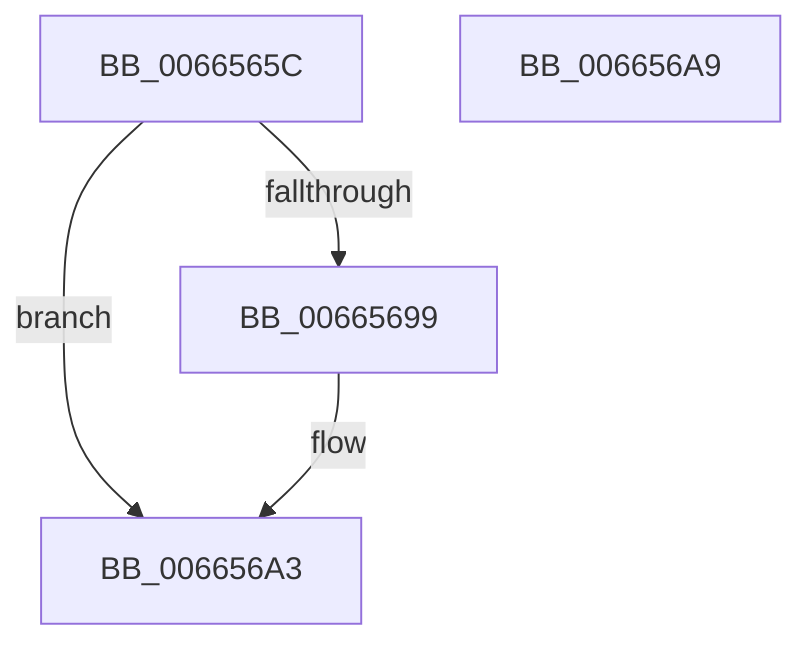

# ApiSetSchemaExpander_InsertContractEntry

- RVA: `0x0066565C`–`0x006656AA` (길이 `78` bytes)
- VA: `0x000000014066565C`
- 실행 섹션: `.text`
- PDB 이름 있음: `예`; PDB Function 태그: `아니요`
- unwind 정보 RVA: `0x00064C80`
- 디코드: `22`개 명령, `78/78` bytes 표시
- 미해석 바이트: `0` (있으면 어셈블리에 `.byte`로 보존)

> 이 문서는 커널 이미지의 기계어와 PDB 기호를 분석해 생성했습니다. 4번과 5번은 함수 원형과 자료형을 바이너리 사용 방식에서 추정한 C 해석이며 원본 소스 복구 결과는 아닙니다.

## 1. Dependencies

- 직접 호출 지점: **1**; 고유 호출 대상: **1**
- 직접 호출자로 확인된 함수: **2**
- RIP 상대 이미지 참조: **0**

### Outgoing calls
- `0x00665690` → [ApiSetpInsertHashEntry](ApiSetpInsertHashEntry_function_006662DC.md) (function, `0x006662DC`)

### Direct callers
- [ApiSetCompose_ProcessV7Extension_Phase1](ApiSetCompose_ProcessV7Extension_Phase1_function_006641BC.md) at `0x00664379`
- [ApiSetCompose_V7_ProcessV6Extension_Phase1](ApiSetCompose_V7_ProcessV6Extension_Phase1_function_00665C64.md) at `0x00665EA2`

### Static image references
- 디코드된 RIP-relative 메모리 참조가 없습니다.

## 2. Other-region calls and transfers

- 다른 실행 섹션으로 향하는 call: **0**
- 별도 외부 분기/꼬리 이동을 확인하지 못했습니다.

## 3. Assembly (complete function range)

```asm
0066565C  40 53                           push rbx
0066565E  48 83 EC 30                     sub rsp, 0x30
00665662  44 0F B7 91 AC 00 00 00         movzx r10d, word ptr [rcx + 0xac]
0066566A  48 8B D9                        mov rbx, rcx
0066566D  4C 8B CA                        mov r9, rdx
00665670  66 45 89 10                     mov word ptr [r8], r10w
00665674  45 0F B7 C2                     movzx r8d, r10w
00665678  C6 44 24 20 01                  mov byte ptr [rsp + 0x20], 1
0066567D  41 8D 42 01                     lea eax, [r10 + 1]
00665681  66 89 81 AC 00 00 00            mov word ptr [rcx + 0xac], ax
00665688  48 8B 49 20                     mov rcx, qword ptr [rcx + 0x20]
0066568C  48 8D 51 2C                     lea rdx, [rcx + 0x2c]
00665690  E8 47 0C 00 00                  call 0x1406662dc
00665695  85 C0                           test eax, eax
00665697  78 0A                           js 0x1406656a3
00665699  48 8B 43 20                     mov rax, qword ptr [rbx + 0x20]
0066569D  66 FF 40 30                     inc word ptr [rax + 0x30]
006656A1  33 C0                           xor eax, eax
006656A3  48 83 C4 30                     add rsp, 0x30
006656A7  5B                              pop rbx
006656A8  C3                              ret
006656A9  CC                              int3
```

## 4. C-style interpretation (structured pseudocode)

```c
__int64 __fastcall ApiSetSchemaExpander_InsertContractEntry(__int64 a1, __int64 a2, __int64 a3)
{
    __int64 result;
    __int64 v_rsp;
    unsigned __int8 v_stack_m18;

    v_rsp = (v_rsp) - (48);
    *(unsigned __int16 *)(a3) = (unsigned __int16)(*(unsigned __int16 *)(a1 + 172));
    v_stack_m18 = 1;
    *(unsigned __int16 *)(a1 + 172) = (unsigned __int16)(*(unsigned __int16 *)(a1 + 172) + 1);
    result = ApiSetpInsertHashEntry(*(unsigned __int64 *)(a1 + 32), *(unsigned __int64 *)(a1 + 32) + 44, (unsigned __int16)(*(unsigned __int16 *)(a1 + 172)), a2);
    if (!(sign_flag)) {
        result = *(unsigned __int64 *)(a1 + 32);
        result = 0;
    }
    v_rsp = (v_rsp) + (48);
    return result;
}
```

## 5. (Beta) C Style

```c
int64_t ApiSetSchemaExpander_InsertContractEntry(void *Arg1, int64_t Arg2, void *Arg3)
{
    uint8_t *arg1 = (uint8_t *)Arg1;
    uint8_t *arg3 = (uint8_t *)Arg3;

    int64_t result;
    int64_t local_rsp;
    uint8_t v_stack_m18;

    local_rsp = (local_rsp) - (48);
    *(uint16_t *)(arg3) = (uint16_t)(*(uint16_t *)(arg1 + 0xAC));
    v_stack_m18 = 1;
    *(uint16_t *)(arg1 + 0xAC) = (uint16_t)(*(uint16_t *)(arg1 + 0xAC) + 1);
    result = ApiSetpInsertHashEntry(*(uint64_t *)(arg1 + 0x20), *(uint64_t *)(arg1 + 0x20) + 44, (uint16_t)(*(uint16_t *)(arg1 + 0xAC)), Arg2);
    if (!(sign_flag)) {
        result = *(uint64_t *)(arg1 + 0x20);
        result = 0;
    }
    local_rsp = (local_rsp) + (48);
    return result;
}
```

### 관측된 메모리 오프셋

구조체 형식이 확인되지 않은 접근은 인자 기준의 오프셋으로만 기록했습니다.

| 기준 인자 | 오프셋 표현 | 폭 (bit) | 접근 |
|---|---:|---:|---|
| `Arg1` | `+ 0x20` | `64` | `R` |
| `Arg1` | `+ 0xAC` | `16` | `R` |
| `Arg1` | `+ 0xAC` | `16` | `W` |
| `Arg3` | `+ 0x0` | `16` | `W` |

## 6. Execution-region graph

[열기: 2D/3D 그래프와 함수 탐색 컨트롤 패널](../../../control-panel.html?section=text&rva=0x0066565C&view=graph)

- 2D 그래프는 위에서 아래로 흐르고, 3D 그래프는 빈 공간을 드래그해 회전합니다. Shift+드래그는 이동, 휠은 확대·축소, 함수 노드 선택은 대상 보고서 이동입니다.

### Static fallback


