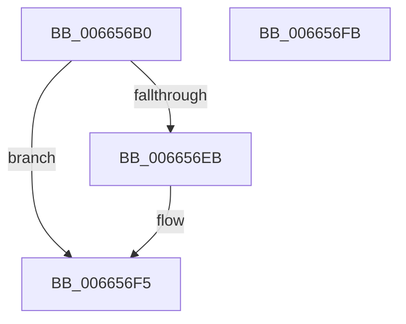

# ApiSetSchemaExpander_InsertExtensionNameEntry

- RVA: `0x006656B0`–`0x006656FC` (길이 `76` bytes)
- VA: `0x00000001406656B0`
- 실행 섹션: `.text`
- PDB 이름 있음: `예`; PDB Function 태그: `아니요`
- unwind 정보 RVA: `0x00064C80`
- 디코드: `23`개 명령, `76/76` bytes 표시
- 미해석 바이트: `0` (있으면 어셈블리에 `.byte`로 보존)

> 이 문서는 커널 이미지의 기계어와 PDB 기호를 분석해 생성했습니다. 4번과 5번은 함수 원형과 자료형을 바이너리 사용 방식에서 추정한 C 해석이며 원본 소스 복구 결과는 아닙니다.

## 1. Dependencies

- 직접 호출 지점: **1**; 고유 호출 대상: **1**
- 직접 호출자로 확인된 함수: **2**
- RIP 상대 이미지 참조: **0**

### Outgoing calls
- `0x006656E2` → [ApiSetpInsertHashEntry](ApiSetpInsertHashEntry_function_006662DC.md) (function, `0x006662DC`)

### Direct callers
- [ApiSetCompose_ProcessV7Extension_Phase1](ApiSetCompose_ProcessV7Extension_Phase1_function_006641BC.md) at `0x0066424B`
- [ApiSetCompose_V7_ProcessV6Extension_Phase1](ApiSetCompose_V7_ProcessV6Extension_Phase1_function_00665C64.md) at `0x00665D18`

### Static image references
- 디코드된 RIP-relative 메모리 참조가 없습니다.

## 2. Other-region calls and transfers

- 다른 실행 섹션으로 향하는 call: **0**
- 별도 외부 분기/꼬리 이동을 확인하지 못했습니다.

## 3. Assembly (complete function range)

```asm
006656B0  40 53                           push rbx
006656B2  48 83 EC 30                     sub rsp, 0x30
006656B6  44 0F B7 81 DC 00 00 00         movzx r8d, word ptr [rcx + 0xdc]
006656BE  48 8B D9                        mov rbx, rcx
006656C1  4C 8B CA                        mov r9, rdx
006656C4  41 8D 40 01                     lea eax, [r8 + 1]
006656C8  66 89 81 DC 00 00 00            mov word ptr [rcx + 0xdc], ax
006656CF  48 8B 49 20                     mov rcx, qword ptr [rcx + 0x20]
006656D3  8A 41 59                        mov al, byte ptr [rcx + 0x59]
006656D6  48 8D 51 50                     lea rdx, [rcx + 0x50]
006656DA  D0 E8                           shr al, 1
006656DC  24 01                           and al, 1
006656DE  88 44 24 20                     mov byte ptr [rsp + 0x20], al
006656E2  E8 F5 0B 00 00                  call 0x1406662dc
006656E7  85 C0                           test eax, eax
006656E9  78 0A                           js 0x1406656f5
006656EB  48 8B 43 20                     mov rax, qword ptr [rbx + 0x20]
006656EF  66 FF 40 54                     inc word ptr [rax + 0x54]
006656F3  33 C0                           xor eax, eax
006656F5  48 83 C4 30                     add rsp, 0x30
006656F9  5B                              pop rbx
006656FA  C3                              ret
006656FB  CC                              int3
```

## 4. C-style interpretation (structured pseudocode)

```c
__int64 __fastcall ApiSetSchemaExpander_InsertExtensionNameEntry(__int64 a1, __int64 a2)
{
    __int64 result;
    __int64 v_rsp;
    unsigned __int8 v_stack_m18;

    v_rsp = (v_rsp) - (48);
    *(unsigned __int16 *)(a1 + 220) = (unsigned __int16)(*(unsigned __int16 *)(a1 + 220) + 1);
    result = (unsigned __int8)((*(unsigned __int8 *)(*(unsigned __int64 *)(a1 + 32) + 89)) >> (1));
    result = (unsigned __int8)((result) & (1));
    v_stack_m18 = (unsigned __int8)(result);
    result = ApiSetpInsertHashEntry(*(unsigned __int64 *)(a1 + 32), *(unsigned __int64 *)(a1 + 32) + 80, *(unsigned __int16 *)(a1 + 220), a2);
    if (!(sign_flag)) {
        result = *(unsigned __int64 *)(a1 + 32);
        result = 0;
    }
    v_rsp = (v_rsp) + (48);
    return result;
}
```

## 5. (Beta) C Style

```c
int64_t ApiSetSchemaExpander_InsertExtensionNameEntry(void *Arg1, int64_t Arg2)
{
    uint8_t *arg1 = (uint8_t *)Arg1;

    int64_t result;
    int64_t local_rsp;
    uint8_t v_stack_m18;

    local_rsp = (local_rsp) - (48);
    *(uint16_t *)(arg1 + 0xDC) = (uint16_t)(*(uint16_t *)(arg1 + 0xDC) + 1);
    result = (uint8_t)((*(uint8_t *)(*(uint64_t *)(arg1 + 0x20) + 0x59)) >> (1));
    result = (uint8_t)((result) & (1));
    v_stack_m18 = (uint8_t)(result);
    result = ApiSetpInsertHashEntry(*(uint64_t *)(arg1 + 0x20), *(uint64_t *)(arg1 + 0x20) + 80, *(uint16_t *)(arg1 + 0xDC), Arg2);
    if (!(sign_flag)) {
        result = *(uint64_t *)(arg1 + 0x20);
        result = 0;
    }
    local_rsp = (local_rsp) + (48);
    return result;
}
```

### 관측된 메모리 오프셋

구조체 형식이 확인되지 않은 접근은 인자 기준의 오프셋으로만 기록했습니다.

| 기준 인자 | 오프셋 표현 | 폭 (bit) | 접근 |
|---|---:|---:|---|
| `Arg1` | `+ 0x20` | `64` | `R` |
| `Arg1` | `+ 0xDC` | `16` | `R` |
| `Arg1` | `+ 0xDC` | `16` | `W` |

## 6. Execution-region graph

[열기: 2D/3D 그래프와 함수 탐색 컨트롤 패널](../../../control-panel.html?section=text&rva=0x006656B0&view=graph)

- 2D 그래프는 위에서 아래로 흐르고, 3D 그래프는 빈 공간을 드래그해 회전합니다. Shift+드래그는 이동, 휠은 확대·축소, 함수 노드 선택은 대상 보고서 이동입니다.

### Static fallback


