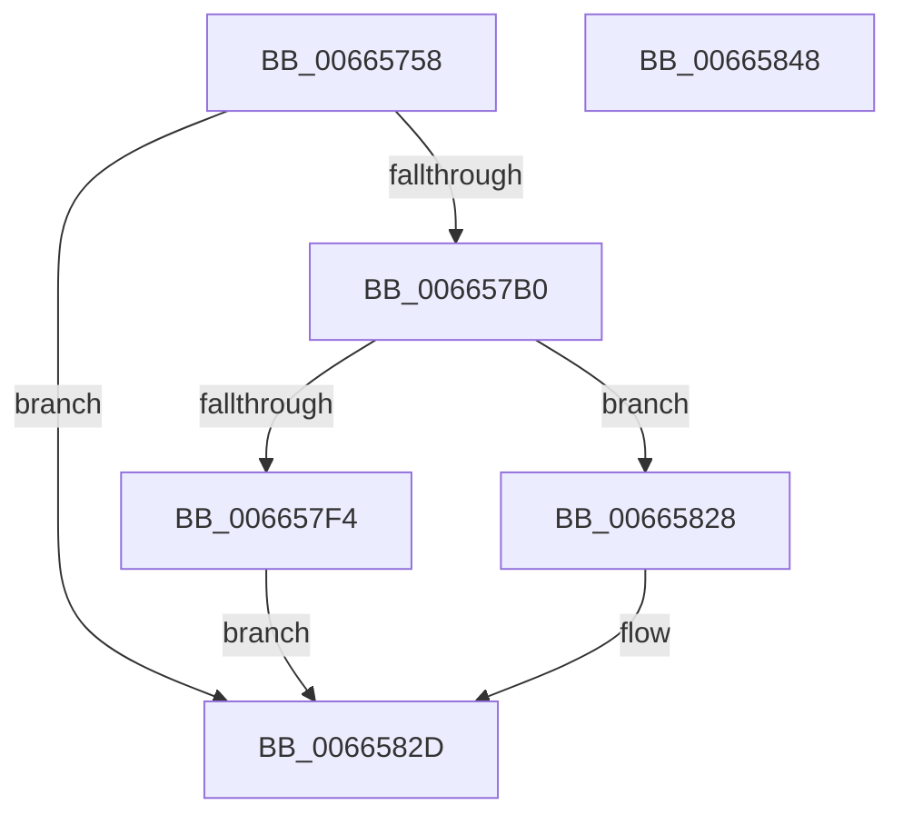

# ApiSetSchemaExpander_InsertHostEntry

- RVA: `0x00665758`–`0x00665849` (길이 `241` bytes)
- VA: `0x0000000140665758`
- 실행 섹션: `.text`
- PDB 이름 있음: `예`; PDB Function 태그: `아니요`
- unwind 정보 RVA: `0x000BDE90`
- 디코드: `67`개 명령, `241/241` bytes 표시
- 미해석 바이트: `0` (있으면 어셈블리에 `.byte`로 보존)

> 이 문서는 커널 이미지의 기계어와 PDB 기호를 분석해 생성했습니다. 4번과 5번은 함수 원형과 자료형을 바이너리 사용 방식에서 추정한 C 해석이며 원본 소스 복구 결과는 아닙니다.

## 1. Dependencies

- 직접 호출 지점: **2**; 고유 호출 대상: **2**
- 직접 호출자로 확인된 함수: **2**
- RIP 상대 이미지 참조: **0**

### Outgoing calls
- `0x006657A7` → [ApiSetpInsertHashEntry](ApiSetpInsertHashEntry_function_006662DC.md) (function, `0x006662DC`)
- `0x0066580D` → [memcpy](../6C/memcpy_function_006C6840.md) (function, `0x006C6840`)

### Direct callers
- [ApiSetCompose_ProcessV7Extension_Phase1](ApiSetCompose_ProcessV7Extension_Phase1_function_006641BC.md) at `0x006646E2`
- [ApiSetCompose_V7_ProcessV6Extension_Phase1](ApiSetCompose_V7_ProcessV6Extension_Phase1_function_00665C64.md) at `0x00665D7B`

### Static image references
- 디코드된 RIP-relative 메모리 참조가 없습니다.

## 2. Other-region calls and transfers

- 다른 실행 섹션으로 향하는 call: **0**
- 별도 외부 분기/꼬리 이동을 확인하지 못했습니다.

## 3. Assembly (complete function range)

```asm
00665758  48 8B C4                        mov rax, rsp
0066575B  48 89 58 08                     mov qword ptr [rax + 8], rbx
0066575F  48 89 70 10                     mov qword ptr [rax + 0x10], rsi
00665763  48 89 78 18                     mov qword ptr [rax + 0x18], rdi
00665767  4C 89 70 20                     mov qword ptr [rax + 0x20], r14
0066576B  41 57                           push r15
0066576D  48 83 EC 30                     sub rsp, 0x30
00665771  49 8B F8                        mov rdi, r8
00665774  4C 8B F2                        mov r14, rdx
00665777  44 0F B7 81 D0 00 00 00         movzx r8d, word ptr [rcx + 0xd0]
0066577F  48 8B D9                        mov rbx, rcx
00665782  4D 8B CE                        mov r9, r14
00665785  66 44 89 07                     mov word ptr [rdi], r8w
00665789  41 8D 40 01                     lea eax, [r8 + 1]
0066578D  66 89 81 D0 00 00 00            mov word ptr [rcx + 0xd0], ax
00665794  48 8B 49 20                     mov rcx, qword ptr [rcx + 0x20]
00665798  8A 41 65                        mov al, byte ptr [rcx + 0x65]
0066579B  48 8D 51 5C                     lea rdx, [rcx + 0x5c]
0066579F  D0 E8                           shr al, 1
006657A1  24 01                           and al, 1
006657A3  88 44 24 20                     mov byte ptr [rsp + 0x20], al
006657A7  E8 30 0B 00 00                  call 0x1406662dc
006657AC  85 C0                           test eax, eax
006657AE  78 7D                           js 0x14066582d
006657B0  48 8B 53 20                     mov rdx, qword ptr [rbx + 0x20]
006657B4  0F B7 07                        movzx eax, word ptr [rdi]
006657B7  45 0F B7 7E 12                  movzx r15d, word ptr [r14 + 0x12]
006657BC  45 8B C7                        mov r8d, r15d
006657BF  0F B6 4A 64                     movzx ecx, byte ptr [rdx + 0x64]
006657C3  4D 03 C0                        add r8, r8
006657C6  8B 7A 5C                        mov edi, dword ptr [rdx + 0x5c]
006657C9  48 0F AF C8                     imul rcx, rax
006657CD  0F B7 42 12                     movzx eax, word ptr [rdx + 0x12]
006657D1  48 2B C8                        sub rcx, rax
006657D4  48 8D 04 0A                     lea rax, [rdx + rcx]
006657D8  48 03 F8                        add rdi, rax
006657DB  66 44 89 7F 08                  mov word ptr [rdi + 8], r15w
006657E0  83 67 04 00                     and dword ptr [rdi + 4], 0
006657E4  8B 83 F0 00 00 00               mov eax, dword ptr [rbx + 0xf0]
006657EA  8B 73 58                        mov esi, dword ptr [rbx + 0x58]
006657ED  2B C6                           sub eax, esi
006657EF  4C 3B C0                        cmp r8, rax
006657F2  77 34                           ja 0x140665828
006657F4  4C 8B 4B 20                     mov r9, qword ptr [rbx + 0x20]
006657F8  49 8B 16                        mov rdx, qword ptr [r14]
006657FB  41 8B 49 24                     mov ecx, dword ptr [r9 + 0x24]
006657FF  41 0F B7 41 12                  movzx eax, word ptr [r9 + 0x12]
00665804  48 2B C8                        sub rcx, rax
00665807  49 03 C9                        add rcx, r9
0066580A  48 03 CE                        add rcx, rsi
0066580D  E8 2E 10 06 00                  call 0x1406c6840
00665812  43 8D 04 3F                     lea eax, [r15 + r15]
00665816  01 43 58                        add dword ptr [rbx + 0x58], eax
00665819  89 77 04                        mov dword ptr [rdi + 4], esi
0066581C  48 8B 43 20                     mov rax, qword ptr [rbx + 0x20]
00665820  66 FF 40 60                     inc word ptr [rax + 0x60]
00665824  33 C0                           xor eax, eax
00665826  EB 05                           jmp 0x14066582d
00665828  B8 05 00 00 80                  mov eax, 0x80000005
0066582D  48 8B 5C 24 40                  mov rbx, qword ptr [rsp + 0x40]
00665832  48 8B 74 24 48                  mov rsi, qword ptr [rsp + 0x48]
00665837  48 8B 7C 24 50                  mov rdi, qword ptr [rsp + 0x50]
0066583C  4C 8B 74 24 58                  mov r14, qword ptr [rsp + 0x58]
00665841  48 83 C4 30                     add rsp, 0x30
00665845  41 5F                           pop r15
00665847  C3                              ret
00665848  CC                              int3
```

## 4. C-style interpretation (structured pseudocode)

```c
__int64 __fastcall ApiSetSchemaExpander_InsertHostEntry(__int64 a1, __int64 a2, __int64 a3)
{
    __int64 result;
    __int64 v_rdi;
    __int64 v_rsp;
    unsigned __int8 v_stack_m18;
    unsigned __int64 v_stack_p10;
    unsigned __int64 v_stack_p18;
    unsigned __int64 v_stack_p20;
    unsigned __int64 v_stack_p8;

    *(unsigned __int64 *)(v_rsp + 8) = v_rbx;
    *(unsigned __int64 *)(v_rsp + 16) = v_rsi;
    *(unsigned __int64 *)(v_rsp + 24) = v_rdi;
    *(unsigned __int64 *)(v_rsp + 32) = v_r14;
    v_rsp = (v_rsp) - (48);
    *(unsigned __int16 *)(a3) = (unsigned __int16)(*(unsigned __int16 *)(a1 + 208));
    *(unsigned __int16 *)(a1 + 208) = (unsigned __int16)(*(unsigned __int16 *)(a1 + 208) + 1);
    result = (unsigned __int8)((*(unsigned __int8 *)(*(unsigned __int64 *)(a1 + 32) + 101)) >> (1));
    result = (unsigned __int8)((result) & (1));
    v_stack_m18 = (unsigned __int8)(result);
    result = ApiSetpInsertHashEntry(*(unsigned __int64 *)(a1 + 32), *(unsigned __int64 *)(a1 + 32) + 92, *(unsigned __int16 *)(a1 + 208), a2);
    if (sign_flag) goto loc_0066582D;
    a3 = ((unsigned int)((unsigned int)(*(unsigned __int16 *)(a2 + 18)))) + ((unsigned int)((unsigned int)(*(unsigned __int16 *)(a2 + 18))));
    a1 = (*(unsigned __int8 *)(*(unsigned __int64 *)(a1 + 32) + 100)) * (*(unsigned __int16 *)(a3));
    a1 = (a1) - (*(unsigned __int16 *)(*(unsigned __int64 *)(a1 + 32) + 18));
    v_rdi = ((unsigned int)(*(unsigned int *)(*(unsigned __int64 *)(a1 + 32) + 92))) + (*(unsigned __int64 *)(a1 + 32) + a1 * 1);
    *(unsigned __int16 *)(v_rdi + 8) = (unsigned __int16)(*(unsigned __int16 *)(a2 + 18));
    result = (unsigned int)(((unsigned int)(*(unsigned int *)(a1 + 240))) - ((unsigned int)((unsigned int)(*(unsigned int *)(a1 + 88)))));
    if (a3 > result) goto loc_00665828;
    a1 = ((unsigned int)(*(unsigned int *)(*(unsigned __int64 *)(a1 + 32) + 36))) - (*(unsigned __int16 *)(*(unsigned __int64 *)(a1 + 32) + 18));
    a1 = (a1) + (*(unsigned __int64 *)(a1 + 32));
    a1 = (a1) + ((unsigned int)(*(unsigned int *)(a1 + 88)));
    result = memcpy(a1, *(unsigned __int64 *)(a2), a3, *(unsigned __int64 *)(a1 + 32));
    *(unsigned int *)(v_rdi + 4) = (unsigned int)((unsigned int)(*(unsigned int *)(a1 + 88)));
    result = 0;
    goto loc_0066582D;
loc_00665828:
loc_0066582D:
    v_rsp = (v_rsp) + (48);
    return (unsigned int)(0x80000005ULL);
}
```

## 5. (Beta) C Style

```c
int64_t ApiSetSchemaExpander_InsertHostEntry(void *Arg1, void *Arg2, void *Arg3)
{
    uint8_t *arg1 = (uint8_t *)Arg1;
    uint8_t *arg2 = (uint8_t *)Arg2;
    uint8_t *arg3 = (uint8_t *)Arg3;

    int64_t result;
    int64_t local_rdi;
    int64_t local_rsp;
    uint8_t v_stack_m18;
    uint64_t v_stack_p10;
    uint64_t v_stack_p18;
    uint64_t v_stack_p20;
    uint64_t v_stack_p8;

    *(uint64_t *)(local_rsp + 0x8) = local_rbx;
    *(uint64_t *)(local_rsp + 0x10) = local_rsi;
    *(uint64_t *)(local_rsp + 0x18) = local_rdi;
    *(uint64_t *)(local_rsp + 0x20) = local_r14;
    local_rsp = (local_rsp) - (48);
    *(uint16_t *)(arg3) = (uint16_t)(*(uint16_t *)(arg1 + 0xD0));
    *(uint16_t *)(arg1 + 0xD0) = (uint16_t)(*(uint16_t *)(arg1 + 0xD0) + 1);
    result = (uint8_t)((*(uint8_t *)(*(uint64_t *)(arg1 + 0x20) + 0x65)) >> (1));
    result = (uint8_t)((result) & (1));
    v_stack_m18 = (uint8_t)(result);
    result = ApiSetpInsertHashEntry(*(uint64_t *)(arg1 + 0x20), *(uint64_t *)(arg1 + 0x20) + 92, *(uint16_t *)(arg1 + 0xD0), Arg2);
    if (sign_flag) goto loc_0066582D;
    Arg3 = ((uint32_t)((uint32_t)(*(uint16_t *)(arg2 + 0x12)))) + ((uint32_t)((uint32_t)(*(uint16_t *)(arg2 + 0x12))));
    Arg1 = (*(uint8_t *)(*(uint64_t *)(arg1 + 0x20) + 0x64)) * (*(uint16_t *)(arg3));
    Arg1 = (Arg1) - (*(uint16_t *)(*(uint64_t *)(arg1 + 0x20) + 0x12));
    local_rdi = ((uint32_t)(*(uint32_t *)(*(uint64_t *)(arg1 + 0x20) + 0x5C))) + (*(uint64_t *)(arg1 + 0x20) + Arg1 * 1);
    *(uint16_t *)(local_rdi + 0x8) = (uint16_t)(*(uint16_t *)(arg2 + 0x12));
    result = (uint32_t)(((uint32_t)(*(uint32_t *)(arg1 + 0xF0))) - ((uint32_t)((uint32_t)(*(uint32_t *)(arg1 + 0x58)))));
    if (Arg3 > result) goto loc_00665828;
    Arg1 = ((uint32_t)(*(uint32_t *)(*(uint64_t *)(arg1 + 0x20) + 0x24))) - (*(uint16_t *)(*(uint64_t *)(arg1 + 0x20) + 0x12));
    Arg1 = (Arg1) + (*(uint64_t *)(arg1 + 0x20));
    Arg1 = (Arg1) + ((uint32_t)(*(uint32_t *)(arg1 + 0x58)));
    result = memcpy(Arg1, *(uint64_t *)(arg2), Arg3, *(uint64_t *)(arg1 + 0x20));
    *(uint32_t *)(local_rdi + 0x4) = (uint32_t)((uint32_t)(*(uint32_t *)(arg1 + 0x58)));
    result = 0;
    goto loc_0066582D;
loc_00665828:
loc_0066582D:
    local_rsp = (local_rsp) + (48);
    return (uint32_t)(0x80000005ULL);
}
```

### 관측된 메모리 오프셋

구조체 형식이 확인되지 않은 접근은 인자 기준의 오프셋으로만 기록했습니다.

| 기준 인자 | 오프셋 표현 | 폭 (bit) | 접근 |
|---|---:|---:|---|
| `Arg1` | `+ 0x20` | `64` | `R` |
| `Arg1` | `+ 0x58` | `32` | `R` |
| `Arg1` | `+ 0x58` | `32` | `R/W` |
| `Arg1` | `+ 0xD0` | `16` | `R` |
| `Arg1` | `+ 0xD0` | `16` | `W` |
| `Arg1` | `+ 0xF0` | `32` | `R` |
| `Arg2` | `+ 0x0` | `64` | `R` |
| `Arg2` | `+ 0x12` | `16` | `R` |
| `Arg3` | `+ 0x0` | `16` | `R` |
| `Arg3` | `+ 0x0` | `16` | `W` |

## 6. Execution-region graph

[열기: 2D/3D 그래프와 함수 탐색 컨트롤 패널](../../../control-panel.html?section=text&rva=0x00665758&view=graph)

- 2D 그래프는 위에서 아래로 흐르고, 3D 그래프는 빈 공간을 드래그해 회전합니다. Shift+드래그는 이동, 휠은 확대·축소, 함수 노드 선택은 대상 보고서 이동입니다.

### Static fallback


