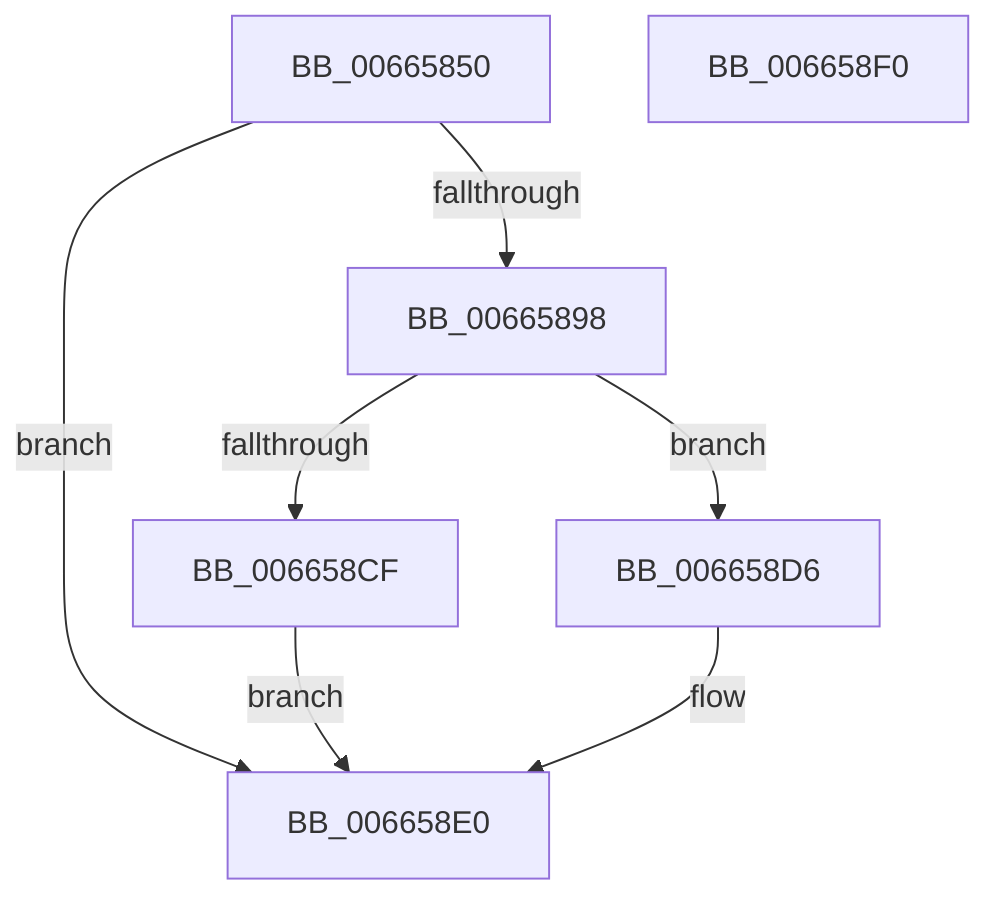

# ApiSetSchemaExpander_InsertSemverContractEntry

- RVA: `0x00665850`–`0x006658F1` (길이 `161` bytes)
- VA: `0x0000000140665850`
- 실행 섹션: `.text`
- PDB 이름 있음: `예`; PDB Function 태그: `아니요`
- unwind 정보 RVA: `0x000794E0`
- 디코드: `44`개 명령, `161/161` bytes 표시
- 미해석 바이트: `0` (있으면 어셈블리에 `.byte`로 보존)

> 이 문서는 커널 이미지의 기계어와 PDB 기호를 분석해 생성했습니다. 4번과 5번은 함수 원형과 자료형을 바이너리 사용 방식에서 추정한 C 해석이며 원본 소스 복구 결과는 아닙니다.

## 1. Dependencies

- 직접 호출 지점: **2**; 고유 호출 대상: **2**
- 직접 호출자로 확인된 함수: **2**
- RIP 상대 이미지 참조: **0**

### Outgoing calls
- `0x0066588F` → [ApiSetpInsertHashEntry](ApiSetpInsertHashEntry_function_006662DC.md) (function, `0x006662DC`)
- `0x006658C6` → [ApiSetpGetSemverKeyVersions](ApiSetpGetSemverKeyVersions_function_0066508C.md) (function, `0x0066508C`)

### Direct callers
- [ApiSetCompose_ProcessV7Extension_Phase1](ApiSetCompose_ProcessV7Extension_Phase1_function_006641BC.md) at `0x00664544`
- [ApiSetCompose_V7_ProcessV6Extension_Phase1](ApiSetCompose_V7_ProcessV6Extension_Phase1_function_00665C64.md) at `0x00665F50`

### Static image references
- 디코드된 RIP-relative 메모리 참조가 없습니다.

## 2. Other-region calls and transfers

- 다른 실행 섹션으로 향하는 call: **0**
- 별도 외부 분기/꼬리 이동을 확인하지 못했습니다.

## 3. Assembly (complete function range)

```asm
00665850  48 89 5C 24 08                  mov qword ptr [rsp + 8], rbx
00665855  48 89 74 24 10                  mov qword ptr [rsp + 0x10], rsi
0066585A  57                              push rdi
0066585B  48 83 EC 30                     sub rsp, 0x30
0066585F  49 8B F8                        mov rdi, r8
00665862  C6 44 24 20 00                  mov byte ptr [rsp + 0x20], 0
00665867  44 0F B7 81 C4 00 00 00         movzx r8d, word ptr [rcx + 0xc4]
0066586F  48 8B F2                        mov rsi, rdx
00665872  48 8B D9                        mov rbx, rcx
00665875  4C 8B CE                        mov r9, rsi
00665878  66 44 89 07                     mov word ptr [rdi], r8w
0066587C  41 8D 40 01                     lea eax, [r8 + 1]
00665880  66 89 81 C4 00 00 00            mov word ptr [rcx + 0xc4], ax
00665887  48 8B 49 20                     mov rcx, qword ptr [rcx + 0x20]
0066588B  48 8D 51 44                     lea rdx, [rcx + 0x44]
0066588F  E8 48 0A 00 00                  call 0x1406662dc
00665894  85 C0                           test eax, eax
00665896  78 48                           js 0x1406658e0
00665898  4C 8B 43 20                     mov r8, qword ptr [rbx + 0x20]
0066589C  0F B7 07                        movzx eax, word ptr [rdi]
0066589F  41 0F B6 48 4C                  movzx ecx, byte ptr [r8 + 0x4c]
006658A4  41 8B 50 44                     mov edx, dword ptr [r8 + 0x44]
006658A8  48 0F AF C8                     imul rcx, rax
006658AC  41 0F B7 40 12                  movzx eax, word ptr [r8 + 0x12]
006658B1  48 2B C8                        sub rcx, rax
006658B4  49 8D 04 08                     lea rax, [r8 + rcx]
006658B8  48 8B CE                        mov rcx, rsi
006658BB  48 03 D0                        add rdx, rax
006658BE  4C 8D 42 09                     lea r8, [rdx + 9]
006658C2  48 83 C2 08                     add rdx, 8
006658C6  E8 C1 F7 FF FF                  call 0x14066508c
006658CB  84 C0                           test al, al
006658CD  75 07                           jne 0x1406658d6
006658CF  B8 0D 00 00 C0                  mov eax, 0xc000000d
006658D4  EB 0A                           jmp 0x1406658e0
006658D6  48 8B 43 20                     mov rax, qword ptr [rbx + 0x20]
006658DA  66 FF 40 48                     inc word ptr [rax + 0x48]
006658DE  33 C0                           xor eax, eax
006658E0  48 8B 5C 24 40                  mov rbx, qword ptr [rsp + 0x40]
006658E5  48 8B 74 24 48                  mov rsi, qword ptr [rsp + 0x48]
006658EA  48 83 C4 30                     add rsp, 0x30
006658EE  5F                              pop rdi
006658EF  C3                              ret
006658F0  CC                              int3
```

## 4. C-style interpretation (structured pseudocode)

```c
__int64 __fastcall ApiSetSchemaExpander_InsertSemverContractEntry(__int64 a1, __int64 a2, __int64 a3)
{
    __int64 result;
    __int64 v_rsp;
    unsigned __int8 v_stack_m18;
    unsigned __int64 v_stack_p10;
    unsigned __int64 v_stack_p8;

    v_stack_p8 = v_rbx;
    v_stack_p10 = v_rsi;
    v_rsp = (v_rsp) - (48);
    v_stack_m18 = 0;
    *(unsigned __int16 *)(a3) = (unsigned __int16)(*(unsigned __int16 *)(a1 + 196));
    *(unsigned __int16 *)(a1 + 196) = (unsigned __int16)(*(unsigned __int16 *)(a1 + 196) + 1);
    result = ApiSetpInsertHashEntry(*(unsigned __int64 *)(a1 + 32), *(unsigned __int64 *)(a1 + 32) + 68, *(unsigned __int16 *)(a1 + 196), a2);
    if (sign_flag) goto loc_006658E0;
    a1 = (*(unsigned __int8 *)(*(unsigned __int64 *)(a1 + 32) + 76)) * (*(unsigned __int16 *)(a3));
    a1 = (a1) - (*(unsigned __int16 *)(*(unsigned __int64 *)(a1 + 32) + 18));
    a2 = ((unsigned int)(*(unsigned int *)(*(unsigned __int64 *)(a1 + 32) + 68))) + (*(unsigned __int64 *)(a1 + 32) + a1 * 1);
    a2 = (a2) + (8);
    result = ApiSetpGetSemverKeyVersions(a2, a2, a2 + 9, a2);
    if ((unsigned __int8)(result) != 0) goto loc_006658D6;
    goto loc_006658E0;
loc_006658D6:
    result = 0;
loc_006658E0:
    v_rsp = (v_rsp) + (48);
    return result;
}
```

## 5. (Beta) C Style

```c
int64_t ApiSetSchemaExpander_InsertSemverContractEntry(void *Arg1, int64_t Arg2, void *Arg3)
{
    uint8_t *arg1 = (uint8_t *)Arg1;
    uint8_t *arg3 = (uint8_t *)Arg3;

    int64_t result;
    int64_t local_rsp;
    uint8_t v_stack_m18;
    uint64_t v_stack_p10;
    uint64_t v_stack_p8;

    v_stack_p8 = local_rbx;
    v_stack_p10 = local_rsi;
    local_rsp = (local_rsp) - (48);
    v_stack_m18 = 0;
    *(uint16_t *)(arg3) = (uint16_t)(*(uint16_t *)(arg1 + 0xC4));
    *(uint16_t *)(arg1 + 0xC4) = (uint16_t)(*(uint16_t *)(arg1 + 0xC4) + 1);
    result = ApiSetpInsertHashEntry(*(uint64_t *)(arg1 + 0x20), *(uint64_t *)(arg1 + 0x20) + 68, *(uint16_t *)(arg1 + 0xC4), Arg2);
    if (sign_flag) goto loc_006658E0;
    Arg1 = (*(uint8_t *)(*(uint64_t *)(arg1 + 0x20) + 0x4C)) * (*(uint16_t *)(arg3));
    Arg1 = (Arg1) - (*(uint16_t *)(*(uint64_t *)(arg1 + 0x20) + 0x12));
    Arg2 = ((uint32_t)(*(uint32_t *)(*(uint64_t *)(arg1 + 0x20) + 0x44))) + (*(uint64_t *)(arg1 + 0x20) + Arg1 * 1);
    Arg2 = (Arg2) + (8);
    result = ApiSetpGetSemverKeyVersions(Arg2, Arg2, Arg2 + 9, Arg2);
    if ((uint8_t)(result) != 0) goto loc_006658D6;
    goto loc_006658E0;
loc_006658D6:
    result = 0;
loc_006658E0:
    local_rsp = (local_rsp) + (48);
    return result;
}
```

### 관측된 메모리 오프셋

구조체 형식이 확인되지 않은 접근은 인자 기준의 오프셋으로만 기록했습니다.

| 기준 인자 | 오프셋 표현 | 폭 (bit) | 접근 |
|---|---:|---:|---|
| `Arg1` | `+ 0x20` | `64` | `R` |
| `Arg1` | `+ 0xC4` | `16` | `R` |
| `Arg1` | `+ 0xC4` | `16` | `W` |
| `Arg3` | `+ 0x0` | `16` | `R` |
| `Arg3` | `+ 0x0` | `16` | `W` |

## 6. Execution-region graph

[열기: 2D/3D 그래프와 함수 탐색 컨트롤 패널](../../../control-panel.html?section=text&rva=0x00665850&view=graph)

- 2D 그래프는 위에서 아래로 흐르고, 3D 그래프는 빈 공간을 드래그해 회전합니다. Shift+드래그는 이동, 휠은 확대·축소, 함수 노드 선택은 대상 보고서 이동입니다.

### Static fallback


