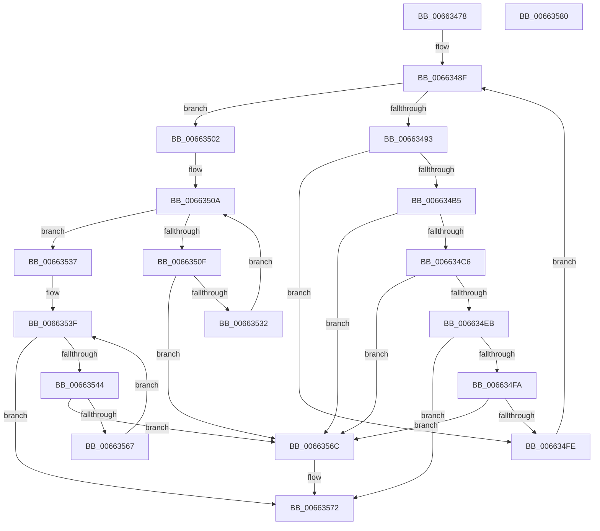

# ApiSetValidateSchemaElements_V7

- RVA: `0x00663478`–`0x00663581` (길이 `265` bytes)
- VA: `0x0000000140663478`
- 실행 섹션: `.text`
- PDB 이름 있음: `예`; PDB Function 태그: `아니요`
- unwind 정보 RVA: `0x000950EC`
- 디코드: `73`개 명령, `265/265` bytes 표시
- 미해석 바이트: `0` (있으면 어셈블리에 `.byte`로 보존)

> 이 문서는 커널 이미지의 기계어와 PDB 기호를 분석해 생성했습니다. 4번과 5번은 함수 원형과 자료형을 바이너리 사용 방식에서 추정한 C 해석이며 원본 소스 복구 결과는 아닙니다.

## 1. Dependencies

- 직접 호출 지점: **0**; 고유 호출 대상: **0**
- 직접 호출자로 확인된 함수: **2**
- RIP 상대 이미지 참조: **0**

### Outgoing calls
- 직접 디코드된 call 명령이 없습니다.

### Direct callers
- [ApiSetValidateSchemaFormat_V7](ApiSetValidateSchemaFormat_V7_function_006636E8.md) at `0x00663719`
- [ApiSetComposeSchema_V7](ApiSetComposeSchema_V7_function_00663CCC.md) at `0x00663E68`

### Static image references
- 디코드된 RIP-relative 메모리 참조가 없습니다.

## 2. Other-region calls and transfers

- 다른 실행 섹션으로 향하는 call: **0**
- 별도 외부 분기/꼬리 이동을 확인하지 못했습니다.

## 3. Assembly (complete function range)

```asm
00663478  48 89 5C 24 08                  mov qword ptr [rsp + 8], rbx
0066347D  48 89 7C 24 10                  mov qword ptr [rsp + 0x10], rdi
00663482  0F B7 59 30                     movzx ebx, word ptr [rcx + 0x30]
00663486  45 33 C0                        xor r8d, r8d
00663489  41 8B D0                        mov edx, r8d
0066348C  4C 8B C9                        mov r9, rcx
0066348F  3B D3                           cmp edx, ebx
00663491  73 6F                           jae 0x140663502
00663493  41 0F B6 49 34                  movzx ecx, byte ptr [r9 + 0x34]
00663498  45 0F B7 59 12                  movzx r11d, word ptr [r9 + 0x12]
0066349D  45 8B 51 2C                     mov r10d, dword ptr [r9 + 0x2c]
006634A1  8B C2                           mov eax, edx
006634A3  48 0F AF C1                     imul rax, rcx
006634A7  49 2B C3                        sub rax, r11
006634AA  49 03 C1                        add rax, r9
006634AD  41 F6 44 02 0A 02               test byte ptr [r10 + rax + 0xa], 2
006634B3  74 49                           je 0x1406634fe
006634B5  41 0F B7 44 02 04               movzx eax, word ptr [r10 + rax + 4]
006634BB  66 41 3B 41 60                  cmp ax, word ptr [r9 + 0x60]
006634C0  0F 83 A6 00 00 00               jae 0x14066356c
006634C6  41 0F B6 49 64                  movzx ecx, byte ptr [r9 + 0x64]
006634CB  45 8B 51 5C                     mov r10d, dword ptr [r9 + 0x5c]
006634CF  41 8B 79 28                     mov edi, dword ptr [r9 + 0x28]
006634D3  48 0F AF C1                     imul rax, rcx
006634D7  49 2B C3                        sub rax, r11
006634DA  49 03 C1                        add rax, r9
006634DD  45 8B 5C 02 04                  mov r11d, dword ptr [r10 + rax + 4]
006634E2  44 3B DF                        cmp r11d, edi
006634E5  0F 87 81 00 00 00               ja 0x14066356c
006634EB  41 0F B7 44 02 08               movzx eax, word ptr [r10 + rax + 8]
006634F1  41 8D 0C 43                     lea ecx, [r11 + rax*2]
006634F5  41 3B CB                        cmp ecx, r11d
006634F8  72 78                           jb 0x140663572
006634FA  3B CF                           cmp ecx, edi
006634FC  77 6E                           ja 0x14066356c
006634FE  FF C2                           inc edx
00663500  EB 8D                           jmp 0x14066348f
00663502  45 0F B7 59 3C                  movzx r11d, word ptr [r9 + 0x3c]
00663507  45 8B D0                        mov r10d, r8d
0066350A  45 3B D3                        cmp r10d, r11d
0066350D  73 28                           jae 0x140663537
0066350F  41 0F B6 51 40                  movzx edx, byte ptr [r9 + 0x40]
00663514  41 8B 49 38                     mov ecx, dword ptr [r9 + 0x38]
00663518  41 8B C2                        mov eax, r10d
0066351B  48 0F AF D0                     imul rdx, rax
0066351F  41 0F B7 41 12                  movzx eax, word ptr [r9 + 0x12]
00663524  48 2B D0                        sub rdx, rax
00663527  49 8D 04 11                     lea rax, [r9 + rdx]
0066352B  66 39 5C 01 04                  cmp word ptr [rcx + rax + 4], bx
00663530  73 3A                           jae 0x14066356c
00663532  41 FF C2                        inc r10d
00663535  EB D3                           jmp 0x14066350a
00663537  45 0F B7 59 48                  movzx r11d, word ptr [r9 + 0x48]
0066353C  45 8B D0                        mov r10d, r8d
0066353F  45 3B D3                        cmp r10d, r11d
00663542  73 2E                           jae 0x140663572
00663544  41 0F B6 51 4C                  movzx edx, byte ptr [r9 + 0x4c]
00663549  41 8B 49 44                     mov ecx, dword ptr [r9 + 0x44]
0066354D  41 8B C2                        mov eax, r10d
00663550  48 0F AF D0                     imul rdx, rax
00663554  41 0F B7 41 12                  movzx eax, word ptr [r9 + 0x12]
00663559  48 2B D0                        sub rdx, rax
0066355C  49 8D 04 11                     lea rax, [r9 + rdx]
00663560  66 39 5C 01 04                  cmp word ptr [rcx + rax + 4], bx
00663565  73 05                           jae 0x14066356c
00663567  41 FF C2                        inc r10d
0066356A  EB D3                           jmp 0x14066353f
0066356C  41 B8 E4 00 00 C0               mov r8d, 0xc00000e4
00663572  48 8B 5C 24 08                  mov rbx, qword ptr [rsp + 8]
00663577  41 8B C0                        mov eax, r8d
0066357A  48 8B 7C 24 10                  mov rdi, qword ptr [rsp + 0x10]
0066357F  C3                              ret
00663580  CC                              int3
```

## 4. C-style interpretation (structured pseudocode)

```c
__int64 __fastcall ApiSetValidateSchemaElements_V7(__int64 a1, __int64 a2, int a3)
{
    __int64 result;
    __int64 v_r10;
    unsigned __int64 v_stack_p10;
    unsigned __int64 v_stack_p8;

    v_stack_p8 = v_rbx;
    v_stack_p10 = v_rdi;
    a3 = 0;
loc_0066348F:
    if (0 >= ((unsigned int)(*(unsigned __int16 *)(a1 + 48)))) goto loc_00663502;
    result = (0) * (*(unsigned __int8 *)(a1 + 52));
    result = (result) - (*(unsigned __int16 *)(a1 + 18));
    result = (result) + (a1);
    if (((*(unsigned __int8 *)((unsigned int)(*(unsigned int *)(a1 + 44)) + result * 1 + 10)) & (2)) == 0) goto loc_006634FE;
    if (((unsigned __int16)(*(unsigned __int16 *)((unsigned int)(*(unsigned int *)(a1 + 44)) + result * 1 + 4))) >= (*(unsigned __int16 *)(a1 + 96))) goto loc_0066356C;
    result = (*(unsigned __int16 *)((unsigned int)(*(unsigned int *)(a1 + 44)) + result * 1 + 4)) * (*(unsigned __int8 *)(a1 + 100));
    result = (result) - (*(unsigned __int16 *)(a1 + 18));
    result = (result) + (a1);
    if (((unsigned int)((unsigned int)(*(unsigned int *)((unsigned int)(*(unsigned int *)(a1 + 92)) + result * 1 + 4)))) > ((unsigned int)((unsigned int)(*(unsigned int *)(a1 + 40))))) goto loc_0066356C;
    if (((unsigned int)((unsigned int)(*(unsigned int *)((unsigned int)(*(unsigned int *)(a1 + 92)) + result * 1 + 4)) + *(unsigned __int16 *)((unsigned int)(*(unsigned int *)(a1 + 92)) + result * 1 + 8) * 2)) < ((unsigned int)((unsigned int)(*(unsigned int *)((unsigned int)(*(unsigned int *)(a1 + 92)) + result * 1 + 4))))) goto loc_00663572;
    if (((unsigned int)((unsigned int)(*(unsigned int *)((unsigned int)(*(unsigned int *)(a1 + 92)) + result * 1 + 4)) + *(unsigned __int16 *)((unsigned int)(*(unsigned int *)(a1 + 92)) + result * 1 + 8) * 2)) > ((unsigned int)((unsigned int)(*(unsigned int *)(a1 + 40))))) goto loc_0066356C;
loc_006634FE:
    a2 = (unsigned int)((0) + 1);
    goto loc_0066348F;
loc_00663502:
loc_0066350A:
    if (0 >= ((unsigned int)(*(unsigned __int16 *)(a1 + 60)))) goto loc_00663537;
    a2 = (*(unsigned __int8 *)(a1 + 64)) * (0);
    a2 = (a2) - (*(unsigned __int16 *)(a1 + 18));
    if ((*(unsigned __int16 *)((unsigned int)(*(unsigned int *)(a1 + 56)) + a1 + a2 * 1 * 1 + 4)) >= ((unsigned __int16)(*(unsigned __int16 *)(a1 + 48)))) goto loc_0066356C;
    v_r10 = (unsigned int)((0) + 1);
    goto loc_0066350A;
loc_00663537:
loc_0066353F:
    if (0 >= ((unsigned int)(*(unsigned __int16 *)(a1 + 72)))) goto loc_00663572;
    a2 = (*(unsigned __int8 *)(a1 + 76)) * (0);
    a2 = (a2) - (*(unsigned __int16 *)(a1 + 18));
    if ((*(unsigned __int16 *)((unsigned int)(*(unsigned int *)(a1 + 68)) + a1 + a2 * 1 * 1 + 4)) >= ((unsigned __int16)(*(unsigned __int16 *)(a1 + 48)))) goto loc_0066356C;
    v_r10 = (unsigned int)((0) + 1);
    goto loc_0066353F;
loc_0066356C:
loc_00663572:
    return (unsigned int)((unsigned int)((unsigned int)(0xC00000E4ULL)));
}
```

## 5. (Beta) C Style

```c
int64_t ApiSetValidateSchemaElements_V7(void *Arg1, int64_t Arg2, int32_t Arg3)
{
    uint8_t *arg1 = (uint8_t *)Arg1;

    int64_t result;
    int64_t local_r10;
    uint64_t v_stack_p10;
    uint64_t v_stack_p8;

    v_stack_p8 = local_rbx;
    v_stack_p10 = local_rdi;
    Arg3 = 0;
loc_0066348F:
    if (0 >= ((uint32_t)(*(uint16_t *)(arg1 + 0x30)))) goto loc_00663502;
    result = (0) * (*(uint8_t *)(arg1 + 0x34));
    result = (result) - (*(uint16_t *)(arg1 + 0x12));
    result = (result) + (Arg1);
    if (((*(uint8_t *)((uint32_t)(*(uint32_t *)(arg1 + 0x2C)) + result * 1 + 0xA)) & (2)) == 0) goto loc_006634FE;
    if (((uint16_t)(*(uint16_t *)((uint32_t)(*(uint32_t *)(arg1 + 0x2C)) + result * 1 + 0x4))) >= (*(uint16_t *)(arg1 + 0x60))) goto loc_0066356C;
    result = (*(uint16_t *)((uint32_t)(*(uint32_t *)(arg1 + 0x2C)) + result * 1 + 0x4)) * (*(uint8_t *)(arg1 + 0x64));
    result = (result) - (*(uint16_t *)(arg1 + 0x12));
    result = (result) + (Arg1);
    if (((uint32_t)((uint32_t)(*(uint32_t *)((uint32_t)(*(uint32_t *)(arg1 + 0x5C)) + result * 1 + 0x4)))) > ((uint32_t)((uint32_t)(*(uint32_t *)(arg1 + 0x28))))) goto loc_0066356C;
    if (((uint32_t)((uint32_t)(*(uint32_t *)((uint32_t)(*(uint32_t *)(arg1 + 0x5C)) + result * 1 + 0x4)) + *(uint16_t *)((uint32_t)(*(uint32_t *)(arg1 + 0x5C)) + result * 1 + 0x8) * 2)) < ((uint32_t)((uint32_t)(*(uint32_t *)((uint32_t)(*(uint32_t *)(arg1 + 0x5C)) + result * 1 + 0x4))))) goto loc_00663572;
    if (((uint32_t)((uint32_t)(*(uint32_t *)((uint32_t)(*(uint32_t *)(arg1 + 0x5C)) + result * 1 + 0x4)) + *(uint16_t *)((uint32_t)(*(uint32_t *)(arg1 + 0x5C)) + result * 1 + 0x8) * 2)) > ((uint32_t)((uint32_t)(*(uint32_t *)(arg1 + 0x28))))) goto loc_0066356C;
loc_006634FE:
    Arg2 = (uint32_t)((0) + 1);
    goto loc_0066348F;
loc_00663502:
loc_0066350A:
    if (0 >= ((uint32_t)(*(uint16_t *)(arg1 + 0x3C)))) goto loc_00663537;
    Arg2 = (*(uint8_t *)(arg1 + 0x40)) * (0);
    Arg2 = (Arg2) - (*(uint16_t *)(arg1 + 0x12));
    if ((*(uint16_t *)((uint32_t)(*(uint32_t *)(arg1 + 0x38)) + arg1 + Arg2 * 1 * 1 + 0x4)) >= ((uint16_t)(*(uint16_t *)(arg1 + 0x30)))) goto loc_0066356C;
    local_r10 = (uint32_t)((0) + 1);
    goto loc_0066350A;
loc_00663537:
loc_0066353F:
    if (0 >= ((uint32_t)(*(uint16_t *)(arg1 + 0x48)))) goto loc_00663572;
    Arg2 = (*(uint8_t *)(arg1 + 0x4C)) * (0);
    Arg2 = (Arg2) - (*(uint16_t *)(arg1 + 0x12));
    if ((*(uint16_t *)((uint32_t)(*(uint32_t *)(arg1 + 0x44)) + arg1 + Arg2 * 1 * 1 + 0x4)) >= ((uint16_t)(*(uint16_t *)(arg1 + 0x30)))) goto loc_0066356C;
    local_r10 = (uint32_t)((0) + 1);
    goto loc_0066353F;
loc_0066356C:
loc_00663572:
    return (uint32_t)((uint32_t)((uint32_t)(0xC00000E4ULL)));
}
```

### 관측된 메모리 오프셋

구조체 형식이 확인되지 않은 접근은 인자 기준의 오프셋으로만 기록했습니다.

| 기준 인자 | 오프셋 표현 | 폭 (bit) | 접근 |
|---|---:|---:|---|
| `Arg1` | `+ 0x0 + rdx*1` | `64` | `R` |
| `Arg1` | `+ 0x12` | `16` | `R` |
| `Arg1` | `+ 0x28` | `32` | `R` |
| `Arg1` | `+ 0x2C` | `32` | `R` |
| `Arg1` | `+ 0x30` | `16` | `R` |
| `Arg1` | `+ 0x34` | `8` | `R` |
| `Arg1` | `+ 0x38` | `32` | `R` |
| `Arg1` | `+ 0x3C` | `16` | `R` |
| `Arg1` | `+ 0x40` | `8` | `R` |
| `Arg1` | `+ 0x44` | `32` | `R` |
| `Arg1` | `+ 0x48` | `16` | `R` |
| `Arg1` | `+ 0x4C` | `8` | `R` |
| `Arg1` | `+ 0x5C` | `32` | `R` |
| `Arg1` | `+ 0x60` | `16` | `R` |
| `Arg1` | `+ 0x64` | `8` | `R` |

## 6. Execution-region graph

[열기: 2D/3D 그래프와 함수 탐색 컨트롤 패널](../../../control-panel.html?section=text&rva=0x00663478&view=graph)

- 2D 그래프는 위에서 아래로 흐르고, 3D 그래프는 빈 공간을 드래그해 회전합니다. Shift+드래그는 이동, 휠은 확대·축소, 함수 노드 선택은 대상 보고서 이동입니다.

### Static fallback


