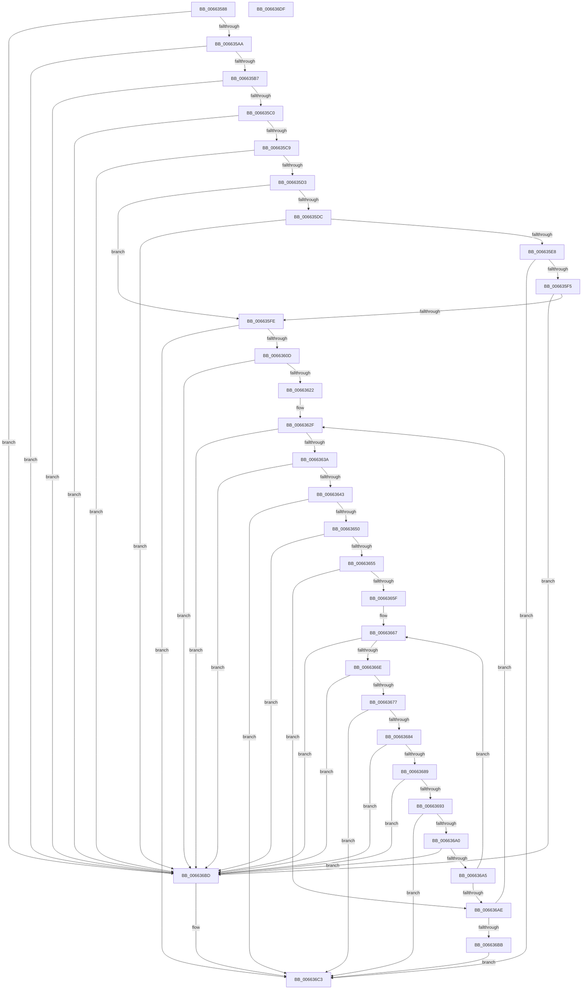

# ApiSetValidateSchemaExtensionFormat_V7

- RVA: `0x00663588`–`0x006636E0` (길이 `344` bytes)
- VA: `0x0000000140663588`
- 실행 섹션: `.text`
- PDB 이름 있음: `예`; PDB Function 태그: `아니요`
- unwind 정보 RVA: `0x000BE9E8`
- 디코드: `96`개 명령, `344/344` bytes 표시
- 미해석 바이트: `0` (있으면 어셈블리에 `.byte`로 보존)

> 이 문서는 커널 이미지의 기계어와 PDB 기호를 분석해 생성했습니다. 4번과 5번은 함수 원형과 자료형을 바이너리 사용 방식에서 추정한 C 해석이며 원본 소스 복구 결과는 아닙니다.

## 1. Dependencies

- 직접 호출 지점: **0**; 고유 호출 대상: **0**
- 직접 호출자로 확인된 함수: **1**
- RIP 상대 이미지 참조: **0**

### Outgoing calls
- 직접 디코드된 call 명령이 없습니다.

### Direct callers
- [ApiSetValidateSchemaFormat](ApiSetValidateSchemaFormat_function_0066228C.md) at `0x006622B6`

### Static image references
- 디코드된 RIP-relative 메모리 참조가 없습니다.

## 2. Other-region calls and transfers

- 다른 실행 섹션으로 향하는 call: **0**
- 별도 외부 분기/꼬리 이동을 확인하지 못했습니다.

## 3. Assembly (complete function range)

```asm
00663588  48 8B C4                        mov rax, rsp
0066358B  48 89 58 08                     mov qword ptr [rax + 8], rbx
0066358F  48 89 68 10                     mov qword ptr [rax + 0x10], rbp
00663593  48 89 70 18                     mov qword ptr [rax + 0x18], rsi
00663597  48 89 78 20                     mov qword ptr [rax + 0x20], rdi
0066359B  41 56                           push r14
0066359D  41 57                           push r15
0066359F  45 33 C0                        xor r8d, r8d
006635A2  85 D2                           test edx, edx
006635A4  0F 84 13 01 00 00               je 0x1406636bd
006635AA  44 8B 49 04                     mov r9d, dword ptr [rcx + 4]
006635AE  45 85 C9                        test r9d, r9d
006635B1  0F 84 06 01 00 00               je 0x1406636bd
006635B7  44 3B CA                        cmp r9d, edx
006635BA  0F 87 FD 00 00 00               ja 0x1406636bd
006635C0  83 FA 14                        cmp edx, 0x14
006635C3  0F 82 F4 00 00 00               jb 0x1406636bd
006635C9  41 83 F9 14                     cmp r9d, 0x14
006635CD  0F 82 EA 00 00 00               jb 0x1406636bd
006635D3  0F B7 41 10                     movzx eax, word ptr [rcx + 0x10]
006635D7  66 85 C0                        test ax, ax
006635DA  74 22                           je 0x1406635fe
006635DC  8B 51 08                        mov edx, dword ptr [rcx + 8]
006635DF  41 3B D1                        cmp edx, r9d
006635E2  0F 87 D5 00 00 00               ja 0x1406636bd
006635E8  44 8D 14 02                     lea r10d, [rdx + rax]
006635EC  44 3B D2                        cmp r10d, edx
006635EF  0F 82 CE 00 00 00               jb 0x1406636c3
006635F5  45 3B D1                        cmp r10d, r9d
006635F8  0F 87 BF 00 00 00               ja 0x1406636bd
006635FE  44 0F B7 59 12                  movzx r11d, word ptr [rcx + 0x12]
00663603  66 45 85 DB                     test r11w, r11w
00663607  0F 84 B6 00 00 00               je 0x1406636c3
0066360D  49 8D 43 01                     lea rax, [r11 + 1]
00663611  48 8D 04 80                     lea rax, [rax + rax*4]
00663615  48 C1 E0 02                     shl rax, 2
00663619  49 3B C1                        cmp rax, r9
0066361C  0F 87 9B 00 00 00               ja 0x1406636bd
00663622  8B 79 0C                        mov edi, dword ptr [rcx + 0xc]
00663625  4D 8D 71 EC                     lea r14, [r9 - 0x14]
00663629  41 BF FF FF 00 00               mov r15d, 0xffff
0066362F  8B D7                           mov edx, edi
00663631  49 3B D6                        cmp rdx, r14
00663634  0F 87 83 00 00 00               ja 0x1406636bd
0066363A  44 8B 14 0A                     mov r10d, dword ptr [rdx + rcx]
0066363E  45 3B D1                        cmp r10d, r9d
00663641  77 7A                           ja 0x1406636bd
00663643  0F B7 44 0A 08                  movzx eax, word ptr [rdx + rcx + 8]
00663648  41 03 C2                        add eax, r10d
0066364B  41 3B C2                        cmp eax, r10d
0066364E  72 73                           jb 0x1406636c3
00663650  41 3B C1                        cmp eax, r9d
00663653  77 68                           ja 0x1406636bd
00663655  0F B7 5C 0A 0A                  movzx ebx, word ptr [rdx + rcx + 0xa]
0066365A  66 85 DB                        test bx, bx
0066365D  74 4F                           je 0x1406636ae
0066365F  8B 74 0A 04                     mov esi, dword ptr [rdx + rcx + 4]
00663663  49 8D 69 F0                     lea rbp, [r9 - 0x10]
00663667  8B D6                           mov edx, esi
00663669  48 3B D5                        cmp rdx, rbp
0066366C  77 4F                           ja 0x1406636bd
0066366E  44 8B 14 0A                     mov r10d, dword ptr [rdx + rcx]
00663672  45 3B D1                        cmp r10d, r9d
00663675  77 46                           ja 0x1406636bd
00663677  0F B7 44 0A 08                  movzx eax, word ptr [rdx + rcx + 8]
0066367C  41 03 C2                        add eax, r10d
0066367F  41 3B C2                        cmp eax, r10d
00663682  72 3F                           jb 0x1406636c3
00663684  41 3B C1                        cmp eax, r9d
00663687  77 34                           ja 0x1406636bd
00663689  44 8B 54 0A 04                  mov r10d, dword ptr [rdx + rcx + 4]
0066368E  45 3B D1                        cmp r10d, r9d
00663691  77 2A                           ja 0x1406636bd
00663693  0F B7 54 0A 0A                  movzx edx, word ptr [rdx + rcx + 0xa]
00663698  41 03 D2                        add edx, r10d
0066369B  41 3B D2                        cmp edx, r10d
0066369E  72 23                           jb 0x1406636c3
006636A0  41 3B D1                        cmp edx, r9d
006636A3  77 18                           ja 0x1406636bd
006636A5  83 C6 10                        add esi, 0x10
006636A8  66 41 03 DF                     add bx, r15w
006636AC  75 B9                           jne 0x140663667
006636AE  83 C7 14                        add edi, 0x14
006636B1  66 45 03 DF                     add r11w, r15w
006636B5  0F 85 74 FF FF FF               jne 0x14066362f
006636BB  EB 06                           jmp 0x1406636c3
006636BD  41 B8 E4 00 00 C0               mov r8d, 0xc00000e4
006636C3  48 8B 5C 24 18                  mov rbx, qword ptr [rsp + 0x18]
006636C8  41 8B C0                        mov eax, r8d
006636CB  48 8B 6C 24 20                  mov rbp, qword ptr [rsp + 0x20]
006636D0  48 8B 74 24 28                  mov rsi, qword ptr [rsp + 0x28]
006636D5  48 8B 7C 24 30                  mov rdi, qword ptr [rsp + 0x30]
006636DA  41 5F                           pop r15
006636DC  41 5E                           pop r14
006636DE  C3                              ret
006636DF  CC                              int3
```

## 4. C-style interpretation (structured pseudocode)

```c
__int64 __fastcall ApiSetValidateSchemaExtensionFormat_V7(__int64 a1, int a2, int a3)
{
    __int64 result;
    __int64 v_r11;
    __int64 v_rbx;
    __int64 v_rdi;
    __int64 v_rsi;
    unsigned __int64 v_stack_p10;
    unsigned __int64 v_stack_p18;
    unsigned __int64 v_stack_p20;
    unsigned __int64 v_stack_p8;

    *(unsigned __int64 *)(v_rsp + 8) = v_rbx;
    *(unsigned __int64 *)(v_rsp + 16) = v_rbp;
    *(unsigned __int64 *)(v_rsp + 24) = v_rsi;
    *(unsigned __int64 *)(v_rsp + 32) = v_rdi;
    a3 = 0;
    if (a2 == 0) goto loc_006636BD;
    if ((unsigned int)((unsigned int)(*(unsigned int *)(a1 + 4))) == 0) goto loc_006636BD;
    if (((unsigned int)((unsigned int)(*(unsigned int *)(a1 + 4)))) > a2) goto loc_006636BD;
    if (a2 < 20) goto loc_006636BD;
    if (((unsigned int)((unsigned int)(*(unsigned int *)(a1 + 4)))) < 20) goto loc_006636BD;
    if ((unsigned __int16)(*(unsigned __int16 *)(a1 + 16)) == 0) goto loc_006635FE;
    if (((unsigned int)((unsigned int)(*(unsigned int *)(a1 + 8)))) > ((unsigned int)((unsigned int)(*(unsigned int *)(a1 + 4))))) goto loc_006636BD;
    if (((unsigned int)((unsigned int)(*(unsigned int *)(a1 + 8)) + *(unsigned __int16 *)(a1 + 16) * 1)) < ((unsigned int)((unsigned int)(*(unsigned int *)(a1 + 8))))) goto loc_006636C3;
    if (((unsigned int)((unsigned int)(*(unsigned int *)(a1 + 8)) + *(unsigned __int16 *)(a1 + 16) * 1)) > ((unsigned int)((unsigned int)(*(unsigned int *)(a1 + 4))))) goto loc_006636BD;
loc_006635FE:
    if ((unsigned __int16)(*(unsigned __int16 *)(a1 + 18)) == 0) goto loc_006636C3;
    result = (*(unsigned __int16 *)(a1 + 18) + 1 + *(unsigned __int16 *)(a1 + 18) + 1 * 4) << (2);
    if (result > ((unsigned int)(*(unsigned int *)(a1 + 4)))) goto loc_006636BD;
loc_0066362F:
    if (((unsigned int)((unsigned int)((unsigned int)(*(unsigned int *)(a1 + 12))))) > ((unsigned int)(*(unsigned int *)(a1 + 4)) - 20)) goto loc_006636BD;
    if (((unsigned int)((unsigned int)(*(unsigned int *)((unsigned int)((unsigned int)((unsigned int)(*(unsigned int *)(a1 + 12)))) + a1 * 1)))) > ((unsigned int)((unsigned int)(*(unsigned int *)(a1 + 4))))) goto loc_006636BD;
    result = (unsigned int)((*(unsigned __int16 *)((unsigned int)((unsigned int)((unsigned int)(*(unsigned int *)(a1 + 12)))) + a1 * 1 + 8)) + ((unsigned int)((unsigned int)(*(unsigned int *)((unsigned int)((unsigned int)((unsigned int)(*(unsigned int *)(a1 + 12)))) + a1 * 1)))));
    if (((unsigned int)(result)) < ((unsigned int)((unsigned int)(*(unsigned int *)((unsigned int)((unsigned int)((unsigned int)(*(unsigned int *)(a1 + 12)))) + a1 * 1))))) goto loc_006636C3;
    if (((unsigned int)(result)) > ((unsigned int)((unsigned int)(*(unsigned int *)(a1 + 4))))) goto loc_006636BD;
    if ((unsigned __int16)(*(unsigned __int16 *)((unsigned int)((unsigned int)((unsigned int)(*(unsigned int *)(a1 + 12)))) + a1 * 1 + 10)) == 0) goto loc_006636AE;
loc_00663667:
    if (((unsigned int)((unsigned int)((unsigned int)(*(unsigned int *)((unsigned int)((unsigned int)((unsigned int)(*(unsigned int *)(a1 + 12)))) + a1 * 1 + 4))))) > ((unsigned int)(*(unsigned int *)(a1 + 4)) - 16)) goto loc_006636BD;
    if (((unsigned int)((unsigned int)(*(unsigned int *)((unsigned int)((unsigned int)((unsigned int)(*(unsigned int *)((unsigned int)((unsigned int)((unsigned int)(*(unsigned int *)(a1 + 12)))) + a1 * 1 + 4)))) + a1 * 1)))) > ((unsigned int)((unsigned int)(*(unsigned int *)(a1 + 4))))) goto loc_006636BD;
    result = (unsigned int)((*(unsigned __int16 *)((unsigned int)((unsigned int)((unsigned int)(*(unsigned int *)((unsigned int)((unsigned int)((unsigned int)(*(unsigned int *)(a1 + 12)))) + a1 * 1 + 4)))) + a1 * 1 + 8)) + ((unsigned int)((unsigned int)(*(unsigned int *)((unsigned int)((unsigned int)((unsigned int)(*(unsigned int *)((unsigned int)((unsigned int)((unsigned int)(*(unsigned int *)(a1 + 12)))) + a1 * 1 + 4)))) + a1 * 1)))));
    if (((unsigned int)(result)) < ((unsigned int)((unsigned int)(*(unsigned int *)((unsigned int)((unsigned int)((unsigned int)(*(unsigned int *)((unsigned int)((unsigned int)((unsigned int)(*(unsigned int *)(a1 + 12)))) + a1 * 1 + 4)))) + a1 * 1))))) goto loc_006636C3;
    if (((unsigned int)(result)) > ((unsigned int)((unsigned int)(*(unsigned int *)(a1 + 4))))) goto loc_006636BD;
    if (((unsigned int)((unsigned int)(*(unsigned int *)((unsigned int)((unsigned int)((unsigned int)(*(unsigned int *)((unsigned int)((unsigned int)((unsigned int)(*(unsigned int *)(a1 + 12)))) + a1 * 1 + 4)))) + a1 * 1 + 4)))) > ((unsigned int)((unsigned int)(*(unsigned int *)(a1 + 4))))) goto loc_006636BD;
    a2 = (unsigned int)((*(unsigned __int16 *)((unsigned int)((unsigned int)((unsigned int)(*(unsigned int *)((unsigned int)((unsigned int)((unsigned int)(*(unsigned int *)(a1 + 12)))) + a1 * 1 + 4)))) + a1 * 1 + 10)) + ((unsigned int)((unsigned int)(*(unsigned int *)((unsigned int)((unsigned int)((unsigned int)(*(unsigned int *)((unsigned int)((unsigned int)((unsigned int)(*(unsigned int *)(a1 + 12)))) + a1 * 1 + 4)))) + a1 * 1 + 4)))));
    if (a2 < ((unsigned int)((unsigned int)(*(unsigned int *)((unsigned int)((unsigned int)((unsigned int)(*(unsigned int *)((unsigned int)((unsigned int)((unsigned int)(*(unsigned int *)(a1 + 12)))) + a1 * 1 + 4)))) + a1 * 1 + 4))))) goto loc_006636C3;
    if (a2 > ((unsigned int)((unsigned int)(*(unsigned int *)(a1 + 4))))) goto loc_006636BD;
    v_rsi = (unsigned int)(((unsigned int)(*(unsigned int *)((unsigned int)((unsigned int)((unsigned int)(*(unsigned int *)(a1 + 12)))) + a1 * 1 + 4))) + (16));
    v_rbx = (unsigned __int16)((*(unsigned __int16 *)((unsigned int)((unsigned int)((unsigned int)(*(unsigned int *)(a1 + 12)))) + a1 * 1 + 10)) + ((unsigned __int16)((unsigned int)(0xFFFFULL))));
    if (condition_is_not_equal) goto loc_00663667;
loc_006636AE:
    v_rdi = (unsigned int)(((unsigned int)(*(unsigned int *)(a1 + 12))) + (20));
    v_r11 = (unsigned __int16)((*(unsigned __int16 *)(a1 + 18)) + ((unsigned __int16)((unsigned int)(0xFFFFULL))));
    if (condition_is_not_equal) goto loc_0066362F;
    goto loc_006636C3;
loc_006636BD:
loc_006636C3:
    return (unsigned int)((unsigned int)((unsigned int)(0xC00000E4ULL)));
}
```

## 5. (Beta) C Style

```c
int64_t ApiSetValidateSchemaExtensionFormat_V7(void *Arg1, int32_t Arg2, int32_t Arg3)
{
    uint8_t *arg1 = (uint8_t *)Arg1;

    int64_t result;
    int64_t local_r11;
    int64_t local_rbx;
    int64_t local_rdi;
    int64_t local_rsi;
    uint64_t v_stack_p10;
    uint64_t v_stack_p18;
    uint64_t v_stack_p20;
    uint64_t v_stack_p8;

    *(uint64_t *)(local_rsp + 0x8) = local_rbx;
    *(uint64_t *)(local_rsp + 0x10) = local_rbp;
    *(uint64_t *)(local_rsp + 0x18) = local_rsi;
    *(uint64_t *)(local_rsp + 0x20) = local_rdi;
    Arg3 = 0;
    if (Arg2 == 0) goto loc_006636BD;
    if ((uint32_t)((uint32_t)(*(uint32_t *)(arg1 + 0x4))) == 0) goto loc_006636BD;
    if (((uint32_t)((uint32_t)(*(uint32_t *)(arg1 + 0x4)))) > Arg2) goto loc_006636BD;
    if (Arg2 < 20) goto loc_006636BD;
    if (((uint32_t)((uint32_t)(*(uint32_t *)(arg1 + 0x4)))) < 20) goto loc_006636BD;
    if ((uint16_t)(*(uint16_t *)(arg1 + 0x10)) == 0) goto loc_006635FE;
    if (((uint32_t)((uint32_t)(*(uint32_t *)(arg1 + 0x8)))) > ((uint32_t)((uint32_t)(*(uint32_t *)(arg1 + 0x4))))) goto loc_006636BD;
    if (((uint32_t)((uint32_t)(*(uint32_t *)(arg1 + 0x8)) + *(uint16_t *)(arg1 + 0x10) * 1)) < ((uint32_t)((uint32_t)(*(uint32_t *)(arg1 + 0x8))))) goto loc_006636C3;
    if (((uint32_t)((uint32_t)(*(uint32_t *)(arg1 + 0x8)) + *(uint16_t *)(arg1 + 0x10) * 1)) > ((uint32_t)((uint32_t)(*(uint32_t *)(arg1 + 0x4))))) goto loc_006636BD;
loc_006635FE:
    if ((uint16_t)(*(uint16_t *)(arg1 + 0x12)) == 0) goto loc_006636C3;
    result = (*(uint16_t *)(arg1 + 0x12) + 1 + *(uint16_t *)(arg1 + 0x12) + 1 * 4) << (2);
    if (result > ((uint32_t)(*(uint32_t *)(arg1 + 0x4)))) goto loc_006636BD;
loc_0066362F:
    if (((uint32_t)((uint32_t)((uint32_t)(*(uint32_t *)(arg1 + 0xC))))) > ((uint32_t)(*(uint32_t *)(arg1 + 0x4)) - 20)) goto loc_006636BD;
    if (((uint32_t)((uint32_t)(*(uint32_t *)((uint32_t)((uint32_t)((uint32_t)(*(uint32_t *)(arg1 + 0xC)))) + arg1 * 1)))) > ((uint32_t)((uint32_t)(*(uint32_t *)(arg1 + 0x4))))) goto loc_006636BD;
    result = (uint32_t)((*(uint16_t *)((uint32_t)((uint32_t)((uint32_t)(*(uint32_t *)(arg1 + 0xC)))) + arg1 * 1 + 0x8)) + ((uint32_t)((uint32_t)(*(uint32_t *)((uint32_t)((uint32_t)((uint32_t)(*(uint32_t *)(arg1 + 0xC)))) + arg1 * 1)))));
    if (((uint32_t)(result)) < ((uint32_t)((uint32_t)(*(uint32_t *)((uint32_t)((uint32_t)((uint32_t)(*(uint32_t *)(arg1 + 0xC)))) + arg1 * 1))))) goto loc_006636C3;
    if (((uint32_t)(result)) > ((uint32_t)((uint32_t)(*(uint32_t *)(arg1 + 0x4))))) goto loc_006636BD;
    if ((uint16_t)(*(uint16_t *)((uint32_t)((uint32_t)((uint32_t)(*(uint32_t *)(arg1 + 0xC)))) + arg1 * 1 + 0xA)) == 0) goto loc_006636AE;
loc_00663667:
    if (((uint32_t)((uint32_t)((uint32_t)(*(uint32_t *)((uint32_t)((uint32_t)((uint32_t)(*(uint32_t *)(arg1 + 0xC)))) + arg1 * 1 + 0x4))))) > ((uint32_t)(*(uint32_t *)(arg1 + 0x4)) - 16)) goto loc_006636BD;
    if (((uint32_t)((uint32_t)(*(uint32_t *)((uint32_t)((uint32_t)((uint32_t)(*(uint32_t *)((uint32_t)((uint32_t)((uint32_t)(*(uint32_t *)(arg1 + 0xC)))) + arg1 * 1 + 0x4)))) + arg1 * 1)))) > ((uint32_t)((uint32_t)(*(uint32_t *)(arg1 + 0x4))))) goto loc_006636BD;
    result = (uint32_t)((*(uint16_t *)((uint32_t)((uint32_t)((uint32_t)(*(uint32_t *)((uint32_t)((uint32_t)((uint32_t)(*(uint32_t *)(arg1 + 0xC)))) + arg1 * 1 + 0x4)))) + arg1 * 1 + 0x8)) + ((uint32_t)((uint32_t)(*(uint32_t *)((uint32_t)((uint32_t)((uint32_t)(*(uint32_t *)((uint32_t)((uint32_t)((uint32_t)(*(uint32_t *)(arg1 + 0xC)))) + arg1 * 1 + 0x4)))) + arg1 * 1)))));
    if (((uint32_t)(result)) < ((uint32_t)((uint32_t)(*(uint32_t *)((uint32_t)((uint32_t)((uint32_t)(*(uint32_t *)((uint32_t)((uint32_t)((uint32_t)(*(uint32_t *)(arg1 + 0xC)))) + arg1 * 1 + 0x4)))) + arg1 * 1))))) goto loc_006636C3;
    if (((uint32_t)(result)) > ((uint32_t)((uint32_t)(*(uint32_t *)(arg1 + 0x4))))) goto loc_006636BD;
    if (((uint32_t)((uint32_t)(*(uint32_t *)((uint32_t)((uint32_t)((uint32_t)(*(uint32_t *)((uint32_t)((uint32_t)((uint32_t)(*(uint32_t *)(arg1 + 0xC)))) + arg1 * 1 + 0x4)))) + arg1 * 1 + 0x4)))) > ((uint32_t)((uint32_t)(*(uint32_t *)(arg1 + 0x4))))) goto loc_006636BD;
    Arg2 = (uint32_t)((*(uint16_t *)((uint32_t)((uint32_t)((uint32_t)(*(uint32_t *)((uint32_t)((uint32_t)((uint32_t)(*(uint32_t *)(arg1 + 0xC)))) + arg1 * 1 + 0x4)))) + arg1 * 1 + 0xA)) + ((uint32_t)((uint32_t)(*(uint32_t *)((uint32_t)((uint32_t)((uint32_t)(*(uint32_t *)((uint32_t)((uint32_t)((uint32_t)(*(uint32_t *)(arg1 + 0xC)))) + arg1 * 1 + 0x4)))) + arg1 * 1 + 0x4)))));
    if (Arg2 < ((uint32_t)((uint32_t)(*(uint32_t *)((uint32_t)((uint32_t)((uint32_t)(*(uint32_t *)((uint32_t)((uint32_t)((uint32_t)(*(uint32_t *)(arg1 + 0xC)))) + arg1 * 1 + 0x4)))) + arg1 * 1 + 0x4))))) goto loc_006636C3;
    if (Arg2 > ((uint32_t)((uint32_t)(*(uint32_t *)(arg1 + 0x4))))) goto loc_006636BD;
    local_rsi = (uint32_t)(((uint32_t)(*(uint32_t *)((uint32_t)((uint32_t)((uint32_t)(*(uint32_t *)(arg1 + 0xC)))) + arg1 * 1 + 0x4))) + (16));
    local_rbx = (uint16_t)((*(uint16_t *)((uint32_t)((uint32_t)((uint32_t)(*(uint32_t *)(arg1 + 0xC)))) + arg1 * 1 + 0xA)) + ((uint16_t)((uint32_t)(0xFFFFULL))));
    if (condition_is_not_equal) goto loc_00663667;
loc_006636AE:
    local_rdi = (uint32_t)(((uint32_t)(*(uint32_t *)(arg1 + 0xC))) + (20));
    local_r11 = (uint16_t)((*(uint16_t *)(arg1 + 0x12)) + ((uint16_t)((uint32_t)(0xFFFFULL))));
    if (condition_is_not_equal) goto loc_0066362F;
    goto loc_006636C3;
loc_006636BD:
loc_006636C3:
    return (uint32_t)((uint32_t)((uint32_t)(0xC00000E4ULL)));
}
```

### 관측된 메모리 오프셋

구조체 형식이 확인되지 않은 접근은 인자 기준의 오프셋으로만 기록했습니다.

| 기준 인자 | 오프셋 표현 | 폭 (bit) | 접근 |
|---|---:|---:|---|
| `Arg1` | `+ 0x4` | `32` | `R` |
| `Arg1` | `+ 0x8` | `32` | `R` |
| `Arg1` | `+ 0xC` | `32` | `R` |
| `Arg1` | `+ 0x10` | `16` | `R` |
| `Arg1` | `+ 0x12` | `16` | `R` |

## 6. Execution-region graph

[열기: 2D/3D 그래프와 함수 탐색 컨트롤 패널](../../../control-panel.html?section=text&rva=0x00663588&view=graph)

- 2D 그래프는 위에서 아래로 흐르고, 3D 그래프는 빈 공간을 드래그해 회전합니다. Shift+드래그는 이동, 휠은 확대·축소, 함수 노드 선택은 대상 보고서 이동입니다.

### Static fallback


