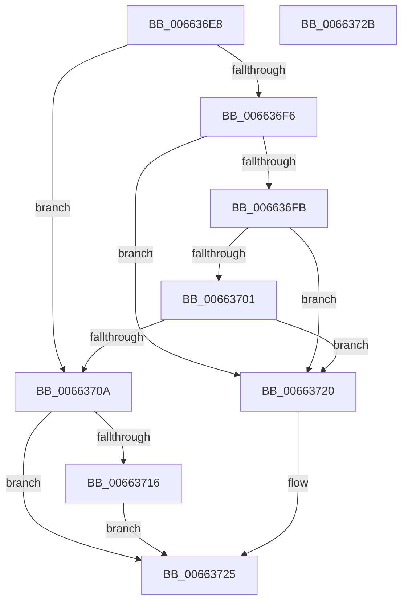

# ApiSetValidateSchemaFormat_V7

- RVA: `0x006636E8`–`0x0066372C` (길이 `68` bytes)
- VA: `0x00000001406636E8`
- 실행 섹션: `.text`
- PDB 이름 있음: `예`; PDB Function 태그: `아니요`
- unwind 정보 RVA: `0x0005CF00`
- 디코드: `24`개 명령, `68/68` bytes 표시
- 미해석 바이트: `0` (있으면 어셈블리에 `.byte`로 보존)

> 이 문서는 커널 이미지의 기계어와 PDB 기호를 분석해 생성했습니다. 4번과 5번은 함수 원형과 자료형을 바이너리 사용 방식에서 추정한 C 해석이며 원본 소스 복구 결과는 아닙니다.

## 1. Dependencies

- 직접 호출 지점: **2**; 고유 호출 대상: **2**
- 직접 호출자로 확인된 함수: **2**
- RIP 상대 이미지 참조: **0**

### Outgoing calls
- `0x0066370D` → [ApiSetValidateSchemaHeader_V7](ApiSetValidateSchemaHeader_V7_function_00663734.md) (function, `0x00663734`)
- `0x00663719` → [ApiSetValidateSchemaElements_V7](ApiSetValidateSchemaElements_V7_function_00663478.md) (function, `0x00663478`)

### Direct callers
- [ApiSetValidateSchemaFormat](ApiSetValidateSchemaFormat_function_0066228C.md) at `0x006622D3`
- [ApiSetComposeSchema_V7](ApiSetComposeSchema_V7_function_00663CCC.md) at `0x00663D39`
- [ApiSetComposeSchema_V7](ApiSetComposeSchema_V7_function_00663CCC.md) at `0x00663E9C`

### Static image references
- 디코드된 RIP-relative 메모리 참조가 없습니다.

## 2. Other-region calls and transfers

- 다른 실행 섹션으로 향하는 call: **0**
- 별도 외부 분기/꼬리 이동을 확인하지 못했습니다.

## 3. Assembly (complete function range)

```asm
006636E8  40 53                           push rbx
006636EA  48 83 EC 20                     sub rsp, 0x20
006636EE  80 39 07                        cmp byte ptr [rcx], 7
006636F1  48 8B D9                        mov rbx, rcx
006636F4  74 14                           je 0x14066370a
006636F6  83 39 06                        cmp dword ptr [rcx], 6
006636F9  75 25                           jne 0x140663720
006636FB  83 79 10 08                     cmp dword ptr [rcx + 0x10], 8
006636FF  76 1F                           jbe 0x140663720
00663701  48 83 C3 1C                     add rbx, 0x1c
00663705  80 3B 07                        cmp byte ptr [rbx], 7
00663708  75 16                           jne 0x140663720
0066370A  48 8B CB                        mov rcx, rbx
0066370D  E8 22 00 00 00                  call 0x140663734
00663712  85 C0                           test eax, eax
00663714  78 0F                           js 0x140663725
00663716  48 8B CB                        mov rcx, rbx
00663719  E8 5A FD FF FF                  call 0x140663478
0066371E  EB 05                           jmp 0x140663725
00663720  B8 0D 00 00 C0                  mov eax, 0xc000000d
00663725  48 83 C4 20                     add rsp, 0x20
00663729  5B                              pop rbx
0066372A  C3                              ret
0066372B  CC                              int3
```

## 4. C-style interpretation (structured pseudocode)

```c
__int64 __fastcall ApiSetValidateSchemaFormat_V7(__int64 a1)
{
    __int64 result;
    __int64 v_rbx;
    __int64 v_rsp;

    v_rsp = (v_rsp) - (32);
    if ((*(unsigned __int8 *)(a1)) == 7) goto loc_0066370A;
    if ((*(unsigned int *)(a1)) != 6) goto loc_00663720;
    if ((*(unsigned int *)(a1 + 16)) <= 8) goto loc_00663720;
    v_rbx = (a1) + (28);
    if ((*(unsigned __int8 *)(v_rbx)) != 7) goto loc_00663720;
loc_0066370A:
    result = ApiSetValidateSchemaHeader_V7(v_rbx, a2, a3, a4);
    if (sign_flag) goto loc_00663725;
    result = ApiSetValidateSchemaElements_V7(v_rbx, a2, a3, a4);
    goto loc_00663725;
loc_00663720:
loc_00663725:
    v_rsp = (v_rsp) + (32);
    return (unsigned int)(0xC000000DULL);
}
```

## 5. (Beta) C Style

```c
int64_t ApiSetValidateSchemaFormat_V7(void *Arg1)
{
    uint8_t *arg1 = (uint8_t *)Arg1;

    int64_t result;
    int64_t local_rbx;
    int64_t local_rsp;

    local_rsp = (local_rsp) - (32);
    if ((*(uint8_t *)(arg1)) == 7) goto loc_0066370A;
    if ((*(uint32_t *)(arg1)) != 6) goto loc_00663720;
    if ((*(uint32_t *)(arg1 + 0x10)) <= 8) goto loc_00663720;
    local_rbx = (Arg1) + (28);
    if ((*(uint8_t *)(local_rbx)) != 7) goto loc_00663720;
loc_0066370A:
    result = ApiSetValidateSchemaHeader_V7(local_rbx, a2, a3, a4);
    if (sign_flag) goto loc_00663725;
    result = ApiSetValidateSchemaElements_V7(local_rbx, a2, a3, a4);
    goto loc_00663725;
loc_00663720:
loc_00663725:
    local_rsp = (local_rsp) + (32);
    return (uint32_t)(0xC000000DULL);
}
```

### 관측된 메모리 오프셋

구조체 형식이 확인되지 않은 접근은 인자 기준의 오프셋으로만 기록했습니다.

| 기준 인자 | 오프셋 표현 | 폭 (bit) | 접근 |
|---|---:|---:|---|
| `Arg1` | `+ 0x0` | `8` | `R` |
| `Arg1` | `+ 0x0` | `32` | `R` |
| `Arg1` | `+ 0x10` | `32` | `R` |

## 6. Execution-region graph

[열기: 2D/3D 그래프와 함수 탐색 컨트롤 패널](../../../control-panel.html?section=text&rva=0x006636E8&view=graph)

- 2D 그래프는 위에서 아래로 흐르고, 3D 그래프는 빈 공간을 드래그해 회전합니다. Shift+드래그는 이동, 휠은 확대·축소, 함수 노드 선택은 대상 보고서 이동입니다.

### Static fallback


