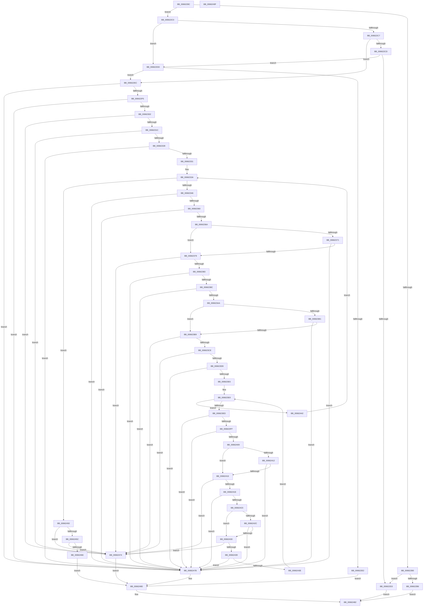

# ApiSetValidateSchemaFormat

- RVA: `0x0066228C`–`0x006624A0` (길이 `532` bytes)
- VA: `0x000000014066228C`
- 실행 섹션: `.text`
- PDB 이름 있음: `예`; PDB Function 태그: `아니요`
- unwind 정보 RVA: `0x00075C18`
- 디코드: `156`개 명령, `532/532` bytes 표시
- 미해석 바이트: `0` (있으면 어셈블리에 `.byte`로 보존)

> 이 문서는 커널 이미지의 기계어와 PDB 기호를 분석해 생성했습니다. 4번과 5번은 함수 원형과 자료형을 바이너리 사용 방식에서 추정한 C 해석이며 원본 소스 복구 결과는 아닙니다.

## 1. Dependencies

- 직접 호출 지점: **3**; 고유 호출 대상: **3**
- 직접 호출자로 확인된 함수: **2**
- RIP 상대 이미지 참조: **0**

### Outgoing calls
- `0x006622B6` → [ApiSetValidateSchemaExtensionFormat_V7](ApiSetValidateSchemaExtensionFormat_V7_function_00663588.md) (function, `0x00663588`)
- `0x006622D3` → [ApiSetValidateSchemaFormat_V7](ApiSetValidateSchemaFormat_V7_function_006636E8.md) (function, `0x006636E8`)
- `0x0066239C` → [ApiSetpSearchForApiSet](../4B/ApiSetpSearchForApiSet_function_004B8048.md) (function, `0x004B8048`)

### Direct callers
- [ApiSetComposeSchema](ApiSetComposeSchema_function_00662684.md) at `0x0066271D`
- [ApiSetComposeSchema](ApiSetComposeSchema_function_00662684.md) at `0x00662733`
- [ApiSetComposeSchema](ApiSetComposeSchema_function_00662684.md) at `0x006629C3`
- [ApiSetComposeSchema](ApiSetComposeSchema_function_00662684.md) at `0x00662CFB`
- [ApiSetComposeSchema_V7](ApiSetComposeSchema_V7_function_00663CCC.md) at `0x00663D59`

### Static image references
- 디코드된 RIP-relative 메모리 참조가 없습니다.

## 2. Other-region calls and transfers

- 다른 실행 섹션으로 향하는 call: **0**
- 별도 외부 분기/꼬리 이동을 확인하지 못했습니다.

## 3. Assembly (complete function range)

```asm
0066228C  48 89 5C 24 08                  mov qword ptr [rsp + 8], rbx
00662291  48 89 6C 24 10                  mov qword ptr [rsp + 0x10], rbp
00662296  48 89 74 24 18                  mov qword ptr [rsp + 0x18], rsi
0066229B  57                              push rdi
0066229C  41 54                           push r12
0066229E  41 55                           push r13
006622A0  41 56                           push r14
006622A2  41 57                           push r15
006622A4  48 83 EC 20                     sub rsp, 0x20
006622A8  80 39 07                        cmp byte ptr [rcx], 7
006622AB  48 8B D9                        mov rbx, rcx
006622AE  75 10                           jne 0x1406622c0
006622B0  F6 41 02 02                     test byte ptr [rcx + 2], 2
006622B4  74 1D                           je 0x1406622d3
006622B6  E8 CD 12 00 00                  call 0x140663588
006622BB  E9 C2 01 00 00                  jmp 0x140662482
006622C0  8B 01                           mov eax, dword ptr [rcx]
006622C2  83 F8 06                        cmp eax, 6
006622C5  75 16                           jne 0x1406622dd
006622C7  83 79 10 08                     cmp dword ptr [rcx + 0x10], 8
006622CB  76 1F                           jbe 0x1406622ec
006622CD  80 79 1C 07                     cmp byte ptr [rcx + 0x1c], 7
006622D1  75 0A                           jne 0x1406622dd
006622D3  E8 10 14 00 00                  call 0x1406636e8
006622D8  E9 A5 01 00 00                  jmp 0x140662482
006622DD  83 F8 04                        cmp eax, 4
006622E0  77 0A                           ja 0x1406622ec
006622E2  B9 BB 00 00 C0                  mov ecx, 0xc00000bb
006622E7  E9 94 01 00 00                  jmp 0x140662480
006622EC  83 FA 1C                        cmp edx, 0x1c
006622EF  0F 82 86 01 00 00               jb 0x14066247b
006622F5  44 8B 41 04                     mov r8d, dword ptr [rcx + 4]
006622F9  44 3B C2                        cmp r8d, edx
006622FC  0F 87 79 01 00 00               ja 0x14066247b
00662302  8B 41 0C                        mov eax, dword ptr [rcx + 0xc]
00662305  41 BF FF FF FF FF               mov r15d, 0xffffffff
0066230B  48 8D 0C 40                     lea rcx, [rax + rax*2]
0066230F  48 C1 E1 03                     shl rcx, 3
00662313  49 3B CF                        cmp rcx, r15
00662316  0F 87 58 01 00 00               ja 0x140662474
0066231C  8D 79 1C                        lea edi, [rcx + 0x1c]
0066231F  83 FF 1C                        cmp edi, 0x1c
00662322  0F 82 4C 01 00 00               jb 0x140662474
00662328  41 3B F8                        cmp edi, r8d
0066232B  0F 87 4A 01 00 00               ja 0x14066247b
00662331  45 33 F6                        xor r14d, r14d
00662334  41 BD FF FF 00 00               mov r13d, 0xffff
0066233A  8B 43 0C                        mov eax, dword ptr [rbx + 0xc]
0066233D  44 3B F0                        cmp r14d, eax
00662340  0F 83 0A 01 00 00               jae 0x140662450
00662346  8B 4B 10                        mov ecx, dword ptr [rbx + 0x10]
00662349  4B 8D 14 76                     lea rdx, [r14 + r14*2]
0066234D  48 03 CB                        add rcx, rbx
00662350  48 8D 34 D1                     lea rsi, [rcx + rdx*8]
00662354  8B 4E 08                        mov ecx, dword ptr [rsi + 8]
00662357  41 3B CD                        cmp ecx, r13d
0066235A  0F 87 1B 01 00 00               ja 0x14066247b
00662360  44 39 6E 0C                     cmp dword ptr [rsi + 0xc], r13d
00662364  0F 87 11 01 00 00               ja 0x14066247b
0066236A  8B 46 04                        mov eax, dword ptr [rsi + 4]
0066236D  85 C0                           test eax, eax
0066236F  74 08                           je 0x140662379
00662371  3B C7                           cmp eax, edi
00662373  0F 82 02 01 00 00               jb 0x14066247b
00662379  03 C8                           add ecx, eax
0066237B  3B C8                           cmp ecx, eax
0066237D  0F 82 F1 00 00 00               jb 0x140662474
00662383  3B 4B 04                        cmp ecx, dword ptr [rbx + 4]
00662386  0F 87 EF 00 00 00               ja 0x14066247b
0066238C  44 0F B7 46 0C                  movzx r8d, word ptr [rsi + 0xc]
00662391  48 8D 14 03                     lea rdx, [rbx + rax]
00662395  66 41 D1 E8                     shr r8w, 1
00662399  48 8B CB                        mov rcx, rbx
0066239C  E8 A7 5C E5 FF                  call 0x1404b8048
006623A1  48 3B C6                        cmp rax, rsi
006623A4  0F 85 D1 00 00 00               jne 0x14066247b
006623AA  8B 4E 10                        mov ecx, dword ptr [rsi + 0x10]
006623AD  85 C9                           test ecx, ecx
006623AF  74 08                           je 0x1406623b9
006623B1  3B CF                           cmp ecx, edi
006623B3  0F 82 C2 00 00 00               jb 0x14066247b
006623B9  44 8B 66 14                     mov r12d, dword ptr [rsi + 0x14]
006623BD  4B 8D 04 A4                     lea rax, [r12 + r12*4]
006623C1  48 C1 E0 02                     shl rax, 2
006623C5  49 3B C7                        cmp rax, r15
006623C8  0F 87 A6 00 00 00               ja 0x140662474
006623CE  8D 14 01                        lea edx, [rcx + rax]
006623D1  3B D1                           cmp edx, ecx
006623D3  0F 82 9B 00 00 00               jb 0x140662474
006623D9  44 8B 5B 04                     mov r11d, dword ptr [rbx + 4]
006623DD  41 3B D3                        cmp edx, r11d
006623E0  0F 87 95 00 00 00               ja 0x14066247b
006623E6  33 D2                           xor edx, edx
006623E8  41 3B D4                        cmp edx, r12d
006623EB  73 55                           jae 0x140662442
006623ED  4C 8D 04 92                     lea r8, [rdx + rdx*4]
006623F1  4C 8D 0C 0B                     lea r9, [rbx + rcx]
006623F5  47 8B 54 81 08                  mov r10d, dword ptr [r9 + r8*4 + 8]
006623FA  45 3B D5                        cmp r10d, r13d
006623FD  77 7C                           ja 0x14066247b
006623FF  47 8B 7C 81 10                  mov r15d, dword ptr [r9 + r8*4 + 0x10]
00662404  45 3B FD                        cmp r15d, r13d
00662407  77 72                           ja 0x14066247b
00662409  43 8B 44 81 04                  mov eax, dword ptr [r9 + r8*4 + 4]
0066240E  85 C0                           test eax, eax
00662410  74 04                           je 0x140662416
00662412  3B C7                           cmp eax, edi
00662414  72 65                           jb 0x14066247b
00662416  44 03 D0                        add r10d, eax
00662419  44 3B D0                        cmp r10d, eax
0066241C  72 56                           jb 0x140662474
0066241E  45 3B D3                        cmp r10d, r11d
00662421  77 58                           ja 0x14066247b
00662423  43 8B 44 81 0C                  mov eax, dword ptr [r9 + r8*4 + 0xc]
00662428  85 C0                           test eax, eax
0066242A  74 04                           je 0x140662430
0066242C  3B C7                           cmp eax, edi
0066242E  72 4B                           jb 0x14066247b
00662430  45 8D 04 07                     lea r8d, [r15 + rax]
00662434  44 3B C0                        cmp r8d, eax
00662437  72 3B                           jb 0x140662474
00662439  45 3B C3                        cmp r8d, r11d
0066243C  77 3D                           ja 0x14066247b
0066243E  FF C2                           inc edx
00662440  EB A6                           jmp 0x1406623e8
00662442  41 FF C6                        inc r14d
00662445  41 BF FF FF FF FF               mov r15d, 0xffffffff
0066244B  E9 EA FE FF FF                  jmp 0x14066233a
00662450  48 8B C8                        mov rcx, rax
00662453  48 C1 E1 03                     shl rcx, 3
00662457  49 3B CF                        cmp rcx, r15
0066245A  77 18                           ja 0x140662474
0066245C  8B 43 14                        mov eax, dword ptr [rbx + 0x14]
0066245F  8D 14 08                        lea edx, [rax + rcx]
00662462  3B D0                           cmp edx, eax
00662464  72 0E                           jb 0x140662474
00662466  39 53 04                        cmp dword ptr [rbx + 4], edx
00662469  B9 E4 00 00 C0                  mov ecx, 0xc00000e4
0066246E  1B C0                           sbb eax, eax
00662470  23 C8                           and ecx, eax
00662472  EB 0C                           jmp 0x140662480
00662474  B9 95 00 00 C0                  mov ecx, 0xc0000095
00662479  EB 05                           jmp 0x140662480
0066247B  B9 E4 00 00 C0                  mov ecx, 0xc00000e4
00662480  8B C1                           mov eax, ecx
00662482  48 8B 5C 24 50                  mov rbx, qword ptr [rsp + 0x50]
00662487  48 8B 6C 24 58                  mov rbp, qword ptr [rsp + 0x58]
0066248C  48 8B 74 24 60                  mov rsi, qword ptr [rsp + 0x60]
00662491  48 83 C4 20                     add rsp, 0x20
00662495  41 5F                           pop r15
00662497  41 5E                           pop r14
00662499  41 5D                           pop r13
0066249B  41 5C                           pop r12
0066249D  5F                              pop rdi
0066249E  C3                              ret
0066249F  CC                              int3
```

## 4. C-style interpretation (structured pseudocode)

```c
__int64 __fastcall ApiSetValidateSchemaFormat(__int64 a1, int a2)
{
    __int64 result;
    __int64 v_r10;
    __int64 v_r14;
    __int64 v_rsp;
    unsigned __int64 v_stack_p10;
    unsigned __int64 v_stack_p18;
    unsigned __int64 v_stack_p8;

    v_stack_p8 = v_rbx;
    v_stack_p10 = v_rbp;
    v_stack_p18 = v_rsi;
    v_rsp = (v_rsp) - (32);
    if ((*(unsigned __int8 *)(a1)) != 7) goto loc_006622C0;
    if (((*(unsigned __int8 *)(a1 + 2)) & (2)) == 0) goto loc_006622D3;
    result = ApiSetValidateSchemaExtensionFormat_V7(a1, a2, a3, a4);
    goto loc_00662482;
loc_006622C0:
    if (((unsigned int)((unsigned int)(*(unsigned int *)(a1)))) != 6) goto loc_006622DD;
    if ((*(unsigned int *)(a1 + 16)) <= 8) goto loc_006622EC;
    if ((*(unsigned __int8 *)(a1 + 28)) != 7) goto loc_006622DD;
loc_006622D3:
    result = ApiSetValidateSchemaFormat_V7(a1, a2, a3, a4);
    goto loc_00662482;
loc_006622DD:
    if (((unsigned int)(result)) > 4) goto loc_006622EC;
    goto loc_00662480;
loc_006622EC:
    if (a2 < 28) goto loc_0066247B;
    if (((unsigned int)((unsigned int)(*(unsigned int *)((unsigned int)(0xC00000BBULL) + 4)))) > a2) goto loc_0066247B;
    a1 = ((unsigned int)(*(unsigned int *)((unsigned int)(0xC00000BBULL) + 12)) + (unsigned int)(*(unsigned int *)((unsigned int)(0xC00000BBULL) + 12)) * 2) << (3);
    if (a1 > ((unsigned int)(0xFFFFFFFFULL))) goto loc_00662474;
    if (((unsigned int)(a1 + 28)) < 28) goto loc_00662474;
    if (((unsigned int)(a1 + 28)) > ((unsigned int)((unsigned int)(*(unsigned int *)((unsigned int)(0xC00000BBULL) + 4))))) goto loc_0066247B;
    v_r14 = 0;
loc_0066233A:
    if (0 >= ((unsigned int)((unsigned int)(*(unsigned int *)(a1 + 12))))) goto loc_00662450;
    a1 = ((unsigned int)(*(unsigned int *)(a1 + 16))) + (a1);
    if (((unsigned int)((unsigned int)(*(unsigned int *)(a1 + v_r14 + v_r14 * 2 * 8 + 8)))) > ((unsigned int)((unsigned int)(0xFFFFULL)))) goto loc_0066247B;
    if ((*(unsigned int *)(a1 + v_r14 + v_r14 * 2 * 8 + 12)) > ((unsigned int)((unsigned int)(0xFFFFULL)))) goto loc_0066247B;
    if ((unsigned int)((unsigned int)(*(unsigned int *)(a1 + v_r14 + v_r14 * 2 * 8 + 4))) == 0) goto loc_00662379;
    if (((unsigned int)((unsigned int)(*(unsigned int *)(a1 + v_r14 + v_r14 * 2 * 8 + 4)))) < ((unsigned int)(a1 + 28))) goto loc_0066247B;
loc_00662379:
    a1 = (unsigned int)(((unsigned int)(*(unsigned int *)(a1 + v_r14 + v_r14 * 2 * 8 + 8))) + ((unsigned int)((unsigned int)(*(unsigned int *)(a1 + v_r14 + v_r14 * 2 * 8 + 4)))));
    if (((unsigned int)(a1)) < ((unsigned int)((unsigned int)(*(unsigned int *)(a1 + v_r14 + v_r14 * 2 * 8 + 4))))) goto loc_00662474;
    if (((unsigned int)(a1)) > (*(unsigned int *)(a1 + 4))) goto loc_0066247B;
    a3 = (unsigned __int16)((*(unsigned __int16 *)(a1 + v_r14 + v_r14 * 2 * 8 + 12)) >> (1));
    result = ApiSetpSearchForApiSet(a1, a1 + (unsigned int)(*(unsigned int *)(a1 + v_r14 + v_r14 * 2 * 8 + 4)) * 1, a3, a4);
    if (result != (a1 + v_r14 + v_r14 * 2 * 8)) goto loc_0066247B;
    if ((unsigned int)((unsigned int)(*(unsigned int *)(a1 + v_r14 + v_r14 * 2 * 8 + 16))) == 0) goto loc_006623B9;
    if (((unsigned int)((unsigned int)(*(unsigned int *)(a1 + v_r14 + v_r14 * 2 * 8 + 16)))) < ((unsigned int)(a1 + 28))) goto loc_0066247B;
loc_006623B9:
    result = ((unsigned int)(*(unsigned int *)(a1 + v_r14 + v_r14 * 2 * 8 + 20)) + (unsigned int)(*(unsigned int *)(a1 + v_r14 + v_r14 * 2 * 8 + 20)) * 4) << (2);
    if (result > ((unsigned int)(0xFFFFFFFFULL))) goto loc_00662474;
    if (((unsigned int)((unsigned int)(*(unsigned int *)(a1 + v_r14 + v_r14 * 2 * 8 + 16)) + result * 1)) < ((unsigned int)((unsigned int)(*(unsigned int *)(a1 + v_r14 + v_r14 * 2 * 8 + 16))))) goto loc_00662474;
    if (((unsigned int)((unsigned int)(*(unsigned int *)(a1 + v_r14 + v_r14 * 2 * 8 + 16)) + result * 1)) > ((unsigned int)((unsigned int)(*(unsigned int *)(a1 + 4))))) goto loc_0066247B;
    a2 = 0;
loc_006623E8:
    if (0 >= ((unsigned int)((unsigned int)(*(unsigned int *)(a1 + v_r14 + v_r14 * 2 * 8 + 20))))) goto loc_00662442;
    if (((unsigned int)((unsigned int)(*(unsigned int *)(a1 + (unsigned int)(*(unsigned int *)(a1 + v_r14 + v_r14 * 2 * 8 + 16)) * 1 + a2 + a2 * 4 * 4 + 8)))) > ((unsigned int)((unsigned int)(0xFFFFULL)))) goto loc_0066247B;
    if (((unsigned int)((unsigned int)(*(unsigned int *)(a1 + (unsigned int)(*(unsigned int *)(a1 + v_r14 + v_r14 * 2 * 8 + 16)) * 1 + a2 + a2 * 4 * 4 + 16)))) > ((unsigned int)((unsigned int)(0xFFFFULL)))) goto loc_0066247B;
    if ((unsigned int)((unsigned int)(*(unsigned int *)(a1 + (unsigned int)(*(unsigned int *)(a1 + v_r14 + v_r14 * 2 * 8 + 16)) * 1 + a2 + a2 * 4 * 4 + 4))) == 0) goto loc_00662416;
    if (((unsigned int)((unsigned int)(*(unsigned int *)(a1 + (unsigned int)(*(unsigned int *)(a1 + v_r14 + v_r14 * 2 * 8 + 16)) * 1 + a2 + a2 * 4 * 4 + 4)))) < ((unsigned int)(a1 + 28))) goto loc_0066247B;
loc_00662416:
    v_r10 = (unsigned int)(((unsigned int)(*(unsigned int *)(a1 + (unsigned int)(*(unsigned int *)(a1 + v_r14 + v_r14 * 2 * 8 + 16)) * 1 + a2 + a2 * 4 * 4 + 8))) + ((unsigned int)((unsigned int)(*(unsigned int *)(a1 + (unsigned int)(*(unsigned int *)(a1 + v_r14 + v_r14 * 2 * 8 + 16)) * 1 + a2 + a2 * 4 * 4 + 4)))));
    if (((unsigned int)(v_r10)) < ((unsigned int)((unsigned int)(*(unsigned int *)(a1 + (unsigned int)(*(unsigned int *)(a1 + v_r14 + v_r14 * 2 * 8 + 16)) * 1 + a2 + a2 * 4 * 4 + 4))))) goto loc_00662474;
    if (((unsigned int)(v_r10)) > ((unsigned int)((unsigned int)(*(unsigned int *)(a1 + 4))))) goto loc_0066247B;
    if ((unsigned int)((unsigned int)(*(unsigned int *)(a1 + (unsigned int)(*(unsigned int *)(a1 + v_r14 + v_r14 * 2 * 8 + 16)) * 1 + a2 + a2 * 4 * 4 + 12))) == 0) goto loc_00662430;
    if (((unsigned int)((unsigned int)(*(unsigned int *)(a1 + (unsigned int)(*(unsigned int *)(a1 + v_r14 + v_r14 * 2 * 8 + 16)) * 1 + a2 + a2 * 4 * 4 + 12)))) < ((unsigned int)(a1 + 28))) goto loc_0066247B;
loc_00662430:
    if (((unsigned int)((unsigned int)(*(unsigned int *)(a1 + (unsigned int)(*(unsigned int *)(a1 + v_r14 + v_r14 * 2 * 8 + 16)) * 1 + a2 + a2 * 4 * 4 + 16)) + (unsigned int)(*(unsigned int *)(a1 + (unsigned int)(*(unsigned int *)(a1 + v_r14 + v_r14 * 2 * 8 + 16)) * 1 + a2 + a2 * 4 * 4 + 12)) * 1)) < ((unsigned int)((unsigned int)(*(unsigned int *)(a1 + (unsigned int)(*(unsigned int *)(a1 + v_r14 + v_r14 * 2 * 8 + 16)) * 1 + a2 + a2 * 4 * 4 + 12))))) goto loc_00662474;
    if (((unsigned int)((unsigned int)(*(unsigned int *)(a1 + (unsigned int)(*(unsigned int *)(a1 + v_r14 + v_r14 * 2 * 8 + 16)) * 1 + a2 + a2 * 4 * 4 + 16)) + (unsigned int)(*(unsigned int *)(a1 + (unsigned int)(*(unsigned int *)(a1 + v_r14 + v_r14 * 2 * 8 + 16)) * 1 + a2 + a2 * 4 * 4 + 12)) * 1)) > ((unsigned int)((unsigned int)(*(unsigned int *)(a1 + 4))))) goto loc_0066247B;
    a2 = (unsigned int)((a2) + 1);
    goto loc_006623E8;
loc_00662442:
    v_r14 = (unsigned int)((v_r14) + 1);
    goto loc_0066233A;
loc_00662450:
    a1 = ((unsigned int)(*(unsigned int *)(a1 + (unsigned int)(*(unsigned int *)(a1 + v_r14 + v_r14 * 2 * 8 + 16)) * 1 + a2 + a2 * 4 * 4 + 12))) << (3);
    if (a1 > ((unsigned int)(0xFFFFFFFFULL))) goto loc_00662474;
    if (((unsigned int)((unsigned int)(*(unsigned int *)(a1 + 20)) + a1 * 1)) < ((unsigned int)((unsigned int)(*(unsigned int *)(a1 + 20))))) goto loc_00662474;
    a1 = (unsigned int)(((unsigned int)(0xC00000E4ULL)) & ((unsigned int)((unsigned int)(*(unsigned int *)(a1 + 20)))));
    goto loc_00662480;
loc_00662474:
    goto loc_00662480;
loc_0066247B:
loc_00662480:
loc_00662482:
    v_rsp = (v_rsp) + (32);
    return (unsigned int)((unsigned int)((unsigned int)(0xC00000E4ULL)));
}
```

## 5. (Beta) C Style

```c
int64_t ApiSetValidateSchemaFormat(void *Arg1, int32_t Arg2)
{
    uint8_t *arg1 = (uint8_t *)Arg1;

    int64_t result;
    int64_t local_r10;
    int64_t local_r14;
    int64_t local_rsp;
    uint64_t v_stack_p10;
    uint64_t v_stack_p18;
    uint64_t v_stack_p8;

    v_stack_p8 = local_rbx;
    v_stack_p10 = local_rbp;
    v_stack_p18 = local_rsi;
    local_rsp = (local_rsp) - (32);
    if ((*(uint8_t *)(arg1)) != 7) goto loc_006622C0;
    if (((*(uint8_t *)(arg1 + 0x2)) & (2)) == 0) goto loc_006622D3;
    result = ApiSetValidateSchemaExtensionFormat_V7(Arg1, Arg2, a3, a4);
    goto loc_00662482;
loc_006622C0:
    if (((uint32_t)((uint32_t)(*(uint32_t *)(arg1)))) != 6) goto loc_006622DD;
    if ((*(uint32_t *)(arg1 + 0x10)) <= 8) goto loc_006622EC;
    if ((*(uint8_t *)(arg1 + 0x1C)) != 7) goto loc_006622DD;
loc_006622D3:
    result = ApiSetValidateSchemaFormat_V7(Arg1, Arg2, a3, a4);
    goto loc_00662482;
loc_006622DD:
    if (((uint32_t)(result)) > 4) goto loc_006622EC;
    goto loc_00662480;
loc_006622EC:
    if (Arg2 < 28) goto loc_0066247B;
    if (((uint32_t)((uint32_t)(*(uint32_t *)((uint32_t)(0xC00000BBULL) + 0x4)))) > Arg2) goto loc_0066247B;
    Arg1 = ((uint32_t)(*(uint32_t *)((uint32_t)(0xC00000BBULL) + 0xC)) + (uint32_t)(*(uint32_t *)((uint32_t)(0xC00000BBULL) + 0xC)) * 2) << (3);
    if (Arg1 > ((uint32_t)(0xFFFFFFFFULL))) goto loc_00662474;
    if (((uint32_t)(Arg1 + 28)) < 28) goto loc_00662474;
    if (((uint32_t)(Arg1 + 28)) > ((uint32_t)((uint32_t)(*(uint32_t *)((uint32_t)(0xC00000BBULL) + 0x4))))) goto loc_0066247B;
    local_r14 = 0;
loc_0066233A:
    if (0 >= ((uint32_t)((uint32_t)(*(uint32_t *)(arg1 + 0xC))))) goto loc_00662450;
    Arg1 = ((uint32_t)(*(uint32_t *)(arg1 + 0x10))) + (Arg1);
    if (((uint32_t)((uint32_t)(*(uint32_t *)(arg1 + local_r14 + local_r14 * 2 * 8 + 0x8)))) > ((uint32_t)((uint32_t)(0xFFFFULL)))) goto loc_0066247B;
    if ((*(uint32_t *)(arg1 + local_r14 + local_r14 * 2 * 8 + 0xC)) > ((uint32_t)((uint32_t)(0xFFFFULL)))) goto loc_0066247B;
    if ((uint32_t)((uint32_t)(*(uint32_t *)(arg1 + local_r14 + local_r14 * 2 * 8 + 0x4))) == 0) goto loc_00662379;
    if (((uint32_t)((uint32_t)(*(uint32_t *)(arg1 + local_r14 + local_r14 * 2 * 8 + 0x4)))) < ((uint32_t)(Arg1 + 28))) goto loc_0066247B;
loc_00662379:
    Arg1 = (uint32_t)(((uint32_t)(*(uint32_t *)(arg1 + local_r14 + local_r14 * 2 * 8 + 0x8))) + ((uint32_t)((uint32_t)(*(uint32_t *)(arg1 + local_r14 + local_r14 * 2 * 8 + 0x4)))));
    if (((uint32_t)(Arg1)) < ((uint32_t)((uint32_t)(*(uint32_t *)(arg1 + local_r14 + local_r14 * 2 * 8 + 0x4))))) goto loc_00662474;
    if (((uint32_t)(Arg1)) > (*(uint32_t *)(arg1 + 0x4))) goto loc_0066247B;
    a3 = (uint16_t)((*(uint16_t *)(arg1 + local_r14 + local_r14 * 2 * 8 + 0xC)) >> (1));
    result = ApiSetpSearchForApiSet(Arg1, Arg1 + (uint32_t)(*(uint32_t *)(arg1 + local_r14 + local_r14 * 2 * 8 + 0x4)) * 1, a3, a4);
    if (result != (Arg1 + local_r14 + local_r14 * 2 * 8)) goto loc_0066247B;
    if ((uint32_t)((uint32_t)(*(uint32_t *)(arg1 + local_r14 + local_r14 * 2 * 8 + 0x10))) == 0) goto loc_006623B9;
    if (((uint32_t)((uint32_t)(*(uint32_t *)(arg1 + local_r14 + local_r14 * 2 * 8 + 0x10)))) < ((uint32_t)(Arg1 + 28))) goto loc_0066247B;
loc_006623B9:
    result = ((uint32_t)(*(uint32_t *)(arg1 + local_r14 + local_r14 * 2 * 8 + 0x14)) + (uint32_t)(*(uint32_t *)(arg1 + local_r14 + local_r14 * 2 * 8 + 0x14)) * 4) << (2);
    if (result > ((uint32_t)(0xFFFFFFFFULL))) goto loc_00662474;
    if (((uint32_t)((uint32_t)(*(uint32_t *)(arg1 + local_r14 + local_r14 * 2 * 8 + 0x10)) + result * 1)) < ((uint32_t)((uint32_t)(*(uint32_t *)(arg1 + local_r14 + local_r14 * 2 * 8 + 0x10))))) goto loc_00662474;
    if (((uint32_t)((uint32_t)(*(uint32_t *)(arg1 + local_r14 + local_r14 * 2 * 8 + 0x10)) + result * 1)) > ((uint32_t)((uint32_t)(*(uint32_t *)(arg1 + 0x4))))) goto loc_0066247B;
    Arg2 = 0;
loc_006623E8:
    if (0 >= ((uint32_t)((uint32_t)(*(uint32_t *)(arg1 + local_r14 + local_r14 * 2 * 8 + 0x14))))) goto loc_00662442;
    if (((uint32_t)((uint32_t)(*(uint32_t *)(arg1 + (uint32_t)(*(uint32_t *)(arg1 + local_r14 + local_r14 * 2 * 8 + 0x10)) * 1 + Arg2 + Arg2 * 4 * 4 + 0x8)))) > ((uint32_t)((uint32_t)(0xFFFFULL)))) goto loc_0066247B;
    if (((uint32_t)((uint32_t)(*(uint32_t *)(arg1 + (uint32_t)(*(uint32_t *)(arg1 + local_r14 + local_r14 * 2 * 8 + 0x10)) * 1 + Arg2 + Arg2 * 4 * 4 + 0x10)))) > ((uint32_t)((uint32_t)(0xFFFFULL)))) goto loc_0066247B;
    if ((uint32_t)((uint32_t)(*(uint32_t *)(arg1 + (uint32_t)(*(uint32_t *)(arg1 + local_r14 + local_r14 * 2 * 8 + 0x10)) * 1 + Arg2 + Arg2 * 4 * 4 + 0x4))) == 0) goto loc_00662416;
    if (((uint32_t)((uint32_t)(*(uint32_t *)(arg1 + (uint32_t)(*(uint32_t *)(arg1 + local_r14 + local_r14 * 2 * 8 + 0x10)) * 1 + Arg2 + Arg2 * 4 * 4 + 0x4)))) < ((uint32_t)(Arg1 + 28))) goto loc_0066247B;
loc_00662416:
    local_r10 = (uint32_t)(((uint32_t)(*(uint32_t *)(arg1 + (uint32_t)(*(uint32_t *)(arg1 + local_r14 + local_r14 * 2 * 8 + 0x10)) * 1 + Arg2 + Arg2 * 4 * 4 + 0x8))) + ((uint32_t)((uint32_t)(*(uint32_t *)(arg1 + (uint32_t)(*(uint32_t *)(arg1 + local_r14 + local_r14 * 2 * 8 + 0x10)) * 1 + Arg2 + Arg2 * 4 * 4 + 0x4)))));
    if (((uint32_t)(local_r10)) < ((uint32_t)((uint32_t)(*(uint32_t *)(arg1 + (uint32_t)(*(uint32_t *)(arg1 + local_r14 + local_r14 * 2 * 8 + 0x10)) * 1 + Arg2 + Arg2 * 4 * 4 + 0x4))))) goto loc_00662474;
    if (((uint32_t)(local_r10)) > ((uint32_t)((uint32_t)(*(uint32_t *)(arg1 + 0x4))))) goto loc_0066247B;
    if ((uint32_t)((uint32_t)(*(uint32_t *)(arg1 + (uint32_t)(*(uint32_t *)(arg1 + local_r14 + local_r14 * 2 * 8 + 0x10)) * 1 + Arg2 + Arg2 * 4 * 4 + 0xC))) == 0) goto loc_00662430;
    if (((uint32_t)((uint32_t)(*(uint32_t *)(arg1 + (uint32_t)(*(uint32_t *)(arg1 + local_r14 + local_r14 * 2 * 8 + 0x10)) * 1 + Arg2 + Arg2 * 4 * 4 + 0xC)))) < ((uint32_t)(Arg1 + 28))) goto loc_0066247B;
loc_00662430:
    if (((uint32_t)((uint32_t)(*(uint32_t *)(arg1 + (uint32_t)(*(uint32_t *)(arg1 + local_r14 + local_r14 * 2 * 8 + 0x10)) * 1 + Arg2 + Arg2 * 4 * 4 + 0x10)) + (uint32_t)(*(uint32_t *)(arg1 + (uint32_t)(*(uint32_t *)(arg1 + local_r14 + local_r14 * 2 * 8 + 0x10)) * 1 + Arg2 + Arg2 * 4 * 4 + 0xC)) * 1)) < ((uint32_t)((uint32_t)(*(uint32_t *)(arg1 + (uint32_t)(*(uint32_t *)(arg1 + local_r14 + local_r14 * 2 * 8 + 0x10)) * 1 + Arg2 + Arg2 * 4 * 4 + 0xC))))) goto loc_00662474;
    if (((uint32_t)((uint32_t)(*(uint32_t *)(arg1 + (uint32_t)(*(uint32_t *)(arg1 + local_r14 + local_r14 * 2 * 8 + 0x10)) * 1 + Arg2 + Arg2 * 4 * 4 + 0x10)) + (uint32_t)(*(uint32_t *)(arg1 + (uint32_t)(*(uint32_t *)(arg1 + local_r14 + local_r14 * 2 * 8 + 0x10)) * 1 + Arg2 + Arg2 * 4 * 4 + 0xC)) * 1)) > ((uint32_t)((uint32_t)(*(uint32_t *)(arg1 + 0x4))))) goto loc_0066247B;
    Arg2 = (uint32_t)((Arg2) + 1);
    goto loc_006623E8;
loc_00662442:
    local_r14 = (uint32_t)((local_r14) + 1);
    goto loc_0066233A;
loc_00662450:
    Arg1 = ((uint32_t)(*(uint32_t *)(arg1 + (uint32_t)(*(uint32_t *)(arg1 + local_r14 + local_r14 * 2 * 8 + 0x10)) * 1 + Arg2 + Arg2 * 4 * 4 + 0xC))) << (3);
    if (Arg1 > ((uint32_t)(0xFFFFFFFFULL))) goto loc_00662474;
    if (((uint32_t)((uint32_t)(*(uint32_t *)(arg1 + 0x14)) + Arg1 * 1)) < ((uint32_t)((uint32_t)(*(uint32_t *)(arg1 + 0x14))))) goto loc_00662474;
    Arg1 = (uint32_t)(((uint32_t)(0xC00000E4ULL)) & ((uint32_t)((uint32_t)(*(uint32_t *)(arg1 + 0x14)))));
    goto loc_00662480;
loc_00662474:
    goto loc_00662480;
loc_0066247B:
loc_00662480:
loc_00662482:
    local_rsp = (local_rsp) + (32);
    return (uint32_t)((uint32_t)((uint32_t)(0xC00000E4ULL)));
}
```

### 관측된 메모리 오프셋

구조체 형식이 확인되지 않은 접근은 인자 기준의 오프셋으로만 기록했습니다.

| 기준 인자 | 오프셋 표현 | 폭 (bit) | 접근 |
|---|---:|---:|---|
| `Arg1` | `+ 0x0` | `8` | `R` |
| `Arg1` | `+ 0x0` | `32` | `R` |
| `Arg1` | `+ 0x0 + rax*1` | `64` | `R` |
| `Arg1` | `+ 0x0 + rcx*1` | `64` | `R` |
| `Arg1` | `+ 0x2` | `8` | `R` |
| `Arg1` | `+ 0x4` | `32` | `R` |
| `Arg1` | `+ 0x4 + r8*4` | `32` | `R` |
| `Arg1` | `+ 0x8 + r8*4` | `32` | `R` |
| `Arg1` | `+ 0xC` | `32` | `R` |
| `Arg1` | `+ 0xC + r8*4` | `32` | `R` |
| `Arg1` | `+ 0x10` | `32` | `R` |
| `Arg1` | `+ 0x10 + r8*4` | `32` | `R` |
| `Arg1` | `+ 0x14` | `32` | `R` |
| `Arg1` | `+ 0x1C` | `8` | `R` |

## 6. Execution-region graph

[열기: 2D/3D 그래프와 함수 탐색 컨트롤 패널](../../../control-panel.html?section=text&rva=0x0066228C&view=graph)

- 2D 그래프는 위에서 아래로 흐르고, 3D 그래프는 빈 공간을 드래그해 회전합니다. Shift+드래그는 이동, 휠은 확대·축소, 함수 노드 선택은 대상 보고서 이동입니다.

### Static fallback


