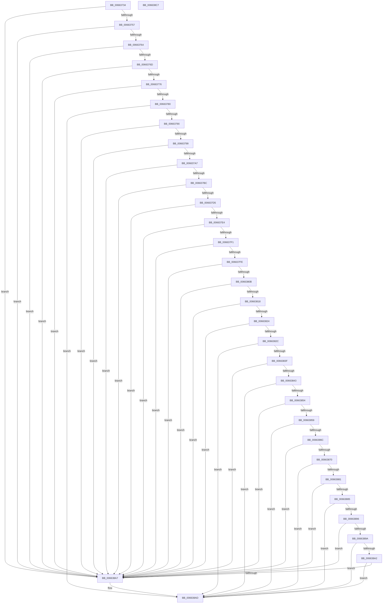

# ApiSetValidateSchemaHeader_V7

- RVA: `0x00663734`–`0x006638C8` (길이 `404` bytes)
- VA: `0x0000000140663734`
- 실행 섹션: `.text`
- PDB 이름 있음: `예`; PDB Function 태그: `아니요`
- unwind 정보 RVA: `0x000D6150`
- 디코드: `116`개 명령, `404/404` bytes 표시
- 미해석 바이트: `0` (있으면 어셈블리에 `.byte`로 보존)

> 이 문서는 커널 이미지의 기계어와 PDB 기호를 분석해 생성했습니다. 4번과 5번은 함수 원형과 자료형을 바이너리 사용 방식에서 추정한 C 해석이며 원본 소스 복구 결과는 아닙니다.

## 1. Dependencies

- 직접 호출 지점: **0**; 고유 호출 대상: **0**
- 직접 호출자로 확인된 함수: **2**
- RIP 상대 이미지 참조: **0**

### Outgoing calls
- 직접 디코드된 call 명령이 없습니다.

### Direct callers
- [ApiSetValidateSchemaFormat_V7](ApiSetValidateSchemaFormat_V7_function_006636E8.md) at `0x0066370D`
- [ApiSetComposeSchema_V7](ApiSetComposeSchema_V7_function_00663CCC.md) at `0x00663E50`

### Static image references
- 디코드된 RIP-relative 메모리 참조가 없습니다.

## 2. Other-region calls and transfers

- 다른 실행 섹션으로 향하는 call: **0**
- 별도 외부 분기/꼬리 이동을 확인하지 못했습니다.

## 3. Assembly (complete function range)

```asm
00663734  48 8B C4                        mov rax, rsp
00663737  48 89 58 08                     mov qword ptr [rax + 8], rbx
0066373B  48 89 70 10                     mov qword ptr [rax + 0x10], rsi
0066373F  48 89 78 18                     mov qword ptr [rax + 0x18], rdi
00663743  4C 89 70 20                     mov qword ptr [rax + 0x20], r14
00663747  41 57                           push r15
00663749  45 33 C0                        xor r8d, r8d
0066374C  4C 8B C9                        mov r9, rcx
0066374F  85 D2                           test edx, edx
00663751  0F 84 50 01 00 00               je 0x1406638a7
00663757  44 8B 51 04                     mov r10d, dword ptr [rcx + 4]
0066375B  45 85 D2                        test r10d, r10d
0066375E  0F 84 43 01 00 00               je 0x1406638a7
00663764  44 3B D2                        cmp r10d, edx
00663767  0F 87 3A 01 00 00               ja 0x1406638a7
0066376D  83 FA 74                        cmp edx, 0x74
00663770  0F 82 31 01 00 00               jb 0x1406638a7
00663776  41 83 FA 74                     cmp r10d, 0x74
0066377A  0F 82 27 01 00 00               jb 0x1406638a7
00663780  8B 51 24                        mov edx, dword ptr [rcx + 0x24]
00663783  8B 49 28                        mov ecx, dword ptr [rcx + 0x28]
00663786  03 CA                           add ecx, edx
00663788  3B CA                           cmp ecx, edx
0066378A  0F 82 1D 01 00 00               jb 0x1406638ad
00663790  41 3B CA                        cmp ecx, r10d
00663793  0F 87 0E 01 00 00               ja 0x1406638a7
00663799  41 0F B7 41 72                  movzx eax, word ptr [r9 + 0x72]
0066379E  66 85 C0                        test ax, ax
006637A1  0F 84 00 01 00 00               je 0x1406638a7
006637A7  41 0F B7 49 70                  movzx ecx, word ptr [r9 + 0x70]
006637AC  45 8B 79 6C                     mov r15d, dword ptr [r9 + 0x6c]
006637B0  0F AF C8                        imul ecx, eax
006637B3  41 3B CF                        cmp ecx, r15d
006637B6  0F 85 EB 00 00 00               jne 0x1406638a7
006637BC  41 0F B7 49 16                  movzx ecx, word ptr [r9 + 0x16]
006637C1  41 0F B7 41 14                  movzx eax, word ptr [r9 + 0x14]
006637C6  45 8B 59 18                     mov r11d, dword ptr [r9 + 0x18]
006637CA  03 C8                           add ecx, eax
006637CC  44 3B D9                        cmp r11d, ecx
006637CF  0F 85 D2 00 00 00               jne 0x1406638a7
006637D5  41 8B 49 1C                     mov ecx, dword ptr [r9 + 0x1c]
006637D9  41 03 CB                        add ecx, r11d
006637DC  3B D1                           cmp edx, ecx
006637DE  0F 85 C3 00 00 00               jne 0x1406638a7
006637E4  45 8B 71 2C                     mov r14d, dword ptr [r9 + 0x2c]
006637E8  41 3B D6                        cmp edx, r14d
006637EB  0F 87 B6 00 00 00               ja 0x1406638a7
006637F1  41 8B 51 38                     mov edx, dword ptr [r9 + 0x38]
006637F5  44 3B F2                        cmp r14d, edx
006637F8  0F 87 A9 00 00 00               ja 0x1406638a7
006637FE  45 8B 59 44                     mov r11d, dword ptr [r9 + 0x44]
00663802  41 3B D3                        cmp edx, r11d
00663805  0F 87 9C 00 00 00               ja 0x1406638a7
0066380B  41 8B 59 50                     mov ebx, dword ptr [r9 + 0x50]
0066380F  44 3B DB                        cmp r11d, ebx
00663812  0F 87 8F 00 00 00               ja 0x1406638a7
00663818  41 8B 79 5C                     mov edi, dword ptr [r9 + 0x5c]
0066381C  3B DF                           cmp ebx, edi
0066381E  0F 87 83 00 00 00               ja 0x1406638a7
00663824  41 8B 71 68                     mov esi, dword ptr [r9 + 0x68]
00663828  3B FE                           cmp edi, esi
0066382A  77 7B                           ja 0x1406638a7
0066382C  41 0F B7 41 30                  movzx eax, word ptr [r9 + 0x30]
00663831  8D 04 80                        lea eax, [rax + rax*4]
00663834  C1 E0 02                        shl eax, 2
00663837  41 03 C6                        add eax, r14d
0066383A  41 3B C6                        cmp eax, r14d
0066383D  72 6E                           jb 0x1406638ad
0066383F  3B C2                           cmp eax, edx
00663841  77 64                           ja 0x1406638a7
00663843  41 0F B7 41 3C                  movzx eax, word ptr [r9 + 0x3c]
00663848  8D 04 80                        lea eax, [rax + rax*4]
0066384B  C1 E0 02                        shl eax, 2
0066384E  03 C2                           add eax, edx
00663850  3B C2                           cmp eax, edx
00663852  72 59                           jb 0x1406638ad
00663854  41 3B C3                        cmp eax, r11d
00663857  77 4E                           ja 0x1406638a7
00663859  41 0F B7 41 48                  movzx eax, word ptr [r9 + 0x48]
0066385E  8D 04 80                        lea eax, [rax + rax*4]
00663861  C1 E0 02                        shl eax, 2
00663864  41 03 C3                        add eax, r11d
00663867  41 3B C3                        cmp eax, r11d
0066386A  72 41                           jb 0x1406638ad
0066386C  3B C3                           cmp eax, ebx
0066386E  77 37                           ja 0x1406638a7
00663870  41 0F B7 41 54                  movzx eax, word ptr [r9 + 0x54]
00663875  8D 04 40                        lea eax, [rax + rax*2]
00663878  C1 E0 02                        shl eax, 2
0066387B  03 C3                           add eax, ebx
0066387D  3B C3                           cmp eax, ebx
0066387F  72 2C                           jb 0x1406638ad
00663881  3B C7                           cmp eax, edi
00663883  77 22                           ja 0x1406638a7
00663885  41 0F B7 41 60                  movzx eax, word ptr [r9 + 0x60]
0066388A  8D 04 80                        lea eax, [rax + rax*4]
0066388D  C1 E0 02                        shl eax, 2
00663890  03 C7                           add eax, edi
00663892  3B C7                           cmp eax, edi
00663894  72 17                           jb 0x1406638ad
00663896  3B C6                           cmp eax, esi
00663898  77 0D                           ja 0x1406638a7
0066389A  41 8D 04 37                     lea eax, [r15 + rsi]
0066389E  3B C6                           cmp eax, esi
006638A0  72 0B                           jb 0x1406638ad
006638A2  41 3B C2                        cmp eax, r10d
006638A5  76 06                           jbe 0x1406638ad
006638A7  41 B8 E4 00 00 C0               mov r8d, 0xc00000e4
006638AD  48 8B 5C 24 10                  mov rbx, qword ptr [rsp + 0x10]
006638B2  41 8B C0                        mov eax, r8d
006638B5  48 8B 74 24 18                  mov rsi, qword ptr [rsp + 0x18]
006638BA  48 8B 7C 24 20                  mov rdi, qword ptr [rsp + 0x20]
006638BF  4C 8B 74 24 28                  mov r14, qword ptr [rsp + 0x28]
006638C4  41 5F                           pop r15
006638C6  C3                              ret
006638C7  CC                              int3
```

## 4. C-style interpretation (structured pseudocode)

```c
__int64 __fastcall ApiSetValidateSchemaHeader_V7(__int64 a1, int a2, int a3)
{
    __int64 result;
    unsigned __int64 v_stack_p10;
    unsigned __int64 v_stack_p18;
    unsigned __int64 v_stack_p20;
    unsigned __int64 v_stack_p8;

    *(unsigned __int64 *)(v_rsp + 8) = v_rbx;
    *(unsigned __int64 *)(v_rsp + 16) = v_rsi;
    *(unsigned __int64 *)(v_rsp + 24) = v_rdi;
    *(unsigned __int64 *)(v_rsp + 32) = v_r14;
    a3 = 0;
    if (a2 == 0) goto loc_006638A7;
    if ((unsigned int)((unsigned int)(*(unsigned int *)(a1 + 4))) == 0) goto loc_006638A7;
    if (((unsigned int)((unsigned int)(*(unsigned int *)(a1 + 4)))) > a2) goto loc_006638A7;
    if (a2 < 116) goto loc_006638A7;
    if (((unsigned int)((unsigned int)(*(unsigned int *)(a1 + 4)))) < 116) goto loc_006638A7;
    a1 = (unsigned int)(((unsigned int)(*(unsigned int *)(a1 + 40))) + ((unsigned int)((unsigned int)(*(unsigned int *)(a1 + 36)))));
    if (((unsigned int)(a1)) < ((unsigned int)((unsigned int)(*(unsigned int *)(a1 + 36))))) goto loc_006638AD;
    if (((unsigned int)(a1)) > ((unsigned int)((unsigned int)(*(unsigned int *)(a1 + 4))))) goto loc_006638A7;
    if ((unsigned __int16)(*(unsigned __int16 *)(a1 + 114)) == 0) goto loc_006638A7;
    a1 = (unsigned int)((*(unsigned __int16 *)(a1 + 112)) * ((unsigned int)(*(unsigned __int16 *)(a1 + 114))));
    if (((unsigned int)(a1)) != ((unsigned int)((unsigned int)(*(unsigned int *)(a1 + 108))))) goto loc_006638A7;
    a1 = (unsigned int)((*(unsigned __int16 *)(a1 + 22)) + ((unsigned int)(*(unsigned __int16 *)(a1 + 20))));
    if (((unsigned int)((unsigned int)(*(unsigned int *)(a1 + 24)))) != ((unsigned int)(a1))) goto loc_006638A7;
    a1 = (unsigned int)(((unsigned int)(*(unsigned int *)(a1 + 28))) + ((unsigned int)((unsigned int)(*(unsigned int *)(a1 + 24)))));
    if (((unsigned int)((unsigned int)(*(unsigned int *)(a1 + 36)))) != ((unsigned int)(a1))) goto loc_006638A7;
    if (((unsigned int)((unsigned int)(*(unsigned int *)(a1 + 36)))) > ((unsigned int)((unsigned int)(*(unsigned int *)(a1 + 44))))) goto loc_006638A7;
    if (((unsigned int)((unsigned int)(*(unsigned int *)(a1 + 44)))) > ((unsigned int)((unsigned int)(*(unsigned int *)(a1 + 56))))) goto loc_006638A7;
    if (((unsigned int)((unsigned int)(*(unsigned int *)(a1 + 56)))) > ((unsigned int)((unsigned int)(*(unsigned int *)(a1 + 68))))) goto loc_006638A7;
    if (((unsigned int)((unsigned int)(*(unsigned int *)(a1 + 68)))) > ((unsigned int)((unsigned int)(*(unsigned int *)(a1 + 80))))) goto loc_006638A7;
    if (((unsigned int)((unsigned int)(*(unsigned int *)(a1 + 80)))) > ((unsigned int)((unsigned int)(*(unsigned int *)(a1 + 92))))) goto loc_006638A7;
    if (((unsigned int)((unsigned int)(*(unsigned int *)(a1 + 92)))) > ((unsigned int)((unsigned int)(*(unsigned int *)(a1 + 104))))) goto loc_006638A7;
    result = (unsigned int)((*(unsigned __int16 *)(a1 + 48) + *(unsigned __int16 *)(a1 + 48) * 4) << (2));
    result = (unsigned int)((result) + ((unsigned int)((unsigned int)(*(unsigned int *)(a1 + 44)))));
    if (((unsigned int)(result)) < ((unsigned int)((unsigned int)(*(unsigned int *)(a1 + 44))))) goto loc_006638AD;
    if (((unsigned int)(result)) > ((unsigned int)((unsigned int)(*(unsigned int *)(a1 + 56))))) goto loc_006638A7;
    result = (unsigned int)((*(unsigned __int16 *)(a1 + 60) + *(unsigned __int16 *)(a1 + 60) * 4) << (2));
    result = (unsigned int)((result) + ((unsigned int)((unsigned int)(*(unsigned int *)(a1 + 56)))));
    if (((unsigned int)(result)) < ((unsigned int)((unsigned int)(*(unsigned int *)(a1 + 56))))) goto loc_006638AD;
    if (((unsigned int)(result)) > ((unsigned int)((unsigned int)(*(unsigned int *)(a1 + 68))))) goto loc_006638A7;
    result = (unsigned int)((*(unsigned __int16 *)(a1 + 72) + *(unsigned __int16 *)(a1 + 72) * 4) << (2));
    result = (unsigned int)((result) + ((unsigned int)((unsigned int)(*(unsigned int *)(a1 + 68)))));
    if (((unsigned int)(result)) < ((unsigned int)((unsigned int)(*(unsigned int *)(a1 + 68))))) goto loc_006638AD;
    if (((unsigned int)(result)) > ((unsigned int)((unsigned int)(*(unsigned int *)(a1 + 80))))) goto loc_006638A7;
    result = (unsigned int)((*(unsigned __int16 *)(a1 + 84) + *(unsigned __int16 *)(a1 + 84) * 2) << (2));
    result = (unsigned int)((result) + ((unsigned int)((unsigned int)(*(unsigned int *)(a1 + 80)))));
    if (((unsigned int)(result)) < ((unsigned int)((unsigned int)(*(unsigned int *)(a1 + 80))))) goto loc_006638AD;
    if (((unsigned int)(result)) > ((unsigned int)((unsigned int)(*(unsigned int *)(a1 + 92))))) goto loc_006638A7;
    result = (unsigned int)((*(unsigned __int16 *)(a1 + 96) + *(unsigned __int16 *)(a1 + 96) * 4) << (2));
    result = (unsigned int)((result) + ((unsigned int)((unsigned int)(*(unsigned int *)(a1 + 92)))));
    if (((unsigned int)(result)) < ((unsigned int)((unsigned int)(*(unsigned int *)(a1 + 92))))) goto loc_006638AD;
    if (((unsigned int)(result)) > ((unsigned int)((unsigned int)(*(unsigned int *)(a1 + 104))))) goto loc_006638A7;
    if (((unsigned int)((unsigned int)(*(unsigned int *)(a1 + 108)) + (unsigned int)(*(unsigned int *)(a1 + 104)) * 1)) < ((unsigned int)((unsigned int)(*(unsigned int *)(a1 + 104))))) goto loc_006638AD;
    if (((unsigned int)((unsigned int)(*(unsigned int *)(a1 + 108)) + (unsigned int)(*(unsigned int *)(a1 + 104)) * 1)) >= = ((unsigned int)((unsigned int)(*(unsigned int *)(a1 + 4))))) {
        a3 = 0xC00000E4ULL;
    }
    return (unsigned int)(a3);
}
```

## 5. (Beta) C Style

```c
int64_t ApiSetValidateSchemaHeader_V7(void *Arg1, int32_t Arg2, int32_t Arg3)
{
    uint8_t *arg1 = (uint8_t *)Arg1;

    int64_t result;
    uint64_t v_stack_p10;
    uint64_t v_stack_p18;
    uint64_t v_stack_p20;
    uint64_t v_stack_p8;

    *(uint64_t *)(local_rsp + 0x8) = local_rbx;
    *(uint64_t *)(local_rsp + 0x10) = local_rsi;
    *(uint64_t *)(local_rsp + 0x18) = local_rdi;
    *(uint64_t *)(local_rsp + 0x20) = local_r14;
    Arg3 = 0;
    if (Arg2 == 0) goto loc_006638A7;
    if ((uint32_t)((uint32_t)(*(uint32_t *)(arg1 + 0x4))) == 0) goto loc_006638A7;
    if (((uint32_t)((uint32_t)(*(uint32_t *)(arg1 + 0x4)))) > Arg2) goto loc_006638A7;
    if (Arg2 < 116) goto loc_006638A7;
    if (((uint32_t)((uint32_t)(*(uint32_t *)(arg1 + 0x4)))) < 116) goto loc_006638A7;
    Arg1 = (uint32_t)(((uint32_t)(*(uint32_t *)(arg1 + 0x28))) + ((uint32_t)((uint32_t)(*(uint32_t *)(arg1 + 0x24)))));
    if (((uint32_t)(Arg1)) < ((uint32_t)((uint32_t)(*(uint32_t *)(arg1 + 0x24))))) goto loc_006638AD;
    if (((uint32_t)(Arg1)) > ((uint32_t)((uint32_t)(*(uint32_t *)(arg1 + 0x4))))) goto loc_006638A7;
    if ((uint16_t)(*(uint16_t *)(arg1 + 0x72)) == 0) goto loc_006638A7;
    Arg1 = (uint32_t)((*(uint16_t *)(arg1 + 0x70)) * ((uint32_t)(*(uint16_t *)(arg1 + 0x72))));
    if (((uint32_t)(Arg1)) != ((uint32_t)((uint32_t)(*(uint32_t *)(arg1 + 0x6C))))) goto loc_006638A7;
    Arg1 = (uint32_t)((*(uint16_t *)(arg1 + 0x16)) + ((uint32_t)(*(uint16_t *)(arg1 + 0x14))));
    if (((uint32_t)((uint32_t)(*(uint32_t *)(arg1 + 0x18)))) != ((uint32_t)(Arg1))) goto loc_006638A7;
    Arg1 = (uint32_t)(((uint32_t)(*(uint32_t *)(arg1 + 0x1C))) + ((uint32_t)((uint32_t)(*(uint32_t *)(arg1 + 0x18)))));
    if (((uint32_t)((uint32_t)(*(uint32_t *)(arg1 + 0x24)))) != ((uint32_t)(Arg1))) goto loc_006638A7;
    if (((uint32_t)((uint32_t)(*(uint32_t *)(arg1 + 0x24)))) > ((uint32_t)((uint32_t)(*(uint32_t *)(arg1 + 0x2C))))) goto loc_006638A7;
    if (((uint32_t)((uint32_t)(*(uint32_t *)(arg1 + 0x2C)))) > ((uint32_t)((uint32_t)(*(uint32_t *)(arg1 + 0x38))))) goto loc_006638A7;
    if (((uint32_t)((uint32_t)(*(uint32_t *)(arg1 + 0x38)))) > ((uint32_t)((uint32_t)(*(uint32_t *)(arg1 + 0x44))))) goto loc_006638A7;
    if (((uint32_t)((uint32_t)(*(uint32_t *)(arg1 + 0x44)))) > ((uint32_t)((uint32_t)(*(uint32_t *)(arg1 + 0x50))))) goto loc_006638A7;
    if (((uint32_t)((uint32_t)(*(uint32_t *)(arg1 + 0x50)))) > ((uint32_t)((uint32_t)(*(uint32_t *)(arg1 + 0x5C))))) goto loc_006638A7;
    if (((uint32_t)((uint32_t)(*(uint32_t *)(arg1 + 0x5C)))) > ((uint32_t)((uint32_t)(*(uint32_t *)(arg1 + 0x68))))) goto loc_006638A7;
    result = (uint32_t)((*(uint16_t *)(arg1 + 0x30) + *(uint16_t *)(arg1 + 0x30) * 4) << (2));
    result = (uint32_t)((result) + ((uint32_t)((uint32_t)(*(uint32_t *)(arg1 + 0x2C)))));
    if (((uint32_t)(result)) < ((uint32_t)((uint32_t)(*(uint32_t *)(arg1 + 0x2C))))) goto loc_006638AD;
    if (((uint32_t)(result)) > ((uint32_t)((uint32_t)(*(uint32_t *)(arg1 + 0x38))))) goto loc_006638A7;
    result = (uint32_t)((*(uint16_t *)(arg1 + 0x3C) + *(uint16_t *)(arg1 + 0x3C) * 4) << (2));
    result = (uint32_t)((result) + ((uint32_t)((uint32_t)(*(uint32_t *)(arg1 + 0x38)))));
    if (((uint32_t)(result)) < ((uint32_t)((uint32_t)(*(uint32_t *)(arg1 + 0x38))))) goto loc_006638AD;
    if (((uint32_t)(result)) > ((uint32_t)((uint32_t)(*(uint32_t *)(arg1 + 0x44))))) goto loc_006638A7;
    result = (uint32_t)((*(uint16_t *)(arg1 + 0x48) + *(uint16_t *)(arg1 + 0x48) * 4) << (2));
    result = (uint32_t)((result) + ((uint32_t)((uint32_t)(*(uint32_t *)(arg1 + 0x44)))));
    if (((uint32_t)(result)) < ((uint32_t)((uint32_t)(*(uint32_t *)(arg1 + 0x44))))) goto loc_006638AD;
    if (((uint32_t)(result)) > ((uint32_t)((uint32_t)(*(uint32_t *)(arg1 + 0x50))))) goto loc_006638A7;
    result = (uint32_t)((*(uint16_t *)(arg1 + 0x54) + *(uint16_t *)(arg1 + 0x54) * 2) << (2));
    result = (uint32_t)((result) + ((uint32_t)((uint32_t)(*(uint32_t *)(arg1 + 0x50)))));
    if (((uint32_t)(result)) < ((uint32_t)((uint32_t)(*(uint32_t *)(arg1 + 0x50))))) goto loc_006638AD;
    if (((uint32_t)(result)) > ((uint32_t)((uint32_t)(*(uint32_t *)(arg1 + 0x5C))))) goto loc_006638A7;
    result = (uint32_t)((*(uint16_t *)(arg1 + 0x60) + *(uint16_t *)(arg1 + 0x60) * 4) << (2));
    result = (uint32_t)((result) + ((uint32_t)((uint32_t)(*(uint32_t *)(arg1 + 0x5C)))));
    if (((uint32_t)(result)) < ((uint32_t)((uint32_t)(*(uint32_t *)(arg1 + 0x5C))))) goto loc_006638AD;
    if (((uint32_t)(result)) > ((uint32_t)((uint32_t)(*(uint32_t *)(arg1 + 0x68))))) goto loc_006638A7;
    if (((uint32_t)((uint32_t)(*(uint32_t *)(arg1 + 0x6C)) + (uint32_t)(*(uint32_t *)(arg1 + 0x68)) * 1)) < ((uint32_t)((uint32_t)(*(uint32_t *)(arg1 + 0x68))))) goto loc_006638AD;
    if (((uint32_t)((uint32_t)(*(uint32_t *)(arg1 + 0x6C)) + (uint32_t)(*(uint32_t *)(arg1 + 0x68)) * 1)) >= = ((uint32_t)((uint32_t)(*(uint32_t *)(arg1 + 0x4))))) {
        Arg3 = 0xC00000E4ULL;
    }
    return (uint32_t)(Arg3);
}
```

### 관측된 메모리 오프셋

구조체 형식이 확인되지 않은 접근은 인자 기준의 오프셋으로만 기록했습니다.

| 기준 인자 | 오프셋 표현 | 폭 (bit) | 접근 |
|---|---:|---:|---|
| `Arg1` | `+ 0x4` | `32` | `R` |
| `Arg1` | `+ 0x14` | `16` | `R` |
| `Arg1` | `+ 0x16` | `16` | `R` |
| `Arg1` | `+ 0x18` | `32` | `R` |
| `Arg1` | `+ 0x1C` | `32` | `R` |
| `Arg1` | `+ 0x24` | `32` | `R` |
| `Arg1` | `+ 0x28` | `32` | `R` |
| `Arg1` | `+ 0x2C` | `32` | `R` |
| `Arg1` | `+ 0x30` | `16` | `R` |
| `Arg1` | `+ 0x38` | `32` | `R` |
| `Arg1` | `+ 0x3C` | `16` | `R` |
| `Arg1` | `+ 0x44` | `32` | `R` |
| `Arg1` | `+ 0x48` | `16` | `R` |
| `Arg1` | `+ 0x50` | `32` | `R` |
| `Arg1` | `+ 0x54` | `16` | `R` |
| `Arg1` | `+ 0x5C` | `32` | `R` |
| `Arg1` | `+ 0x60` | `16` | `R` |
| `Arg1` | `+ 0x68` | `32` | `R` |
| `Arg1` | `+ 0x6C` | `32` | `R` |
| `Arg1` | `+ 0x70` | `16` | `R` |
| `Arg1` | `+ 0x72` | `16` | `R` |

## 6. Execution-region graph

[열기: 2D/3D 그래프와 함수 탐색 컨트롤 패널](../../../control-panel.html?section=text&rva=0x00663734&view=graph)

- 2D 그래프는 위에서 아래로 흐르고, 3D 그래프는 빈 공간을 드래그해 회전합니다. Shift+드래그는 이동, 휠은 확대·축소, 함수 노드 선택은 대상 보고서 이동입니다.

### Static fallback


