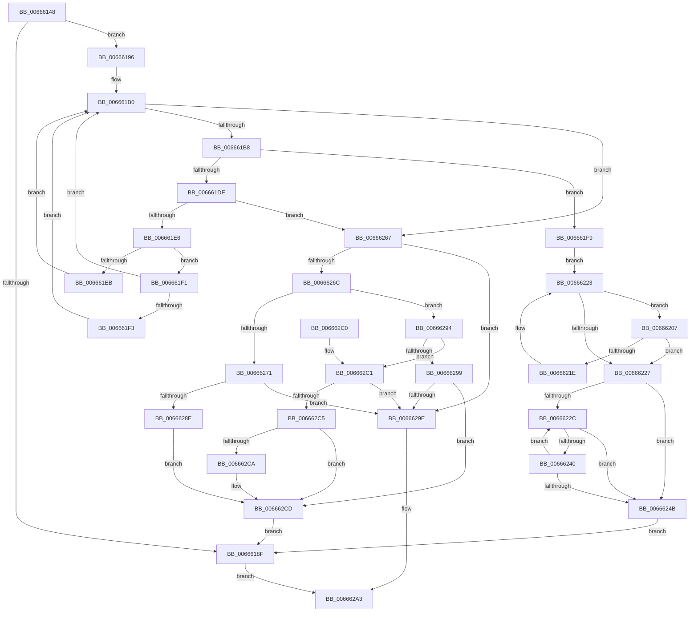

# ApiSetpFindHashInsertionPoint_V7

- RVA: `0x00666148`–`0x006662D6` (길이 `398` bytes)
- VA: `0x0000000140666148`
- 실행 섹션: `.text`
- PDB 이름 있음: `예`; PDB Function 태그: `아니요`
- unwind 정보 RVA: `0x000D61D0`
- 디코드: `122`개 명령, `398/398` bytes 표시
- 미해석 바이트: `0` (있으면 어셈블리에 `.byte`로 보존)

> 이 문서는 커널 이미지의 기계어와 PDB 기호를 분석해 생성했습니다. 4번과 5번은 함수 원형과 자료형을 바이너리 사용 방식에서 추정한 C 해석이며 원본 소스 복구 결과는 아닙니다.

## 1. Dependencies

- 직접 호출 지점: **0**; 고유 호출 대상: **0**
- 직접 호출자로 확인된 함수: **1**
- RIP 상대 이미지 참조: **0**

### Outgoing calls
- 직접 디코드된 call 명령이 없습니다.

### Direct callers
- [ApiSetpInsertHashEntry](ApiSetpInsertHashEntry_function_006662DC.md) at `0x006663DD`

### Static image references
- 디코드된 RIP-relative 메모리 참조가 없습니다.

## 2. Other-region calls and transfers

- 다른 실행 섹션으로 향하는 call: **0**
- 별도 외부 분기/꼬리 이동을 확인하지 못했습니다.

## 3. Assembly (complete function range)

```asm
00666148  48 8B C4                        mov rax, rsp
0066614B  48 89 58 08                     mov qword ptr [rax + 8], rbx
0066614F  48 89 68 10                     mov qword ptr [rax + 0x10], rbp
00666153  48 89 70 18                     mov qword ptr [rax + 0x18], rsi
00666157  48 89 78 20                     mov qword ptr [rax + 0x20], rdi
0066615B  41 54                           push r12
0066615D  41 55                           push r13
0066615F  41 56                           push r14
00666161  41 57                           push r15
00666163  4C 8B 7C 24 48                  mov r15, qword ptr [rsp + 0x48]
00666168  45 33 ED                        xor r13d, r13d
0066616B  4C 8B 64 24 50                  mov r12, qword ptr [rsp + 0x50]
00666170  4D 8B F1                        mov r14, r9
00666173  0F B7 42 04                     movzx eax, word ptr [rdx + 4]
00666177  45 8B D0                        mov r10d, r8d
0066617A  66 45 89 29                     mov word ptr [r9], r13w
0066617E  4C 8B D9                        mov r11, rcx
00666181  66 45 89 2F                     mov word ptr [r15], r13w
00666185  66 45 89 2C 24                  mov word ptr [r12], r13w
0066618A  66 85 C0                        test ax, ax
0066618D  75 07                           jne 0x140666196
0066618F  33 C0                           xor eax, eax
00666191  E9 0D 01 00 00                  jmp 0x1406662a3
00666196  44 0F B6 4A 08                  movzx r9d, byte ptr [rdx + 8]
0066619B  8D 48 FF                        lea ecx, [rax - 1]
0066619E  44 0F AF C8                     imul r9d, eax
006661A2  8B D8                           mov ebx, eax
006661A4  45 8B C5                        mov r8d, r13d
006661A7  49 8B C5                        mov rax, r13
006661AA  44 03 0A                        add r9d, dword ptr [rdx]
006661AD  41 8B D5                        mov edx, r13d
006661B0  3B D1                           cmp edx, ecx
006661B2  0F 8F AF 00 00 00               jg 0x140666267
006661B8  41 0F B7 73 12                  movzx esi, word ptr [r11 + 0x12]
006661BD  44 8D 04 0A                     lea r8d, [rdx + rcx]
006661C1  41 D1 F8                        sar r8d, 1
006661C4  49 63 C0                        movsxd rax, r8d
006661C7  48 C1 E0 03                     shl rax, 3
006661CB  48 2B C6                        sub rax, rsi
006661CE  41 8B E9                        mov ebp, r9d
006661D1  48 03 C5                        add rax, rbp
006661D4  49 03 C3                        add rax, r11
006661D7  8B 38                           mov edi, dword ptr [rax]
006661D9  44 3B D7                        cmp r10d, edi
006661DC  74 1B                           je 0x1406661f9
006661DE  3B D1                           cmp edx, ecx
006661E0  0F 84 81 00 00 00               je 0x140666267
006661E6  44 3B D7                        cmp r10d, edi
006661E9  73 06                           jae 0x1406661f1
006661EB  41 8D 48 FF                     lea ecx, [r8 - 1]
006661EF  EB BF                           jmp 0x1406661b0
006661F1  76 BD                           jbe 0x1406661b0
006661F3  41 8D 50 01                     lea edx, [r8 + 1]
006661F7  EB B7                           jmp 0x1406661b0
006661F9  41 8B C8                        mov ecx, r8d
006661FC  41 8D 40 01                     lea eax, [r8 + 1]
00666200  BA 01 00 00 00                  mov edx, 1
00666205  EB 1C                           jmp 0x140666223
00666207  48 63 C1                        movsxd rax, ecx
0066620A  48 8D 04 C5 08 00 00 00         lea rax, [rax*8 + 8]
00666212  48 2B C6                        sub rax, rsi
00666215  48 03 C5                        add rax, rbp
00666218  46 39 14 18                     cmp dword ptr [rax + r11], r10d
0066621C  75 09                           jne 0x140666227
0066621E  03 CA                           add ecx, edx
00666220  8D 41 01                        lea eax, [rcx + 1]
00666223  3B C3                           cmp eax, ebx
00666225  7C E0                           jl 0x140666207
00666227  45 85 C0                        test r8d, r8d
0066622A  7E 1F                           jle 0x14066624b
0066622C  49 63 C0                        movsxd rax, r8d
0066622F  48 C1 E0 03                     shl rax, 3
00666233  48 2B C6                        sub rax, rsi
00666236  48 03 C5                        add rax, rbp
00666239  46 39 54 18 F8                  cmp dword ptr [rax + r11 - 8], r10d
0066623E  75 0B                           jne 0x14066624b
00666240  44 2B C2                        sub r8d, edx
00666243  41 8D 40 FF                     lea eax, [r8 - 1]
00666247  85 C0                           test eax, eax
00666249  79 E1                           jns 0x14066622c
0066624B  8D 04 0A                        lea eax, [rdx + rcx]
0066624E  66 45 89 07                     mov word ptr [r15], r8w
00666252  66 41 2B C8                     sub cx, r8w
00666256  66 41 89 06                     mov word ptr [r14], ax
0066625A  66 03 CA                        add cx, dx
0066625D  66 41 89 0C 24                  mov word ptr [r12], cx
00666262  E9 28 FF FF FF                  jmp 0x14066618f
00666267  48 85 C0                        test rax, rax
0066626A  74 32                           je 0x14066629e
0066626C  41 3B D0                        cmp edx, r8d
0066626F  7E 23                           jle 0x140666294
00666271  49 63 C0                        movsxd rax, r8d
00666274  48 8D 14 C5 08 00 00 00         lea rdx, [rax*8 + 8]
0066627C  41 0F B7 43 12                  movzx eax, word ptr [r11 + 0x12]
00666281  48 2B D0                        sub rdx, rax
00666284  49 8D 04 13                     lea rax, [r11 + rdx]
00666288  45 3B 14 01                     cmp r10d, dword ptr [r9 + rax]
0066628C  73 10                           jae 0x14066629e
0066628E  66 41 FF C0                     inc r8w
00666292  EB 39                           jmp 0x1406662cd
00666294  41 3B C8                        cmp ecx, r8d
00666297  7D 28                           jge 0x1406662c1
00666299  44 3B 10                        cmp r10d, dword ptr [rax]
0066629C  72 2F                           jb 0x1406662cd
0066629E  B8 E5 00 00 C0                  mov eax, 0xc00000e5
006662A3  48 8B 5C 24 28                  mov rbx, qword ptr [rsp + 0x28]
006662A8  48 8B 6C 24 30                  mov rbp, qword ptr [rsp + 0x30]
006662AD  48 8B 74 24 38                  mov rsi, qword ptr [rsp + 0x38]
006662B2  48 8B 7C 24 40                  mov rdi, qword ptr [rsp + 0x40]
006662B7  41 5F                           pop r15
006662B9  41 5E                           pop r14
006662BB  41 5D                           pop r13
006662BD  41 5C                           pop r12
006662BF  C3                              ret
006662C0  CC                              int3
006662C1  3B D1                           cmp edx, ecx
006662C3  75 D9                           jne 0x14066629e
006662C5  44 3B 10                        cmp r10d, dword ptr [rax]
006662C8  72 03                           jb 0x1406662cd
006662CA  41 FF C0                        inc r8d
006662CD  66 45 89 06                     mov word ptr [r14], r8w
006662D1  E9 B9 FE FF FF                  jmp 0x14066618f
```

## 4. C-style interpretation (structured pseudocode)

```c
__int64 __fastcall ApiSetpFindHashInsertionPoint_V7(__int64 a1, __int64 a2, int a3, __int64 a4, __int64 a5, __int64 a6)
{
    __int64 result;
    __int64 v_r13;
    unsigned __int64 v_stack_p10;
    unsigned __int64 v_stack_p18;
    unsigned __int64 v_stack_p20;
    unsigned __int64 v_stack_p8;

    *(unsigned __int64 *)(v_rsp + 8) = v_rbx;
    *(unsigned __int64 *)(v_rsp + 16) = v_rbp;
    *(unsigned __int64 *)(v_rsp + 24) = v_rsi;
    *(unsigned __int64 *)(v_rsp + 32) = v_rdi;
    v_r13 = 0;
    *(unsigned __int16 *)(a4) = 0;
    *(unsigned __int16 *)(a5) = 0;
    *(unsigned __int16 *)(a6) = 0;
    if ((unsigned __int16)(*(unsigned __int16 *)(a2 + 4)) != 0) goto loc_00666196;
loc_0066618F:
    result = 0;
    goto loc_006662A3;
loc_00666196:
    a4 = (unsigned int)((*(unsigned __int8 *)(a2 + 8)) * (0));
    a4 = (unsigned int)((a4) + (*(unsigned int *)(a2)));
loc_006661B0:
    if (0 > ((unsigned int)(result - 1))) goto loc_00666267;
    a3 = (unsigned int)((0 + result - 1 * 1) >> (1));
    result = ((int)(a3)) << (3);
    result = (result) - (*(unsigned __int16 *)(a1 + 18));
    result = (result) + ((unsigned int)((unsigned int)(a4)));
    result = (result) + (a1);
    if (((unsigned int)((unsigned int)(a3))) == ((unsigned int)((unsigned int)(*(unsigned int *)(result))))) goto loc_006661F9;
    if (0 == ((unsigned int)(result - 1))) goto loc_00666267;
    if (((unsigned int)((unsigned int)(a3))) >= ((unsigned int)((unsigned int)(*(unsigned int *)(result))))) goto loc_006661F1;
    goto loc_006661B0;
loc_006661F1:
    if (((unsigned int)((unsigned int)(a3))) <= ((unsigned int)((unsigned int)(*(unsigned int *)(result))))) goto loc_006661B0;
    goto loc_006661B0;
loc_006661F9:
    goto loc_00666223;
loc_00666207:
    result = ((int)((unsigned int)((unsigned int)(a3))) * 8 + 8) - (*(unsigned __int16 *)(a1 + 18));
    result = (result) + ((unsigned int)((unsigned int)(a4)));
    if ((*(unsigned int *)(result + a1 * 1)) != ((unsigned int)((unsigned int)(a3)))) goto loc_00666227;
    a1 = (unsigned int)(((unsigned int)(a3)) + (1));
loc_00666223:
    if (((unsigned int)(a1 + 1)) < 0) goto loc_00666207;
loc_00666227:
    if (condition_is_less_or_equal) goto loc_0066624B;
loc_0066622C:
    result = ((int)(a3)) << (3);
    result = (result) - (*(unsigned __int16 *)(a1 + 18));
    result = (result) + ((unsigned int)((unsigned int)(a4)));
    if ((*(unsigned int *)(result + a1 * 1 - 8)) != ((unsigned int)((unsigned int)(a3)))) goto loc_0066624B;
    a3 = (unsigned int)((a3) - (1));
    if (!sign_flag) goto loc_0066622C;
loc_0066624B:
    *(unsigned __int16 *)(a5) = (unsigned __int16)(a3);
    a1 = (unsigned __int16)((a1) - ((unsigned __int16)(a3)));
    *(unsigned __int16 *)(a4) = (unsigned __int16)(1 + a1 * 1);
    a1 = (unsigned __int16)((a1) + (1));
    *(unsigned __int16 *)(a6) = (unsigned __int16)(a1);
    goto loc_0066618F;
loc_00666267:
    if (1 + a1 * 1 == 0) goto loc_0066629E;
    if (1 <= a3) goto loc_00666294;
    a2 = ((int)(a3) * 8 + 8) - (*(unsigned __int16 *)(a1 + 18));
    if (((unsigned int)((unsigned int)(a3))) >= (*(unsigned int *)(a4 + a1 + a2 * 1 * 1))) goto loc_0066629E;
    a3 = (unsigned __int16)((a3) + 1);
    goto loc_006662CD;
loc_00666294:
    if (((unsigned int)(a1)) >= a3) goto loc_006662C1;
    if (((unsigned int)((unsigned int)(a3))) < (*(unsigned int *)(a1 + a2 * 1))) goto loc_006662CD;
loc_0066629E:
loc_006662A3:
    return (unsigned int)(0xC00000E5ULL);
loc_006662C1:
    if (((unsigned int)(a2)) != ((unsigned int)(a1))) goto loc_0066629E;
    if (((unsigned int)((unsigned int)(a3))) >= (*(unsigned int *)((unsigned int)(0xC00000E5ULL)))) {
        a3 = (unsigned int)((a3) + 1);
    }
    *(unsigned __int16 *)(a4) = (unsigned __int16)(a3);
    goto loc_0066618F;
}
```

## 5. (Beta) C Style

```c
int64_t ApiSetpFindHashInsertionPoint_V7(void *Arg1, void *Arg2, int32_t Arg3, void *Arg4, void *Arg5, void *Arg6)
{
    uint8_t *arg1 = (uint8_t *)Arg1;
    uint8_t *arg2 = (uint8_t *)Arg2;
    uint8_t *arg4 = (uint8_t *)Arg4;
    uint8_t *arg5 = (uint8_t *)Arg5;
    uint8_t *arg6 = (uint8_t *)Arg6;

    int64_t result;
    int64_t local_r13;
    uint64_t v_stack_p10;
    uint64_t v_stack_p18;
    uint64_t v_stack_p20;
    uint64_t v_stack_p8;

    *(uint64_t *)(local_rsp + 0x8) = local_rbx;
    *(uint64_t *)(local_rsp + 0x10) = local_rbp;
    *(uint64_t *)(local_rsp + 0x18) = local_rsi;
    *(uint64_t *)(local_rsp + 0x20) = local_rdi;
    local_r13 = 0;
    *(uint16_t *)(arg4) = 0;
    *(uint16_t *)(arg5) = 0;
    *(uint16_t *)(arg6) = 0;
    if ((uint16_t)(*(uint16_t *)(arg2 + 0x4)) != 0) goto loc_00666196;
loc_0066618F:
    result = 0;
    goto loc_006662A3;
loc_00666196:
    Arg4 = (uint32_t)((*(uint8_t *)(arg2 + 0x8)) * (0));
    Arg4 = (uint32_t)((Arg4) + (*(uint32_t *)(arg2)));
loc_006661B0:
    if (0 > ((uint32_t)(result - 1))) goto loc_00666267;
    Arg3 = (uint32_t)((0 + result - 1 * 1) >> (1));
    result = ((int32_t)(Arg3)) << (3);
    result = (result) - (*(uint16_t *)(arg1 + 0x12));
    result = (result) + ((uint32_t)((uint32_t)(Arg4)));
    result = (result) + (Arg1);
    if (((uint32_t)((uint32_t)(Arg3))) == ((uint32_t)((uint32_t)(*(uint32_t *)(result))))) goto loc_006661F9;
    if (0 == ((uint32_t)(result - 1))) goto loc_00666267;
    if (((uint32_t)((uint32_t)(Arg3))) >= ((uint32_t)((uint32_t)(*(uint32_t *)(result))))) goto loc_006661F1;
    goto loc_006661B0;
loc_006661F1:
    if (((uint32_t)((uint32_t)(Arg3))) <= ((uint32_t)((uint32_t)(*(uint32_t *)(result))))) goto loc_006661B0;
    goto loc_006661B0;
loc_006661F9:
    goto loc_00666223;
loc_00666207:
    result = ((int32_t)((uint32_t)((uint32_t)(Arg3))) * 8 + 8) - (*(uint16_t *)(arg1 + 0x12));
    result = (result) + ((uint32_t)((uint32_t)(Arg4)));
    if ((*(uint32_t *)(result + arg1 * 1)) != ((uint32_t)((uint32_t)(Arg3)))) goto loc_00666227;
    Arg1 = (uint32_t)(((uint32_t)(Arg3)) + (1));
loc_00666223:
    if (((uint32_t)(Arg1 + 1)) < 0) goto loc_00666207;
loc_00666227:
    if (condition_is_less_or_equal) goto loc_0066624B;
loc_0066622C:
    result = ((int32_t)(Arg3)) << (3);
    result = (result) - (*(uint16_t *)(arg1 + 0x12));
    result = (result) + ((uint32_t)((uint32_t)(Arg4)));
    if ((*(uint32_t *)(result + arg1 * 1 - 0x8)) != ((uint32_t)((uint32_t)(Arg3)))) goto loc_0066624B;
    Arg3 = (uint32_t)((Arg3) - (1));
    if (!sign_flag) goto loc_0066622C;
loc_0066624B:
    *(uint16_t *)(arg5) = (uint16_t)(Arg3);
    Arg1 = (uint16_t)((Arg1) - ((uint16_t)(Arg3)));
    *(uint16_t *)(arg4) = (uint16_t)(1 + Arg1 * 1);
    Arg1 = (uint16_t)((Arg1) + (1));
    *(uint16_t *)(arg6) = (uint16_t)(Arg1);
    goto loc_0066618F;
loc_00666267:
    if (1 + Arg1 * 1 == 0) goto loc_0066629E;
    if (1 <= Arg3) goto loc_00666294;
    Arg2 = ((int32_t)(Arg3) * 8 + 8) - (*(uint16_t *)(arg1 + 0x12));
    if (((uint32_t)((uint32_t)(Arg3))) >= (*(uint32_t *)(arg4 + arg1 + arg2 * 1 * 1))) goto loc_0066629E;
    Arg3 = (uint16_t)((Arg3) + 1);
    goto loc_006662CD;
loc_00666294:
    if (((uint32_t)(Arg1)) >= Arg3) goto loc_006662C1;
    if (((uint32_t)((uint32_t)(Arg3))) < (*(uint32_t *)(arg1 + arg2 * 1))) goto loc_006662CD;
loc_0066629E:
loc_006662A3:
    return (uint32_t)(0xC00000E5ULL);
loc_006662C1:
    if (((uint32_t)(Arg2)) != ((uint32_t)(Arg1))) goto loc_0066629E;
    if (((uint32_t)((uint32_t)(Arg3))) >= (*(uint32_t *)((uint32_t)(0xC00000E5ULL)))) {
        Arg3 = (uint32_t)((Arg3) + 1);
    }
    *(uint16_t *)(arg4) = (uint16_t)(Arg3);
    goto loc_0066618F;
}
```

### 관측된 메모리 오프셋

구조체 형식이 확인되지 않은 접근은 인자 기준의 오프셋으로만 기록했습니다.

| 기준 인자 | 오프셋 표현 | 폭 (bit) | 접근 |
|---|---:|---:|---|
| `Arg1` | `+ 0x0 + rdx*1` | `64` | `R` |
| `Arg1` | `+ 0x12` | `16` | `R` |
| `Arg2` | `+ 0x0` | `32` | `R` |
| `Arg2` | `+ 0x4` | `16` | `R` |
| `Arg2` | `+ 0x8` | `8` | `R` |
| `Arg4` | `+ 0x0` | `16` | `W` |
| `Arg5` | `+ 0x0` | `16` | `W` |
| `Arg6` | `+ 0x0` | `16` | `W` |

## 6. Execution-region graph

[열기: 2D/3D 그래프와 함수 탐색 컨트롤 패널](../../../control-panel.html?section=text&rva=0x00666148&view=graph)

- 2D 그래프는 위에서 아래로 흐르고, 3D 그래프는 빈 공간을 드래그해 회전합니다. Shift+드래그는 이동, 휠은 확대·축소, 함수 노드 선택은 대상 보고서 이동입니다.

### Static fallback


