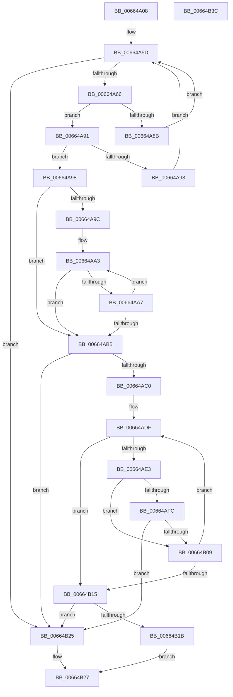

# ApiSetpFindHashtableIndexAndVerify_V7

- RVA: `0x00664A08`–`0x00664B3D` (길이 `309` bytes)
- VA: `0x0000000140664A08`
- 실행 섹션: `.text`
- PDB 이름 있음: `예`; PDB Function 태그: `아니요`
- unwind 정보 RVA: `0x000D6194`
- 디코드: `97`개 명령, `309/309` bytes 표시
- 미해석 바이트: `0` (있으면 어셈블리에 `.byte`로 보존)

> 이 문서는 커널 이미지의 기계어와 PDB 기호를 분석해 생성했습니다. 4번과 5번은 함수 원형과 자료형을 바이너리 사용 방식에서 추정한 C 해석이며 원본 소스 복구 결과는 아닙니다.

## 1. Dependencies

- 직접 호출 지점: **0**; 고유 호출 대상: **0**
- 직접 호출자로 확인된 함수: **1**
- RIP 상대 이미지 참조: **0**

### Outgoing calls
- 직접 디코드된 call 명령이 없습니다.

### Direct callers
- [ApiSetpSearchForSectionIndex_V7](ApiSetpSearchForSectionIndex_V7_function_00665218.md) at `0x006652FD`

### Static image references
- 디코드된 RIP-relative 메모리 참조가 없습니다.

## 2. Other-region calls and transfers

- 다른 실행 섹션으로 향하는 call: **0**
- 별도 외부 분기/꼬리 이동을 확인하지 못했습니다.

## 3. Assembly (complete function range)

```asm
00664A08  48 89 5C 24 08                  mov qword ptr [rsp + 8], rbx
00664A0D  48 89 6C 24 18                  mov qword ptr [rsp + 0x18], rbp
00664A12  44 89 4C 24 20                  mov dword ptr [rsp + 0x20], r9d
00664A17  56                              push rsi
00664A18  57                              push rdi
00664A19  41 54                           push r12
00664A1B  41 55                           push r13
00664A1D  41 56                           push r14
00664A1F  41 57                           push r15
00664A21  0F B6 42 08                     movzx eax, byte ptr [rdx + 8]
00664A25  48 8B F1                        mov rsi, rcx
00664A28  44 0F B7 6A 04                  movzx r13d, word ptr [rdx + 4]
00664A2D  44 8B D8                        mov r11d, eax
00664A30  8B 0A                           mov ecx, dword ptr [rdx]
00664A32  41 8B D8                        mov ebx, r8d
00664A35  4C 8B 64 24 58                  mov r12, qword ptr [rsp + 0x58]
00664A3A  BD FF FF 00 00                  mov ebp, 0xffff
00664A3F  45 0F AF DD                     imul r11d, r13d
00664A43  89 44 24 58                     mov dword ptr [rsp + 0x58], eax
00664A47  45 8D 4D FF                     lea r9d, [r13 - 1]
00664A4B  89 4C 24 40                     mov dword ptr [rsp + 0x40], ecx
00664A4F  66 41 89 2C 24                  mov word ptr [r12], bp
00664A54  44 03 D9                        add r11d, ecx
00664A57  45 33 C0                        xor r8d, r8d
00664A5A  41 8B D0                        mov edx, r8d
00664A5D  41 3B D1                        cmp edx, r9d
00664A60  0F 8F BF 00 00 00               jg 0x140664b25
00664A66  44 0F B7 76 12                  movzx r14d, word ptr [rsi + 0x12]
00664A6B  42 8D 04 0A                     lea eax, [rdx + r9]
00664A6F  D1 F8                           sar eax, 1
00664A71  48 63 C8                        movsxd rcx, eax
00664A74  45 8B FB                        mov r15d, r11d
00664A77  4C 8D 14 CD 00 00 00 00         lea r10, [rcx*8]
00664A7F  4D 2B D6                        sub r10, r14
00664A82  4D 03 D7                        add r10, r15
00664A85  41 3B 1C 32                     cmp ebx, dword ptr [r10 + rsi]
00664A89  73 06                           jae 0x140664a91
00664A8B  44 8D 48 FF                     lea r9d, [rax - 1]
00664A8F  EB CC                           jmp 0x140664a5d
00664A91  76 05                           jbe 0x140664a98
00664A93  8D 50 01                        lea edx, [rax + 1]
00664A96  EB C5                           jmp 0x140664a5d
00664A98  85 C0                           test eax, eax
00664A9A  7E 19                           jle 0x140664ab5
00664A9C  48 8D 56 F8                     lea rdx, [rsi - 8]
00664AA0  49 03 D2                        add rdx, r10
00664AA3  39 1A                           cmp dword ptr [rdx], ebx
00664AA5  75 0E                           jne 0x140664ab5
00664AA7  FF C8                           dec eax
00664AA9  48 FF C9                        dec rcx
00664AAC  48 83 EA 08                     sub rdx, 8
00664AB0  48 85 C9                        test rcx, rcx
00664AB3  7F EE                           jg 0x140664aa3
00664AB5  4C 63 C8                        movsxd r9, eax
00664AB8  4D 8B DD                        mov r11, r13
00664ABB  4D 3B CD                        cmp r9, r13
00664ABE  7D 65                           jge 0x140664b25
00664AC0  8B 7C 24 58                     mov edi, dword ptr [rsp + 0x58]
00664AC4  4A 8D 14 CD 00 00 00 00         lea rdx, [r9*8]
00664ACC  44 8B 6C 24 50                  mov r13d, dword ptr [rsp + 0x50]
00664AD1  49 2B D6                        sub rdx, r14
00664AD4  49 03 D7                        add rdx, r15
00664AD7  44 8B 7C 24 40                  mov r15d, dword ptr [rsp + 0x40]
00664ADC  48 03 D6                        add rdx, rsi
00664ADF  39 1A                           cmp dword ptr [rdx], ebx
00664AE1  75 32                           jne 0x140664b15
00664AE3  44 0F B7 52 04                  movzx r10d, word ptr [rdx + 4]
00664AE8  40 0F B6 CF                     movzx ecx, dil
00664AEC  49 0F AF CA                     imul rcx, r10
00664AF0  49 03 CF                        add rcx, r15
00664AF3  49 2B CE                        sub rcx, r14
00664AF6  44 39 2C 31                     cmp dword ptr [rcx + rsi], r13d
00664AFA  75 0D                           jne 0x140664b09
00664AFC  41 FF C0                        inc r8d
00664AFF  41 0F B7 EA                     movzx ebp, r10w
00664B03  41 83 F8 01                     cmp r8d, 1
00664B07  77 1C                           ja 0x140664b25
00664B09  49 FF C1                        inc r9
00664B0C  48 83 C2 08                     add rdx, 8
00664B10  4D 3B CB                        cmp r9, r11
00664B13  7C CA                           jl 0x140664adf
00664B15  41 83 F8 01                     cmp r8d, 1
00664B19  75 0A                           jne 0x140664b25
00664B1B  66 41 89 2C 24                  mov word ptr [r12], bp
00664B20  41 8A C0                        mov al, r8b
00664B23  EB 02                           jmp 0x140664b27
00664B25  32 C0                           xor al, al
00664B27  48 8B 5C 24 38                  mov rbx, qword ptr [rsp + 0x38]
00664B2C  48 8B 6C 24 48                  mov rbp, qword ptr [rsp + 0x48]
00664B31  41 5F                           pop r15
00664B33  41 5E                           pop r14
00664B35  41 5D                           pop r13
00664B37  41 5C                           pop r12
00664B39  5F                              pop rdi
00664B3A  5E                              pop rsi
00664B3B  C3                              ret
00664B3C  CC                              int3
```

## 4. C-style interpretation (structured pseudocode)

```c
__int64 __fastcall ApiSetpFindHashtableIndexAndVerify_V7(__int64 a1, __int64 a2, int a3, int a4, unsigned int a5)
{
    __int64 result;
    __int64 v_r10;
    __int64 v_r11;
    unsigned int v_stack_p10;
    unsigned __int64 v_stack_p18;
    unsigned int v_stack_p20;
    unsigned int v_stack_p28;
    unsigned __int64 v_stack_p8;

    v_stack_p8 = v_rbx;
    v_stack_p18 = v_rbp;
    v_stack_p20 = a4;
    v_r11 = (unsigned int)(((unsigned int)((unsigned int)(*(unsigned __int8 *)(a2 + 8)))) * ((unsigned int)(*(unsigned __int16 *)(a2 + 4))));
    v_stack_p28 = (unsigned int)(*(unsigned __int8 *)(a2 + 8));
    v_stack_p10 = (unsigned int)((unsigned int)(*(unsigned int *)(a2)));
    *(unsigned __int16 *)(a5) = (unsigned __int16)((unsigned int)(0xFFFFULL));
    v_r11 = (unsigned int)((v_r11) + ((unsigned int)((unsigned int)(*(unsigned int *)(a2)))));
    a3 = 0;
loc_00664A5D:
    if (0 > ((unsigned int)(*(unsigned __int16 *)(a2 + 4) - 1))) goto loc_00664B25;
    result = (unsigned int)((0 + *(unsigned __int16 *)(a2 + 4) - 1 * 1) >> (1));
    v_r10 = ((int)((unsigned int)(result)) * 8) - (*(unsigned __int16 *)(a1 + 18));
    v_r10 = (v_r10) + ((unsigned int)((unsigned int)(v_r11)));
    if (((unsigned int)((unsigned int)(a3))) >= (*(unsigned int *)(v_r10 + a1 * 1))) goto loc_00664A91;
    goto loc_00664A5D;
loc_00664A91:
    if (((unsigned int)((unsigned int)(a3))) <= (*(unsigned int *)(v_r10 + a1 * 1))) goto loc_00664A98;
    goto loc_00664A5D;
loc_00664A98:
    if (condition_is_less_or_equal) goto loc_00664AB5;
    a2 = (a1 - 8) + (v_r10);
loc_00664AA3:
    if ((*(unsigned int *)(a2)) != ((unsigned int)((unsigned int)(a3)))) goto loc_00664AB5;
    result = (unsigned int)((result) - 1);
    a1 = ((int)((unsigned int)(result))) - 1;
    a2 = (a2) - (8);
    if (condition_is_greater) goto loc_00664AA3;
loc_00664AB5:
    if (((int)((unsigned int)(result))) >= (*(unsigned __int16 *)(a2 + 4))) goto loc_00664B25;
    a2 = ((int)((unsigned int)(result)) * 8) - (*(unsigned __int16 *)(a1 + 18));
    a2 = (a2) + ((unsigned int)((unsigned int)(v_r11)));
    a2 = (a2) + (a1);
loc_00664ADF:
    if ((*(unsigned int *)(a2)) != ((unsigned int)((unsigned int)(a3)))) goto loc_00664B15;
    a1 = ((unsigned __int8)((unsigned int)(a5))) * (*(unsigned __int16 *)(a2 + 4));
    a1 = (a1) + ((unsigned int)(v_stack_p10));
    a1 = (a1) - (*(unsigned __int16 *)(a1 + 18));
    if ((*(unsigned int *)(a1 + a1 * 1)) != ((unsigned int)((unsigned int)(v_stack_p20)))) goto loc_00664B09;
    a3 = (unsigned int)((a3) + 1);
    if (a3 > 1) goto loc_00664B25;
loc_00664B09:
    a4 = ((int)((unsigned int)(result))) + 1;
    a2 = (a2) + (8);
    if (a4 < (*(unsigned __int16 *)(a2 + 4))) goto loc_00664ADF;
loc_00664B15:
    if (a3 != 1) goto loc_00664B25;
    *(unsigned __int16 *)(a5) = (unsigned __int16)((unsigned __int16)(*(unsigned __int16 *)(a2 + 4)));
    goto loc_00664B27;
loc_00664B25:
    result = 0;
loc_00664B27:
    return result;
}
```

## 5. (Beta) C Style

```c
int64_t ApiSetpFindHashtableIndexAndVerify_V7(void *Arg1, void *Arg2, int32_t Arg3, int32_t Arg4, void *Arg5)
{
    uint8_t *arg1 = (uint8_t *)Arg1;
    uint8_t *arg2 = (uint8_t *)Arg2;
    uint8_t *arg5 = (uint8_t *)Arg5;

    int64_t result;
    int64_t local_r10;
    int64_t local_r11;
    uint32_t v_stack_p10;
    uint64_t v_stack_p18;
    uint32_t v_stack_p20;
    uint32_t v_stack_p28;
    uint64_t v_stack_p8;

    v_stack_p8 = local_rbx;
    v_stack_p18 = local_rbp;
    v_stack_p20 = Arg4;
    local_r11 = (uint32_t)(((uint32_t)((uint32_t)(*(uint8_t *)(arg2 + 0x8)))) * ((uint32_t)(*(uint16_t *)(arg2 + 0x4))));
    v_stack_p28 = (uint32_t)(*(uint8_t *)(arg2 + 0x8));
    v_stack_p10 = (uint32_t)((uint32_t)(*(uint32_t *)(arg2)));
    *(uint16_t *)(arg5) = (uint16_t)((uint32_t)(0xFFFFULL));
    local_r11 = (uint32_t)((local_r11) + ((uint32_t)((uint32_t)(*(uint32_t *)(arg2)))));
    Arg3 = 0;
loc_00664A5D:
    if (0 > ((uint32_t)(*(uint16_t *)(arg2 + 0x4) - 1))) goto loc_00664B25;
    result = (uint32_t)((0 + *(uint16_t *)(arg2 + 0x4) - 1 * 1) >> (1));
    local_r10 = ((int32_t)((uint32_t)(result)) * 8) - (*(uint16_t *)(arg1 + 0x12));
    local_r10 = (local_r10) + ((uint32_t)((uint32_t)(local_r11)));
    if (((uint32_t)((uint32_t)(Arg3))) >= (*(uint32_t *)(local_r10 + arg1 * 1))) goto loc_00664A91;
    goto loc_00664A5D;
loc_00664A91:
    if (((uint32_t)((uint32_t)(Arg3))) <= (*(uint32_t *)(local_r10 + arg1 * 1))) goto loc_00664A98;
    goto loc_00664A5D;
loc_00664A98:
    if (condition_is_less_or_equal) goto loc_00664AB5;
    Arg2 = (Arg1 - 8) + (local_r10);
loc_00664AA3:
    if ((*(uint32_t *)(arg2)) != ((uint32_t)((uint32_t)(Arg3)))) goto loc_00664AB5;
    result = (uint32_t)((result) - 1);
    Arg1 = ((int32_t)((uint32_t)(result))) - 1;
    Arg2 = (Arg2) - (8);
    if (condition_is_greater) goto loc_00664AA3;
loc_00664AB5:
    if (((int32_t)((uint32_t)(result))) >= (*(uint16_t *)(arg2 + 0x4))) goto loc_00664B25;
    Arg2 = ((int32_t)((uint32_t)(result)) * 8) - (*(uint16_t *)(arg1 + 0x12));
    Arg2 = (Arg2) + ((uint32_t)((uint32_t)(local_r11)));
    Arg2 = (Arg2) + (Arg1);
loc_00664ADF:
    if ((*(uint32_t *)(arg2)) != ((uint32_t)((uint32_t)(Arg3)))) goto loc_00664B15;
    Arg1 = ((uint8_t)((uint32_t)(Arg5))) * (*(uint16_t *)(arg2 + 0x4));
    Arg1 = (Arg1) + ((uint32_t)(v_stack_p10));
    Arg1 = (Arg1) - (*(uint16_t *)(arg1 + 0x12));
    if ((*(uint32_t *)(arg1 + arg1 * 1)) != ((uint32_t)((uint32_t)(v_stack_p20)))) goto loc_00664B09;
    Arg3 = (uint32_t)((Arg3) + 1);
    if (Arg3 > 1) goto loc_00664B25;
loc_00664B09:
    Arg4 = ((int32_t)((uint32_t)(result))) + 1;
    Arg2 = (Arg2) + (8);
    if (Arg4 < (*(uint16_t *)(arg2 + 0x4))) goto loc_00664ADF;
loc_00664B15:
    if (Arg3 != 1) goto loc_00664B25;
    *(uint16_t *)(arg5) = (uint16_t)((uint16_t)(*(uint16_t *)(arg2 + 0x4)));
    goto loc_00664B27;
loc_00664B25:
    result = 0;
loc_00664B27:
    return result;
}
```

### 관측된 메모리 오프셋

구조체 형식이 확인되지 않은 접근은 인자 기준의 오프셋으로만 기록했습니다.

| 기준 인자 | 오프셋 표현 | 폭 (bit) | 접근 |
|---|---:|---:|---|
| `Arg1` | `- 0x8` | `64` | `R` |
| `Arg1` | `+ 0x0` | `32` | `R` |
| `Arg1` | `+ 0x12` | `16` | `R` |
| `Arg2` | `+ 0x0` | `32` | `R` |
| `Arg2` | `+ 0x4` | `16` | `R` |
| `Arg2` | `+ 0x8` | `8` | `R` |
| `Arg5` | `+ 0x0` | `16` | `W` |
| `Arg5` | `+ 0x0 + rsi*1` | `32` | `R` |

## 6. Execution-region graph

[열기: 2D/3D 그래프와 함수 탐색 컨트롤 패널](../../../control-panel.html?section=text&rva=0x00664A08&view=graph)

- 2D 그래프는 위에서 아래로 흐르고, 3D 그래프는 빈 공간을 드래그해 회전합니다. Shift+드래그는 이동, 휠은 확대·축소, 함수 노드 선택은 대상 보고서 이동입니다.

### Static fallback


