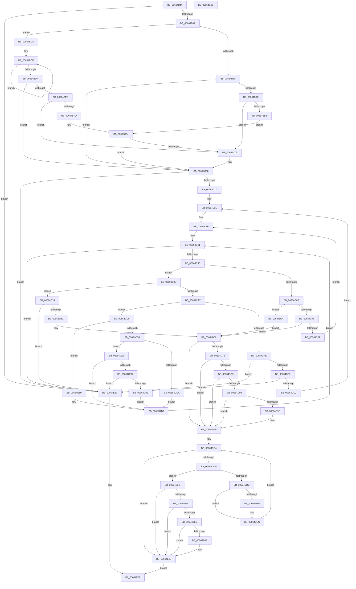

# ApiSetpGetContractKeyInfo

- RVA: `0x00664B44`–`0x00664E43` (길이 `767` bytes)
- VA: `0x0000000140664B44`
- 실행 섹션: `.text`
- PDB 이름 있음: `예`; PDB Function 태그: `아니요`
- unwind 정보 RVA: `0x000D61B0`
- 디코드: `220`개 명령, `767/767` bytes 표시
- 미해석 바이트: `0` (있으면 어셈블리에 `.byte`로 보존)

> 이 문서는 커널 이미지의 기계어와 PDB 기호를 분석해 생성했습니다. 4번과 5번은 함수 원형과 자료형을 바이너리 사용 방식에서 추정한 C 해석이며 원본 소스 복구 결과는 아닙니다.

## 1. Dependencies

- 직접 호출 지점: **0**; 고유 호출 대상: **0**
- 직접 호출자로 확인된 함수: **6**
- RIP 상대 이미지 참조: **2**

### Outgoing calls
- 직접 디코드된 call 명령이 없습니다.

### Direct callers
- [ApiSetQuerySchemaInfo2_V7](ApiSetQuerySchemaInfo2_V7_function_0066301C.md) at `0x006630FB`
- [ApiSetpResolveHost](ApiSetpResolveHost_function_006638D0.md) at `0x00663926`
- [ApiSetCompose_ProcessV7Extension_Phase0](ApiSetCompose_ProcessV7Extension_Phase0_function_00663F00.md) at `0x00663F7D`
- [ApiSetCompose_ProcessV7Extension_Phase1](ApiSetCompose_ProcessV7Extension_Phase1_function_006641BC.md) at `0x006642A4`
- [ApiSetCompose_V7_ProcessV6Extension_Phase0](ApiSetCompose_V7_ProcessV6Extension_Phase0_function_00665A78.md) at `0x00665BA2`
- [ApiSetCompose_V7_ProcessV6Extension_Phase1](ApiSetCompose_V7_ProcessV6Extension_Phase1_function_00665C64.md) at `0x00665DD7`

### Static image references
- `0x00664BF4` → RVA `0x00039E0C` (`.rdata`; read)
- `0x00664BFD` → RVA `0x00039E04` (`.rdata`; read)

## 2. Other-region calls and transfers

- 다른 실행 섹션으로 향하는 call: **0**
- 별도 외부 분기/꼬리 이동을 확인하지 못했습니다.

## 3. Assembly (complete function range)

```asm
00664B44  48 89 5C 24 08                  mov qword ptr [rsp + 8], rbx
00664B49  48 89 6C 24 18                  mov qword ptr [rsp + 0x18], rbp
00664B4E  48 89 74 24 20                  mov qword ptr [rsp + 0x20], rsi
00664B53  57                              push rdi
00664B54  41 54                           push r12
00664B56  41 55                           push r13
00664B58  41 56                           push r14
00664B5A  41 57                           push r15
00664B5C  0F 57 C0                        xorps xmm0, xmm0
00664B5F  44 0F B7 D2                     movzx r10d, dx
00664B63  33 C0                           xor eax, eax
00664B65  45 8A E0                        mov r12b, r8b
00664B68  4C 8B F1                        mov r14, rcx
00664B6B  41 0F 11 01                     movups xmmword ptr [r9], xmm0
00664B6F  41 0F 11 41 10                  movups xmmword ptr [r9 + 0x10], xmm0
00664B74  49 89 41 20                     mov qword ptr [r9 + 0x20], rax
00664B78  41 83 FA 05                     cmp r10d, 5
00664B7C  0F 82 A5 02 00 00               jb 0x140664e27
00664B82  33 FF                           xor edi, edi
00664B84  40 8A CF                        mov cl, dil
00664B87  45 84 C0                        test r8b, r8b
00664B8A  74 3E                           je 0x140664bca
00664B8C  41 0F B7 C2                     movzx eax, r10w
00664B90  8D 57 01                        lea edx, [rdi + 1]
00664B93  66 03 C0                        add ax, ax
00664B96  66 83 F8 08                     cmp ax, 8
00664B9A  72 6C                           jb 0x140664c08
00664B9C  49 8B 06                        mov rax, qword ptr [r14]
00664B9F  49 B8 DF FF DF FF DF FF FF FF   movabs r8, 0xffffffdfffdfffdf
00664BA9  49 23 C0                        and rax, r8
00664BAC  49 B8 41 00 50 00 49 00 2D 00   movabs r8, 0x2d004900500041
00664BB6  49 3B C0                        cmp rax, r8
00664BB9  74 4B                           je 0x140664c06
00664BBB  49 B8 45 00 58 00 54 00 2D 00   movabs r8, 0x2d005400580045
00664BC5  49 3B C0                        cmp rax, r8
00664BC8  EB 3A                           jmp 0x140664c04
00664BCA  48 83 C8 FF                     or rax, 0xffffffffffffffff
00664BCE  48 FF C0                        inc rax
00664BD1  41 38 3C 06                     cmp byte ptr [r14 + rax], dil
00664BD5  75 F7                           jne 0x140664bce
00664BD7  48 83 C0 FC                     add rax, -4
00664BDB  BA 01 00 00 00                  mov edx, 1
00664BE0  48 3D FB FF 00 00               cmp rax, 0xfffb
00664BE6  77 20                           ja 0x140664c08
00664BE8  41 8B 06                        mov eax, dword ptr [r14]
00664BEB  41 B8 DF DF DF FF               mov r8d, 0xffdfdfdf
00664BF1  49 23 C0                        and rax, r8
00664BF4  48 3B 05 11 52 9D FF            cmp rax, qword ptr [rip - 0x62adef]
00664BFB  74 09                           je 0x140664c06
00664BFD  48 3B 05 00 52 9D FF            cmp rax, qword ptr [rip - 0x62ae00]
00664C04  75 02                           jne 0x140664c08
00664C06  8A CA                           mov cl, dl
00664C08  84 C9                           test cl, cl
00664C0A  0F 84 17 02 00 00               je 0x140664e27
00664C10  45 84 E4                        test r12b, r12b
00664C13  4D 89 31                        mov qword ptr [r9], r14
00664C16  4F 8D 2C 12                     lea r13, [r10 + r10]
00664C1A  66 45 89 51 08                  mov word ptr [r9 + 8], r10w
00664C1F  4D 0F 44 EA                     cmove r13, r10
00664C23  45 88 61 0A                     mov byte ptr [r9 + 0xa], r12b
00664C27  4D 03 EE                        add r13, r14
00664C2A  40 88 7C 24 38                  mov byte ptr [rsp + 0x38], dil
00664C2F  40 8A EF                        mov bpl, dil
00664C32  44 0F B7 FF                     movzx r15d, di
00664C36  8B F2                           mov esi, edx
00664C38  45 0F B7 C2                     movzx r8d, r10w
00664C3C  44 8A DF                        mov r11b, dil
00664C3F  8A DA                           mov bl, dl
00664C41  B8 FF FF 00 00                  mov eax, 0xffff
00664C46  66 44 3B C2                     cmp r8w, dx
00664C4A  0F 86 D7 01 00 00               jbe 0x140664e27
00664C50  66 44 03 C0                     add r8w, ax
00664C54  41 8A C4                        mov al, r12b
00664C57  F6 D8                           neg al
00664C59  48 1B FF                        sbb rdi, rdi
00664C5C  48 F7 DF                        neg rdi
00664C5F  48 03 FA                        add rdi, rdx
00664C62  4C 2B EF                        sub r13, rdi
00664C65  41 0F B6 4D 00                  movzx ecx, byte ptr [r13]
00664C6A  80 F9 2D                        cmp cl, 0x2d
00664C6D  75 2F                           jne 0x140664c9e
00664C6F  45 84 DB                        test r11b, r11b
00664C72  0F 84 AC 00 00 00               je 0x140664d24
00664C78  40 84 ED                        test bpl, bpl
00664C7B  0F 85 D5 00 00 00               jne 0x140664d56
00664C81  45 32 DB                        xor r11b, r11b
00664C84  66 45 89 79 18                  mov word ptr [r9 + 0x18], r15w
00664C89  45 33 FF                        xor r15d, r15d
00664C8C  41 C7 41 0C 03 00 00 00         mov dword ptr [r9 + 0xc], 3
00664C94  66 45 89 41 12                  mov word ptr [r9 + 0x12], r8w
00664C99  40 8A EA                        mov bpl, dl
00664C9C  EB A1                           jmp 0x140664c3f
00664C9E  80 F9 7E                        cmp cl, 0x7e
00664CA1  0F 84 8C 00 00 00               je 0x140664d33
00664CA7  33 FF                           xor edi, edi
00664CA9  80 F9 2E                        cmp cl, 0x2e
00664CAC  75 21                           jne 0x140664ccf
00664CAE  40 84 ED                        test bpl, bpl
00664CB1  0F 85 70 01 00 00               jne 0x140664e27
00664CB7  40 38 7C 24 38                  cmp byte ptr [rsp + 0x38], dil
00664CBC  0F 85 65 01 00 00               jne 0x140664e27
00664CC2  45 0F B7 D0                     movzx r10d, r8w
00664CC6  88 54 24 38                     mov byte ptr [rsp + 0x38], dl
00664CCA  E9 6D FF FF FF                  jmp 0x140664c3c
00664CCF  8D 41 D0                        lea eax, [rcx - 0x30]
00664CD2  3C 09                           cmp al, 9
00664CD4  77 43                           ja 0x140664d19
00664CD6  84 DB                           test bl, bl
00664CD8  74 0E                           je 0x140664ce8
00664CDA  44 8D 79 D0                     lea r15d, [rcx - 0x30]
00664CDE  BE 0A 00 00 00                  mov esi, 0xa
00664CE3  44 8A DA                        mov r11b, dl
00664CE6  EB 34                           jmp 0x140664d1c
00664CE8  45 84 DB                        test r11b, r11b
00664CEB  74 2F                           je 0x140664d1c
00664CED  83 E9 30                        sub ecx, 0x30
00664CF0  41 0F B7 C7                     movzx eax, r15w
00664CF4  0F AF CE                        imul ecx, esi
00664CF7  BB FF FF 00 00                  mov ebx, 0xffff
00664CFC  03 C8                           add ecx, eax
00664CFE  3B CB                           cmp ecx, ebx
00664D00  0F 87 21 01 00 00               ja 0x140664e27
00664D06  8D 34 B6                        lea esi, [rsi + rsi*4]
00664D09  44 0F B7 F9                     movzx r15d, cx
00664D0D  03 F6                           add esi, esi
00664D0F  8D 43 01                        lea eax, [rbx + 1]
00664D12  3B F3                           cmp esi, ebx
00664D14  0F 47 F0                        cmova esi, eax
00664D17  EB 03                           jmp 0x140664d1c
00664D19  44 8A DF                        mov r11b, dil
00664D1C  40 8A DF                        mov bl, dil
00664D1F  E9 1D FF FF FF                  jmp 0x140664c41
00664D24  41 89 51 0C                     mov dword ptr [r9 + 0xc], edx
00664D28  45 0F B7 C2                     movzx r8d, r10w
00664D2C  66 45 89 51 12                  mov word ptr [r9 + 0x12], r10w
00664D31  EB 23                           jmp 0x140664d56
00664D33  40 84 ED                        test bpl, bpl
00664D36  0F 85 EB 00 00 00               jne 0x140664e27
00664D3C  66 45 89 51 12                  mov word ptr [r9 + 0x12], r10w
00664D41  66 45 2B D0                     sub r10w, r8w
00664D45  66 44 2B D2                     sub r10w, dx
00664D49  41 C7 41 0C 02 00 00 00         mov dword ptr [r9 + 0xc], 2
00664D51  66 45 89 51 16                  mov word ptr [r9 + 0x16], r10w
00664D56  41 BA 14 00 00 00               mov r10d, 0x14
00664D5C  4D 8B D9                        mov r11, r9
00664D5F  40 B5 DF                        mov bpl, 0xdf
00664D62  66 47 89 04 11                  mov word ptr [r9 + r10], r8w
00664D67  41 8D 72 F0                     lea esi, [r10 - 0x10]
00664D6B  66 41 83 F8 07                  cmp r8w, 7
00664D70  76 34                           jbe 0x140664da6
00664D72  41 8A C4                        mov al, r12b
00664D75  F6 D8                           neg al
00664D77  48 1B C9                        sbb rcx, rcx
00664D7A  48 23 CE                        and rcx, rsi
00664D7D  48 03 CE                        add rcx, rsi
00664D80  49 03 CE                        add rcx, r14
00664D83  8A 01                           mov al, byte ptr [rcx]
00664D85  2C 4D                           sub al, 0x4d
00664D87  40 84 C5                        test bpl, al
00664D8A  75 1A                           jne 0x140664da6
00664D8C  48 03 CF                        add rcx, rdi
00664D8F  8A 01                           mov al, byte ptr [rcx]
00664D91  2C 53                           sub al, 0x53
00664D93  40 84 C5                        test bpl, al
00664D96  75 0E                           jne 0x140664da6
00664D98  80 3C 0F 2D                     cmp byte ptr [rdi + rcx], 0x2d
00664D9C  75 08                           jne 0x140664da6
00664D9E  41 C7 41 1A 04 00 06 00         mov dword ptr [r9 + 0x1a], 0x60004
00664DA6  43 0F B7 04 13                  movzx eax, word ptr [r11 + r10]
00664DAB  45 84 E4                        test r12b, r12b
00664DAE  48 8D 0C 00                     lea rcx, [rax + rax]
00664DB2  48 0F 44 C8                     cmove rcx, rax
00664DB6  32 DB                           xor bl, bl
00664DB8  49 03 CE                        add rcx, r14
00664DBB  41 BE FF FF 00 00               mov r14d, 0xffff
00664DC1  45 32 D2                        xor r10b, r10b
00664DC4  66 44 3B C6                     cmp r8w, si
00664DC8  76 59                           jbe 0x140664e23
00664DCA  48 2B CF                        sub rcx, rdi
00664DCD  66 45 03 C6                     add r8w, r14w
00664DD1  44 8A 19                        mov r11b, byte ptr [rcx]
00664DD4  41 8D 43 D0                     lea eax, [r11 - 0x30]
00664DD8  3C 09                           cmp al, 9
00664DDA  77 14                           ja 0x140664df0
00664DDC  84 DB                           test bl, bl
00664DDE  75 0C                           jne 0x140664dec
00664DE0  41 80 FB 31                     cmp r11b, 0x31
00664DE4  45 0F B6 D2                     movzx r10d, r10b
00664DE8  44 0F 44 D2                     cmove r10d, edx
00664DEC  8A DA                           mov bl, dl
00664DEE  EB D4                           jmp 0x140664dc4
00664DF0  84 DB                           test bl, bl
00664DF2  74 2F                           je 0x140664e23
00664DF4  41 80 EB 4C                     sub r11b, 0x4c
00664DF8  44 84 DD                        test bpl, r11b
00664DFB  75 26                           jne 0x140664e23
00664DFD  48 2B CF                        sub rcx, rdi
00664E00  66 45 03 C6                     add r8w, r14w
00664E04  80 39 2D                        cmp byte ptr [rcx], 0x2d
00664E07  75 1A                           jne 0x140664e23
00664E09  41 F6 DA                        neg r10b
00664E0C  66 45 89 41 1E                  mov word ptr [r9 + 0x1e], r8w
00664E11  66 1B C9                        sbb cx, cx
00664E14  66 F7 D9                        neg cx
00664E17  66 03 CA                        add cx, dx
00664E1A  66 41 03 C8                     add cx, r8w
00664E1E  66 41 89 49 20                  mov word ptr [r9 + 0x20], cx
00664E23  8A C2                           mov al, dl
00664E25  EB 02                           jmp 0x140664e29
00664E27  32 C0                           xor al, al
00664E29  48 8B 5C 24 30                  mov rbx, qword ptr [rsp + 0x30]
00664E2E  48 8B 6C 24 40                  mov rbp, qword ptr [rsp + 0x40]
00664E33  48 8B 74 24 48                  mov rsi, qword ptr [rsp + 0x48]
00664E38  41 5F                           pop r15
00664E3A  41 5E                           pop r14
00664E3C  41 5D                           pop r13
00664E3E  41 5C                           pop r12
00664E40  5F                              pop rdi
00664E41  C3                              ret
00664E42  CC                              int3
```

## 4. C-style interpretation (structured pseudocode)

```c
__int64 __fastcall ApiSetpGetContractKeyInfo(__int64 a1, unsigned __int16 a2, unsigned __int8 a3, __int64 a4)
{
    __int64 result;
    __int64 v_r10;
    __int64 v_r11;
    __int64 v_r13;
    __int64 v_r15;
    __int64 v_rbx;
    __int64 v_rdi;
    __int64 v_rsi;
    unsigned __int8 v_stack_p10;
    unsigned __int64 v_stack_p18;
    unsigned __int64 v_stack_p20;
    unsigned __int64 v_stack_p8;

    v_stack_p8 = v_rbx;
    v_stack_p18 = v_rbp;
    v_stack_p20 = v_rsi;
    result = 0;
    *(unsigned __int64 *)(a4) = v_xmm0;
    *(unsigned __int64 *)(a4 + 16) = v_xmm0;
    *(unsigned __int64 *)(a4 + 32) = 0;
    if (a2 < 5) goto loc_00664E27;
    v_rdi = 0;
    if (a3 == 0) goto loc_00664BCA;
    result = (unsigned __int16)((a2) + (a2));
    if (((unsigned __int16)(result)) < 8) goto loc_00664C08;
    result = (*(unsigned __int64 *)(a1)) & (a3);
    if (result == a3) goto loc_00664C06;
    goto loc_00664C04;
loc_00664BCA:
    result = (result) | (-1);
loc_00664BCE:
    result = (result) + 1;
    if ((*(unsigned __int8 *)(a1 + result * 1)) != 0) goto loc_00664BCE;
    result = (result) + (-4);
    if (result > 0xFFFBULL) goto loc_00664C08;
    result = ((unsigned int)(*(unsigned int *)(a1))) & ((unsigned int)(0xFFDFDFDFULL));
    if (result == (*(unsigned __int64 *)(v_rip - 6467055))) goto loc_00664C06;
loc_00664C04:
    if (result == (*(unsigned __int64 *)(v_rip - 6467072))) {
        a1 = 1;
    }
    if ((unsigned __int8)(a1) == 0) goto loc_00664E27;
    *(unsigned __int64 *)(a4) = a1;
    *(unsigned __int16 *)(a4 + 8) = a2;
    v_r13 = a2 + a2 * 1;
    if (a3 == 0) { v_r13 = a2; }
    *(unsigned __int8 *)(a4 + 10) = a3;
    v_r13 = (v_r13) + (a1);
    v_stack_p10 = 0;
loc_00664C3C:
loc_00664C3F:
loc_00664C41:
    if (a2 <= 1) goto loc_00664E27;
    a3 = (unsigned __int16)((a2) + ((unsigned __int16)((unsigned int)(0xFFFFULL))));
    result = (unsigned __int8)(-(a3));
    v_rdi = -(v_rdi);
    v_rdi = (v_rdi) + (1);
    v_r13 = (v_r13) - (v_rdi);
    if (((unsigned __int8)(*(unsigned __int8 *)(v_r13))) != 45) goto loc_00664C9E;
    if (0 == 0) goto loc_00664D24;
    if (0 != 0) goto loc_00664D56;
    v_r11 = 0;
    *(unsigned __int16 *)(a4 + 24) = 0;
    v_r15 = 0;
    *(unsigned int *)(a4 + 12) = 3;
    *(unsigned __int16 *)(a4 + 18) = a3;
    goto loc_00664C3F;
loc_00664C9E:
    if (((unsigned __int8)(*(unsigned __int8 *)(v_r13))) == 126) goto loc_00664D33;
    v_rdi = 0;
    if (((unsigned __int8)(*(unsigned __int8 *)(v_r13))) != 46) goto loc_00664CCF;
    if (1 != 0) goto loc_00664E27;
    if (v_stack_p10 != 0) goto loc_00664E27;
    v_stack_p10 = 1;
    goto loc_00664C3C;
loc_00664CCF:
    if (((unsigned __int8)(*(unsigned __int8 *)(v_r13) - 48)) > 9) goto loc_00664D19;
    if (1 == 0) goto loc_00664CE8;
    goto loc_00664D1C;
loc_00664CE8:
    if (1 == 0) goto loc_00664D1C;
    a1 = (unsigned int)((*(unsigned __int8 *)(v_r13)) - (48));
    a1 = (unsigned int)((a1) * (10));
    a1 = (unsigned int)((a1) + ((unsigned int)((unsigned __int16)(*(unsigned __int8 *)(v_r13) - 48))));
    if (((unsigned int)(a1)) > ((unsigned int)((unsigned int)(0xFFFFULL)))) goto loc_00664E27;
    v_rsi = (unsigned int)((10 + 10 * 4) + ((unsigned int)(10 + 10 * 4)));
    if (((unsigned int)(v_rsi)) > ((unsigned int)((unsigned int)(0xFFFFULL)))) { v_rsi = (unsigned int)((unsigned int)(0xFFFFULL) + 1); }
    goto loc_00664D1C;
loc_00664D19:
loc_00664D1C:
    goto loc_00664C41;
loc_00664D24:
    *(unsigned int *)(a4 + 12) = 1;
    *(unsigned __int16 *)(a4 + 18) = a3;
    goto loc_00664D56;
loc_00664D33:
    if (1 != 0) goto loc_00664E27;
    *(unsigned __int16 *)(a4 + 18) = a3;
    v_r10 = (unsigned __int16)((a3) - (a3));
    v_r10 = (unsigned __int16)((v_r10) - (1));
    *(unsigned int *)(a4 + 12) = 2;
    *(unsigned __int16 *)(a4 + 22) = (unsigned __int16)(v_r10);
loc_00664D56:
    *(unsigned __int16 *)(a4 + 20 * 1) = a3;
    if (a3 <= 7) goto loc_00664DA6;
    result = (unsigned __int8)(-(a3));
    a1 = (a1) & (20 - 16);
    a1 = (a1) + (20 - 16);
    a1 = (a1) + (a1);
    result = (unsigned __int8)((*(unsigned __int8 *)(a1)) - (77));
    if (((223) & ((unsigned __int8)(result))) != 0) goto loc_00664DA6;
    a1 = (a1) + (0);
    result = (unsigned __int8)((*(unsigned __int8 *)(a1)) - (83));
    if (((223) & ((unsigned __int8)(result))) != 0) goto loc_00664DA6;
    if ((*(unsigned __int8 *)(v_rdi + a1 * 1)) == 45) {
        *(unsigned int *)(a4 + 26) = 0x60004ULL;
    }
    a1 = *(unsigned __int16 *)(a4 + 20 * 1) + *(unsigned __int16 *)(a4 + 20 * 1) * 1;
    if (a3 == 0) { a1 = *(unsigned __int16 *)(a4 + 20 * 1); }
    v_rbx = 0;
    a1 = (a1) + (a1);
    v_r10 = 0;
loc_00664DC4:
    if (a3 <= ((unsigned __int16)(20 - 16))) goto loc_00664E23;
    a1 = (a1) - (0);
    a3 = (unsigned __int16)((a3) + ((unsigned __int16)((unsigned int)(0xFFFFULL))));
    if (((unsigned __int8)(*(unsigned __int8 *)(a1) - 48)) > 9) goto loc_00664DF0;
    if (0 == 0) {
        v_r10 = 0;
        if (((unsigned __int8)(*(unsigned __int8 *)(a1))) == 49) { v_r10 = 1; }
    }
    goto loc_00664DC4;
loc_00664DF0:
    if (1 == 0) goto loc_00664E23;
    v_r11 = (unsigned __int8)((*(unsigned __int8 *)(a1)) - (76));
    if (((223) & ((unsigned __int8)(v_r11))) != 0) goto loc_00664E23;
    a1 = (a1) - (0);
    a3 = (unsigned __int16)((a3) + ((unsigned __int16)((unsigned int)(0xFFFFULL))));
    if ((*(unsigned __int8 *)(a1)) == 45) {
        v_r10 = (unsigned __int8)(-(v_r10));
        *(unsigned __int16 *)(a4 + 30) = a3;
        a1 = (unsigned __int16)(-(a1));
        a1 = (unsigned __int16)((a1) + (1));
        a1 = (unsigned __int16)((a1) + (a3));
        *(unsigned __int16 *)(a4 + 32) = (unsigned __int16)(a1);
    }
    goto loc_00664E29;
loc_00664E27:
    result = 0;
loc_00664E29:
    return result;
}
```

## 5. (Beta) C Style

```c
int64_t ApiSetpGetContractKeyInfo(void *Arg1, uint16_t Arg2, uint8_t Arg3, void *Arg4)
{
    uint8_t *arg1 = (uint8_t *)Arg1;
    uint8_t *arg4 = (uint8_t *)Arg4;

    int64_t result;
    int64_t local_r10;
    int64_t local_r11;
    int64_t local_r13;
    int64_t local_r15;
    int64_t local_rbx;
    int64_t local_rdi;
    int64_t local_rsi;
    uint8_t v_stack_p10;
    uint64_t v_stack_p18;
    uint64_t v_stack_p20;
    uint64_t v_stack_p8;

    v_stack_p8 = local_rbx;
    v_stack_p18 = local_rbp;
    v_stack_p20 = local_rsi;
    result = 0;
    *(uint64_t *)(arg4) = v_xmm0;
    *(uint64_t *)(arg4 + 0x10) = v_xmm0;
    *(uint64_t *)(arg4 + 0x20) = 0;
    if (Arg2 < 5) goto loc_00664E27;
    local_rdi = 0;
    if (Arg3 == 0) goto loc_00664BCA;
    result = (uint16_t)((Arg2) + (Arg2));
    if (((uint16_t)(result)) < 8) goto loc_00664C08;
    result = (*(uint64_t *)(arg1)) & (Arg3);
    if (result == Arg3) goto loc_00664C06;
    goto loc_00664C04;
loc_00664BCA:
    result = (result) | (-1);
loc_00664BCE:
    result = (result) + 1;
    if ((*(uint8_t *)(arg1 + result * 1)) != 0) goto loc_00664BCE;
    result = (result) + (-4);
    if (result > 0xFFFBULL) goto loc_00664C08;
    result = ((uint32_t)(*(uint32_t *)(arg1))) & ((uint32_t)(0xFFDFDFDFULL));
    if (result == (*(uint64_t *)(v_rip - 0x62ADEF))) goto loc_00664C06;
loc_00664C04:
    if (result == (*(uint64_t *)(v_rip - 0x62AE00))) {
        Arg1 = 1;
    }
    if ((uint8_t)(Arg1) == 0) goto loc_00664E27;
    *(void **)(arg4) = Arg1;
    *(uint16_t *)(arg4 + 0x8) = Arg2;
    local_r13 = Arg2 + Arg2 * 1;
    if (Arg3 == 0) { local_r13 = Arg2; }
    *(uint8_t *)(arg4 + 0xA) = Arg3;
    local_r13 = (local_r13) + (Arg1);
    v_stack_p10 = 0;
loc_00664C3C:
loc_00664C3F:
loc_00664C41:
    if (Arg2 <= 1) goto loc_00664E27;
    Arg3 = (uint16_t)((Arg2) + ((uint16_t)((uint32_t)(0xFFFFULL))));
    result = (uint8_t)(-(Arg3));
    local_rdi = -(local_rdi);
    local_rdi = (local_rdi) + (1);
    local_r13 = (local_r13) - (local_rdi);
    if (((uint8_t)(*(uint8_t *)(local_r13))) != 45) goto loc_00664C9E;
    if (0 == 0) goto loc_00664D24;
    if (0 != 0) goto loc_00664D56;
    local_r11 = 0;
    *(uint16_t *)(arg4 + 0x18) = 0;
    local_r15 = 0;
    *(uint32_t *)(arg4 + 0xC) = 3;
    *(uint16_t *)(arg4 + 0x12) = Arg3;
    goto loc_00664C3F;
loc_00664C9E:
    if (((uint8_t)(*(uint8_t *)(local_r13))) == 126) goto loc_00664D33;
    local_rdi = 0;
    if (((uint8_t)(*(uint8_t *)(local_r13))) != 46) goto loc_00664CCF;
    if (1 != 0) goto loc_00664E27;
    if (v_stack_p10 != 0) goto loc_00664E27;
    v_stack_p10 = 1;
    goto loc_00664C3C;
loc_00664CCF:
    if (((uint8_t)(*(uint8_t *)(local_r13) - 48)) > 9) goto loc_00664D19;
    if (1 == 0) goto loc_00664CE8;
    goto loc_00664D1C;
loc_00664CE8:
    if (1 == 0) goto loc_00664D1C;
    Arg1 = (uint32_t)((*(uint8_t *)(local_r13)) - (48));
    Arg1 = (uint32_t)((Arg1) * (10));
    Arg1 = (uint32_t)((Arg1) + ((uint32_t)((uint16_t)(*(uint8_t *)(local_r13) - 48))));
    if (((uint32_t)(Arg1)) > ((uint32_t)((uint32_t)(0xFFFFULL)))) goto loc_00664E27;
    local_rsi = (uint32_t)((10 + 10 * 4) + ((uint32_t)(10 + 10 * 4)));
    if (((uint32_t)(local_rsi)) > ((uint32_t)((uint32_t)(0xFFFFULL)))) { local_rsi = (uint32_t)((uint32_t)(0xFFFFULL) + 1); }
    goto loc_00664D1C;
loc_00664D19:
loc_00664D1C:
    goto loc_00664C41;
loc_00664D24:
    *(uint32_t *)(arg4 + 0xC) = 1;
    *(uint16_t *)(arg4 + 0x12) = Arg3;
    goto loc_00664D56;
loc_00664D33:
    if (1 != 0) goto loc_00664E27;
    *(uint16_t *)(arg4 + 0x12) = Arg3;
    local_r10 = (uint16_t)((Arg3) - (Arg3));
    local_r10 = (uint16_t)((local_r10) - (1));
    *(uint32_t *)(arg4 + 0xC) = 2;
    *(uint16_t *)(arg4 + 0x16) = (uint16_t)(local_r10);
loc_00664D56:
    *(uint16_t *)(arg4 + 0x14 * 1) = Arg3;
    if (Arg3 <= 7) goto loc_00664DA6;
    result = (uint8_t)(-(Arg3));
    Arg1 = (Arg1) & (20 - 16);
    Arg1 = (Arg1) + (20 - 16);
    Arg1 = (Arg1) + (Arg1);
    result = (uint8_t)((*(uint8_t *)(arg1)) - (77));
    if (((223) & ((uint8_t)(result))) != 0) goto loc_00664DA6;
    Arg1 = (Arg1) + (0);
    result = (uint8_t)((*(uint8_t *)(arg1)) - (83));
    if (((223) & ((uint8_t)(result))) != 0) goto loc_00664DA6;
    if ((*(uint8_t *)(local_rdi + arg1 * 1)) == 45) {
        *(uint32_t *)(arg4 + 0x1A) = 0x60004ULL;
    }
    Arg1 = *(uint16_t *)(arg4 + 0x14 * 1) + *(uint16_t *)(arg4 + 0x14 * 1) * 1;
    if (Arg3 == 0) { Arg1 = *(uint16_t *)(arg4 + 0x14 * 1); }
    local_rbx = 0;
    Arg1 = (Arg1) + (Arg1);
    local_r10 = 0;
loc_00664DC4:
    if (Arg3 <= ((uint16_t)(20 - 16))) goto loc_00664E23;
    Arg1 = (Arg1) - (0);
    Arg3 = (uint16_t)((Arg3) + ((uint16_t)((uint32_t)(0xFFFFULL))));
    if (((uint8_t)(*(uint8_t *)(arg1) - 48)) > 9) goto loc_00664DF0;
    if (0 == 0) {
        local_r10 = 0;
        if (((uint8_t)(*(uint8_t *)(arg1))) == 49) { local_r10 = 1; }
    }
    goto loc_00664DC4;
loc_00664DF0:
    if (1 == 0) goto loc_00664E23;
    local_r11 = (uint8_t)((*(uint8_t *)(arg1)) - (76));
    if (((223) & ((uint8_t)(local_r11))) != 0) goto loc_00664E23;
    Arg1 = (Arg1) - (0);
    Arg3 = (uint16_t)((Arg3) + ((uint16_t)((uint32_t)(0xFFFFULL))));
    if ((*(uint8_t *)(arg1)) == 45) {
        local_r10 = (uint8_t)(-(local_r10));
        *(uint16_t *)(arg4 + 0x1E) = Arg3;
        Arg1 = (uint16_t)(-(Arg1));
        Arg1 = (uint16_t)((Arg1) + (1));
        Arg1 = (uint16_t)((Arg1) + (Arg3));
        *(uint16_t *)(arg4 + 0x20) = (uint16_t)(Arg1);
    }
    goto loc_00664E29;
loc_00664E27:
    result = 0;
loc_00664E29:
    return result;
}
```

### 관측된 메모리 오프셋

구조체 형식이 확인되지 않은 접근은 인자 기준의 오프셋으로만 기록했습니다.

| 기준 인자 | 오프셋 표현 | 폭 (bit) | 접근 |
|---|---:|---:|---|
| `Arg1` | `+ 0x0` | `32` | `R` |
| `Arg1` | `+ 0x0` | `64` | `R` |
| `Arg1` | `+ 0x0 + rax*1` | `8` | `R` |
| `Arg4` | `+ 0x0` | `64` | `W` |
| `Arg4` | `+ 0x0` | `128` | `R` |
| `Arg4` | `+ 0x0 + r10*1` | `16` | `R` |
| `Arg4` | `+ 0x0 + r10*1` | `16` | `W` |
| `Arg4` | `+ 0x8` | `16` | `W` |
| `Arg4` | `+ 0xA` | `8` | `W` |
| `Arg4` | `+ 0xC` | `32` | `W` |
| `Arg4` | `+ 0x10` | `128` | `R` |
| `Arg4` | `+ 0x12` | `16` | `W` |
| `Arg4` | `+ 0x16` | `16` | `W` |
| `Arg4` | `+ 0x18` | `16` | `W` |
| `Arg4` | `+ 0x1A` | `32` | `W` |
| `Arg4` | `+ 0x1E` | `16` | `W` |
| `Arg4` | `+ 0x20` | `16` | `W` |
| `Arg4` | `+ 0x20` | `64` | `W` |

## 6. Execution-region graph

[열기: 2D/3D 그래프와 함수 탐색 컨트롤 패널](../../../control-panel.html?section=text&rva=0x00664B44&view=graph)

- 2D 그래프는 위에서 아래로 흐르고, 3D 그래프는 빈 공간을 드래그해 회전합니다. Shift+드래그는 이동, 휠은 확대·축소, 함수 노드 선택은 대상 보고서 이동입니다.

### Static fallback


