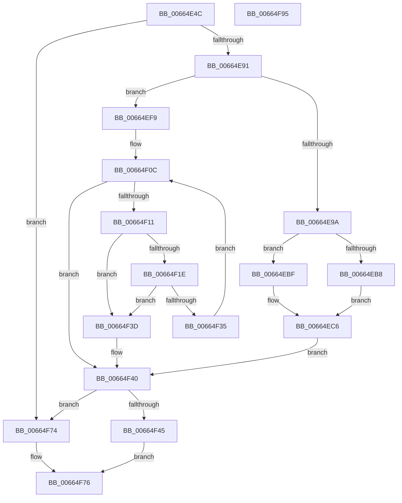

# ApiSetpGetExtensionNameKeyInfo

- RVA: `0x00664E4C`–`0x00664F96` (길이 `330` bytes)
- VA: `0x0000000140664E4C`
- 실행 섹션: `.text`
- PDB 이름 있음: `예`; PDB Function 태그: `아니요`
- unwind 정보 RVA: `0x0008A668`
- 디코드: `95`개 명령, `330/330` bytes 표시
- 미해석 바이트: `0` (있으면 어셈블리에 `.byte`로 보존)

> 이 문서는 커널 이미지의 기계어와 PDB 기호를 분석해 생성했습니다. 4번과 5번은 함수 원형과 자료형을 바이너리 사용 방식에서 추정한 C 해석이며 원본 소스 복구 결과는 아닙니다.

## 1. Dependencies

- 직접 호출 지점: **1**; 고유 호출 대상: **1**
- 직접 호출자로 확인된 함수: **2**
- RIP 상대 이미지 참조: **2**

### Outgoing calls
- `0x00664EEC` → [RtlCompareUnicodeString](../../page/93/RtlCompareUnicodeString_function_00937F90.md) (function, `0x00937F90`)

### Direct callers
- [ApiSetQuerySchemaInfo2_V7](ApiSetQuerySchemaInfo2_V7_function_0066301C.md) at `0x00663418`
- [ApiSetCompose_V7_ProcessV6Extension_Phase1](ApiSetCompose_V7_ProcessV6Extension_Phase1_function_00665C64.md) at `0x00665CDB`

### Static image references
- `0x00664ED0` → RVA `0x00039E18` (`.rdata`; read)
- `0x00664EF9` → RVA `0x00039DF8` (`.rdata`; read)

## 2. Other-region calls and transfers

- 다른 실행 섹션으로 향하는 call: **1**
  - `0x00664EEC` → [RtlCompareUnicodeString](../../page/93/RtlCompareUnicodeString_function_00937F90.md) (`.text` → `PAGE`)
- 별도 외부 분기/꼬리 이동을 확인하지 못했습니다.

## 3. Assembly (complete function range)

```asm
00664E4C  4C 8B DC                        mov r11, rsp
00664E4F  49 89 5B 08                     mov qword ptr [r11 + 8], rbx
00664E53  49 89 6B 10                     mov qword ptr [r11 + 0x10], rbp
00664E57  49 89 73 18                     mov qword ptr [r11 + 0x18], rsi
00664E5B  49 89 7B 20                     mov qword ptr [r11 + 0x20], rdi
00664E5F  41 54                           push r12
00664E61  41 56                           push r14
00664E63  41 57                           push r15
00664E65  48 83 EC 40                     sub rsp, 0x40
00664E69  0F 57 C0                        xorps xmm0, xmm0
00664E6C  33 C0                           xor eax, eax
00664E6E  49 8B D9                        mov rbx, r9
00664E71  41 8A E8                        mov bpl, r8b
00664E74  0F B7 FA                        movzx edi, dx
00664E77  48 8B F1                        mov rsi, rcx
00664E7A  41 0F 11 01                     movups xmmword ptr [r9], xmm0
00664E7E  41 0F 11 41 10                  movups xmmword ptr [r9 + 0x10], xmm0
00664E83  49 89 41 20                     mov qword ptr [r9 + 0x20], rax
00664E87  66 83 FA 0B                     cmp dx, 0xb
00664E8B  0F 82 E3 00 00 00               jb 0x140664f74
00664E91  44 8D 60 0A                     lea r12d, [rax + 0xa]
00664E95  45 84 C0                        test r8b, r8b
00664E98  74 5F                           je 0x140664ef9
00664E9A  83 64 24 34 00                  and dword ptr [rsp + 0x34], 0
00664E9F  0F B7 C2                        movzx eax, dx
00664EA2  0F 11 44 24 20                  movups xmmword ptr [rsp + 0x20], xmm0
00664EA7  49 89 4B D0                     mov qword ptr [r11 - 0x30], rcx
00664EAB  66 03 C0                        add ax, ax
00664EAE  41 8D 4C 24 0A                  lea ecx, [r12 + 0xa]
00664EB3  66 3B C1                        cmp ax, cx
00664EB6  73 07                           jae 0x140664ebf
00664EB8  66 89 44 24 20                  mov word ptr [rsp + 0x20], ax
00664EBD  EB 07                           jmp 0x140664ec6
00664EBF  8B C1                           mov eax, ecx
00664EC1  66 89 4C 24 20                  mov word ptr [rsp + 0x20], cx
00664EC6  66 89 44 24 22                  mov word ptr [rsp + 0x22], ax
00664ECB  48 8D 54 24 30                  lea rdx, [rsp + 0x30]
00664ED0  48 8D 05 41 4F 9D FF            lea rax, [rip - 0x62b0bf]
00664ED7  C7 44 24 30 14 00 14 00         mov dword ptr [rsp + 0x30], 0x140014
00664EDF  41 B0 01                        mov r8b, 1
00664EE2  48 89 44 24 38                  mov qword ptr [rsp + 0x38], rax
00664EE7  48 8D 4C 24 20                  lea rcx, [rsp + 0x20]
00664EEC  E8 9F 30 2D 00                  call 0x140937f90
00664EF1  85 C0                           test eax, eax
00664EF3  41 0F 94 C0                     sete r8b
00664EF7  EB 47                           jmp 0x140664f40
00664EF9  4C 8D 1D F8 4E 9D FF            lea r11, [rip - 0x62b108]
00664F00  45 8B D4                        mov r10d, r12d
00664F03  4C 2B DE                        sub r11, rsi
00664F06  41 B0 01                        mov r8b, 1
00664F09  4C 8B CE                        mov r9, rsi
00664F0C  45 85 D2                        test r10d, r10d
00664F0F  7E 2F                           jle 0x140664f40
00664F11  45 0F B6 31                     movzx r14d, byte ptr [r9]
00664F15  47 8A 3C 0B                     mov r15b, byte ptr [r11 + r9]
00664F19  45 84 F6                        test r14b, r14b
00664F1C  74 1F                           je 0x140664f3d
00664F1E  41 8D 56 BF                     lea edx, [r14 - 0x41]
00664F22  80 FA 19                        cmp dl, 0x19
00664F25  41 8D 46 20                     lea eax, [r14 + 0x20]
00664F29  0F B6 C8                        movzx ecx, al
00664F2C  41 0F 47 CE                     cmova ecx, r14d
00664F30  44 3A F9                        cmp r15b, cl
00664F33  75 08                           jne 0x140664f3d
00664F35  49 FF C1                        inc r9
00664F38  41 FF CA                        dec r10d
00664F3B  EB CF                           jmp 0x140664f0c
00664F3D  45 32 C0                        xor r8b, r8b
00664F40  45 84 C0                        test r8b, r8b
00664F43  74 2F                           je 0x140664f74
00664F45  40 8A CD                        mov cl, bpl
00664F48  40 88 6B 0A                     mov byte ptr [rbx + 0xa], bpl
00664F4C  F6 D9                           neg cl
00664F4E  C7 43 0C 04 00 00 00            mov dword ptr [rbx + 0xc], 4
00664F55  B0 01                           mov al, 1
00664F57  48 1B D2                        sbb rdx, rdx
00664F5A  49 23 D4                        and rdx, r12
00664F5D  49 03 D4                        add rdx, r12
00664F60  48 03 D6                        add rdx, rsi
00664F63  66 41 2B FC                     sub di, r12w
00664F67  48 89 13                        mov qword ptr [rbx], rdx
00664F6A  66 89 7B 08                     mov word ptr [rbx + 8], di
00664F6E  66 89 7B 12                     mov word ptr [rbx + 0x12], di
00664F72  EB 02                           jmp 0x140664f76
00664F74  32 C0                           xor al, al
00664F76  48 8B 5C 24 60                  mov rbx, qword ptr [rsp + 0x60]
00664F7B  48 8B 6C 24 68                  mov rbp, qword ptr [rsp + 0x68]
00664F80  48 8B 74 24 70                  mov rsi, qword ptr [rsp + 0x70]
00664F85  48 8B 7C 24 78                  mov rdi, qword ptr [rsp + 0x78]
00664F8A  48 83 C4 40                     add rsp, 0x40
00664F8E  41 5F                           pop r15
00664F90  41 5E                           pop r14
00664F92  41 5C                           pop r12
00664F94  C3                              ret
00664F95  CC                              int3
```

## 4. C-style interpretation (structured pseudocode)

```c
__int64 __fastcall ApiSetpGetExtensionNameKeyInfo(__int64 a1, unsigned __int16 a2, unsigned __int8 a3, __int64 a4)
{
    __int64 result;
    __int64 v_r10;
    __int64 v_r11;
    __int64 v_rdi;
    __int64 v_rsp;
    unsigned __int64 v_stack_m20;
    unsigned int v_stack_m24;
    unsigned __int64 v_stack_m28;
    unsigned __int16 v_stack_m36;
    unsigned __int64 v_stack_m38;
    unsigned __int64 v_stack_p10;
    unsigned __int64 v_stack_p18;
    unsigned __int64 v_stack_p20;
    unsigned __int64 v_stack_p8;

    *(unsigned __int64 *)(v_rsp + 8) = v_rbx;
    *(unsigned __int64 *)(v_rsp + 16) = v_rbp;
    *(unsigned __int64 *)(v_rsp + 24) = v_rsi;
    *(unsigned __int64 *)(v_rsp + 32) = v_rdi;
    v_rsp = (v_rsp) - (64);
    result = 0;
    *(unsigned __int64 *)(a4) = v_xmm0;
    *(unsigned __int64 *)(a4 + 16) = v_xmm0;
    *(unsigned __int64 *)(a4 + 32) = 0;
    if (a2 < 11) goto loc_00664F74;
    if (a3 == 0) goto loc_00664EF9;
    v_stack_m38 = v_xmm0;
    *(unsigned __int64 *)(v_rsp - 48) = a1;
    result = (unsigned __int16)((a2) + (a2));
    if (((unsigned __int16)(result)) >= ((unsigned __int16)(result + 10 + 10))) goto loc_00664EBF;
    v_stack_m38 = (unsigned __int16)(result);
    goto loc_00664EC6;
loc_00664EBF:
    v_stack_m38 = (unsigned __int16)(result + 10 + 10);
loc_00664EC6:
    v_stack_m36 = (unsigned __int16)((unsigned int)((unsigned int)(result + 10 + 10)));
    v_stack_m28 = 0x140014ULL;
    v_stack_m20 = v_rip - 6467775;
    result = RtlCompareUnicodeString(v_stack_m38, v_stack_m28, 1, a4);
    a3 = ((unsigned int)(result) == 0) ? 1 : 0;
    goto loc_00664F40;
loc_00664EF9:
    v_r11 = (v_rip - 6467848) - (a1);
loc_00664F0C:
    if (condition_is_less_or_equal) goto loc_00664F40;
    if ((unsigned __int8)(*(unsigned __int8 *)(a1)) == 0) goto loc_00664F3D;
    a1 = (unsigned __int8)(*(unsigned __int8 *)(a1) + 32);
    if (((unsigned __int8)(*(unsigned __int8 *)(a1) - 65)) > 25) { a1 = (unsigned int)(*(unsigned __int8 *)(a1)); }
    if (((unsigned __int8)(*(unsigned __int8 *)(v_r11 + a1 * 1))) != ((unsigned __int8)(a1))) goto loc_00664F3D;
    a4 = (a1) + 1;
    v_r10 = (unsigned int)(((unsigned int)((unsigned int)(result + 10))) - 1);
    goto loc_00664F0C;
loc_00664F3D:
    a3 = 0;
loc_00664F40:
    if (0 == 0) goto loc_00664F74;
    *(unsigned __int8 *)(a4 + 10) = 0;
    a1 = (unsigned __int8)(-(0));
    *(unsigned int *)(a4 + 12) = 4;
    a2 = (*(unsigned __int8 *)(a1) - 65) & (result + 10);
    a2 = (a2) + (result + 10);
    a2 = (a2) + (a1);
    v_rdi = (unsigned __int16)((a2) - ((unsigned __int16)(result + 10)));
    *(unsigned __int64 *)(a4) = a2;
    *(unsigned __int16 *)(a4 + 8) = (unsigned __int16)(v_rdi);
    *(unsigned __int16 *)(a4 + 18) = (unsigned __int16)(v_rdi);
    goto loc_00664F76;
loc_00664F74:
    result = 0;
loc_00664F76:
    v_rsp = (v_rsp) + (64);
    return result;
}
```

## 5. (Beta) C Style

```c
int64_t ApiSetpGetExtensionNameKeyInfo(int64_t Arg1, uint16_t Arg2, uint8_t Arg3, void *Arg4)
{
    uint8_t *arg4 = (uint8_t *)Arg4;

    int64_t result;
    int64_t local_r10;
    int64_t local_r11;
    int64_t local_rdi;
    int64_t local_rsp;
    uint64_t v_stack_m20;
    uint32_t v_stack_m24;
    uint64_t v_stack_m28;
    uint16_t v_stack_m36;
    uint64_t v_stack_m38;
    uint64_t v_stack_p10;
    uint64_t v_stack_p18;
    uint64_t v_stack_p20;
    uint64_t v_stack_p8;

    *(uint64_t *)(local_rsp + 0x8) = local_rbx;
    *(uint64_t *)(local_rsp + 0x10) = local_rbp;
    *(uint64_t *)(local_rsp + 0x18) = local_rsi;
    *(uint64_t *)(local_rsp + 0x20) = local_rdi;
    local_rsp = (local_rsp) - (64);
    result = 0;
    *(uint64_t *)(arg4) = v_xmm0;
    *(uint64_t *)(arg4 + 0x10) = v_xmm0;
    *(uint64_t *)(arg4 + 0x20) = 0;
    if (Arg2 < 11) goto loc_00664F74;
    if (Arg3 == 0) goto loc_00664EF9;
    v_stack_m38 = v_xmm0;
    *(uint64_t *)(local_rsp - 0x30) = Arg1;
    result = (uint16_t)((Arg2) + (Arg2));
    if (((uint16_t)(result)) >= ((uint16_t)(result + 10 + 10))) goto loc_00664EBF;
    v_stack_m38 = (uint16_t)(result);
    goto loc_00664EC6;
loc_00664EBF:
    v_stack_m38 = (uint16_t)(result + 10 + 10);
loc_00664EC6:
    v_stack_m36 = (uint16_t)((uint32_t)((uint32_t)(result + 10 + 10)));
    v_stack_m28 = 0x140014ULL;
    v_stack_m20 = v_rip - 6467775;
    result = RtlCompareUnicodeString(v_stack_m38, v_stack_m28, 1, Arg4);
    Arg3 = ((uint32_t)(result) == 0) ? 1 : 0;
    goto loc_00664F40;
loc_00664EF9:
    local_r11 = (v_rip - 6467848) - (Arg1);
loc_00664F0C:
    if (condition_is_less_or_equal) goto loc_00664F40;
    if ((uint8_t)(*(uint8_t *)(Arg1)) == 0) goto loc_00664F3D;
    Arg1 = (uint8_t)(*(uint8_t *)(Arg1) + 32);
    if (((uint8_t)(*(uint8_t *)(Arg1) - 65)) > 25) { Arg1 = (uint32_t)(*(uint8_t *)(Arg1)); }
    if (((uint8_t)(*(uint8_t *)(local_r11 + Arg1 * 1))) != ((uint8_t)(Arg1))) goto loc_00664F3D;
    Arg4 = (Arg1) + 1;
    local_r10 = (uint32_t)(((uint32_t)((uint32_t)(result + 10))) - 1);
    goto loc_00664F0C;
loc_00664F3D:
    Arg3 = 0;
loc_00664F40:
    if (0 == 0) goto loc_00664F74;
    *(uint8_t *)(arg4 + 0xA) = 0;
    Arg1 = (uint8_t)(-(0));
    *(uint32_t *)(arg4 + 0xC) = 4;
    Arg2 = (*(uint8_t *)(Arg1) - 65) & (result + 10);
    Arg2 = (Arg2) + (result + 10);
    Arg2 = (Arg2) + (Arg1);
    local_rdi = (uint16_t)((Arg2) - ((uint16_t)(result + 10)));
    *(uint64_t *)(arg4) = Arg2;
    *(uint16_t *)(arg4 + 0x8) = (uint16_t)(local_rdi);
    *(uint16_t *)(arg4 + 0x12) = (uint16_t)(local_rdi);
    goto loc_00664F76;
loc_00664F74:
    result = 0;
loc_00664F76:
    local_rsp = (local_rsp) + (64);
    return result;
}
```

### 관측된 메모리 오프셋

구조체 형식이 확인되지 않은 접근은 인자 기준의 오프셋으로만 기록했습니다.

| 기준 인자 | 오프셋 표현 | 폭 (bit) | 접근 |
|---|---:|---:|---|
| `Arg4` | `+ 0x0` | `64` | `W` |
| `Arg4` | `+ 0x0` | `128` | `R` |
| `Arg4` | `+ 0x8` | `16` | `W` |
| `Arg4` | `+ 0xA` | `8` | `W` |
| `Arg4` | `+ 0xC` | `32` | `W` |
| `Arg4` | `+ 0x10` | `128` | `R` |
| `Arg4` | `+ 0x12` | `16` | `W` |
| `Arg4` | `+ 0x20` | `64` | `W` |

## 6. Execution-region graph

[열기: 2D/3D 그래프와 함수 탐색 컨트롤 패널](../../../control-panel.html?section=text&rva=0x00664E4C&view=graph)

- 2D 그래프는 위에서 아래로 흐르고, 3D 그래프는 빈 공간을 드래그해 회전합니다. Shift+드래그는 이동, 휠은 확대·축소, 함수 노드 선택은 대상 보고서 이동입니다.

### Static fallback


