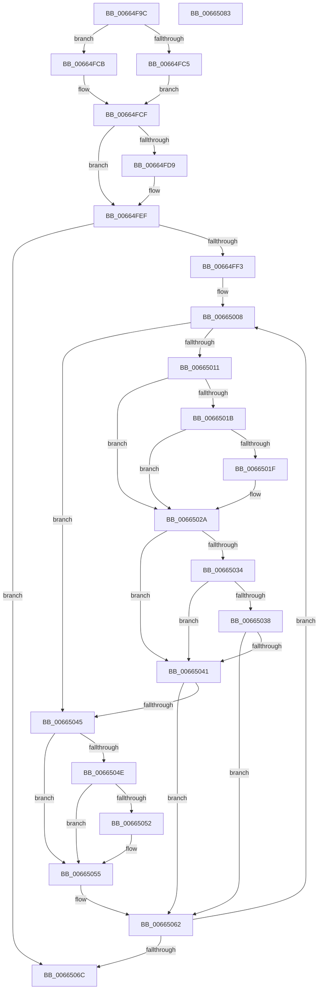

# ApiSetpGetSearchKeyHash

- RVA: `0x00664F9C`–`0x00665084` (길이 `232` bytes)
- VA: `0x0000000140664F9C`
- 실행 섹션: `.text`
- PDB 이름 있음: `예`; PDB Function 태그: `아니요`
- unwind 정보 RVA: `0x000A5A38`
- 디코드: `78`개 명령, `232/232` bytes 표시
- 미해석 바이트: `0` (있으면 어셈블리에 `.byte`로 보존)

> 이 문서는 커널 이미지의 기계어와 PDB 기호를 분석해 생성했습니다. 4번과 5번은 함수 원형과 자료형을 바이너리 사용 방식에서 추정한 C 해석이며 원본 소스 복구 결과는 아닙니다.

## 1. Dependencies

- 직접 호출 지점: **0**; 고유 호출 대상: **0**
- 직접 호출자로 확인된 함수: **6**
- RIP 상대 이미지 참조: **0**

### Outgoing calls
- 직접 디코드된 call 명령이 없습니다.

### Direct callers
- [ApiSetQuerySchemaInfo2_V7](ApiSetQuerySchemaInfo2_V7_function_0066301C.md) at `0x0066318C`
- [ApiSetQuerySchemaInfo2_V7](ApiSetQuerySchemaInfo2_V7_function_0066301C.md) at `0x006631A8`
- [ApiSetQuerySchemaInfo2_V7](ApiSetQuerySchemaInfo2_V7_function_0066301C.md) at `0x0066328C`
- [ApiSetQuerySchemaInfo2_V7](ApiSetQuerySchemaInfo2_V7_function_0066301C.md) at `0x006632A8`
- [ApiSetQuerySchemaInfo2_V7](ApiSetQuerySchemaInfo2_V7_function_0066301C.md) at `0x006633AB`
- [ApiSetQuerySchemaInfo2_V7](ApiSetQuerySchemaInfo2_V7_function_0066301C.md) at `0x006633C6`
- [ApiSetpResolveHost](ApiSetpResolveHost_function_006638D0.md) at `0x006639BA`
- [ApiSetpResolveHost](ApiSetpResolveHost_function_006638D0.md) at `0x006639D6`
- [ApiSetpResolveHost](ApiSetpResolveHost_function_006638D0.md) at `0x00663A92`
- [ApiSetpResolveHost](ApiSetpResolveHost_function_006638D0.md) at `0x00663AAE`
- [ApiSetpResolveHost](ApiSetpResolveHost_function_006638D0.md) at `0x00663B87`
- [ApiSetpResolveHost](ApiSetpResolveHost_function_006638D0.md) at `0x00663BA3`
- [ApiSetCompose_ProcessV7Extension_Phase1](ApiSetCompose_ProcessV7Extension_Phase1_function_006641BC.md) at `0x006642F5`
- [ApiSetCompose_ProcessV7Extension_Phase1](ApiSetCompose_ProcessV7Extension_Phase1_function_006641BC.md) at `0x00664312`
- [ApiSetCompose_ProcessV7Extension_Phase1](ApiSetCompose_ProcessV7Extension_Phase1_function_006641BC.md) at `0x00664405`
- [ApiSetCompose_ProcessV7Extension_Phase1](ApiSetCompose_ProcessV7Extension_Phase1_function_006641BC.md) at `0x00664421`
- [ApiSetCompose_ProcessV7Extension_Phase1](ApiSetCompose_ProcessV7Extension_Phase1_function_006641BC.md) at `0x006644EE`
- [ApiSetCompose_ProcessV7Extension_Phase1](ApiSetCompose_ProcessV7Extension_Phase1_function_006641BC.md) at `0x0066450A`
- [ApiSetpSearchForSectionIndex_V7](ApiSetpSearchForSectionIndex_V7_function_00665218.md) at `0x0066527D`
- [ApiSetpSearchForSectionIndex_V7](ApiSetpSearchForSectionIndex_V7_function_00665218.md) at `0x006652A7`
- [ApiSetpSearchForSectionIndex_V7](ApiSetpSearchForSectionIndex_V7_function_00665218.md) at `0x006652C7`
- [ApiSetpSearchForSectionIndex_V7](ApiSetpSearchForSectionIndex_V7_function_00665218.md) at `0x006652DB`
- [ApiSetCompose_V7_ProcessV6Extension_Phase1](ApiSetCompose_V7_ProcessV6Extension_Phase1_function_00665C64.md) at `0x00665E1F`
- [ApiSetCompose_V7_ProcessV6Extension_Phase1](ApiSetCompose_V7_ProcessV6Extension_Phase1_function_00665C64.md) at `0x00665E3C`
- [ApiSetCompose_V7_ProcessV6Extension_Phase1](ApiSetCompose_V7_ProcessV6Extension_Phase1_function_00665C64.md) at `0x00665F00`
- [ApiSetCompose_V7_ProcessV6Extension_Phase1](ApiSetCompose_V7_ProcessV6Extension_Phase1_function_00665C64.md) at `0x00665F1C`
- [ApiSetpInsertHashEntry](ApiSetpInsertHashEntry_function_006662DC.md) at `0x0066634A`
- [ApiSetpInsertHashEntry](ApiSetpInsertHashEntry_function_006662DC.md) at `0x0066636F`
- [ApiSetpInsertHashEntry](ApiSetpInsertHashEntry_function_006662DC.md) at `0x00666393`

### Static image references
- 디코드된 RIP-relative 메모리 참조가 없습니다.

## 2. Other-region calls and transfers

- 다른 실행 섹션으로 향하는 call: **0**
- 별도 외부 분기/꼬리 이동을 확인하지 못했습니다.

## 3. Assembly (complete function range)

```asm
00664F9C  48 8B C4                        mov rax, rsp
00664F9F  48 89 58 08                     mov qword ptr [rax + 8], rbx
00664FA3  48 89 68 10                     mov qword ptr [rax + 0x10], rbp
00664FA7  48 89 70 18                     mov qword ptr [rax + 0x18], rsi
00664FAB  48 89 78 20                     mov qword ptr [rax + 0x20], rdi
00664FAF  44 0F B7 59 10                  movzx r11d, word ptr [rcx + 0x10]
00664FB4  33 ED                           xor ebp, ebp
00664FB6  4C 03 19                        add r11, qword ptr [rcx]
00664FB9  41 8A F0                        mov sil, r8b
00664FBC  4C 8B D1                        mov r10, rcx
00664FBF  8B DD                           mov ebx, ebp
00664FC1  84 D2                           test dl, dl
00664FC3  74 06                           je 0x140664fcb
00664FC5  0F B7 41 14                     movzx eax, word ptr [rcx + 0x14]
00664FC9  EB 04                           jmp 0x140664fcf
00664FCB  0F B7 41 12                     movzx eax, word ptr [rcx + 0x12]
00664FCF  0F B7 F8                        movzx edi, ax
00664FD2  8B D5                           mov edx, ebp
00664FD4  45 84 C9                        test r9b, r9b
00664FD7  74 16                           je 0x140664fef
00664FD9  8A 41 0A                        mov al, byte ptr [rcx + 0xa]
00664FDC  BA 04 00 00 00                  mov edx, 4
00664FE1  F6 D8                           neg al
00664FE3  48 1B C9                        sbb rcx, rcx
00664FE6  48 23 CA                        and rcx, rdx
00664FE9  48 03 CA                        add rcx, rdx
00664FEC  4C 03 D9                        add r11, rcx
00664FEF  3B D7                           cmp edx, edi
00664FF1  73 79                           jae 0x14066506c
00664FF3  41 8A 42 0A                     mov al, byte ptr [r10 + 0xa]
00664FF7  41 B9 01 00 00 00               mov r9d, 1
00664FFD  F6 D8                           neg al
00664FFF  4D 1B C0                        sbb r8, r8
00665002  49 F7 D8                        neg r8
00665005  4D 03 C1                        add r8, r9
00665008  40 0F B6 CD                     movzx ecx, bpl
0066500C  40 84 F6                        test sil, sil
0066500F  74 34                           je 0x140665045
00665011  41 0F B7 42 1A                  movzx eax, word ptr [r10 + 0x1a]
00665016  66 85 C0                        test ax, ax
00665019  74 0F                           je 0x14066502a
0066501B  3B D0                           cmp edx, eax
0066501D  72 0B                           jb 0x14066502a
0066501F  41 0F B7 42 1C                  movzx eax, word ptr [r10 + 0x1c]
00665024  3B D0                           cmp edx, eax
00665026  41 0F 46 C9                     cmovbe ecx, r9d
0066502A  41 0F B7 42 1E                  movzx eax, word ptr [r10 + 0x1e]
0066502F  66 85 C0                        test ax, ax
00665032  74 0D                           je 0x140665041
00665034  3B D0                           cmp edx, eax
00665036  72 09                           jb 0x140665041
00665038  41 0F B7 42 20                  movzx eax, word ptr [r10 + 0x20]
0066503D  3B D0                           cmp edx, eax
0066503F  76 21                           jbe 0x140665062
00665041  84 C9                           test cl, cl
00665043  75 1D                           jne 0x140665062
00665045  41 8A 03                        mov al, byte ptr [r11]
00665048  8A C8                           mov cl, al
0066504A  3C 41                           cmp al, 0x41
0066504C  72 07                           jb 0x140665055
0066504E  3C 5A                           cmp al, 0x5a
00665050  77 03                           ja 0x140665055
00665052  8D 48 20                        lea ecx, [rax + 0x20]
00665055  0F B6 44 24 28                  movzx eax, byte ptr [rsp + 0x28]
0066505A  0F AF C3                        imul eax, ebx
0066505D  0F B6 D9                        movzx ebx, cl
00665060  03 D8                           add ebx, eax
00665062  4D 03 D8                        add r11, r8
00665065  41 03 D1                        add edx, r9d
00665068  3B D7                           cmp edx, edi
0066506A  72 9C                           jb 0x140665008
0066506C  48 8B 6C 24 10                  mov rbp, qword ptr [rsp + 0x10]
00665071  8B C3                           mov eax, ebx
00665073  48 8B 5C 24 08                  mov rbx, qword ptr [rsp + 8]
00665078  48 8B 74 24 18                  mov rsi, qword ptr [rsp + 0x18]
0066507D  48 8B 7C 24 20                  mov rdi, qword ptr [rsp + 0x20]
00665082  C3                              ret
00665083  CC                              int3
```

## 4. C-style interpretation (structured pseudocode)

```c
__int64 __fastcall ApiSetpGetSearchKeyHash(__int64 a1, unsigned __int8 a2, __int64 a3, unsigned __int8 a4, unsigned __int8 a5)
{
    __int64 result;
    __int64 v_r11;
    __int64 v_rbp;
    __int64 v_rbx;
    unsigned __int64 v_stack_p10;
    unsigned __int64 v_stack_p18;
    unsigned __int64 v_stack_p20;
    unsigned __int64 v_stack_p8;

    *(unsigned __int64 *)(v_rsp + 8) = v_rbx;
    *(unsigned __int64 *)(v_rsp + 16) = v_rbp;
    *(unsigned __int64 *)(v_rsp + 24) = v_rsi;
    *(unsigned __int64 *)(v_rsp + 32) = v_rdi;
    v_rbp = 0;
    v_r11 = (*(unsigned __int16 *)(a1 + 16)) + (*(unsigned __int64 *)(a1));
    if (a2 == 0) goto loc_00664FCB;
    goto loc_00664FCF;
loc_00664FCB:
loc_00664FCF:
    result = *(unsigned __int16 *)(a1 + 18);
    if (a4 != 0) {
        result = *(unsigned __int8 *)(a1 + 10);
        a2 = 4;
        result = (unsigned __int8)(-(result));
        a1 = (a1) & (a2);
        a1 = (a1) + (a2);
        v_r11 = (v_r11) + (a1);
    }
    if (a2 >= ((unsigned int)((unsigned __int16)(*(unsigned __int16 *)(a1 + 18))))) goto loc_0066506C;
    result = (unsigned __int8)(-(*(unsigned __int8 *)(a1 + 10)));
    a3 = -(a3);
    a3 = (a3) + (1);
loc_00665008:
    if ((unsigned __int8)((unsigned __int8)(a3)) == 0) goto loc_00665045;
    if ((unsigned __int16)(*(unsigned __int16 *)(a1 + 26)) == 0) goto loc_0066502A;
    result = *(unsigned __int16 *)(a1 + 26);
    if (a2 >= ((unsigned int)(*(unsigned __int16 *)(a1 + 26)))) {
        result = *(unsigned __int16 *)(a1 + 28);
        a1 = 0;
        if (a2 <= ((unsigned int)(result))) { a1 = 1; }
    }
    if ((unsigned __int16)(*(unsigned __int16 *)(a1 + 30)) == 0) goto loc_00665041;
    if (a2 < ((unsigned int)(*(unsigned __int16 *)(a1 + 30)))) goto loc_00665041;
    if (a2 <= ((unsigned int)(*(unsigned __int16 *)(a1 + 32)))) goto loc_00665062;
loc_00665041:
    if ((unsigned __int8)(a1) != 0) goto loc_00665062;
loc_00665045:
    if (((unsigned __int8)(*(unsigned __int8 *)(v_r11))) < 65) goto loc_00665055;
    if (((unsigned __int8)(*(unsigned __int8 *)(v_r11))) <= 90) {
        a1 = *(unsigned __int8 *)(v_r11) + 32;
    }
    result = (unsigned int)((a5) * (0));
    v_rbx = (unsigned int)(((unsigned __int8)(a1)) + ((unsigned int)(result)));
loc_00665062:
    v_r11 = (v_r11) + (a3);
    a2 = (unsigned int)((a2) + (1));
    if (a2 < ((unsigned int)((unsigned __int16)(*(unsigned __int16 *)(a1 + 18))))) goto loc_00665008;
loc_0066506C:
    return (unsigned int)((unsigned int)(v_rbx));
}
```

## 5. (Beta) C Style

```c
int64_t ApiSetpGetSearchKeyHash(void *Arg1, uint8_t Arg2, int64_t Arg3, uint8_t Arg4, uint8_t Arg5)
{
    uint8_t *arg1 = (uint8_t *)Arg1;

    int64_t result;
    int64_t local_r11;
    int64_t local_rbp;
    int64_t local_rbx;
    uint64_t v_stack_p10;
    uint64_t v_stack_p18;
    uint64_t v_stack_p20;
    uint64_t v_stack_p8;

    *(uint64_t *)(local_rsp + 0x8) = local_rbx;
    *(uint64_t *)(local_rsp + 0x10) = local_rbp;
    *(uint64_t *)(local_rsp + 0x18) = local_rsi;
    *(uint64_t *)(local_rsp + 0x20) = local_rdi;
    local_rbp = 0;
    local_r11 = (*(uint16_t *)(arg1 + 0x10)) + (*(uint64_t *)(arg1));
    if (Arg2 == 0) goto loc_00664FCB;
    goto loc_00664FCF;
loc_00664FCB:
loc_00664FCF:
    result = *(uint16_t *)(arg1 + 0x12);
    if (Arg4 != 0) {
        result = *(uint8_t *)(arg1 + 0xA);
        Arg2 = 4;
        result = (uint8_t)(-(result));
        Arg1 = (Arg1) & (Arg2);
        Arg1 = (Arg1) + (Arg2);
        local_r11 = (local_r11) + (Arg1);
    }
    if (Arg2 >= ((uint32_t)((uint16_t)(*(uint16_t *)(arg1 + 0x12))))) goto loc_0066506C;
    result = (uint8_t)(-(*(uint8_t *)(arg1 + 0xA)));
    Arg3 = -(Arg3);
    Arg3 = (Arg3) + (1);
loc_00665008:
    if ((uint8_t)((uint8_t)(Arg3)) == 0) goto loc_00665045;
    if ((uint16_t)(*(uint16_t *)(arg1 + 0x1A)) == 0) goto loc_0066502A;
    result = *(uint16_t *)(arg1 + 0x1A);
    if (Arg2 >= ((uint32_t)(*(uint16_t *)(arg1 + 0x1A)))) {
        result = *(uint16_t *)(arg1 + 0x1C);
        Arg1 = 0;
        if (Arg2 <= ((uint32_t)(result))) { Arg1 = 1; }
    }
    if ((uint16_t)(*(uint16_t *)(arg1 + 0x1E)) == 0) goto loc_00665041;
    if (Arg2 < ((uint32_t)(*(uint16_t *)(arg1 + 0x1E)))) goto loc_00665041;
    if (Arg2 <= ((uint32_t)(*(uint16_t *)(arg1 + 0x20)))) goto loc_00665062;
loc_00665041:
    if ((uint8_t)(Arg1) != 0) goto loc_00665062;
loc_00665045:
    if (((uint8_t)(*(uint8_t *)(local_r11))) < 65) goto loc_00665055;
    if (((uint8_t)(*(uint8_t *)(local_r11))) <= 90) {
        Arg1 = *(uint8_t *)(local_r11) + 32;
    }
    result = (uint32_t)((Arg5) * (0));
    local_rbx = (uint32_t)(((uint8_t)(Arg1)) + ((uint32_t)(result)));
loc_00665062:
    local_r11 = (local_r11) + (Arg3);
    Arg2 = (uint32_t)((Arg2) + (1));
    if (Arg2 < ((uint32_t)((uint16_t)(*(uint16_t *)(arg1 + 0x12))))) goto loc_00665008;
loc_0066506C:
    return (uint32_t)((uint32_t)(local_rbx));
}
```

### 관측된 메모리 오프셋

구조체 형식이 확인되지 않은 접근은 인자 기준의 오프셋으로만 기록했습니다.

| 기준 인자 | 오프셋 표현 | 폭 (bit) | 접근 |
|---|---:|---:|---|
| `Arg1` | `+ 0x0` | `64` | `R` |
| `Arg1` | `+ 0xA` | `8` | `R` |
| `Arg1` | `+ 0x10` | `16` | `R` |
| `Arg1` | `+ 0x12` | `16` | `R` |
| `Arg1` | `+ 0x14` | `16` | `R` |
| `Arg1` | `+ 0x1A` | `16` | `R` |
| `Arg1` | `+ 0x1C` | `16` | `R` |
| `Arg1` | `+ 0x1E` | `16` | `R` |
| `Arg1` | `+ 0x20` | `16` | `R` |

## 6. Execution-region graph

[열기: 2D/3D 그래프와 함수 탐색 컨트롤 패널](../../../control-panel.html?section=text&rva=0x00664F9C&view=graph)

- 2D 그래프는 위에서 아래로 흐르고, 3D 그래프는 빈 공간을 드래그해 회전합니다. Shift+드래그는 이동, 휠은 확대·축소, 함수 노드 선택은 대상 보고서 이동입니다.

### Static fallback


