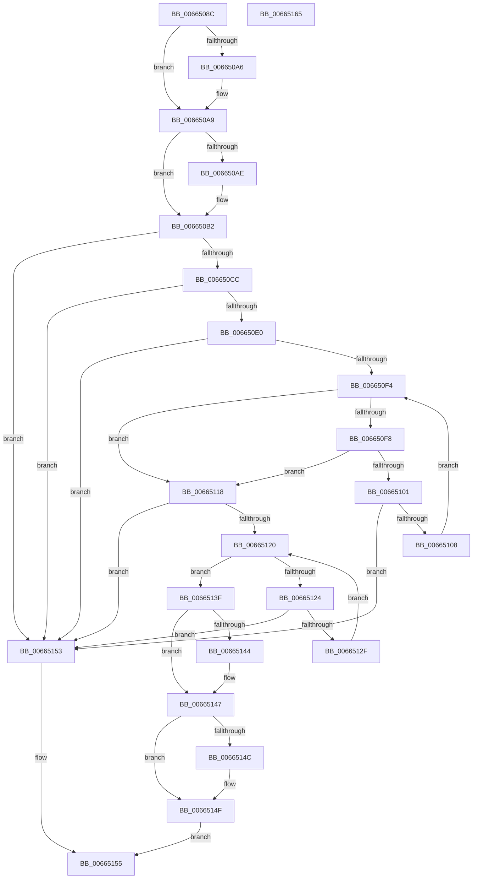

# ApiSetpGetSemverKeyVersions

- RVA: `0x0066508C`–`0x00665166` (길이 `218` bytes)
- VA: `0x000000014066508C`
- 실행 섹션: `.text`
- PDB 이름 있음: `예`; PDB Function 태그: `아니요`
- unwind 정보 RVA: `0x00069588`
- 디코드: `75`개 명령, `218/218` bytes 표시
- 미해석 바이트: `0` (있으면 어셈블리에 `.byte`로 보존)

> 이 문서는 커널 이미지의 기계어와 PDB 기호를 분석해 생성했습니다. 4번과 5번은 함수 원형과 자료형을 바이너리 사용 방식에서 추정한 C 해석이며 원본 소스 복구 결과는 아닙니다.

## 1. Dependencies

- 직접 호출 지점: **0**; 고유 호출 대상: **0**
- 직접 호출자로 확인된 함수: **1**
- RIP 상대 이미지 참조: **0**

### Outgoing calls
- 직접 디코드된 call 명령이 없습니다.

### Direct callers
- [ApiSetSchemaExpander_InsertSemverContractEntry](ApiSetSchemaExpander_InsertSemverContractEntry_function_00665850.md) at `0x006658C6`

### Static image references
- 디코드된 RIP-relative 메모리 참조가 없습니다.

## 2. Other-region calls and transfers

- 다른 실행 섹션으로 향하는 call: **0**
- 별도 외부 분기/꼬리 이동을 확인하지 못했습니다.

## 3. Assembly (complete function range)

```asm
0066508C  48 89 5C 24 08                  mov qword ptr [rsp + 8], rbx
00665091  48 89 74 24 10                  mov qword ptr [rsp + 0x10], rsi
00665096  48 89 7C 24 18                  mov qword ptr [rsp + 0x18], rdi
0066509B  4D 8B C8                        mov r9, r8
0066509E  4C 8B DA                        mov r11, rdx
006650A1  48 85 D2                        test rdx, rdx
006650A4  74 03                           je 0x1406650a9
006650A6  C6 02 00                        mov byte ptr [rdx], 0
006650A9  4D 85 C9                        test r9, r9
006650AC  74 04                           je 0x1406650b2
006650AE  41 C6 00 00                     mov byte ptr [r8], 0
006650B2  0F B7 41 14                     movzx eax, word ptr [rcx + 0x14]
006650B6  33 F6                           xor esi, esi
006650B8  0F B7 51 08                     movzx edx, word ptr [rcx + 8]
006650BC  33 FF                           xor edi, edi
006650BE  44 8A 51 0A                     mov r10b, byte ptr [rcx + 0xa]
006650C2  2B D0                           sub edx, eax
006650C4  85 D2                           test edx, edx
006650C6  0F 8E 87 00 00 00               jle 0x140665153
006650CC  45 84 D2                        test r10b, r10b
006650CF  4C 8D 04 00                     lea r8, [rax + rax]
006650D3  4C 0F 44 C0                     cmove r8, rax
006650D7  4C 03 01                        add r8, qword ptr [rcx]
006650DA  41 80 38 2D                     cmp byte ptr [r8], 0x2d
006650DE  75 73                           jne 0x140665153
006650E0  41 F6 DA                        neg r10b
006650E3  4D 1B D2                        sbb r10, r10
006650E6  49 F7 DA                        neg r10
006650E9  49 FF C2                        inc r10
006650EC  4D 03 C2                        add r8, r10
006650EF  83 EA 01                        sub edx, 1
006650F2  74 5F                           je 0x140665153
006650F4  85 D2                           test edx, edx
006650F6  7E 20                           jle 0x140665118
006650F8  41 0F B6 18                     movzx ebx, byte ptr [r8]
006650FC  80 FB 2D                        cmp bl, 0x2d
006650FF  74 17                           je 0x140665118
00665101  8D 43 D0                        lea eax, [rbx - 0x30]
00665104  3C 09                           cmp al, 9
00665106  77 4B                           ja 0x140665153
00665108  8D 34 B6                        lea esi, [rsi + rsi*4]
0066510B  4D 03 C2                        add r8, r10
0066510E  8D 76 E8                        lea esi, [rsi - 0x18]
00665111  FF CA                           dec edx
00665113  8D 34 73                        lea esi, [rbx + rsi*2]
00665116  EB DC                           jmp 0x1406650f4
00665118  4D 03 C2                        add r8, r10
0066511B  83 EA 01                        sub edx, 1
0066511E  74 33                           je 0x140665153
00665120  85 D2                           test edx, edx
00665122  7E 1B                           jle 0x14066513f
00665124  41 0F B6 18                     movzx ebx, byte ptr [r8]
00665128  8D 43 D0                        lea eax, [rbx - 0x30]
0066512B  3C 09                           cmp al, 9
0066512D  77 24                           ja 0x140665153
0066512F  8D 3C BF                        lea edi, [rdi + rdi*4]
00665132  4D 03 C2                        add r8, r10
00665135  8D 7F E8                        lea edi, [rdi - 0x18]
00665138  FF CA                           dec edx
0066513A  8D 3C 7B                        lea edi, [rbx + rdi*2]
0066513D  EB E1                           jmp 0x140665120
0066513F  4D 85 DB                        test r11, r11
00665142  74 03                           je 0x140665147
00665144  41 88 33                        mov byte ptr [r11], sil
00665147  4D 85 C9                        test r9, r9
0066514A  74 03                           je 0x14066514f
0066514C  41 88 39                        mov byte ptr [r9], dil
0066514F  B0 01                           mov al, 1
00665151  EB 02                           jmp 0x140665155
00665153  32 C0                           xor al, al
00665155  48 8B 5C 24 08                  mov rbx, qword ptr [rsp + 8]
0066515A  48 8B 74 24 10                  mov rsi, qword ptr [rsp + 0x10]
0066515F  48 8B 7C 24 18                  mov rdi, qword ptr [rsp + 0x18]
00665164  C3                              ret
00665165  CC                              int3
```

## 4. C-style interpretation (structured pseudocode)

```c
__int64 __fastcall ApiSetpGetSemverKeyVersions(__int64 a1, __int64 a2, __int64 a3)
{
    __int64 result;
    __int64 v_r10;
    __int64 v_rdi;
    __int64 v_rsi;
    unsigned __int64 v_stack_p10;
    unsigned __int64 v_stack_p18;
    unsigned __int64 v_stack_p8;

    v_stack_p8 = v_rbx;
    v_stack_p10 = v_rsi;
    v_stack_p18 = v_rdi;
    if (a2 != 0) {
        *(unsigned __int8 *)(a2) = 0;
    }
    if (a3 != 0) {
        *(unsigned __int8 *)(a3) = 0;
    }
    v_rsi = 0;
    v_rdi = 0;
    a2 = (unsigned int)((*(unsigned __int16 *)(a1 + 8)) - ((unsigned int)(*(unsigned __int16 *)(a1 + 20))));
    if (condition_is_less_or_equal) goto loc_00665153;
    a3 = *(unsigned __int16 *)(a1 + 20) + *(unsigned __int16 *)(a1 + 20) * 1;
    if ((unsigned __int8)(*(unsigned __int8 *)(a1 + 10)) == 0) { a3 = *(unsigned __int16 *)(a1 + 20); }
    a3 = (a3) + (*(unsigned __int64 *)(a1));
    if ((*(unsigned __int8 *)(a3)) != 45) goto loc_00665153;
    v_r10 = (unsigned __int8)(-(*(unsigned __int8 *)(a1 + 10)));
    v_r10 = -(v_r10);
    v_r10 = (v_r10) + 1;
    a3 = (a3) + (v_r10);
    a2 = (unsigned int)((a2) - (1));
    if (condition_is_equal) goto loc_00665153;
loc_006650F4:
    if (condition_is_less_or_equal) goto loc_00665118;
    if (((unsigned __int8)(*(unsigned __int8 *)(a3))) == 45) goto loc_00665118;
    if (((unsigned __int8)(*(unsigned __int8 *)(a3) - 48)) > 9) goto loc_00665153;
    a3 = (a3) + (v_r10);
    a2 = (unsigned int)((a2) - 1);
    goto loc_006650F4;
loc_00665118:
    a3 = (a3) + (v_r10);
    a2 = (unsigned int)((a2) - (1));
    if (condition_is_equal) goto loc_00665153;
loc_00665120:
    if (condition_is_less_or_equal) goto loc_0066513F;
    if (((unsigned __int8)(*(unsigned __int8 *)(a3) - 48)) > 9) goto loc_00665153;
    a3 = (a3) + (v_r10);
    a2 = (unsigned int)((a2) - 1);
    goto loc_00665120;
loc_0066513F:
    if (a2 != 0) {
        *(unsigned __int8 *)(a2) = (unsigned __int8)(*(unsigned __int8 *)(a3) + v_rsi + v_rsi * 4 - 24 * 2);
    }
    if (a3 != 0) {
        *(unsigned __int8 *)(a3) = (unsigned __int8)(*(unsigned __int8 *)(a3) + v_rdi + v_rdi * 4 - 24 * 2);
    }
    goto loc_00665155;
loc_00665153:
    result = 0;
loc_00665155:
    return result;
}
```

## 5. (Beta) C Style

```c
int64_t ApiSetpGetSemverKeyVersions(void *Arg1, int64_t Arg2, void *Arg3)
{
    uint8_t *arg1 = (uint8_t *)Arg1;
    uint8_t *arg3 = (uint8_t *)Arg3;

    int64_t result;
    int64_t local_r10;
    int64_t local_rdi;
    int64_t local_rsi;
    uint64_t v_stack_p10;
    uint64_t v_stack_p18;
    uint64_t v_stack_p8;

    v_stack_p8 = local_rbx;
    v_stack_p10 = local_rsi;
    v_stack_p18 = local_rdi;
    if (Arg2 != 0) {
        *(uint8_t *)(Arg2) = 0;
    }
    if (Arg3 != NULL) {
        *(uint8_t *)(arg3) = 0;
    }
    local_rsi = 0;
    local_rdi = 0;
    Arg2 = (uint32_t)((*(uint16_t *)(arg1 + 0x8)) - ((uint32_t)(*(uint16_t *)(arg1 + 0x14))));
    if (condition_is_less_or_equal) goto loc_00665153;
    Arg3 = *(uint16_t *)(arg1 + 0x14) + *(uint16_t *)(arg1 + 0x14) * 1;
    if ((uint8_t)(*(uint8_t *)(arg1 + 0xA)) == 0) { Arg3 = *(uint16_t *)(arg1 + 0x14); }
    Arg3 = (Arg3) + (*(uint64_t *)(arg1));
    if ((*(uint8_t *)(arg3)) != 45) goto loc_00665153;
    local_r10 = (uint8_t)(-(*(uint8_t *)(arg1 + 0xA)));
    local_r10 = -(local_r10);
    local_r10 = (local_r10) + 1;
    Arg3 = (Arg3) + (local_r10);
    Arg2 = (uint32_t)((Arg2) - (1));
    if (condition_is_equal) goto loc_00665153;
loc_006650F4:
    if (condition_is_less_or_equal) goto loc_00665118;
    if (((uint8_t)(*(uint8_t *)(arg3))) == 45) goto loc_00665118;
    if (((uint8_t)(*(uint8_t *)(arg3) - 48)) > 9) goto loc_00665153;
    Arg3 = (Arg3) + (local_r10);
    Arg2 = (uint32_t)((Arg2) - 1);
    goto loc_006650F4;
loc_00665118:
    Arg3 = (Arg3) + (local_r10);
    Arg2 = (uint32_t)((Arg2) - (1));
    if (condition_is_equal) goto loc_00665153;
loc_00665120:
    if (condition_is_less_or_equal) goto loc_0066513F;
    if (((uint8_t)(*(uint8_t *)(arg3) - 48)) > 9) goto loc_00665153;
    Arg3 = (Arg3) + (local_r10);
    Arg2 = (uint32_t)((Arg2) - 1);
    goto loc_00665120;
loc_0066513F:
    if (Arg2 != 0) {
        *(uint8_t *)(Arg2) = (uint8_t)(*(uint8_t *)(arg3) + local_rsi + local_rsi * 4 - 24 * 2);
    }
    if (Arg3 != NULL) {
        *(uint8_t *)(arg3) = (uint8_t)(*(uint8_t *)(arg3) + local_rdi + local_rdi * 4 - 24 * 2);
    }
    goto loc_00665155;
loc_00665153:
    result = 0;
loc_00665155:
    return result;
}
```

### 관측된 메모리 오프셋

구조체 형식이 확인되지 않은 접근은 인자 기준의 오프셋으로만 기록했습니다.

| 기준 인자 | 오프셋 표현 | 폭 (bit) | 접근 |
|---|---:|---:|---|
| `Arg1` | `+ 0x0` | `64` | `R` |
| `Arg1` | `+ 0x8` | `16` | `R` |
| `Arg1` | `+ 0xA` | `8` | `R` |
| `Arg1` | `+ 0x14` | `16` | `R` |
| `Arg3` | `+ 0x0` | `8` | `W` |

## 6. Execution-region graph

[열기: 2D/3D 그래프와 함수 탐색 컨트롤 패널](../../../control-panel.html?section=text&rva=0x0066508C&view=graph)

- 2D 그래프는 위에서 아래로 흐르고, 3D 그래프는 빈 공간을 드래그해 회전합니다. Shift+드래그는 이동, 휠은 확대·축소, 함수 노드 선택은 대상 보고서 이동입니다.

### Static fallback


