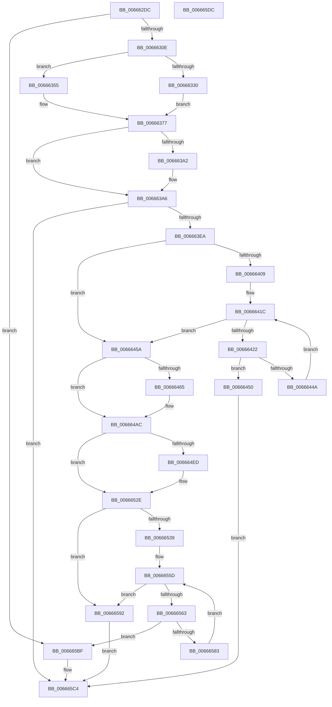

# ApiSetpInsertHashEntry

- RVA: `0x006662DC`–`0x006665DD` (길이 `769` bytes)
- VA: `0x00000001406662DC`
- 실행 섹션: `.text`
- PDB 이름 있음: `예`; PDB Function 태그: `아니요`
- unwind 정보 RVA: `0x000D61F0`
- 디코드: `219`개 명령, `769/769` bytes 표시
- 미해석 바이트: `0` (있으면 어셈블리에 `.byte`로 보존)

> 이 문서는 커널 이미지의 기계어와 PDB 기호를 분석해 생성했습니다. 4번과 5번은 함수 원형과 자료형을 바이너리 사용 방식에서 추정한 C 해석이며 원본 소스 복구 결과는 아닙니다.

## 1. Dependencies

- 직접 호출 지점: **7**; 고유 호출 대상: **4**
- 직접 호출자로 확인된 함수: **5**
- RIP 상대 이미지 참조: **0**

### Outgoing calls
- `0x0066634A` → [ApiSetpGetSearchKeyHash](ApiSetpGetSearchKeyHash_function_00664F9C.md) (function, `0x00664F9C`)
- `0x0066636F` → [ApiSetpGetSearchKeyHash](ApiSetpGetSearchKeyHash_function_00664F9C.md) (function, `0x00664F9C`)
- `0x00666393` → [ApiSetpGetSearchKeyHash](ApiSetpGetSearchKeyHash_function_00664F9C.md) (function, `0x00664F9C`)
- `0x006663DD` → [ApiSetpFindHashInsertionPoint_V7](ApiSetpFindHashInsertionPoint_V7_function_00666148.md) (function, `0x00666148`)
- `0x006664A7` → [memcpy](../6C/memcpy_function_006C6840.md) (function, `0x006C6840`)
- `0x00666523` → [memcpy](../6C/memcpy_function_006C6840.md) (function, `0x006C6840`)
- `0x006665B3` → [memset](../6C/memset_function_006C6C40.md) (function, `0x006C6C40`)

### Direct callers
- [ApiSetSchemaExpander_InsertContractEntry](ApiSetSchemaExpander_InsertContractEntry_function_0066565C.md) at `0x00665690`
- [ApiSetSchemaExpander_InsertExtensionNameEntry](ApiSetSchemaExpander_InsertExtensionNameEntry_function_006656B0.md) at `0x006656E2`
- [ApiSetSchemaExpander_InsertGroupContractEntry](ApiSetSchemaExpander_InsertGroupContractEntry_function_00665704.md) at `0x00665738`
- [ApiSetSchemaExpander_InsertHostEntry](ApiSetSchemaExpander_InsertHostEntry_function_00665758.md) at `0x006657A7`
- [ApiSetSchemaExpander_InsertSemverContractEntry](ApiSetSchemaExpander_InsertSemverContractEntry_function_00665850.md) at `0x0066588F`

### Static image references
- 디코드된 RIP-relative 메모리 참조가 없습니다.

## 2. Other-region calls and transfers

- 다른 실행 섹션으로 향하는 call: **0**
- 별도 외부 분기/꼬리 이동을 확인하지 못했습니다.

## 3. Assembly (complete function range)

```asm
006662DC  48 89 5C 24 08                  mov qword ptr [rsp + 8], rbx
006662E1  66 44 89 44 24 18               mov word ptr [rsp + 0x18], r8w
006662E7  55                              push rbp
006662E8  56                              push rsi
006662E9  57                              push rdi
006662EA  41 54                           push r12
006662EC  41 55                           push r13
006662EE  41 56                           push r14
006662F0  41 57                           push r15
006662F2  48 83 EC 40                     sub rsp, 0x40
006662F6  44 0F B7 62 04                  movzx r12d, word ptr [rdx + 4]
006662FB  4D 8B F9                        mov r15, r9
006662FE  48 8B DA                        mov rbx, rdx
00666301  48 8B F9                        mov rdi, rcx
00666304  66 45 3B C4                     cmp r8w, r12w
00666308  0F 85 B1 02 00 00               jne 0x1406665bf
0066630E  8A 4A 09                        mov cl, byte ptr [rdx + 9]
00666311  8A 47 02                        mov al, byte ptr [rdi + 2]
00666314  40 8A F1                        mov sil, cl
00666317  44 8A 43 0A                     mov r8b, byte ptr [rbx + 0xa]
0066631B  8A D0                           mov dl, al
0066631D  80 E2 10                        and dl, 0x10
00666320  44 88 44 24 20                  mov byte ptr [rsp + 0x20], r8b
00666325  24 08                           and al, 8
00666327  80 E1 02                        and cl, 2
0066632A  40 80 E6 04                     and sil, 4
0066632E  74 25                           je 0x140666355
00666330  84 D2                           test dl, dl
00666332  40 0F 95 C5                     setne bpl
00666336  84 C0                           test al, al
00666338  44 8A CD                        mov r9b, bpl
0066633B  41 0F 95 C6                     setne r14b
0066633F  84 C9                           test cl, cl
00666341  45 8A C6                        mov r8b, r14b
00666344  49 8B CF                        mov rcx, r15
00666347  0F 95 C2                        setne dl
0066634A  E8 4D EC FF FF                  call 0x140664f9c
0066634F  44 0F B6 E8                     movzx r13d, al
00666353  EB 22                           jmp 0x140666377
00666355  84 D2                           test dl, dl
00666357  40 0F 95 C5                     setne bpl
0066635B  84 C0                           test al, al
0066635D  44 8A CD                        mov r9b, bpl
00666360  41 0F 95 C6                     setne r14b
00666364  84 C9                           test cl, cl
00666366  45 8A C6                        mov r8b, r14b
00666369  49 8B CF                        mov rcx, r15
0066636C  0F 95 C2                        setne dl
0066636F  E8 28 EC FF FF                  call 0x140664f9c
00666374  44 8B E8                        mov r13d, eax
00666377  8A 4B 0B                        mov cl, byte ptr [rbx + 0xb]
0066637A  44 8A CD                        mov r9b, bpl
0066637D  8A 94 24 A0 00 00 00            mov dl, byte ptr [rsp + 0xa0]
00666384  45 8A C6                        mov r8b, r14b
00666387  88 4C 24 20                     mov byte ptr [rsp + 0x20], cl
0066638B  49 8B CF                        mov rcx, r15
0066638E  44 89 6C 24 38                  mov dword ptr [rsp + 0x38], r13d
00666393  E8 04 EC FF FF                  call 0x140664f9c
00666398  33 ED                           xor ebp, ebp
0066639A  44 8B F8                        mov r15d, eax
0066639D  40 84 F6                        test sil, sil
006663A0  74 04                           je 0x1406663a6
006663A2  44 0F B6 F8                     movzx r15d, al
006663A6  48 8D 84 24 88 00 00 00         lea rax, [rsp + 0x88]
006663AE  66 89 6C 24 34                  mov word ptr [rsp + 0x34], bp
006663B3  48 89 44 24 28                  mov qword ptr [rsp + 0x28], rax
006663B8  4C 8D 4C 24 34                  lea r9, [rsp + 0x34]
006663BD  48 8D 44 24 30                  lea rax, [rsp + 0x30]
006663C2  66 89 6C 24 30                  mov word ptr [rsp + 0x30], bp
006663C7  45 8B C5                        mov r8d, r13d
006663CA  48 89 44 24 20                  mov qword ptr [rsp + 0x20], rax
006663CF  48 8B D3                        mov rdx, rbx
006663D2  66 89 AC 24 88 00 00 00         mov word ptr [rsp + 0x88], bp
006663DA  48 8B CF                        mov rcx, rdi
006663DD  E8 66 FD FF FF                  call 0x140666148
006663E2  85 C0                           test eax, eax
006663E4  0F 88 DA 01 00 00               js 0x1406665c4
006663EA  44 0F B7 94 24 88 00 00 00      movzx r10d, word ptr [rsp + 0x88]
006663F3  41 BD 01 00 00 00               mov r13d, 1
006663F9  44 0F B6 5B 08                  movzx r11d, byte ptr [rbx + 8]
006663FE  45 8B F4                        mov r14d, r12d
00666401  8B 33                           mov esi, dword ptr [rbx]
00666403  66 45 85 D2                     test r10w, r10w
00666407  74 51                           je 0x14066645a
00666409  44 0F B7 4C 24 30               movzx r9d, word ptr [rsp + 0x30]
0066640F  41 8B EB                        mov ebp, r11d
00666412  41 0F AF EC                     imul ebp, r12d
00666416  03 EE                           add ebp, esi
00666418  66 45 03 D1                     add r10w, r9w
0066641C  66 45 3B CA                     cmp r9w, r10w
00666420  73 38                           jae 0x14066645a
00666422  44 0F B7 47 12                  movzx r8d, word ptr [rdi + 0x12]
00666427  41 0F B7 C1                     movzx eax, r9w
0066642B  48 C1 E0 03                     shl rax, 3
0066642F  49 2B C0                        sub rax, r8
00666432  48 03 C7                        add rax, rdi
00666435  0F B7 54 05 04                  movzx edx, word ptr [rbp + rax + 4]
0066643A  49 0F AF D3                     imul rdx, r11
0066643E  48 03 D6                        add rdx, rsi
00666441  49 2B D0                        sub rdx, r8
00666444  44 39 3C 3A                     cmp dword ptr [rdx + rdi], r15d
00666448  74 06                           je 0x140666450
0066644A  66 45 03 CD                     add r9w, r13w
0066644E  EB CC                           jmp 0x14066641c
00666450  B8 BD 00 00 C0                  mov eax, 0xc00000bd
00666455  E9 6A 01 00 00                  jmp 0x1406665c4
0066645A  44 0F B7 6C 24 34               movzx r13d, word ptr [rsp + 0x34]
00666460  45 2B F5                        sub r14d, r13d
00666463  74 47                           je 0x1406664ac
00666465  44 0F B7 57 12                  movzx r10d, word ptr [rdi + 0x12]
0066646A  49 8D 4C 24 01                  lea rcx, [r12 + 1]
0066646F  4D 8B CB                        mov r9, r11
00666472  45 8B C6                        mov r8d, r14d
00666475  49 0F AF C9                     imul rcx, r9
00666479  49 8B D4                        mov rdx, r12
0066647C  49 C1 E0 03                     shl r8, 3
00666480  49 0F AF D1                     imul rdx, r9
00666484  49 2B CA                        sub rcx, r10
00666487  45 8B DD                        mov r11d, r13d
0066648A  49 2B D2                        sub rdx, r10
0066648D  49 C1 E3 03                     shl r11, 3
00666491  48 03 D6                        add rdx, rsi
00666494  48 03 CE                        add rcx, rsi
00666497  49 03 D3                        add rdx, r11
0066649A  49 83 C3 08                     add r11, 8
0066649E  49 03 CB                        add rcx, r11
006664A1  48 03 D7                        add rdx, rdi
006664A4  48 03 CF                        add rcx, rdi
006664A7  E8 94 03 06 00                  call 0x1406c6840
006664AC  0F B6 43 08                     movzx eax, byte ptr [rbx + 8]
006664B0  41 B9 01 00 00 00               mov r9d, 1
006664B6  0F B7 4B 04                     movzx ecx, word ptr [rbx + 4]
006664BA  8B 13                           mov edx, dword ptr [rbx]
006664BC  49 03 C9                        add rcx, r9
006664BF  44 0F B7 A4 24 90 00 00 00      movzx r12d, word ptr [rsp + 0x90]
006664C8  48 0F AF C8                     imul rcx, rax
006664CC  0F B7 47 12                     movzx eax, word ptr [rdi + 0x12]
006664D0  4A 8D 0C E9                     lea rcx, [rcx + r13*8]
006664D4  48 2B C8                        sub rcx, rax
006664D7  48 8D 04 0F                     lea rax, [rdi + rcx]
006664DB  48 03 D0                        add rdx, rax
006664DE  8B 44 24 38                     mov eax, dword ptr [rsp + 0x38]
006664E2  89 02                           mov dword ptr [rdx], eax
006664E4  44 89 62 04                     mov dword ptr [rdx + 4], r12d
006664E8  45 85 ED                        test r13d, r13d
006664EB  74 41                           je 0x14066652e
006664ED  0F B7 4B 04                     movzx ecx, word ptr [rbx + 4]
006664F1  4D 8B C5                        mov r8, r13
006664F4  0F B6 43 08                     movzx eax, byte ptr [rbx + 8]
006664F8  8B D1                           mov edx, ecx
006664FA  44 0F B7 4F 12                  movzx r9d, word ptr [rdi + 0x12]
006664FF  44 8B 13                        mov r10d, dword ptr [rbx]
00666502  48 0F AF D0                     imul rdx, rax
00666506  49 C1 E0 03                     shl r8, 3
0066650A  49 2B D1                        sub rdx, r9
0066650D  49 03 D2                        add rdx, r10
00666510  48 03 D7                        add rdx, rdi
00666513  48 FF C1                        inc rcx
00666516  48 0F AF C8                     imul rcx, rax
0066651A  49 2B C9                        sub rcx, r9
0066651D  49 03 CA                        add rcx, r10
00666520  48 03 CF                        add rcx, rdi
00666523  E8 18 03 06 00                  call 0x1406c6840
00666528  41 B9 01 00 00 00               mov r9d, 1
0066652E  44 0F B7 43 04                  movzx r8d, word ptr [rbx + 4]
00666533  66 45 85 C0                     test r8w, r8w
00666537  74 59                           je 0x140666592
00666539  0F B6 6B 08                     movzx ebp, byte ptr [rbx + 8]
0066653D  4F 8D 14 01                     lea r10, [r9 + r8]
00666541  44 0F B7 77 12                  movzx r14d, word ptr [rdi + 0x12]
00666546  47 8D 1C 01                     lea r11d, [r9 + r8]
0066654A  8B 33                           mov esi, dword ptr [rbx]
0066654C  41 0F B7 D1                     movzx edx, r9w
00666550  4C 0F AF D5                     imul r10, rbp
00666554  4D 2B D6                        sub r10, r14
00666557  4C 03 D7                        add r10, rdi
0066655A  4C 03 D6                        add r10, rsi
0066655D  66 41 3B D3                     cmp dx, r11w
00666561  73 2F                           jae 0x140666592
00666563  4B 8D 0C 01                     lea rcx, [r9 + r8]
00666567  0F B7 C2                        movzx eax, dx
0066656A  48 0F AF CD                     imul rcx, rbp
0066656E  4C 8D 0C C1                     lea r9, [rcx + rax*8]
00666572  4D 2B CE                        sub r9, r14
00666575  4C 03 CF                        add r9, rdi
00666578  4C 03 CE                        add r9, rsi
0066657B  41 8B 01                        mov eax, dword ptr [r9]
0066657E  41 39 02                        cmp dword ptr [r10], eax
00666581  77 3C                           ja 0x1406665bf
00666583  4D 8B D1                        mov r10, r9
00666586  41 B9 01 00 00 00               mov r9d, 1
0066658C  66 41 03 D1                     add dx, r9w
00666590  EB CB                           jmp 0x14066655d
00666592  44 0F B6 43 08                  movzx r8d, byte ptr [rbx + 8]
00666597  49 8B CC                        mov rcx, r12
0066659A  0F B7 47 12                     movzx eax, word ptr [rdi + 0x12]
0066659E  33 D2                           xor edx, edx
006665A0  8B 1B                           mov ebx, dword ptr [rbx]
006665A2  49 0F AF C8                     imul rcx, r8
006665A6  48 2B C8                        sub rcx, rax
006665A9  48 8D 04 0F                     lea rax, [rdi + rcx]
006665AD  48 03 D8                        add rbx, rax
006665B0  48 8B CB                        mov rcx, rbx
006665B3  E8 88 06 06 00                  call 0x1406c6c40
006665B8  33 C0                           xor eax, eax
006665BA  44 89 3B                        mov dword ptr [rbx], r15d
006665BD  EB 05                           jmp 0x1406665c4
006665BF  B8 E5 00 00 C0                  mov eax, 0xc00000e5
006665C4  48 8B 9C 24 80 00 00 00         mov rbx, qword ptr [rsp + 0x80]
006665CC  48 83 C4 40                     add rsp, 0x40
006665D0  41 5F                           pop r15
006665D2  41 5E                           pop r14
006665D4  41 5D                           pop r13
006665D6  41 5C                           pop r12
006665D8  5F                              pop rdi
006665D9  5E                              pop rsi
006665DA  5D                              pop rbp
006665DB  C3                              ret
006665DC  CC                              int3
```

## 4. C-style interpretation (structured pseudocode)

```c
__int64 __fastcall ApiSetpInsertHashEntry(__int64 a1, __int64 a2, unsigned __int16 a3, __int64 a4, unsigned __int8 a5)
{
    __int64 result;
    __int64 v_r10;
    __int64 v_r11;
    __int64 v_r14;
    __int64 v_r15;
    __int64 v_rbp;
    __int64 v_rbx;
    __int64 v_rsi;
    __int64 v_rsp;
    unsigned int v_stack_m40;
    unsigned __int16 v_stack_m44;
    unsigned __int64 v_stack_m48;
    unsigned __int64 v_stack_m50;
    unsigned __int8 v_stack_m58;
    unsigned __int64 v_stack_p10;
    unsigned __int16 v_stack_p18;
    unsigned __int64 v_stack_p8;

    v_stack_p8 = v_rbx;
    v_stack_p18 = a3;
    v_rsp = (v_rsp) - (64);
    if (a3 != ((unsigned __int16)(*(unsigned __int16 *)(a2 + 4)))) goto loc_006665BF;
    a2 = (unsigned __int8)(((unsigned __int8)(*(unsigned __int8 *)(a1 + 2))) & (16));
    v_stack_m58 = (unsigned __int8)(*(unsigned __int8 *)(a2 + 10));
    result = (unsigned __int8)((*(unsigned __int8 *)(a1 + 2)) & (8));
    a1 = (unsigned __int8)((*(unsigned __int8 *)(a2 + 9)) & (2));
    v_rsi = (unsigned __int8)(((unsigned __int8)(*(unsigned __int8 *)(a2 + 9))) & (4));
    if (condition_is_equal) goto loc_00666355;
    v_rbp = ((unsigned __int8)(a2) != 0) ? 1 : 0;
    v_r14 = ((unsigned __int8)(result) != 0) ? 1 : 0;
    a2 = ((unsigned __int8)(a1) != 0) ? 1 : 0;
    result = ApiSetpGetSearchKeyHash(a4, a2, (unsigned __int8)(v_r14), (unsigned __int8)(v_rbp));
    goto loc_00666377;
loc_00666355:
    v_rbp = ((unsigned __int8)(a2) != 0) ? 1 : 0;
    v_r14 = ((unsigned __int8)(result) != 0) ? 1 : 0;
    a2 = ((unsigned __int8)(a4) != 0) ? 1 : 0;
    result = ApiSetpGetSearchKeyHash(a4, a2, (unsigned __int8)(v_r14), (unsigned __int8)(v_rbp));
loc_00666377:
    v_stack_m58 = (unsigned __int8)(*(unsigned __int8 *)(a2 + 11));
    v_stack_m40 = (unsigned int)((unsigned int)((unsigned int)(result)));
    result = ApiSetpGetSearchKeyHash(a4, a5, (unsigned __int8)(v_r14), (unsigned __int8)(v_rbp));
    v_rbp = 0;
    v_r15 = (unsigned int)((unsigned int)(result));
    if ((unsigned __int8)(v_rsi) != 0) {
        v_r15 = (unsigned __int8)(result);
    }
    v_stack_m44 = 0;
    v_stack_m50 = v_stack_p10;
    v_stack_m48 = 0;
    v_stack_m58 = v_stack_m48;
    v_stack_p10 = 0;
    result = ApiSetpFindHashInsertionPoint_V7(a1, a2, (unsigned int)((unsigned int)((unsigned int)((unsigned int)(result)))), v_stack_m44);
    if (sign_flag) goto loc_006665C4;
    if ((unsigned __int16)(v_stack_p10) == 0) goto loc_0066645A;
    v_rbp = (unsigned int)(((unsigned int)((unsigned int)(*(unsigned __int8 *)(a2 + 8)))) * ((unsigned int)(*(unsigned __int16 *)(a2 + 4))));
    v_rbp = (unsigned int)((v_rbp) + ((unsigned int)((unsigned int)(*(unsigned int *)(a2)))));
    v_r10 = (unsigned __int16)((v_stack_p10) + ((unsigned __int16)(v_stack_m48)));
loc_0066641C:
    if (((unsigned __int16)(v_stack_m48)) >= ((unsigned __int16)(v_r10))) goto loc_0066645A;
    result = ((unsigned __int16)(v_stack_m48)) << (3);
    result = (result) - (*(unsigned __int16 *)(a1 + 18));
    result = (result) + (a1);
    a2 = (*(unsigned __int16 *)(v_rbp + result * 1 + 4)) * (*(unsigned __int8 *)(a2 + 8));
    a2 = (a2) + ((unsigned int)(*(unsigned int *)(a2)));
    a2 = (a2) - (*(unsigned __int16 *)(a1 + 18));
    if ((*(unsigned int *)(a2 + a1 * 1)) == ((unsigned int)(v_r15))) goto loc_00666450;
    a4 = (unsigned __int16)((v_stack_m48) + (1));
    goto loc_0066641C;
loc_00666450:
    goto loc_006665C4;
loc_0066645A:
    v_r14 = (unsigned int)(((unsigned int)((unsigned int)(*(unsigned __int16 *)(a2 + 4)))) - ((unsigned int)(v_stack_m44)));
    result = (unsigned int)(0xC00000BDULL);
    v_r11 = *(unsigned __int8 *)(a2 + 8);
    if (!(condition_is_equal)) {
        v_r10 = *(unsigned __int16 *)(a1 + 18);
        a1 = *(unsigned __int16 *)(a2 + 4) + 1;
        a4 = *(unsigned __int8 *)(a2 + 8);
        a3 = (unsigned int)(v_r14);
        a1 = (a1) * (a4);
        a2 = *(unsigned __int16 *)(a2 + 4);
        a3 = (a3) << (3);
        a2 = (a2) * (a4);
        a1 = (a1) - (v_r10);
        v_r11 = (unsigned int)(v_stack_m44);
        a2 = (a2) - (v_r10);
        v_r11 = (v_r11) << (3);
        a2 = (a2) + ((unsigned int)(*(unsigned int *)(a2)));
        a1 = (a1) + ((unsigned int)(*(unsigned int *)(a2)));
        a2 = (a2) + (v_r11);
        v_r11 = (v_r11) + (8);
        a1 = (a1) + (v_r11);
        a2 = (a2) + (a1);
        a1 = (a1) + (a1);
        result = memcpy(a1, a2, a3, a4);
    }
    a1 = (*(unsigned __int16 *)(a2 + 4)) + (1);
    a1 = (a1) * (*(unsigned __int8 *)(a2 + 8));
    a1 = (a1 + v_stack_m44 * 8) - (*(unsigned __int16 *)(a1 + 18));
    a2 = ((unsigned int)(*(unsigned int *)(a2))) + (a1 + a1 * 1);
    *(unsigned int *)(a2) = (unsigned int)((unsigned int)(v_stack_m40));
    *(unsigned int *)(a2 + 4) = (unsigned int)(v_stack_p18);
    result = (unsigned int)(v_stack_m40);
    if ((unsigned int)(v_stack_m44) != 0) {
        a1 = *(unsigned __int16 *)(a2 + 4);
        a3 = v_stack_m44;
        result = *(unsigned __int8 *)(a2 + 8);
        a2 = (unsigned int)(a1);
        a4 = *(unsigned __int16 *)(a1 + 18);
        v_r10 = *(unsigned int *)(a2);
        a2 = (a2) * (result);
        a3 = (a3) << (3);
        a2 = (a2) - (a4);
        a2 = (a2) + (v_r10);
        a2 = (a2) + (a1);
        a1 = (a1) + 1;
        a1 = (a1) * (result);
        a1 = (a1) - (a4);
        a1 = (a1) + (v_r10);
        a1 = (a1) + (a1);
        result = memcpy(a1, a2, a3, a4);
        a4 = 1;
    }
    if ((unsigned __int16)(*(unsigned __int16 *)(a2 + 4)) == 0) goto loc_00666592;
    v_r10 = (a4 + *(unsigned __int16 *)(a2 + 4) * 1) * (*(unsigned __int8 *)(a2 + 8));
    v_r10 = (v_r10) - (*(unsigned __int16 *)(a1 + 18));
    v_r10 = (v_r10) + (a1);
    v_r10 = (v_r10) + ((unsigned int)(*(unsigned int *)(a2)));
loc_0066655D:
    if (((unsigned __int16)((unsigned __int16)(a4))) >= ((unsigned __int16)(a4 + *(unsigned __int16 *)(a2 + 4) * 1))) goto loc_00666592;
    a1 = (a4 + *(unsigned __int16 *)(a2 + 4) * 1) * (*(unsigned __int8 *)(a2 + 8));
    a4 = (a1 + (unsigned __int16)((unsigned __int16)(a4)) * 8) - (*(unsigned __int16 *)(a1 + 18));
    a4 = (a4) + (a1);
    a4 = (a4) + ((unsigned int)(*(unsigned int *)(a2)));
    if ((*(unsigned int *)(v_r10)) > ((unsigned int)((unsigned int)(*(unsigned int *)(a4))))) goto loc_006665BF;
    a2 = (unsigned __int16)(((unsigned __int16)(a4)) + (1));
    goto loc_0066655D;
loc_00666592:
    a2 = 0;
    a1 = (v_stack_p18) * (*(unsigned __int8 *)(a2 + 8));
    a1 = (a1) - (*(unsigned __int16 *)(a1 + 18));
    v_rbx = ((unsigned int)(*(unsigned int *)(a2))) + (a1 + a1 * 1);
    result = memset(v_rbx, a2, *(unsigned __int8 *)(a2 + 8), 1);
    result = 0;
    *(unsigned int *)(v_rbx) = (unsigned int)(v_r15);
    goto loc_006665C4;
loc_006665BF:
loc_006665C4:
    v_rsp = (v_rsp) + (64);
    return (unsigned int)(0xC00000E5ULL);
}
```

## 5. (Beta) C Style

```c
int64_t ApiSetpInsertHashEntry(void *Arg1, void *Arg2, uint16_t Arg3, int64_t Arg4, uint8_t Arg5)
{
    uint8_t *arg1 = (uint8_t *)Arg1;
    uint8_t *arg2 = (uint8_t *)Arg2;

    int64_t result;
    int64_t local_r10;
    int64_t local_r11;
    int64_t local_r14;
    int64_t local_r15;
    int64_t local_rbp;
    int64_t local_rbx;
    int64_t local_rsi;
    int64_t local_rsp;
    uint32_t v_stack_m40;
    uint16_t v_stack_m44;
    uint64_t v_stack_m48;
    uint64_t v_stack_m50;
    uint8_t v_stack_m58;
    uint64_t v_stack_p10;
    uint16_t v_stack_p18;
    uint64_t v_stack_p8;

    v_stack_p8 = local_rbx;
    v_stack_p18 = Arg3;
    local_rsp = (local_rsp) - (64);
    if (Arg3 != ((uint16_t)(*(uint16_t *)(arg2 + 0x4)))) goto loc_006665BF;
    Arg2 = (uint8_t)(((uint8_t)(*(uint8_t *)(arg1 + 0x2))) & (16));
    v_stack_m58 = (uint8_t)(*(uint8_t *)(arg2 + 0xA));
    result = (uint8_t)((*(uint8_t *)(arg1 + 0x2)) & (8));
    Arg1 = (uint8_t)((*(uint8_t *)(arg2 + 0x9)) & (2));
    local_rsi = (uint8_t)(((uint8_t)(*(uint8_t *)(arg2 + 0x9))) & (4));
    if (condition_is_equal) goto loc_00666355;
    local_rbp = ((uint8_t)(Arg2) != 0) ? 1 : 0;
    local_r14 = ((uint8_t)(result) != 0) ? 1 : 0;
    Arg2 = ((uint8_t)(Arg1) != 0) ? 1 : 0;
    result = ApiSetpGetSearchKeyHash(Arg4, Arg2, (uint8_t)(local_r14), (uint8_t)(local_rbp));
    goto loc_00666377;
loc_00666355:
    local_rbp = ((uint8_t)(Arg2) != 0) ? 1 : 0;
    local_r14 = ((uint8_t)(result) != 0) ? 1 : 0;
    Arg2 = ((uint8_t)(Arg4) != 0) ? 1 : 0;
    result = ApiSetpGetSearchKeyHash(Arg4, Arg2, (uint8_t)(local_r14), (uint8_t)(local_rbp));
loc_00666377:
    v_stack_m58 = (uint8_t)(*(uint8_t *)(arg2 + 0xB));
    v_stack_m40 = (uint32_t)((uint32_t)((uint32_t)(result)));
    result = ApiSetpGetSearchKeyHash(Arg4, Arg5, (uint8_t)(local_r14), (uint8_t)(local_rbp));
    local_rbp = 0;
    local_r15 = (uint32_t)((uint32_t)(result));
    if ((uint8_t)(local_rsi) != 0) {
        local_r15 = (uint8_t)(result);
    }
    v_stack_m44 = 0;
    v_stack_m50 = v_stack_p10;
    v_stack_m48 = 0;
    v_stack_m58 = v_stack_m48;
    v_stack_p10 = 0;
    result = ApiSetpFindHashInsertionPoint_V7(Arg1, Arg2, (uint32_t)((uint32_t)((uint32_t)((uint32_t)(result)))), v_stack_m44);
    if (sign_flag) goto loc_006665C4;
    if ((uint16_t)(v_stack_p10) == 0) goto loc_0066645A;
    local_rbp = (uint32_t)(((uint32_t)((uint32_t)(*(uint8_t *)(arg2 + 0x8)))) * ((uint32_t)(*(uint16_t *)(arg2 + 0x4))));
    local_rbp = (uint32_t)((local_rbp) + ((uint32_t)((uint32_t)(*(uint32_t *)(arg2)))));
    local_r10 = (uint16_t)((v_stack_p10) + ((uint16_t)(v_stack_m48)));
loc_0066641C:
    if (((uint16_t)(v_stack_m48)) >= ((uint16_t)(local_r10))) goto loc_0066645A;
    result = ((uint16_t)(v_stack_m48)) << (3);
    result = (result) - (*(uint16_t *)(arg1 + 0x12));
    result = (result) + (Arg1);
    Arg2 = (*(uint16_t *)(local_rbp + result * 1 + 0x4)) * (*(uint8_t *)(arg2 + 0x8));
    Arg2 = (Arg2) + ((uint32_t)(*(uint32_t *)(arg2)));
    Arg2 = (Arg2) - (*(uint16_t *)(arg1 + 0x12));
    if ((*(uint32_t *)(arg2 + arg1 * 1)) == ((uint32_t)(local_r15))) goto loc_00666450;
    Arg4 = (uint16_t)((v_stack_m48) + (1));
    goto loc_0066641C;
loc_00666450:
    goto loc_006665C4;
loc_0066645A:
    local_r14 = (uint32_t)(((uint32_t)((uint32_t)(*(uint16_t *)(arg2 + 0x4)))) - ((uint32_t)(v_stack_m44)));
    result = (uint32_t)(0xC00000BDULL);
    local_r11 = *(uint8_t *)(arg2 + 0x8);
    if (!(condition_is_equal)) {
        local_r10 = *(uint16_t *)(arg1 + 0x12);
        Arg1 = *(uint16_t *)(arg2 + 0x4) + 1;
        Arg4 = *(uint8_t *)(arg2 + 0x8);
        Arg3 = (uint32_t)(local_r14);
        Arg1 = (Arg1) * (Arg4);
        Arg2 = *(uint16_t *)(arg2 + 0x4);
        Arg3 = (Arg3) << (3);
        Arg2 = (Arg2) * (Arg4);
        Arg1 = (Arg1) - (local_r10);
        local_r11 = (uint32_t)(v_stack_m44);
        Arg2 = (Arg2) - (local_r10);
        local_r11 = (local_r11) << (3);
        Arg2 = (Arg2) + ((uint32_t)(*(uint32_t *)(arg2)));
        Arg1 = (Arg1) + ((uint32_t)(*(uint32_t *)(arg2)));
        Arg2 = (Arg2) + (local_r11);
        local_r11 = (local_r11) + (8);
        Arg1 = (Arg1) + (local_r11);
        Arg2 = (Arg2) + (Arg1);
        Arg1 = (Arg1) + (Arg1);
        result = memcpy(Arg1, Arg2, Arg3, Arg4);
    }
    Arg1 = (*(uint16_t *)(arg2 + 0x4)) + (1);
    Arg1 = (Arg1) * (*(uint8_t *)(arg2 + 0x8));
    Arg1 = (Arg1 + v_stack_m44 * 8) - (*(uint16_t *)(arg1 + 0x12));
    Arg2 = ((uint32_t)(*(uint32_t *)(arg2))) + (Arg1 + Arg1 * 1);
    *(uint32_t *)(arg2) = (uint32_t)((uint32_t)(v_stack_m40));
    *(uint32_t *)(arg2 + 0x4) = (uint32_t)(v_stack_p18);
    result = (uint32_t)(v_stack_m40);
    if ((uint32_t)(v_stack_m44) != 0) {
        Arg1 = *(uint16_t *)(arg2 + 0x4);
        Arg3 = v_stack_m44;
        result = *(uint8_t *)(arg2 + 0x8);
        Arg2 = (uint32_t)(Arg1);
        Arg4 = *(uint16_t *)(arg1 + 0x12);
        local_r10 = *(uint32_t *)(arg2);
        Arg2 = (Arg2) * (result);
        Arg3 = (Arg3) << (3);
        Arg2 = (Arg2) - (Arg4);
        Arg2 = (Arg2) + (local_r10);
        Arg2 = (Arg2) + (Arg1);
        Arg1 = (Arg1) + 1;
        Arg1 = (Arg1) * (result);
        Arg1 = (Arg1) - (Arg4);
        Arg1 = (Arg1) + (local_r10);
        Arg1 = (Arg1) + (Arg1);
        result = memcpy(Arg1, Arg2, Arg3, Arg4);
        Arg4 = 1;
    }
    if ((uint16_t)(*(uint16_t *)(arg2 + 0x4)) == 0) goto loc_00666592;
    local_r10 = (Arg4 + *(uint16_t *)(arg2 + 0x4) * 1) * (*(uint8_t *)(arg2 + 0x8));
    local_r10 = (local_r10) - (*(uint16_t *)(arg1 + 0x12));
    local_r10 = (local_r10) + (Arg1);
    local_r10 = (local_r10) + ((uint32_t)(*(uint32_t *)(arg2)));
loc_0066655D:
    if (((uint16_t)((uint16_t)(Arg4))) >= ((uint16_t)(Arg4 + *(uint16_t *)(arg2 + 0x4) * 1))) goto loc_00666592;
    Arg1 = (Arg4 + *(uint16_t *)(arg2 + 0x4) * 1) * (*(uint8_t *)(arg2 + 0x8));
    Arg4 = (Arg1 + (uint16_t)((uint16_t)(Arg4)) * 8) - (*(uint16_t *)(arg1 + 0x12));
    Arg4 = (Arg4) + (Arg1);
    Arg4 = (Arg4) + ((uint32_t)(*(uint32_t *)(arg2)));
    if ((*(uint32_t *)(local_r10)) > ((uint32_t)((uint32_t)(*(uint32_t *)(Arg4))))) goto loc_006665BF;
    Arg2 = (uint16_t)(((uint16_t)(Arg4)) + (1));
    goto loc_0066655D;
loc_00666592:
    Arg2 = 0;
    Arg1 = (v_stack_p18) * (*(uint8_t *)(arg2 + 0x8));
    Arg1 = (Arg1) - (*(uint16_t *)(arg1 + 0x12));
    local_rbx = ((uint32_t)(*(uint32_t *)(arg2))) + (Arg1 + Arg1 * 1);
    result = memset(local_rbx, Arg2, *(uint8_t *)(arg2 + 0x8), 1);
    result = 0;
    *(uint32_t *)(local_rbx) = (uint32_t)(local_r15);
    goto loc_006665C4;
loc_006665BF:
loc_006665C4:
    local_rsp = (local_rsp) + (64);
    return (uint32_t)(0xC00000E5ULL);
}
```

### 관측된 메모리 오프셋

구조체 형식이 확인되지 않은 접근은 인자 기준의 오프셋으로만 기록했습니다.

| 기준 인자 | 오프셋 표현 | 폭 (bit) | 접근 |
|---|---:|---:|---|
| `Arg1` | `+ 0x0 + rcx*1` | `64` | `R` |
| `Arg1` | `+ 0x2` | `8` | `R` |
| `Arg1` | `+ 0x12` | `16` | `R` |
| `Arg2` | `+ 0x0` | `32` | `R` |
| `Arg2` | `+ 0x4` | `16` | `R` |
| `Arg2` | `+ 0x8` | `8` | `R` |
| `Arg2` | `+ 0x9` | `8` | `R` |
| `Arg2` | `+ 0xA` | `8` | `R` |
| `Arg2` | `+ 0xB` | `8` | `R` |

## 6. Execution-region graph

[열기: 2D/3D 그래프와 함수 탐색 컨트롤 패널](../../../control-panel.html?section=text&rva=0x006662DC&view=graph)

- 2D 그래프는 위에서 아래로 흐르고, 3D 그래프는 빈 공간을 드래그해 회전합니다. Shift+드래그는 이동, 휠은 확대·축소, 함수 노드 선택은 대상 보고서 이동입니다.

### Static fallback


