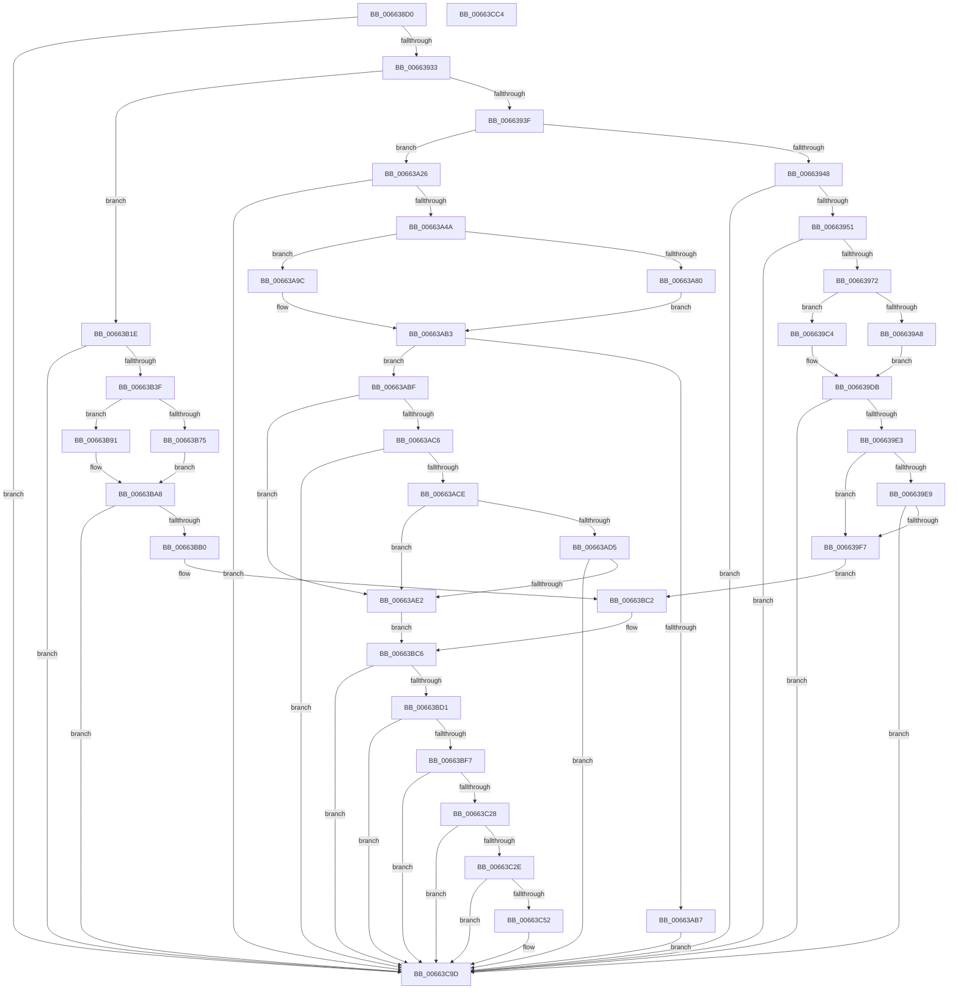

# ApiSetpResolveHost

- RVA: `0x006638D0`–`0x00663CC5` (길이 `1,013` bytes)
- VA: `0x00000001406638D0`
- 실행 섹션: `.text`
- PDB 이름 있음: `예`; PDB Function 태그: `아니요`
- unwind 정보 RVA: `0x000BE68C`
- 디코드: `287`개 명령, `1,013/1,013` bytes 표시
- 미해석 바이트: `0` (있으면 어셈블리에 `.byte`로 보존)

> 이 문서는 커널 이미지의 기계어와 PDB 기호를 분석해 생성했습니다. 4번과 5번은 함수 원형과 자료형을 바이너리 사용 방식에서 추정한 C 해석이며 원본 소스 복구 결과는 아닙니다.

## 1. Dependencies

- 직접 호출 지점: **12**; 고유 호출 대상: **5**
- 직접 호출자로 확인된 함수: **1**
- RIP 상대 이미지 참조: **0**

### Outgoing calls
- `0x00663926` → [ApiSetpGetContractKeyInfo](ApiSetpGetContractKeyInfo_function_00664B44.md) (function, `0x00664B44`)
- `0x0066395F` → [ApiSetpSearchForSectionIndex_V7](ApiSetpSearchForSectionIndex_V7_function_00665218.md) (function, `0x00665218`)
- `0x006639BA` → [ApiSetpGetSearchKeyHash](ApiSetpGetSearchKeyHash_function_00664F9C.md) (function, `0x00664F9C`)
- `0x006639D6` → [ApiSetpGetSearchKeyHash](ApiSetpGetSearchKeyHash_function_00664F9C.md) (function, `0x00664F9C`)
- `0x00663A37` → [ApiSetpSearchForSectionIndex_V7](ApiSetpSearchForSectionIndex_V7_function_00665218.md) (function, `0x00665218`)
- `0x00663A92` → [ApiSetpGetSearchKeyHash](ApiSetpGetSearchKeyHash_function_00664F9C.md) (function, `0x00664F9C`)
- `0x00663AAE` → [ApiSetpGetSearchKeyHash](ApiSetpGetSearchKeyHash_function_00664F9C.md) (function, `0x00664F9C`)
- `0x00663AD5` → [ApiSetpIsFeatureEnabled](ApiSetpIsFeatureEnabled_function_006648A8.md) (function, `0x006648A8`)
- `0x00663B2C` → [ApiSetpSearchForSectionIndex_V7](ApiSetpSearchForSectionIndex_V7_function_00665218.md) (function, `0x00665218`)
- `0x00663B87` → [ApiSetpGetSearchKeyHash](ApiSetpGetSearchKeyHash_function_00664F9C.md) (function, `0x00664F9C`)
- `0x00663BA3` → [ApiSetpGetSearchKeyHash](ApiSetpGetSearchKeyHash_function_00664F9C.md) (function, `0x00664F9C`)
- `0x00663C49` → [ApiSetpSearchForHostOverrideIndex_V7](ApiSetpSearchForHostOverrideIndex_V7_function_0066516C.md) (function, `0x0066516C`)

### Direct callers
- [ApiSetResolveToHost](../4C/ApiSetResolveToHost_function_004C8AA8.md) at `0x004C8AEF`

### Static image references
- 디코드된 RIP-relative 메모리 참조가 없습니다.

## 2. Other-region calls and transfers

- 다른 실행 섹션으로 향하는 call: **0**
- 별도 외부 분기/꼬리 이동을 확인하지 못했습니다.

## 3. Assembly (complete function range)

```asm
006638D0  48 89 5C 24 08                  mov qword ptr [rsp + 8], rbx
006638D5  48 89 74 24 10                  mov qword ptr [rsp + 0x10], rsi
006638DA  48 89 7C 24 18                  mov qword ptr [rsp + 0x18], rdi
006638DF  55                              push rbp
006638E0  41 54                           push r12
006638E2  41 55                           push r13
006638E4  41 56                           push r14
006638E6  41 57                           push r15
006638E8  48 8B EC                        mov rbp, rsp
006638EB  48 83 EC 60                     sub rsp, 0x60
006638EF  4C 8B 65 60                     mov r12, qword ptr [rbp + 0x60]
006638F3  4C 8D 4D D0                     lea r9, [rbp - 0x30]
006638F7  0F 57 C0                        xorps xmm0, xmm0
006638FA  48 8B D9                        mov rbx, rcx
006638FD  33 C9                           xor ecx, ecx
006638FF  41 0F B7 C0                     movzx eax, r8w
00663903  4C 8B D2                        mov r10, rdx
00663906  48 89 4D F0                     mov qword ptr [rbp - 0x10], rcx
0066390A  45 33 ED                        xor r13d, r13d
0066390D  49 8B CA                        mov rcx, r10
00663910  41 B0 01                        mov r8b, 1
00663913  0F B7 D0                        movzx edx, ax
00663916  41 0F 11 04 24                  movups xmmword ptr [r12], xmm0
0066391B  45 8A F5                        mov r14b, r13b
0066391E  0F 11 45 D0                     movups xmmword ptr [rbp - 0x30], xmm0
00663922  0F 11 45 E0                     movups xmmword ptr [rbp - 0x20], xmm0
00663926  E8 19 12 00 00                  call 0x140664b44
0066392B  84 C0                           test al, al
0066392D  0F 84 6A 03 00 00               je 0x140663c9d
00663933  8B 4D DC                        mov ecx, dword ptr [rbp - 0x24]
00663936  83 E9 01                        sub ecx, 1
00663939  0F 84 DF 01 00 00               je 0x140663b1e
0066393F  83 E9 01                        sub ecx, 1
00663942  0F 84 DE 00 00 00               je 0x140663a26
00663948  83 F9 01                        cmp ecx, 1
0066394B  0F 85 4C 03 00 00               jne 0x140663c9d
00663951  45 33 C9                        xor r9d, r9d
00663954  4C 8D 45 D0                     lea r8, [rbp - 0x30]
00663958  48 8D 53 44                     lea rdx, [rbx + 0x44]
0066395C  48 8B CB                        mov rcx, rbx
0066395F  E8 B4 18 00 00                  call 0x140665218
00663964  BE FF FF 00 00                  mov esi, 0xffff
00663969  66 3B C6                        cmp ax, si
0066396C  0F 84 2B 03 00 00               je 0x140663c9d
00663972  0F B6 4B 4C                     movzx ecx, byte ptr [rbx + 0x4c]
00663976  44 0F B7 7B 12                  movzx r15d, word ptr [rbx + 0x12]
0066397B  8B 7B 44                        mov edi, dword ptr [rbx + 0x44]
0066397E  44 8A 53 4F                     mov r10b, byte ptr [rbx + 0x4f]
00663982  0F B7 C0                        movzx eax, ax
00663985  48 0F AF C1                     imul rax, rcx
00663989  8A 4B 02                        mov cl, byte ptr [rbx + 2]
0066398C  49 2B C7                        sub rax, r15
0066398F  44 88 54 24 20                  mov byte ptr [rsp + 0x20], r10b
00663994  48 03 C3                        add rax, rbx
00663997  8A D1                           mov dl, cl
00663999  48 03 F8                        add rdi, rax
0066399C  80 E2 10                        and dl, 0x10
0066399F  80 E1 08                        and cl, 8
006639A2  F6 43 4D 04                     test byte ptr [rbx + 0x4d], 4
006639A6  74 1C                           je 0x1406639c4
006639A8  84 D2                           test dl, dl
006639AA  41 0F 95 C1                     setne r9b
006639AE  84 C9                           test cl, cl
006639B0  48 8D 4D D0                     lea rcx, [rbp - 0x30]
006639B4  41 0F 95 C0                     setne r8b
006639B8  33 D2                           xor edx, edx
006639BA  E8 DD 15 00 00                  call 0x140664f9c
006639BF  0F B6 C0                        movzx eax, al
006639C2  EB 17                           jmp 0x1406639db
006639C4  84 D2                           test dl, dl
006639C6  41 0F 95 C1                     setne r9b
006639CA  84 C9                           test cl, cl
006639CC  48 8D 4D D0                     lea rcx, [rbp - 0x30]
006639D0  41 0F 95 C0                     setne r8b
006639D4  33 D2                           xor edx, edx
006639D6  E8 C1 15 00 00                  call 0x140664f9c
006639DB  39 07                           cmp dword ptr [rdi], eax
006639DD  0F 85 BA 02 00 00               jne 0x140663c9d
006639E3  F6 47 0A 04                     test byte ptr [rdi + 0xa], 4
006639E7  74 0E                           je 0x1406639f7
006639E9  0F B6 47 09                     movzx eax, byte ptr [rdi + 9]
006639ED  66 39 45 E8                     cmp word ptr [rbp - 0x18], ax
006639F1  0F 87 A6 02 00 00               ja 0x140663c9d
006639F7  0F B6 43 34                     movzx eax, byte ptr [rbx + 0x34]
006639FB  0F B7 4F 04                     movzx ecx, word ptr [rdi + 4]
006639FF  48 0F AF C8                     imul rcx, rax
00663A03  8B 43 2C                        mov eax, dword ptr [rbx + 0x2c]
00663A06  48 03 C8                        add rcx, rax
00663A09  49 2B CF                        sub rcx, r15
00663A0C  48 03 CB                        add rcx, rbx
00663A0F  44 0F B7 41 08                  movzx r8d, word ptr [rcx + 8]
00663A14  8A 41 0A                        mov al, byte ptr [rcx + 0xa]
00663A17  44 0F B7 49 04                  movzx r9d, word ptr [rcx + 4]
00663A1C  44 0F B7 51 06                  movzx r10d, word ptr [rcx + 6]
00663A21  E9 9C 01 00 00                  jmp 0x140663bc2
00663A26  45 33 C9                        xor r9d, r9d
00663A29  4C 8D 45 D0                     lea r8, [rbp - 0x30]
00663A2D  48 8D 53 38                     lea rdx, [rbx + 0x38]
00663A31  48 8B CB                        mov rcx, rbx
00663A34  41 B6 01                        mov r14b, 1
00663A37  E8 DC 17 00 00                  call 0x140665218
00663A3C  BE FF FF 00 00                  mov esi, 0xffff
00663A41  66 3B C6                        cmp ax, si
00663A44  0F 84 53 02 00 00               je 0x140663c9d
00663A4A  0F B6 4B 40                     movzx ecx, byte ptr [rbx + 0x40]
00663A4E  8B 7B 38                        mov edi, dword ptr [rbx + 0x38]
00663A51  44 8A 53 43                     mov r10b, byte ptr [rbx + 0x43]
00663A55  0F B7 C0                        movzx eax, ax
00663A58  48 0F AF C8                     imul rcx, rax
00663A5C  0F B7 43 12                     movzx eax, word ptr [rbx + 0x12]
00663A60  48 2B C8                        sub rcx, rax
00663A63  44 88 54 24 20                  mov byte ptr [rsp + 0x20], r10b
00663A68  48 8D 04 0B                     lea rax, [rbx + rcx]
00663A6C  8A 4B 02                        mov cl, byte ptr [rbx + 2]
00663A6F  8A D1                           mov dl, cl
00663A71  48 03 F8                        add rdi, rax
00663A74  80 E2 10                        and dl, 0x10
00663A77  80 E1 08                        and cl, 8
00663A7A  F6 43 41 04                     test byte ptr [rbx + 0x41], 4
00663A7E  74 1C                           je 0x140663a9c
00663A80  84 D2                           test dl, dl
00663A82  41 0F 95 C1                     setne r9b
00663A86  84 C9                           test cl, cl
00663A88  48 8D 4D D0                     lea rcx, [rbp - 0x30]
00663A8C  41 0F 95 C0                     setne r8b
00663A90  33 D2                           xor edx, edx
00663A92  E8 05 15 00 00                  call 0x140664f9c
00663A97  0F B6 C0                        movzx eax, al
00663A9A  EB 17                           jmp 0x140663ab3
00663A9C  84 D2                           test dl, dl
00663A9E  41 0F 95 C1                     setne r9b
00663AA2  84 C9                           test cl, cl
00663AA4  48 8D 4D D0                     lea rcx, [rbp - 0x30]
00663AA8  41 0F 95 C0                     setne r8b
00663AAC  33 D2                           xor edx, edx
00663AAE  E8 E9 14 00 00                  call 0x140664f9c
00663AB3  39 07                           cmp dword ptr [rdi], eax
00663AB5  74 08                           je 0x140663abf
00663AB7  45 8A F5                        mov r14b, r13b
00663ABA  E9 DE 01 00 00                  jmp 0x140663c9d
00663ABF  8A 47 06                        mov al, byte ptr [rdi + 6]
00663AC2  A8 04                           test al, 4
00663AC4  74 1C                           je 0x140663ae2
00663AC6  A8 02                           test al, 2
00663AC8  0F 85 CF 01 00 00               jne 0x140663c9d
00663ACE  8B 4F 08                        mov ecx, dword ptr [rdi + 8]
00663AD1  85 C9                           test ecx, ecx
00663AD3  74 0D                           je 0x140663ae2
00663AD5  E8 CE 0D 00 00                  call 0x1406648a8
00663ADA  84 C0                           test al, al
00663ADC  0F 84 BB 01 00 00               je 0x140663c9d
00663AE2  0F B6 43 34                     movzx eax, byte ptr [rbx + 0x34]
00663AE6  0F B7 53 12                     movzx edx, word ptr [rbx + 0x12]
00663AEA  0F B7 4F 04                     movzx ecx, word ptr [rdi + 4]
00663AEE  44 0F B7 FA                     movzx r15d, dx
00663AF2  48 0F AF C8                     imul rcx, rax
00663AF6  8B 43 2C                        mov eax, dword ptr [rbx + 0x2c]
00663AF9  48 03 C8                        add rcx, rax
00663AFC  48 2B CA                        sub rcx, rdx
00663AFF  48 03 CB                        add rcx, rbx
00663B02  8A 41 0A                        mov al, byte ptr [rcx + 0xa]
00663B05  44 0F B7 41 08                  movzx r8d, word ptr [rcx + 8]
00663B0A  44 0F B7 49 04                  movzx r9d, word ptr [rcx + 4]
00663B0F  44 0F B7 51 06                  movzx r10d, word ptr [rcx + 6]
00663B14  D0 E8                           shr al, 1
00663B16  41 22 C6                        and al, r14b
00663B19  E9 A8 00 00 00                  jmp 0x140663bc6
00663B1E  41 B1 01                        mov r9b, 1
00663B21  4C 8D 45 D0                     lea r8, [rbp - 0x30]
00663B25  48 8D 53 2C                     lea rdx, [rbx + 0x2c]
00663B29  48 8B CB                        mov rcx, rbx
00663B2C  E8 E7 16 00 00                  call 0x140665218
00663B31  BE FF FF 00 00                  mov esi, 0xffff
00663B36  66 3B C6                        cmp ax, si
00663B39  0F 84 5E 01 00 00               je 0x140663c9d
00663B3F  0F B6 4B 34                     movzx ecx, byte ptr [rbx + 0x34]
00663B43  44 0F B7 7B 12                  movzx r15d, word ptr [rbx + 0x12]
00663B48  8B 7B 2C                        mov edi, dword ptr [rbx + 0x2c]
00663B4B  44 8A 53 37                     mov r10b, byte ptr [rbx + 0x37]
00663B4F  0F B7 C0                        movzx eax, ax
00663B52  48 0F AF C1                     imul rax, rcx
00663B56  8A 4B 02                        mov cl, byte ptr [rbx + 2]
00663B59  49 2B C7                        sub rax, r15
00663B5C  44 88 54 24 20                  mov byte ptr [rsp + 0x20], r10b
00663B61  48 03 C3                        add rax, rbx
00663B64  8A D1                           mov dl, cl
00663B66  48 03 F8                        add rdi, rax
00663B69  80 E2 10                        and dl, 0x10
00663B6C  80 E1 08                        and cl, 8
00663B6F  F6 43 35 04                     test byte ptr [rbx + 0x35], 4
00663B73  74 1C                           je 0x140663b91
00663B75  84 D2                           test dl, dl
00663B77  B2 01                           mov dl, 1
00663B79  41 0F 95 C1                     setne r9b
00663B7D  84 C9                           test cl, cl
00663B7F  48 8D 4D D0                     lea rcx, [rbp - 0x30]
00663B83  41 0F 95 C0                     setne r8b
00663B87  E8 10 14 00 00                  call 0x140664f9c
00663B8C  0F B6 C0                        movzx eax, al
00663B8F  EB 17                           jmp 0x140663ba8
00663B91  84 D2                           test dl, dl
00663B93  B2 01                           mov dl, 1
00663B95  41 0F 95 C1                     setne r9b
00663B99  84 C9                           test cl, cl
00663B9B  48 8D 4D D0                     lea rcx, [rbp - 0x30]
00663B9F  41 0F 95 C0                     setne r8b
00663BA3  E8 F4 13 00 00                  call 0x140664f9c
00663BA8  39 07                           cmp dword ptr [rdi], eax
00663BAA  0F 85 ED 00 00 00               jne 0x140663c9d
00663BB0  44 0F B7 47 08                  movzx r8d, word ptr [rdi + 8]
00663BB5  8A 47 0A                        mov al, byte ptr [rdi + 0xa]
00663BB8  44 0F B7 4F 04                  movzx r9d, word ptr [rdi + 4]
00663BBD  44 0F B7 57 06                  movzx r10d, word ptr [rdi + 6]
00663BC2  D0 E8                           shr al, 1
00663BC4  24 01                           and al, 1
00663BC6  41 B6 01                        mov r14b, 1
00663BC9  84 C0                           test al, al
00663BCB  0F 84 CC 00 00 00               je 0x140663c9d
00663BD1  0F B6 53 64                     movzx edx, byte ptr [rbx + 0x64]
00663BD5  41 0F B7 C1                     movzx eax, r9w
00663BD9  48 0F AF D0                     imul rdx, rax
00663BDD  8B 43 5C                        mov eax, dword ptr [rbx + 0x5c]
00663BE0  48 03 D0                        add rdx, rax
00663BE3  41 0F B7 CF                     movzx ecx, r15w
00663BE7  8A 43 03                        mov al, byte ptr [rbx + 3]
00663BEA  48 2B D1                        sub rdx, rcx
00663BED  38 44 1A 0A                     cmp byte ptr [rdx + rbx + 0xa], al
00663BF1  0F 87 A6 00 00 00               ja 0x140663c9d
00663BF7  8B 44 1A 04                     mov eax, dword ptr [rdx + rbx + 4]
00663BFB  4C 8B 4D 50                     mov r9, qword ptr [rbp + 0x50]
00663BFF  48 2B C1                        sub rax, rcx
00663C02  8B 4B 24                        mov ecx, dword ptr [rbx + 0x24]
00663C05  48 03 C3                        add rax, rbx
00663C08  48 03 C8                        add rcx, rax
00663C0B  49 89 4C 24 08                  mov qword ptr [r12 + 8], rcx
00663C10  0F B7 44 1A 08                  movzx eax, word ptr [rdx + rbx + 8]
00663C15  66 03 C0                        add ax, ax
00663C18  66 41 89 04 24                  mov word ptr [r12], ax
00663C1D  66 41 89 44 24 02               mov word ptr [r12 + 2], ax
00663C23  4D 85 C9                        test r9, r9
00663C26  74 75                           je 0x140663c9d
00663C28  66 45 85 C0                     test r8w, r8w
00663C2C  74 6F                           je 0x140663c9d
00663C2E  41 0F B7 01                     movzx eax, word ptr [r9]
00663C32  48 8B CB                        mov rcx, rbx
00663C35  4D 8B 49 08                     mov r9, qword ptr [r9 + 8]
00663C39  66 D1 E8                        shr ax, 1
00663C3C  45 0F B7 C0                     movzx r8d, r8w
00663C40  41 0F B7 D2                     movzx edx, r10w
00663C44  66 89 44 24 20                  mov word ptr [rsp + 0x20], ax
00663C49  E8 1E 15 00 00                  call 0x14066516c
00663C4E  3B C6                           cmp eax, esi
00663C50  74 4B                           je 0x140663c9d
00663C52  0F B7 53 12                     movzx edx, word ptr [rbx + 0x12]
00663C56  44 0F B7 43 72                  movzx r8d, word ptr [rbx + 0x72]
00663C5B  8B C0                           mov eax, eax
00663C5D  4C 0F AF C0                     imul r8, rax
00663C61  8B 43 68                        mov eax, dword ptr [rbx + 0x68]
00663C64  4C 03 C0                        add r8, rax
00663C67  8B 43 24                        mov eax, dword ptr [rbx + 0x24]
00663C6A  4C 2B C2                        sub r8, rdx
00663C6D  41 8B 4C 18 08                  mov ecx, dword ptr [r8 + rbx + 8]
00663C72  48 03 C8                        add rcx, rax
00663C75  48 2B CA                        sub rcx, rdx
00663C78  48 03 CB                        add rcx, rbx
00663C7B  49 89 4C 24 08                  mov qword ptr [r12 + 8], rcx
00663C80  41 0F B7 44 18 0E               movzx eax, word ptr [r8 + rbx + 0xe]
00663C86  66 03 C0                        add ax, ax
00663C89  66 41 89 44 24 02               mov word ptr [r12 + 2], ax
00663C8F  41 0F B7 44 18 0E               movzx eax, word ptr [r8 + rbx + 0xe]
00663C95  66 03 C0                        add ax, ax
00663C98  66 41 89 04 24                  mov word ptr [r12], ax
00663C9D  48 8B 45 58                     mov rax, qword ptr [rbp + 0x58]
00663CA1  4C 8D 5C 24 60                  lea r11, [rsp + 0x60]
00663CA6  49 8B 5B 30                     mov rbx, qword ptr [r11 + 0x30]
00663CAA  49 8B 73 38                     mov rsi, qword ptr [r11 + 0x38]
00663CAE  49 8B 7B 40                     mov rdi, qword ptr [r11 + 0x40]
00663CB2  44 88 30                        mov byte ptr [rax], r14b
00663CB5  33 C0                           xor eax, eax
00663CB7  49 8B E3                        mov rsp, r11
00663CBA  41 5F                           pop r15
00663CBC  41 5E                           pop r14
00663CBE  41 5D                           pop r13
00663CC0  41 5C                           pop r12
00663CC2  5D                              pop rbp
00663CC3  C3                              ret
00663CC4  CC                              int3
```

## 4. C-style interpretation (structured pseudocode)

```c
__int64 __fastcall ApiSetpResolveHost(__int64 a1, __int64 a2, unsigned __int16 a3, __int64 a4, __int64 a5, __int64 a6, __int64 a7)
{
    __int64 result;
    __int64 v_r13;
    __int64 v_rdi;
    __int64 v_rsp;
    unsigned __int64 v_stack_m28;
    unsigned __int64 v_stack_m38;
    unsigned __int16 v_stack_m40;
    unsigned __int64 v_stack_m48;
    unsigned int v_stack_m4C;
    unsigned __int64 v_stack_m58;
    unsigned __int8 v_stack_m68;
    unsigned __int64 v_stack_p10;
    unsigned __int64 v_stack_p18;
    unsigned __int64 v_stack_p8;

    v_stack_p8 = v_rbx;
    v_stack_p10 = v_rsi;
    v_stack_p18 = v_rdi;
    v_rsp = (v_rsp) - (96);
    a1 = 0;
    v_stack_m38 = 0;
    v_r13 = 0;
    *(unsigned __int64 *)(a7) = v_xmm0;
    v_stack_m58 = v_xmm0;
    v_stack_m48 = v_xmm0;
    result = ApiSetpGetContractKeyInfo(a2, a3, 1, v_stack_m58);
    if ((unsigned __int8)(result) == 0) goto loc_00663C9D;
    a1 = (unsigned int)(((unsigned int)(v_stack_m4C)) - (1));
    if (condition_is_equal) goto loc_00663B1E;
    a1 = (unsigned int)((a1) - (1));
    if (condition_is_equal) goto loc_00663A26;
    if (((unsigned int)(a1)) != 1) goto loc_00663C9D;
    a4 = 0;
    result = ApiSetpSearchForSectionIndex_V7(a1, a1 + 68, v_stack_m58, a4);
    if (((unsigned __int16)(result)) == ((unsigned __int16)((unsigned int)(0xFFFFULL)))) goto loc_00663C9D;
    result = ((unsigned __int16)(result)) * (*(unsigned __int8 *)(a1 + 76));
    result = (result) - (*(unsigned __int16 *)(a1 + 18));
    v_stack_m68 = (unsigned __int8)(*(unsigned __int8 *)(a1 + 79));
    result = (result) + (a1);
    v_rdi = ((unsigned int)(*(unsigned int *)(a1 + 68))) + (result);
    a2 = (unsigned __int8)(((unsigned __int8)(*(unsigned __int8 *)(a1 + 2))) & (16));
    a1 = (unsigned __int8)((*(unsigned __int8 *)(a1 + 2)) & (8));
    if (((*(unsigned __int8 *)(a1 + 77)) & (4)) == 0) goto loc_006639C4;
    a4 = ((unsigned __int8)(a2) != 0) ? 1 : 0;
    a3 = ((unsigned __int8)(a1) != 0) ? 1 : 0;
    a2 = 0;
    result = ApiSetpGetSearchKeyHash(v_stack_m58, a2, a3, a4);
    goto loc_006639DB;
loc_006639C4:
    a4 = (0 != 0) ? 1 : 0;
    a3 = ((unsigned __int8)(v_stack_m58) != 0) ? 1 : 0;
    a2 = 0;
    result = ApiSetpGetSearchKeyHash(v_stack_m58, a2, a3, a4);
loc_006639DB:
    if ((*(unsigned int *)(v_rdi)) != ((unsigned int)(result))) goto loc_00663C9D;
    if (((*(unsigned __int8 *)(v_rdi + 10)) & (4)) == 0) goto loc_006639F7;
    if (v_stack_m40 > ((unsigned __int16)(*(unsigned __int8 *)(v_rdi + 9)))) goto loc_00663C9D;
loc_006639F7:
    a1 = (*(unsigned __int16 *)(v_rdi + 4)) * (*(unsigned __int8 *)(a1 + 52));
    a1 = (a1) + ((unsigned int)(*(unsigned int *)(a1 + 44)));
    a1 = (a1) - (*(unsigned __int16 *)(a1 + 18));
    a1 = (a1) + (a1);
    goto loc_00663BC2;
loc_00663A26:
    a4 = 0;
    result = ApiSetpSearchForSectionIndex_V7(a1, a1 + 56, v_stack_m58, a4);
    if (((unsigned __int16)(result)) == ((unsigned __int16)((unsigned int)(0xFFFFULL)))) goto loc_00663C9D;
    a1 = (*(unsigned __int8 *)(a1 + 64)) * ((unsigned __int16)(result));
    a1 = (a1) - (*(unsigned __int16 *)(a1 + 18));
    v_stack_m68 = (unsigned __int8)(*(unsigned __int8 *)(a1 + 67));
    v_rdi = ((unsigned int)(*(unsigned int *)(a1 + 56))) + (a1 + a1 * 1);
    a2 = (unsigned __int8)(((unsigned __int8)(*(unsigned __int8 *)(a1 + 2))) & (16));
    a1 = (unsigned __int8)((*(unsigned __int8 *)(a1 + 2)) & (8));
    if (((*(unsigned __int8 *)(a1 + 65)) & (4)) == 0) goto loc_00663A9C;
    a4 = ((unsigned __int8)(a2) != 0) ? 1 : 0;
    a3 = ((unsigned __int8)(a1) != 0) ? 1 : 0;
    a2 = 0;
    result = ApiSetpGetSearchKeyHash(v_stack_m58, a2, a3, a4);
    goto loc_00663AB3;
loc_00663A9C:
    a4 = (0 != 0) ? 1 : 0;
    a3 = ((unsigned __int8)(v_stack_m58) != 0) ? 1 : 0;
    a2 = 0;
    result = ApiSetpGetSearchKeyHash(v_stack_m58, a2, a3, a4);
loc_00663AB3:
    if ((*(unsigned int *)(v_rdi)) == ((unsigned int)(result))) goto loc_00663ABF;
    goto loc_00663C9D;
loc_00663ABF:
    if ((((unsigned __int8)(*(unsigned __int8 *)(v_rdi + 6))) & (4)) == 0) goto loc_00663AE2;
    if ((((unsigned __int8)(*(unsigned __int8 *)(v_rdi + 6))) & (2)) != 0) goto loc_00663C9D;
    if ((unsigned int)((unsigned int)(*(unsigned int *)(v_rdi + 8))) == 0) goto loc_00663AE2;
    result = ApiSetpIsFeatureEnabled((unsigned int)(*(unsigned int *)(v_rdi + 8)), a2, a3, a4);
    if ((unsigned __int8)(result) == 0) goto loc_00663C9D;
loc_00663AE2:
    a1 = (*(unsigned __int16 *)(v_rdi + 4)) * (*(unsigned __int8 *)(a1 + 52));
    a1 = (a1) + ((unsigned int)(*(unsigned int *)(a1 + 44)));
    a1 = (a1) - (*(unsigned __int16 *)(a1 + 18));
    a1 = (a1) + (a1);
    result = (unsigned __int8)((*(unsigned __int8 *)(a1 + 10)) >> (1));
    result = (unsigned __int8)((result) & (0));
    goto loc_00663BC6;
loc_00663B1E:
    result = ApiSetpSearchForSectionIndex_V7(a1, a1 + 44, v_stack_m58, 1);
    if (((unsigned __int16)(result)) == ((unsigned __int16)((unsigned int)(0xFFFFULL)))) goto loc_00663C9D;
    result = ((unsigned __int16)(result)) * (*(unsigned __int8 *)(a1 + 52));
    result = (result) - (*(unsigned __int16 *)(a1 + 18));
    v_stack_m68 = (unsigned __int8)(*(unsigned __int8 *)(a1 + 55));
    result = (result) + (a1);
    v_rdi = ((unsigned int)(*(unsigned int *)(a1 + 44))) + (result);
    a2 = (unsigned __int8)(((unsigned __int8)(*(unsigned __int8 *)(a1 + 2))) & (16));
    a1 = (unsigned __int8)((*(unsigned __int8 *)(a1 + 2)) & (8));
    if (((*(unsigned __int8 *)(a1 + 53)) & (4)) == 0) goto loc_00663B91;
    a4 = ((unsigned __int8)(a2) != 0) ? 1 : 0;
    a3 = ((unsigned __int8)(a1) != 0) ? 1 : 0;
    result = ApiSetpGetSearchKeyHash(v_stack_m58, 1, a3, a4);
    goto loc_00663BA8;
loc_00663B91:
    a4 = (1 != 0) ? 1 : 0;
    a3 = ((unsigned __int8)(v_stack_m58) != 0) ? 1 : 0;
    result = ApiSetpGetSearchKeyHash(v_stack_m58, 1, a3, a4);
loc_00663BA8:
    if ((*(unsigned int *)(v_rdi)) != ((unsigned int)(result))) goto loc_00663C9D;
loc_00663BC2:
    result = (unsigned __int8)((*(unsigned __int8 *)(v_rdi + 10)) >> (1));
    result = (unsigned __int8)((result) & (1));
loc_00663BC6:
    if ((unsigned __int8)(result) == 0) goto loc_00663C9D;
    a2 = (*(unsigned __int8 *)(a1 + 100)) * ((unsigned __int16)(*(unsigned __int16 *)(v_rdi + 4)));
    a2 = (a2) + ((unsigned int)(*(unsigned int *)(a1 + 92)));
    a2 = (a2) - ((unsigned __int16)(*(unsigned __int16 *)(a1 + 18)));
    if ((*(unsigned __int8 *)(a2 + a1 * 1 + 10)) > ((unsigned __int8)(*(unsigned __int8 *)(a1 + 3)))) goto loc_00663C9D;
    result = ((unsigned int)(*(unsigned int *)(a2 + a1 * 1 + 4))) - ((unsigned __int16)(*(unsigned __int16 *)(a1 + 18)));
    result = (result) + (a1);
    a1 = ((unsigned int)(*(unsigned int *)(a1 + 36))) + (result);
    *(unsigned __int64 *)(a7 + 8) = a1;
    result = (unsigned __int16)((*(unsigned __int16 *)(a2 + a1 * 1 + 8)) + ((unsigned __int16)(*(unsigned __int16 *)(a2 + a1 * 1 + 8))));
    *(unsigned __int16 *)(a7) = (unsigned __int16)(result);
    *(unsigned __int16 *)(a7 + 2) = (unsigned __int16)(result);
    if (a5 == 0) goto loc_00663C9D;
    if ((unsigned __int16)(*(unsigned __int16 *)(v_rdi + 8)) == 0) goto loc_00663C9D;
    result = (unsigned __int16)((*(unsigned __int16 *)(a5)) >> (1));
    v_stack_m68 = (unsigned __int16)(result);
    result = ApiSetpSearchForHostOverrideIndex_V7(a1, (unsigned __int16)(*(unsigned __int16 *)(v_rdi + 6)), (unsigned __int16)(*(unsigned __int16 *)(v_rdi + 8)), *(unsigned __int64 *)(a5 + 8));
    if (((unsigned int)(result)) != ((unsigned int)((unsigned int)(0xFFFFULL)))) {
        a2 = *(unsigned __int16 *)(a1 + 18);
        a3 = *(unsigned __int16 *)(a1 + 114);
        result = (unsigned int)(result);
        a3 = (a3) * (result);
        result = *(unsigned int *)(a1 + 104);
        a3 = (a3) + (result);
        result = *(unsigned int *)(a1 + 36);
        a3 = (a3) - (a2);
        a1 = *(unsigned int *)(a3 + a1 * 1 + 8);
        a1 = (a1) + (result);
        a1 = (a1) - (a2);
        a1 = (a1) + (a1);
        *(unsigned __int64 *)(a7 + 8) = a1;
        result = *(unsigned __int16 *)(a3 + a1 * 1 + 14);
        result = (unsigned __int16)((result) + ((unsigned __int16)(result)));
        *(unsigned __int16 *)(a7 + 2) = (unsigned __int16)(result);
        result = *(unsigned __int16 *)(a3 + a1 * 1 + 14);
        result = (unsigned __int16)((result) + ((unsigned __int16)(result)));
        *(unsigned __int16 *)(a7) = (unsigned __int16)(result);
    }
    *(unsigned __int8 *)(a6) = 1;
    result = 0;
    return result;
}
```

## 5. (Beta) C Style

```c
int64_t ApiSetpResolveHost(void *Arg1, int64_t Arg2, uint16_t Arg3, int64_t Arg4, int64_t Arg5, void *Arg6, void *Arg7)
{
    uint8_t *arg1 = (uint8_t *)Arg1;
    uint8_t *arg6 = (uint8_t *)Arg6;
    uint8_t *arg7 = (uint8_t *)Arg7;

    int64_t result;
    int64_t local_r13;
    int64_t local_rdi;
    int64_t local_rsp;
    uint64_t v_stack_m28;
    uint64_t v_stack_m38;
    uint16_t v_stack_m40;
    uint64_t v_stack_m48;
    uint32_t v_stack_m4C;
    uint64_t v_stack_m58;
    uint8_t v_stack_m68;
    uint64_t v_stack_p10;
    uint64_t v_stack_p18;
    uint64_t v_stack_p8;

    v_stack_p8 = local_rbx;
    v_stack_p10 = local_rsi;
    v_stack_p18 = local_rdi;
    local_rsp = (local_rsp) - (96);
    Arg1 = 0;
    v_stack_m38 = 0;
    local_r13 = 0;
    *(uint64_t *)(arg7) = v_xmm0;
    v_stack_m58 = v_xmm0;
    v_stack_m48 = v_xmm0;
    result = ApiSetpGetContractKeyInfo(Arg2, Arg3, 1, v_stack_m58);
    if ((uint8_t)(result) == 0) goto loc_00663C9D;
    Arg1 = (uint32_t)(((uint32_t)(v_stack_m4C)) - (1));
    if (condition_is_equal) goto loc_00663B1E;
    Arg1 = (uint32_t)((Arg1) - (1));
    if (condition_is_equal) goto loc_00663A26;
    if (((uint32_t)(Arg1)) != 1) goto loc_00663C9D;
    Arg4 = 0;
    result = ApiSetpSearchForSectionIndex_V7(Arg1, Arg1 + 68, v_stack_m58, Arg4);
    if (((uint16_t)(result)) == ((uint16_t)((uint32_t)(0xFFFFULL)))) goto loc_00663C9D;
    result = ((uint16_t)(result)) * (*(uint8_t *)(arg1 + 0x4C));
    result = (result) - (*(uint16_t *)(arg1 + 0x12));
    v_stack_m68 = (uint8_t)(*(uint8_t *)(arg1 + 0x4F));
    result = (result) + (Arg1);
    local_rdi = ((uint32_t)(*(uint32_t *)(arg1 + 0x44))) + (result);
    Arg2 = (uint8_t)(((uint8_t)(*(uint8_t *)(arg1 + 0x2))) & (16));
    Arg1 = (uint8_t)((*(uint8_t *)(arg1 + 0x2)) & (8));
    if (((*(uint8_t *)(arg1 + 0x4D)) & (4)) == 0) goto loc_006639C4;
    Arg4 = ((uint8_t)(Arg2) != 0) ? 1 : 0;
    Arg3 = ((uint8_t)(Arg1) != 0) ? 1 : 0;
    Arg2 = 0;
    result = ApiSetpGetSearchKeyHash(v_stack_m58, Arg2, Arg3, Arg4);
    goto loc_006639DB;
loc_006639C4:
    Arg4 = (0 != 0) ? 1 : 0;
    Arg3 = ((uint8_t)(v_stack_m58) != 0) ? 1 : 0;
    Arg2 = 0;
    result = ApiSetpGetSearchKeyHash(v_stack_m58, Arg2, Arg3, Arg4);
loc_006639DB:
    if ((*(uint32_t *)(local_rdi)) != ((uint32_t)(result))) goto loc_00663C9D;
    if (((*(uint8_t *)(local_rdi + 0xA)) & (4)) == 0) goto loc_006639F7;
    if (v_stack_m40 > ((uint16_t)(*(uint8_t *)(local_rdi + 0x9)))) goto loc_00663C9D;
loc_006639F7:
    Arg1 = (*(uint16_t *)(local_rdi + 0x4)) * (*(uint8_t *)(arg1 + 0x34));
    Arg1 = (Arg1) + ((uint32_t)(*(uint32_t *)(arg1 + 0x2C)));
    Arg1 = (Arg1) - (*(uint16_t *)(arg1 + 0x12));
    Arg1 = (Arg1) + (Arg1);
    goto loc_00663BC2;
loc_00663A26:
    Arg4 = 0;
    result = ApiSetpSearchForSectionIndex_V7(Arg1, Arg1 + 56, v_stack_m58, Arg4);
    if (((uint16_t)(result)) == ((uint16_t)((uint32_t)(0xFFFFULL)))) goto loc_00663C9D;
    Arg1 = (*(uint8_t *)(arg1 + 0x40)) * ((uint16_t)(result));
    Arg1 = (Arg1) - (*(uint16_t *)(arg1 + 0x12));
    v_stack_m68 = (uint8_t)(*(uint8_t *)(arg1 + 0x43));
    local_rdi = ((uint32_t)(*(uint32_t *)(arg1 + 0x38))) + (Arg1 + Arg1 * 1);
    Arg2 = (uint8_t)(((uint8_t)(*(uint8_t *)(arg1 + 0x2))) & (16));
    Arg1 = (uint8_t)((*(uint8_t *)(arg1 + 0x2)) & (8));
    if (((*(uint8_t *)(arg1 + 0x41)) & (4)) == 0) goto loc_00663A9C;
    Arg4 = ((uint8_t)(Arg2) != 0) ? 1 : 0;
    Arg3 = ((uint8_t)(Arg1) != 0) ? 1 : 0;
    Arg2 = 0;
    result = ApiSetpGetSearchKeyHash(v_stack_m58, Arg2, Arg3, Arg4);
    goto loc_00663AB3;
loc_00663A9C:
    Arg4 = (0 != 0) ? 1 : 0;
    Arg3 = ((uint8_t)(v_stack_m58) != 0) ? 1 : 0;
    Arg2 = 0;
    result = ApiSetpGetSearchKeyHash(v_stack_m58, Arg2, Arg3, Arg4);
loc_00663AB3:
    if ((*(uint32_t *)(local_rdi)) == ((uint32_t)(result))) goto loc_00663ABF;
    goto loc_00663C9D;
loc_00663ABF:
    if ((((uint8_t)(*(uint8_t *)(local_rdi + 0x6))) & (4)) == 0) goto loc_00663AE2;
    if ((((uint8_t)(*(uint8_t *)(local_rdi + 0x6))) & (2)) != 0) goto loc_00663C9D;
    if ((uint32_t)((uint32_t)(*(uint32_t *)(local_rdi + 0x8))) == 0) goto loc_00663AE2;
    result = ApiSetpIsFeatureEnabled((uint32_t)(*(uint32_t *)(local_rdi + 0x8)), Arg2, Arg3, Arg4);
    if ((uint8_t)(result) == 0) goto loc_00663C9D;
loc_00663AE2:
    Arg1 = (*(uint16_t *)(local_rdi + 0x4)) * (*(uint8_t *)(arg1 + 0x34));
    Arg1 = (Arg1) + ((uint32_t)(*(uint32_t *)(arg1 + 0x2C)));
    Arg1 = (Arg1) - (*(uint16_t *)(arg1 + 0x12));
    Arg1 = (Arg1) + (Arg1);
    result = (uint8_t)((*(uint8_t *)(arg1 + 0xA)) >> (1));
    result = (uint8_t)((result) & (0));
    goto loc_00663BC6;
loc_00663B1E:
    result = ApiSetpSearchForSectionIndex_V7(Arg1, Arg1 + 44, v_stack_m58, 1);
    if (((uint16_t)(result)) == ((uint16_t)((uint32_t)(0xFFFFULL)))) goto loc_00663C9D;
    result = ((uint16_t)(result)) * (*(uint8_t *)(arg1 + 0x34));
    result = (result) - (*(uint16_t *)(arg1 + 0x12));
    v_stack_m68 = (uint8_t)(*(uint8_t *)(arg1 + 0x37));
    result = (result) + (Arg1);
    local_rdi = ((uint32_t)(*(uint32_t *)(arg1 + 0x2C))) + (result);
    Arg2 = (uint8_t)(((uint8_t)(*(uint8_t *)(arg1 + 0x2))) & (16));
    Arg1 = (uint8_t)((*(uint8_t *)(arg1 + 0x2)) & (8));
    if (((*(uint8_t *)(arg1 + 0x35)) & (4)) == 0) goto loc_00663B91;
    Arg4 = ((uint8_t)(Arg2) != 0) ? 1 : 0;
    Arg3 = ((uint8_t)(Arg1) != 0) ? 1 : 0;
    result = ApiSetpGetSearchKeyHash(v_stack_m58, 1, Arg3, Arg4);
    goto loc_00663BA8;
loc_00663B91:
    Arg4 = (1 != 0) ? 1 : 0;
    Arg3 = ((uint8_t)(v_stack_m58) != 0) ? 1 : 0;
    result = ApiSetpGetSearchKeyHash(v_stack_m58, 1, Arg3, Arg4);
loc_00663BA8:
    if ((*(uint32_t *)(local_rdi)) != ((uint32_t)(result))) goto loc_00663C9D;
loc_00663BC2:
    result = (uint8_t)((*(uint8_t *)(local_rdi + 0xA)) >> (1));
    result = (uint8_t)((result) & (1));
loc_00663BC6:
    if ((uint8_t)(result) == 0) goto loc_00663C9D;
    Arg2 = (*(uint8_t *)(arg1 + 0x64)) * ((uint16_t)(*(uint16_t *)(local_rdi + 0x4)));
    Arg2 = (Arg2) + ((uint32_t)(*(uint32_t *)(arg1 + 0x5C)));
    Arg2 = (Arg2) - ((uint16_t)(*(uint16_t *)(arg1 + 0x12)));
    if ((*(uint8_t *)(Arg2 + arg1 * 1 + 0xA)) > ((uint8_t)(*(uint8_t *)(arg1 + 0x3)))) goto loc_00663C9D;
    result = ((uint32_t)(*(uint32_t *)(Arg2 + arg1 * 1 + 0x4))) - ((uint16_t)(*(uint16_t *)(arg1 + 0x12)));
    result = (result) + (Arg1);
    Arg1 = ((uint32_t)(*(uint32_t *)(arg1 + 0x24))) + (result);
    *(void **)(arg7 + 0x8) = Arg1;
    result = (uint16_t)((*(uint16_t *)(Arg2 + arg1 * 1 + 0x8)) + ((uint16_t)(*(uint16_t *)(Arg2 + arg1 * 1 + 0x8))));
    *(uint16_t *)(arg7) = (uint16_t)(result);
    *(uint16_t *)(arg7 + 0x2) = (uint16_t)(result);
    if (Arg5 == 0) goto loc_00663C9D;
    if ((uint16_t)(*(uint16_t *)(local_rdi + 0x8)) == 0) goto loc_00663C9D;
    result = (uint16_t)((*(uint16_t *)(Arg5)) >> (1));
    v_stack_m68 = (uint16_t)(result);
    result = ApiSetpSearchForHostOverrideIndex_V7(Arg1, (uint16_t)(*(uint16_t *)(local_rdi + 0x6)), (uint16_t)(*(uint16_t *)(local_rdi + 0x8)), *(uint64_t *)(Arg5 + 0x8));
    if (((uint32_t)(result)) != ((uint32_t)((uint32_t)(0xFFFFULL)))) {
        Arg2 = *(uint16_t *)(arg1 + 0x12);
        Arg3 = *(uint16_t *)(arg1 + 0x72);
        result = (uint32_t)(result);
        Arg3 = (Arg3) * (result);
        result = *(uint32_t *)(arg1 + 0x68);
        Arg3 = (Arg3) + (result);
        result = *(uint32_t *)(arg1 + 0x24);
        Arg3 = (Arg3) - (Arg2);
        Arg1 = *(uint32_t *)(Arg3 + arg1 * 1 + 0x8);
        Arg1 = (Arg1) + (result);
        Arg1 = (Arg1) - (Arg2);
        Arg1 = (Arg1) + (Arg1);
        *(void **)(arg7 + 0x8) = Arg1;
        result = *(uint16_t *)(Arg3 + arg1 * 1 + 0xE);
        result = (uint16_t)((result) + ((uint16_t)(result)));
        *(uint16_t *)(arg7 + 0x2) = (uint16_t)(result);
        result = *(uint16_t *)(Arg3 + arg1 * 1 + 0xE);
        result = (uint16_t)((result) + ((uint16_t)(result)));
        *(uint16_t *)(arg7) = (uint16_t)(result);
    }
    *(uint8_t *)(arg6) = 1;
    result = 0;
    return result;
}
```

### 관측된 메모리 오프셋

구조체 형식이 확인되지 않은 접근은 인자 기준의 오프셋으로만 기록했습니다.

| 기준 인자 | 오프셋 표현 | 폭 (bit) | 접근 |
|---|---:|---:|---|
| `Arg1` | `+ 0x0 + rcx*1` | `64` | `R` |
| `Arg1` | `+ 0x2` | `8` | `R` |
| `Arg1` | `+ 0x3` | `8` | `R` |
| `Arg1` | `+ 0x12` | `16` | `R` |
| `Arg1` | `+ 0x24` | `32` | `R` |
| `Arg1` | `+ 0x2C` | `32` | `R` |
| `Arg1` | `+ 0x2C` | `64` | `R` |
| `Arg1` | `+ 0x34` | `8` | `R` |
| `Arg1` | `+ 0x35` | `8` | `R` |
| `Arg1` | `+ 0x37` | `8` | `R` |
| `Arg1` | `+ 0x38` | `32` | `R` |
| `Arg1` | `+ 0x38` | `64` | `R` |
| `Arg1` | `+ 0x40` | `8` | `R` |
| `Arg1` | `+ 0x41` | `8` | `R` |
| `Arg1` | `+ 0x43` | `8` | `R` |
| `Arg1` | `+ 0x44` | `32` | `R` |
| `Arg1` | `+ 0x44` | `64` | `R` |
| `Arg1` | `+ 0x4C` | `8` | `R` |
| `Arg1` | `+ 0x4D` | `8` | `R` |
| `Arg1` | `+ 0x4F` | `8` | `R` |
| `Arg1` | `+ 0x5C` | `32` | `R` |
| `Arg1` | `+ 0x64` | `8` | `R` |
| `Arg1` | `+ 0x68` | `32` | `R` |
| `Arg1` | `+ 0x72` | `16` | `R` |
| `Arg6` | `+ 0x0` | `8` | `W` |
| `Arg7` | `+ 0x0` | `16` | `W` |
| `Arg7` | `+ 0x0` | `128` | `R` |
| `Arg7` | `+ 0x2` | `16` | `W` |
| `Arg7` | `+ 0x8` | `64` | `W` |

## 6. Execution-region graph

[열기: 2D/3D 그래프와 함수 탐색 컨트롤 패널](../../../control-panel.html?section=text&rva=0x006638D0&view=graph)

- 2D 그래프는 위에서 아래로 흐르고, 3D 그래프는 빈 공간을 드래그해 회전합니다. Shift+드래그는 이동, 휠은 확대·축소, 함수 노드 선택은 대상 보고서 이동입니다.

### Static fallback


