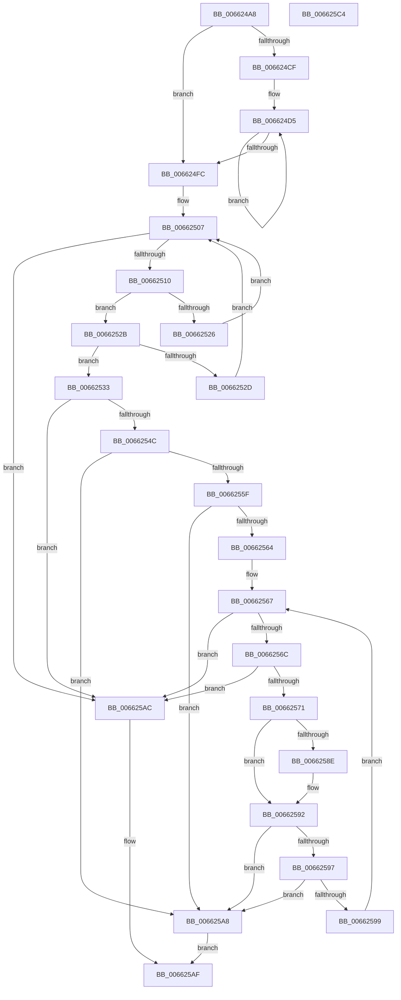

# ApiSetpSearchForApiSetA

- RVA: `0x006624A8`–`0x006625C5` (길이 `285` bytes)
- VA: `0x00000001406624A8`
- 실행 섹션: `.text`
- PDB 이름 있음: `예`; PDB Function 태그: `아니요`
- unwind 정보 RVA: `0x000A5A38`
- 디코드: `92`개 명령, `285/285` bytes 표시
- 미해석 바이트: `0` (있으면 어셈블리에 `.byte`로 보존)

> 이 문서는 커널 이미지의 기계어와 PDB 기호를 분석해 생성했습니다. 4번과 5번은 함수 원형과 자료형을 바이너리 사용 방식에서 추정한 C 해석이며 원본 소스 복구 결과는 아닙니다.

## 1. Dependencies

- 직접 호출 지점: **0**; 고유 호출 대상: **0**
- 직접 호출자로 확인된 함수: **2**
- RIP 상대 이미지 참조: **0**

### Outgoing calls
- 직접 디코드된 call 명령이 없습니다.

### Direct callers
- [ApiSetQuerySchemaInfo2](ApiSetQuerySchemaInfo2_function_00661FAC.md) at `0x00662112`
- [ApiSetQuerySchemaInfo2](ApiSetQuerySchemaInfo2_function_00661FAC.md) at `0x0066223E`
- [ApiSetCompose_ProcessV7Extension_Phase1](ApiSetCompose_ProcessV7Extension_Phase1_function_006641BC.md) at `0x00664647`

### Static image references
- 디코드된 RIP-relative 메모리 참조가 없습니다.

## 2. Other-region calls and transfers

- 다른 실행 섹션으로 향하는 call: **0**
- 별도 외부 분기/꼬리 이동을 확인하지 못했습니다.

## 3. Assembly (complete function range)

```asm
006624A8  48 8B C4                        mov rax, rsp
006624AB  48 89 58 08                     mov qword ptr [rax + 8], rbx
006624AF  48 89 68 10                     mov qword ptr [rax + 0x10], rbp
006624B3  48 89 70 18                     mov qword ptr [rax + 0x18], rsi
006624B7  48 89 78 20                     mov qword ptr [rax + 0x20], rdi
006624BB  33 ED                           xor ebp, ebp
006624BD  45 0F B7 D8                     movzx r11d, r8w
006624C1  48 8B F2                        mov rsi, rdx
006624C4  4C 8B C9                        mov r9, rcx
006624C7  4C 8B D2                        mov r10, rdx
006624CA  45 85 DB                        test r11d, r11d
006624CD  74 2D                           je 0x1406624fc
006624CF  8B 79 18                        mov edi, dword ptr [rcx + 0x18]
006624D2  41 8B DB                        mov ebx, r11d
006624D5  45 0F B6 02                     movzx r8d, byte ptr [r10]
006624D9  41 8D 50 BF                     lea edx, [r8 - 0x41]
006624DD  80 FA 19                        cmp dl, 0x19
006624E0  41 8D 40 20                     lea eax, [r8 + 0x20]
006624E4  0F B6 C8                        movzx ecx, al
006624E7  41 0F 47 C8                     cmova ecx, r8d
006624EB  0F AF EF                        imul ebp, edi
006624EE  0F BE D1                        movsx edx, cl
006624F1  49 FF C2                        inc r10
006624F4  03 EA                           add ebp, edx
006624F6  48 83 EB 01                     sub rbx, 1
006624FA  75 D9                           jne 0x1406624d5
006624FC  41 8B 49 0C                     mov ecx, dword ptr [r9 + 0xc]
00662500  33 DB                           xor ebx, ebx
00662502  45 33 C0                        xor r8d, r8d
00662505  FF C9                           dec ecx
00662507  44 3B C1                        cmp r8d, ecx
0066250A  0F 8F 9C 00 00 00               jg 0x1406625ac
00662510  41 8B 79 14                     mov edi, dword ptr [r9 + 0x14]
00662514  42 8D 14 01                     lea edx, [rcx + r8]
00662518  D1 FA                           sar edx, 1
0066251A  49 03 F9                        add rdi, r9
0066251D  4C 63 D2                        movsxd r10, edx
00662520  42 3B 2C D7                     cmp ebp, dword ptr [rdi + r10*8]
00662524  73 05                           jae 0x14066252b
00662526  8D 4A FF                        lea ecx, [rdx - 1]
00662529  EB DC                           jmp 0x140662507
0066252B  76 06                           jbe 0x140662533
0066252D  44 8D 42 01                     lea r8d, [rdx + 1]
00662531  EB D4                           jmp 0x140662507
00662533  42 8B 44 D7 04                  mov eax, dword ptr [rdi + r10*8 + 4]
00662538  41 8B 49 10                     mov ecx, dword ptr [r9 + 0x10]
0066253C  49 03 C9                        add rcx, r9
0066253F  48 8D 14 40                     lea rdx, [rax + rax*2]
00662543  48 8D 1C D1                     lea rbx, [rcx + rdx*8]
00662547  48 85 DB                        test rbx, rbx
0066254A  74 60                           je 0x1406625ac
0066254C  44 8B 43 0C                     mov r8d, dword ptr [rbx + 0xc]
00662550  44 8B 53 04                     mov r10d, dword ptr [rbx + 4]
00662554  41 D1 E8                        shr r8d, 1
00662557  4D 03 D1                        add r10, r9
0066255A  45 85 DB                        test r11d, r11d
0066255D  74 49                           je 0x1406625a8
0066255F  45 85 C0                        test r8d, r8d
00662562  74 44                           je 0x1406625a8
00662564  83 CD FF                        or ebp, 0xffffffff
00662567  45 85 DB                        test r11d, r11d
0066256A  74 40                           je 0x1406625ac
0066256C  45 85 C0                        test r8d, r8d
0066256F  74 3B                           je 0x1406625ac
00662571  0F B6 16                        movzx edx, byte ptr [rsi]
00662574  45 8A 0A                        mov r9b, byte ptr [r10]
00662577  8D 42 20                        lea eax, [rdx + 0x20]
0066257A  0F B6 F8                        movzx edi, al
0066257D  8D 4A BF                        lea ecx, [rdx - 0x41]
00662580  80 F9 19                        cmp cl, 0x19
00662583  41 8D 41 BF                     lea eax, [r9 - 0x41]
00662587  0F 47 FA                        cmova edi, edx
0066258A  3C 19                           cmp al, 0x19
0066258C  77 04                           ja 0x140662592
0066258E  41 80 C1 20                     add r9b, 0x20
00662592  41 3A F9                        cmp dil, r9b
00662595  72 11                           jb 0x1406625a8
00662597  77 0F                           ja 0x1406625a8
00662599  48 FF C6                        inc rsi
0066259C  44 03 DD                        add r11d, ebp
0066259F  49 83 C2 02                     add r10, 2
006625A3  44 03 C5                        add r8d, ebp
006625A6  EB BF                           jmp 0x140662567
006625A8  33 C0                           xor eax, eax
006625AA  EB 03                           jmp 0x1406625af
006625AC  48 8B C3                        mov rax, rbx
006625AF  48 8B 5C 24 08                  mov rbx, qword ptr [rsp + 8]
006625B4  48 8B 6C 24 10                  mov rbp, qword ptr [rsp + 0x10]
006625B9  48 8B 74 24 18                  mov rsi, qword ptr [rsp + 0x18]
006625BE  48 8B 7C 24 20                  mov rdi, qword ptr [rsp + 0x20]
006625C3  C3                              ret
006625C4  CC                              int3
```

## 4. C-style interpretation (structured pseudocode)

```c
__int64 __fastcall ApiSetpSearchForApiSetA(__int64 a1, __int64 a2, unsigned __int16 a3)
{
    __int64 result;
    __int64 v_r10;
    __int64 v_r11;
    __int64 v_rbp;
    __int64 v_rbx;
    __int64 v_rdi;
    __int64 v_rsi;
    unsigned __int64 v_stack_p10;
    unsigned __int64 v_stack_p18;
    unsigned __int64 v_stack_p20;
    unsigned __int64 v_stack_p8;

    *(unsigned __int64 *)(v_rsp + 8) = v_rbx;
    *(unsigned __int64 *)(v_rsp + 16) = v_rbp;
    *(unsigned __int64 *)(v_rsp + 24) = v_rsi;
    *(unsigned __int64 *)(v_rsp + 32) = v_rdi;
    v_rbp = 0;
    if (a3 == 0) goto loc_006624FC;
loc_006624D5:
    a1 = (unsigned __int8)(*(unsigned __int8 *)(a2) + 32);
    if (((unsigned __int8)(*(unsigned __int8 *)(a2) - 65)) > 25) { a1 = (unsigned int)(*(unsigned __int8 *)(a2)); }
    v_rbp = (unsigned int)((v_rbp) * ((unsigned int)((unsigned int)(*(unsigned int *)(a1 + 24)))));
    v_r10 = (a2) + 1;
    v_rbp = (unsigned int)((v_rbp) + ((unsigned int)((__int8)((unsigned __int8)(a1)))));
    v_rbx = ((unsigned int)(a3)) - (1);
    if (condition_is_not_equal) goto loc_006624D5;
loc_006624FC:
    v_rbx = 0;
    a3 = 0;
    a1 = (unsigned int)(((unsigned int)(*(unsigned int *)(a1 + 12))) - 1);
loc_00662507:
    if (0 > ((unsigned int)(a1))) goto loc_006625AC;
    a2 = (unsigned int)((a1 + a3 * 1) >> (1));
    v_rdi = ((unsigned int)(*(unsigned int *)(a1 + 20))) + (a1);
    if (((unsigned int)(v_rbp)) >= (*(unsigned int *)(v_rdi + (int)((unsigned int)(a2)) * 8))) goto loc_0066252B;
    goto loc_00662507;
loc_0066252B:
    if (((unsigned int)(v_rbp)) <= (*(unsigned int *)(v_rdi + (int)((unsigned int)(a2)) * 8))) goto loc_00662533;
    goto loc_00662507;
loc_00662533:
    a1 = ((unsigned int)(*(unsigned int *)(a1 + 16))) + (a1);
    if (a1 + (unsigned int)(*(unsigned int *)(v_rdi + (int)((unsigned int)(a2)) * 8 + 4)) + (unsigned int)(*(unsigned int *)(v_rdi + (int)((unsigned int)(a2)) * 8 + 4)) * 2 * 8 == 0) goto loc_006625AC;
    a3 = (unsigned int)(((unsigned int)(*(unsigned int *)(a1 + (unsigned int)(*(unsigned int *)(v_rdi + (int)((unsigned int)(a2)) * 8 + 4)) + (unsigned int)(*(unsigned int *)(v_rdi + (int)((unsigned int)(a2)) * 8 + 4)) * 2 * 8 + 12))) >> (1));
    v_r10 = ((unsigned int)(*(unsigned int *)(a1 + (unsigned int)(*(unsigned int *)(v_rdi + (int)((unsigned int)(a2)) * 8 + 4)) + (unsigned int)(*(unsigned int *)(v_rdi + (int)((unsigned int)(a2)) * 8 + 4)) * 2 * 8 + 4))) + (a1);
    if (a3 == 0) goto loc_006625A8;
    if (a3 == 0) goto loc_006625A8;
    v_rbp = (unsigned int)((v_rbp) | (0xFFFFFFFFULL));
loc_00662567:
    if (a3 == 0) goto loc_006625AC;
    if (a3 == 0) goto loc_006625AC;
    v_rdi = (unsigned __int8)(*(unsigned __int8 *)(a2) + 32);
    if (((unsigned __int8)(*(unsigned __int8 *)(a2) - 65)) > 25) { v_rdi = (unsigned int)(*(unsigned __int8 *)(a2)); }
    if (((unsigned __int8)(*(unsigned __int8 *)(v_r10) - 65)) <= 25) {
        a4 = (unsigned __int8)((*(unsigned __int8 *)(v_r10)) + (32));
    }
    if (((unsigned __int8)(v_rdi)) < ((unsigned __int8)(a4))) goto loc_006625A8;
    if (((unsigned __int8)(v_rdi)) > ((unsigned __int8)(a4))) goto loc_006625A8;
    v_rsi = (a2) + 1;
    v_r11 = (unsigned int)((a3) + ((unsigned int)(v_rbp)));
    v_r10 = (v_r10) + (2);
    a3 = (unsigned int)((a3) + ((unsigned int)(v_rbp)));
    goto loc_00662567;
loc_006625A8:
    result = 0;
    goto loc_006625AF;
loc_006625AC:
loc_006625AF:
    return a1 + (unsigned int)(*(unsigned int *)(v_rdi + (int)((unsigned int)(a2)) * 8 + 4)) + (unsigned int)(*(unsigned int *)(v_rdi + (int)((unsigned int)(a2)) * 8 + 4)) * 2 * 8;
}
```

## 5. (Beta) C Style

```c
int64_t ApiSetpSearchForApiSetA(void *Arg1, int64_t Arg2, uint16_t Arg3)
{
    uint8_t *arg1 = (uint8_t *)Arg1;

    int64_t result;
    int64_t local_r10;
    int64_t local_r11;
    int64_t local_rbp;
    int64_t local_rbx;
    int64_t local_rdi;
    int64_t local_rsi;
    uint64_t v_stack_p10;
    uint64_t v_stack_p18;
    uint64_t v_stack_p20;
    uint64_t v_stack_p8;

    *(uint64_t *)(local_rsp + 0x8) = local_rbx;
    *(uint64_t *)(local_rsp + 0x10) = local_rbp;
    *(uint64_t *)(local_rsp + 0x18) = local_rsi;
    *(uint64_t *)(local_rsp + 0x20) = local_rdi;
    local_rbp = 0;
    if (Arg3 == 0) goto loc_006624FC;
loc_006624D5:
    Arg1 = (uint8_t)(*(uint8_t *)(Arg2) + 32);
    if (((uint8_t)(*(uint8_t *)(Arg2) - 65)) > 25) { Arg1 = (uint32_t)(*(uint8_t *)(Arg2)); }
    local_rbp = (uint32_t)((local_rbp) * ((uint32_t)((uint32_t)(*(uint32_t *)(arg1 + 0x18)))));
    local_r10 = (Arg2) + 1;
    local_rbp = (uint32_t)((local_rbp) + ((uint32_t)((int8_t)((uint8_t)(Arg1)))));
    local_rbx = ((uint32_t)(Arg3)) - (1);
    if (condition_is_not_equal) goto loc_006624D5;
loc_006624FC:
    local_rbx = 0;
    Arg3 = 0;
    Arg1 = (uint32_t)(((uint32_t)(*(uint32_t *)(arg1 + 0xC))) - 1);
loc_00662507:
    if (0 > ((uint32_t)(Arg1))) goto loc_006625AC;
    Arg2 = (uint32_t)((Arg1 + Arg3 * 1) >> (1));
    local_rdi = ((uint32_t)(*(uint32_t *)(arg1 + 0x14))) + (Arg1);
    if (((uint32_t)(local_rbp)) >= (*(uint32_t *)(local_rdi + (int32_t)((uint32_t)(Arg2)) * 8))) goto loc_0066252B;
    goto loc_00662507;
loc_0066252B:
    if (((uint32_t)(local_rbp)) <= (*(uint32_t *)(local_rdi + (int32_t)((uint32_t)(Arg2)) * 8))) goto loc_00662533;
    goto loc_00662507;
loc_00662533:
    Arg1 = ((uint32_t)(*(uint32_t *)(arg1 + 0x10))) + (Arg1);
    if (Arg1 + (uint32_t)(*(uint32_t *)(local_rdi + (int32_t)((uint32_t)(Arg2)) * 8 + 0x4)) + (uint32_t)(*(uint32_t *)(local_rdi + (int32_t)((uint32_t)(Arg2)) * 8 + 0x4)) * 2 * 8 == 0) goto loc_006625AC;
    Arg3 = (uint32_t)(((uint32_t)(*(uint32_t *)(arg1 + (uint32_t)(*(uint32_t *)(local_rdi + (int32_t)((uint32_t)(Arg2)) * 8 + 0x4)) + (uint32_t)(*(uint32_t *)(local_rdi + (int32_t)((uint32_t)(Arg2)) * 8 + 0x4)) * 2 * 8 + 0xC))) >> (1));
    local_r10 = ((uint32_t)(*(uint32_t *)(arg1 + (uint32_t)(*(uint32_t *)(local_rdi + (int32_t)((uint32_t)(Arg2)) * 8 + 0x4)) + (uint32_t)(*(uint32_t *)(local_rdi + (int32_t)((uint32_t)(Arg2)) * 8 + 0x4)) * 2 * 8 + 0x4))) + (Arg1);
    if (Arg3 == 0) goto loc_006625A8;
    if (Arg3 == 0) goto loc_006625A8;
    local_rbp = (uint32_t)((local_rbp) | (0xFFFFFFFFULL));
loc_00662567:
    if (Arg3 == 0) goto loc_006625AC;
    if (Arg3 == 0) goto loc_006625AC;
    local_rdi = (uint8_t)(*(uint8_t *)(Arg2) + 32);
    if (((uint8_t)(*(uint8_t *)(Arg2) - 65)) > 25) { local_rdi = (uint32_t)(*(uint8_t *)(Arg2)); }
    if (((uint8_t)(*(uint8_t *)(local_r10) - 65)) <= 25) {
        a4 = (uint8_t)((*(uint8_t *)(local_r10)) + (32));
    }
    if (((uint8_t)(local_rdi)) < ((uint8_t)(a4))) goto loc_006625A8;
    if (((uint8_t)(local_rdi)) > ((uint8_t)(a4))) goto loc_006625A8;
    local_rsi = (Arg2) + 1;
    local_r11 = (uint32_t)((Arg3) + ((uint32_t)(local_rbp)));
    local_r10 = (local_r10) + (2);
    Arg3 = (uint32_t)((Arg3) + ((uint32_t)(local_rbp)));
    goto loc_00662567;
loc_006625A8:
    result = 0;
    goto loc_006625AF;
loc_006625AC:
loc_006625AF:
    return Arg1 + (uint32_t)(*(uint32_t *)(local_rdi + (int32_t)((uint32_t)(Arg2)) * 8 + 0x4)) + (uint32_t)(*(uint32_t *)(local_rdi + (int32_t)((uint32_t)(Arg2)) * 8 + 0x4)) * 2 * 8;
}
```

### 관측된 메모리 오프셋

구조체 형식이 확인되지 않은 접근은 인자 기준의 오프셋으로만 기록했습니다.

| 기준 인자 | 오프셋 표현 | 폭 (bit) | 접근 |
|---|---:|---:|---|
| `Arg1` | `+ 0xC` | `32` | `R` |
| `Arg1` | `+ 0x10` | `32` | `R` |
| `Arg1` | `+ 0x14` | `32` | `R` |
| `Arg1` | `+ 0x18` | `32` | `R` |

## 6. Execution-region graph

[열기: 2D/3D 그래프와 함수 탐색 컨트롤 패널](../../../control-panel.html?section=text&rva=0x006624A8&view=graph)

- 2D 그래프는 위에서 아래로 흐르고, 3D 그래프는 빈 공간을 드래그해 회전합니다. Shift+드래그는 이동, 휠은 확대·축소, 함수 노드 선택은 대상 보고서 이동입니다.

### Static fallback


