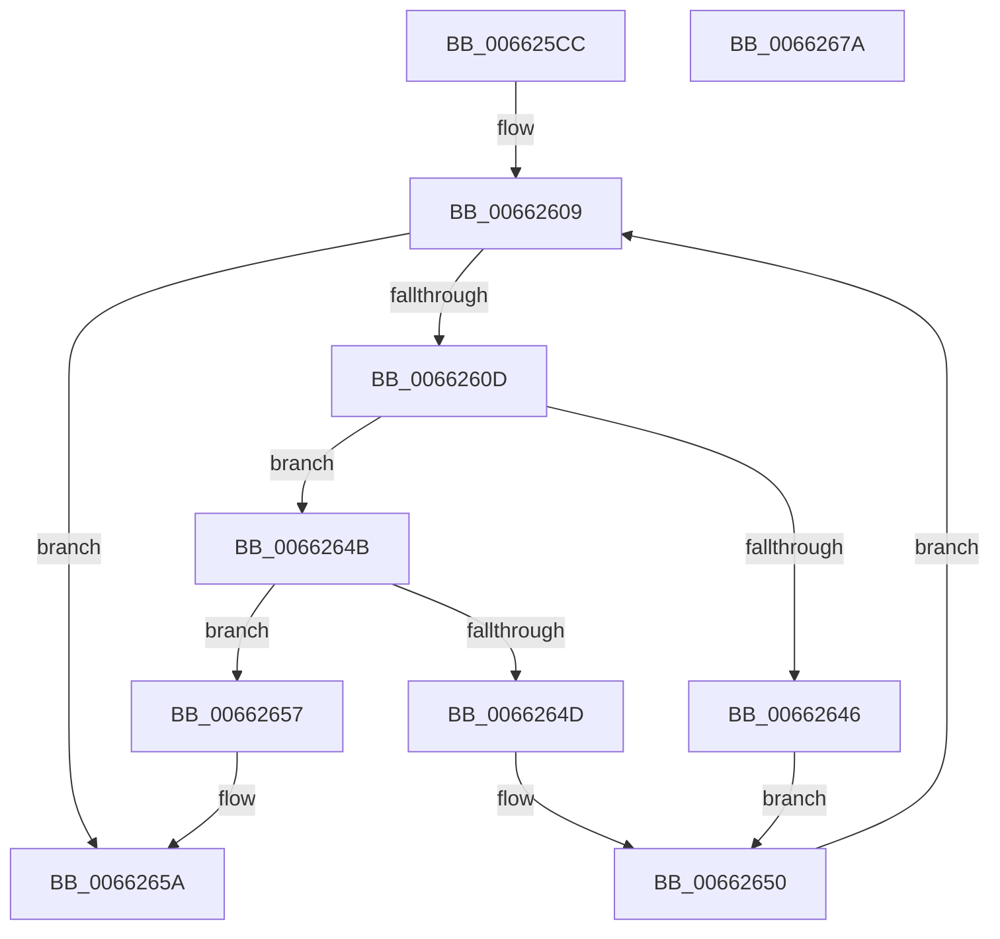

# ApiSetpSearchForApiSetHost

- RVA: `0x006625CC`–`0x0066267B` (길이 `175` bytes)
- VA: `0x00000001406625CC`
- 실행 섹션: `.text`
- PDB 이름 있음: `예`; PDB Function 태그: `아니요`
- unwind 정보 RVA: `0x000C5440`
- 디코드: `58`개 명령, `175/175` bytes 표시
- 미해석 바이트: `0` (있으면 어셈블리에 `.byte`로 보존)

> 이 문서는 커널 이미지의 기계어와 PDB 기호를 분석해 생성했습니다. 4번과 5번은 함수 원형과 자료형을 바이너리 사용 방식에서 추정한 C 해석이며 원본 소스 복구 결과는 아닙니다.

## 1. Dependencies

- 직접 호출 지점: **1**; 고유 호출 대상: **1**
- 직접 호출자로 확인된 함수: **1**
- RIP 상대 이미지 참조: **0**

### Outgoing calls
- `0x0066263D` → [RtlCompareUnicodeStrings](../../page/97/RtlCompareUnicodeStrings_function_009727E0.md) (function, `0x009727E0`)

### Direct callers
- [ApiSetResolveToHost](../4C/ApiSetResolveToHost_function_004C8AA8.md) at `0x004C8BB1`

### Static image references
- 디코드된 RIP-relative 메모리 참조가 없습니다.

## 2. Other-region calls and transfers

- 다른 실행 섹션으로 향하는 call: **1**
  - `0x0066263D` → [RtlCompareUnicodeStrings](../../page/97/RtlCompareUnicodeStrings_function_009727E0.md) (`.text` → `PAGE`)
- 별도 외부 분기/꼬리 이동을 확인하지 못했습니다.

## 3. Assembly (complete function range)

```asm
006625CC  48 8B C4                        mov rax, rsp
006625CF  48 89 58 08                     mov qword ptr [rax + 8], rbx
006625D3  48 89 68 18                     mov qword ptr [rax + 0x18], rbp
006625D7  48 89 70 20                     mov qword ptr [rax + 0x20], rsi
006625DB  48 89 50 10                     mov qword ptr [rax + 0x10], rdx
006625DF  57                              push rdi
006625E0  41 54                           push r12
006625E2  41 55                           push r13
006625E4  41 56                           push r14
006625E6  41 57                           push r15
006625E8  48 83 EC 30                     sub rsp, 0x30
006625EC  8B 59 10                        mov ebx, dword ptr [rcx + 0x10]
006625EF  4D 8B E1                        mov r12, r9
006625F2  8B 79 14                        mov edi, dword ptr [rcx + 0x14]
006625F5  49 03 D9                        add rbx, r9
006625F8  FF CF                           dec edi
006625FA  45 0F B7 E8                     movzx r13d, r8w
006625FE  4C 8B D2                        mov r10, rdx
00662601  4C 8B F9                        mov r15, rcx
00662604  BE 01 00 00 00                  mov esi, 1
00662609  3B F7                           cmp esi, edi
0066260B  7F 4D                           jg 0x14066265a
0066260D  41 8B 4F 10                     mov ecx, dword ptr [r15 + 0x10]
00662611  8D 2C 3E                        lea ebp, [rsi + rdi]
00662614  49 03 CC                        add rcx, r12
00662617  D1 FD                           sar ebp, 1
00662619  48 63 C5                        movsxd rax, ebp
0066261C  C6 44 24 20 01                  mov byte ptr [rsp + 0x20], 1
00662621  48 8D 14 80                     lea rdx, [rax + rax*4]
00662625  4C 8D 34 91                     lea r14, [rcx + rdx*4]
00662629  49 8B D5                        mov rdx, r13
0066262C  45 8B 46 04                     mov r8d, dword ptr [r14 + 4]
00662630  49 8B CA                        mov rcx, r10
00662633  45 8B 4E 08                     mov r9d, dword ptr [r14 + 8]
00662637  4D 03 C4                        add r8, r12
0066263A  41 D1 E9                        shr r9d, 1
0066263D  E8 9E 01 31 00                  call 0x1409727e0
00662642  85 C0                           test eax, eax
00662644  79 05                           jns 0x14066264b
00662646  8D 7D FF                        lea edi, [rbp - 1]
00662649  EB 05                           jmp 0x140662650
0066264B  7E 0A                           jle 0x140662657
0066264D  8D 75 01                        lea esi, [rbp + 1]
00662650  4C 8B 54 24 68                  mov r10, qword ptr [rsp + 0x68]
00662655  EB B2                           jmp 0x140662609
00662657  49 8B DE                        mov rbx, r14
0066265A  48 8B 6C 24 70                  mov rbp, qword ptr [rsp + 0x70]
0066265F  48 8B C3                        mov rax, rbx
00662662  48 8B 5C 24 60                  mov rbx, qword ptr [rsp + 0x60]
00662667  48 8B 74 24 78                  mov rsi, qword ptr [rsp + 0x78]
0066266C  48 83 C4 30                     add rsp, 0x30
00662670  41 5F                           pop r15
00662672  41 5E                           pop r14
00662674  41 5D                           pop r13
00662676  41 5C                           pop r12
00662678  5F                              pop rdi
00662679  C3                              ret
0066267A  CC                              int3
```

## 4. C-style interpretation (structured pseudocode)

```c
__int64 __fastcall ApiSetpSearchForApiSetHost(__int64 a1, __int64 a2, unsigned __int16 a3, __int64 a4)
{
    __int64 result;
    __int64 v_rbp;
    __int64 v_rbx;
    __int64 v_rdi;
    __int64 v_rsp;
    unsigned __int8 v_stack_m38;
    unsigned __int64 v_stack_p10;
    unsigned __int64 v_stack_p18;
    unsigned __int64 v_stack_p20;
    unsigned __int64 v_stack_p8;

    *(unsigned __int64 *)(v_rsp + 8) = v_rbx;
    *(unsigned __int64 *)(v_rsp + 24) = v_rbp;
    *(unsigned __int64 *)(v_rsp + 32) = v_rsi;
    *(unsigned __int64 *)(v_rsp + 16) = a2;
    v_rsp = (v_rsp) - (48);
    v_rbx = ((unsigned int)(*(unsigned int *)(a1 + 16))) + (a4);
    v_rdi = (unsigned int)(((unsigned int)(*(unsigned int *)(a1 + 20))) - 1);
loc_00662609:
    if (1 > ((unsigned int)(v_rdi))) goto loc_0066265A;
    a1 = ((unsigned int)(*(unsigned int *)(a1 + 16))) + (a4);
    v_rbp = (unsigned int)((1 + v_rdi * 1) >> (1));
    v_stack_m38 = 1;
    a3 = ((unsigned int)(*(unsigned int *)(a1 + (int)((unsigned int)(v_rbp)) + (int)((unsigned int)(v_rbp)) * 4 * 4 + 4))) + (a4);
    a4 = (unsigned int)(((unsigned int)(*(unsigned int *)(a1 + (int)((unsigned int)(v_rbp)) + (int)((unsigned int)(v_rbp)) * 4 * 4 + 8))) >> (1));
    result = RtlCompareUnicodeStrings(a2, a3, a3, a4);
    if (!sign_flag) goto loc_0066264B;
    goto loc_00662650;
loc_0066264B:
    if (condition_is_less_or_equal) goto loc_00662657;
loc_00662650:
    goto loc_00662609;
loc_00662657:
loc_0066265A:
    v_rsp = (v_rsp) + (48);
    return a1 + (int)((unsigned int)(v_rbp)) + (int)((unsigned int)(v_rbp)) * 4 * 4;
}
```

## 5. (Beta) C Style

```c
int64_t ApiSetpSearchForApiSetHost(void *Arg1, int64_t Arg2, uint16_t Arg3, int64_t Arg4)
{
    uint8_t *arg1 = (uint8_t *)Arg1;

    int64_t result;
    int64_t local_rbp;
    int64_t local_rbx;
    int64_t local_rdi;
    int64_t local_rsp;
    uint8_t v_stack_m38;
    uint64_t v_stack_p10;
    uint64_t v_stack_p18;
    uint64_t v_stack_p20;
    uint64_t v_stack_p8;

    *(uint64_t *)(local_rsp + 0x8) = local_rbx;
    *(uint64_t *)(local_rsp + 0x18) = local_rbp;
    *(uint64_t *)(local_rsp + 0x20) = local_rsi;
    *(uint64_t *)(local_rsp + 0x10) = Arg2;
    local_rsp = (local_rsp) - (48);
    local_rbx = ((uint32_t)(*(uint32_t *)(arg1 + 0x10))) + (Arg4);
    local_rdi = (uint32_t)(((uint32_t)(*(uint32_t *)(arg1 + 0x14))) - 1);
loc_00662609:
    if (1 > ((uint32_t)(local_rdi))) goto loc_0066265A;
    Arg1 = ((uint32_t)(*(uint32_t *)(arg1 + 0x10))) + (Arg4);
    local_rbp = (uint32_t)((1 + local_rdi * 1) >> (1));
    v_stack_m38 = 1;
    Arg3 = ((uint32_t)(*(uint32_t *)(arg1 + (int32_t)((uint32_t)(local_rbp)) + (int32_t)((uint32_t)(local_rbp)) * 4 * 4 + 0x4))) + (Arg4);
    Arg4 = (uint32_t)(((uint32_t)(*(uint32_t *)(arg1 + (int32_t)((uint32_t)(local_rbp)) + (int32_t)((uint32_t)(local_rbp)) * 4 * 4 + 0x8))) >> (1));
    result = RtlCompareUnicodeStrings(Arg2, Arg3, Arg3, Arg4);
    if (!sign_flag) goto loc_0066264B;
    goto loc_00662650;
loc_0066264B:
    if (condition_is_less_or_equal) goto loc_00662657;
loc_00662650:
    goto loc_00662609;
loc_00662657:
loc_0066265A:
    local_rsp = (local_rsp) + (48);
    return Arg1 + (int32_t)((uint32_t)(local_rbp)) + (int32_t)((uint32_t)(local_rbp)) * 4 * 4;
}
```

### 관측된 메모리 오프셋

구조체 형식이 확인되지 않은 접근은 인자 기준의 오프셋으로만 기록했습니다.

| 기준 인자 | 오프셋 표현 | 폭 (bit) | 접근 |
|---|---:|---:|---|
| `Arg1` | `+ 0x10` | `32` | `R` |
| `Arg1` | `+ 0x14` | `32` | `R` |

## 6. Execution-region graph

[열기: 2D/3D 그래프와 함수 탐색 컨트롤 패널](../../../control-panel.html?section=text&rva=0x006625CC&view=graph)

- 2D 그래프는 위에서 아래로 흐르고, 3D 그래프는 빈 공간을 드래그해 회전합니다. Shift+드래그는 이동, 휠은 확대·축소, 함수 노드 선택은 대상 보고서 이동입니다.

### Static fallback


