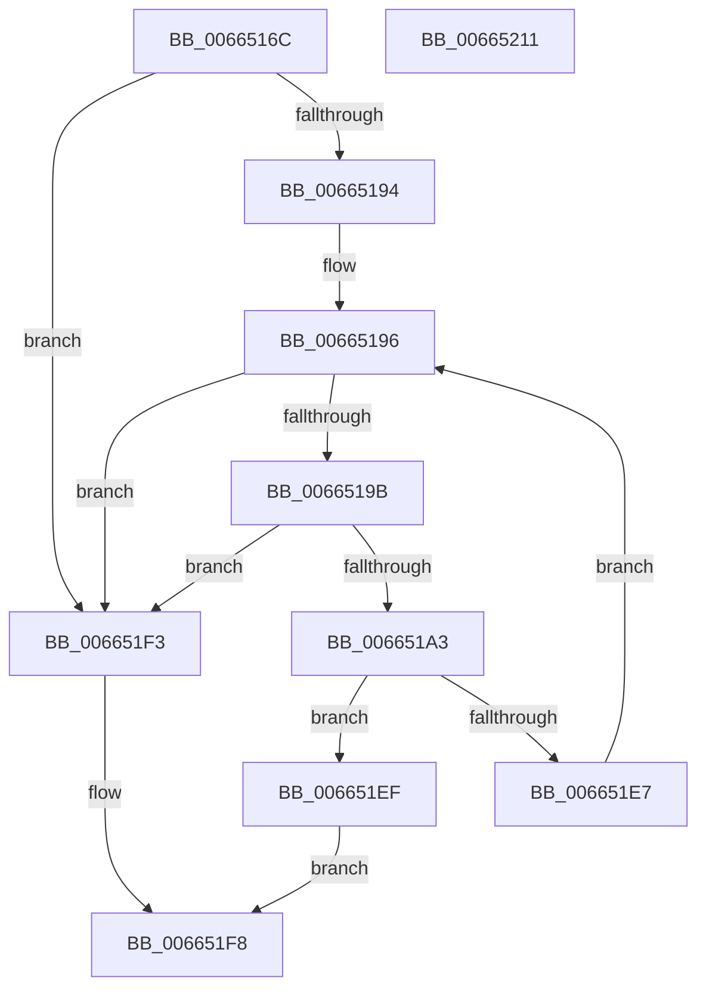

# ApiSetpSearchForHostOverrideIndex_V7

- RVA: `0x0066516C`–`0x00665212` (길이 `166` bytes)
- VA: `0x000000014066516C`
- 실행 섹션: `.text`
- PDB 이름 있음: `예`; PDB Function 태그: `아니요`
- unwind 정보 RVA: `0x00084C9C`
- 디코드: `53`개 명령, `166/166` bytes 표시
- 미해석 바이트: `0` (있으면 어셈블리에 `.byte`로 보존)

> 이 문서는 커널 이미지의 기계어와 PDB 기호를 분석해 생성했습니다. 4번과 5번은 함수 원형과 자료형을 바이너리 사용 방식에서 추정한 C 해석이며 원본 소스 복구 결과는 아닙니다.

## 1. Dependencies

- 직접 호출 지점: **1**; 고유 호출 대상: **1**
- 직접 호출자로 확인된 함수: **1**
- RIP 상대 이미지 참조: **0**

### Outgoing calls
- `0x006651DE` → [RtlCompareUnicodeStrings](../../page/97/RtlCompareUnicodeStrings_function_009727E0.md) (function, `0x009727E0`)

### Direct callers
- [ApiSetpResolveHost](ApiSetpResolveHost_function_006638D0.md) at `0x00663C49`

### Static image references
- 디코드된 RIP-relative 메모리 참조가 없습니다.

## 2. Other-region calls and transfers

- 다른 실행 섹션으로 향하는 call: **1**
  - `0x006651DE` → [RtlCompareUnicodeStrings](../../page/97/RtlCompareUnicodeStrings_function_009727E0.md) (`.text` → `PAGE`)
- 별도 외부 분기/꼬리 이동을 확인하지 못했습니다.

## 3. Assembly (complete function range)

```asm
0066516C  48 89 5C 24 08                  mov qword ptr [rsp + 8], rbx
00665171  48 89 6C 24 10                  mov qword ptr [rsp + 0x10], rbp
00665176  48 89 74 24 18                  mov qword ptr [rsp + 0x18], rsi
0066517B  57                              push rdi
0066517C  41 56                           push r14
0066517E  41 57                           push r15
00665180  48 83 EC 30                     sub rsp, 0x30
00665184  4D 8B F9                        mov r15, r9
00665187  45 8B F0                        mov r14d, r8d
0066518A  8B DA                           mov ebx, edx
0066518C  48 8B E9                        mov rbp, rcx
0066518F  45 85 C0                        test r8d, r8d
00665192  74 5F                           je 0x1406651f3
00665194  33 FF                           xor edi, edi
00665196  41 3B FE                        cmp edi, r14d
00665199  73 58                           jae 0x1406651f3
0066519B  0F B7 45 70                     movzx eax, word ptr [rbp + 0x70]
0066519F  3B D8                           cmp ebx, eax
006651A1  73 50                           jae 0x1406651f3
006651A3  0F B7 4D 12                     movzx ecx, word ptr [rbp + 0x12]
006651A7  0F B7 75 72                     movzx esi, word ptr [rbp + 0x72]
006651AB  44 8B 45 24                     mov r8d, dword ptr [rbp + 0x24]
006651AF  0F B7 54 24 70                  movzx edx, word ptr [rsp + 0x70]
006651B4  8B C3                           mov eax, ebx
006651B6  48 0F AF F0                     imul rsi, rax
006651BA  8B 45 68                        mov eax, dword ptr [rbp + 0x68]
006651BD  48 03 F0                        add rsi, rax
006651C0  C6 44 24 20 01                  mov byte ptr [rsp + 0x20], 1
006651C5  48 2B F1                        sub rsi, rcx
006651C8  8B 44 2E 04                     mov eax, dword ptr [rsi + rbp + 4]
006651CC  44 0F B7 4C 2E 0C               movzx r9d, word ptr [rsi + rbp + 0xc]
006651D2  4C 03 C0                        add r8, rax
006651D5  4C 2B C1                        sub r8, rcx
006651D8  49 8B CF                        mov rcx, r15
006651DB  4C 03 C5                        add r8, rbp
006651DE  E8 FD D5 30 00                  call 0x1409727e0
006651E3  85 C0                           test eax, eax
006651E5  74 08                           je 0x1406651ef
006651E7  0F B7 1C 2E                     movzx ebx, word ptr [rsi + rbp]
006651EB  FF C7                           inc edi
006651ED  EB A7                           jmp 0x140665196
006651EF  8B C3                           mov eax, ebx
006651F1  EB 05                           jmp 0x1406651f8
006651F3  B8 FF FF 00 00                  mov eax, 0xffff
006651F8  48 8B 5C 24 50                  mov rbx, qword ptr [rsp + 0x50]
006651FD  48 8B 6C 24 58                  mov rbp, qword ptr [rsp + 0x58]
00665202  48 8B 74 24 60                  mov rsi, qword ptr [rsp + 0x60]
00665207  48 83 C4 30                     add rsp, 0x30
0066520B  41 5F                           pop r15
0066520D  41 5E                           pop r14
0066520F  5F                              pop rdi
00665210  C3                              ret
00665211  CC                              int3
```

## 4. C-style interpretation (structured pseudocode)

```c
__int64 __fastcall ApiSetpSearchForHostOverrideIndex_V7(__int64 a1, int a2, int a3, __int64 a4, unsigned __int16 a5)
{
    __int64 result;
    __int64 v_rdi;
    __int64 v_rsi;
    __int64 v_rsp;
    unsigned __int8 v_stack_m28;
    unsigned __int64 v_stack_p10;
    unsigned __int64 v_stack_p18;
    unsigned __int64 v_stack_p8;

    v_stack_p8 = v_rbx;
    v_stack_p10 = v_rbp;
    v_stack_p18 = v_rsi;
    v_rsp = (v_rsp) - (48);
    if (a3 == 0) goto loc_006651F3;
    v_rdi = 0;
loc_00665196:
    if (0 >= ((unsigned int)((unsigned int)(a3)))) goto loc_006651F3;
    if (((unsigned int)((unsigned int)(a2))) >= ((unsigned int)(*(unsigned __int16 *)(a1 + 112)))) goto loc_006651F3;
    v_rsi = (*(unsigned __int16 *)(a1 + 114)) * ((unsigned int)((unsigned int)((unsigned int)(a2))));
    v_rsi = (v_rsi) + ((unsigned int)(*(unsigned int *)(a1 + 104)));
    v_stack_m28 = 1;
    v_rsi = (v_rsi) - (*(unsigned __int16 *)(a1 + 18));
    a3 = ((unsigned int)(*(unsigned int *)(a1 + 36))) + ((unsigned int)(*(unsigned int *)(v_rsi + a1 * 1 + 4)));
    a3 = (a3) - (*(unsigned __int16 *)(a1 + 18));
    a3 = (a3) + (a1);
    result = RtlCompareUnicodeStrings(a4, a5, a3, *(unsigned __int16 *)(v_rsi + a1 * 1 + 12));
    if ((unsigned int)(result) == 0) goto loc_006651EF;
    v_rdi = (unsigned int)((v_rdi) + 1);
    goto loc_00665196;
loc_006651EF:
    goto loc_006651F8;
loc_006651F3:
loc_006651F8:
    v_rsp = (v_rsp) + (48);
    return (unsigned int)(0xFFFFULL);
}
```

## 5. (Beta) C Style

```c
int64_t ApiSetpSearchForHostOverrideIndex_V7(void *Arg1, int32_t Arg2, int32_t Arg3, int64_t Arg4, uint16_t Arg5)
{
    uint8_t *arg1 = (uint8_t *)Arg1;

    int64_t result;
    int64_t local_rdi;
    int64_t local_rsi;
    int64_t local_rsp;
    uint8_t v_stack_m28;
    uint64_t v_stack_p10;
    uint64_t v_stack_p18;
    uint64_t v_stack_p8;

    v_stack_p8 = local_rbx;
    v_stack_p10 = local_rbp;
    v_stack_p18 = local_rsi;
    local_rsp = (local_rsp) - (48);
    if (Arg3 == 0) goto loc_006651F3;
    local_rdi = 0;
loc_00665196:
    if (0 >= ((uint32_t)((uint32_t)(Arg3)))) goto loc_006651F3;
    if (((uint32_t)((uint32_t)(Arg2))) >= ((uint32_t)(*(uint16_t *)(arg1 + 0x70)))) goto loc_006651F3;
    local_rsi = (*(uint16_t *)(arg1 + 0x72)) * ((uint32_t)((uint32_t)((uint32_t)(Arg2))));
    local_rsi = (local_rsi) + ((uint32_t)(*(uint32_t *)(arg1 + 0x68)));
    v_stack_m28 = 1;
    local_rsi = (local_rsi) - (*(uint16_t *)(arg1 + 0x12));
    Arg3 = ((uint32_t)(*(uint32_t *)(arg1 + 0x24))) + ((uint32_t)(*(uint32_t *)(local_rsi + arg1 * 1 + 0x4)));
    Arg3 = (Arg3) - (*(uint16_t *)(arg1 + 0x12));
    Arg3 = (Arg3) + (Arg1);
    result = RtlCompareUnicodeStrings(Arg4, Arg5, Arg3, *(uint16_t *)(local_rsi + arg1 * 1 + 0xC));
    if ((uint32_t)(result) == 0) goto loc_006651EF;
    local_rdi = (uint32_t)((local_rdi) + 1);
    goto loc_00665196;
loc_006651EF:
    goto loc_006651F8;
loc_006651F3:
loc_006651F8:
    local_rsp = (local_rsp) + (48);
    return (uint32_t)(0xFFFFULL);
}
```

### 관측된 메모리 오프셋

구조체 형식이 확인되지 않은 접근은 인자 기준의 오프셋으로만 기록했습니다.

| 기준 인자 | 오프셋 표현 | 폭 (bit) | 접근 |
|---|---:|---:|---|
| `Arg1` | `+ 0x12` | `16` | `R` |
| `Arg1` | `+ 0x24` | `32` | `R` |
| `Arg1` | `+ 0x68` | `32` | `R` |
| `Arg1` | `+ 0x70` | `16` | `R` |
| `Arg1` | `+ 0x72` | `16` | `R` |

## 6. Execution-region graph

[열기: 2D/3D 그래프와 함수 탐색 컨트롤 패널](../../../control-panel.html?section=text&rva=0x0066516C&view=graph)

- 2D 그래프는 위에서 아래로 흐르고, 3D 그래프는 빈 공간을 드래그해 회전합니다. Shift+드래그는 이동, 휠은 확대·축소, 함수 노드 선택은 대상 보고서 이동입니다.

### Static fallback


