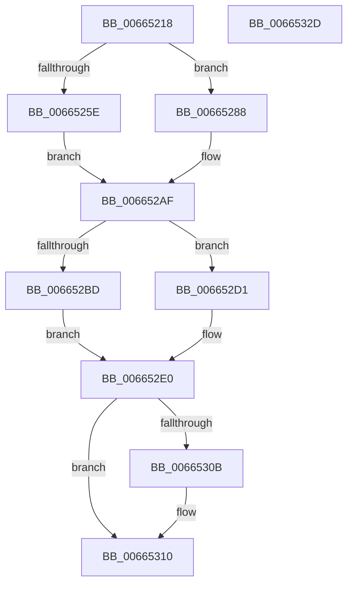

# ApiSetpSearchForSectionIndex_V7

- RVA: `0x00665218`–`0x0066532E` (길이 `278` bytes)
- VA: `0x0000000140665218`
- 실행 섹션: `.text`
- PDB 이름 있음: `예`; PDB Function 태그: `아니요`
- unwind 정보 RVA: `0x000AA18C`
- 디코드: `87`개 명령, `278/278` bytes 표시
- 미해석 바이트: `0` (있으면 어셈블리에 `.byte`로 보존)

> 이 문서는 커널 이미지의 기계어와 PDB 기호를 분석해 생성했습니다. 4번과 5번은 함수 원형과 자료형을 바이너리 사용 방식에서 추정한 C 해석이며 원본 소스 복구 결과는 아닙니다.

## 1. Dependencies

- 직접 호출 지점: **5**; 고유 호출 대상: **2**
- 직접 호출자로 확인된 함수: **6**
- RIP 상대 이미지 참조: **0**

### Outgoing calls
- `0x0066527D` → [ApiSetpGetSearchKeyHash](ApiSetpGetSearchKeyHash_function_00664F9C.md) (function, `0x00664F9C`)
- `0x006652A7` → [ApiSetpGetSearchKeyHash](ApiSetpGetSearchKeyHash_function_00664F9C.md) (function, `0x00664F9C`)
- `0x006652C7` → [ApiSetpGetSearchKeyHash](ApiSetpGetSearchKeyHash_function_00664F9C.md) (function, `0x00664F9C`)
- `0x006652DB` → [ApiSetpGetSearchKeyHash](ApiSetpGetSearchKeyHash_function_00664F9C.md) (function, `0x00664F9C`)
- `0x006652FD` → [ApiSetpFindHashtableIndexAndVerify_V7](ApiSetpFindHashtableIndexAndVerify_V7_function_00664A08.md) (function, `0x00664A08`)

### Direct callers
- [ApiSetQuerySchemaInfo2_V7](ApiSetQuerySchemaInfo2_V7_function_0066301C.md) at `0x00663134`
- [ApiSetQuerySchemaInfo2_V7](ApiSetQuerySchemaInfo2_V7_function_0066301C.md) at `0x00663234`
- [ApiSetQuerySchemaInfo2_V7](ApiSetQuerySchemaInfo2_V7_function_0066301C.md) at `0x00663350`
- [ApiSetQuerySchemaInfo2_V7](ApiSetQuerySchemaInfo2_V7_function_0066301C.md) at `0x00663437`
- [ApiSetpResolveHost](ApiSetpResolveHost_function_006638D0.md) at `0x0066395F`
- [ApiSetpResolveHost](ApiSetpResolveHost_function_006638D0.md) at `0x00663A37`
- [ApiSetpResolveHost](ApiSetpResolveHost_function_006638D0.md) at `0x00663B2C`
- [ApiSetCompose_ProcessV7Extension_Phase0](ApiSetCompose_ProcessV7Extension_Phase0_function_00663F00.md) at `0x00663FB0`
- [ApiSetCompose_ProcessV7Extension_Phase0](ApiSetCompose_ProcessV7Extension_Phase0_function_00663F00.md) at `0x00664000`
- [ApiSetCompose_ProcessV7Extension_Phase0](ApiSetCompose_ProcessV7Extension_Phase0_function_00663F00.md) at `0x00664047`
- [ApiSetCompose_ProcessV7Extension_Phase0](ApiSetCompose_ProcessV7Extension_Phase0_function_00663F00.md) at `0x0066410A`
- [ApiSetCompose_ProcessV7Extension_Phase1](ApiSetCompose_ProcessV7Extension_Phase1_function_006641BC.md) at `0x0066422F`
- [ApiSetCompose_ProcessV7Extension_Phase1](ApiSetCompose_ProcessV7Extension_Phase1_function_006641BC.md) at `0x00664328`
- [ApiSetCompose_ProcessV7Extension_Phase1](ApiSetCompose_ProcessV7Extension_Phase1_function_006641BC.md) at `0x00664437`
- [ApiSetCompose_ProcessV7Extension_Phase1](ApiSetCompose_ProcessV7Extension_Phase1_function_006641BC.md) at `0x00664520`
- [ApiSetCompose_ProcessV7Extension_Phase1](ApiSetCompose_ProcessV7Extension_Phase1_function_006641BC.md) at `0x006646BF`
- [ApiSetCompose_V7_ProcessV6Extension_Phase0](ApiSetCompose_V7_ProcessV6Extension_Phase0_function_00665A78.md) at `0x00665B22`
- [ApiSetCompose_V7_ProcessV6Extension_Phase0](ApiSetCompose_V7_ProcessV6Extension_Phase0_function_00665A78.md) at `0x00665BBE`
- [ApiSetCompose_V7_ProcessV6Extension_Phase1](ApiSetCompose_V7_ProcessV6Extension_Phase1_function_00665C64.md) at `0x00665CFE`
- [ApiSetCompose_V7_ProcessV6Extension_Phase1](ApiSetCompose_V7_ProcessV6Extension_Phase1_function_00665C64.md) at `0x00665D58`
- [ApiSetCompose_V7_ProcessV6Extension_Phase1](ApiSetCompose_V7_ProcessV6Extension_Phase1_function_00665C64.md) at `0x00665E52`
- [ApiSetCompose_V7_ProcessV6Extension_Phase1](ApiSetCompose_V7_ProcessV6Extension_Phase1_function_00665C64.md) at `0x00665F32`

### Static image references
- 디코드된 RIP-relative 메모리 참조가 없습니다.

## 2. Other-region calls and transfers

- 다른 실행 섹션으로 향하는 call: **0**
- 별도 외부 분기/꼬리 이동을 확인하지 못했습니다.

## 3. Assembly (complete function range)

```asm
00665218  48 89 5C 24 08                  mov qword ptr [rsp + 8], rbx
0066521D  48 89 6C 24 18                  mov qword ptr [rsp + 0x18], rbp
00665222  48 89 74 24 20                  mov qword ptr [rsp + 0x20], rsi
00665227  57                              push rdi
00665228  41 54                           push r12
0066522A  41 55                           push r13
0066522C  41 56                           push r14
0066522E  41 57                           push r15
00665230  48 83 EC 30                     sub rsp, 0x30
00665234  8A 41 02                        mov al, byte ptr [rcx + 2]
00665237  49 8B E8                        mov rbp, r8
0066523A  48 8B DA                        mov rbx, rdx
0066523D  44 8A C0                        mov r8b, al
00665240  8A 52 09                        mov dl, byte ptr [rdx + 9]
00665243  41 80 E0 10                     and r8b, 0x10
00665247  44 8A F2                        mov r14b, dl
0066524A  24 08                           and al, 8
0066524C  80 E2 02                        and dl, 2
0066524F  4C 8B E9                        mov r13, rcx
00665252  45 8A F9                        mov r15b, r9b
00665255  48 8B CD                        mov rcx, rbp
00665258  41 80 E6 04                     and r14b, 4
0066525C  74 2A                           je 0x140665288
0066525E  45 84 C0                        test r8b, r8b
00665261  40 0F 95 C7                     setne dil
00665265  84 C0                           test al, al
00665267  8A 43 0A                        mov al, byte ptr [rbx + 0xa]
0066526A  44 8A CF                        mov r9b, dil
0066526D  40 0F 95 C6                     setne sil
00665271  88 44 24 20                     mov byte ptr [rsp + 0x20], al
00665275  84 D2                           test dl, dl
00665277  44 8A C6                        mov r8b, sil
0066527A  0F 95 C2                        setne dl
0066527D  E8 1A FD FF FF                  call 0x140664f9c
00665282  44 0F B6 E0                     movzx r12d, al
00665286  EB 27                           jmp 0x1406652af
00665288  45 84 C0                        test r8b, r8b
0066528B  40 0F 95 C7                     setne dil
0066528F  84 C0                           test al, al
00665291  8A 43 0A                        mov al, byte ptr [rbx + 0xa]
00665294  44 8A CF                        mov r9b, dil
00665297  40 0F 95 C6                     setne sil
0066529B  88 44 24 20                     mov byte ptr [rsp + 0x20], al
0066529F  84 D2                           test dl, dl
006652A1  44 8A C6                        mov r8b, sil
006652A4  0F 95 C2                        setne dl
006652A7  E8 F0 FC FF FF                  call 0x140664f9c
006652AC  44 8B E0                        mov r12d, eax
006652AF  44 8A CF                        mov r9b, dil
006652B2  44 8A C6                        mov r8b, sil
006652B5  41 8A D7                        mov dl, r15b
006652B8  45 84 F6                        test r14b, r14b
006652BB  74 14                           je 0x1406652d1
006652BD  8A 4B 0B                        mov cl, byte ptr [rbx + 0xb]
006652C0  88 4C 24 20                     mov byte ptr [rsp + 0x20], cl
006652C4  48 8B CD                        mov rcx, rbp
006652C7  E8 D0 FC FF FF                  call 0x140664f9c
006652CC  0F B6 C0                        movzx eax, al
006652CF  EB 0F                           jmp 0x1406652e0
006652D1  8A 43 0B                        mov al, byte ptr [rbx + 0xb]
006652D4  48 8B CD                        mov rcx, rbp
006652D7  88 44 24 20                     mov byte ptr [rsp + 0x20], al
006652DB  E8 BC FC FF FF                  call 0x140664f9c
006652E0  48 8D 4C 24 68                  lea rcx, [rsp + 0x68]
006652E5  33 FF                           xor edi, edi
006652E7  48 89 4C 24 20                  mov qword ptr [rsp + 0x20], rcx
006652EC  44 8B C8                        mov r9d, eax
006652EF  49 8B CD                        mov rcx, r13
006652F2  66 89 7C 24 68                  mov word ptr [rsp + 0x68], di
006652F7  45 8B C4                        mov r8d, r12d
006652FA  48 8B D3                        mov rdx, rbx
006652FD  E8 06 F7 FF FF                  call 0x140664a08
00665302  84 C0                           test al, al
00665304  0F B7 44 24 68                  movzx eax, word ptr [rsp + 0x68]
00665309  75 05                           jne 0x140665310
0066530B  B8 FF FF 00 00                  mov eax, 0xffff
00665310  48 8B 5C 24 60                  mov rbx, qword ptr [rsp + 0x60]
00665315  48 8B 6C 24 70                  mov rbp, qword ptr [rsp + 0x70]
0066531A  48 8B 74 24 78                  mov rsi, qword ptr [rsp + 0x78]
0066531F  48 83 C4 30                     add rsp, 0x30
00665323  41 5F                           pop r15
00665325  41 5E                           pop r14
00665327  41 5D                           pop r13
00665329  41 5C                           pop r12
0066532B  5F                              pop rdi
0066532C  C3                              ret
0066532D  CC                              int3
```

## 4. C-style interpretation (structured pseudocode)

```c
__int64 __fastcall ApiSetpSearchForSectionIndex_V7(__int64 a1, __int64 a2, __int64 a3, unsigned __int8 a4)
{
    __int64 result;
    __int64 v_r14;
    __int64 v_rdi;
    __int64 v_rsi;
    __int64 v_rsp;
    unsigned __int8 v_stack_m38;
    unsigned __int64 v_stack_p10;
    unsigned __int64 v_stack_p18;
    unsigned __int64 v_stack_p20;
    unsigned __int64 v_stack_p8;

    v_stack_p8 = v_rbx;
    v_stack_p18 = v_rbp;
    v_stack_p20 = v_rsi;
    v_rsp = (v_rsp) - (48);
    a3 = (unsigned __int8)(((unsigned __int8)(*(unsigned __int8 *)(a1 + 2))) & (16));
    result = (unsigned __int8)((*(unsigned __int8 *)(a1 + 2)) & (8));
    a2 = (unsigned __int8)((*(unsigned __int8 *)(a2 + 9)) & (2));
    v_r14 = (unsigned __int8)(((unsigned __int8)(*(unsigned __int8 *)(a2 + 9))) & (4));
    if (condition_is_equal) goto loc_00665288;
    v_rdi = ((unsigned __int8)(a3) != 0) ? 1 : 0;
    v_rsi = ((unsigned __int8)(result) != 0) ? 1 : 0;
    v_stack_m38 = (unsigned __int8)(*(unsigned __int8 *)(a2 + 10));
    a2 = ((unsigned __int8)(a2) != 0) ? 1 : 0;
    result = ApiSetpGetSearchKeyHash(a3, a2, (unsigned __int8)(v_rsi), (unsigned __int8)(v_rdi));
    goto loc_006652AF;
loc_00665288:
    v_rdi = ((unsigned __int8)((unsigned __int8)(v_rsi)) != 0) ? 1 : 0;
    v_rsi = ((unsigned __int8)(result) != 0) ? 1 : 0;
    v_stack_m38 = (unsigned __int8)(*(unsigned __int8 *)(a2 + 10));
    a2 = ((unsigned __int8)(a2) != 0) ? 1 : 0;
    result = ApiSetpGetSearchKeyHash(a3, a2, (unsigned __int8)(v_rsi), (unsigned __int8)(v_rdi));
loc_006652AF:
    if ((unsigned __int8)(v_r14) == 0) goto loc_006652D1;
    v_stack_m38 = (unsigned __int8)(*(unsigned __int8 *)(a2 + 11));
    result = ApiSetpGetSearchKeyHash(a3, a4, (unsigned __int8)(v_rsi), (unsigned __int8)(v_rdi));
    goto loc_006652E0;
loc_006652D1:
    v_stack_m38 = (unsigned __int8)(*(unsigned __int8 *)(a2 + 11));
    result = ApiSetpGetSearchKeyHash(a3, a4, (unsigned __int8)(v_rsi), (unsigned __int8)(v_rdi));
loc_006652E0:
    v_rdi = 0;
    v_stack_m38 = v_stack_p10;
    v_stack_p10 = 0;
    result = ApiSetpFindHashtableIndexAndVerify_V7(a1, a2, (unsigned int)((unsigned int)((unsigned int)((unsigned int)(result)))), (unsigned int)((unsigned int)(result)));
    result = v_stack_p10;
    if ((unsigned __int8)(result) == 0) {
        result = 0xFFFFULL;
    }
    v_rsp = (v_rsp) + (48);
    return result;
}
```

## 5. (Beta) C Style

```c
int64_t ApiSetpSearchForSectionIndex_V7(void *Arg1, void *Arg2, int64_t Arg3, uint8_t Arg4)
{
    uint8_t *arg1 = (uint8_t *)Arg1;
    uint8_t *arg2 = (uint8_t *)Arg2;

    int64_t result;
    int64_t local_r14;
    int64_t local_rdi;
    int64_t local_rsi;
    int64_t local_rsp;
    uint8_t v_stack_m38;
    uint64_t v_stack_p10;
    uint64_t v_stack_p18;
    uint64_t v_stack_p20;
    uint64_t v_stack_p8;

    v_stack_p8 = local_rbx;
    v_stack_p18 = local_rbp;
    v_stack_p20 = local_rsi;
    local_rsp = (local_rsp) - (48);
    Arg3 = (uint8_t)(((uint8_t)(*(uint8_t *)(arg1 + 0x2))) & (16));
    result = (uint8_t)((*(uint8_t *)(arg1 + 0x2)) & (8));
    Arg2 = (uint8_t)((*(uint8_t *)(arg2 + 0x9)) & (2));
    local_r14 = (uint8_t)(((uint8_t)(*(uint8_t *)(arg2 + 0x9))) & (4));
    if (condition_is_equal) goto loc_00665288;
    local_rdi = ((uint8_t)(Arg3) != 0) ? 1 : 0;
    local_rsi = ((uint8_t)(result) != 0) ? 1 : 0;
    v_stack_m38 = (uint8_t)(*(uint8_t *)(arg2 + 0xA));
    Arg2 = ((uint8_t)(Arg2) != 0) ? 1 : 0;
    result = ApiSetpGetSearchKeyHash(Arg3, Arg2, (uint8_t)(local_rsi), (uint8_t)(local_rdi));
    goto loc_006652AF;
loc_00665288:
    local_rdi = ((uint8_t)((uint8_t)(local_rsi)) != 0) ? 1 : 0;
    local_rsi = ((uint8_t)(result) != 0) ? 1 : 0;
    v_stack_m38 = (uint8_t)(*(uint8_t *)(arg2 + 0xA));
    Arg2 = ((uint8_t)(Arg2) != 0) ? 1 : 0;
    result = ApiSetpGetSearchKeyHash(Arg3, Arg2, (uint8_t)(local_rsi), (uint8_t)(local_rdi));
loc_006652AF:
    if ((uint8_t)(local_r14) == 0) goto loc_006652D1;
    v_stack_m38 = (uint8_t)(*(uint8_t *)(arg2 + 0xB));
    result = ApiSetpGetSearchKeyHash(Arg3, Arg4, (uint8_t)(local_rsi), (uint8_t)(local_rdi));
    goto loc_006652E0;
loc_006652D1:
    v_stack_m38 = (uint8_t)(*(uint8_t *)(arg2 + 0xB));
    result = ApiSetpGetSearchKeyHash(Arg3, Arg4, (uint8_t)(local_rsi), (uint8_t)(local_rdi));
loc_006652E0:
    local_rdi = 0;
    v_stack_m38 = v_stack_p10;
    v_stack_p10 = 0;
    result = ApiSetpFindHashtableIndexAndVerify_V7(Arg1, Arg2, (uint32_t)((uint32_t)((uint32_t)((uint32_t)(result)))), (uint32_t)((uint32_t)(result)));
    result = v_stack_p10;
    if ((uint8_t)(result) == 0) {
        result = 0xFFFFULL;
    }
    local_rsp = (local_rsp) + (48);
    return result;
}
```

### 관측된 메모리 오프셋

구조체 형식이 확인되지 않은 접근은 인자 기준의 오프셋으로만 기록했습니다.

| 기준 인자 | 오프셋 표현 | 폭 (bit) | 접근 |
|---|---:|---:|---|
| `Arg1` | `+ 0x2` | `8` | `R` |
| `Arg2` | `+ 0x9` | `8` | `R` |
| `Arg2` | `+ 0xA` | `8` | `R` |
| `Arg2` | `+ 0xB` | `8` | `R` |

## 6. Execution-region graph

[열기: 2D/3D 그래프와 함수 탐색 컨트롤 패널](../../../control-panel.html?section=text&rva=0x00665218&view=graph)

- 2D 그래프는 위에서 아래로 흐르고, 3D 그래프는 빈 공간을 드래그해 회전합니다. Shift+드래그는 이동, 휠은 확대·축소, 함수 노드 선택은 대상 보고서 이동입니다.

### Static fallback


