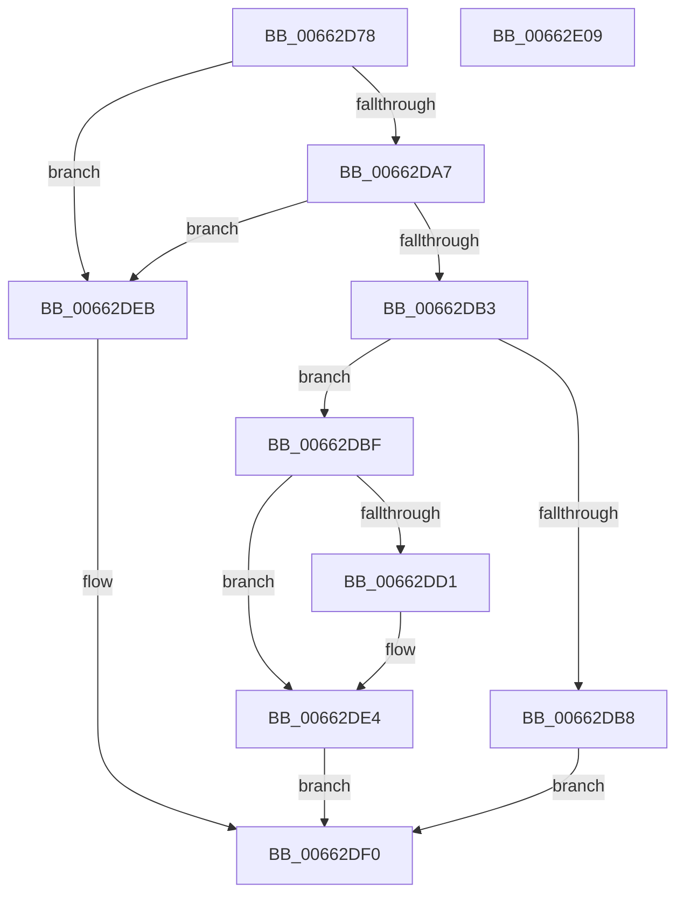

# AsiAddDataToSchema

- RVA: `0x00662D78`–`0x00662E0A` (길이 `146` bytes)
- VA: `0x0000000140662D78`
- 실행 섹션: `.text`
- PDB 이름 있음: `예`; PDB Function 태그: `아니요`
- unwind 정보 RVA: `0x00060300`
- 디코드: `48`개 명령, `146/146` bytes 표시
- 미해석 바이트: `0` (있으면 어셈블리에 `.byte`로 보존)

> 이 문서는 커널 이미지의 기계어와 PDB 기호를 분석해 생성했습니다. 4번과 5번은 함수 원형과 자료형을 바이너리 사용 방식에서 추정한 C 해석이며 원본 소스 복구 결과는 아닙니다.

## 1. Dependencies

- 직접 호출 지점: **2**; 고유 호출 대상: **2**
- 직접 호출자로 확인된 함수: **1**
- RIP 상대 이미지 참조: **0**

### Outgoing calls
- `0x00662DC8` → [memcpy](../6C/memcpy_function_006C6840.md) (function, `0x006C6840`)
- `0x00662DDF` → [memset](../6C/memset_function_006C6C40.md) (function, `0x006C6C40`)

### Direct callers
- [ApiSetComposeSchema](ApiSetComposeSchema_function_00662684.md) at `0x00662A6D`
- [ApiSetComposeSchema](ApiSetComposeSchema_function_00662684.md) at `0x00662B5E`
- [ApiSetComposeSchema](ApiSetComposeSchema_function_00662684.md) at `0x00662B97`
- [ApiSetComposeSchema](ApiSetComposeSchema_function_00662684.md) at `0x00662BD9`
- [ApiSetComposeSchema](ApiSetComposeSchema_function_00662684.md) at `0x00662C29`
- [ApiSetComposeSchema](ApiSetComposeSchema_function_00662684.md) at `0x00662C62`

### Static image references
- 디코드된 RIP-relative 메모리 참조가 없습니다.

## 2. Other-region calls and transfers

- 다른 실행 섹션으로 향하는 call: **0**
- 별도 외부 분기/꼬리 이동을 확인하지 못했습니다.

## 3. Assembly (complete function range)

```asm
00662D78  48 89 5C 24 08                  mov qword ptr [rsp + 8], rbx
00662D7D  48 89 6C 24 10                  mov qword ptr [rsp + 0x10], rbp
00662D82  48 89 74 24 18                  mov qword ptr [rsp + 0x18], rsi
00662D87  57                              push rdi
00662D88  41 56                           push r14
00662D8A  41 57                           push r15
00662D8C  48 83 EC 20                     sub rsp, 0x20
00662D90  41 8B F1                        mov esi, r9d
00662D93  49 8B C0                        mov rax, r8
00662D96  4C 8B FA                        mov r15, rdx
00662D99  48 8B E9                        mov rbp, rcx
00662D9C  8D 5E 03                        lea ebx, [rsi + 3]
00662D9F  83 E3 FC                        and ebx, 0xfffffffc
00662DA2  41 3B D9                        cmp ebx, r9d
00662DA5  72 44                           jb 0x140662deb
00662DA7  44 8B 32                        mov r14d, dword ptr [rdx]
00662DAA  41 8D 3C 1E                     lea edi, [r14 + rbx]
00662DAE  41 3B FE                        cmp edi, r14d
00662DB1  72 38                           jb 0x140662deb
00662DB3  3B 79 14                        cmp edi, dword ptr [rcx + 0x14]
00662DB6  76 07                           jbe 0x140662dbf
00662DB8  B8 05 00 00 80                  mov eax, 0x80000005
00662DBD  EB 31                           jmp 0x140662df0
00662DBF  4C 8B C6                        mov r8, rsi
00662DC2  49 03 CE                        add rcx, r14
00662DC5  48 8B D0                        mov rdx, rax
00662DC8  E8 73 3A 06 00                  call 0x1406c6840
00662DCD  3B F3                           cmp esi, ebx
00662DCF  73 13                           jae 0x140662de4
00662DD1  2B DE                           sub ebx, esi
00662DD3  41 8D 0C 36                     lea ecx, [r14 + rsi]
00662DD7  44 8B C3                        mov r8d, ebx
00662DDA  48 03 CD                        add rcx, rbp
00662DDD  33 D2                           xor edx, edx
00662DDF  E8 5C 3E 06 00                  call 0x1406c6c40
00662DE4  41 89 3F                        mov dword ptr [r15], edi
00662DE7  33 C0                           xor eax, eax
00662DE9  EB 05                           jmp 0x140662df0
00662DEB  B8 95 00 00 C0                  mov eax, 0xc0000095
00662DF0  48 8B 5C 24 40                  mov rbx, qword ptr [rsp + 0x40]
00662DF5  48 8B 6C 24 48                  mov rbp, qword ptr [rsp + 0x48]
00662DFA  48 8B 74 24 50                  mov rsi, qword ptr [rsp + 0x50]
00662DFF  48 83 C4 20                     add rsp, 0x20
00662E03  41 5F                           pop r15
00662E05  41 5E                           pop r14
00662E07  5F                              pop rdi
00662E08  C3                              ret
00662E09  CC                              int3
```

## 4. C-style interpretation (structured pseudocode)

```c
__int64 __fastcall AsiAddDataToSchema(__int64 a1, __int64 a2, __int64 a3, int a4)
{
    __int64 result;
    __int64 v_rbx;
    __int64 v_rsp;
    unsigned __int64 v_stack_p10;
    unsigned __int64 v_stack_p18;
    unsigned __int64 v_stack_p8;

    v_stack_p8 = v_rbx;
    v_stack_p10 = v_rbp;
    v_stack_p18 = v_rsi;
    v_rsp = (v_rsp) - (32);
    v_rbx = (unsigned int)(((unsigned int)(a4) + 3) & (0xFFFFFFFCULL));
    if (((unsigned int)(v_rbx)) < a4) goto loc_00662DEB;
    if (((unsigned int)((unsigned int)(*(unsigned int *)(a2)) + v_rbx * 1)) < ((unsigned int)((unsigned int)(*(unsigned int *)(a2))))) goto loc_00662DEB;
    if (((unsigned int)((unsigned int)(*(unsigned int *)(a2)) + v_rbx * 1)) <= (*(unsigned int *)(a1 + 20))) goto loc_00662DBF;
    goto loc_00662DF0;
loc_00662DBF:
    a1 = (a1) + ((unsigned int)(*(unsigned int *)(a2)));
    result = memcpy(a1, (unsigned int)(0x80000005ULL), (unsigned int)(a4), a4);
    if (((unsigned int)((unsigned int)(a4))) < ((unsigned int)(v_rbx))) {
        v_rbx = (unsigned int)((v_rbx) - ((unsigned int)((unsigned int)(a4))));
        a1 = (unsigned int)(*(unsigned int *)(a2)) + (unsigned int)(a4) * 1;
        a3 = (unsigned int)(v_rbx);
        a1 = (a1) + (a1);
        a2 = 0;
        result = memset(a1, a2, a3, a4);
    }
    *(unsigned int *)(a2) = (unsigned int)((unsigned int)(*(unsigned int *)(a2)) + v_rbx * 1);
    result = 0;
    goto loc_00662DF0;
loc_00662DEB:
loc_00662DF0:
    v_rsp = (v_rsp) + (32);
    return (unsigned int)(0xC0000095ULL);
}
```

## 5. (Beta) C Style

```c
int64_t AsiAddDataToSchema(void *Arg1, void *Arg2, int64_t Arg3, void *Arg4)
{
    uint8_t *arg1 = (uint8_t *)Arg1;
    uint8_t *arg2 = (uint8_t *)Arg2;
    uint8_t *arg4 = (uint8_t *)Arg4;

    int64_t result;
    int64_t local_rbx;
    int64_t local_rsp;
    uint64_t v_stack_p10;
    uint64_t v_stack_p18;
    uint64_t v_stack_p8;

    v_stack_p8 = local_rbx;
    v_stack_p10 = local_rbp;
    v_stack_p18 = local_rsi;
    local_rsp = (local_rsp) - (32);
    local_rbx = (uint32_t)(((uint32_t)(Arg4) + 3) & (0xFFFFFFFCULL));
    if (((uint32_t)(local_rbx)) < Arg4) goto loc_00662DEB;
    if (((uint32_t)((uint32_t)(*(uint32_t *)(arg2)) + local_rbx * 1)) < ((uint32_t)((uint32_t)(*(uint32_t *)(arg2))))) goto loc_00662DEB;
    if (((uint32_t)((uint32_t)(*(uint32_t *)(arg2)) + local_rbx * 1)) <= (*(uint32_t *)(arg1 + 0x14))) goto loc_00662DBF;
    goto loc_00662DF0;
loc_00662DBF:
    Arg1 = (Arg1) + ((uint32_t)(*(uint32_t *)(arg2)));
    result = memcpy(Arg1, (uint32_t)(0x80000005ULL), (uint32_t)(Arg4), Arg4);
    if (((uint32_t)((uint32_t)(Arg4))) < ((uint32_t)(local_rbx))) {
        local_rbx = (uint32_t)((local_rbx) - ((uint32_t)((uint32_t)(Arg4))));
        Arg1 = (uint32_t)(*(uint32_t *)(arg2)) + (uint32_t)(Arg4) * 1;
        Arg3 = (uint32_t)(local_rbx);
        Arg1 = (Arg1) + (Arg1);
        Arg2 = 0;
        result = memset(Arg1, Arg2, Arg3, Arg4);
    }
    *(uint32_t *)(arg2) = (uint32_t)((uint32_t)(*(uint32_t *)(arg2)) + local_rbx * 1);
    result = 0;
    goto loc_00662DF0;
loc_00662DEB:
loc_00662DF0:
    local_rsp = (local_rsp) + (32);
    return (uint32_t)(0xC0000095ULL);
}
```

### 관측된 메모리 오프셋

구조체 형식이 확인되지 않은 접근은 인자 기준의 오프셋으로만 기록했습니다.

| 기준 인자 | 오프셋 표현 | 폭 (bit) | 접근 |
|---|---:|---:|---|
| `Arg1` | `+ 0x14` | `32` | `R` |
| `Arg2` | `+ 0x0` | `32` | `R` |
| `Arg2` | `+ 0x0` | `32` | `W` |
| `Arg4` | `+ 0x3` | `32` | `R` |

## 6. Execution-region graph

[열기: 2D/3D 그래프와 함수 탐색 컨트롤 패널](../../../control-panel.html?section=text&rva=0x00662D78&view=graph)

- 2D 그래프는 위에서 아래로 흐르고, 3D 그래프는 빈 공간을 드래그해 회전합니다. Shift+드래그는 이동, 휠은 확대·축소, 함수 노드 선택은 대상 보고서 이동입니다.

### Static fallback


