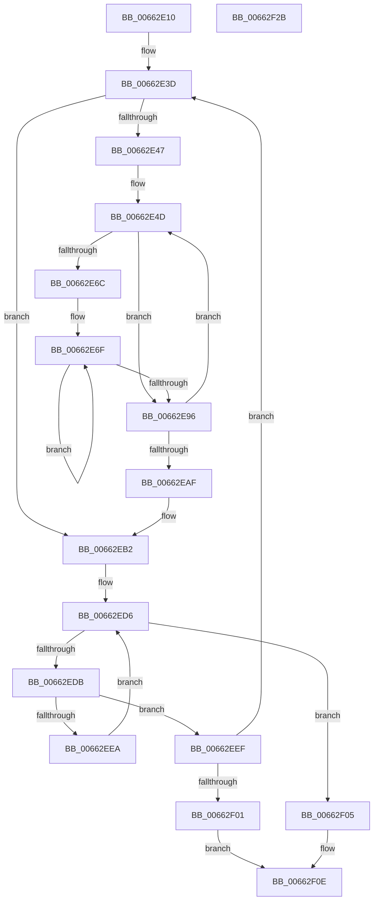

# AsiPopulateHashes

- RVA: `0x00662E10`–`0x00662F2C` (길이 `284` bytes)
- VA: `0x0000000140662E10`
- 실행 섹션: `.text`
- PDB 이름 있음: `예`; PDB Function 태그: `아니요`
- unwind 정보 RVA: `0x00075C18`
- 디코드: `87`개 명령, `284/284` bytes 표시
- 미해석 바이트: `0` (있으면 어셈블리에 `.byte`로 보존)

> 이 문서는 커널 이미지의 기계어와 PDB 기호를 분석해 생성했습니다. 4번과 5번은 함수 원형과 자료형을 바이너리 사용 방식에서 추정한 C 해석이며 원본 소스 복구 결과는 아닙니다.

## 1. Dependencies

- 직접 호출 지점: **1**; 고유 호출 대상: **1**
- 직접 호출자로 확인된 함수: **1**
- RIP 상대 이미지 참조: **2**

### Outgoing calls
- `0x00662ECB` → [qsort](../50/qsort_function_005009F0.md) (function, `0x005009F0`)

### Direct callers
- [ApiSetComposeSchema](ApiSetComposeSchema_function_00662684.md) at `0x00662CE5`

### Static image references
- `0x00662E2F` → RVA `0x00039E30` (`.rdata`; read)
- `0x00662EB5` → RVA `0x00662F40` (`AsiSortHashTableHelper`; read)

## 2. Other-region calls and transfers

- 다른 실행 섹션으로 향하는 call: **0**
- 별도 외부 분기/꼬리 이동을 확인하지 못했습니다.

## 3. Assembly (complete function range)

```asm
00662E10  48 89 5C 24 08                  mov qword ptr [rsp + 8], rbx
00662E15  48 89 6C 24 10                  mov qword ptr [rsp + 0x10], rbp
00662E1A  48 89 74 24 18                  mov qword ptr [rsp + 0x18], rsi
00662E1F  57                              push rdi
00662E20  41 54                           push r12
00662E22  41 55                           push r13
00662E24  41 56                           push r14
00662E26  41 57                           push r15
00662E28  48 83 EC 20                     sub rsp, 0x20
00662E2C  8B 71 0C                        mov esi, dword ptr [rcx + 0xc]
00662E2F  4C 8D 35 FA 6F 9D FF            lea r14, [rip - 0x629006]
00662E36  8B C6                           mov eax, esi
00662E38  48 8B D9                        mov rbx, rcx
00662E3B  33 ED                           xor ebp, ebp
00662E3D  45 8B 3E                        mov r15d, dword ptr [r14]
00662E40  45 33 C0                        xor r8d, r8d
00662E43  85 F6                           test esi, esi
00662E45  74 6B                           je 0x140662eb2
00662E47  45 33 D2                        xor r10d, r10d
00662E4A  45 33 DB                        xor r11d, r11d
00662E4D  8B 43 10                        mov eax, dword ptr [rbx + 0x10]
00662E50  33 FF                           xor edi, edi
00662E52  44 8B 4B 14                     mov r9d, dword ptr [rbx + 0x14]
00662E56  49 03 C3                        add rax, r11
00662E59  4D 03 CA                        add r9, r10
00662E5C  44 8B 64 18 04                  mov r12d, dword ptr [rax + rbx + 4]
00662E61  8B 4C 18 0C                     mov ecx, dword ptr [rax + rbx + 0xc]
00662E65  4C 03 E3                        add r12, rbx
00662E68  D1 E9                           shr ecx, 1
00662E6A  74 2A                           je 0x140662e96
00662E6C  44 8B E9                        mov r13d, ecx
00662E6F  41 0F B7 14 24                  movzx edx, word ptr [r12]
00662E74  4D 8D 64 24 02                  lea r12, [r12 + 2]
00662E79  8D 42 BF                        lea eax, [rdx - 0x41]
00662E7C  66 83 F8 19                     cmp ax, 0x19
00662E80  8D 4A 20                        lea ecx, [rdx + 0x20]
00662E83  66 0F 47 CA                     cmova cx, dx
00662E87  41 0F AF FF                     imul edi, r15d
00662E8B  0F B7 C1                        movzx eax, cx
00662E8E  03 F8                           add edi, eax
00662E90  49 83 ED 01                     sub r13, 1
00662E94  75 D9                           jne 0x140662e6f
00662E96  45 89 44 19 04                  mov dword ptr [r9 + rbx + 4], r8d
00662E9B  49 83 C3 18                     add r11, 0x18
00662E9F  41 FF C0                        inc r8d
00662EA2  41 89 3C 19                     mov dword ptr [r9 + rbx], edi
00662EA6  49 83 C2 08                     add r10, 8
00662EAA  44 3B C6                        cmp r8d, esi
00662EAD  72 9E                           jb 0x140662e4d
00662EAF  48 8B C6                        mov rax, rsi
00662EB2  8B 7B 14                        mov edi, dword ptr [rbx + 0x14]
00662EB5  4C 8D 0D 84 00 00 00            lea r9, [rip + 0x84]
00662EBC  48 03 FB                        add rdi, rbx
00662EBF  41 B8 08 00 00 00               mov r8d, 8
00662EC5  48 8B CF                        mov rcx, rdi
00662EC8  48 8B D0                        mov rdx, rax
00662ECB  E8 20 DB E9 FF                  call 0x1405009f0
00662ED0  41 B8 01 00 00 00               mov r8d, 1
00662ED6  44 3B C6                        cmp r8d, esi
00662ED9  73 2A                           jae 0x140662f05
00662EDB  41 8B C0                        mov eax, r8d
00662EDE  41 8D 50 FF                     lea edx, [r8 - 1]
00662EE2  8B 0C C7                        mov ecx, dword ptr [rdi + rax*8]
00662EE5  39 0C D7                        cmp dword ptr [rdi + rdx*8], ecx
00662EE8  74 05                           je 0x140662eef
00662EEA  41 FF C0                        inc r8d
00662EED  EB E7                           jmp 0x140662ed6
00662EEF  FF C5                           inc ebp
00662EF1  49 83 C6 04                     add r14, 4
00662EF5  48 8B C6                        mov rax, rsi
00662EF8  83 FD 64                        cmp ebp, 0x64
00662EFB  0F 82 3C FF FF FF               jb 0x140662e3d
00662F01  33 C0                           xor eax, eax
00662F03  EB 09                           jmp 0x140662f0e
00662F05  44 89 7B 18                     mov dword ptr [rbx + 0x18], r15d
00662F09  B8 01 00 00 00                  mov eax, 1
00662F0E  48 8B 5C 24 50                  mov rbx, qword ptr [rsp + 0x50]
00662F13  48 8B 6C 24 58                  mov rbp, qword ptr [rsp + 0x58]
00662F18  48 8B 74 24 60                  mov rsi, qword ptr [rsp + 0x60]
00662F1D  48 83 C4 20                     add rsp, 0x20
00662F21  41 5F                           pop r15
00662F23  41 5E                           pop r14
00662F25  41 5D                           pop r13
00662F27  41 5C                           pop r12
00662F29  5F                              pop rdi
00662F2A  C3                              ret
00662F2B  CC                              int3
```

## 4. C-style interpretation (structured pseudocode)

```c
__int64 __fastcall AsiPopulateHashes(__int64 a1, __int64 a2, int a3)
{
    __int64 result;
    __int64 v_r10;
    __int64 v_r11;
    __int64 v_r12;
    __int64 v_r13;
    __int64 v_r14;
    __int64 v_rbp;
    __int64 v_rdi;
    __int64 v_rsp;
    unsigned __int64 v_stack_p10;
    unsigned __int64 v_stack_p18;
    unsigned __int64 v_stack_p8;

    v_stack_p8 = v_rbx;
    v_stack_p10 = v_rbp;
    v_stack_p18 = v_rsi;
    v_rsp = (v_rsp) - (32);
    v_rbp = 0;
loc_00662E3D:
    a3 = 0;
    if ((unsigned int)((unsigned int)(*(unsigned int *)(a1 + 12))) == 0) goto loc_00662EB2;
    v_r10 = 0;
    v_r11 = 0;
loc_00662E4D:
    v_rdi = 0;
    result = ((unsigned int)(*(unsigned int *)(a1 + 16))) + (0);
    a4 = ((unsigned int)(*(unsigned int *)(a1 + 20))) + (0);
    v_r12 = ((unsigned int)(*(unsigned int *)(result + a1 * 1 + 4))) + (a1);
    a1 = (unsigned int)(((unsigned int)(*(unsigned int *)(result + a1 * 1 + 12))) >> (1));
    if (condition_is_equal) goto loc_00662E96;
loc_00662E6F:
    a1 = *(unsigned __int16 *)(v_r12) + 32;
    if (((unsigned __int16)(*(unsigned __int16 *)(v_r12) - 65)) > 25) { a1 = (unsigned __int16)(*(unsigned __int16 *)(v_r12)); }
    v_rdi = (unsigned int)((v_rdi) * ((unsigned int)((unsigned int)(*(unsigned int *)(v_rip - 6459398)))));
    v_rdi = (unsigned int)((v_rdi) + ((unsigned int)((unsigned __int16)(a1))));
    v_r13 = ((unsigned int)((unsigned int)(a1))) - (1);
    if (condition_is_not_equal) goto loc_00662E6F;
loc_00662E96:
    *(unsigned int *)(a4 + a1 * 1 + 4) = 0;
    v_r11 = (v_r11) + (24);
    a3 = (unsigned int)((a3) + 1);
    *(unsigned int *)(a4 + a1 * 1) = (unsigned int)(v_rdi);
    v_r10 = (v_r10) + (8);
    if (a3 < ((unsigned int)((unsigned int)(*(unsigned int *)(a1 + 12))))) goto loc_00662E4D;
loc_00662EB2:
    v_rdi = ((unsigned int)(*(unsigned int *)(a1 + 20))) + (a1);
    result = qsort(v_rdi, (unsigned int)(*(unsigned int *)(a1 + 12)), 8, v_rip + 132);
loc_00662ED6:
    if (1 >= ((unsigned int)((unsigned int)(*(unsigned int *)(a1 + 12))))) goto loc_00662F05;
    if ((*(unsigned int *)(v_rdi + 1 - 1 * 8)) == ((unsigned int)((unsigned int)(*(unsigned int *)(v_rdi + 1 * 8))))) goto loc_00662EEF;
    a3 = (unsigned int)((1) + 1);
    goto loc_00662ED6;
loc_00662EEF:
    v_rbp = (unsigned int)((v_rbp) + 1);
    v_r14 = (v_rip - 6459398) + (4);
    if (((unsigned int)(v_rbp)) < 100) goto loc_00662E3D;
    result = 0;
    goto loc_00662F0E;
loc_00662F05:
    *(unsigned int *)(a1 + 24) = (unsigned int)((unsigned int)(*(unsigned int *)(v_rip - 6459398)));
loc_00662F0E:
    v_rsp = (v_rsp) + (32);
    return 1;
}
```

## 5. (Beta) C Style

```c
int64_t AsiPopulateHashes(void *Arg1, int64_t Arg2, int32_t Arg3)
{
    uint8_t *arg1 = (uint8_t *)Arg1;

    int64_t result;
    int64_t local_r10;
    int64_t local_r11;
    int64_t local_r12;
    int64_t local_r13;
    int64_t local_r14;
    int64_t local_rbp;
    int64_t local_rdi;
    int64_t local_rsp;
    uint64_t v_stack_p10;
    uint64_t v_stack_p18;
    uint64_t v_stack_p8;

    v_stack_p8 = local_rbx;
    v_stack_p10 = local_rbp;
    v_stack_p18 = local_rsi;
    local_rsp = (local_rsp) - (32);
    local_rbp = 0;
loc_00662E3D:
    Arg3 = 0;
    if ((uint32_t)((uint32_t)(*(uint32_t *)(arg1 + 0xC))) == 0) goto loc_00662EB2;
    local_r10 = 0;
    local_r11 = 0;
loc_00662E4D:
    local_rdi = 0;
    result = ((uint32_t)(*(uint32_t *)(arg1 + 0x10))) + (0);
    a4 = ((uint32_t)(*(uint32_t *)(arg1 + 0x14))) + (0);
    local_r12 = ((uint32_t)(*(uint32_t *)(result + arg1 * 1 + 0x4))) + (Arg1);
    Arg1 = (uint32_t)(((uint32_t)(*(uint32_t *)(result + arg1 * 1 + 0xC))) >> (1));
    if (condition_is_equal) goto loc_00662E96;
loc_00662E6F:
    Arg1 = *(uint16_t *)(local_r12) + 32;
    if (((uint16_t)(*(uint16_t *)(local_r12) - 65)) > 25) { Arg1 = (uint16_t)(*(uint16_t *)(local_r12)); }
    local_rdi = (uint32_t)((local_rdi) * ((uint32_t)((uint32_t)(*(uint32_t *)(v_rip - 0x629006)))));
    local_rdi = (uint32_t)((local_rdi) + ((uint32_t)((uint16_t)(Arg1))));
    local_r13 = ((uint32_t)((uint32_t)(Arg1))) - (1);
    if (condition_is_not_equal) goto loc_00662E6F;
loc_00662E96:
    *(uint32_t *)(a4 + arg1 * 1 + 0x4) = 0;
    local_r11 = (local_r11) + (24);
    Arg3 = (uint32_t)((Arg3) + 1);
    *(uint32_t *)(a4 + arg1 * 1) = (uint32_t)(local_rdi);
    local_r10 = (local_r10) + (8);
    if (Arg3 < ((uint32_t)((uint32_t)(*(uint32_t *)(arg1 + 0xC))))) goto loc_00662E4D;
loc_00662EB2:
    local_rdi = ((uint32_t)(*(uint32_t *)(arg1 + 0x14))) + (Arg1);
    result = qsort(local_rdi, (uint32_t)(*(uint32_t *)(arg1 + 0xC)), 8, v_rip + 132);
loc_00662ED6:
    if (1 >= ((uint32_t)((uint32_t)(*(uint32_t *)(arg1 + 0xC))))) goto loc_00662F05;
    if ((*(uint32_t *)(local_rdi + 0x1 - 0x1 * 8)) == ((uint32_t)((uint32_t)(*(uint32_t *)(local_rdi + 0x1 * 8))))) goto loc_00662EEF;
    Arg3 = (uint32_t)((1) + 1);
    goto loc_00662ED6;
loc_00662EEF:
    local_rbp = (uint32_t)((local_rbp) + 1);
    local_r14 = (v_rip - 6459398) + (4);
    if (((uint32_t)(local_rbp)) < 100) goto loc_00662E3D;
    result = 0;
    goto loc_00662F0E;
loc_00662F05:
    *(uint32_t *)(arg1 + 0x18) = (uint32_t)((uint32_t)(*(uint32_t *)(v_rip - 0x629006)));
loc_00662F0E:
    local_rsp = (local_rsp) + (32);
    return 1;
}
```

### 관측된 메모리 오프셋

구조체 형식이 확인되지 않은 접근은 인자 기준의 오프셋으로만 기록했습니다.

| 기준 인자 | 오프셋 표현 | 폭 (bit) | 접근 |
|---|---:|---:|---|
| `Arg1` | `+ 0xC` | `32` | `R` |
| `Arg1` | `+ 0x10` | `32` | `R` |
| `Arg1` | `+ 0x14` | `32` | `R` |
| `Arg1` | `+ 0x18` | `32` | `W` |

## 6. Execution-region graph

[열기: 2D/3D 그래프와 함수 탐색 컨트롤 패널](../../../control-panel.html?section=text&rva=0x00662E10&view=graph)

- 2D 그래프는 위에서 아래로 흐르고, 3D 그래프는 빈 공간을 드래그해 회전합니다. Shift+드래그는 이동, 휠은 확대·축소, 함수 노드 선택은 대상 보고서 이동입니다.

### Static fallback


