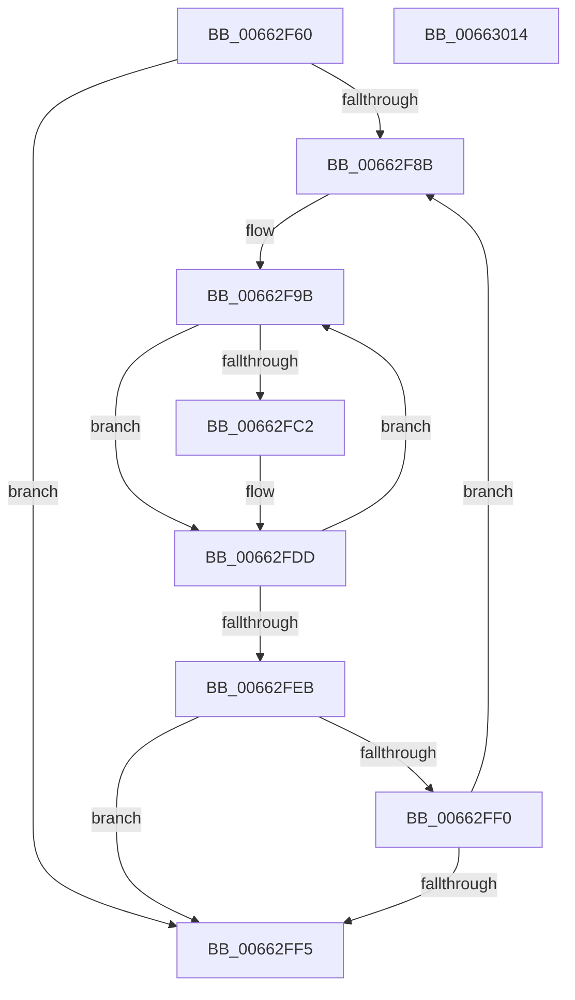

# AsiSortValueList

- RVA: `0x00662F60`–`0x00663015` (길이 `181` bytes)
- VA: `0x0000000140662F60`
- 실행 섹션: `.text`
- PDB 이름 있음: `예`; PDB Function 태그: `아니요`
- unwind 정보 RVA: `0x000847EC`
- 디코드: `58`개 명령, `181/181` bytes 표시
- 미해석 바이트: `0` (있으면 어셈블리에 `.byte`로 보존)

> 이 문서는 커널 이미지의 기계어와 PDB 기호를 분석해 생성했습니다. 4번과 5번은 함수 원형과 자료형을 바이너리 사용 방식에서 추정한 C 해석이며 원본 소스 복구 결과는 아닙니다.

## 1. Dependencies

- 직접 호출 지점: **1**; 고유 호출 대상: **1**
- 직접 호출자로 확인된 함수: **1**
- RIP 상대 이미지 참조: **0**

### Outgoing calls
- `0x00662FB9` → [RtlCompareUnicodeStrings](../../page/97/RtlCompareUnicodeStrings_function_009727E0.md) (function, `0x009727E0`)

### Direct callers
- [ApiSetComposeSchema](ApiSetComposeSchema_function_00662684.md) at `0x00662C76`

### Static image references
- 디코드된 RIP-relative 메모리 참조가 없습니다.

## 2. Other-region calls and transfers

- 다른 실행 섹션으로 향하는 call: **1**
  - `0x00662FB9` → [RtlCompareUnicodeStrings](../../page/97/RtlCompareUnicodeStrings_function_009727E0.md) (`.text` → `PAGE`)
- 별도 외부 분기/꼬리 이동을 확인하지 못했습니다.

## 3. Assembly (complete function range)

```asm
00662F60  48 8B C4                        mov rax, rsp
00662F63  48 89 58 08                     mov qword ptr [rax + 8], rbx
00662F67  48 89 68 10                     mov qword ptr [rax + 0x10], rbp
00662F6B  48 89 70 18                     mov qword ptr [rax + 0x18], rsi
00662F6F  48 89 78 20                     mov qword ptr [rax + 0x20], rdi
00662F73  41 54                           push r12
00662F75  41 56                           push r14
00662F77  41 57                           push r15
00662F79  48 83 EC 30                     sub rsp, 0x30
00662F7D  8B 5A 14                        mov ebx, dword ptr [rdx + 0x14]
00662F80  48 8B EA                        mov rbp, rdx
00662F83  4C 8B E1                        mov r12, rcx
00662F86  83 EB 01                        sub ebx, 1
00662F89  74 6A                           je 0x140662ff5
00662F8B  8B 7D 10                        mov edi, dword ptr [rbp + 0x10]
00662F8E  49 03 FC                        add rdi, r12
00662F91  44 8B F3                        mov r14d, ebx
00662F94  45 32 FF                        xor r15b, r15b
00662F97  48 8D 77 14                     lea rsi, [rdi + 0x14]
00662F9B  8B 4F 04                        mov ecx, dword ptr [rdi + 4]
00662F9E  8B 57 08                        mov edx, dword ptr [rdi + 8]
00662FA1  49 03 CC                        add rcx, r12
00662FA4  44 8B 46 04                     mov r8d, dword ptr [rsi + 4]
00662FA8  44 8B 4E 08                     mov r9d, dword ptr [rsi + 8]
00662FAC  4D 03 C4                        add r8, r12
00662FAF  D1 EA                           shr edx, 1
00662FB1  41 D1 E9                        shr r9d, 1
00662FB4  C6 44 24 20 01                  mov byte ptr [rsp + 0x20], 1
00662FB9  E8 22 F8 30 00                  call 0x1409727e0
00662FBE  85 C0                           test eax, eax
00662FC0  74 1B                           je 0x140662fdd
00662FC2  0F 10 07                        movups xmm0, xmmword ptr [rdi]
00662FC5  8B 4E 10                        mov ecx, dword ptr [rsi + 0x10]
00662FC8  41 B7 01                        mov r15b, 1
00662FCB  0F 10 0E                        movups xmm1, xmmword ptr [rsi]
00662FCE  0F 11 06                        movups xmmword ptr [rsi], xmm0
00662FD1  8B 47 10                        mov eax, dword ptr [rdi + 0x10]
00662FD4  89 46 10                        mov dword ptr [rsi + 0x10], eax
00662FD7  0F 11 0F                        movups xmmword ptr [rdi], xmm1
00662FDA  89 4F 10                        mov dword ptr [rdi + 0x10], ecx
00662FDD  48 83 C7 14                     add rdi, 0x14
00662FE1  48 83 C6 14                     add rsi, 0x14
00662FE5  49 83 EE 01                     sub r14, 1
00662FE9  75 B0                           jne 0x140662f9b
00662FEB  45 84 FF                        test r15b, r15b
00662FEE  74 05                           je 0x140662ff5
00662FF0  83 C3 FF                        add ebx, -1
00662FF3  75 96                           jne 0x140662f8b
00662FF5  48 8B 5C 24 50                  mov rbx, qword ptr [rsp + 0x50]
00662FFA  48 8B 6C 24 58                  mov rbp, qword ptr [rsp + 0x58]
00662FFF  48 8B 74 24 60                  mov rsi, qword ptr [rsp + 0x60]
00663004  48 8B 7C 24 68                  mov rdi, qword ptr [rsp + 0x68]
00663009  48 83 C4 30                     add rsp, 0x30
0066300D  41 5F                           pop r15
0066300F  41 5E                           pop r14
00663011  41 5C                           pop r12
00663013  C3                              ret
00663014  CC                              int3
```

## 4. C-style interpretation (structured pseudocode)

```c
__int64 __fastcall AsiSortValueList(__int64 a1, __int64 a2)
{
    __int64 result;
    __int64 v_r14;
    __int64 v_r15;
    __int64 v_rbx;
    __int64 v_rdi;
    __int64 v_rsi;
    __int64 v_rsp;
    unsigned __int8 v_stack_m28;
    unsigned __int64 v_stack_p10;
    unsigned __int64 v_stack_p18;
    unsigned __int64 v_stack_p20;
    unsigned __int64 v_stack_p8;

    *(unsigned __int64 *)(v_rsp + 8) = v_rbx;
    *(unsigned __int64 *)(v_rsp + 16) = v_rbp;
    *(unsigned __int64 *)(v_rsp + 24) = v_rsi;
    *(unsigned __int64 *)(v_rsp + 32) = v_rdi;
    v_rsp = (v_rsp) - (48);
    v_rbx = (unsigned int)(((unsigned int)(*(unsigned int *)(a2 + 20))) - (1));
    if (condition_is_equal) goto loc_00662FF5;
loc_00662F8B:
    v_rdi = ((unsigned int)(*(unsigned int *)(a2 + 16))) + (a1);
    v_r15 = 0;
loc_00662F9B:
    a1 = ((unsigned int)(*(unsigned int *)(v_rdi + 4))) + (a1);
    a3 = ((unsigned int)(*(unsigned int *)(v_rdi + 20 + 4))) + (a1);
    a2 = (unsigned int)(((unsigned int)(*(unsigned int *)(v_rdi + 8))) >> (1));
    a4 = (unsigned int)(((unsigned int)(*(unsigned int *)(v_rdi + 20 + 8))) >> (1));
    v_stack_m28 = 1;
    result = RtlCompareUnicodeStrings(a1, a2, a3, a4);
    if ((unsigned int)(result) != 0) {
        a1 = *(unsigned int *)(v_rdi + 20 + 16);
        v_r15 = 1;
        *(unsigned __int64 *)(v_rdi + 20) = v_xmm0;
        result = *(unsigned int *)(v_rdi + 16);
        *(unsigned int *)(v_rdi + 20 + 16) = (unsigned int)(result);
        *(unsigned __int64 *)(v_rdi) = v_xmm1;
        *(unsigned int *)(v_rdi + 16) = (unsigned int)(a1);
    }
    v_rdi = (v_rdi) + (20);
    v_rsi = (v_rdi + 20) + (20);
    v_r14 = ((unsigned int)((unsigned int)(v_rbx))) - (1);
    if (condition_is_not_equal) goto loc_00662F9B;
    if ((unsigned __int8)(v_r15) == 0) goto loc_00662FF5;
    v_rbx = (unsigned int)((v_rbx) + (-1));
    if (condition_is_not_equal) goto loc_00662F8B;
loc_00662FF5:
    v_rsp = (v_rsp) + (48);
    return result;
}
```

## 5. (Beta) C Style

```c
int64_t AsiSortValueList(int64_t Arg1, void *Arg2)
{
    uint8_t *arg2 = (uint8_t *)Arg2;

    int64_t result;
    int64_t local_r14;
    int64_t local_r15;
    int64_t local_rbx;
    int64_t local_rdi;
    int64_t local_rsi;
    int64_t local_rsp;
    uint8_t v_stack_m28;
    uint64_t v_stack_p10;
    uint64_t v_stack_p18;
    uint64_t v_stack_p20;
    uint64_t v_stack_p8;

    *(uint64_t *)(local_rsp + 0x8) = local_rbx;
    *(uint64_t *)(local_rsp + 0x10) = local_rbp;
    *(uint64_t *)(local_rsp + 0x18) = local_rsi;
    *(uint64_t *)(local_rsp + 0x20) = local_rdi;
    local_rsp = (local_rsp) - (48);
    local_rbx = (uint32_t)(((uint32_t)(*(uint32_t *)(arg2 + 0x14))) - (1));
    if (condition_is_equal) goto loc_00662FF5;
loc_00662F8B:
    local_rdi = ((uint32_t)(*(uint32_t *)(arg2 + 0x10))) + (Arg1);
    local_r15 = 0;
loc_00662F9B:
    Arg1 = ((uint32_t)(*(uint32_t *)(local_rdi + 0x4))) + (Arg1);
    a3 = ((uint32_t)(*(uint32_t *)(local_rdi + 0x14 + 0x4))) + (Arg1);
    Arg2 = (uint32_t)(((uint32_t)(*(uint32_t *)(local_rdi + 0x8))) >> (1));
    a4 = (uint32_t)(((uint32_t)(*(uint32_t *)(local_rdi + 0x14 + 0x8))) >> (1));
    v_stack_m28 = 1;
    result = RtlCompareUnicodeStrings(Arg1, Arg2, a3, a4);
    if ((uint32_t)(result) != 0) {
        Arg1 = *(uint32_t *)(local_rdi + 0x14 + 0x10);
        local_r15 = 1;
        *(uint64_t *)(local_rdi + 0x14) = v_xmm0;
        result = *(uint32_t *)(local_rdi + 0x10);
        *(uint32_t *)(local_rdi + 0x14 + 0x10) = (uint32_t)(result);
        *(uint64_t *)(local_rdi) = v_xmm1;
        *(uint32_t *)(local_rdi + 0x10) = (uint32_t)(Arg1);
    }
    local_rdi = (local_rdi) + (20);
    local_rsi = (local_rdi + 20) + (20);
    local_r14 = ((uint32_t)((uint32_t)(local_rbx))) - (1);
    if (condition_is_not_equal) goto loc_00662F9B;
    if ((uint8_t)(local_r15) == 0) goto loc_00662FF5;
    local_rbx = (uint32_t)((local_rbx) + (-1));
    if (condition_is_not_equal) goto loc_00662F8B;
loc_00662FF5:
    local_rsp = (local_rsp) + (48);
    return result;
}
```

### 관측된 메모리 오프셋

구조체 형식이 확인되지 않은 접근은 인자 기준의 오프셋으로만 기록했습니다.

| 기준 인자 | 오프셋 표현 | 폭 (bit) | 접근 |
|---|---:|---:|---|
| `Arg2` | `+ 0x10` | `32` | `R` |
| `Arg2` | `+ 0x14` | `32` | `R` |

## 6. Execution-region graph

[열기: 2D/3D 그래프와 함수 탐색 컨트롤 패널](../../../control-panel.html?section=text&rva=0x00662F60&view=graph)

- 2D 그래프는 위에서 아래로 흐르고, 3D 그래프는 빈 공간을 드래그해 회전합니다. Shift+드래그는 이동, 휠은 확대·축소, 함수 노드 선택은 대상 보고서 이동입니다.

### Static fallback


