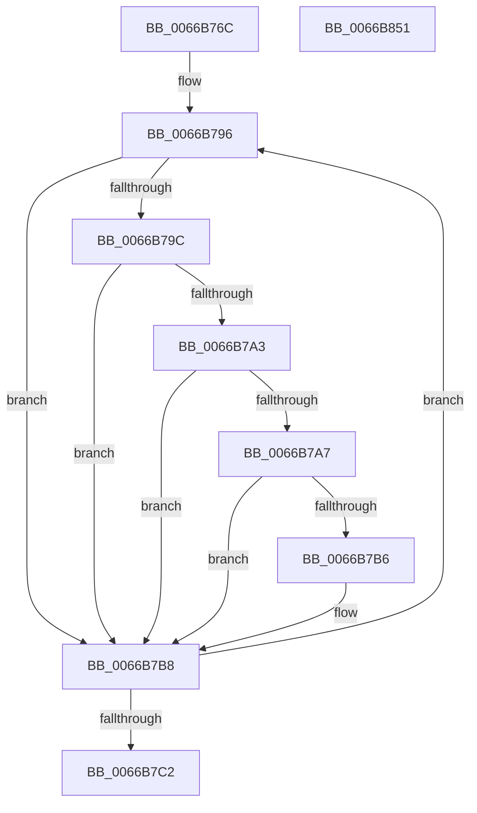

# CmFcDebugUpdateSystemInfo

- RVA: `0x0066B76C`–`0x0066B852` (길이 `230` bytes)
- VA: `0x000000014066B76C`
- 실행 섹션: `.text`
- PDB 이름 있음: `예`; PDB Function 태그: `아니요`
- unwind 정보 RVA: `0x00060BC4`
- 디코드: `60`개 명령, `230/230` bytes 표시
- 미해석 바이트: `0` (있으면 어셈블리에 `.byte`로 보존)

> 이 문서는 커널 이미지의 기계어와 PDB 기호를 분석해 생성했습니다. 4번과 5번은 함수 원형과 자료형을 바이너리 사용 방식에서 추정한 C 해석이며 원본 소스 복구 결과는 아닙니다.

## 1. Dependencies

- 직접 호출 지점: **4**; 고유 호출 대상: **4**
- 직접 호출자로 확인된 함수: **1**
- RIP 상대 이미지 참조: **3**

### Outgoing calls
- `0x0066B7AD` → [guard_dispatch_icall](../6B/guard_dispatch_icall_function_006BAAD0.md) (function, `0x006BAAD0`)
- `0x0066B7DE` → [Feature_UxAccOptimization__private_IsEnabledNoReportingNoInline](Feature_UxAccOptimization__private_IsEnabledNoReportingNoInline_function_0066D404.md) (function, `0x0066D404`)
- `0x0066B7FF` → [Feature_TestReadyFlag__private_IsEnabledNoReportingNoInline](Feature_TestReadyFlag__private_IsEnabledNoReportingNoInline_function_0066CE04.md) (function, `0x0066CE04`)
- `0x0066B820` → [Feature_TestCurrentBundleOn_Flag__private_IsEnabledNoReportingNoInline](Feature_TestCurrentBundleOn_Flag__private_IsEnabledNoReportingNoInline_function_0066C954.md) (function, `0x0066C954`)

### Direct callers
- [CmInitSystem0](../../init/C5/CmInitSystem0_function_00C58E88.md) at `0x00C58F1A`

### Static image references
- `0x0066B77B` → RVA `0x00E3EE28` (`.data`; write)
- `0x0066B785` → RVA `0x00009568` (`.rdata`; read)
- `0x0066B7C2` → RVA `0x00E3EE28` (`.data`; read)

## 2. Other-region calls and transfers

- 다른 실행 섹션으로 향하는 call: **0**
- 별도 외부 분기/꼬리 이동을 확인하지 못했습니다.

## 3. Assembly (complete function range)

```asm
0066B76C  48 89 5C 24 08                  mov qword ptr [rsp + 8], rbx
0066B771  48 89 74 24 10                  mov qword ptr [rsp + 0x10], rsi
0066B776  57                              push rdi
0066B777  48 83 EC 20                     sub rsp, 0x20
0066B77B  C7 05 A3 36 7D 00 01 00 00 00   mov dword ptr [rip + 0x7d36a3], 1
0066B785  48 8D 1D DC DD 99 FF            lea rbx, [rip - 0x662224]
0066B78C  BF CF 09 00 00                  mov edi, 0x9cf
0066B791  BE 20 00 00 00                  mov esi, 0x20
0066B796  8B 03                           mov eax, dword ptr [rbx]
0066B798  85 C0                           test eax, eax
0066B79A  74 1C                           je 0x14066b7b8
0066B79C  3D 0F 27 00 00                  cmp eax, 0x270f
0066B7A1  74 15                           je 0x14066b7b8
0066B7A3  3B C7                           cmp eax, edi
0066B7A5  76 11                           jbe 0x14066b7b8
0066B7A7  48 8B 43 F8                     mov rax, qword ptr [rbx - 8]
0066B7AB  33 C9                           xor ecx, ecx
0066B7AD  E8 1E F3 04 00                  call 0x1406baad0
0066B7B2  85 C0                           test eax, eax
0066B7B4  74 02                           je 0x14066b7b8
0066B7B6  8B 3B                           mov edi, dword ptr [rbx]
0066B7B8  48 83 C3 10                     add rbx, 0x10
0066B7BC  48 83 EE 01                     sub rsi, 1
0066B7C0  75 D4                           jne 0x14066b796
0066B7C2  8B 05 60 36 7D 00               mov eax, dword ptr [rip + 0x7d3660]
0066B7C8  81 E7 FF 0F 00 00               and edi, 0xfff
0066B7CE  25 3F 00 FC FF                  and eax, 0xfffc003f
0066B7D3  C1 E7 06                        shl edi, 6
0066B7D6  0B F8                           or edi, eax
0066B7D8  89 3D 4A 36 7D 00               mov dword ptr [rip + 0x7d364a], edi
0066B7DE  E8 21 1C 00 00                  call 0x14066d404
0066B7E3  F7 D8                           neg eax
0066B7E5  8B 05 3D 36 7D 00               mov eax, dword ptr [rip + 0x7d363d]
0066B7EB  1B C9                           sbb ecx, ecx
0066B7ED  0F BA F0 12                     btr eax, 0x12
0066B7F1  81 E1 00 00 04 00               and ecx, 0x40000
0066B7F7  0B C1                           or eax, ecx
0066B7F9  89 05 29 36 7D 00               mov dword ptr [rip + 0x7d3629], eax
0066B7FF  E8 00 16 00 00                  call 0x14066ce04
0066B804  F7 D8                           neg eax
0066B806  8B 05 1C 36 7D 00               mov eax, dword ptr [rip + 0x7d361c]
0066B80C  1B C9                           sbb ecx, ecx
0066B80E  0F BA F0 13                     btr eax, 0x13
0066B812  81 E1 00 00 08 00               and ecx, 0x80000
0066B818  0B C1                           or eax, ecx
0066B81A  89 05 08 36 7D 00               mov dword ptr [rip + 0x7d3608], eax
0066B820  E8 2F 11 00 00                  call 0x14066c954
0066B825  48 8B 5C 24 30                  mov rbx, qword ptr [rsp + 0x30]
0066B82A  F7 D8                           neg eax
0066B82C  8B 05 F6 35 7D 00               mov eax, dword ptr [rip + 0x7d35f6]
0066B832  48 8B 74 24 38                  mov rsi, qword ptr [rsp + 0x38]
0066B837  1B C9                           sbb ecx, ecx
0066B839  81 E1 00 00 10 00               and ecx, 0x100000
0066B83F  0F BA F0 14                     btr eax, 0x14
0066B843  0B C1                           or eax, ecx
0066B845  89 05 DD 35 7D 00               mov dword ptr [rip + 0x7d35dd], eax
0066B84B  48 83 C4 20                     add rsp, 0x20
0066B84F  5F                              pop rdi
0066B850  C3                              ret
0066B851  CC                              int3
```

## 4. C-style interpretation (structured pseudocode)

```c
__int64 __fastcall CmFcDebugUpdateSystemInfo(int a1)
{
    __int64 result;
    __int64 v_rbx;
    __int64 v_rdi;
    __int64 v_rsi;
    __int64 v_rsp;
    unsigned __int64 v_stack_p10;
    unsigned __int64 v_stack_p8;

    v_stack_p8 = v_rbx;
    v_stack_p10 = v_rsi;
    v_rsp = (v_rsp) - (32);
    *(unsigned int *)(v_rip + 8205987) = 1;
loc_0066B796:
    if ((unsigned int)((unsigned int)(*(unsigned int *)(v_rip - 6693412))) == 0) goto loc_0066B7B8;
    if (((unsigned int)((unsigned int)(*(unsigned int *)(v_rip - 6693412)))) == 0x270FULL) goto loc_0066B7B8;
    if (((unsigned int)((unsigned int)(*(unsigned int *)(v_rip - 6693412)))) <= ((unsigned int)((unsigned int)(0x9CFULL)))) goto loc_0066B7B8;
    a1 = 0;
    result = guard_dispatch_icall(a1, a2, a3, a4);
    v_rdi = (unsigned int)(0x9CFULL);
    if ((unsigned int)(result) != 0) {
        v_rdi = *(unsigned int *)(v_rip - 6693412);
    }
    v_rbx = (v_rip - 6693412) + (16);
    v_rsi = (32) - (1);
    if (condition_is_not_equal) goto loc_0066B796;
    v_rdi = (unsigned int)((v_rdi) & (0xFFFULL));
    result = (unsigned int)(((unsigned int)(*(unsigned int *)(v_rip + 8205920))) & (0xFFFC003FULL));
    v_rdi = (unsigned int)((v_rdi) << (6));
    v_rdi = (unsigned int)((v_rdi) | ((unsigned int)(result)));
    *(unsigned int *)(v_rip + 8205898) = (unsigned int)(v_rdi);
    result = Feature_UxAccOptimization__private_IsEnabledNoReportingNoInline(a1, a2, a3, a4);
    result = (unsigned int)(-(result));
    a1 = (unsigned int)((a1) & (0x40000ULL));
    result = (unsigned int)(((unsigned int)(*(unsigned int *)(v_rip + 8205885))) | (a1));
    *(unsigned int *)(v_rip + 8205865) = (unsigned int)(result);
    result = Feature_TestReadyFlag__private_IsEnabledNoReportingNoInline(a1, a2, a3, a4);
    result = (unsigned int)(-(result));
    a1 = (unsigned int)((a1) & (0x80000ULL));
    result = (unsigned int)(((unsigned int)(*(unsigned int *)(v_rip + 8205852))) | (a1));
    *(unsigned int *)(v_rip + 8205832) = (unsigned int)(result);
    result = Feature_TestCurrentBundleOn_Flag__private_IsEnabledNoReportingNoInline(a1, a2, a3, a4);
    result = (unsigned int)(-(result));
    a1 = (unsigned int)((a1) & (0x100000ULL));
    result = (unsigned int)(((unsigned int)(*(unsigned int *)(v_rip + 8205814))) | (a1));
    *(unsigned int *)(v_rip + 8205789) = (unsigned int)(result);
    v_rsp = (v_rsp) + (32);
    return result;
}
```

## 5. (Beta) C Style

```c
int64_t CmFcDebugUpdateSystemInfo(int32_t Arg1)
{
    int64_t result;
    int64_t local_rbx;
    int64_t local_rdi;
    int64_t local_rsi;
    int64_t local_rsp;
    uint64_t v_stack_p10;
    uint64_t v_stack_p8;

    v_stack_p8 = local_rbx;
    v_stack_p10 = local_rsi;
    local_rsp = (local_rsp) - (32);
    *(uint32_t *)(v_rip + 0x7D36A3) = 1;
loc_0066B796:
    if ((uint32_t)((uint32_t)(*(uint32_t *)(v_rip - 0x662224))) == 0) goto loc_0066B7B8;
    if (((uint32_t)((uint32_t)(*(uint32_t *)(v_rip - 0x662224)))) == 0x270FULL) goto loc_0066B7B8;
    if (((uint32_t)((uint32_t)(*(uint32_t *)(v_rip - 0x662224)))) <= ((uint32_t)((uint32_t)(0x9CFULL)))) goto loc_0066B7B8;
    Arg1 = 0;
    result = guard_dispatch_icall(Arg1, a2, a3, a4);
    local_rdi = (uint32_t)(0x9CFULL);
    if ((uint32_t)(result) != 0) {
        local_rdi = *(uint32_t *)(v_rip - 0x662224);
    }
    local_rbx = (v_rip - 6693412) + (16);
    local_rsi = (32) - (1);
    if (condition_is_not_equal) goto loc_0066B796;
    local_rdi = (uint32_t)((local_rdi) & (0xFFFULL));
    result = (uint32_t)(((uint32_t)(*(uint32_t *)(v_rip + 0x7D3660))) & (0xFFFC003FULL));
    local_rdi = (uint32_t)((local_rdi) << (6));
    local_rdi = (uint32_t)((local_rdi) | ((uint32_t)(result)));
    *(uint32_t *)(v_rip + 0x7D364A) = (uint32_t)(local_rdi);
    result = Feature_UxAccOptimization__private_IsEnabledNoReportingNoInline(Arg1, a2, a3, a4);
    result = (uint32_t)(-(result));
    Arg1 = (uint32_t)((Arg1) & (0x40000ULL));
    result = (uint32_t)(((uint32_t)(*(uint32_t *)(v_rip + 0x7D363D))) | (Arg1));
    *(uint32_t *)(v_rip + 0x7D3629) = (uint32_t)(result);
    result = Feature_TestReadyFlag__private_IsEnabledNoReportingNoInline(Arg1, a2, a3, a4);
    result = (uint32_t)(-(result));
    Arg1 = (uint32_t)((Arg1) & (0x80000ULL));
    result = (uint32_t)(((uint32_t)(*(uint32_t *)(v_rip + 0x7D361C))) | (Arg1));
    *(uint32_t *)(v_rip + 0x7D3608) = (uint32_t)(result);
    result = Feature_TestCurrentBundleOn_Flag__private_IsEnabledNoReportingNoInline(Arg1, a2, a3, a4);
    result = (uint32_t)(-(result));
    Arg1 = (uint32_t)((Arg1) & (0x100000ULL));
    result = (uint32_t)(((uint32_t)(*(uint32_t *)(v_rip + 0x7D35F6))) | (Arg1));
    *(uint32_t *)(v_rip + 0x7D35DD) = (uint32_t)(result);
    local_rsp = (local_rsp) + (32);
    return result;
}
```

## 6. Execution-region graph

[열기: 2D/3D 그래프와 함수 탐색 컨트롤 패널](../../../control-panel.html?section=text&rva=0x0066B76C&view=graph)

- 2D 그래프는 위에서 아래로 흐르고, 3D 그래프는 빈 공간을 드래그해 회전합니다. Shift+드래그는 이동, 휠은 확대·축소, 함수 노드 선택은 대상 보고서 이동입니다.

### Static fallback


